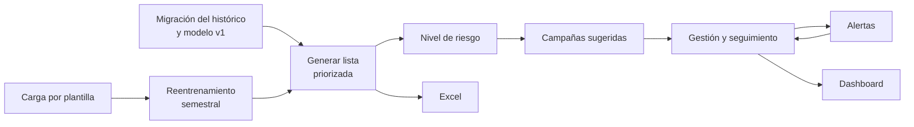

# 00 · Descripción del proyecto

**Fecha:** 29 de septiembre de 2026
**Base:** [03 · Casos de uso](03-casos-de-uso.md) (fuente de verdad del alcance) y [DEVELOPMENT_GUIDELINES.md](DEVELOPMENT_GUIDELINES.md).
Si este documento y `03` discrepan, manda `03`.

---

## 1. Qué es

**Mtabolic — apoyo a la retención** es una aplicación web local para el gimnasio Mtabolic. Toma el modelo predictivo del notebook `Notebookes/MVP.ipynb` y lo pone en uso diario: estima qué socios tienen riesgo de **no renovar** su membresía, los ordena por prioridad y ayuda al personal a actuar sobre ellos con campañas de retención y a registrar el seguimiento.

El modelo de aprendizaje automático es el componente central, pero no decide nada por sí mismo: **señala a quién conviene atender primero; el personal elige la campaña y contacta al socio.**

## 2. Problema que resuelve

Hoy la información de membresías vive en libros de Excel mensuales y el notebook produce una lista de riesgo aislada, que hay que regenerar a mano y que no deja rastro de qué se hizo con cada socio. En consecuencia:

- no hay una base acumulada del histórico ni una forma estándar de añadir datos nuevos;
- la predicción no se convierte en una acción concreta ni en un seguimiento con fecha;
- no se puede ver después qué campañas se aplicaron ni cómo terminaron;
- el modelo no se actualiza con la información nueva.

## 3. Objetivo

### Objetivo general

Convertir el prototipo predictivo en un **proceso cerrado de retención**: identificar a los socios en riesgo, priorizarlos, intervenir con una campaña, observar el resultado y aprender de la nueva información.

### Objetivos específicos

1. Migrar una sola vez el histórico de membresías 2025–2026 a una base de datos, con la misma limpieza y reglas del notebook, y entrenar con él el modelo v1.
2. Permitir la carga paulatina de nuevas membresías mediante una plantilla oficial validada.
3. Generar bajo demanda la lista priorizada de socios por vencer, con su probabilidad de no renovación y un nivel de riesgo alto, medio o bajo.
4. Sugerir campañas de retención definidas por Mtabolic según el nivel de riesgo y el tipo de plan del socio.
5. Registrar la gestión de cada socio (campaña, fecha de seguimiento y resultado) y alertar de los seguimientos vencidos o próximos.
6. Resumir la operación en un dashboard y permitir descargar la lista en Excel.
7. Reentrenar el modelo cada 6 meses, y conservar la versión nueva solo si no es peor que la vigente.

## 4. Qué hará la aplicación

| Función | Casos de uso | Descripción |
|---|---|---|
| Control de acceso | CU-00 | Sin usuarios ni contraseñas: solo responde a las IP autorizadas (por defecto, el propio PC). |
| Migración del histórico | CU-03 | En el primer arranque con la base vacía, carga los libros 2025–2026 y entrena el modelo v1 en una sola operación atómica. |
| Carga de datos nuevos | CU-01 | Subida de la plantilla oficial (máx. 500 filas) con vista previa; si una fila es inválida, no se carga nada. |
| Reentrenamiento | CU-02 | Automático cada 6 meses y por comando manual; se compara con el modelo vigente antes de reemplazarlo. |
| Lista priorizada | CU-04, CU-05 | A pedido del usuario, para una fecha dada: socios por vencer ordenados por riesgo, con nivel alto/medio/bajo por cortes de probabilidad 0,70 / 0,50 (desde M01; antes, percentiles). |
| Campañas | CU-06, CU-07 | Mtabolic define sus campañas con reglas por nivel de riesgo y plan; el sistema sugiere las compatibles para cada socio. |
| Gestión y seguimiento | CU-08, CU-10 | Un formulario para asignar campaña y fecha de seguimiento y, más tarde, registrar el resultado. Una gestión por ciclo. |
| Alertas | CU-09 | Contador de seguimientos vencidos, para hoy y para los próximos 7 días, dentro de la aplicación. |
| Dashboard | CU-11 | Embudo de gestión, tabla por campaña y estado del modelo, filtrable por mes. |
| Exportación | CU-12 | Descarga de la lista priorizada en Excel. |

### Flujo de uso

## 5. Usuarios

| Usuario | Qué hace |
|---|---|
| **Personal de Mtabolic** | Carga datos, genera y revisa la lista, gestiona campañas, registra seguimientos y consulta el dashboard desde el PC autorizado. |
| **Responsable técnico** | Instala el sistema, deja los libros históricos en su carpeta antes del primer arranque y, si hace falta, lanza el reentrenamiento manual. |

La aplicación se instala y se usa en **un solo PC** de Mtabolic con Docker Compose.

## 6. Alcance

**Entra** (entrega de una semana): los casos de uso CU-00 a CU-12, varios en versión simplificada; el detalle está en [DEVELOPMENT_GUIDELINES.md](DEVELOPMENT_GUIDELINES.md) §Alcance.

**No entra**, entre otros:

- autenticación por usuario, roles o permisos;
- integración con WhatsApp, SMS, correo, el sistema biométrico o la facturación;
- aprendizaje automático para elegir campañas, pruebas A/B o atribución causal de resultados (las cifras de campañas son descriptivas);
- aplicación móvil, notificaciones push o BI avanzado;
- cambios a la lógica del notebook (asistencias, estados `BAJA`/`CONGELAMIENTO`/`REINGRESO`).

Lista completa: [DEVELOPMENT_GUIDELINES.md](DEVELOPMENT_GUIDELINES.md) §Fuera de alcance.

## 7. Cómo está construida

| Capa | Tecnología |
|---|---|
| Backend | Python 3.12 + FastAPI, SQLAlchemy 2, Alembic, pytest |
| Base de datos | PostgreSQL 16 |
| Frontend | React + TypeScript + Vite, Vitest, Playwright |
| Despliegue | Docker Compose en un solo PC |

Ambos lados siguen una **arquitectura en capas** con dependencias hacia el dominio; el modelo de scikit-learn vive en infraestructura detrás de un puerto ([ADR-002](adr/ADR-002-ml-en-infraestructura.md)). Detalle: [backend/01-arquitectura](docs/backend/01-arquitectura.md) y [frontend/01-arquitectura](docs/frontend/01-arquitectura.md).

Reglas que el sistema respeta en todo momento: nada crítico se borra físicamente, los montos y probabilidades usan decimal, la fecha actual viene de un reloj inyectable y ningún secreto queda en el código.

## 8. Resultado esperado

Al terminar, Mtabolic podrá recorrer de punta a punta el escenario de [03 §21](03-casos-de-uso.md): arrancar con su histórico migrado, cargar el mes nuevo, generar la lista, asignar campañas a los socios de riesgo alto, recibir las alertas de seguimiento, registrar los resultados y ver el resumen en el dashboard, con un modelo que se actualiza con la información nueva.
