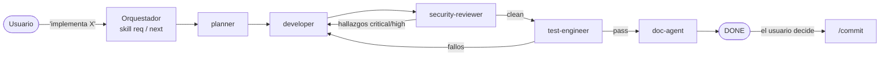
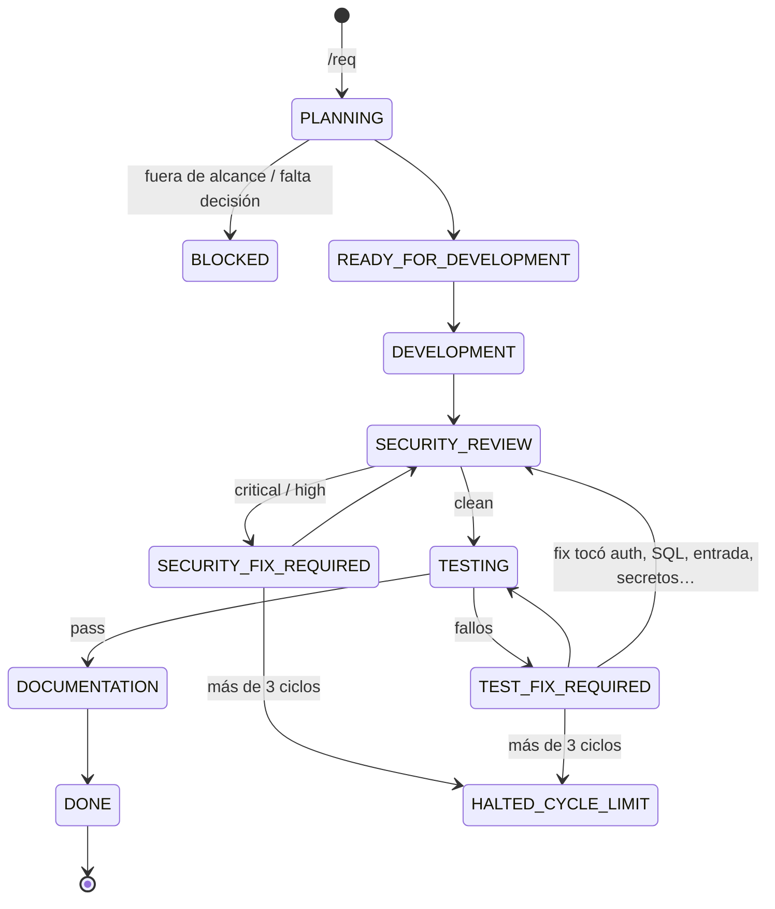

# 02 · Entorno de desarrollo asistido por IA: harness y agentes

**Fecha:** 2026-09-28

Este documento explica cómo está montado el entorno de desarrollo con Claude Code en este proyecto: qué piezas lo componen, cómo fluye un requerimiento desde que se pide hasta que se commitea, qué hace cada agente y qué controles evitan que la IA se salga del carril.

---

## 1. Idea general

El desarrollo no lo hace "un asistente que programa", sino un **harness**: una máquina de estados que reparte el trabajo entre **agentes especializados**, cada uno con permisos y responsabilidades acotadas. Ningún agente puede hacer todo:

- el que planifica no programa;
- el que programa no escribe las pruebas de aceptación ni se autoaprueba;
- el que revisa seguridad no puede editar archivos;
- el que prueba no puede tocar código de producción;
- nadie commitea salvo el usuario con `/commit`.

La separación imita un equipo real (analista → desarrollador → revisor de seguridad → QA → documentador) y convierte los controles de calidad en **pasos obligatorios** en lugar de buenas intenciones.



---

## 2. Piezas del entorno

| Pieza | Ubicación | Función |
|---|---|---|
| Instrucciones del proyecto | `.claude/CLAUDE.md` | Stack, invariantes no negociables, cuándo usar el harness y cuándo responder directo. Se carga en cada sesión. |
| Agentes | `.claude/agents/*.md` | Definición de cada subagente: herramientas permitidas, modo de permisos, límite de turnos, contrato de entrada/salida. |
| Skills (comandos) | `.claude/skills/{req,next,status,commit}/` | Los comandos `/req`, `/next`, `/status`, `/commit`. `req` y `next` actúan como orquestador. |
| Reglas por área | `.claude/rules/*.md` | Reglas de backend, frontend, base de datos, despliegue y git. Se cargan **solo** cuando se tocan archivos de esa área (campo `paths:`). |
| Configuración y permisos | `.claude/settings.json` | Listas `allow` / `ask` / `deny` de comandos y el registro de hooks. |
| Hook de commit | `.claude/hooks/guard-commit.mjs` | Bloquea `git commit` si el harness no está en un estado estable. |
| Estado del harness | `.harness/state.json` | Requerimiento activo, estado actual, contadores de ciclos, resultado de seguridad y pruebas. |
| Traspaso entre agentes | `.harness/handoff.json` | La tarea en curso: objetivo, archivos, criterios de aceptación, fuera de alcance, siguiente agente. |
| Informes temporales | `.harness/security.md`, `.harness/tests.md` | Hallazgos de seguridad y fallos de pruebas del ciclo actual. Se borran al llegar a `DONE`. |
| Board vivo | `Documentation/ACTION_PLAN.md` | Requerimientos (`R-###`) y tareas (`T#`) activas, terminadas y log de decisiones. |

---

## 3. Cómo se decide si se usa el harness

`CLAUDE.md` define la regla:

- **Pasa por el harness** (skill `req`) todo mensaje que pida un cambio en código, pruebas, base de datos o infraestructura: "implementa", "añade", "crea", "corrige", "refactoriza", "haz que", "falta", "termina". El usuario no necesita escribir `/req`; el asistente la invoca solo.
- **Se responde directo**, sin harness: preguntas sobre cómo funciona algo, exploración o resumen de código y documentación, operaciones de git o comandos puntuales, y cambios triviales sin impacto en el comportamiento (un texto, un typo).
- Ante la duda, el asistente pregunta en una línea.

---

## 4. La máquina de estados

El estado vive en `.harness/state.json`:

```json
{ "req": "R-001", "goal": "…", "state": "DEVELOPMENT",
  "cycles": { "sec": 0, "test": 0 }, "resecurity": false,
  "security": "pending", "tests": "pending", "head": null, "updated": "…" }
```



| Estado | Agente que se despacha |
|---|---|
| `PLANNING` | `planner` |
| `READY_FOR_DEVELOPMENT`, `DEVELOPMENT`, `SECURITY_FIX_REQUIRED`, `TEST_FIX_REQUIRED` | `developer` |
| `SECURITY_REVIEW` | `security-reviewer` |
| `TESTING` | `test-engineer` |
| `DOCUMENTATION` | `doc-agent` |
| `DONE`, `BLOCKED`, `HALTED_CYCLE_LIMIT` | ninguno: se detiene y decide el humano |

### Reglas del orquestador

- **Contexto mínimo:** el prompt de cada subagente es solo el contenido de `handoff.json` más una línea con el estado. No se le pasa código, documentación ni la conversación previa; cada agente lee lo que necesita.
- **Anti-bucles:** `cycles.sec` sube al entrar en `SECURITY_FIX_REQUIRED` y `cycles.test` al entrar en `TEST_FIX_REQUIRED`. Si alguno supera 3, o dos iteraciones seguidas no cambian nada, el estado pasa a `HALTED_CYCLE_LIMIT` y se escala al humano.
- **Re-seguridad:** tras corregir un hallazgo de seguridad siempre se vuelve a probar. Tras corregir un fallo de pruebas, se vuelve a revisar seguridad solo si el arreglo tocó autenticación, autorización, SQL, entrada de usuario, secretos o serialización (marca `resecurity`).
- **Árbol congelado:** antes de lanzar al revisor de seguridad o al test-engineer se guarda `git rev-parse HEAD` y `git status --short` en `state.head`. Si al recoger el resultado el árbol cambió, el resultado se descarta y el paso se repite.
- **Salida compacta:** una línea por paso (`ESTADO_ANTERIOR → ESTADO_NUEVO · agente · resultado`) y un resumen de ≤ 8 líneas al detenerse.

---

## 5. Los agentes

Cada agente se define en `.claude/agents/<nombre>.md` con un *frontmatter* que fija sus herramientas y permisos. Ninguno puede lanzar otros agentes (`disallowedTools: Agent`): solo el orquestador despacha.

| Agente | Herramientas | Permisos | Turnos máx. | Escribe en |
|---|---|---|---|---|
| `planner` | Read, Grep, Glob, Edit, Write, TodoWrite | default | 30 | `ACTION_PLAN.md`, `handoff.json` |
| `developer` | Read, Edit, Write, Grep, Glob, Bash, TodoWrite | acceptEdits | 60 | Código de producción (y sus pruebas TDD) |
| `security-reviewer` | Read, Grep, Glob, Bash | default | 25 | Nada: solo lectura por construcción |
| `test-engineer` | Read, Edit, Write, Grep, Glob, Bash | acceptEdits | 40 | Solo archivos de prueba y `.harness/tests.md` |
| `doc-agent` | Read, Edit, Write, Grep, Glob | acceptEdits | 25 | Documentación afectada y `ACTION_PLAN.md` |
| `doc-curator` | Read, Edit, Write, Grep, Glob, TodoWrite | default | 40 | `Documentation/**` (fuera del ciclo automático) |

### 5.1 planner — planifica, no programa

- Lee `ACTION_PLAN.md`, el producto activo y solo los documentos técnicos que va a citar.
- Si el requerimiento cae fuera del alcance de la versión, devuelve `BLOCKED`.
- Parte el requerimiento en tareas `T1..Tn`. Cada tarea toca **≤ 4 archivos** con uno principal, indica su capa (`domain`, `application`, `infra`, `api`, `frontend`, `db`, `infra-deploy`), el documento que el developer debe leer, criterios de aceptación **verificables** (entrada → resultado, con código HTTP cuando aplica) y las pruebas necesarias.
- Añade dependencias y hasta 3 riesgos concretos.
- Convierte las invariantes del proyecto (aislamiento por propietario, transacciones, borrado lógico…) en criterios de aceptación explícitos.
- Deja en `handoff.json` la primera tarea ejecutable.

### 5.2 developer — el único que escribe código de producción

- Lee solo la regla del área que toca (`backend.md`, `frontend.md`, `database.md` o `deploy.md`), la sección citada del documento técnico y los archivos de la tarea.
- Trabaja con **TDD**: para lógica de dominio o casos de uso, primero la prueba que falla.
- Implementa el mínimo que cumple los criterios y respeta la dirección de capas.
- Verifica el build: en backend `ruff check`, `ruff format --check`, `mypy app` y `lint-imports`; en frontend `npm run build` y `npm run lint`.
- En un ciclo de corrección trabaja **solo** sobre los hallazgos abiertos (`open[]`) y justifica cada cierre.
- Prohibido: commitear, modificar pruebas para que pasen, cambiar los criterios, implementar cosas no pedidas, dejar secretos.

### 5.3 security-reviewer — audita, no arregla

- No tiene `Edit` ni `Write`: es de solo lectura por construcción. El orquestador copia sus hallazgos a `.harness/security.md`.
- Revisa **solo el diff de la tarea**. Lo que vea fuera se anota como tarea futura.
- Checklist por prioridad: aislamiento entre usuarios, violaciones de capas, integridad de datos (transacciones, borrado lógico, `Decimal`), entrada (SQL parametrizado, validación Pydantic, `eval`/`pickle`), secretos y exposición en logs o errores, sesión y transporte (cookies, CORS, JWT, rate limiting) y frontend (token en memoria, XSS, variables `VITE_*`).
- Severidades: `critical`, `high`, `medium`, `low`. **Solo `critical` y `high` bloquean.**
- No inventa hallazgos teóricos; si reabre dos veces lo mismo, lo marca `disputed` y escala al humano.

### 5.4 test-engineer — prueba, no arregla

- Garantiza que **cada** criterio de aceptación tiene al menos una prueba con nombre explícito, más camino feliz, casos límite y caso de error.
- Ejecuta `pytest` (backend), `npm test` / Vitest (frontend) y Playwright solo para flujos críticos completos.
- Casos obligatorios cuando aplican: un usuario no accede a datos de otro, sin estado inconsistente ante fallos a mitad de operación, concurrencia y valores de frontera.
- Integración contra PostgreSQL real en contenedor, nunca SQLite ni memoria.
- Regla innegociable: **no toca código de producción ni debilita pruebas** (nada de `skip`, `xfail` ni aserciones relajadas). Si el código está mal, la salida es un fallo que vuelve al developer.

### 5.5 doc-agent — documenta lo que cambió

- Solo se ejecuta si `security == "clean"` y `tests == "pass"`.
- Actualiza únicamente los documentos afectados según un mapa de impacto (contrato de API, esquema de BD, arquitectura, autenticación, README, despliegue…) y solo la sección necesaria.
- Marca las tareas cerradas en `ACTION_PLAN.md` y añade decisiones al log.
- Crea un ADR solo si hay un cambio de librería, contrato de API, modelo de datos o autenticación, o una desviación de lo documentado.
- Respeta la jerarquía de fuentes de verdad: nunca corrige un documento de mayor rango para acomodar la implementación.

### 5.6 doc-curator — fuera del ciclo

No lo despacha el orquestador. Lo invoca el usuario para reorganizar la documentación: detectar duplicados, inconsistencias entre `ACTION_PLAN.md` y los productos, mala estructura o ADRs mal referenciados. No tiene `Bash`, no toca código y no cambia el avance real de las tareas.

---

## 6. Comandos disponibles

| Comando | Quién lo lanza | Qué hace |
|---|---|---|
| `/req <descripción>` | Usuario o el asistente automáticamente | Abre un requerimiento `R-###`, lanza al planner y ejecuta el ciclo completo hasta `DONE`, `BLOCKED` o `HALTED_CYCLE_LIMIT`. Si hay otro requerimiento en curso, se detiene y avisa. Con "solo planifica" se para tras el plan. |
| `/next [all]` | Orquestador o usuario | Avanza un paso (o todos con `all`). Sirve para retomar un requerimiento a medias. |
| `/status` | Solo el usuario | Tabla compacta del estado actual, leyendo solo `.harness/`. Pensado para costar menos de 1000 tokens. |
| `/commit` | **Solo el usuario** | Verifica precondiciones, revisa el diff buscando secretos y commitea con formato `tipo(scope): descripción (R-###/T#)`, primero en cada submódulo y luego en el superproyecto. Rama `dev`; aborta en `main`. Nunca hace push sin pedirlo. |

---

## 7. Controles y barreras

El entorno combina tres niveles de control:

1. **Instrucciones** (lo que se le pide al modelo): `CLAUDE.md`, contratos de cada agente, reglas por área.
2. **Permisos por construcción** (lo que el modelo *no puede* hacer aunque quiera):
   - herramientas por agente (el revisor de seguridad no puede escribir; el doc-agent no tiene `Bash`);
   - `settings.json`:
     - **deny**: leer `.env`, `.pem`, `.pfx`; editar `Documentation/Plan/**`; `git push --force`; `rm -rf`;
     - **ask** (pide confirmación): `git push`, `git reset --hard`, `git checkout`, `psql`, `dropdb`, `alembic upgrade/downgrade`, `pip install`, `npm install`, `docker compose down -v`;
     - **allow**: lint, tipos, pruebas, build, `git status/diff/log`, `alembic revision/history/current`, `docker compose up/ps/logs`.
3. **Hook `guard-commit.mjs`** (verificación automática antes de cada `git commit`):
   - deniega `--no-verify`;
   - si hay requerimiento activo, solo permite commitear en `DOCUMENTATION` o `DONE`;
   - deniega si `security == "blocked"` o `tests != "pass"`;
   - si no hay estado de harness, o el requerimiento terminó en `BLOCKED`/`HALTED_CYCLE_LIMIT`, deja pasar (decide el humano).

### Invariantes del proyecto

Todos los agentes trabajan contra las mismas reglas no negociables de `CLAUDE.md`: el propietario del dato sale del token y filtra toda consulta; escrituras relacionadas en una misma transacción; borrado lógico (`deleted_at`); `Decimal` para valores exactos; reloj inyectable; ningún secreto en código, configuración versionada ni logs; nada fuera del alcance de la versión.

---

## 8. Gestión del contexto

El entorno está diseñado para gastar pocos tokens y evitar que el modelo se pierda:

- Cada agente arranca "en frío" con solo el handoff y lee lo mínimo necesario.
- Las reglas por área se cargan solo al tocar archivos de esa área.
- `ACTION_PLAN.md` es un board corto; el detalle va por producto.
- `Documentation/Plan/**` es material humano de referencia que no se abre sin pedirlo.
- Un requerimiento = una sesión; al terminar se recomienda `/clear`.
- Los informes de seguridad y pruebas son temporales y se borran en `DONE`; en el board queda una sola línea.

---

## 9. Ejemplo de recorrido

Estado actual del proyecto: `R-001` (scaffold de Backend + Frontend con Docker, PostgreSQL 16 y un endpoint `health` de extremo a extremo con TDD) está en `DEVELOPMENT`, tarea `T1` (esqueleto y tooling del backend).

1. El usuario escribe *"crea el scaffold del backend y frontend…"* → el asistente invoca `req`.
2. `req` crea `state.json` en `PLANNING` y lanza al **planner**, que escribe `R-001` con sus tareas en `ACTION_PLAN.md` y deja `T1` en `handoff.json`.
3. `next` despacha al **developer** con `T1`: crea `pyproject.toml`, los paquetes de las 4 capas y los contratos de `import-linter`, y verifica que `ruff`, `mypy` y `lint-imports` pasan.
4. **security-reviewer** revisa el diff. Si encuentra algo `high` → `SECURITY_FIX_REQUIRED` → vuelve al developer.
5. **test-engineer** comprueba cada criterio (p. ej. que un import prohibido `domain → infrastructure` hace fallar `lint-imports`).
6. **doc-agent** actualiza la documentación afectada y marca `T1` en el board.
7. Se repite con `T2…Tn` hasta `DONE`; el asistente sugiere `/commit` y el usuario decide.

---

## 10. Puntos pendientes del entorno

Al revisar la configuración se detectaron huecos que conviene cerrar:

- **`HARNESS.md` no existe.** Las skills `req` y `next` y el hook lo citan (§1 tabla de transición, §2 anti-bucles, §3.x contratos, §7 commits, §8 checklist de `DONE`). Hoy el flujo se sostiene con lo que está en las skills y los agentes, pero falta el documento de referencia.
- **Marcadores de plantilla sin rellenar:** `{{PROYECTO}}`, `{{DESCRIPCION_UNA_LINEA}}` e `{{INVARIANTE_PROPIA_DEL_DOMINIO}}` en `CLAUDE.md` y los agentes.
- **Rutas de documentación inexistentes:** el doc-agent y el planner apuntan a `Documentation/docs/**`, `Documentation/products/P##-*.md`, `Documentation/adr/` y `Documentation/DEVELOPMENT_GUIDELINES.md`, que aún no existen. En particular, sin `DEVELOPMENT_GUIDELINES.md` el planner no puede verificar el "fuera de alcance".
- **Git no inicializado:** el superproyecto no es aún un repositorio git, y el flujo depende de `git diff` y `git rev-parse` (revisor de seguridad, árbol congelado, `/commit`).
