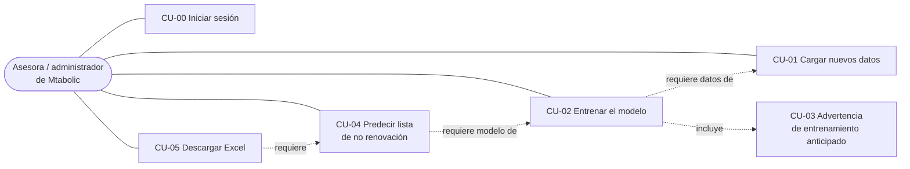

# 03 · Casos de uso de la aplicación

**Fecha:** 28 de septiembre de 2026
**Base:** [01 · Análisis: del notebook MVP a una aplicación web](01-analisis-mvp-a-app-web.md) y `plantillas/Plantilla_Carga_Datos_Mtabolic.xlsx`
**Estado:** propuesta para validar; no se ha escrito código.

---

## 1. Resumen

La aplicación tiene cinco casos de uso funcionales y uno de soporte (el acceso):

| ID | Caso de uso | Resultado para el usuario |
|---|---|---|
| CU-00 | Iniciar sesión | Accede a la aplicación; nadie sin credenciales ve datos. |
| CU-01 | Cargar nuevos datos | Las membresías de la plantilla quedan guardadas y validadas. |
| CU-02 | Entrenar (reentrenar) el modelo | Queda un modelo vigente entrenado con todo el historial guardado. |
| CU-03 | Advertir entrenamiento anticipado | Si el último entrenamiento tiene menos de 6 meses, se avisa; el usuario decide si continúa. |
| CU-04 | Predecir la lista de no renovación | Lista de socios cuya membresía vence pronto, ordenada por riesgo. |
| CU-05 | Descargar el Excel de no renovaciones | Archivo `.xlsx` con la lista para contactar a los socios. |



**Orden normal de uso**

1. Primera vez: cargar el historial → entrenar → predecir → descargar.
2. Cada mes: cargar las membresías nuevas → predecir → descargar.
3. Cada 6 meses (o antes, aceptando la advertencia): reentrenar.

### Cambio respecto al análisis 01

El análisis 01 proponía **reentrenar en cada carga** y **no guardar nada** (P-06 y P-12). Los casos de uso piden otra cosa:

- el entrenamiento es una acción separada que se recomienda cada 6 meses, así que el **modelo se guarda** y se reutiliza entre predicciones;
- "cargar nuevos datos" y "reentrenar" implican que **los datos se acumulan**: el modelo se entrena con todo lo cargado hasta la fecha, no solo con el último archivo.

Las consecuencias están en la sección 9.

---

## 2. Actores

| Actor | Descripción |
|---|---|
| **Asesora / administrador** | Persona de Mtabolic que carga los datos, entrena el modelo y usa la lista para contactar a los socios. Según P-08, puede ser una sola persona o varias. |
| **Reloj del sistema** | Proporciona la fecha actual. Es una abstracción inyectable (invariante del proyecto), necesaria para calcular los 6 meses de CU-03 y poder probarlo. |

---

## 3. CU-00 · Iniciar sesión

| | |
|---|---|
| **Objetivo** | Impedir el acceso a los datos personales de los socios a quien no esté autorizado (análisis 01 §4, requisito 1). |
| **Actor** | Asesora / administrador |
| **Precondición** | El usuario tiene una cuenta creada. |
| **Flujo principal** | 1. El usuario introduce usuario y contraseña. 2. El sistema valida las credenciales. 3. El sistema abre la sesión y muestra la pantalla principal con el estado del modelo y de los datos. |
| **Excepciones** | Credenciales incorrectas → mensaje genérico ("usuario o contraseña incorrectos"), sin decir cuál falló. Demasiados intentos → bloqueo temporal. |
| **Postcondición** | Toda acción posterior se registra con el usuario de la sesión. |
| **Reglas** | Ninguna pantalla ni endpoint de CU-01 a CU-05 es accesible sin sesión. El usuario se identifica por el token, nunca por un dato enviado en el formulario. |

**Pantalla principal (resumen de estado):** última carga (fecha y n.º de registros), modelo vigente (fecha de entrenamiento y próxima fecha recomendada) y última lista generada.

---

## 4. CU-01 · Cargar nuevos datos

| | |
|---|---|
| **Objetivo** | Incorporar al sistema las membresías vendidas o renovadas, con el formato de la plantilla oficial. |
| **Actor** | Asesora / administrador |
| **Precondición** | Sesión iniciada. El archivo sigue la plantilla `Plantilla_Carga_Datos_Mtabolic.xlsx`. |
| **Disparador** | El usuario pulsa "Cargar datos" y selecciona un `.xlsx`. |

### Formato de entrada

Viene de la plantilla oficial, que resuelve P-01 con un formato nuevo: **una sola hoja `Registros`, una fila por membresía**, sin hojas mensuales.

| Col. | Campo | Obligatorio | Validación |
|---|---|---|---|
| A | Estado del registro | No | Catálogo: `NUEVO`, `RENOVACION`, `CONGELAMIENTO`, `REINGRESO`, `BAJA` |
| B | Nombres y apellidos | **Sí** | No vacío |
| C | Cédula | **Sí** | 10 dígitos |
| D | Celular | No | — |
| E | Correo | No | — |
| F | Tipo de plan | **Sí** | Catálogo: `MENSUAL`, `TRIMESTRAL`, `SEMESTRAL`, `ANUAL`, `DIARIO`, `OTRO` |
| G | Fecha de inicio | **Sí** | Fecha ≥ 2024-01-01 |
| H | Fecha de vencimiento | **Sí** | Fecha posterior al inicio |
| I | Forma de pago | **Sí** | Catálogo: `EFECTIVO`, `TRANSFERENCIA`, `TARJETA_DATAFAST`, `OTRO` |
| J | N.º de transacción | No | — |
| K | Monto a facturar (USD) | No | Decimal ≥ 0 |
| L | Monto cobrado (USD) | **Sí** | Decimal ≥ 0 |
| M | Asistencias en el período | No | Entero ≥ 0 |
| N | Observaciones | No | Texto libre |
| O | Duración (días) | Calculada | `H − G`; ≥ 21 salvo `DIARIO`, ≤ 400 |
| P | Revisión automática | Calculada | Se ignora: el servidor repite todas las validaciones por su cuenta. |

### Flujo principal

1. El usuario selecciona el archivo.
2. El sistema comprueba que es un `.xlsx` válido, que existe la hoja `Registros` y que los títulos de columna coinciden **exactamente** con la plantilla.
3. El sistema valida cada fila con las reglas de la tabla (las mismas que aplica la columna "Revisión automática" de la plantilla).
4. El sistema muestra una **vista previa**: filas leídas, filas válidas, filas con error (n.º de fila y motivo), filas duplicadas ya existentes y rango de fechas de vencimiento.
5. El usuario confirma la carga.
6. El sistema guarda las filas válidas en **una sola transacción** y registra la carga (fecha, usuario, archivo, conteos).
7. El sistema muestra el resultado y, si el modelo vigente se entrenó antes de esta carga, un aviso informativo: "Hay datos nuevos desde el último entrenamiento".

### Flujos alternativos y excepciones

| Caso | Comportamiento |
|---|---|
| El archivo no es `.xlsx`, está dañado o supera el tamaño máximo | Se rechaza completo con un mensaje claro. No se guarda nada. |
| Falta la hoja `Registros` o hay títulos cambiados | Se rechaza completo indicando qué columna falta o cuál no coincide. |
| Hay filas con errores | Se listan con n.º de fila y motivo (p. ej. "Fila 14: la cédula debe tener 10 dígitos"). El usuario puede cargar solo las válidas o cancelar y corregir el archivo. |
| Todas las filas tienen error o el archivo está vacío | No se permite confirmar. |
| Una fila ya existe (misma cédula, fecha de inicio y tipo de plan) | Se marca como duplicada y no se vuelve a insertar. |
| El usuario cancela en la vista previa | No se guarda nada. |
| Fallo a mitad del guardado | Se revierte toda la carga; no quedan registros a medias. |

### Postcondiciones

- Las membresías válidas quedan guardadas y disponibles para CU-02 y CU-04.
- El archivo subido **no** se guarda en disco: se procesa en memoria y se descarta.

### Reglas de negocio

- **RN-01.1** Los montos se guardan como decimales exactos, nunca como coma flotante.
- **RN-01.2** Los registros `DIARIO` se guardan pero no entran en el entrenamiento ni en las listas (plantilla, hoja Catálogos).
- **RN-01.3** Una carga no se borra físicamente; si se necesita deshacer, se anula (borrado lógico) y sus registros dejan de usarse.
- **RN-01.4** Ningún dato personal (nombre, cédula, celular, correo) se escribe en los logs.

### Criterios de aceptación

- Un archivo con la plantilla correcta y todas las filas en "OK" se carga completo y el conteo coincide con las filas del archivo.
- Una fila con cédula de 9 dígitos aparece en la vista previa como error con su número de fila y no se guarda.
- Cargar dos veces el mismo archivo no duplica registros.
- Un archivo con la columna "TIPO DE PLAN" renombrada se rechaza sin guardar nada.

### Preguntas abiertas

- **CU01-Q1 · Historial inicial.** El modelo necesita el historial de 2025–2026, que hoy está en los libros `Control Gym 2025` y `Control Gym 2026` con hojas mensuales. ¿Se pasa una única vez a la plantilla (con un script de migración a partir de las secciones 3–4 del notebook) o la aplicación acepta también el formato antiguo? Recomendación: script de migración único, fuera de la aplicación.
- **CU01-Q2 · Nuevos estados.** `CONGELAMIENTO`, `REINGRESO` y `BAJA` no existían en el notebook. Hay que decidir cómo afectan a la etiqueta `no_renovo`: por ejemplo, que un congelamiento no cuente como abandono.
- **CU01-Q3 · Carga parcial.** ¿Se permite cargar solo las filas válidas o se exige que todo el archivo esté correcto? Recomendación: permitir la carga parcial con la lista de errores visible.

---

## 5. CU-02 · Entrenar (reentrenar) el modelo

| | |
|---|---|
| **Objetivo** | Obtener un modelo de riesgo de no renovación actualizado con todo el historial guardado. |
| **Actor** | Asesora / administrador |
| **Precondición** | Sesión iniciada. Hay datos cargados con suficientes ciclos evaluables (ver excepciones). |
| **Disparador** | El usuario pulsa "Entrenar modelo". |

### Flujo principal

1. El usuario pulsa "Entrenar modelo".
2. **Se incluye CU-03**: si existe un modelo vigente con menos de 6 meses, se muestra la advertencia y el usuario decide si continúa.
3. El sistema reconstruye los ciclos de membresía con todos los registros vigentes (no anulados), usando la cadena del notebook:
   - estandarización (secciones 4.1–4.6);
   - fecha de corte, estado del ciclo y etiqueta `no_renovo` en la ventana T a T+30 (secciones 5.1, 5.3–5.5);
   - variables del modelo: historial previo en T−30 e imputación de monto y duración (secciones 7.2–7.4).
4. El sistema entrena el Random Forest con los parámetros fijos del notebook: 300 árboles, profundidad 6, `min_samples_leaf=20`.
5. El sistema guarda el modelo como **nueva versión** con sus metadatos: fecha y hora de entrenamiento, usuario, n.º de ciclos evaluables, porcentaje de no renovación, rango de fechas de los datos, versiones de Python y scikit-learn, y si se entrenó aceptando la advertencia de CU-03.
6. La nueva versión pasa a ser el **modelo vigente**; la anterior queda como histórica.
7. El sistema muestra el resumen del entrenamiento y la **próxima fecha recomendada** (fecha de entrenamiento + 6 meses).

### Flujos alternativos y excepciones

| Caso | Comportamiento |
|---|---|
| No hay datos cargados | El botón está deshabilitado con el mensaje "Carga datos antes de entrenar". |
| Muy pocos ciclos evaluables (por debajo de un mínimo configurable) | No se entrena; se indica cuántos hay y cuántos hacen falta. |
| Todos los ciclos tienen la misma etiqueta (nadie renovó o todos renovaron) | No se entrena; el modelo no puede aprender sin ambas clases. |
| El usuario cancela en la advertencia de CU-03 | No se entrena; el modelo vigente no cambia. |
| Error durante el entrenamiento | El modelo vigente no cambia; se muestra un mensaje sin detalles técnicos. |
| Otro entrenamiento ya está en curso | Se rechaza el segundo hasta que termine el primero. |

### Postcondiciones

- Existe un modelo vigente y su fecha de entrenamiento queda registrada para CU-03.
- Las versiones anteriores se conservan (no hay borrado físico).

### Reglas de negocio

- **RN-02.1** El algoritmo y sus parámetros son fijos; la aplicación no compara modelos ni los valida (análisis 01 §3.2).
- **RN-02.2** Solo hay un modelo vigente a la vez.
- **RN-02.3** El archivo del modelo lo genera y lo lee solo el sistema; nunca se acepta un modelo subido por el usuario (cargar un `.joblib` equivale a ejecutar código).
- **RN-02.4** Si la versión de scikit-learn del servidor no coincide con la del modelo guardado, se exige reentrenar antes de predecir (riesgo señalado en el análisis 01 §3.2).

### Criterios de aceptación

- Con el historial 2025–2026 del notebook, el entrenamiento termina en segundos y deja un modelo vigente con su fecha.
- Tras entrenar, CU-04 usa el modelo nuevo y no el anterior.
- Si el entrenamiento falla, el modelo vigente sigue siendo el mismo.

---

## 6. CU-03 · Advertencia de entrenamiento anticipado

| | |
|---|---|
| **Objetivo** | Recomendar reentrenar cada 6 meses sin impedir hacerlo antes. |
| **Actor** | Asesora / administrador (a través de CU-02) y reloj del sistema |
| **Tipo** | Caso incluido en CU-02. **No bloqueante.** |

### Regla

```
próxima_fecha_recomendada = fecha_entrenamiento_modelo_vigente + 6 meses (calendario)
si hoy < próxima_fecha_recomendada  →  mostrar advertencia
```

`hoy` sale del reloj inyectable, no de la fecha del sistema directamente, para poder probar la regla con fechas fijas.

### Flujo principal

1. El usuario pulsa "Entrenar modelo" (CU-02).
2. El sistema consulta la fecha de entrenamiento del modelo vigente.
3. Si todavía no han pasado 6 meses, muestra:
   > **Se recomienda reentrenar el modelo cada 6 meses.** El modelo vigente se entrenó el 15/03/2026 (hace 4 meses). La próxima fecha recomendada es el 15/09/2026. ¿Deseas entrenar de todas formas?
   > [Cancelar] [Entrenar de todas formas]
4. Si el usuario elige "Entrenar de todas formas", CU-02 continúa y el modelo nuevo queda marcado como `entrenado_con_advertencia = true`.
5. Si elige "Cancelar", no ocurre nada.

### Flujos alternativos

| Caso | Comportamiento |
|---|---|
| No hay modelo vigente (primer entrenamiento) | No hay advertencia. |
| Han pasado 6 meses o más | No hay advertencia; se entrena directamente. |
| El modelo tiene más de 6 meses (aviso en pantalla principal y en CU-04) | Se muestra un recordatorio, también no bloqueante: "El modelo tiene más de 6 meses. Se recomienda reentrenarlo". |

### Criterios de aceptación

- Con el reloj fijado a 5 meses y 29 días después del último entrenamiento, aparece la advertencia y se puede entrenar de todas formas.
- Con el reloj fijado a 6 meses exactos después, no aparece.
- Sin modelo previo, no aparece.
- Cancelar no crea ninguna versión de modelo.

### Decisión de diseño

"6 meses" se cuenta en **meses de calendario** (15/03 → 15/09), no como 180 días, porque es como lo entiende el usuario. El backend no bloquea: la API de entrenamiento pide una confirmación explícita cuando el entrenamiento es anticipado, para que la advertencia no se pueda saltar sin verla.

---

## 7. CU-04 · Predecir la lista de no renovación

| | |
|---|---|
| **Objetivo** | Obtener la lista priorizada de socios cuya membresía vence pronto y que tienen riesgo de no renovar. |
| **Actor** | Asesora / administrador |
| **Precondición** | Sesión iniciada. Existe un modelo vigente (CU-02). Hay datos cargados que cubren la fecha de generación. |
| **Disparador** | El usuario pulsa "Generar lista". |

### Parámetros

| Parámetro | Valor por defecto | Origen |
|---|---|---|
| Fecha de generación (T) | Último día del último mes cargado | P-04; el usuario puede cambiarla |
| Horizonte | 30 días | P-05 |
| Top K | 25 socios | P-05 |

### Flujo principal

1. El usuario revisa o ajusta los parámetros y pulsa "Generar lista".
2. El sistema selecciona la **cartera a vencer**: membresías cuyo vencimiento cae entre T y T + horizonte (notebook §13.2).
3. Excluye a quienes **ya renovaron** (notebook §13.3) y los planes `DIARIO`.
4. Calcula las variables de cada socio con el mismo proceso que en el entrenamiento.
5. Aplica el modelo vigente: probabilidad de no renovación, nivel de riesgo y factores principales (notebook §13.8).
6. Ordena la lista por probabilidad, de mayor a menor.
7. Muestra:
   - **resumen de la cartera**: membresías que vencen, ya renovadas, socios a priorizar, fecha del modelo usado;
   - **tabla** ordenada por prioridad, destacando el Top K.
8. El sistema guarda la lista generada con sus parámetros y la versión del modelo usada, para poder descargarla (CU-05) y saber después con qué se generó.

### Flujos alternativos y excepciones

| Caso | Comportamiento |
|---|---|
| No hay modelo vigente | El botón está deshabilitado con el mensaje "Entrena el modelo antes de generar la lista". |
| El modelo tiene más de 6 meses | Se genera la lista con el recordatorio no bloqueante de CU-03. |
| Hay datos cargados después del último entrenamiento | Se genera la lista con un aviso informativo; no hace falta reentrenar para predecir. |
| Nadie vence en el horizonte elegido | Se informa "No hay membresías que venzan entre T y T+30"; no se genera lista vacía para descargar. |
| La fecha de generación está fuera del rango de datos cargados | Se avisa y se pide otra fecha. |
| Versión de scikit-learn distinta a la del modelo (RN-02.4) | No se predice; se pide reentrenar. |

### Reglas de negocio

- **RN-04.1** La lista se presenta **por orden de prioridad**. El nivel (ALTO/MEDIO/BAJO) es secundario, porque las probabilidades salen desplazadas hacia abajo y casi nadie aparece como "ALTO" (análisis 01 §6).
- **RN-04.2** La variable `mes_vencimiento` no aporta al predecir meses que no estaban en el entrenamiento (análisis 01 §3.5). Se mantiene igual que en el notebook (P-10).
- **RN-04.3** La lista usa siempre el modelo vigente en el momento de generarla.

### Criterios de aceptación

- Con los datos y la fecha del notebook, la lista coincide con la de la sección 13.8 (mismos socios y mismo orden, salvo diferencias de versión de librerías).
- Ningún socio que ya renovó aparece en la lista.
- Ningún registro `DIARIO` aparece en la lista.
- Cambiar el Top K a 10 destaca 10 socios sin cambiar el orden.

---

## 8. CU-05 · Descargar el Excel de no renovaciones

| | |
|---|---|
| **Objetivo** | Entregar a la asesora un archivo con los socios a contactar. |
| **Actor** | Asesora / administrador |
| **Precondición** | Sesión iniciada. Existe una lista generada (CU-04). |
| **Disparador** | El usuario pulsa "Descargar Excel" sobre una lista generada. |

### Contenido del archivo

Basado en la exportación del notebook (§14.1):

| Hoja | Contenido |
|---|---|
| `top_25` (o `top_K`) | Los K socios con mayor probabilidad, con datos de contacto. |
| `cartera_completa` | Todos los socios de la cartera a vencer, ordenados por prioridad. |
| `resumen` | Fecha de generación, horizonte, Top K, fecha y versión del modelo, conteos de la cartera. |

Columnas propuestas por socio (pendientes de validar con la asesora, P-11): prioridad, nombre, celular, correo, tipo de plan, fecha de vencimiento, monto cobrado, probabilidad de no renovación, nivel de riesgo y factores principales.

### Flujo principal

1. El usuario pulsa "Descargar Excel".
2. El sistema genera el `.xlsx` **en memoria** a partir de la lista guardada en CU-04 (no vuelve a predecir).
3. El navegador descarga `no_renovaciones_AAAA-MM-DD.xlsx` (fecha de generación de la lista).
4. El sistema registra la descarga (usuario, fecha y lista), sin datos personales en el registro.

### Excepciones

| Caso | Comportamiento |
|---|---|
| No existe lista generada | El botón no aparece o está deshabilitado. |
| La lista pertenece a una versión de modelo ya reemplazada | Se descarga igual; la hoja `resumen` indica con qué modelo se generó. |
| Error al generar el archivo | Mensaje genérico; no se entrega un archivo incompleto. |

### Reglas de negocio

- **RN-05.1** El archivo no se guarda en el disco del servidor.
- **RN-05.2** Los textos que vienen de los datos (nombres, observaciones) se neutralizan si empiezan por `=`, `+`, `-` o `@`, para evitar la inyección de fórmulas al abrir el Excel.
- **RN-05.3** Los montos se exportan como números con dos decimales, no como texto.
- **RN-05.4** Si se decide no exportar contactos (P-02), el nombre se sustituye por el código anónimo `MTB-XXXXXXXX`.

### Criterios de aceptación

- El archivo se abre en Excel con las tres hojas y el mismo orden que la tabla en pantalla.
- Un nombre cargado como `=HYPERLINK(...)` aparece como texto en el Excel descargado, no como fórmula.
- La hoja `resumen` indica la fecha de generación y la fecha del modelo.

---

## 9. Impacto en el análisis 01 y decisiones pendientes

| Punto del análisis 01 | Qué cambia con estos casos de uso |
|---|---|
| **P-01** Formato de entrada | **Resuelto por la plantilla oficial:** una hoja `Registros` con una fila por membresía. Queda abierta la migración del historial (CU01-Q1). |
| **P-06** Reentrenar en cada carga | **Cambia:** el entrenamiento es una acción aparte, con recomendación semestral (CU-02, CU-03). El modelo se guarda y reaparece el riesgo de incompatibilidad de versiones del `.joblib`; se mitiga con RN-02.4. |
| **P-07** Tecnología | El requerimiento R-001 del `ACTION_PLAN.md` ya monta FastAPI + React + PostgreSQL, lo que es coherente con guardar datos y modelos. |
| **P-12** Historial | **Cambia:** hay que guardar las membresías cargadas, las versiones del modelo y las listas generadas. |
| **§4** Privacidad ("solo en memoria") | **Cambia:** los datos personales quedan guardados en la base de datos. Hace falta la autorización de Mtabolic según la LOPDP, acceso restringido (CU-00), cifrado del disco o de la base, copias de seguridad protegidas y una política de retención (cuánto tiempo se guardan los datos de socios). Los archivos subidos y los Excel generados siguen sin guardarse. |
| **§2** Estandarización (forma de pago) | El notebook usaba 5 categorías; la plantilla tiene 4 (`EFECTIVO`, `TRANSFERENCIA`, `TARJETA_DATAFAST`, `OTRO`). El código de estandarización debe adaptarse a la plantilla. |
| **P-09** Indicadores | Se añaden avisos baratos: datos nuevos sin entrenar, modelo de más de 6 meses, filas rechazadas en la carga. |

### Decisiones que hay que tomar antes de implementar

1. Migración del historial al formato de la plantilla (CU01-Q1).
2. Efecto de `CONGELAMIENTO`, `REINGRESO` y `BAJA` en la etiqueta y en la lista (CU01-Q2).
3. Carga parcial o todo-o-nada (CU01-Q3).
4. Mínimo de ciclos evaluables para permitir entrenar (CU-02).
5. Columnas y orden del Excel (P-11) y si incluye contactos (P-02).
6. Dónde se despliega, ahora que se guardan datos personales (P-03), y quiénes son los usuarios (P-08).
7. Política de retención de datos de socios y de listas generadas.

---

## 10. Trazabilidad con el notebook

| Caso de uso | Secciones de `MVP.ipynb` reutilizadas |
|---|---|
| CU-01 Cargar datos | 3.1–3.7 (lectura; se adapta a la plantilla), 4.1–4.6 (estandarización) |
| CU-02 Entrenar | 5.1, 5.3–5.5 (etiqueta), 7.2–7.4 (variables), 13.8 (reentrenamiento del Random Forest) |
| CU-03 Advertencia | Nuevo; no existe en el notebook |
| CU-04 Predecir | 13.2 (cartera a vencer), 13.3 (exclusión de renovados), 13.8 (probabilidad, nivel y factores) |
| CU-05 Descargar Excel | 14.1 (parcial: hojas `top_25`, `cartera_completa`, `resumen`) |
