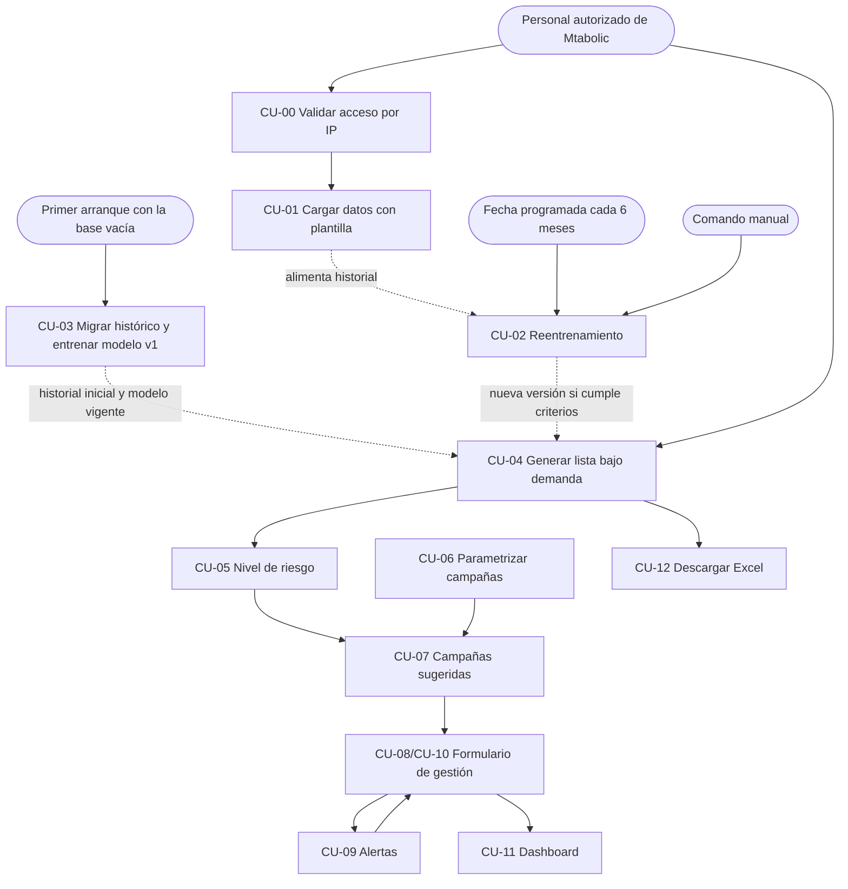
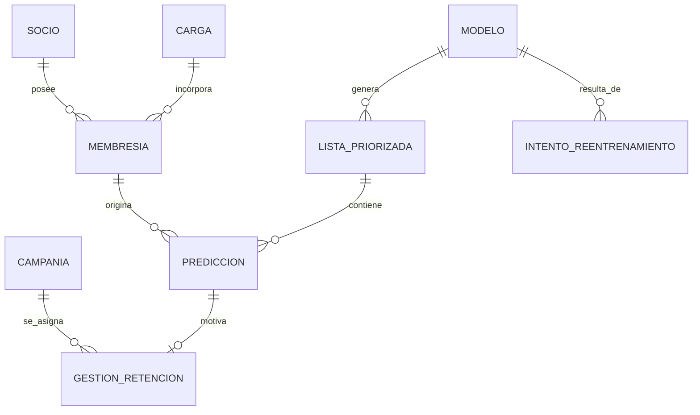

# 03 · Casos de uso del sistema de apoyo a la retención

**Fecha:** 28 de septiembre de 2026 · **Versión 4**: decisiones D-01 a D-18 confirmadas por el usuario (ver `04` §2)  
**Base:** `Notebookes/MVP.ipynb`, [01 · Análisis](01-analisis-mvp-a-app-web.md), plantilla `plantillas/Plantilla_Carga_Datos_Mtabolic.xlsx` y las decisiones adoptadas en [04 · Pendientes](04-pendientes-para-iniciar-desarrollo.md).  
**Datos históricos:** `plantillas/Control Gym 2025 (1).xlsx` y `plantillas/Control Gym 2026 (2).xlsx`.  
**Estado:** alcance funcional para implementar. Los doce casos de uso entran en la entrega, varios en versión simplificada. Lo que se dejó fuera está en §20.

| Versión | Cambio |
|---|---|
| 1 | Casos de uso CU-00 a CU-12 (sin CU-03). |
| 2 | Se añade CU-03 · Migración única del histórico; la carga paulatina se hace solo por plantilla. |
| 3 | Alcance ajustado a una semana: se simplifican CU-00, CU-01, CU-02 y CU-06 a CU-11, y se adoptan como decisión las recomendaciones D-01 a D-18 de `04`. |
| 4 | El usuario confirma las decisiones: el sistema funciona en **un solo PC**; la migración del histórico se ejecuta **automáticamente en el primer arranque con la base vacía** y es **atómica con el entrenamiento del modelo v1**; el reentrenamiento **no recupera fechas perdidas**; el comando manual queda documentado; el modelo nuevo debe **no ser peor** que el vigente; estados del registro, asistencias y variables del modelo se tratan **como en el notebook**; se acepta pasaporte. |

---

## 1. Resumen

El sistema de Mtabolic amplía el prototipo predictivo original y cubre el ciclo completo de apoyo a la retención:

**migración única del histórico → carga paulatina por plantilla → reentrenamiento programado → priorización bajo demanda → nivel de riesgo → campañas sugeridas → gestión y seguimiento → dashboard.**

El modelo de aprendizaje automático sigue siendo el componente central para estimar el riesgo de no renovación. Alrededor de él se añaden funciones operativas que convierten esa predicción en una acción de seguimiento trazable.

El sistema no requiere autenticación por usuario. Funciona en **un solo PC** de Mtabolic, donde se instala y desde donde se usa. El acceso se restringe a las direcciones IP autorizadas en la configuración; por defecto, solo el propio equipo.

### 1.1 Alcance de la entrega de una semana

| ID | Caso de uso | Versión de la entrega |
|---|---|---|
| CU-00 | Validar acceso por IP | **Simplificado**: lista de IP o rangos en variables de entorno (por defecto, solo el propio PC); sin proxy intermedio. |
| CU-01 | Cargar nuevos datos | **Simplificado**: la carga es todo o nada; si hay una fila inválida, se corrige el archivo y se vuelve a subir. |
| CU-02 | Reentrenar el modelo | **Simplificado**: se ejecuta en la fecha programada cada 6 meses, sin recuperar una fecha perdida, más un comando manual documentado. Incluye comparación contra el modelo vigente. |
| CU-03 | Migrar el histórico inicial | **Completo**: automático en el primer arranque con la base vacía, atómico con el modelo v1. Todo lo demás depende de él. |
| CU-04 | Generar priorización | **Completo.** |
| CU-05 | Clasificar el nivel de riesgo | **Completo**, con umbrales por percentiles. |
| CU-06 | Parametrizar campañas | **Simplificado**: reglas solo por nivel de riesgo y tipo de plan. |
| CU-07 | Recomendar campañas | **Simplificado**: filtra por nivel y plan, ordena por prioridad. |
| CU-08 | Asignar campaña y crear seguimiento | **Simplificado**: se resuelve en el mismo formulario de gestión que CU-10. |
| CU-09 | Consultar alertas | **Simplificado**: contador de vencidos, de hoy y de los próximos 7 días, con acceso a la lista. |
| CU-10 | Registrar resultado | **Simplificado**: mismo formulario que CU-08; una gestión por ciclo. |
| CU-11 | Dashboard | **Simplificado**: embudo, tabla por campaña y estado del modelo; solo filtro por mes. |
| CU-12 | Descargar Excel | **Completo.** |

El plan día a día y las condiciones para cumplir la semana están en `04` §6.



### 1.2 Orden normal de uso

1. **Una sola vez**, en el primer arranque del sistema con la base vacía, el backend migra el histórico 2025–2026 y entrena el modelo v1 (CU-03).
2. Desde entonces, las nuevas membresías se cargan **de forma paulatina y solo con la plantilla oficial** (CU-01).
3. Los nuevos datos se acumulan en el historial. En la fecha programada, cada 6 meses, el sistema reentrena si hay datos suficientes y el modelo nuevo no es peor que el vigente (CU-02). Si ese día el PC está apagado, la ejecución se omite hasta la fecha siguiente.
4. Cuando el personal necesita trabajar la cartera, pulsa **Generar lista** (CU-04). Cada socio recibe un nivel de riesgo (CU-05).
5. Para un socio de la lista, el sistema sugiere campañas compatibles (CU-07), definidas antes por Mtabolic (CU-06).
6. El personal abre el formulario de gestión, elige campaña y fecha de seguimiento (CU-08), y más adelante registra en el mismo formulario el resultado (CU-10).
7. La pantalla principal muestra cuántos seguimientos están vencidos, son para hoy o vencen en los próximos 7 días (CU-09).
8. El dashboard resume la operación (CU-11). La lista se puede descargar en Excel en cualquier momento (CU-12).

---

## 2. Actores

| Actor | Descripción |
|---|---|
| **Personal de Mtabolic** | Usa el sistema desde la red autorizada para cargar información, revisar la lista priorizada, gestionar campañas y registrar seguimientos. |
| **Responsable técnico de la instalación** | Instala el sistema en el PC, deja los libros históricos en la carpeta configurada antes del primer arranque (CU-03) y, si hace falta, ejecuta el reentrenamiento manual por comando (CU-02). No usa la interfaz web para esas tareas. |
| **Reloj del sistema** | Proporciona la fecha actual para la lista, los seguimientos, las alertas y el reentrenamiento. Debe ser inyectable para las pruebas. |
| **Motor predictivo** | Entrena, versiona y aplica el modelo de no renovación. |

---

## 3. CU-00 · Validar acceso por IP

| | |
|---|---|
| **Objetivo** | Restringir el acceso a los equipos autorizados de Mtabolic sin cuentas de usuario. |
| **Actor** | Personal de Mtabolic / red del negocio |
| **Precondición** | El sistema está instalado en el PC de Mtabolic y existe una lista de IP o rangos autorizados en la configuración. **Valor por defecto: solo el propio equipo** (`127.0.0.1`). Si más adelante se quiere abrir desde otro equipo de la red, se añade su IP a la lista. |
| **Disparador** | Un navegador o cliente hace cualquier petición a la aplicación. |

### Flujo principal

1. El cliente hace una petición.
2. El backend toma la IP de origen **directamente de la conexión**.
3. La compara con la lista de IP y rangos de la variable de entorno.
4. Si está autorizada, atiende la petición.
5. Si no lo está, responde `403` con el formato único de error y no expone información del sistema.

### Reglas de negocio

- **RN-00.1** No existen cuentas, contraseñas ni sesiones de usuario.
- **RN-00.2** La lista de IP autorizadas está en la configuración (variable de entorno), no en el código.
- **RN-00.3** En esta entrega **no se confía en cabeceras de IP reenviada** (`X-Forwarded-For`). Si en el despliegue final hay un proxy delante, esta regla se revisa (ver `04` §3).
- **RN-00.4** El control por IP reduce la exposición, pero no sustituye la protección del equipo, de la base de datos ni de los respaldos.
- **RN-00.5** El endpoint de salud (`/api/v1/health`) queda fuera de la restricción para que Docker pueda verificar el servicio.

### Criterios de aceptación

- Una IP autorizada recibe respuesta normal.
- Una IP no autorizada recibe `403`.
- Una cabecera `X-Forwarded-For` con una IP autorizada no permite el acceso a una IP no autorizada.
- Cambiar la lista de IP solo requiere cambiar la configuración y reiniciar.

---

## 4. CU-01 · Cargar nuevos datos

| | |
|---|---|
| **Objetivo** | Incorporar al historial las membresías nuevas, renovadas y sus estados, para predicción, seguimiento y reentrenamiento. |
| **Actor** | Personal de Mtabolic |
| **Precondición** | Acceso permitido por CU-00. **CU-03 ya se ejecutó.** El archivo sigue la plantilla oficial. |
| **Disparador** | El usuario pulsa **Cargar datos** y selecciona un archivo `.xlsx`. |

### Formato de entrada

La plantilla tiene cuatro hojas: `Instrucciones`, `Registros`, `Ejemplo` y `Catalogos`. El sistema **solo lee `Registros`**, con los títulos en la fila 1 y una membresía por fila desde la fila 2. Las listas desplegables y validaciones de Excel ayudan al usuario, pero **el servidor repite todas las validaciones**.

| Col. | Campo | Obligatorio | Validación del servidor |
|---|---|---|---|
| A | Estado del registro | No | Catálogo: `NUEVO`, `RENOVACION`, `CONGELAMIENTO`, `REINGRESO`, `BAJA`. Se guarda como dato informativo (RN-01.7) |
| B | Nombres y apellidos | **Sí** | No vacío; al menos 5 letras después de normalizar |
| C | Cédula | **Sí** | 10 dígitos con dígito verificador válido (cédula ecuatoriana). **Excepción:** si Observaciones contiene la palabra `PASAPORTE`, se acepta un documento alfanumérico de 5 a 20 caracteres |
| D | Celular | No | Texto |
| E | Correo | No | Formato de correo si existe |
| F | Tipo de plan | **Sí** | `MENSUAL`, `TRIMESTRAL`, `SEMESTRAL`, `ANUAL`, `DIARIO`, `OTRO` |
| G | Fecha de inicio | **Sí** | Fecha entre 2024-01-01 y 2035-12-31 (rango de la plantilla). La exclusión de ciclos antiguos para el modelo sigue la regla del notebook (RN-01.5) |
| H | Fecha de vencimiento | **Sí** | Fecha posterior a la de inicio |
| I | Forma de pago | **Sí** | `EFECTIVO`, `TRANSFERENCIA`, `TARJETA_DATAFAST`, `OTRO` |
| J | N.º de transacción | No | — |
| K | Monto a facturar (USD) | No | Decimal ≥ 0 |
| L | Monto cobrado (USD) | **Sí** | Decimal ≥ 0 |
| M | Asistencias en el período | No | Entero entre 0 y 400. Se guarda, pero **no entra al modelo**, igual que en el notebook |
| N | Observaciones | No | Texto libre |
| O | Duración (días) | Calculada | El servidor la recalcula (`H − G`): ≥ 21 salvo `DIARIO`, ≤ 400 |
| P | Revisión automática | Calculada | Se ignora; el servidor valida por su cuenta |

### Flujo principal

1. El usuario selecciona el archivo.
2. El sistema valida extensión, hoja `Registros`, títulos y un máximo de **500 filas con datos**.
3. Valida cada fila y busca duplicados contra la base (clave en RN-01.8).
4. Muestra una vista previa: filas leídas, válidas, con error (número de fila y motivo), duplicadas y rango de vencimientos.
5. Si **no hay filas con error**, el usuario puede confirmar. Si hay alguna, no se puede confirmar: el usuario corrige el Excel y lo vuelve a subir.
6. Al confirmar, el sistema guarda todas las filas nuevas (las duplicadas se omiten) en **una sola transacción**.
7. Enlaza cada socio con su historia (RN-01.9).
8. Registra la carga: fecha, nombre del archivo, conteos y rango de fechas.

### Flujos alternativos y excepciones

| Caso | Comportamiento |
|---|---|
| Archivo dañado, sin hoja `Registros` o con títulos distintos | Se rechaza indicando el motivo. |
| Archivo con el formato antiguo de hojas mensuales | Se rechaza indicando que debe usarse la plantilla. |
| Más de 500 filas con datos | Se rechaza; se pide dividir el archivo. |
| Una o más filas con error | Se muestran todas; no se permite confirmar. |
| Todas las filas son duplicadas o el archivo está vacío | No se permite confirmar. |
| Fallo durante el guardado | Se revierte toda la operación. |

### Reglas de negocio

- **RN-01.1** Los montos se guardan como decimales exactos.
- **RN-01.2** Los planes `DIARIO` se guardan, pero no participan en el entrenamiento ni en la lista.
- **RN-01.3** Una carga se anula por borrado lógico, nunca físico.
- **RN-01.4** Los datos personales no se escriben en los registros técnicos (logs).
- **RN-01.5** Los ciclos se clasifican con **las mismas reglas del notebook** (Sección 5.3): sin fecha de vencimiento, fecha anterior a la mínima razonable, pase diario o duración implausible → excluidos; ventana T+30 incompleta → pendientes. Solo los evaluables aportan etiqueta al entrenamiento, y un ciclo pendiente no se convierte antes de tiempo en renovación o no renovación.
- **RN-01.6** Después de CU-03, la plantilla es el **único** formato de carga aceptado.
- **RN-01.7** **Estados del registro, igual que en el notebook:** todas las filas se tratan como membresías con sus fechas, sin importar el estado. El estado se guarda solo como dato informativo y **no cambia la etiqueta ni la lista**. En un congelamiento, quien llena la plantilla debe registrar la fecha de vencimiento ya extendida.
- **RN-01.8** **Clave de duplicado:** identidad del socio + fecha de inicio + fecha de vencimiento + tipo de plan. Aplica contra cargas anteriores y contra el histórico migrado.
- **RN-01.9** **Enlace con el histórico:** si la cédula ya existe, la fila se asocia a ese socio. Si no existe, pero hay un único socio histórico **sin cédula** cuyo nombre normalizado coincide exactamente, se enlaza con él y se le asigna la cédula. Si hay más de un socio histórico con ese nombre, se crea un socio nuevo y el caso aparece en el resumen de la carga para revisión.
- **RN-01.10** Una renovación cargada puede cerrar la etiqueta de un ciclo migrado que estaba pendiente (por ejemplo, los vencimientos de agosto 2026).
- **RN-01.11** La carga no dispara un reentrenamiento.

### Criterios de aceptación

- Cargar dos veces el mismo archivo no duplica registros.
- Un archivo con una sola fila inválida no se puede confirmar, y la vista previa muestra esa fila con su motivo.
- Una cédula con dígito verificador incorrecto se marca como error.
- Un documento alfanumérico se acepta solo si Observaciones contiene `PASAPORTE`.
- Una membresía que ya existe en el histórico migrado se marca como duplicada y no se inserta.
- Un socio histórico sin cédula y con nombre único queda enlazado con la cédula de la plantilla; con nombre repetido, se crea un socio nuevo y se informa en el resumen.
- Un archivo con hojas mensuales se rechaza con el mensaje de usar la plantilla.
- Un archivo de 501 filas con datos se rechaza.

---

## 5. CU-02 · Reentrenar el modelo

| | |
|---|---|
| **Objetivo** | Actualizar el modelo con la información acumulada, solo cuando los datos nuevos sean suficientes y el modelo resultante no sea peor que el vigente. |
| **Actor** | Motor predictivo, reloj del sistema y responsable técnico (ejecución manual) |
| **Precondición** | CU-03 ya generó el modelo v1. |
| **Disparadores** | (1) **Programado:** llega la *próxima fecha de reentrenamiento* (fecha del último entrenamiento o intento más 6 meses calendario) y el sistema está encendido. (2) **Manual:** el responsable técnico ejecuta el comando documentado. |

### Política de fechas perdidas

El sistema funciona en un solo PC que puede estar apagado. **No se recupera una ejecución perdida:** si el PC no estuvo encendido en la fecha programada, al volver a arrancar **no se reentrena**. El intento queda registrado como `OMITIDO` y la próxima fecha pasa a ser **6 meses después de la fecha perdida**.

Consecuencia aceptada: si el PC está apagado justo en las fechas programadas, el modelo puede pasar 12 meses o más sin actualizarse. Para eso existe el comando manual.

### Comando manual

Se ejecuta en el PC, fuera de la interfaz web, dentro del contenedor del backend:

```
docker compose exec backend python -m app.cli reentrenar
```

- Evalúa los mismos criterios que la ejecución programada y muestra el resultado (entrenado, criterios no cumplidos o no supera al vigente) con su motivo.
- Si entrena una versión nueva, la próxima fecha programada pasa a ser 6 meses después de ese entrenamiento.
- El nombre definitivo del comando se fija al implementarlo y se documenta en `Backend/README.md`.

### Criterios para reentrenar

Se reentrena solo si se cumplen **todos**:

1. al menos **150 ciclos nuevos evaluables** (con la ventana T a T+30 completa) desde el último entrenamiento;
2. al menos **60 %** de las membresías nuevas con fecha de vencimiento;
3. al menos **20 casos de cada clase** (renovó y no renovó) entre los ciclos nuevos;
4. el conjunto completo de entrenamiento tiene las columnas que exige el pipeline aprobado.

Además, para **reemplazar** al modelo vigente, el modelo nuevo **no puede tener peor PR-AUC** que el vigente sobre los ciclos evaluables de los **últimos 3 meses con resultado conocido**. Todos los valores son configurables.

### Flujo principal

1. Se activa uno de los dos disparadores.
2. El sistema cuenta los ciclos nuevos evaluables y revisa la cobertura.
3. Evalúa los criterios 1 a 4. Si no se cumplen, registra el intento y el motivo, y termina.
4. Reconstruye todos los ciclos del historial con las reglas del notebook (T−30 / T+30).
5. Separa como conjunto de comparación los ciclos evaluables de los últimos 3 meses con resultado conocido.
6. Entrena un modelo candidato con el pipeline y los parámetros aprobados, **sin** ese conjunto.
7. Calcula la PR-AUC del candidato y del modelo vigente sobre el conjunto de comparación.
8. Si el candidato es peor, lo descarta y registra el intento como `NO_SUPERA_VIGENTE`.
9. Si no es peor, **reentrena con todo el historial evaluable** (igual que el modelo operativo del notebook), calcula los umbrales (CU-05) y guarda la nueva versión con sus metadatos: fecha, ciclos usados, prevalencia, rango de fechas, parámetros, umbrales, las dos PR-AUC comparadas y versiones de librerías.
10. La marca como vigente; la anterior se conserva.

### Flujos alternativos

| Caso | Comportamiento |
|---|---|
| El PC estaba apagado en la fecha programada | Al arrancar no se reentrena. Se registra `OMITIDO` y la próxima fecha pasa a ser 6 meses después. |
| No se cumplen los criterios 1 a 4 | No se entrena. Se registra `CRITERIOS_NO_CUMPLIDOS` con el motivo; la próxima fecha pasa a ser 6 meses después. |
| El candidato tiene peor PR-AUC que el vigente | No se reemplaza. Se registra `NO_SUPERA_VIGENTE` con ambas cifras. |
| Falla el entrenamiento | Sigue vigente el modelo anterior. Se registra `FALLIDO`; la próxima fecha pasa a ser 6 meses después. |
| Se ejecuta el comando manual | Se aplican los mismos criterios, sin importar la fecha programada. |

### Reglas de negocio

- **RN-02.1** El intervalo es de 6 meses calendario.
- **RN-02.2** Una fecha perdida no se recupera (ver "Política de fechas perdidas").
- **RN-02.3** Cada ciclo se entrena solo con información disponible hasta su T−30.
- **RN-02.4** La etiqueta observada entre T y T+30 nunca entra como predictor.
- **RN-02.5** Solo hay un modelo vigente. Las versiones anteriores se conservan.
- **RN-02.6** Los modelos se guardan dentro de la base de datos, para que entren en el mismo respaldo. Solo se cargan modelos generados por el propio sistema.
- **RN-02.7** Las variables del modelo son las del notebook, incluidas `inicio_aproximado` y `mes_vencimiento`, y se calculan igual.

### Criterios de aceptación

- Una carga de datos no provoca un reentrenamiento.
- Con el reloj simulado en la fecha programada y el sistema encendido, el reentrenamiento se ejecuta sin intervención.
- Con el reloj simulado 3 días después de la fecha programada, simulando que el sistema estuvo apagado, al arrancar no se reentrena, se registra `OMITIDO` y la próxima fecha queda 6 meses después de la fecha perdida.
- Con menos de 150 ciclos nuevos o menos de 20 casos de una clase, no se crea una versión y queda registrado el motivo.
- Un candidato con peor PR-AUC que el vigente no lo reemplaza.
- Si el entrenamiento falla, el modelo anterior sigue vigente.
- El comando manual documentado crea una nueva versión cuando se cumplen los criterios.

---

## 6. CU-03 · Migrar el histórico inicial

| | |
|---|---|
| **Objetivo** | Poblar la base con el historial 2025–2026 (formato antiguo de libros mensuales) y dejar un modelo vigente para priorizar desde el primer día. |
| **Actor** | Backend (automático) y responsable técnico de la instalación |
| **Precondición** | El esquema de la base existe (lo crea el servicio de migraciones de Alembic, que corre antes del backend). Los libros están en la carpeta configurada, montada en el contenedor como volumen de **solo lectura**. |
| **Disparador** | **Automático:** el backend arranca y encuentra la base **sin membresías y sin una migración histórica registrada**. |
| **Entradas** | `plantillas/Control Gym 2025 (1).xlsx` y `plantillas/Control Gym 2026 (2).xlsx`. |

### Por qué es un caso de uso aparte

Los libros históricos no siguen la plantilla: una hoja por mes, el encabezado en una fila variable, nombres de columna que cambian entre meses, cientos de formas de escribir el plan y la forma de pago, y hojas auxiliares mezcladas (diarias, novedades, ventas, pendientes, bases). El notebook ya resuelve esa lectura (secciones 2.4 a 4.6) y las reglas de ciclo y etiqueta (Parte 5). Este caso de uso **adapta esa lógica tal cual** para la primera carga; no forma parte de la operación diaria.

### Flujo principal

1. El backend arranca y comprueba si la base tiene membresías o una migración histórica registrada. Si tiene alguna, no hace nada.
2. Si la base está vacía, inicia la migración **en segundo plano**: la API responde, y la interfaz muestra "Inicializando datos históricos" hasta que termine.
3. Toma un bloqueo en la base para que dos procesos no migren a la vez.
4. Obtiene el año de cada libro a partir del nombre del archivo.
5. Selecciona solo las hojas cuyo nombre es un mes (ENERO a DICIEMBRE, ignorando espacios).
6. En cada hoja detecta la fila de encabezado (la que contiene CEDULA y NOMBRE) y ubica las columnas por sus nombres equivalentes.
7. Descarta filas vacías, de totales y encabezados repetidos, y registros con un nombre de menos de 5 letras.
8. Convierte fechas y montos, y normaliza cédula, nombre, plan (6 categorías) y forma de pago (incluida `SIN_DATO`).
9. Asigna la identidad del socio: cédula de al menos 9 dígitos si existe; si no, el nombre normalizado.
10. Si falta la fecha de inicio, usa el primer día del mes de la hoja y marca `inicio_aproximado`.
11. Reconstruye los ciclos, los clasifica (evaluable, pendiente o excluido) y calcula la etiqueta T a T+30 con las reglas del notebook.
12. Entrena el Random Forest con el pipeline y los parámetros aprobados y calcula los umbrales (CU-05).
13. En **una sola transacción** guarda socios, membresías (origen `HISTORICO`, año, hoja y fila, y valores originales de plan y forma de pago), la carga `MIGRACION_HISTORICA` con sus conteos y el **modelo v1 vigente** con sus metadatos. Los duplicados exactos del histórico se conservan, como en el notebook.
14. Fija la próxima fecha de reentrenamiento en 6 meses después del entrenamiento del modelo v1.
15. Registra un **informe de migración**: filas leídas, descartadas y guardadas; socios por cédula y por nombre; ciclos por estado y motivo de exclusión; prevalencia y rango de fechas.

### Flujos alternativos

| Caso | Comportamiento |
|---|---|
| La base ya tiene membresías o una migración registrada | No se hace nada. |
| Faltan los libros o no se reconoce su año | No se migra. La interfaz muestra "Faltan los datos históricos" y el registro técnico indica qué archivo falta. Se reintenta en el siguiente arranque. |
| Una hoja mensual no tiene encabezado reconocible | No se guarda nada. Se informa libro y hoja; se reintenta en el siguiente arranque. |
| Falla cualquier paso, **incluido el entrenamiento del modelo v1** | **Se revierte todo**: la base queda vacía y se reintenta en el siguiente arranque. |
| Mientras dura la migración | Las funciones que necesitan datos o modelo (CU-01, CU-04, CU-12) responden "Inicializando" en lugar de fallar. |

### Reglas de negocio

- **RN-03.1** La migración se ejecuta **una sola vez** por base de datos: la primera vez que el backend arranca con la base vacía. No está disponible en la interfaz web.
- **RN-03.2** Migración de datos y entrenamiento del modelo v1 son **atómicos**: o queda todo o no queda nada.
- **RN-03.3** Los registros históricos **no pasan por las validaciones de la plantilla**. Se aplican las reglas del notebook, adaptadas tal cual, sin mejoras: se aceptan socios sin cédula, membresías sin fecha de vencimiento (se guardan como `EXCLUIDO` para el entrenamiento) y la forma de pago `SIN_DATO`; los estados del registro y las asistencias no se usan, y las variables del modelo son las del notebook.
- **RN-03.4** Cada membresía migrada conserva su referencia al Excel de origen (año, hoja, fila).
- **RN-03.5** Los libros no se copian a la base ni a los registros técnicos.
- **RN-03.6** Los libros contienen datos personales reales: no se versionan en git ni se incluyen en las imágenes Docker. Llegan al contenedor por un volumen de solo lectura. Después de la migración se pueden retirar de la carpeta; el sistema ya no los necesita.
- **RN-03.7** Si alguien vacía la base, en el siguiente arranque se vuelve a migrar. Es el comportamiento esperado para una reinstalación.

### Criterios de aceptación

- Con los libros actuales, las cifras coinciden con el notebook: **2.771 registros útiles**, **2.748 con identidad utilizable** y **1.410 socios distintos**. Los ciclos evaluables, la tasa de no renovación y el top-25 de septiembre 2026 coinciden con la Sección 13.8 del notebook, salvo diferencias de un caso por versiones de librerías, que deben quedar documentadas.
- Un segundo arranque con la base ya migrada no cambia nada.
- Si el entrenamiento del modelo v1 falla, la base queda sin membresías ni modelo.
- Mientras la migración está en curso, la API de salud responde y las funciones dependientes informan "Inicializando".
- Dos procesos que arrancan a la vez no migran dos veces.
- Al terminar existe exactamente un modelo vigente (v1) y CU-04 puede generar la lista.
- El informe y los registros del proceso no contienen nombres, cédulas, teléfonos ni correos.

---

## 7. CU-04 · Generar priorización de no renovación

| | |
|---|---|
| **Objetivo** | Obtener la cartera de socios próximos a vencer, ordenada de mayor a menor riesgo. |
| **Actor** | Personal de Mtabolic |
| **Precondición** | Existe un modelo vigente. |
| **Disparador** | El usuario pulsa **Generar lista**. |

### Parámetros

| Parámetro | Valor por defecto | Editable |
|---|---|---|
| Fecha de generación ("Fecha de la lista") | Hoy (fecha de Ecuador) | Sí; no puede ser anterior a hoy |
| Horizonte ("Buscar socios que vencen en los próximos (días)") | 30 días | Sí; de 1 a 31 días |
| Top K ("Socios prioritarios a contactar") | 25 | Sí |

> Ajuste de R-005 (petición del usuario tras el Día 3): la fecha no puede ser pasada, el horizonte máximo es 31 días y las etiquetas de pantalla usan los nombres entre paréntesis. Guía para el personal: [06-como-funciona-la-lista.md](06-como-funciona-la-lista.md).

Si la última carga de datos tiene más de 30 días respecto a la fecha de generación, la pantalla muestra una advertencia: la lista puede incluir socios que ya renovaron pero cuya renovación aún no se cargó.

### Flujo principal

1. El usuario confirma los parámetros y pulsa **Generar lista**.
2. El sistema selecciona las membresías que vencen entre la fecha de generación y el horizonte.
3. Excluye planes `DIARIO`, duraciones implausibles y socios que ya registraron una membresía posterior, con las mismas reglas de la Sección 13.8 del notebook. El estado del registro no se usa. Excluye también a los socios **sin cédula** (R-005): siguen en la base y en el entrenamiento, pero no aparecen en la lista.
4. Calcula las variables con las mismas reglas del entrenamiento.
5. Aplica el modelo vigente y obtiene el score de no renovación de cada socio.
6. Calcula los factores principales de cada predicción.
7. Ordena de mayor a menor score y deja una sola fila por socio.
8. Asigna el nivel de riesgo (CU-05).
9. Guarda la lista con su fecha, parámetros y versión del modelo.

### Información mostrada por socio

Prioridad, nombre, cédula, plan, fecha de vencimiento, días para vencer, nivel de riesgo, motivos principales (sin el aporte numérico), estado de la gestión y campaña asignada, si existe. Los socios dentro del top K se muestran en una tabla propia ("Socios prioritarios a contactar") y el resto en "Otros socios por vencer". El celular no se muestra en pantalla (R-006) ni en el Excel (R-008).

> Ajuste de R-005: la pantalla ya no muestra el correo, el score ni una columna de top K; el score y los aportes siguen en el Excel (CU-12).

### Reglas de negocio

- **RN-04.1** El orden por score es la prioridad del sistema.
- **RN-04.2** El nivel de riesgo facilita la lectura, pero no reemplaza el orden.
- **RN-04.3** Cada lista conserva la versión exacta del modelo y los umbrales con que se generó.
- **RN-04.4** Las listas solo se generan cuando el usuario lo pide.
- **RN-04.5** Generar una lista nueva no borra las anteriores.

### Criterios de aceptación

- Ningún socio que ya renovó aparece en la lista.
- Ningún `DIARIO` aparece en la lista.
- Los socios aparecen ordenados de mayor a menor score, con una sola fila por socio.
- Con los datos migrados y la fecha 31-08-2026, la lista coincide con la lista operativa de septiembre del notebook (Sección 13.8). Desde R-005 esa fecha ya no se puede pedir en la aplicación: la conciliación se verifica con `Backend/scripts/verificar_lista.py`, que trata a todos los socios como "con cédula".
- Una fecha anterior a hoy se rechaza con el mensaje "La fecha de la lista debe ser hoy o posterior." (R-005).
- Sin modelo vigente, o mientras CU-03 está en curso, el sistema informa que no puede generar la lista todavía.

---

## 8. CU-05 · Clasificar el nivel de riesgo

| | |
|---|---|
| **Objetivo** | Traducir el score continuo a tres niveles comprensibles para la gestión comercial. |
| **Actor** | Motor predictivo |

### Regla de umbrales

Los umbrales se calculan **cada vez que se entrena un modelo** (CU-03 para v1 y CU-02 para las siguientes), a partir de los scores del nuevo modelo sobre los ciclos evaluables de los **últimos 3 meses con resultado conocido** (el mismo período que usa la comparación de CU-02):

| Nivel | Regla por defecto |
|---|---|
| **ALTO** | El 20 % de scores más altos |
| **MEDIO** | El 30 % siguiente |
| **BAJO** | El 50 % restante |

Los porcentajes son configurables. Los umbrales resultantes (valores de score) se guardan con la versión del modelo.

Se usan percentiles, y no probabilidades fijas, porque el notebook mostró que las probabilidades del modelo están desplazadas hacia abajo: con los cortes de 0,70 y 0,50, casi ningún socio aparecía como ALTO.

### Reglas de negocio

- **RN-05.1** Cada versión del modelo conserva sus umbrales.
- **RN-05.2** Cambiar los porcentajes afecta solo a los modelos que se entrenen después; no modifica las listas ya guardadas.
- **RN-05.3** El score se presenta como **indicador de prioridad**, no como la probabilidad exacta de que un socio no renueve.

### Criterios de aceptación

- Con el modelo v1, cerca del 20 % de los ciclos de los últimos 3 meses con resultado conocido queda como ALTO, el 30 % como MEDIO y el 50 % como BAJO.
- Una lista antigua conserva los niveles con que se generó, aunque después se entrene otro modelo.

---

## 9. CU-06 · Parametrizar campañas de retención

| | |
|---|---|
| **Objetivo** | Que Mtabolic defina las estrategias que se pueden ofrecer, sin programarlas en la aplicación. |
| **Actor** | Personal de Mtabolic |
| **Precondición** | Acceso permitido por CU-00. |

### Datos de una campaña

| Campo | Descripción |
|---|---|
| Nombre | Identificación comercial. |
| Descripción | Beneficio o acción que el personal debe comunicar. |
| Estado | `ACTIVA` / `INACTIVA`. |
| Niveles de riesgo | Uno o varios de `ALTO`, `MEDIO`, `BAJO`. |
| Tipos de plan | Uno o varios de `MENSUAL`, `TRIMESTRAL`, `SEMESTRAL`, `ANUAL`, `OTRO`. |
| Prioridad | Número entero; 1 es la más prioritaria. |

### Flujo principal

1. El usuario crea o edita una campaña con los datos anteriores.
2. El sistema valida que tenga nombre, al menos un nivel y al menos un plan.
3. La guarda. Si está activa, aparece en las sugerencias de CU-07.

### Reglas de negocio

- **RN-06.1** La aplicación no calcula descuentos ni modifica precios.
- **RN-06.2** La campaña es una sugerencia; la decisión final es del personal.
- **RN-06.3** Una campaña no se borra; se inactiva, y una campaña inactiva se puede **volver a activar**. Las gestiones que ya la usaron la siguen mostrando.
- **RN-06.4** Al instalar se cargan las **campañas iniciales** que entregue Mtabolic (se piden entre 3 y 5). Si no llegan a tiempo, se cargan campañas de ejemplo claramente marcadas como tales.

### Criterios de aceptación

- Se puede crear, editar, inactivar y volver a activar una campaña.
- Una campaña inactiva no aparece como sugerencia nueva; al activarla de nuevo, vuelve a aparecer.
- Una campaña inactiva sigue visible en las gestiones que la usaron.

> **Ajuste R-010 (pedido del usuario):** se añade la reactivación de campañas (R-009 no la permitía). Detalle: [ADR-009](adr/ADR-009-reactivar-campanias-y-gestion-sin-campania-cerrada.md).

---

## 10. CU-07 · Recomendar campañas para un socio

| | |
|---|---|
| **Objetivo** | Mostrar un conjunto pequeño y ordenado de campañas compatibles con el socio. |
| **Actor** | Personal de Mtabolic y motor de reglas |
| **Precondición** | El socio está en una lista generada por CU-04. |

### Flujo principal

1. El usuario abre el formulario de gestión de un socio de la lista.
2. El sistema toma el nivel de riesgo y el plan del socio.
3. Filtra las campañas activas que incluyen ese nivel y ese plan.
4. Las ordena por prioridad y, a igual prioridad, por nombre.
5. Muestra las compatibles, más la opción **No asignar campaña**.

### Aclaración metodológica

La sugerencia **no es un segundo modelo de inteligencia artificial**: es un filtro de reglas definido por Mtabolic. No existe todavía un histórico de "campaña ofrecida → perfil → resultado" con el que entrenar un modelo de ese tipo de forma responsable.

### Reglas de negocio

- **RN-07.1** El orden se explica por los parámetros configurados.
- **RN-07.2** El sistema no afirma que una campaña vaya a lograr la renovación.
- **RN-07.3** Siempre existe la opción **No asignar campaña**.

### Criterios de aceptación

- Un socio `ALTO` no recibe campañas configuradas solo para `BAJO`.
- Una campaña solo para `MENSUAL` no aparece para un socio `ANUAL`.
- Las campañas compatibles aparecen ordenadas por prioridad.
- Si ninguna es compatible, solo se ofrece **No asignar campaña**.

---

## 11. CU-08 · Asignar campaña y crear seguimiento

En esta entrega, CU-08 y CU-10 son **el mismo formulario de gestión**, sobre la misma entidad. CU-08 es su primera parte: se abre desde un socio de la lista.

| | |
|---|---|
| **Objetivo** | Registrar la estrategia elegida para un socio y programar su seguimiento. |
| **Actor** | Personal de Mtabolic |
| **Precondición** | El socio está en una lista generada por CU-04 y su ciclo no tiene ya una gestión. |

### Flujo principal

1. El usuario pulsa **Gestionar** en un socio de la lista.
2. Elige una campaña sugerida (CU-07) o **No asignar campaña**.
3. El sistema propone como fecha de seguimiento el **vencimiento + 25 días**. El usuario puede cambiarla a cualquier fecha entre hoy y el vencimiento + 30 días.
4. El usuario puede escribir su nombre en **Responsable** (texto libre y opcional).
5. El sistema crea la gestión en estado `PENDIENTE`, asociada al socio, al ciclo, a la predicción, a la versión del modelo, a la campaña y a la fecha de asignación.

**Flujo alternativo · No asignar campaña.** Si en el paso 2 el usuario elige **No asignar campaña**, no se piden fecha de seguimiento ni responsable y la gestión se crea directamente en estado `CERRADA`, sin resultado: no tendrá seguimiento ni pasa por CU-10, y solo se puede consultar.

> **Ajuste R-010 (pedido del usuario):** antes, la gestión sin campaña quedaba `PENDIENTE` con fecha de seguimiento y resultado por registrar. Detalle: [ADR-009](adr/ADR-009-reactivar-campanias-y-gestion-sin-campania-cerrada.md).

### Reglas de negocio

- **RN-08.1** Hay **una sola gestión por ciclo de membresía**. Un socio puede tener varias gestiones en el tiempo, una por cada ciclo.
- **RN-08.2** La campaña queda registrada como estaba al asignarla; cambios posteriores a la campaña no alteran la gestión.
- **RN-08.3** Crear la gestión no significa que la campaña se haya ofrecido; eso se registra en CU-10.
- **RN-08.4** El campo **Responsable** sustituye a las cuentas de usuario para saber quién hizo la gestión; no se verifica.
- **RN-08.5** Una gestión sin campaña nace `CERRADA`, sin fecha de seguimiento, responsable ni resultado (R-010). Cuenta como la gestión de ese ciclo (RN-08.1).

### Criterios de aceptación

- No se puede crear una segunda gestión para el mismo ciclo.
- Con campaña, no se acepta una fecha de seguimiento anterior a hoy ni posterior al vencimiento + 30 días.
- Con **No asignar campaña**, la gestión queda `CERRADA` al crearla y no admite registrar resultado.
- La gestión queda enlazada con la versión del modelo y el nivel de riesgo que tenía el socio en esa lista.

---

## 12. CU-09 · Consultar alertas de seguimiento

| | |
|---|---|
| **Objetivo** | Evitar que las gestiones queden sin revisar. |
| **Actor** | Personal de Mtabolic y reloj del sistema |

### Flujo principal

1. La pantalla principal muestra tres contadores de gestiones `PENDIENTE`:
   - **Vencidos:** fecha de seguimiento anterior a hoy;
   - **Para hoy:** fecha de seguimiento igual a hoy;
   - **Próximos 7 días:** fecha de seguimiento entre mañana y dentro de 7 días.
2. Al pulsar un contador se muestra la lista de esas gestiones.
3. Desde la lista se abre el formulario de gestión (CU-10).

### Reglas de negocio

- **RN-09.1** Las alertas son solo dentro de la aplicación; no se envían correos ni mensajes.
- **RN-09.2** Una gestión `CERRADA` no aparece en las alertas.
- **RN-09.3** "Hoy" es la fecha del reloj del sistema. El plazo de 7 días es fijo en esta entrega.

### Criterios de aceptación

- Con el reloj fijado, cada gestión aparece en un solo contador según su fecha.
- Al cerrar una gestión, desaparece de los contadores.

---

## 13. CU-10 · Registrar resultado del seguimiento

Segunda parte del formulario de gestión (ver CU-08).

| | |
|---|---|
| **Objetivo** | Registrar qué ocurrió después de asignar la estrategia. |
| **Actor** | Personal de Mtabolic |
| **Precondición** | Existe una gestión `PENDIENTE` (desde R-010, siempre con campaña: la gestión sin campaña nace `CERRADA`, ver CU-08). |

### Campos

| Campo | Valores |
|---|---|
| ¿Se contactó al socio? | Sí / No |
| ¿Se ofreció la campaña? | Sí / No / No aplica |
| ¿Aceptó la campaña? | Sí / No / Pendiente / No aplica |
| ¿Renovó? | Sí / No / Pendiente |
| Fecha del contacto | Fecha |
| Observaciones | Texto breve |
| Responsable | Texto libre (opcional) |

### Flujo principal

1. El usuario abre una gestión pendiente (desde la lista, las alertas o el socio).
2. Completa los campos y guarda.
3. El sistema valida la coherencia básica:
   - si no se contactó, "¿Se ofreció?" y "¿Aceptó?" deben ser *No aplica*;
   - si no se ofreció, "¿Aceptó?" debe ser *No aplica*;
   - si no hubo campaña asignada, "¿Se ofreció?" y "¿Aceptó?" deben ser *No aplica* (desde R-010 este caso ya no llega al formulario: la gestión sin campaña nace cerrada y no tiene resultado);
   - si se contactó, la fecha del contacto es obligatoria y debe estar entre el día en que se creó la gestión y hoy.
4. Si "¿Renovó?" es **Sí** o **No**, la gestión pasa a `CERRADA`. Si es **Pendiente**, sigue `PENDIENTE` y se puede ajustar la fecha de seguimiento dentro del límite de CU-08.

### Reglas de negocio

- **RN-10.1** Aceptar la campaña no implica renovar.
- **RN-10.2** El resultado registrado a mano **no reemplaza** la etiqueta del modelo: esta sale siempre del historial de membresías y de la regla T a T+30.
- **RN-10.3** Una gestión `CERRADA` no se puede editar en esta entrega. Esto incluye la gestión sin campaña, cerrada desde su creación y sin resultado (R-010): en cifras y alertas cuenta como "sin resultado", no como renovación ni como no renovación.
- **RN-10.4** Las cifras de campañas son descriptivas; no demuestran que la campaña causó la renovación.

### Criterios de aceptación

- Se puede cerrar una gestión con "Renovó = No".
- Una gestión con campaña aceptada y renovación pendiente sigue `PENDIENTE`.
- "No se contactó" junto con "Se ofreció = Sí" se rechaza.
- Una gestión cerrada no se puede modificar; tampoco una gestión sin campaña.
- Una fecha de contacto anterior al día en que se creó la gestión, o futura, se rechaza.
- El resultado queda asociado al score, al nivel y a la versión del modelo originales.

---

## 14. CU-11 · Consultar dashboard de retención

| | |
|---|---|
| **Objetivo** | Resumir la operación de retención con pocos indicadores, útiles para el negocio y defendibles en el informe académico. |
| **Actor** | Personal de Mtabolic |

### Contenido

**Filtro único:** mes de asignación de la gestión (por defecto, el mes actual).

1. **Embudo de gestión** (gráfico de barras): asignadas → contactadas → ofrecidas → aceptadas → renovaron (según "¿Renovó?" del formulario).
2. **Tabla por campaña:** gestiones, contactados, renovaciones registradas y tasa de renovación. La tasa se muestra solo si la campaña tiene **al menos 10 gestiones cerradas**; si no, aparece "casos insuficientes".
3. **Estado del modelo:** versión vigente, fecha de entrenamiento, ciclos usados, próxima revisión de reentrenamiento y ciclos nuevos evaluables acumulados.

### Aclaración metodológica

El dashboard muestra **resultados observados, no causalidad**. Se puede decir: *"De los socios a quienes se asignó la campaña X, el 38 % renovó"*. No se puede decir: *"La campaña X aumentó las renovaciones un 38 %"*. Para eso harían falta grupos de control, que quedan fuera del alcance.

### Reglas de negocio

- **RN-11.1** Una tasa nunca se muestra sin su número de casos.
- **RN-11.2** El dashboard no tiene exportación ni generador de reportes.

### Criterios de aceptación

- Con datos de gestión conocidos, el embudo muestra los conteos correctos para el mes filtrado.
- Una campaña con 9 gestiones cerradas muestra "casos insuficientes" en lugar de la tasa.
- El bloque del modelo muestra la versión vigente y la fecha de la próxima revisión.

---

## 15. CU-12 · Descargar Excel de priorización

| | |
|---|---|
| **Objetivo** | Descargar la cartera priorizada para trabajarla fuera de la aplicación. |
| **Actor** | Personal de Mtabolic |
| **Precondición** | Existe una lista generada por CU-04. |

### Contenido

| Hoja | Contenido |
|---|---|
| `Socios prioritarios a contactar` | Los K socios de mayor prioridad (como la primera tabla de la pantalla). |
| `Otros socios por vencer` | El resto de la cartera, por prioridad (solo encabezados si no hay). |
| `Resumen` | Nombre de la lista, fecha de la lista, fecha hasta la que vencen, socios en cada tabla, total y conteos por nivel de riesgo. |

**Columnas:** prioridad, nombre, cédula (texto, con el cero inicial; desde R-005 sustituye al correo), plan, fecha de vencimiento, días para vencer, nivel de riesgo, motivos principales (sin el aporte numérico), **Gestión** ("Sin gestión" / "Pendiente" / "Cerrada") y **Campaña** (nombre, "Sin campaña" o "—"), con el estado al momento de descargar: las mismas de la pantalla. Sin celular, monto cobrado ni score.

> **Ajuste R-008 (decisión del usuario):** el Excel pasa a ser igual a la tabla de la pantalla. Sustituye las hojas `top_K`, `cartera_completa` y `resumen` y la lista anterior de columnas (celular, monto cobrado, score, factores con aporte, estado de la gestión y campaña). Detalle: [docs/backend/12 §Excel](docs/backend/12-modelo-y-listas.md#excel-cu-12).

> **Ajuste R-009 (registrado en R-010):** como la tabla de la pantalla ganó las columnas "Gestión" y "Campaña", el Excel también las lleva, para seguir igual a la tabla ([ADR-008](adr/ADR-008-gestion-por-ciclo-y-nombre-de-campania-congelado.md) punto 7). Sustituye la frase anterior "sin estado de la gestión ni campaña asignada".

### Reglas de negocio

- **RN-12.1** El archivo se genera en memoria y no se guarda en el servidor.
- **RN-12.2** Los textos que empiezan por `=`, `+`, `-` o `@` se neutralizan para que Excel no los ejecute como fórmulas.
- **RN-12.3** La descarga usa la lista guardada; no vuelve a ejecutar el modelo.

### Criterios de aceptación

- El Excel tiene las tres hojas y la hoja `Socios prioritarios a contactar` tiene como máximo K filas.
- Un nombre que empieza por `=` aparece como texto en Excel.
- Descargar dos veces la misma lista produce el mismo contenido, aunque entre medio se haya entrenado otro modelo.

---

## 16. Modelo conceptual de datos

No es el diseño físico definitivo, pero identifica las entidades que necesitan los casos de uso.



Como el histórico no cumple la plantilla, algunos campos que la plantilla exige **admiten vacío en la base**: `socio.cedula`, `membresia.fecha_inicio`, `membresia.fecha_vencimiento` y `membresia.monto_cobrado`. Las validaciones estrictas se aplican en CU-01, no como restricciones de la base.

| Entidad | Campos principales |
|---|---|
| `socio` | `id`, `cedula` (única si existe), `nombre`, `nombre_normalizado`, `celular`, `correo` |
| `carga` | `id`, `tipo` (`MIGRACION_HISTORICA` / `PLANTILLA`; solo puede haber una `MIGRACION_HISTORICA`), `fecha_carga`, `nombre_archivo`, `filas_leidas`, `filas_guardadas`, `filas_duplicadas`, `socios_enlazados`, `deleted_at` |
| `membresia` | `id`, `socio_id`, `carga_id`, `estado_registro`, `plan`, `fecha_inicio`, `fecha_vencimiento`, `forma_pago`, `monto_facturado`, `monto_cobrado`, `asistencias`, `observaciones`, `origen` (`HISTORICO` / `PLANTILLA`), `referencia_origen` (año, hoja y fila; solo histórico), `plan_original` y `forma_pago_original` (solo histórico), `inicio_aproximado` |
| `modelo` | `id`, `version`, `vigente`, `fecha_entrenamiento`, `ciclos_entrenamiento`, `periodo_desde`, `periodo_hasta`, `prevalencia`, `umbral_alto`, `umbral_medio`, `porcentajes_umbral`, `artefacto` (modelo serializado), `metadata_tecnica` (parámetros y versiones de librerías) |
| `intento_reentrenamiento` | `id`, `fecha`, `fecha_programada`, `disparador` (`PROGRAMADO` / `MANUAL` / `INICIAL`), `resultado` (`ENTRENADO` / `CRITERIOS_NO_CUMPLIDOS` / `NO_SUPERA_VIGENTE` / `OMITIDO` / `FALLIDO`), `motivo`, `ciclos_nuevos`, `pr_auc_candidato`, `pr_auc_vigente`, `modelo_id` |
| `estado_sistema` | Una sola fila: `migracion_historica` (`PENDIENTE` / `EN_CURSO` / `COMPLETADA`), `proxima_fecha_reentrenamiento` |
| `lista_priorizada` | `id`, `modelo_id`, `nombre` (R-008), `fecha_generacion`, `horizonte_dias`, `top_k`, `creada_en` |
| `prediccion` | `id`, `lista_id`, `membresia_id`, `socio_id`, `score`, `nivel_riesgo`, `factores_principales`, `prioridad`, `dentro_top_k` |
| `campania` | `id`, `nombre`, `descripcion`, `activa`, `niveles_riesgo`, `planes`, `prioridad`, `es_ejemplo` |
| `gestion_retencion` | `id`, `prediccion_id`, `membresia_id` (única: una gestión por ciclo), `campania_id` (opcional), `fecha_asignacion`, `fecha_seguimiento`, `estado` (`PENDIENTE` / `CERRADA`), `responsable`, `contactado`, `campania_ofrecida`, `campania_aceptada`, `renovo_declarado`, `fecha_contacto`, `observaciones`, `cerrada_en` |

---

## 17. Reglas transversales

### Datos y temporalidad

- **RT-01** La predicción de un ciclo usa solo información disponible hasta su T−30.
- **RT-02** La ventana T a T+30 se usa solo para observar la renovación real.
- **RT-03** Los ciclos sin T+30 completo son pendientes y no aportan etiqueta.
- **RT-04** Los registros nuevos se acumulan; no reemplazan el histórico. El historial tiene dos orígenes (migración y plantilla), pero se trata como una sola secuencia por socio.

### Modelo

- **RT-05** El modelo se versiona y se guarda en la base de datos.
- **RT-06** El reentrenamiento solo reemplaza al modelo vigente si se cumplen los criterios de CU-02 y el entrenamiento termina bien.
- **RT-07** Cada lista y cada gestión conservan la versión del modelo y los umbrales con que se generaron.

### Campañas y seguimiento

- **RT-08** Las campañas se sugieren con reglas explícitas definidas por Mtabolic; no hay aprendizaje automático para elegirlas.
- **RT-09** Campaña asignada no equivale a campaña ofrecida, y campaña aceptada no equivale a renovación.
- **RT-10** La renovación que usa el modelo sale del historial de membresías, no del formulario.
- **RT-11** Los resultados de campañas se conservan porque pueden servir para un modelo futuro de recomendación.

### Acceso, privacidad y operación

- **RT-12** No hay login; el acceso se limita por IP (CU-00).
- **RT-13** Los datos personales no se escriben en registros técnicos ni en archivos temporales.
- **RT-14** Las migraciones de **esquema** (Alembic) las ejecuta un servicio propio de Docker Compose que termina antes de que arranque el backend; nunca el backend al iniciar. La migración de **datos** del histórico sí la inicia el backend al arrancar con la base vacía (CU-03), en segundo plano. El reentrenamiento manual se ejecuta por comando.
- **RT-15** El sistema se instala en **un solo PC** de Mtabolic con Docker Compose, y se usa desde ese mismo equipo.

---

## 18. Trazabilidad con `Notebookes/MVP.ipynb`

| Funcionalidad | Reutilización o extensión |
|---|---|
| Migración del histórico (CU-03) | Reutiliza tal cual la lectura de libros mensuales, la detección de encabezado, las equivalencias de columnas, la limpieza y la normalización (secciones 2.4 a 4.6). |
| Carga por plantilla (CU-01) | Lectura nueva de una sola hoja con títulos fijos. Reutiliza las conversiones de fecha y monto y la normalización de identidad. |
| Reconstrucción temporal | Reutiliza las reglas de ciclo, T−30, T+30, elegibilidad y exclusiones (Parte 5). |
| Entrenamiento (CU-02, CU-03) | Reutiliza el Random Forest operativo y su pipeline (Secciones 9.5 y 13.8). Añade versionado, criterios de reentrenamiento y guardado en la base. |
| Predicción (CU-04) | Reutiliza la cartera futura, la exclusión de renovados, el cálculo de variables, el score y los factores principales (Sección 13.8). |
| Nivel de riesgo (CU-05) | Cambia los umbrales fijos del notebook por percentiles. |
| Exportación (CU-12) | Reutilizaba las hojas `top_K`, `cartera_completa` y `resumen`; desde R-008 el Excel replica las tablas de la pantalla (§15). |
| Campañas, gestión, alertas y dashboard (CU-06 a CU-11) | Nuevos; no existen en el notebook. |

---

## 19. Decisiones de alcance

1. **No hay login.** El acceso se restringe por IP.
2. **Alertas solo dentro de la aplicación.**
3. **Campañas parametrizables** por Mtabolic, sugeridas con reglas y no con un segundo modelo.
4. **El modelo no toma decisiones comerciales**: el personal elige la campaña y hace el contacto.
5. **Las cifras de campañas son descriptivas**; no se atribuye causalidad.
6. **La lista se genera solo a pedido del usuario.**
7. **Se conserva la descarga en Excel.**
8. **El histórico se migra una sola vez, automáticamente en el primer arranque con la base vacía**, y de forma atómica con el entrenamiento del modelo v1. Después, la carga es solo por plantilla.
9. **Reentrenamiento en la fecha programada cada 6 meses, sin recuperar fechas perdidas**, más un comando manual documentado. Solo si hay datos suficientes y el modelo nuevo no es peor que el vigente.
10. **Entrega en una semana** con el alcance de §1.1. Decisiones D-01 a D-18 confirmadas por el usuario el 28-09-2026 (`04` §2).
11. **Un solo PC** con Docker Compose; el sistema se usa desde ese equipo.
12. **La lógica del notebook se adapta tal cual** para la primera migración y el modelo: estados del registro y asistencias no se usan, y las variables del modelo son las del notebook.

---

## 20. Fuera de alcance

### Diferido a una versión posterior (se recortó para la entrega de una semana)

- Cargar solo las filas válidas de un archivo con errores (CU-01).
- Recuperar una fecha de reentrenamiento perdida porque el PC estaba apagado (CU-02).
- Cambiar la lógica del notebook: revisar las variables `inicio_aproximado` y `mes_vencimiento`, usar la columna de asistencias o usar los estados del registro (`BAJA`, `CONGELAMIENTO`, `REINGRESO`) en la etiqueta y la lista.
- Días de congelamiento como dato propio; hoy se registra la fecha de vencimiento ya extendida.
- Reglas de campaña por antigüedad, ciclos previos y vigencia (CU-06).
- Editar una gestión cerrada y más de una gestión por ciclo (CU-08 y CU-10).
- Plazo configurable de "próximos N días" (CU-09).
- Resultados por nivel de riesgo y filtros por nivel y campaña en el dashboard (CU-11).
- Pantalla de revisión manual de enlaces entre socios históricos y de plantilla (CU-01).
- Confianza en cabeceras de proxy para la restricción por IP (CU-00).

### Fuera del proyecto

- Autenticación por usuario, roles o permisos.
- Integración con WhatsApp, SMS o correo.
- Integración con el sistema biométrico.
- Facturación, cobros o aplicación automática de descuentos.
- Aprendizaje automático para elegir campañas, pruebas A/B o inferencia causal.
- Notificaciones push o aplicación móvil.
- Generador de reportes o BI avanzado.
- Reentrenamiento en línea por cada registro o ajuste automático de hiperparámetros.

---

## 21. Escenario de demostración de punta a punta

1. Se arranca el sistema con la base vacía y los libros en su carpeta: el backend migra el histórico 2025–2026 y deja el modelo v1 vigente (CU-03). El informe de migración coincide con el notebook.
2. Desde el propio PC se abre la aplicación; una petición desde una IP no autorizada recibe acceso denegado (CU-00).
3. Se carga un archivo de plantilla con membresías de septiembre. Uno con errores se rechaza en la vista previa y, una vez corregido, se carga (CU-01).
4. Se genera la lista con fecha 31-08-2026 y se compara con la del notebook; luego se genera con la fecha actual (CU-04, CU-05).
5. Se descarga el Excel (CU-12).
6. Se crean dos campañas (CU-06). En un socio ALTO se ven las campañas compatibles (CU-07) y se asigna una, con fecha de seguimiento (CU-08).
7. Con el reloj adelantado, la gestión aparece como "para hoy" y luego como "vencida" (CU-09).
8. Se registra el resultado y la gestión se cierra (CU-10).
9. El dashboard muestra el embudo, la tabla por campaña y el estado del modelo (CU-11).
10. Con el comando manual documentado se intenta reentrenar: por falta de ciclos nuevos, el intento queda registrado sin crear versión. Con datos de prueba suficientes, se crea la versión v2 si no es peor que la v1. Con el reloj simulado se muestra además el caso de una fecha perdida registrada como `OMITIDO` (CU-02).

Con este flujo, el componente predictivo deja de ser una salida aislada y se integra en un proceso cerrado de retención: **identificar, priorizar, intervenir, observar y aprender de la nueva información**.
