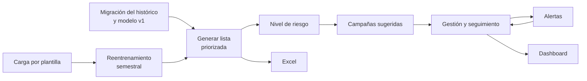
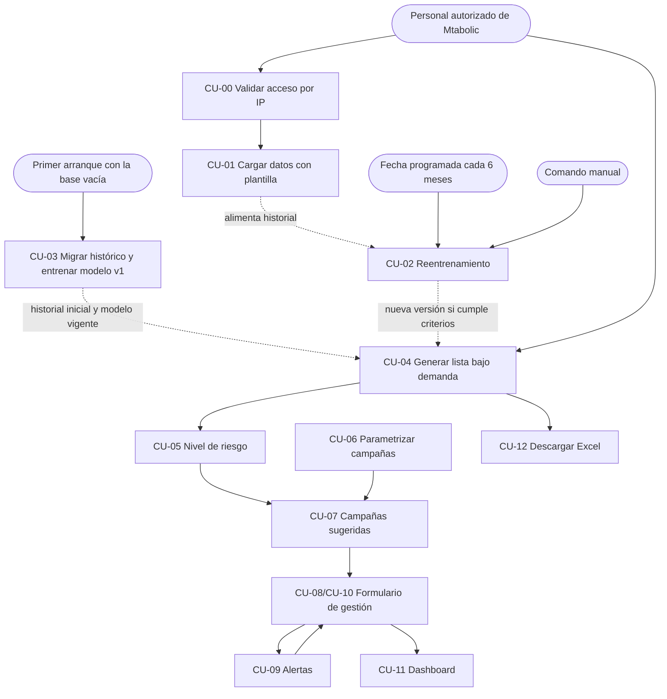
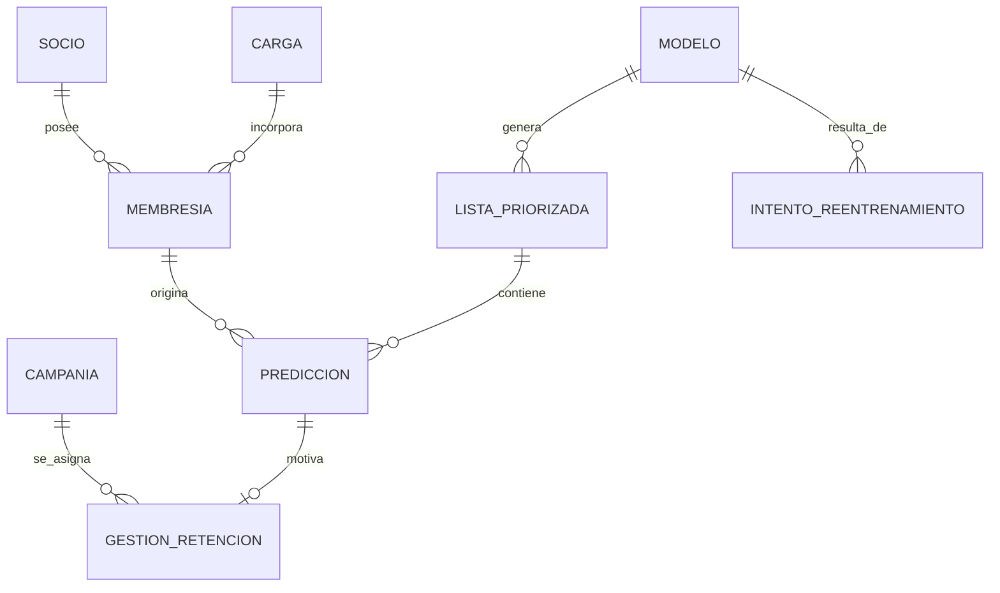
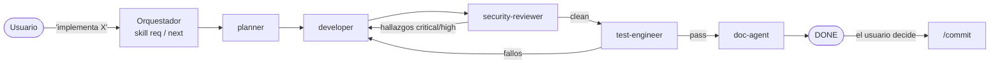
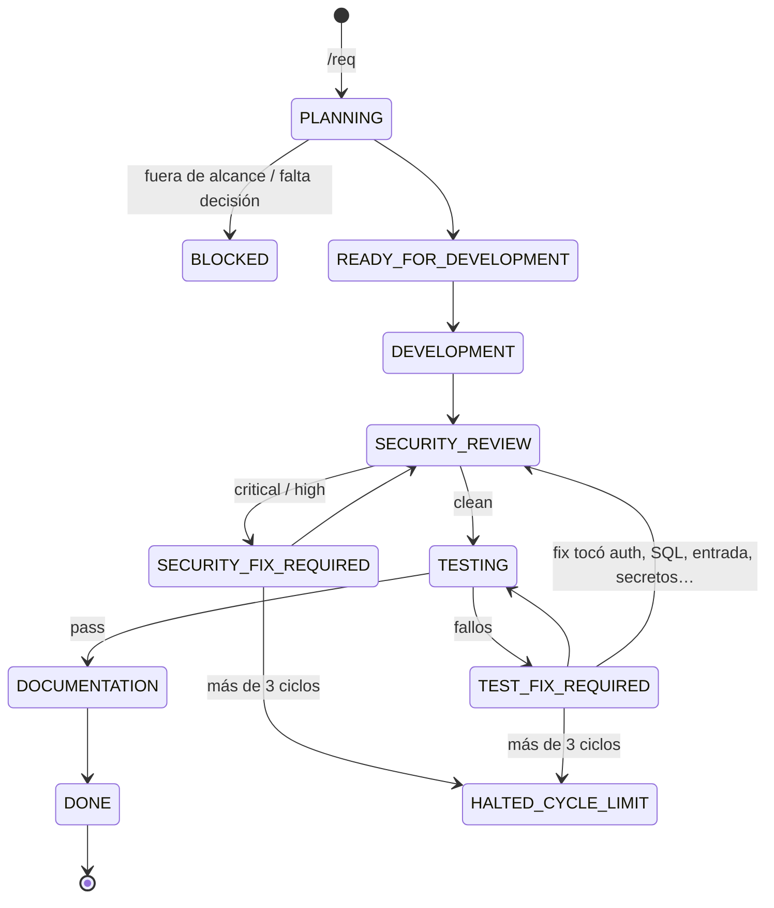

# Mtabolic · Documentación consolidada del proyecto

Documento único generado el 2026-10-01 a partir de todos los documentos del proyecto (`Documentation/`, ADR, comandos y los README de la raíz, `Backend/` y `Frontend/`). **Los archivos originales no se modificaron ni se borraron**; siguen siendo la fuente de verdad. Si se editan, este archivo debe regenerarse.

Cada sección indica su archivo de origen. Los títulos internos se bajaron dos niveles para encajar en el índice y los enlaces entre documentos apuntan a la sección correspondiente de este archivo.

**Cómo leerlo:** para saber *qué se hizo*, empiece por la Parte I (en especial el *Cierre de la entrega*). Para saber *cómo*, siga con las Partes II a VI. La Parte VII es la bitácora completa, requerimiento a requerimiento (R-001 a R-014).

## Índice

- [Parte I · Visión general y resultado](#parte-1)
  - [Descripción del proyecto](#doc-documentation-00-descripcion-del-proyecto) — `Documentation/00-descripcion-del-proyecto.md`
  - [Cierre de la entrega (qué se hizo)](#doc-documentation-07-cierre) — `Documentation/07-cierre.md`
  - [Alcance y lineamientos de desarrollo](#doc-documentation-development-guidelines) — `Documentation/DEVELOPMENT_GUIDELINES.md`
- [Parte II · Análisis, requisitos y planificación](#parte-2)
  - [Análisis: del notebook MVP a la aplicación web](#doc-documentation-01-analisis-mvp-a-app-web) — `Documentation/01-analisis-mvp-a-app-web.md`
  - [Casos de uso](#doc-documentation-03-casos-de-uso) — `Documentation/03-casos-de-uso.md`
  - [Decisiones y pendientes para iniciar el desarrollo](#doc-documentation-04-pendientes-para-iniciar-desarrollo) — `Documentation/04-pendientes-para-iniciar-desarrollo.md`
  - [Cronograma de la semana](#doc-documentation-05-cronograma-semana) — `Documentation/05-cronograma-semana.md`
- [Parte III · Guía funcional](#parte-3)
  - [Cómo funciona la lista de socios por vencer](#doc-documentation-06-como-funciona-la-lista) — `Documentation/06-como-funciona-la-lista.md`
- [Parte IV · Arquitectura y documentación técnica](#parte-4)
  - [README de la raíz (cómo levantar el stack)](#doc-readme) — `README.md`
  - [Backend · Arquitectura](#doc-documentation-docs-backend-01-arquitectura) — `Documentation/docs/backend/01-arquitectura.md`
  - [Backend · Esquema de base de datos](#doc-documentation-docs-backend-09-esquema-base-de-datos) — `Documentation/docs/backend/09-esquema-base-de-datos.md`
  - [Backend · Docker](#doc-documentation-docs-backend-10-docker) — `Documentation/docs/backend/10-docker.md`
  - [Backend · Histórico](#doc-documentation-docs-backend-11-historico) — `Documentation/docs/backend/11-historico.md`
  - [Backend · Modelo y listas](#doc-documentation-docs-backend-12-modelo-y-listas) — `Documentation/docs/backend/12-modelo-y-listas.md`
  - [Backend · Cargas](#doc-documentation-docs-backend-13-cargas) — `Documentation/docs/backend/13-cargas.md`
  - [Contrato de la API](#doc-documentation-docs-api-contract) — `Documentation/docs/API_CONTRACT.md`
  - [Frontend · Arquitectura](#doc-documentation-docs-frontend-01-arquitectura) — `Documentation/docs/frontend/01-arquitectura.md`
  - [README del Backend (operación)](#doc-backend-readme) — `Backend/README.md`
  - [README del Frontend](#doc-frontend-readme) — `Frontend/README.md`
- [Parte V · Decisiones de arquitectura (ADR)](#parte-5)
  - [ADR-001](#doc-documentation-adr-adr-001-fastapi-react-postgresql) — `Documentation/adr/ADR-001-fastapi-react-postgresql.md`
  - [ADR-002](#doc-documentation-adr-adr-002-ml-en-infraestructura) — `Documentation/adr/ADR-002-ml-en-infraestructura.md`
  - [ADR-003](#doc-documentation-adr-adr-003-reentrenamiento-y-versionado) — `Documentation/adr/ADR-003-reentrenamiento-y-versionado.md`
  - [ADR-004](#doc-documentation-adr-adr-004-migracion-datos-al-arrancar) — `Documentation/adr/ADR-004-migracion-datos-al-arrancar.md`
  - [ADR-005](#doc-documentation-adr-adr-005-fidelidad-al-notebook-del-modelo-v1) — `Documentation/adr/ADR-005-fidelidad-al-notebook-del-modelo-v1.md`
  - [ADR-006](#doc-documentation-adr-adr-006-lista-desde-hoy-y-cedula-en-lugar-de-correo) — `Documentation/adr/ADR-006-lista-desde-hoy-y-cedula-en-lugar-de-correo.md`
  - [ADR-007](#doc-documentation-adr-adr-007-excel-igual-a-la-pantalla-y-nombre-de-lista) — `Documentation/adr/ADR-007-excel-igual-a-la-pantalla-y-nombre-de-lista.md`
  - [ADR-008](#doc-documentation-adr-adr-008-gestion-por-ciclo-y-nombre-de-campania-congelado) — `Documentation/adr/ADR-008-gestion-por-ciclo-y-nombre-de-campania-congelado.md`
  - [ADR-009](#doc-documentation-adr-adr-009-reactivar-campanias-y-gestion-sin-campania-cerrada) — `Documentation/adr/ADR-009-reactivar-campanias-y-gestion-sin-campania-cerrada.md`
  - [ADR-010](#doc-documentation-adr-adr-010-acceso-por-ip-detras-de-nginx) — `Documentation/adr/ADR-010-acceso-por-ip-detras-de-nginx.md`
  - [ADR-011](#doc-documentation-adr-adr-011-reglas-del-reentrenamiento) — `Documentation/adr/ADR-011-reglas-del-reentrenamiento.md`
  - [ADR-012](#doc-documentation-adr-adr-012-rol-de-aplicacion-sin-superusuario) — `Documentation/adr/ADR-012-rol-de-aplicacion-sin-superusuario.md`
  - [ADR-013](#doc-documentation-adr-adr-013-proteccion-host-y-origin) — `Documentation/adr/ADR-013-proteccion-host-y-origin.md`
- [Parte VI · Operación (comandos)](#parte-6)
  - [Respaldo y restauración](#doc-documentation-comandos-respaldo-y-restauracion) — `Documentation/comandos/respaldo-y-restauracion.md`
  - [Reiniciar la base histórica](#doc-documentation-comandos-reiniciar-base-historica) — `Documentation/comandos/reiniciar-base-historica.md`
  - [Ensayo de la demostración E2E](#doc-documentation-comandos-ensayo-demo-e2e) — `Documentation/comandos/ensayo-demo-e2e.md`
- [Parte VII · Proceso de desarrollo](#parte-7)
  - [Entorno de desarrollo asistido por IA](#doc-documentation-02-entorno-desarrollo-ia) — `Documentation/02-entorno-desarrollo-ia.md`
  - [Bitácora de requerimientos (ACTION_PLAN)](#doc-documentation-action-plan) — `Documentation/ACTION_PLAN.md`

<a id="parte-1"></a>

# Parte I · Visión general y resultado

_Qué es el proyecto, qué se entregó y con qué alcance._

---

<a id="doc-documentation-00-descripcion-del-proyecto"></a>

## Descripción del proyecto

> Fuente: `Documentation/00-descripcion-del-proyecto.md`

### 00 · Descripción del proyecto

**Fecha:** 29 de septiembre de 2026
**Base:** [03 · Casos de uso](#doc-documentation-03-casos-de-uso) (fuente de verdad del alcance) y [DEVELOPMENT_GUIDELINES.md](#doc-documentation-development-guidelines).
Si este documento y `03` discrepan, manda `03`.

---

#### 1. Qué es

**Mtabolic — apoyo a la retención** es una aplicación web local para el gimnasio Mtabolic. Toma el modelo predictivo del notebook `Notebookes/MVP.ipynb` y lo pone en uso diario: estima qué socios tienen riesgo de **no renovar** su membresía, los ordena por prioridad y ayuda al personal a actuar sobre ellos con campañas de retención y a registrar el seguimiento.

El modelo de aprendizaje automático es el componente central, pero no decide nada por sí mismo: **señala a quién conviene atender primero; el personal elige la campaña y contacta al socio.**

#### 2. Problema que resuelve

Hoy la información de membresías vive en libros de Excel mensuales y el notebook produce una lista de riesgo aislada, que hay que regenerar a mano y que no deja rastro de qué se hizo con cada socio. En consecuencia:

- no hay una base acumulada del histórico ni una forma estándar de añadir datos nuevos;
- la predicción no se convierte en una acción concreta ni en un seguimiento con fecha;
- no se puede ver después qué campañas se aplicaron ni cómo terminaron;
- el modelo no se actualiza con la información nueva.

#### 3. Objetivo

##### Objetivo general

Convertir el prototipo predictivo en un **proceso cerrado de retención**: identificar a los socios en riesgo, priorizarlos, intervenir con una campaña, observar el resultado y aprender de la nueva información.

##### Objetivos específicos

1. Migrar una sola vez el histórico de membresías 2025–2026 a una base de datos, con la misma limpieza y reglas del notebook, y entrenar con él el modelo v1.
2. Permitir la carga paulatina de nuevas membresías mediante una plantilla oficial validada.
3. Generar bajo demanda la lista priorizada de socios por vencer, con su probabilidad de no renovación y un nivel de riesgo alto, medio o bajo.
4. Sugerir campañas de retención definidas por Mtabolic según el nivel de riesgo y el tipo de plan del socio.
5. Registrar la gestión de cada socio (campaña, fecha de seguimiento y resultado) y alertar de los seguimientos vencidos o próximos.
6. Resumir la operación en un dashboard y permitir descargar la lista en Excel.
7. Reentrenar el modelo cada 6 meses, y conservar la versión nueva solo si no es peor que la vigente.

#### 4. Qué hará la aplicación

| Función | Casos de uso | Descripción |
|---|---|---|
| Control de acceso | CU-00 | Sin usuarios ni contraseñas: solo responde a las IP autorizadas (por defecto, el propio PC). |
| Migración del histórico | CU-03 | En el primer arranque con la base vacía, carga los libros 2025–2026 y entrena el modelo v1 en una sola operación atómica. |
| Carga de datos nuevos | CU-01 | Subida de la plantilla oficial (máx. 500 filas) con vista previa; si una fila es inválida, no se carga nada. |
| Reentrenamiento | CU-02 | Automático cada 6 meses y por comando manual; se compara con el modelo vigente antes de reemplazarlo. |
| Lista priorizada | CU-04, CU-05 | A pedido del usuario, para una fecha dada: socios por vencer ordenados por riesgo, con nivel alto/medio/bajo por percentiles. |
| Campañas | CU-06, CU-07 | Mtabolic define sus campañas con reglas por nivel de riesgo y plan; el sistema sugiere las compatibles para cada socio. |
| Gestión y seguimiento | CU-08, CU-10 | Un formulario para asignar campaña y fecha de seguimiento y, más tarde, registrar el resultado. Una gestión por ciclo. |
| Alertas | CU-09 | Contador de seguimientos vencidos, para hoy y para los próximos 7 días, dentro de la aplicación. |
| Dashboard | CU-11 | Embudo de gestión, tabla por campaña y estado del modelo, filtrable por mes. |
| Exportación | CU-12 | Descarga de la lista priorizada en Excel. |

##### Flujo de uso



#### 5. Usuarios

| Usuario | Qué hace |
|---|---|
| **Personal de Mtabolic** | Carga datos, genera y revisa la lista, gestiona campañas, registra seguimientos y consulta el dashboard desde el PC autorizado. |
| **Responsable técnico** | Instala el sistema, deja los libros históricos en su carpeta antes del primer arranque y, si hace falta, lanza el reentrenamiento manual. |

La aplicación se instala y se usa en **un solo PC** de Mtabolic con Docker Compose.

#### 6. Alcance

**Entra** (entrega de una semana): los casos de uso CU-00 a CU-12, varios en versión simplificada; el detalle está en [DEVELOPMENT_GUIDELINES.md](#doc-documentation-development-guidelines) §Alcance.

**No entra**, entre otros:

- autenticación por usuario, roles o permisos;
- integración con WhatsApp, SMS, correo, el sistema biométrico o la facturación;
- aprendizaje automático para elegir campañas, pruebas A/B o atribución causal de resultados (las cifras de campañas son descriptivas);
- aplicación móvil, notificaciones push o BI avanzado;
- cambios a la lógica del notebook (asistencias, estados `BAJA`/`CONGELAMIENTO`/`REINGRESO`).

Lista completa: [DEVELOPMENT_GUIDELINES.md](#doc-documentation-development-guidelines) §Fuera de alcance.

#### 7. Cómo está construida

| Capa | Tecnología |
|---|---|
| Backend | Python 3.12 + FastAPI, SQLAlchemy 2, Alembic, pytest |
| Base de datos | PostgreSQL 16 |
| Frontend | React + TypeScript + Vite, Vitest, Playwright |
| Despliegue | Docker Compose en un solo PC |

Ambos lados siguen una **arquitectura en capas** con dependencias hacia el dominio; el modelo de scikit-learn vive en infraestructura detrás de un puerto ([ADR-002](#doc-documentation-adr-adr-002-ml-en-infraestructura)). Detalle: [backend/01-arquitectura](#doc-documentation-docs-backend-01-arquitectura) y [frontend/01-arquitectura](#doc-documentation-docs-frontend-01-arquitectura).

Reglas que el sistema respeta en todo momento: nada crítico se borra físicamente, los montos y probabilidades usan decimal, la fecha actual viene de un reloj inyectable y ningún secreto queda en el código.

#### 8. Resultado esperado

Al terminar, Mtabolic podrá recorrer de punta a punta el escenario de [03 §21](#doc-documentation-03-casos-de-uso): arrancar con su histórico migrado, cargar el mes nuevo, generar la lista, asignar campañas a los socios de riesgo alto, recibir las alertas de seguimiento, registrar los resultados y ver el resumen en el dashboard, con un modelo que se actualiza con la información nueva.

---

<a id="doc-documentation-07-cierre"></a>

## Cierre de la entrega (qué se hizo)

> Fuente: `Documentation/07-cierre.md`

### 07 · Cierre de la entrega

Estado al cierre del día 7 (R-013, 2026-10-01). Resume qué se entregó, en qué se aparta del notebook, qué queda diferido con sus riesgos y cómo se opera. El detalle vive en los documentos enlazados; aquí no se repite.

#### 1. Qué se entregó

Aplicación web local (FastAPI + PostgreSQL 16 + React) en Docker, accesible solo desde el propio PC, que cubre los casos de uso de [03](#doc-documentation-03-casos-de-uso) dentro del alcance de [DEVELOPMENT_GUIDELINES](#doc-documentation-development-guidelines):

| Caso de uso | Qué hace | Referencia |
|---|---|---|
| CU-00 | Acceso por IP (backend detrás de nginx) y protección `Host`/`Origin` | [ADR-010](#doc-documentation-adr-adr-010-acceso-por-ip-detras-de-nginx), [ADR-013](#doc-documentation-adr-adr-013-proteccion-host-y-origin) |
| CU-03 | Migración única del histórico al arrancar y modelo v1 | [ADR-004](#doc-documentation-adr-adr-004-migracion-datos-al-arrancar), [11-historico](#doc-documentation-docs-backend-11-historico) |
| CU-01 | Carga mensual por plantilla con vista previa | [13-cargas](#doc-documentation-docs-backend-13-cargas) |
| CU-04, CU-05, CU-12 | Lista priorizada desde hoy, niveles de riesgo, Excel | [12-modelo-y-listas](#doc-documentation-docs-backend-12-modelo-y-listas), [06](#doc-documentation-06-como-funciona-la-lista) |
| CU-06..CU-10 | Campañas, sugerencias, gestión, alertas de seguimiento y resultado | [ADR-008](#doc-documentation-adr-adr-008-gestion-por-ciclo-y-nombre-de-campania-congelado), [ADR-009](#doc-documentation-adr-adr-009-reactivar-campanias-y-gestion-sin-campania-cerrada) |
| CU-11 | Dashboard con embudo, resultados por campaña y estado del modelo; impresión del navegador | [03 §14](#doc-documentation-03-casos-de-uso) |
| CU-02 | Reentrenamiento programado (cada 6 meses) y manual | [ADR-011](#doc-documentation-adr-adr-011-reglas-del-reentrenamiento) |

Día 7: respaldo y restauración con scripts, rol de base de datos sin superusuario (S23, [ADR-012](#doc-documentation-adr-adr-012-rol-de-aplicacion-sin-superusuario)), instalación limpia equivalente, revisión de seguridad única de R-001..R-012 (0 critical/high abiertos), E2E del escenario principal, ensayo de §21 y rediseño visual. Detalle por tarea: [05 Día 7](#doc-documentation-05-cronograma-semana).

**Pruebas al cierre:** Backend 1.970 pytest con `ruff`, `ruff format`, `mypy app` y `lint-imports` limpios; Frontend 857 Vitest con `lint` y `build` limpios; E2E 5/5 en el stack aislado (8081), sin violaciones de CSP. Esquema en `0008`.

**Instalación limpia (libros reales, stack efímero):** 1.410 socios, 2.748 membresías, v1 con 1.564 ciclos y las mismas métricas y umbrales que el v1 del stack principal; lista del día y Excel generados.

#### 2. Diferencias con el notebook

| Diferencia | Motivo | Referencia |
|---|---|---|
| Niveles de riesgo por percentiles 20/30/50, no umbrales fijos 0,70/0,50 | CU-05 | [ADR-005](#doc-documentation-adr-adr-005-fidelidad-al-notebook-del-modelo-v1) |
| Referencia de factores fija en el periodo 2025 | Igualar los factores del notebook | ADR-005 |
| La lista se genera desde **hoy** (fecha de Ecuador), horizonte ≤ 31 días; no se puede generar al 31-08-2026 desde la app | Lista operativa | [ADR-006](#doc-documentation-adr-adr-006-lista-desde-hoy-y-cedula-en-lugar-de-correo) |
| Cédula en lugar de correo; socios sin cédula fuera de la cartera | Identificación por el personal | ADR-006 |
| 2 celdas basura de vencimiento no se convierten en fechas (pandas sí); monto negativo → sin monto | Robustez; sin efecto en evaluables ni etiquetas | [11-historico](#doc-documentation-docs-backend-11-historico) |
| Reentrenamiento con criterios y comparación PR-AUC (el notebook entrena una vez) | CU-02 | ADR-011 |

La conciliación con el notebook se hace con `Backend/scripts/verificar_lista.py --fecha 2026-08-31`: resultado idéntico al cierre (cartera 59, 57 a priorizar, 0 diferencias de probabilidad u orden).

#### 3. Diferido y riesgos residuales

Fuera de alcance de la versión (no son defectos): [03 §20](#doc-documentation-03-casos-de-uso) y [DEVELOPMENT_GUIDELINES §Fuera de alcance](#doc-documentation-development-guidelines).

| Id | Qué queda | Riesgo | Referencia |
|---|---|---|---|
| S5 | El filtro por IP solo es efectivo con los puertos en `127.0.0.1`; abrir la app a otro PC no está implementado (exigiría filtrar en nginx) | Publicar los puertos en la red anula CU-00 | ADR-010, [10-docker](#doc-documentation-docs-backend-10-docker) |
| S23 residual | El rol propietario sigue siendo superusuario del clúster (imagen oficial) | Quien obtenga esas credenciales controla el clúster; la app ya no las usa | ADR-012 |
| S18 / TLS | Sin TLS ni HSTS; con TLS delante habrá que propagar `X-Forwarded-Proto` y que el filtro de `Origin` vea `https` | Solo relevante si se sale de `localhost` | ADR-013 |
| S19 | Comprobar que el build no publica sourcemaps | Bajo | 10-docker |
| S21 | Imágenes base fijadas por versión, no por digest | Bajo | 10-docker |
| S24 | Si la base no responde al arrancar, el frontend no arranca | Disponibilidad | 10-docker |
| S10 | Dependencias de Python sin lockfile; `pip-audit`/`npm audit` no ejecutados en R-013 (sin red) | Vulnerabilidades conocidas no revisadas al cierre | 10-docker |
| S26 | En operación `CORS_ORIGINS` debe listar solo el origen del frontend | Ampliarla debilita la protección CSRF | ADR-013 |
| T10-OBS-1 | El script de ensayo muestra la salida propia de `docker compose restart` | Cosmético | [comandos/ensayo-demo-e2e.md](#doc-documentation-comandos-ensayo-demo-e2e) |
| D7-FE-01 | Revisión visual del rediseño por el usuario | Ajustes estéticos | [frontend/01 §Estilos](#doc-documentation-docs-frontend-01-arquitectura) |
| — | Referencia de factores fija en 2025: revisar cuando exista un v2 | Factores menos representativos | ADR-005 |
| — | Cédula (dato personal) en la API, el Excel y los respaldos | Mitigado por el acceso local, `respaldos/` no versionado y sin datos en logs | ADR-006 |

#### 4. Cómo operar

- Instalación, variables, rol de la app (S23), `HOSTS_PERMITIDOS`, reentrenamiento manual: [Backend/README §Operación](#doc-backend-readme).
- Respaldo y restauración: [comandos/respaldo-y-restauracion.md](#doc-documentation-comandos-respaldo-y-restauracion). Haga un respaldo antes de cualquier cambio de configuración o de un reinicio de la base.
- Reiniciar la base a solo histórico (borra datos): [comandos/reiniciar-base-historica.md](#doc-documentation-comandos-reiniciar-base-historica).
- Ensayo de la demostración (solo stack aislado): [comandos/ensayo-demo-e2e.md](#doc-documentation-comandos-ensayo-demo-e2e).
- Stacks: principal `proyectofinal` (8080, datos reales), aislado `mtabolic-e2e` (8081, datos sintéticos), instalación limpia `mtabolic-limpia` (8082, efímero): [10-docker](#doc-documentation-docs-backend-10-docker).
- Uso funcional de la lista, gestión, seguimiento y dashboard: [06](#doc-documentation-06-como-funciona-la-lista).

---

<a id="doc-documentation-development-guidelines"></a>

## Alcance y lineamientos de desarrollo

> Fuente: `Documentation/DEVELOPMENT_GUIDELINES.md`

### Guía de desarrollo — alcance de la versión actual

**Versión:** entrega de una semana (28-09-2026) · **Fuente de verdad:** [03 · Casos de uso](#doc-documentation-03-casos-de-uso) §1.1, §19 y §20 · decisiones D-01 a D-18 de [04 §2](#doc-documentation-04-pendientes-para-iniciar-desarrollo).
Si esta guía y `03` discrepan, manda `03`; esta guía se corrige.

---

#### Alcance

Entran todos los casos de uso, CU-00 a CU-12, varios en versión simplificada ([03 §1.1](#doc-documentation-03-casos-de-uso)):

| CU | Versión de la entrega |
|---|---|
| CU-00 Validar acceso por IP | Simplificado: lista de IP o rangos en variables de entorno (por defecto, solo el propio PC); sin proxy intermedio. |
| CU-01 Cargar nuevos datos | Simplificado: carga todo o nada con la plantilla oficial (máx. 500 filas). |
| CU-02 Reentrenar el modelo | Simplificado: fecha programada cada 6 meses sin recuperar fechas perdidas, comando manual y comparación contra el vigente. |
| CU-03 Migrar el histórico inicial | Completo: automático en el primer arranque con la base vacía, atómico con el modelo v1 ([ADR-004](#doc-documentation-adr-adr-004-migracion-datos-al-arrancar)). |
| CU-04 Generar priorización | Completo. |
| CU-05 Nivel de riesgo | Completo, umbrales por percentiles. |
| CU-06 Parametrizar campañas | Simplificado: reglas solo por nivel de riesgo y tipo de plan. |
| CU-07 Recomendar campañas | Simplificado: filtra por nivel y plan, ordena por prioridad. |
| CU-08 / CU-10 Gestión | Simplificado: un solo formulario; una gestión por ciclo. |
| CU-09 Alertas | Simplificado: vencidos, hoy y próximos 7 días. |
| CU-11 Dashboard | Simplificado: embudo, tabla por campaña, estado del modelo; solo filtro por mes. |
| CU-12 Descargar Excel | Completo. |

##### Decisiones de alcance ([03 §19](#doc-documentation-03-casos-de-uso))

1. Sin login; el acceso se restringe por IP (CU-00, RT-12).
2. Alertas solo dentro de la aplicación.
3. Campañas parametrizables por Mtabolic, sugeridas con reglas, no con un segundo modelo.
4. El modelo no toma decisiones comerciales: el personal elige campaña y contacta.
5. Las cifras de campañas son descriptivas; no se atribuye causalidad.
6. La lista se genera solo a pedido del usuario.
7. Se conserva la descarga en Excel.
8. El histórico se migra una sola vez, automáticamente en el primer arranque con la base vacía y de forma atómica con el modelo v1; después, carga solo por plantilla.
9. Reentrenamiento cada 6 meses sin recuperar fechas perdidas, más comando manual; solo si hay datos suficientes y el modelo nuevo no es peor que el vigente ([ADR-003](#doc-documentation-adr-adr-003-reentrenamiento-y-versionado)).
10. Entrega en una semana ([05 · Cronograma](#doc-documentation-05-cronograma-semana)).
11. Un solo PC con Docker Compose; el sistema se usa desde ese equipo.
12. La lógica del notebook se adapta tal cual (estados del registro y asistencias no se usan; variables del modelo = las del notebook).

---

#### Fuera de alcance

No se implementa nada de esta sección. Si un requerimiento lo pide, el planner lo marca fuera de alcance y lo escala al usuario.

##### Diferido a una versión posterior

- Cargar solo las filas válidas de un archivo con errores (CU-01).
- Recuperar una fecha de reentrenamiento perdida porque el PC estaba apagado (CU-02).
- Cambiar la lógica del notebook: revisar `inicio_aproximado` y `mes_vencimiento`, usar asistencias o los estados del registro (`BAJA`, `CONGELAMIENTO`, `REINGRESO`) en la etiqueta y la lista.
- Días de congelamiento como dato propio.
- Reglas de campaña por antigüedad, ciclos previos y vigencia (CU-06).
- Editar una gestión cerrada o más de una gestión por ciclo (CU-08, CU-10).
- Plazo configurable de "próximos N días" (CU-09).
- Resultados por nivel de riesgo y filtros por nivel y campaña en el dashboard (CU-11).
- Pantalla de revisión manual de enlaces entre socios históricos y de plantilla (CU-01).
- Confianza en cabeceras de proxy para la restricción por IP (CU-00).

##### Fuera del proyecto

- Autenticación por usuario, roles o permisos.
- Integración con WhatsApp, SMS o correo.
- Integración con el sistema biométrico.
- Facturación, cobros o aplicación automática de descuentos.
- Aprendizaje automático para elegir campañas, pruebas A/B o inferencia causal.
- Notificaciones push o aplicación móvil.
- Generador de reportes o BI avanzado.
- Reentrenamiento en línea por cada registro o ajuste automático de hiperparámetros.

---

#### Excepciones documentadas a las reglas generales

| Regla general | Excepción en este proyecto | Origen |
|---|---|---|
| Propietario del dato desde el token; `user_id NOT NULL` en toda tabla (`.claude/rules/database.md`) | **No aplica.** No hay login ni usuarios; el acceso se controla por IP (CU-00). Las pruebas de aislamiento entre usuarios no aplican. | RT-12 · [04 §5](#doc-documentation-04-pendientes-para-iniciar-desarrollo) (ítem 2) |
| Borrado lógico con `deleted_at` en lo crítico | Llevan `deleted_at`: `socios`, `cargas`, `membresias`, `campanias`, `gestiones_retencion`. **No** lo llevan: `modelos`, `listas_priorizadas`, `predicciones` (instantáneas inmutables, RT-07), `intentos_reentrenamiento` (auditoría de solo inserción) y `estado_sistema` (fila única de control). Ninguna de ellas se borra físicamente. | R-002 (plan) · RT-07 |
| Nada crítico se borra físicamente | **Excepción puntual y única, no cambia la regla:** el 2026-09-30 01:50:06 UTC se borraron físicamente todas las filas de `predicciones` (117) y `listas_priorizadas` (3) de la base de desarrollo del stack de Docker, por ser listas de prueba que dificultaban ver errores (decisión explícita del usuario). Una transacción con precondición `gestiones_retencion = 0`, sin `CASCADE`, `TRUNCATE` ni reinicio de secuencias; el resto de tablas quedó intacto. El código sigue sin exponer borrado de listas. Detalle y SQL: [09 §Convenciones](#doc-documentation-docs-backend-09-esquema-base-de-datos). | R-006 (T4) |
| Nada crítico se borra físicamente | **Reinicio manual de la base principal (no es una función de la aplicación):** los scripts `scripts/reiniciar-base-historica.ps1` / `.sh` hacen `down -v` del stack principal (`-p proyectofinal`) y lo recrean solo con el histórico, borrando cargas por plantilla, socios que estas agregaron, listas, predicciones y todo lo demás del volumen. Solo por decisión explícita del usuario, con confirmación `BORRAR`; nunca toca `mtabolic-e2e`. El código de la app sigue sin exponer borrados. En R-008 no se ejecutó (la base tenía listas del usuario). **Ejecutado el 30-09-2026** en el stack principal con `scripts/reiniciar-base-historica.sh --si`, autorizado por el usuario; resultado: socios 1.410, membresías 2.748, cargas 1, listas 0, predicciones 0, sistema `LISTO`. → [comandos/reiniciar-base-historica.md](#doc-documentation-comandos-reiniciar-base-historica) | R-008 (T5) · R-009 (ejecución) |
| Valores exactos en decimal, nunca coma flotante | Montos y probabilidades se guardan como `Decimal` (`NUMERIC`). La conversión `Decimal → float` (y `float → Decimal` del score) está permitida **solo en el borde del modelo**: el adaptador de infraestructura que implementa `PredictorModel` ([ADR-002](#doc-documentation-adr-adr-002-ml-en-infraestructura)). Dominio, aplicación, persistencia y API trabajan siempre con `Decimal`. | [04 §5](#doc-documentation-04-pendientes-para-iniciar-desarrollo) (ítem 7) |
| La aplicación nunca ejecuta migraciones al arrancar | Se mantiene para el **esquema** (solo el servicio `migrate`). La única migración de **datos** al arrancar es CU-03. | RT-14 · [ADR-004](#doc-documentation-adr-adr-004-migracion-datos-al-arrancar) |


<a id="parte-2"></a>

# Parte II · Análisis, requisitos y planificación

_Cómo se pasó del notebook a la aplicación y cómo se organizó la semana._

---

<a id="doc-documentation-01-analisis-mvp-a-app-web"></a>

## Análisis: del notebook MVP a la aplicación web

> Fuente: `Documentation/01-analisis-mvp-a-app-web.md`

### 01 · Análisis: del notebook MVP a una aplicación web

**Fecha:** 28 de septiembre de 2026
**Fuente analizada:** `Notebookes/MVP.ipynb` (informe técnico del MVP de Mtabolic, 196 celdas)
**Estado:** análisis inicial. Su alcance fue **ampliado y reemplazado** por [03 · Casos de uso](#doc-documentation-03-casos-de-uso); se conserva como registro de cómo evolucionó la decisión.

> **Nota de alineación (28-09-2026).** Este documento describe una app de tres funciones (cargar, generar lista, exportar), sin base de datos. La versión vigente del alcance es la de `03`: sistema de apoyo a la retención con base de datos acumulativa, migración única del histórico (CU-03), carga paulatina por plantilla (CU-01), reentrenamiento semestral (CU-02), campañas, seguimiento y dashboard. Donde este documento y `03` difieren, manda `03`. Las decisiones que cierran las preguntas de la §8 están anotadas en la propia tabla; las que siguen abiertas se consolidan en [04 · Pendientes para iniciar el desarrollo](#doc-documentation-04-pendientes-para-iniciar-desarrollo).

---

#### 1. Objetivo de la aplicación

Llevar el MVP a una aplicación web fácil de desplegar que haga únicamente tres cosas:

1. Cargar el archivo (o archivos) Excel con los datos históricos de membresías.
2. Generar la lista priorizada de socios con riesgo de no renovación.
3. Exportar esa lista a Excel.

Queda fuera la parte analítica del informe: gráficos, comparación de modelos, métricas, validación y reconciliación con el Informe S5.

#### 2. Qué parte del notebook se reutiliza

La aplicación solo necesita la cadena que termina en la **lista operativa** (Sección 13.8 del notebook).

| Bloque | Secciones del notebook | Qué hace |
|---|---|---|
| Lectura | 2.4, 3.1 – 3.7 | Selecciona hojas mensuales, detecta el encabezado, unifica nombres de columna, convierte fechas y montos. |
| Estandarización | 4.1 – 4.6 | Normaliza nombre, cédula, `socio_id`, plan (6 categorías) y forma de pago (5 categorías). |
| Variable objetivo | 5.1, 5.3 – 5.5 | Fecha de corte, estado del ciclo (evaluable / pendiente / excluido) y etiqueta `no_renovo` (ventana T a T+30). |
| Variables del modelo | 7.2 – 7.4 | Historial previo en T−30, imputación de monto y duración. |
| Lista operativa | 13.2, 13.3, 13.8 | Cartera a vencer, exclusión de quienes ya renovaron, reentrenamiento del Random Forest, probabilidad, nivel de riesgo y factores principales. |
| Exportación | 14.1 (parcial) | Excel con las hojas `top_25`, `cartera_completa` y `resumen`. |

Se elimina alrededor del **80 % del código** del notebook.

#### 3. Implicaciones técnicas

##### 3.1 Reorganizar el código en funciones

El notebook depende de variables globales creadas celda a celda (`fecha_corte_datos`, `actividades_por_socio`, `historial_por_socio`, `mediana_por_plan`, `REFERENCIA`, entre otras). Hay que reescribirlo como funciones encadenadas y sin estado global:

```
cargar(archivos) → preparar(datos) → entrenar(ciclos_evaluables) → lista_operativa(...) → exportar_excel(...)
```

Estimación: unas 250 a 300 líneas en un módulo de procesamiento y unas 60 a 80 líneas de interfaz.

##### 3.2 Entrenar el modelo en cada carga o usar uno ya entrenado

El notebook ya reentrena el modelo operativo con todos los ciclos evaluables. La opción recomendada es **reentrenar en cada carga**:

- Con unos 1.500 ciclos, el entrenamiento tarda segundos.
- Las variables (ciclos previos, antigüedad, monto histórico) dependen del historial completo, así que los datos hay que procesarlos de todas formas.
- Evita que la versión del `.joblib` no coincida con la de scikit-learn del servidor.

**Consecuencia:** el algoritmo y sus parámetros quedan fijos (Random Forest, 300 árboles, profundidad 6, `min_samples_leaf=20`). La aplicación no vuelve a comparar modelos ni a validar su desempeño, así que un cambio fuerte en los datos no genera ninguna alerta.

##### 3.3 Formato del archivo de entrada

El notebook espera **dos libros** (`Control Gym 2025` y `Control Gym 2026`):

- el **año** se obtiene del **nombre del archivo**;
- el **mes** se obtiene del **nombre de cada hoja** (ENERO, FEBRERO…);
- el resto de hojas (diarias, novedades, ventas) se ignora.

Si la aplicación recibe "un archivo", hay que redefinir este contrato (ver P-01). Además, los errores que hoy detienen el notebook (`raise`) tienen que convertirse en mensajes comprensibles en pantalla.

##### 3.4 Fechas y valores escritos a mano

| Valor en el notebook | Situación en la aplicación |
|---|---|
| `FECHA_MINIMA_RAZONABLE = 2024-12-01` | Debe calcularse a partir de los datos o volverse un parámetro. |
| Fechas de partición `2026-01-01` y `2026-05-01` | Desaparecen: la aplicación no evalúa el modelo. |
| Fecha de generación = último día del último mes cargado | Hay que decidir si se mantiene o si se usa la fecha real del día (ver P-04). |
| `TOP_K = 25`, horizonte de 30 días | Hay que decidir si quedan fijos o configurables (ver P-05). |

##### 3.5 Limitación conocida de la variable `mes_vencimiento`

Es categórica. En la lista operativa el mes a predecir (por ejemplo `2026-09`) nunca apareció en el entrenamiento y el codificador lo ignora (`handle_unknown="ignore"`). No da error, pero **no aporta nada** al predecir el futuro. Pasar a la aplicación no lo empeora; queda registrado como posible mejora (ver P-10).

##### 3.6 Dependencias del entorno de notebook

Se eliminan `google.colab.files`, `IPython.display`, `matplotlib` y los `print`. El Excel se genera **en memoria** y se entrega con un botón de descarga; no se escribe nada en disco del servidor.

#### 4. Datos personales y privacidad

Es la implicación más seria.

- Para que la asesora pueda contactar a los socios, la lista útil necesita **nombre, celular y correo**. En el notebook eso corresponde a `mostrar_datos_personales=True`.
- Los archivos que se suben contienen **cédulas, nombres, teléfonos y correos**.
- En Ecuador aplica la **Ley Orgánica de Protección de Datos Personales (LOPDP, 2021)**. Mtabolic debe autorizar el tratamiento y el lugar donde se aloja la aplicación.

Requisitos mínimos si la aplicación se publica en internet:

1. Acceso restringido (contraseña o invitación); **nunca pública**.
2. Procesamiento solo en memoria, sin guardar los archivos subidos.
3. Ningún dato personal en los registros (logs) del servidor.

La alternativa que evita el problema es ejecutar la aplicación **en local**, en un equipo de Mtabolic.

#### 5. Opciones de despliegue

| Opción | Esfuerzo | Comentario |
|---|---|---|
| **Streamlit** (recomendada) | Bajo | Todo en Python; trae carga de archivos, tablas y botón de descarga. Se despliega en Streamlit Community Cloud con acceso restringido o se ejecuta en local con `streamlit run`. |
| Gradio / Hugging Face Spaces | Bajo | Parecido a Streamlit. Los Spaces privados requieren cuenta. |
| FastAPI con frontend (HTML o React) | Medio – alto | Más control y bastante más código. No compensa para este alcance. |
| Ejecutable local (PyInstaller) | Medio | Sin servidor y sin exposición de datos, pero el ejecutable pesa mucho por scikit-learn. |

> **Nota (2026-09-28):** la recomendación de esta tabla no se adoptó. Se eligió FastAPI + React + PostgreSQL (P-07 cerrada, [ADR-001](#doc-documentation-adr-adr-001-fastapi-react-postgresql)). El flujo de pantalla siguiente sigue siendo válido como flujo funcional, independiente de la tecnología.

Flujo de pantalla propuesto (Streamlit):

1. Subir el o los Excel.
2. Procesar y mostrar el resumen de la cartera (ciclos que vencen, ya renovados, socios a priorizar).
3. Mostrar la tabla de la lista ordenada por prioridad.
4. Descargar el Excel (`top_25`, `cartera_completa`, `resumen`).

#### 6. Riesgos que se mantienen

| Riesgo | Mitigación |
|---|---|
| Diferencias de uno o dos casos entre versiones de pandas o scikit-learn | Fijar versiones en `requirements.txt`. |
| Probabilidades desplazadas hacia abajo: casi nadie aparece como "ALTO" | Presentar la lista por orden de prioridad y no destacar el nivel, o recalibrar los niveles. |
| Los servicios gratuitos se suspenden cuando no se usan | La primera carga puede tardar unos 30 segundos; aceptable para un uso mensual. |
| Sin monitoreo del desempeño del modelo | Opcional: mostrar una métrica de control (ver P-09). |

#### 7. Conclusión

> **Nota:** esta estimación corresponde al alcance original. Con FastAPI + React + PostgreSQL ([ADR-001](#doc-documentation-adr-adr-001-fastapi-react-postgresql)) y los casos de uso de `03`, el esfuerzo pasa a **medio – alto**.

La migración es **viable y de esfuerzo bajo a medio**. El trabajo real está en:

1. convertir el notebook en funciones reutilizables;
2. definir el formato del archivo de entrada;
3. resolver el acceso y la privacidad de los datos.

Antes de empezar a programar hay que responder los puntos abiertos de la sección 8.

---

#### 8. Puntos por aclarar antes del desarrollo

| ID | Pregunta | Opciones | Recomendación | Estado |
|---|---|---|---|---|
| P-01 | ¿Qué formato tendrá el archivo de entrada? | (a) Varios libros por año, con el año en el nombre del archivo, como hoy. (b) Un solo libro con hojas `ENERO 2025`, `ENERO 2026`… (c) Un solo libro y el usuario indica el año. | (a): no obliga a cambiar la forma en que Mtabolic lleva sus Excel. | **Cerrada** (28-09-2026): dos formatos. El histórico 2025–2026 (libros mensuales de `plantillas/`) se migra **una sola vez** al generar la base (CU-03). Desde entonces, la carga paulatina usa solo la plantilla `Plantilla_Carga_Datos_Mtabolic.xlsx` (CU-01). |
| P-02 | ¿La lista exportada incluye datos de contacto (nombre, celular, correo)? | Sí / solo código anónimo `MTB-XXXXXXXX` | Sí: sin contacto la lista no sirve para operar, pero obliga a resolver P-03. | **Cerrada** (28-09-2026): sí; nombre, celular y correo (CU-04 y CU-12 de `03`). |
| P-03 | ¿Dónde se ejecutará la aplicación? | Nube con acceso restringido / equipo local de Mtabolic / servidor propio | Depende de P-02 y de la autorización de Mtabolic sobre los datos. | **Cerrada** (28-09-2026): en un solo PC de Mtabolic, con Docker Compose. Ver `04` §3. |
| P-04 | ¿Qué fecha se usa para generar la lista? | Último día del último mes cargado (como hoy) / fecha real del día / elegida por el usuario | Elegida por el usuario, con el último día cargado como valor por defecto. | **Abierta.** `03` (CU-04) propone la fecha de corte de los últimos datos; falta confirmar frente al uso del reloj del sistema. Ver `04`. |
| P-05 | ¿`TOP_K` y el horizonte de días son fijos o configurables? | Fijos (25 socios, 30 días) / configurables en pantalla | Configurables, con esos valores por defecto. | **Cerrada** (28-09-2026): configurables; 25 socios y 30 días por defecto (CU-04). |
| P-06 | ¿Se reentrena el modelo en cada carga o se usa uno ya entrenado? | Reentrenar / modelo fijo `.joblib` | Reentrenar (sección 3.2). | **Cerrada** (28-09-2026), con otra solución: la carga no reentrena. El primer modelo se entrena en la migración del histórico (CU-03) y después una tarea semestral reentrena solo si hay datos suficientes (CU-02). |
| P-07 | ¿Qué tecnología se usa? | Streamlit / Gradio / FastAPI + React (plantilla actual del repositorio) | Streamlit. La plantilla en `.claude/` asume FastAPI + React + PostgreSQL, un tamaño desproporcionado para este alcance; hay que decidir si se adapta o se ignora. | **Cerrada** (2026-09-28): FastAPI + React + PostgreSQL, decisión del usuario en R-001. Ver [ADR-001](#doc-documentation-adr-adr-001-fastapi-react-postgresql). |
| P-08 | ¿Quién usará la aplicación y cuántas personas? | Solo la asesora / varias personas de Mtabolic / el equipo académico | Define si basta una contraseña compartida o hacen falta usuarios. | **Cerrada** (28-09-2026): personal interno de Mtabolic, sin cuentas de usuario; acceso restringido por IP (CU-00). |
| P-09 | ¿La aplicación muestra algún indicador de calidad del modelo? | Ninguno / métrica simple (p. ej. PR-AUC del último período conocido) / advertencias de datos (porcentaje de filas sin fecha de fin, hojas no leídas) | Advertencias de calidad de datos; son baratas y útiles. | **Parcial.** `03` define advertencias de datos en CU-01/CU-03 y el bloque "Estado del modelo" del dashboard (CU-11). Falta decidir la métrica de control del reentrenamiento. Ver `04`. |
| P-10 | ¿Se corrige `mes_vencimiento` antes de pasar a producción? | Mantener igual que el notebook / reemplazar por mes del año (1-12) / eliminar | Mantener igual para no desalinearse del informe académico; registrar como mejora futura. | **Abierta.** Se suma a la de `inicio_aproximado` (ver `04`). |
| P-11 | ¿Qué columnas lleva el Excel exportado y en qué orden? | Las de `lista_operativa()` del notebook / formato acordado con la asesora | Validar con la asesora antes de programar la exportación. | **Cerrada** (28-09-2026): columnas propuestas en CU-12 de `03`; pendiente la validación final con la asesora. |
| P-12 | ¿Se conserva algún historial de listas generadas? | No (todo en memoria) / sí (requiere almacenamiento) | No: simplifica el despliegue y reduce el riesgo sobre los datos. | **Cerrada** (28-09-2026): sí. Las listas se guardan con la versión del modelo (CU-04); el Excel de descarga se genera en memoria (CU-12). |

---

<a id="doc-documentation-03-casos-de-uso"></a>

## Casos de uso

> Fuente: `Documentation/03-casos-de-uso.md`

### 03 · Casos de uso del sistema de apoyo a la retención

**Fecha:** 28 de septiembre de 2026 · **Versión 4**: decisiones D-01 a D-18 confirmadas por el usuario (ver `04` §2)  
**Base:** `Notebookes/MVP.ipynb`, [01 · Análisis](#doc-documentation-01-analisis-mvp-a-app-web), plantilla `plantillas/Plantilla_Carga_Datos_Mtabolic.xlsx` y las decisiones adoptadas en [04 · Pendientes](#doc-documentation-04-pendientes-para-iniciar-desarrollo).  
**Datos históricos:** `plantillas/Control Gym 2025 (1).xlsx` y `plantillas/Control Gym 2026 (2).xlsx`.  
**Estado:** alcance funcional para implementar. Los doce casos de uso entran en la entrega, varios en versión simplificada. Lo que se dejó fuera está en §20.

| Versión | Cambio |
|---|---|
| 1 | Casos de uso CU-00 a CU-12 (sin CU-03). |
| 2 | Se añade CU-03 · Migración única del histórico; la carga paulatina se hace solo por plantilla. |
| 3 | Alcance ajustado a una semana: se simplifican CU-00, CU-01, CU-02 y CU-06 a CU-11, y se adoptan como decisión las recomendaciones D-01 a D-18 de `04`. |
| 4 | El usuario confirma las decisiones: el sistema funciona en **un solo PC**; la migración del histórico se ejecuta **automáticamente en el primer arranque con la base vacía** y es **atómica con el entrenamiento del modelo v1**; el reentrenamiento **no recupera fechas perdidas**; el comando manual queda documentado; el modelo nuevo debe **no ser peor** que el vigente; estados del registro, asistencias y variables del modelo se tratan **como en el notebook**; se acepta pasaporte. |

---

#### 1. Resumen

El sistema de Mtabolic amplía el prototipo predictivo original y cubre el ciclo completo de apoyo a la retención:

**migración única del histórico → carga paulatina por plantilla → reentrenamiento programado → priorización bajo demanda → nivel de riesgo → campañas sugeridas → gestión y seguimiento → dashboard.**

El modelo de aprendizaje automático sigue siendo el componente central para estimar el riesgo de no renovación. Alrededor de él se añaden funciones operativas que convierten esa predicción en una acción de seguimiento trazable.

El sistema no requiere autenticación por usuario. Funciona en **un solo PC** de Mtabolic, donde se instala y desde donde se usa. El acceso se restringe a las direcciones IP autorizadas en la configuración; por defecto, solo el propio equipo.

##### 1.1 Alcance de la entrega de una semana

| ID | Caso de uso | Versión de la entrega |
|---|---|---|
| CU-00 | Validar acceso por IP | **Simplificado**: lista de IP o rangos en variables de entorno (por defecto, solo el propio PC); sin proxy intermedio. |
| CU-01 | Cargar nuevos datos | **Simplificado**: la carga es todo o nada; si hay una fila inválida, se corrige el archivo y se vuelve a subir. |
| CU-02 | Reentrenar el modelo | **Simplificado**: se ejecuta en la fecha programada cada 6 meses, sin recuperar una fecha perdida, más un comando manual documentado. Incluye comparación contra el modelo vigente. |
| CU-03 | Migrar el histórico inicial | **Completo**: automático en el primer arranque con la base vacía, atómico con el modelo v1. Todo lo demás depende de él. |
| CU-04 | Generar priorización | **Completo.** |
| CU-05 | Clasificar el nivel de riesgo | **Completo**, con umbrales por percentiles. |
| CU-06 | Parametrizar campañas | **Simplificado**: reglas solo por nivel de riesgo y tipo de plan. |
| CU-07 | Recomendar campañas | **Simplificado**: filtra por nivel y plan, ordena por prioridad. |
| CU-08 | Asignar campaña y crear seguimiento | **Simplificado**: se resuelve en el mismo formulario de gestión que CU-10. |
| CU-09 | Consultar alertas | **Simplificado**: contador de vencidos, de hoy y de los próximos 7 días, con acceso a la lista. |
| CU-10 | Registrar resultado | **Simplificado**: mismo formulario que CU-08; una gestión por ciclo. |
| CU-11 | Dashboard | **Simplificado**: embudo, tabla por campaña y estado del modelo; solo filtro por mes. |
| CU-12 | Descargar Excel | **Completo.** |

El plan día a día y las condiciones para cumplir la semana están en `04` §6.



##### 1.2 Orden normal de uso

1. **Una sola vez**, en el primer arranque del sistema con la base vacía, el backend migra el histórico 2025–2026 y entrena el modelo v1 (CU-03).
2. Desde entonces, las nuevas membresías se cargan **de forma paulatina y solo con la plantilla oficial** (CU-01).
3. Los nuevos datos se acumulan en el historial. En la fecha programada, cada 6 meses, el sistema reentrena si hay datos suficientes y el modelo nuevo no es peor que el vigente (CU-02). Si ese día el PC está apagado, la ejecución se omite hasta la fecha siguiente.
4. Cuando el personal necesita trabajar la cartera, pulsa **Generar lista** (CU-04). Cada socio recibe un nivel de riesgo (CU-05).
5. Para un socio de la lista, el sistema sugiere campañas compatibles (CU-07), definidas antes por Mtabolic (CU-06).
6. El personal abre el formulario de gestión, elige campaña y fecha de seguimiento (CU-08), y más adelante registra en el mismo formulario el resultado (CU-10).
7. La pantalla principal muestra cuántos seguimientos están vencidos, son para hoy o vencen en los próximos 7 días (CU-09).
8. El dashboard resume la operación (CU-11). La lista se puede descargar en Excel en cualquier momento (CU-12).

---

#### 2. Actores

| Actor | Descripción |
|---|---|
| **Personal de Mtabolic** | Usa el sistema desde la red autorizada para cargar información, revisar la lista priorizada, gestionar campañas y registrar seguimientos. |
| **Responsable técnico de la instalación** | Instala el sistema en el PC, deja los libros históricos en la carpeta configurada antes del primer arranque (CU-03) y, si hace falta, ejecuta el reentrenamiento manual por comando (CU-02). No usa la interfaz web para esas tareas. |
| **Reloj del sistema** | Proporciona la fecha actual para la lista, los seguimientos, las alertas y el reentrenamiento. Debe ser inyectable para las pruebas. |
| **Motor predictivo** | Entrena, versiona y aplica el modelo de no renovación. |

---

#### 3. CU-00 · Validar acceso por IP

| | |
|---|---|
| **Objetivo** | Restringir el acceso a los equipos autorizados de Mtabolic sin cuentas de usuario. |
| **Actor** | Personal de Mtabolic / red del negocio |
| **Precondición** | El sistema está instalado en el PC de Mtabolic y existe una lista de IP o rangos autorizados en la configuración. **Valor por defecto: solo el propio equipo** (`127.0.0.1`). Si más adelante se quiere abrir desde otro equipo de la red, se añade su IP a la lista. |
| **Disparador** | Un navegador o cliente hace cualquier petición a la aplicación. |

##### Flujo principal

1. El cliente hace una petición.
2. El backend toma la IP de origen **directamente de la conexión**.
3. La compara con la lista de IP y rangos de la variable de entorno.
4. Si está autorizada, atiende la petición.
5. Si no lo está, responde `403` con el formato único de error y no expone información del sistema.

##### Reglas de negocio

- **RN-00.1** No existen cuentas, contraseñas ni sesiones de usuario.
- **RN-00.2** La lista de IP autorizadas está en la configuración (variable de entorno), no en el código.
- **RN-00.3** En esta entrega **no se confía en cabeceras de IP reenviada** (`X-Forwarded-For`). Si en el despliegue final hay un proxy delante, esta regla se revisa (ver `04` §3).
- **RN-00.4** El control por IP reduce la exposición, pero no sustituye la protección del equipo, de la base de datos ni de los respaldos.
- **RN-00.5** El endpoint de salud (`/api/v1/health`) queda fuera de la restricción para que Docker pueda verificar el servicio.

##### Criterios de aceptación

- Una IP autorizada recibe respuesta normal.
- Una IP no autorizada recibe `403`.
- Una cabecera `X-Forwarded-For` con una IP autorizada no permite el acceso a una IP no autorizada.
- Cambiar la lista de IP solo requiere cambiar la configuración y reiniciar.

**Precisión de la implementación (R-011, [ADR-010](#doc-documentation-adr-adr-010-acceso-por-ip-detras-de-nginx)).** El navegador llega al backend a través de nginx, así que el backend ve la IP del contenedor nginx. Esa IP es fija y está autorizada por defecto (además de `127.0.0.1` y `::1`); RN-00.3 se mantiene (no se lee `X-Forwarded-For`). La protección frente a otros equipos es que los puertos se publican solo en el propio PC. Abrir la aplicación a otro equipo de la red exigiría filtrar también en nginx y no está implementado. Variable: `IPS_PERMITIDAS`.

---

#### 4. CU-01 · Cargar nuevos datos

| | |
|---|---|
| **Objetivo** | Incorporar al historial las membresías nuevas, renovadas y sus estados, para predicción, seguimiento y reentrenamiento. |
| **Actor** | Personal de Mtabolic |
| **Precondición** | Acceso permitido por CU-00. **CU-03 ya se ejecutó.** El archivo sigue la plantilla oficial. |
| **Disparador** | El usuario pulsa **Cargar datos** y selecciona un archivo `.xlsx`. |

##### Formato de entrada

La plantilla tiene cuatro hojas: `Instrucciones`, `Registros`, `Ejemplo` y `Catalogos`. El sistema **solo lee `Registros`**, con los títulos en la fila 1 y una membresía por fila desde la fila 2. Las listas desplegables y validaciones de Excel ayudan al usuario, pero **el servidor repite todas las validaciones**.

| Col. | Campo | Obligatorio | Validación del servidor |
|---|---|---|---|
| A | Estado del registro | No | Catálogo: `NUEVO`, `RENOVACION`, `CONGELAMIENTO`, `REINGRESO`, `BAJA`. Se guarda como dato informativo (RN-01.7) |
| B | Nombres y apellidos | **Sí** | No vacío; al menos 5 letras después de normalizar |
| C | Cédula | **Sí** | 10 dígitos con dígito verificador válido (cédula ecuatoriana). **Excepción:** si Observaciones contiene la palabra `PASAPORTE`, se acepta un documento alfanumérico de 5 a 20 caracteres |
| D | Celular | No | Texto |
| E | Correo | No | Formato de correo si existe |
| F | Tipo de plan | **Sí** | `MENSUAL`, `TRIMESTRAL`, `SEMESTRAL`, `ANUAL`, `DIARIO`, `OTRO` |
| G | Fecha de inicio | **Sí** | Fecha entre 2024-01-01 y 2035-12-31 (rango de la plantilla). La exclusión de ciclos antiguos para el modelo sigue la regla del notebook (RN-01.5) |
| H | Fecha de vencimiento | **Sí** | Fecha posterior a la de inicio |
| I | Forma de pago | **Sí** | `EFECTIVO`, `TRANSFERENCIA`, `TARJETA_DATAFAST`, `OTRO` |
| J | N.º de transacción | No | — |
| K | Monto a facturar (USD) | No | Decimal ≥ 0 |
| L | Monto cobrado (USD) | **Sí** | Decimal ≥ 0 |
| M | Asistencias en el período | No | Entero entre 0 y 400. Se guarda, pero **no entra al modelo**, igual que en el notebook |
| N | Observaciones | No | Texto libre |
| O | Duración (días) | Calculada | El servidor la recalcula (`H − G`): ≥ 21 salvo `DIARIO`, ≤ 400 |
| P | Revisión automática | Calculada | Se ignora; el servidor valida por su cuenta |

##### Flujo principal

1. El usuario selecciona el archivo.
2. El sistema valida extensión, hoja `Registros`, títulos y un máximo de **500 filas con datos**.
3. Valida cada fila y busca duplicados contra la base (clave en RN-01.8).
4. Muestra una vista previa: filas leídas, válidas, con error (número de fila y motivo), duplicadas y rango de vencimientos.
5. Si **no hay filas con error**, el usuario puede confirmar. Si hay alguna, no se puede confirmar: el usuario corrige el Excel y lo vuelve a subir.
6. Al confirmar, el sistema guarda todas las filas nuevas (las duplicadas se omiten) en **una sola transacción**.
7. Enlaza cada socio con su historia (RN-01.9).
8. Registra la carga: fecha, nombre del archivo, conteos y rango de fechas.

##### Flujos alternativos y excepciones

| Caso | Comportamiento |
|---|---|
| Archivo dañado, sin hoja `Registros` o con títulos distintos | Se rechaza indicando el motivo. |
| Archivo con el formato antiguo de hojas mensuales | Se rechaza indicando que debe usarse la plantilla. |
| Más de 500 filas con datos | Se rechaza; se pide dividir el archivo. |
| Una o más filas con error | Se muestran todas; no se permite confirmar. |
| Todas las filas son duplicadas o el archivo está vacío | No se permite confirmar. |
| Fallo durante el guardado | Se revierte toda la operación. |

##### Reglas de negocio

- **RN-01.1** Los montos se guardan como decimales exactos.
- **RN-01.2** Los planes `DIARIO` se guardan, pero no participan en el entrenamiento ni en la lista.
- **RN-01.3** Una carga se anula por borrado lógico, nunca físico.
- **RN-01.4** Los datos personales no se escriben en los registros técnicos (logs).
- **RN-01.5** Los ciclos se clasifican con **las mismas reglas del notebook** (Sección 5.3): sin fecha de vencimiento, fecha anterior a la mínima razonable, pase diario o duración implausible → excluidos; ventana T+30 incompleta → pendientes. Solo los evaluables aportan etiqueta al entrenamiento, y un ciclo pendiente no se convierte antes de tiempo en renovación o no renovación.
- **RN-01.6** Después de CU-03, la plantilla es el **único** formato de carga aceptado.
- **RN-01.7** **Estados del registro, igual que en el notebook:** todas las filas se tratan como membresías con sus fechas, sin importar el estado. El estado se guarda solo como dato informativo y **no cambia la etiqueta ni la lista**. En un congelamiento, quien llena la plantilla debe registrar la fecha de vencimiento ya extendida.
- **RN-01.8** **Clave de duplicado:** identidad del socio + fecha de inicio + fecha de vencimiento + tipo de plan. Aplica contra cargas anteriores y contra el histórico migrado.
- **RN-01.9** **Enlace con el histórico:** si la cédula ya existe, la fila se asocia a ese socio. Si no existe, pero hay un único socio histórico **sin cédula** cuyo nombre normalizado coincide exactamente, se enlaza con él y se le asigna la cédula. Si hay más de un socio histórico con ese nombre, se crea un socio nuevo y el caso aparece en el resumen de la carga para revisión.
- **RN-01.10** Una renovación cargada puede cerrar la etiqueta de un ciclo migrado que estaba pendiente (por ejemplo, los vencimientos de agosto 2026).
- **RN-01.11** La carga no dispara un reentrenamiento.

##### Criterios de aceptación

- Cargar dos veces el mismo archivo no duplica registros.
- Un archivo con una sola fila inválida no se puede confirmar, y la vista previa muestra esa fila con su motivo.
- Una cédula con dígito verificador incorrecto se marca como error.
- Un documento alfanumérico se acepta solo si Observaciones contiene `PASAPORTE`.
- Una membresía que ya existe en el histórico migrado se marca como duplicada y no se inserta.
- Un socio histórico sin cédula y con nombre único queda enlazado con la cédula de la plantilla; con nombre repetido, se crea un socio nuevo y se informa en el resumen.
- Un archivo con hojas mensuales se rechaza con el mensaje de usar la plantilla.
- Un archivo de 501 filas con datos se rechaza.

---

#### 5. CU-02 · Reentrenar el modelo

| | |
|---|---|
| **Objetivo** | Actualizar el modelo con la información acumulada, solo cuando los datos nuevos sean suficientes y el modelo resultante no sea peor que el vigente. |
| **Actor** | Motor predictivo, reloj del sistema y responsable técnico (ejecución manual) |
| **Precondición** | CU-03 ya generó el modelo v1. |
| **Disparadores** | (1) **Programado:** llega la *próxima fecha de reentrenamiento* (fecha del último entrenamiento o intento más 6 meses calendario) y el sistema está encendido. (2) **Manual:** el responsable técnico ejecuta el comando documentado. |

##### Política de fechas perdidas

El sistema funciona en un solo PC que puede estar apagado. **No se recupera una ejecución perdida:** si el PC no estuvo encendido en la fecha programada, al volver a arrancar **no se reentrena**. El intento queda registrado como `OMITIDO` y la próxima fecha pasa a ser **6 meses después de la fecha perdida**.

Consecuencia aceptada: si el PC está apagado justo en las fechas programadas, el modelo puede pasar 12 meses o más sin actualizarse. Para eso existe el comando manual.

##### Comando manual

Se ejecuta en el PC, fuera de la interfaz web, dentro del contenedor del backend:

```
docker compose exec backend python -m app.cli reentrenar
```

- Evalúa los mismos criterios que la ejecución programada y muestra el resultado (entrenado, criterios no cumplidos o no supera al vigente) con su motivo.
- Si entrena una versión nueva, la próxima fecha programada pasa a ser 6 meses después de ese entrenamiento.
- Nombre definitivo (R-011): el de arriba. Imprime el resultado y el motivo; si no entrena, la próxima fecha programada no cambia. Códigos de salida y pasos en `Backend/README.md` §Operación.

##### Criterios para reentrenar

Se reentrena solo si se cumplen **todos**:

1. al menos **150 ciclos nuevos evaluables** (con la ventana T a T+30 completa) desde el último entrenamiento;
2. al menos **60 %** de las membresías nuevas con fecha de vencimiento;
3. al menos **20 casos de cada clase** (renovó y no renovó) entre los ciclos nuevos;
4. el conjunto completo de entrenamiento tiene las columnas que exige el pipeline aprobado.

Además, para **reemplazar** al modelo vigente, el modelo nuevo **no puede tener peor PR-AUC** que el vigente sobre los ciclos evaluables de los **últimos 3 meses con resultado conocido**. Todos los valores son configurables.

##### Flujo principal

1. Se activa uno de los dos disparadores.
2. El sistema cuenta los ciclos nuevos evaluables y revisa la cobertura.
3. Evalúa los criterios 1 a 4. Si no se cumplen, registra el intento y el motivo, y termina.
4. Reconstruye todos los ciclos del historial con las reglas del notebook (T−30 / T+30).
5. Separa como conjunto de comparación los ciclos evaluables de los últimos 3 meses con resultado conocido.
6. Entrena un modelo candidato con el pipeline y los parámetros aprobados, **sin** ese conjunto.
7. Calcula la PR-AUC del candidato y del modelo vigente sobre el conjunto de comparación.
8. Si el candidato es peor, lo descarta y registra el intento como `NO_SUPERA_VIGENTE`.
9. Si no es peor, **reentrena con todo el historial evaluable** (igual que el modelo operativo del notebook), calcula los umbrales (CU-05) y guarda la nueva versión con sus metadatos: fecha, ciclos usados, prevalencia, rango de fechas, parámetros, umbrales, las dos PR-AUC comparadas y versiones de librerías.
10. La marca como vigente; la anterior se conserva.

##### Flujos alternativos

| Caso | Comportamiento |
|---|---|
| El PC estaba apagado en la fecha programada | Al arrancar no se reentrena. Se registra `OMITIDO` y la próxima fecha pasa a ser 6 meses después. |
| No se cumplen los criterios 1 a 4 | No se entrena. Se registra `CRITERIOS_NO_CUMPLIDOS` con el motivo; la próxima fecha pasa a ser 6 meses después. |
| El candidato tiene peor PR-AUC que el vigente | No se reemplaza. Se registra `NO_SUPERA_VIGENTE` con ambas cifras. |
| Falla el entrenamiento | Sigue vigente el modelo anterior. Se registra `FALLIDO`; la próxima fecha pasa a ser 6 meses después. |
| Se ejecuta el comando manual | Se aplican los mismos criterios, sin importar la fecha programada. |

##### Reglas de negocio

- **RN-02.1** El intervalo es de 6 meses calendario.
- **RN-02.2** Una fecha perdida no se recupera (ver "Política de fechas perdidas").
- **RN-02.3** Cada ciclo se entrena solo con información disponible hasta su T−30.
- **RN-02.4** La etiqueta observada entre T y T+30 nunca entra como predictor.
- **RN-02.5** Solo hay un modelo vigente. Las versiones anteriores se conservan.
- **RN-02.6** Los modelos se guardan dentro de la base de datos, para que entren en el mismo respaldo. Solo se cargan modelos generados por el propio sistema.
- **RN-02.7** Las variables del modelo son las del notebook, incluidas `inicio_aproximado` y `mes_vencimiento`, y se calculan igual.

##### Criterios de aceptación

- Una carga de datos no provoca un reentrenamiento.
- Con el reloj simulado en la fecha programada y el sistema encendido, el reentrenamiento se ejecuta sin intervención.
- Con el reloj simulado 3 días después de la fecha programada, simulando que el sistema estuvo apagado, al arrancar no se reentrena, se registra `OMITIDO` y la próxima fecha queda 6 meses después de la fecha perdida.
- Con menos de 150 ciclos nuevos o menos de 20 casos de una clase, no se crea una versión y queda registrado el motivo.
- Un candidato con peor PR-AUC que el vigente no lo reemplaza.
- Si el entrenamiento falla, el modelo anterior sigue vigente.
- El comando manual documentado crea una nueva versión cuando se cumplen los criterios.

**Precisiones de la implementación (R-011, [ADR-011](#doc-documentation-adr-adr-011-reglas-del-reentrenamiento)).** "Ciclo nuevo evaluable" = evaluable hoy y con vencimiento + 30 días posterior a la fecha de corte del modelo vigente. "Membresías nuevas" (criterio 2) = las registradas después del último entrenamiento. Si el PC estuvo apagado en varias fechas programadas, se registra un `OMITIDO` por cada una y la próxima fecha es 6 meses después de la última perdida. El sistema revisa al arrancar y cada hora. Los umbrales de los criterios son configurables por variables de entorno (`REENTRENAR_*`).

---

#### 6. CU-03 · Migrar el histórico inicial

| | |
|---|---|
| **Objetivo** | Poblar la base con el historial 2025–2026 (formato antiguo de libros mensuales) y dejar un modelo vigente para priorizar desde el primer día. |
| **Actor** | Backend (automático) y responsable técnico de la instalación |
| **Precondición** | El esquema de la base existe (lo crea el servicio de migraciones de Alembic, que corre antes del backend). Los libros están en la carpeta configurada, montada en el contenedor como volumen de **solo lectura**. |
| **Disparador** | **Automático:** el backend arranca y encuentra la base **sin membresías y sin una migración histórica registrada**. |
| **Entradas** | `plantillas/Control Gym 2025 (1).xlsx` y `plantillas/Control Gym 2026 (2).xlsx`. |

##### Por qué es un caso de uso aparte

Los libros históricos no siguen la plantilla: una hoja por mes, el encabezado en una fila variable, nombres de columna que cambian entre meses, cientos de formas de escribir el plan y la forma de pago, y hojas auxiliares mezcladas (diarias, novedades, ventas, pendientes, bases). El notebook ya resuelve esa lectura (secciones 2.4 a 4.6) y las reglas de ciclo y etiqueta (Parte 5). Este caso de uso **adapta esa lógica tal cual** para la primera carga; no forma parte de la operación diaria.

##### Flujo principal

1. El backend arranca y comprueba si la base tiene membresías o una migración histórica registrada. Si tiene alguna, no hace nada.
2. Si la base está vacía, inicia la migración **en segundo plano**: la API responde, y la interfaz muestra "Inicializando datos históricos" hasta que termine.
3. Toma un bloqueo en la base para que dos procesos no migren a la vez.
4. Obtiene el año de cada libro a partir del nombre del archivo.
5. Selecciona solo las hojas cuyo nombre es un mes (ENERO a DICIEMBRE, ignorando espacios).
6. En cada hoja detecta la fila de encabezado (la que contiene CEDULA y NOMBRE) y ubica las columnas por sus nombres equivalentes.
7. Descarta filas vacías, de totales y encabezados repetidos, y registros con un nombre de menos de 5 letras.
8. Convierte fechas y montos, y normaliza cédula, nombre, plan (6 categorías) y forma de pago (incluida `SIN_DATO`).
9. Asigna la identidad del socio: cédula de al menos 9 dígitos si existe; si no, el nombre normalizado.
10. Si falta la fecha de inicio, usa el primer día del mes de la hoja y marca `inicio_aproximado`.
11. Reconstruye los ciclos, los clasifica (evaluable, pendiente o excluido) y calcula la etiqueta T a T+30 con las reglas del notebook.
12. Entrena el Random Forest con el pipeline y los parámetros aprobados y calcula los umbrales (CU-05).
13. En **una sola transacción** guarda socios, membresías (origen `HISTORICO`, año, hoja y fila, y valores originales de plan y forma de pago), la carga `MIGRACION_HISTORICA` con sus conteos y el **modelo v1 vigente** con sus metadatos. Los duplicados exactos del histórico se conservan, como en el notebook.
14. Fija la próxima fecha de reentrenamiento en 6 meses después del entrenamiento del modelo v1.
15. Registra un **informe de migración**: filas leídas, descartadas y guardadas; socios por cédula y por nombre; ciclos por estado y motivo de exclusión; prevalencia y rango de fechas.

##### Flujos alternativos

| Caso | Comportamiento |
|---|---|
| La base ya tiene membresías o una migración registrada | No se hace nada. |
| Faltan los libros o no se reconoce su año | No se migra. La interfaz muestra "Faltan los datos históricos" y el registro técnico indica qué archivo falta. Se reintenta en el siguiente arranque. |
| Una hoja mensual no tiene encabezado reconocible | No se guarda nada. Se informa libro y hoja; se reintenta en el siguiente arranque. |
| Falla cualquier paso, **incluido el entrenamiento del modelo v1** | **Se revierte todo**: la base queda vacía y se reintenta en el siguiente arranque. |
| Mientras dura la migración | Las funciones que necesitan datos o modelo (CU-01, CU-04, CU-12) responden "Inicializando" en lugar de fallar. |

##### Reglas de negocio

- **RN-03.1** La migración se ejecuta **una sola vez** por base de datos: la primera vez que el backend arranca con la base vacía. No está disponible en la interfaz web.
- **RN-03.2** Migración de datos y entrenamiento del modelo v1 son **atómicos**: o queda todo o no queda nada.
- **RN-03.3** Los registros históricos **no pasan por las validaciones de la plantilla**. Se aplican las reglas del notebook, adaptadas tal cual, sin mejoras: se aceptan socios sin cédula, membresías sin fecha de vencimiento (se guardan como `EXCLUIDO` para el entrenamiento) y la forma de pago `SIN_DATO`; los estados del registro y las asistencias no se usan, y las variables del modelo son las del notebook.
- **RN-03.4** Cada membresía migrada conserva su referencia al Excel de origen (año, hoja, fila).
- **RN-03.5** Los libros no se copian a la base ni a los registros técnicos.
- **RN-03.6** Los libros contienen datos personales reales: no se versionan en git ni se incluyen en las imágenes Docker. Llegan al contenedor por un volumen de solo lectura. Después de la migración se pueden retirar de la carpeta; el sistema ya no los necesita.
- **RN-03.7** Si alguien vacía la base, en el siguiente arranque se vuelve a migrar. Es el comportamiento esperado para una reinstalación.

##### Criterios de aceptación

- Con los libros actuales, las cifras coinciden con el notebook: **2.771 registros útiles**, **2.748 con identidad utilizable** y **1.410 socios distintos**. Los ciclos evaluables, la tasa de no renovación y el top-25 de septiembre 2026 coinciden con la Sección 13.8 del notebook, salvo diferencias de un caso por versiones de librerías, que deben quedar documentadas.
- Un segundo arranque con la base ya migrada no cambia nada.
- Si el entrenamiento del modelo v1 falla, la base queda sin membresías ni modelo.
- Mientras la migración está en curso, la API de salud responde y las funciones dependientes informan "Inicializando".
- Dos procesos que arrancan a la vez no migran dos veces.
- Al terminar existe exactamente un modelo vigente (v1) y CU-04 puede generar la lista.
- El informe y los registros del proceso no contienen nombres, cédulas, teléfonos ni correos.

---

#### 7. CU-04 · Generar priorización de no renovación

| | |
|---|---|
| **Objetivo** | Obtener la cartera de socios próximos a vencer, ordenada de mayor a menor riesgo. |
| **Actor** | Personal de Mtabolic |
| **Precondición** | Existe un modelo vigente. |
| **Disparador** | El usuario pulsa **Generar lista**. |

##### Parámetros

| Parámetro | Valor por defecto | Editable |
|---|---|---|
| Fecha de generación ("Fecha de la lista") | Hoy (fecha de Ecuador) | Sí; no puede ser anterior a hoy |
| Horizonte ("Buscar socios que vencen en los próximos (días)") | 30 días | Sí; de 1 a 31 días |
| Top K ("Socios prioritarios a contactar") | 25 | Sí |

> Ajuste de R-005 (petición del usuario tras el Día 3): la fecha no puede ser pasada, el horizonte máximo es 31 días y las etiquetas de pantalla usan los nombres entre paréntesis. Guía para el personal: [06-como-funciona-la-lista.md](#doc-documentation-06-como-funciona-la-lista).

Si la última carga de datos tiene más de 30 días respecto a la fecha de generación, la pantalla muestra una advertencia: la lista puede incluir socios que ya renovaron pero cuya renovación aún no se cargó.

##### Flujo principal

1. El usuario confirma los parámetros y pulsa **Generar lista**.
2. El sistema selecciona las membresías que vencen entre la fecha de generación y el horizonte.
3. Excluye planes `DIARIO`, duraciones implausibles y socios que ya registraron una membresía posterior, con las mismas reglas de la Sección 13.8 del notebook. El estado del registro no se usa. Excluye también a los socios **sin cédula** (R-005): siguen en la base y en el entrenamiento, pero no aparecen en la lista.
4. Calcula las variables con las mismas reglas del entrenamiento.
5. Aplica el modelo vigente y obtiene el score de no renovación de cada socio.
6. Calcula los factores principales de cada predicción.
7. Ordena de mayor a menor score y deja una sola fila por socio.
8. Asigna el nivel de riesgo (CU-05).
9. Guarda la lista con su fecha, parámetros y versión del modelo.

##### Información mostrada por socio

Prioridad, nombre, cédula, plan, fecha de vencimiento, días para vencer, nivel de riesgo, motivos principales (sin el aporte numérico), estado de la gestión y campaña asignada, si existe. Los socios dentro del top K se muestran en una tabla propia ("Socios prioritarios a contactar") y el resto en "Otros socios por vencer". El celular no se muestra en pantalla (R-006) ni en el Excel (R-008).

> Ajuste de R-005: la pantalla ya no muestra el correo, el score ni una columna de top K; el score y los aportes siguen en el Excel (CU-12).

##### Reglas de negocio

- **RN-04.1** El orden por score es la prioridad del sistema.
- **RN-04.2** El nivel de riesgo facilita la lectura, pero no reemplaza el orden.
- **RN-04.3** Cada lista conserva la versión exacta del modelo y los umbrales con que se generó.
- **RN-04.4** Las listas solo se generan cuando el usuario lo pide.
- **RN-04.5** Generar una lista nueva no borra las anteriores.

##### Criterios de aceptación

- Ningún socio que ya renovó aparece en la lista.
- Ningún `DIARIO` aparece en la lista.
- Los socios aparecen ordenados de mayor a menor score, con una sola fila por socio.
- Con los datos migrados y la fecha 31-08-2026, la lista coincide con la lista operativa de septiembre del notebook (Sección 13.8). Desde R-005 esa fecha ya no se puede pedir en la aplicación: la conciliación se verifica con `Backend/scripts/verificar_lista.py`, que trata a todos los socios como "con cédula".
- Una fecha anterior a hoy se rechaza con el mensaje "La fecha de la lista debe ser hoy o posterior." (R-005).
- Sin modelo vigente, o mientras CU-03 está en curso, el sistema informa que no puede generar la lista todavía.

---

#### 8. CU-05 · Clasificar el nivel de riesgo

| | |
|---|---|
| **Objetivo** | Traducir el score continuo a tres niveles comprensibles para la gestión comercial. |
| **Actor** | Motor predictivo |

##### Regla de umbrales

Los umbrales se calculan **cada vez que se entrena un modelo** (CU-03 para v1 y CU-02 para las siguientes), a partir de los scores del nuevo modelo sobre los ciclos evaluables de los **últimos 3 meses con resultado conocido** (el mismo período que usa la comparación de CU-02):

| Nivel | Regla por defecto |
|---|---|
| **ALTO** | El 20 % de scores más altos |
| **MEDIO** | El 30 % siguiente |
| **BAJO** | El 50 % restante |

Los porcentajes son configurables. Los umbrales resultantes (valores de score) se guardan con la versión del modelo.

Se usan percentiles, y no probabilidades fijas, porque el notebook mostró que las probabilidades del modelo están desplazadas hacia abajo: con los cortes de 0,70 y 0,50, casi ningún socio aparecía como ALTO.

##### Reglas de negocio

- **RN-05.1** Cada versión del modelo conserva sus umbrales.
- **RN-05.2** Cambiar los porcentajes afecta solo a los modelos que se entrenen después; no modifica las listas ya guardadas.
- **RN-05.3** El score se presenta como **indicador de prioridad**, no como la probabilidad exacta de que un socio no renueve.

##### Criterios de aceptación

- Con el modelo v1, cerca del 20 % de los ciclos de los últimos 3 meses con resultado conocido queda como ALTO, el 30 % como MEDIO y el 50 % como BAJO.
- Una lista antigua conserva los niveles con que se generó, aunque después se entrene otro modelo.

---

#### 9. CU-06 · Parametrizar campañas de retención

| | |
|---|---|
| **Objetivo** | Que Mtabolic defina las estrategias que se pueden ofrecer, sin programarlas en la aplicación. |
| **Actor** | Personal de Mtabolic |
| **Precondición** | Acceso permitido por CU-00. |

##### Datos de una campaña

| Campo | Descripción |
|---|---|
| Nombre | Identificación comercial. |
| Descripción | Beneficio o acción que el personal debe comunicar. |
| Estado | `ACTIVA` / `INACTIVA`. |
| Niveles de riesgo | Uno o varios de `ALTO`, `MEDIO`, `BAJO`. |
| Tipos de plan | Uno o varios de `MENSUAL`, `TRIMESTRAL`, `SEMESTRAL`, `ANUAL`, `OTRO`. |
| Prioridad | Número entero; 1 es la más prioritaria. |

##### Flujo principal

1. El usuario crea o edita una campaña con los datos anteriores.
2. El sistema valida que tenga nombre, al menos un nivel y al menos un plan.
3. La guarda. Si está activa, aparece en las sugerencias de CU-07.

##### Reglas de negocio

- **RN-06.1** La aplicación no calcula descuentos ni modifica precios.
- **RN-06.2** La campaña es una sugerencia; la decisión final es del personal.
- **RN-06.3** Una campaña no se borra; se inactiva, y una campaña inactiva se puede **volver a activar**. Las gestiones que ya la usaron la siguen mostrando.
- **RN-06.4** Al instalar se cargan las **campañas iniciales** que entregue Mtabolic (se piden entre 3 y 5). Si no llegan a tiempo, se cargan campañas de ejemplo claramente marcadas como tales.

##### Criterios de aceptación

- Se puede crear, editar, inactivar y volver a activar una campaña.
- Una campaña inactiva no aparece como sugerencia nueva; al activarla de nuevo, vuelve a aparecer.
- Una campaña inactiva sigue visible en las gestiones que la usaron.

> **Ajuste R-010 (pedido del usuario):** se añade la reactivación de campañas (R-009 no la permitía). Detalle: [ADR-009](#doc-documentation-adr-adr-009-reactivar-campanias-y-gestion-sin-campania-cerrada).

---

#### 10. CU-07 · Recomendar campañas para un socio

| | |
|---|---|
| **Objetivo** | Mostrar un conjunto pequeño y ordenado de campañas compatibles con el socio. |
| **Actor** | Personal de Mtabolic y motor de reglas |
| **Precondición** | El socio está en una lista generada por CU-04. |

##### Flujo principal

1. El usuario abre el formulario de gestión de un socio de la lista.
2. El sistema toma el nivel de riesgo y el plan del socio.
3. Filtra las campañas activas que incluyen ese nivel y ese plan.
4. Las ordena por prioridad y, a igual prioridad, por nombre.
5. Muestra las compatibles, más la opción **No asignar campaña**.

##### Aclaración metodológica

La sugerencia **no es un segundo modelo de inteligencia artificial**: es un filtro de reglas definido por Mtabolic. No existe todavía un histórico de "campaña ofrecida → perfil → resultado" con el que entrenar un modelo de ese tipo de forma responsable.

##### Reglas de negocio

- **RN-07.1** El orden se explica por los parámetros configurados.
- **RN-07.2** El sistema no afirma que una campaña vaya a lograr la renovación.
- **RN-07.3** Siempre existe la opción **No asignar campaña**.

##### Criterios de aceptación

- Un socio `ALTO` no recibe campañas configuradas solo para `BAJO`.
- Una campaña solo para `MENSUAL` no aparece para un socio `ANUAL`.
- Las campañas compatibles aparecen ordenadas por prioridad.
- Si ninguna es compatible, solo se ofrece **No asignar campaña**.

---

#### 11. CU-08 · Asignar campaña y crear seguimiento

En esta entrega, CU-08 y CU-10 son **el mismo formulario de gestión**, sobre la misma entidad. CU-08 es su primera parte: se abre desde un socio de la lista.

| | |
|---|---|
| **Objetivo** | Registrar la estrategia elegida para un socio y programar su seguimiento. |
| **Actor** | Personal de Mtabolic |
| **Precondición** | El socio está en una lista generada por CU-04 y su ciclo no tiene ya una gestión. |

##### Flujo principal

1. El usuario pulsa **Gestionar** en un socio de la lista.
2. Elige una campaña sugerida (CU-07) o **No asignar campaña**.
3. El sistema propone como fecha de seguimiento el **vencimiento + 25 días**. El usuario puede cambiarla a cualquier fecha entre hoy y el vencimiento + 30 días.
4. El usuario puede escribir su nombre en **Responsable** (texto libre y opcional).
5. El sistema crea la gestión en estado `PENDIENTE`, asociada al socio, al ciclo, a la predicción, a la versión del modelo, a la campaña y a la fecha de asignación.

**Flujo alternativo · No asignar campaña.** Si en el paso 2 el usuario elige **No asignar campaña**, no se piden fecha de seguimiento ni responsable y la gestión se crea directamente en estado `CERRADA`, sin resultado: no tendrá seguimiento ni pasa por CU-10, y solo se puede consultar.

> **Ajuste R-010 (pedido del usuario):** antes, la gestión sin campaña quedaba `PENDIENTE` con fecha de seguimiento y resultado por registrar. Detalle: [ADR-009](#doc-documentation-adr-adr-009-reactivar-campanias-y-gestion-sin-campania-cerrada).

> **Ajuste R-012 (pedido del usuario):** al crear la gestión con éxito, con o sin campaña, la ventana se cierra y la lista se recarga; el formulario ya no pasa directamente a la segunda parte (CU-10), que se abre después con "Registrar resultado". Con error, la ventana sigue abierta con el mensaje.

##### Reglas de negocio

- **RN-08.1** Hay **una sola gestión por ciclo de membresía**. Un socio puede tener varias gestiones en el tiempo, una por cada ciclo.
- **RN-08.2** La campaña queda registrada como estaba al asignarla; cambios posteriores a la campaña no alteran la gestión.
- **RN-08.3** Crear la gestión no significa que la campaña se haya ofrecido; eso se registra en CU-10.
- **RN-08.4** El campo **Responsable** sustituye a las cuentas de usuario para saber quién hizo la gestión; no se verifica.
- **RN-08.5** Una gestión sin campaña nace `CERRADA`, sin fecha de seguimiento, responsable ni resultado (R-010). Cuenta como la gestión de ese ciclo (RN-08.1).

##### Criterios de aceptación

- No se puede crear una segunda gestión para el mismo ciclo.
- Con campaña, no se acepta una fecha de seguimiento anterior a hoy ni posterior al vencimiento + 30 días.
- Con **No asignar campaña**, la gestión queda `CERRADA` al crearla y no admite registrar resultado.
- La gestión queda enlazada con la versión del modelo y el nivel de riesgo que tenía el socio en esa lista.

---

#### 12. CU-09 · Consultar alertas de seguimiento

| | |
|---|---|
| **Objetivo** | Evitar que las gestiones queden sin revisar. |
| **Actor** | Personal de Mtabolic y reloj del sistema |

##### Flujo principal

1. La pantalla principal muestra tres contadores de gestiones `PENDIENTE`:
   - **Vencidos:** fecha de seguimiento anterior a hoy;
   - **Para hoy:** fecha de seguimiento igual a hoy;
   - **Próximos 7 días:** fecha de seguimiento entre mañana y dentro de 7 días.
2. Al pulsar un contador se muestra la lista de esas gestiones.
3. Desde la lista se abre el formulario de gestión (CU-10).

##### Reglas de negocio

- **RN-09.1** Las alertas son solo dentro de la aplicación; no se envían correos ni mensajes.
- **RN-09.2** Una gestión `CERRADA` no aparece en las alertas.
- **RN-09.3** "Hoy" es la fecha del reloj del sistema. El plazo de 7 días es fijo en esta entrega.

##### Criterios de aceptación

- Con el reloj fijado, cada gestión aparece en un solo contador según su fecha.
- Al cerrar una gestión, desaparece de los contadores.

**Precisión de la implementación (R-011).** "Hoy" es la fecha de negocio de Ecuador (UTC−5) según el reloj del sistema. Los contadores están en Inicio ("Seguimientos pendientes") y llevan a la página Seguimiento, donde "Abrir gestión" abre la misma ventana de la Lista. Las gestiones creadas sin campaña nacen cerradas y no aparecen (ADR-009). Desde R-012, Inicio tiene la ayuda "¿Cómo funciona el inicio?" que explica los contadores, qué hacer al pulsarlos y el aviso de datos del mes.

---

#### 13. CU-10 · Registrar resultado del seguimiento

Segunda parte del formulario de gestión (ver CU-08).

| | |
|---|---|
| **Objetivo** | Registrar qué ocurrió después de asignar la estrategia. |
| **Actor** | Personal de Mtabolic |
| **Precondición** | Existe una gestión `PENDIENTE` (desde R-010, siempre con campaña: la gestión sin campaña nace `CERRADA`, ver CU-08). |

##### Campos

| Campo | Valores |
|---|---|
| ¿Se contactó al socio? | Sí / No |
| ¿Se ofreció la campaña? | Sí / No / No aplica |
| ¿Aceptó la campaña? | Sí / No / Pendiente / No aplica |
| ¿Renovó? | Sí / No / Pendiente |
| Fecha del contacto | Fecha |
| Observaciones | Texto breve |
| Responsable | Texto libre (opcional) |

##### Flujo principal

1. El usuario abre una gestión pendiente (desde la lista, las alertas o el socio).
2. Completa los campos y guarda.
3. El sistema valida la coherencia básica:
   - si no se contactó, "¿Se ofreció?" y "¿Aceptó?" deben ser *No aplica*;
   - si no se ofreció, "¿Aceptó?" debe ser *No aplica*;
   - si no hubo campaña asignada, "¿Se ofreció?" y "¿Aceptó?" deben ser *No aplica* (desde R-010 este caso ya no llega al formulario: la gestión sin campaña nace cerrada y no tiene resultado);
   - si se contactó, la fecha del contacto es obligatoria y debe estar entre el día en que se creó la gestión y hoy.
4. Si "¿Renovó?" es **Sí** o **No**, la gestión pasa a `CERRADA`. Si es **Pendiente**, sigue `PENDIENTE` y se puede ajustar la fecha de seguimiento dentro del límite de CU-08.
5. Al guardar con éxito, la ventana se cierra y la lista de origen (Lista o Seguimiento) se recarga; con error, sigue abierta con el mensaje (R-012).

##### Reglas de negocio

- **RN-10.1** Aceptar la campaña no implica renovar.
- **RN-10.2** El resultado registrado a mano **no reemplaza** la etiqueta del modelo: esta sale siempre del historial de membresías y de la regla T a T+30.
- **RN-10.3** Una gestión `CERRADA` no se puede editar en esta entrega. Esto incluye la gestión sin campaña, cerrada desde su creación y sin resultado (R-010): en cifras y alertas cuenta como "sin resultado", no como renovación ni como no renovación.
- **RN-10.4** Las cifras de campañas son descriptivas; no demuestran que la campaña causó la renovación.

##### Criterios de aceptación

- Se puede cerrar una gestión con "Renovó = No".
- Una gestión con campaña aceptada y renovación pendiente sigue `PENDIENTE`.
- "No se contactó" junto con "Se ofreció = Sí" se rechaza.
- Una gestión cerrada no se puede modificar; tampoco una gestión sin campaña.
- Una fecha de contacto anterior al día en que se creó la gestión, o futura, se rechaza.
- El resultado queda asociado al score, al nivel y a la versión del modelo originales.

---

#### 14. CU-11 · Consultar dashboard de retención

| | |
|---|---|
| **Objetivo** | Resumir la operación de retención con pocos indicadores, útiles para el negocio y defendibles en el informe académico. |
| **Actor** | Personal de Mtabolic |

##### Contenido

**Filtro único:** mes de asignación de la gestión (por defecto, el mes actual).

1. **Embudo de gestión** (gráfico de barras): asignadas → contactadas → ofrecidas → aceptadas → renovaron (según "¿Renovó?" del formulario).
2. **Tabla por campaña:** gestiones, contactados, renovaciones registradas y tasa de renovación. La tasa se muestra solo si la campaña tiene **al menos 10 gestiones cerradas**; si no, aparece "casos insuficientes".
3. **Estado del modelo:** versión vigente, fecha de entrenamiento, ciclos usados, próxima revisión de reentrenamiento y ciclos nuevos evaluables acumulados.

##### Aclaración metodológica

El dashboard muestra **resultados observados, no causalidad**. Se puede decir: *"De los socios a quienes se asignó la campaña X, el 38 % renovó"*. No se puede decir: *"La campaña X aumentó las renovaciones un 38 %"*. Para eso harían falta grupos de control, que quedan fuera del alcance.

##### Reglas de negocio

- **RN-11.1** Una tasa nunca se muestra sin su número de casos.
- **RN-11.2** El dashboard no tiene exportación ni generador de reportes propios. Se permite imprimirlo o guardarlo en PDF con la impresión del navegador (botón "Imprimir / Guardar PDF", R-012): la aplicación no genera archivos ni añade operaciones para ello.

##### Criterios de aceptación

- Con datos de gestión conocidos, el embudo muestra los conteos correctos para el mes filtrado.
- Una campaña con 9 gestiones cerradas muestra "casos insuficientes" en lugar de la tasa.
- El bloque del modelo muestra la versión vigente y la fecha de la próxima revisión.

**Precisiones de la implementación (R-011).** El mes de asignación es el de creación de la gestión, en fecha de negocio de Ecuador. El embudo cuenta solo gestiones **con campaña**. "Gestiones cerradas" para la tasa = cerradas **con resultado** ("¿Renovó?" Sí o No); una gestión sin resultado nunca cuenta como renovación ni como no renovación. Las gestiones sin campaña aparecen en una fila "Sin campaña", al final y siempre con "casos insuficientes".

**Precisiones de la implementación (R-012, pedido del usuario).** El embudo muestra en cada barra el número y el % sobre asignadas. Se añade un gráfico de dona **"Resultado de las gestiones del mes"** calculado con los mismos datos de la tabla por campaña (incluida "Sin campaña"): Renovaron, No renovaron (cerradas con "¿Renovó?" No) y Sin resultado (abiertas o sin campaña), con número y %; no introduce tasas nuevas (RN-11.1 se mantiene en la tabla). Cada gráfico tiene una tabla equivalente. El título indica el mes en palabras ("Resultados de septiembre de 2026"), hay ayuda "¿Cómo funciona el dashboard?" y botón de impresión (RN-11.2).

---

#### 15. CU-12 · Descargar Excel de priorización

| | |
|---|---|
| **Objetivo** | Descargar la cartera priorizada para trabajarla fuera de la aplicación. |
| **Actor** | Personal de Mtabolic |
| **Precondición** | Existe una lista generada por CU-04. |

##### Contenido

| Hoja | Contenido |
|---|---|
| `Socios prioritarios a contactar` | Los K socios de mayor prioridad (como la primera tabla de la pantalla). |
| `Otros socios por vencer` | El resto de la cartera, por prioridad (solo encabezados si no hay). |
| `Resumen` | Nombre de la lista, fecha de la lista, fecha hasta la que vencen, socios en cada tabla, total y conteos por nivel de riesgo. |

**Columnas:** prioridad, nombre, cédula (texto, con el cero inicial; desde R-005 sustituye al correo), plan, fecha de vencimiento, días para vencer, nivel de riesgo, motivos principales (sin el aporte numérico), **Gestión** ("Sin gestión" / "Pendiente" / "Cerrada") y **Campaña** (nombre, "Sin campaña" o "—"), con el estado al momento de descargar: las mismas de la pantalla. Sin celular, monto cobrado ni score.

> **Ajuste R-008 (decisión del usuario):** el Excel pasa a ser igual a la tabla de la pantalla. Sustituye las hojas `top_K`, `cartera_completa` y `resumen` y la lista anterior de columnas (celular, monto cobrado, score, factores con aporte, estado de la gestión y campaña). Detalle: [docs/backend/12 §Excel](#doc-documentation-docs-backend-12-modelo-y-listas).

> **Ajuste R-009 (registrado en R-010):** como la tabla de la pantalla ganó las columnas "Gestión" y "Campaña", el Excel también las lleva, para seguir igual a la tabla ([ADR-008](#doc-documentation-adr-adr-008-gestion-por-ciclo-y-nombre-de-campania-congelado) punto 7). Sustituye la frase anterior "sin estado de la gestión ni campaña asignada".

##### Reglas de negocio

- **RN-12.1** El archivo se genera en memoria y no se guarda en el servidor.
- **RN-12.2** Los textos que empiezan por `=`, `+`, `-` o `@` se neutralizan para que Excel no los ejecute como fórmulas.
- **RN-12.3** La descarga usa la lista guardada; no vuelve a ejecutar el modelo.

##### Criterios de aceptación

- El Excel tiene las tres hojas y la hoja `Socios prioritarios a contactar` tiene como máximo K filas.
- Un nombre que empieza por `=` aparece como texto en Excel.
- Descargar dos veces la misma lista produce el mismo contenido, aunque entre medio se haya entrenado otro modelo.

---

#### 16. Modelo conceptual de datos

No es el diseño físico definitivo, pero identifica las entidades que necesitan los casos de uso.



Como el histórico no cumple la plantilla, algunos campos que la plantilla exige **admiten vacío en la base**: `socio.cedula`, `membresia.fecha_inicio`, `membresia.fecha_vencimiento` y `membresia.monto_cobrado`. Las validaciones estrictas se aplican en CU-01, no como restricciones de la base.

| Entidad | Campos principales |
|---|---|
| `socio` | `id`, `cedula` (única si existe), `nombre`, `nombre_normalizado`, `celular`, `correo` |
| `carga` | `id`, `tipo` (`MIGRACION_HISTORICA` / `PLANTILLA`; solo puede haber una `MIGRACION_HISTORICA`), `fecha_carga`, `nombre_archivo`, `filas_leidas`, `filas_guardadas`, `filas_duplicadas`, `socios_enlazados`, `deleted_at` |
| `membresia` | `id`, `socio_id`, `carga_id`, `estado_registro`, `plan`, `fecha_inicio`, `fecha_vencimiento`, `forma_pago`, `monto_facturado`, `monto_cobrado`, `asistencias`, `observaciones`, `origen` (`HISTORICO` / `PLANTILLA`), `referencia_origen` (año, hoja y fila; solo histórico), `plan_original` y `forma_pago_original` (solo histórico), `inicio_aproximado` |
| `modelo` | `id`, `version`, `vigente`, `fecha_entrenamiento`, `ciclos_entrenamiento`, `periodo_desde`, `periodo_hasta`, `prevalencia`, `umbral_alto`, `umbral_medio`, `porcentajes_umbral`, `artefacto` (modelo serializado), `metadata_tecnica` (parámetros y versiones de librerías) |
| `intento_reentrenamiento` | `id`, `fecha`, `fecha_programada`, `disparador` (`PROGRAMADO` / `MANUAL` / `INICIAL`), `resultado` (`ENTRENADO` / `CRITERIOS_NO_CUMPLIDOS` / `NO_SUPERA_VIGENTE` / `OMITIDO` / `FALLIDO`), `motivo`, `ciclos_nuevos`, `pr_auc_candidato`, `pr_auc_vigente`, `modelo_id` |
| `estado_sistema` | Una sola fila: `migracion_historica` (`PENDIENTE` / `EN_CURSO` / `COMPLETADA`), `proxima_fecha_reentrenamiento` |
| `lista_priorizada` | `id`, `modelo_id`, `nombre` (R-008), `fecha_generacion`, `horizonte_dias`, `top_k`, `creada_en` |
| `prediccion` | `id`, `lista_id`, `membresia_id`, `socio_id`, `score`, `nivel_riesgo`, `factores_principales`, `prioridad`, `dentro_top_k` |
| `campania` | `id`, `nombre`, `descripcion`, `activa`, `niveles_riesgo`, `planes`, `prioridad`, `es_ejemplo` |
| `gestion_retencion` | `id`, `prediccion_id`, `membresia_id` (única: una gestión por ciclo), `campania_id` (opcional), `fecha_asignacion`, `fecha_seguimiento`, `estado` (`PENDIENTE` / `CERRADA`), `responsable`, `contactado`, `campania_ofrecida`, `campania_aceptada`, `renovo_declarado`, `fecha_contacto`, `observaciones`, `cerrada_en` |

---

#### 17. Reglas transversales

##### Datos y temporalidad

- **RT-01** La predicción de un ciclo usa solo información disponible hasta su T−30.
- **RT-02** La ventana T a T+30 se usa solo para observar la renovación real.
- **RT-03** Los ciclos sin T+30 completo son pendientes y no aportan etiqueta.
- **RT-04** Los registros nuevos se acumulan; no reemplazan el histórico. El historial tiene dos orígenes (migración y plantilla), pero se trata como una sola secuencia por socio.

##### Modelo

- **RT-05** El modelo se versiona y se guarda en la base de datos.
- **RT-06** El reentrenamiento solo reemplaza al modelo vigente si se cumplen los criterios de CU-02 y el entrenamiento termina bien.
- **RT-07** Cada lista y cada gestión conservan la versión del modelo y los umbrales con que se generaron.

##### Campañas y seguimiento

- **RT-08** Las campañas se sugieren con reglas explícitas definidas por Mtabolic; no hay aprendizaje automático para elegirlas.
- **RT-09** Campaña asignada no equivale a campaña ofrecida, y campaña aceptada no equivale a renovación.
- **RT-10** La renovación que usa el modelo sale del historial de membresías, no del formulario.
- **RT-11** Los resultados de campañas se conservan porque pueden servir para un modelo futuro de recomendación.

##### Acceso, privacidad y operación

- **RT-12** No hay login; el acceso se limita por IP (CU-00).
- **RT-13** Los datos personales no se escriben en registros técnicos ni en archivos temporales.
- **RT-14** Las migraciones de **esquema** (Alembic) las ejecuta un servicio propio de Docker Compose que termina antes de que arranque el backend; nunca el backend al iniciar. La migración de **datos** del histórico sí la inicia el backend al arrancar con la base vacía (CU-03), en segundo plano. El reentrenamiento manual se ejecuta por comando.
- **RT-15** El sistema se instala en **un solo PC** de Mtabolic con Docker Compose, y se usa desde ese mismo equipo.

---

#### 18. Trazabilidad con `Notebookes/MVP.ipynb`

| Funcionalidad | Reutilización o extensión |
|---|---|
| Migración del histórico (CU-03) | Reutiliza tal cual la lectura de libros mensuales, la detección de encabezado, las equivalencias de columnas, la limpieza y la normalización (secciones 2.4 a 4.6). |
| Carga por plantilla (CU-01) | Lectura nueva de una sola hoja con títulos fijos. Reutiliza las conversiones de fecha y monto y la normalización de identidad. |
| Reconstrucción temporal | Reutiliza las reglas de ciclo, T−30, T+30, elegibilidad y exclusiones (Parte 5). |
| Entrenamiento (CU-02, CU-03) | Reutiliza el Random Forest operativo y su pipeline (Secciones 9.5 y 13.8). Añade versionado, criterios de reentrenamiento y guardado en la base. |
| Predicción (CU-04) | Reutiliza la cartera futura, la exclusión de renovados, el cálculo de variables, el score y los factores principales (Sección 13.8). |
| Nivel de riesgo (CU-05) | Cambia los umbrales fijos del notebook por percentiles. |
| Exportación (CU-12) | Reutilizaba las hojas `top_K`, `cartera_completa` y `resumen`; desde R-008 el Excel replica las tablas de la pantalla (§15). |
| Campañas, gestión, alertas y dashboard (CU-06 a CU-11) | Nuevos; no existen en el notebook. |

---

#### 19. Decisiones de alcance

1. **No hay login.** El acceso se restringe por IP.
2. **Alertas solo dentro de la aplicación.**
3. **Campañas parametrizables** por Mtabolic, sugeridas con reglas y no con un segundo modelo.
4. **El modelo no toma decisiones comerciales**: el personal elige la campaña y hace el contacto.
5. **Las cifras de campañas son descriptivas**; no se atribuye causalidad.
6. **La lista se genera solo a pedido del usuario.**
7. **Se conserva la descarga en Excel.**
8. **El histórico se migra una sola vez, automáticamente en el primer arranque con la base vacía**, y de forma atómica con el entrenamiento del modelo v1. Después, la carga es solo por plantilla.
9. **Reentrenamiento en la fecha programada cada 6 meses, sin recuperar fechas perdidas**, más un comando manual documentado. Solo si hay datos suficientes y el modelo nuevo no es peor que el vigente.
10. **Entrega en una semana** con el alcance de §1.1. Decisiones D-01 a D-18 confirmadas por el usuario el 28-09-2026 (`04` §2).
11. **Un solo PC** con Docker Compose; el sistema se usa desde ese equipo.
12. **La lógica del notebook se adapta tal cual** para la primera migración y el modelo: estados del registro y asistencias no se usan, y las variables del modelo son las del notebook.

---

#### 20. Fuera de alcance

##### Diferido a una versión posterior (se recortó para la entrega de una semana)

- Cargar solo las filas válidas de un archivo con errores (CU-01).
- Recuperar una fecha de reentrenamiento perdida porque el PC estaba apagado (CU-02).
- Cambiar la lógica del notebook: revisar las variables `inicio_aproximado` y `mes_vencimiento`, usar la columna de asistencias o usar los estados del registro (`BAJA`, `CONGELAMIENTO`, `REINGRESO`) en la etiqueta y la lista.
- Días de congelamiento como dato propio; hoy se registra la fecha de vencimiento ya extendida.
- Reglas de campaña por antigüedad, ciclos previos y vigencia (CU-06).
- Editar una gestión cerrada y más de una gestión por ciclo (CU-08 y CU-10).
- Plazo configurable de "próximos N días" (CU-09).
- Resultados por nivel de riesgo y filtros por nivel y campaña en el dashboard (CU-11).
- Pantalla de revisión manual de enlaces entre socios históricos y de plantilla (CU-01).
- Confianza en cabeceras de proxy para la restricción por IP (CU-00).

##### Fuera del proyecto

- Autenticación por usuario, roles o permisos.
- Integración con WhatsApp, SMS o correo.
- Integración con el sistema biométrico.
- Facturación, cobros o aplicación automática de descuentos.
- Aprendizaje automático para elegir campañas, pruebas A/B o inferencia causal.
- Notificaciones push o aplicación móvil.
- Generador de reportes o BI avanzado.
- Reentrenamiento en línea por cada registro o ajuste automático de hiperparámetros.

---

#### 21. Escenario de demostración de punta a punta

1. Se arranca el sistema con la base vacía y los libros en su carpeta: el backend migra el histórico 2025–2026 y deja el modelo v1 vigente (CU-03). El informe de migración coincide con el notebook.
2. Desde el propio PC se abre la aplicación; una petición desde una IP no autorizada recibe acceso denegado (CU-00).
3. Se carga un archivo de plantilla con membresías de septiembre. Uno con errores se rechaza en la vista previa y, una vez corregido, se carga (CU-01).
4. Se genera la lista con la **fecha actual** (CU-04, CU-05). La comparación con la lista del notebook al 31-08-2026 se hace con `Backend/scripts/verificar_lista.py --fecha 2026-08-31` (resultado idéntico), porque la aplicación no admite fechas de referencia pasadas ([ADR-006](#doc-documentation-adr-adr-006-lista-desde-hoy-y-cedula-en-lugar-de-correo); ajuste de R-013).
5. Se descarga el Excel (CU-12).
6. Se crean dos campañas (CU-06). En un socio ALTO se ven las campañas compatibles (CU-07) y se asigna una, con fecha de seguimiento (CU-08).
7. Con el reloj adelantado, la gestión aparece como "para hoy" y luego como "vencida" (CU-09). En la demostración no hay reloj simulado en ejecución: se adelanta desplazando la fecha de seguimiento en el stack aislado con `scripts/ensayo-demo-e2e` ([comandos/ensayo-demo-e2e.md](#doc-documentation-comandos-ensayo-demo-e2e)); la prueba de integración `test_escenario_demostracion.py` lo cubre con reloj inyectado (R-013).
8. Se registra el resultado y la gestión se cierra (CU-10).
9. El dashboard muestra el embudo, la tabla por campaña y el estado del modelo (CU-11).
10. Con el comando manual documentado se intenta reentrenar: por falta de ciclos nuevos, el intento queda registrado sin crear versión. Con datos de prueba suficientes, se crea la versión v2 si no es peor que la v1 (cubierto por la suite de integración de R-011). La fecha perdida registrada como `OMITIDO` (CU-02) se muestra con `ensayo-demo-e2e perder-fecha-reentrenamiento` en el stack aislado (R-013).

Con este flujo, el componente predictivo deja de ser una salida aislada y se integra en un proceso cerrado de retención: **identificar, priorizar, intervenir, observar y aprender de la nueva información**.

---

<a id="doc-documentation-04-pendientes-para-iniciar-desarrollo"></a>

## Decisiones y pendientes para iniciar el desarrollo

> Fuente: `Documentation/04-pendientes-para-iniciar-desarrollo.md`

### 04 · Decisiones y pendientes para iniciar el desarrollo

**Fecha:** 28 de septiembre de 2026 · **Revisión 3**: decisiones D-01 a D-18 confirmadas por el usuario  
**Base:** [01 · Análisis](#doc-documentation-01-analisis-mvp-a-app-web), [03 · Casos de uso](#doc-documentation-03-casos-de-uso) (v4), `plantillas/` y el estado del repositorio.  
**Uso:** lista viva. Cuando cambie una decisión, se actualiza aquí y en `03`.

---

#### 1. Decisiones de contexto

| Fecha | Decisión | Dónde queda |
|---|---|---|
| 28-09-2026 | Stack FastAPI + React + PostgreSQL 16 en Docker. | [ADR-001](#doc-documentation-adr-adr-001-fastapi-react-postgresql) |
| 28-09-2026 | El histórico 2025–2026 se migra **una sola vez**; después, la carga paulatina es **solo con la plantilla oficial**. | `03` · CU-03, CU-01 |
| 28-09-2026 | Datos históricos: `plantillas/Control Gym 2025 (1).xlsx` y `plantillas/Control Gym 2026 (2).xlsx`. | `03` · CU-03 |
| 28-09-2026 | **Todo el proyecto (CU-00 a CU-12) se entrega en una semana**, con alcance simplificado. | `03` §1.1 y §20 · §6 de este documento |
| 28-09-2026 | El sistema funciona en **un solo PC** de Mtabolic, con Docker Compose, y se usa desde ese equipo. | `03` RT-15 · §3 de este documento |

De las preguntas de `01`: P-01, P-02, P-05, P-06, P-08, P-11 y P-12 ya estaban cerradas. P-03 (dónde se instala) queda cerrada con "un solo PC", P-04 con D-08, P-09 con D-07 y P-10 con D-11.

---

#### 2. Decisiones D-01 a D-18 (confirmadas el 28-09-2026)

| ID | Tema | Decisión | Efecto en `03` |
|---|---|---|---|
| D-01 | Cómo se ejecuta la migración única | **(b) Automática:** el backend la inicia al arrancar si la base no tiene membresías ni una migración registrada. Corre en segundo plano, con un bloqueo en la base para que no se ejecute dos veces. El **esquema** lo sigue creando Alembic en un servicio aparte que corre antes del backend. | CU-03 (disparador y flujo), RT-14 |
| D-02 | Si falla el entrenamiento del modelo v1 | **(a) Se revierte todo:** datos y modelo en una sola transacción. La base queda vacía y se reintenta en el siguiente arranque. | CU-03 (RN-03.2) |
| D-03 | Enlace de un socio histórico sin cédula | **(b) Automático** si el nombre normalizado coincide exactamente, el socio histórico no tiene cédula y no hay homónimos. Los casos ambiguos se informan en el resumen de la carga. | CU-01 (RN-01.9) |
| D-04 | Clave de duplicado | Identidad del socio + fecha de inicio + fecha de vencimiento + plan. En la migración se conservan los duplicados exactos del histórico, como en el notebook. | CU-01 (RN-01.8), CU-03 |
| D-05 | Reentrenamiento programado con el PC apagado | **No se recupera la fecha perdida.** Si el PC no estuvo encendido en la fecha programada, al arrancar no se reentrena: se registra `OMITIDO` y la próxima fecha pasa a ser 6 meses después. | CU-02 ("Política de fechas perdidas") |
| D-06 | Ejecución manual | **Sí**, con un comando documentado (`docker compose exec backend python -m app.cli reentrenar`; el nombre final se fija al implementar y se documenta en `Backend/README.md`). | CU-02 ("Comando manual") |
| D-07 | Criterios de reentrenamiento | Al menos 150 ciclos nuevos evaluables; al menos 60 % de membresías nuevas con fecha de vencimiento; al menos 20 casos por clase; y el modelo nuevo **no puede tener peor PR-AUC** que el vigente en los últimos 3 meses con resultado conocido. | CU-02 |
| D-08 | Fecha de generación de la lista | Fecha actual del reloj, editable, con advertencia si la última carga tiene más de 30 días. | CU-04 |
| D-09 | Máximo de filas por archivo | 500 filas. | CU-01 |
| D-10 | Umbrales de riesgo | Percentiles de los scores sobre los últimos 3 meses con resultado conocido: 20 % ALTO, 30 % MEDIO, 50 % BAJO. Se recalculan en cada entrenamiento. | CU-05 |
| D-11 | Variables `inicio_aproximado` y `mes_vencimiento` | **Como en el notebook**: se mantienen y se calculan igual. | CU-02 (RN-02.7), CU-03 (RN-03.3) |
| D-12 | Estados del registro | **Como en el notebook**: no se usan en la etiqueta ni en la lista; se guardan como dato informativo. | CU-01 (RN-01.7), CU-04 |
| D-13 | Asistencias | **Como en el notebook**: se guardan, pero no entran al modelo. | CU-01 |
| D-14 | Validación de la cédula | 10 dígitos con dígito verificador. Se acepta un pasaporte (alfanumérico de 5 a 20 caracteres) si Observaciones contiene `PASAPORTE`. | CU-01 |
| D-15 | Correcciones a la plantilla | **Ninguna.** La exclusión de ciclos (fecha mínima razonable, duración implausible, sin vencimiento) sigue las reglas del notebook. La hoja `Catalogos` tiene un error de presentación: `TRANSFERENCIA` y `TARJETA_DATAFAST` aparecen como equivalencias de plan. Es solo cosmético, porque el sistema no lee esa hoja. | CU-01 (RN-01.5) |
| D-16 | Detalles de gestión y dashboard | **No hacen falta reglas adicionales**: hay un solo PC y un solo punto de uso, así que no se tratan conflictos entre usuarios simultáneos. Se mantienen las reglas mínimas que el formulario necesita para funcionar (`03` CU-08 a CU-11). | CU-08 a CU-11 sin cambios |
| D-17 | Campañas iniciales | **No se conocen todavía.** Se cargan campañas de ejemplo, marcadas como tales, hasta que Mtabolic entregue las reales. | CU-06 (RN-06.4) |
| D-18 | Quién registró una gestión | Campo de texto opcional "Responsable". | CU-08, CU-10 |

---

#### 3. Instalación en un solo PC: qué implica

Con la instalación en un solo PC, la mayoría de las dudas de despliegue quedan resueltas. Lo que falta tener en cuenta:

1. **Acceso (CU-00):** por defecto solo se permite `127.0.0.1`. Los puertos se publican solo en `127.0.0.1`, como ya hace `compose.yaml`. No hace falta HTTPS dentro del propio equipo.
2. **Arranque automático:** Docker Desktop debe iniciarse con Windows y los servicios deben tener `restart: unless-stopped`. Si no, después de reiniciar el PC el sistema no está disponible.
3. **Reentrenamiento:** como las fechas perdidas no se recuperan (D-05), el modelo puede pasar mucho tiempo sin actualizarse si el PC suele estar apagado. El comando manual es la vía de respaldo.
4. **Respaldos:** después de la migración, la base es la **única fuente de verdad**. Si el disco del PC falla, se pierde todo. Hace falta un respaldo periódico (`pg_dump`) copiado **fuera del PC** (disco externo o nube) y una restauración probada al menos una vez.
5. **Libros históricos:** se montan como volumen de solo lectura para la migración. Después se pueden retirar de la carpeta.
6. **Ley Orgánica de Protección de Datos Personales:** falta definir quién es el responsable del tratamiento en Mtabolic, el plazo de conservación y cómo se atiende una solicitud de eliminación. Como no se borra físicamente, hace falta un proceso de anonimización. Esto no bloquea la entrega, pero debe quedar mencionado en el informe.
7. **Recursos:** 2 GB de RAM libres y 2 núcleos alcanzan para PostgreSQL, el backend (con entrenamiento) y el frontend.

---

#### 4. Repositorio y datos: acciones inmediatas

1. **Riesgo real ahora mismo:** el repositorio raíz es git y los libros `plantillas/Control Gym 2025 (1).xlsx` y `plantillas/Control Gym 2026 (2).xlsx` están **sin seguimiento, pero no ignorados**. Un `git add .` subiría datos personales reales. Hay que añadir `plantillas/Control Gym*.xlsx` a `.gitignore`.
2. Los notebooks están en `Notebookes/`. Revisé sus salidas: no contienen cédulas, correos ni celulares.
3. Las imágenes Docker se construyen desde `Backend/` y `Frontend/`, así que los libros no entran en ellas. Llegan por volumen (D-01).
4. **Datos para pruebas:** no se pueden usar los reales en el repositorio. Hace falta un conjunto pequeño, **sintético**, con la estructura de los libros históricos (varias hojas mensuales, encabezado en filas distintas y nombres de columna cambiantes) para probar CU-03, y archivos de plantilla válidos e inválidos para probar CU-01. La verificación contra las cifras del notebook (2.771 / 2.748 / 1.410) se hace **solo en local**, con los libros reales y fuera de la suite versionada.

---

#### 5. Configuración del proyecto antes de `/req`

| # | Ajuste | Estado |
|---|---|---|
| 1 | `.claude/CLAUDE.md`: completar los marcadores de la plantilla (`{{PROYECTO}}`, `{{DESCRIPCION_UNA_LINEA}}`, `{{INVARIANTE_PROPIA_DEL_DOMINIO}}`) y reemplazar las invariantes de usuarios con sesión ("el dueño del dato sale del token") por las de este sistema (sin login, acceso por IP). | Hecho (R-002, DOC-1) |
| 2 | `.claude/rules/database.md` exige `user_id NOT NULL` en toda tabla. | **No aplica en este caso** (decisión del usuario). Se deja anotado en `CLAUDE.md` para que los agentes no lo exijan. |
| 3 | Crear `Documentation/DEVELOPMENT_GUIDELINES.md` con el alcance y lo que queda fuera (`03` §19 y §20), porque `CLAUDE.md` lo cita. | Hecho: [DEVELOPMENT_GUIDELINES](#doc-documentation-development-guidelines) |
| 4 | **ADR-002 · El modelo de ML vive en infraestructura**, detrás de un puerto (por ejemplo `PredictorModel`). pandas y scikit-learn no entran en el dominio; la lógica de ciclos T−30 y T+30 puede quedar en dominio como código puro. | **Confirmado** · [ADR-002](#doc-documentation-adr-adr-002-ml-en-infraestructura) |
| 5 | **ADR-003 · Reentrenamiento y versionado de modelos**: planificador dentro del backend sin recuperar fechas perdidas, comando manual, comparación contra el vigente, modelos guardados en la base. | [ADR-003](#doc-documentation-adr-adr-003-reentrenamiento-y-versionado) |
| 6 | **ADR-004 · Migración de datos al arrancar**: excepción explícita a la regla "nada automático al arrancar". Solo aplica a datos, nunca al esquema; corre en segundo plano, con bloqueo y de forma atómica. | [ADR-004](#doc-documentation-adr-adr-004-migracion-datos-al-arrancar) |
| 7 | Montos: se guardan como `Decimal` y el modelo trabaja con `float`. Dejar escrito que la conversión en ese punto está permitida. | Hecho: [DEVELOPMENT_GUIDELINES](#doc-documentation-development-guidelines) §Excepciones |

---

#### 6. Plan de la entrega de una semana

##### Condiciones sin las que el plan no se cumple

1. Decisiones cerradas (hecho: §2).
2. **Proceso de agentes aligerado:** TDD completo solo en CU-03 y en las reglas T−30/T+30 y de etiqueta. En el resto, pruebas mínimas de los criterios de aceptación de `03`, y una sola revisión de seguridad al final.
3. Instalación en el PC local con Docker Compose.
4. Siete días a tiempo completo, o dos personas en paralelo (backend y frontend).

##### Plan por día (resumen)

| Día | Trabajo | Casos de uso | Resultado verificable |
|---|---|---|---|
| 1 | Ajustes de §4 y §5; esquema de la base con Alembic y servicio de migraciones en Compose. | — | `docker compose up` crea todas las tablas antes de arrancar el backend. |
| 2 | Lectura y limpieza del histórico, identidad, ciclos y etiquetas. | CU-03 (lógica) | Con los libros reales, en local: 2.771 / 2.748 / 1.410 y los ciclos evaluables del notebook. |
| 3 | Entrenamiento v1, umbrales, guardado atómico al arrancar; generación de la lista y Excel en el backend. | CU-03 (completo), CU-04, CU-05, CU-12 | Arranque en limpio → modelo v1; lista al 31-08-2026 igual a la del notebook. |
| 4 | Carga por plantilla (validación, vista previa, duplicados, enlace con el histórico). Pantallas de carga, lista y descarga. | CU-01, CU-04, CU-12 | Carga y lista de punta a punta en el navegador. |
| 5 | Campañas (con las de ejemplo) y formulario de gestión, en backend y frontend. | CU-06, CU-07, CU-08, CU-10 | Asignar y cerrar una gestión desde la lista. |
| 6 | Alertas, dashboard, reentrenamiento (programado, `OMITIDO`, comparación y comando) y restricción por IP. | CU-09, CU-11, CU-02, CU-00 | Pruebas con reloj simulado; `403` desde una IP no autorizada. |
| 7 | Escenario de demostración (`03` §21), revisión de seguridad única, corrección de errores, instalación limpia en el PC y documentación final. | Todos | Demostración ensayada. |

El cronograma detallado por día, con tareas de base de datos, backend y frontend, está en [05 · Cronograma](#doc-documentation-05-cronograma-semana).

##### Riesgos del plan

| Riesgo | Señal temprana | Qué se recorta primero |
|---|---|---|
| La migración no reproduce las cifras del notebook | Al final del día 2 no cuadran los conteos | Se documenta la diferencia y se sigue; no más de medio día extra. |
| La migración atómica al arrancar es lenta o bloquea el arranque | El backend tarda más de 1 minuto en responder `/health` | Se asegura que corra en segundo plano; si no alcanza el tiempo, se deja en primer plano con un tiempo de espera mayor en el healthcheck. |
| El día 5 o 6 se atrasa | CU-08/CU-10 sin terminar al cierre del día 5 | En este orden: el gráfico del embudo (queda como tabla), la tabla por campaña del dashboard y la comparación contra el modelo vigente en CU-02. |
| Mtabolic no entrega campañas reales | — (ya se sabe) | Campañas de ejemplo (D-17). |

---

<a id="doc-documentation-05-cronograma-semana"></a>

## Cronograma de la semana

> Fuente: `Documentation/05-cronograma-semana.md`

### 05 · Cronograma de la entrega de una semana

**Fecha:** 28 de septiembre de 2026  
**Base:** [03 · Casos de uso](#doc-documentation-03-casos-de-uso) (v4) y [04 · Decisiones](#doc-documentation-04-pendientes-para-iniciar-desarrollo) (§2 y §6).  
**Punto de partida:** existe el scaffold de R-001 (FastAPI en capas, React por features, PostgreSQL 16 en Docker Compose con `restart: unless-stopped` y el ejemplo `health`). No existen todavía tablas de negocio, Alembic, pandas ni scikit-learn.

---

#### 1. Supuestos

| Supuesto | Valor | Si cambia |
|---|---|---|
| Personas | **Dos**: **A** (base de datos y backend) y **B** (frontend, datos de prueba y documentación). | Con una sola persona, este plan necesita **10 a 11 días**. La carga de A (unas 9 h/día) y la de B (unas 6 h/día) no caben juntas en una jornada. |
| Jornada | 8 a 9 horas por persona | Menos horas: se aplica el orden de recorte de §5. |
| Días | 7 días seguidos; el día 7 es de integración y margen, sin trabajo nuevo | — |
| Fechas | Sin fechas de calendario. Día 1 = primer día de trabajo. | Se ponen al fijar el inicio. |
| Proceso de agentes | **Un `/req` por día** con las tareas de ese día. TDD completo solo en las tareas marcadas **TDD**; en el resto, pruebas de los criterios de aceptación de `03`. Una sola revisión de seguridad el día 7. | — |

**Nomenclatura de tareas:** `D<día>-<área>-<n>`. Áreas: **BD** base de datos · **BE** backend · **FE** frontend · **OP** preparación, pruebas y documentación.

---

#### 2. Vista general

| Día | Objetivo del día | CU | Hito verificable al cierre |
|---|---|---|---|
| 1 | Cimientos: configuración, esquema completo, contrato de la API y esqueleto del frontend | — | `docker compose up` crea las tablas antes del backend; el OpenAPI muestra todos los endpoints; el frontend navega con datos simulados. |
| 2 | Lectura del histórico, limpieza, identidad, ciclos y etiquetas | CU-03 (lógica) | Con los libros reales, en local: **2.771 / 2.748 / 1.410** y los ciclos evaluables del notebook. |
| 3 | Modelo v1, migración atómica al arrancar, lista y Excel | CU-03, CU-04, CU-05, CU-12 | Arranque en limpio → modelo v1. La lista al 31-08-2026 coincide con la del notebook. |
| 4 | Carga por plantilla y pantallas conectadas a la API real | CU-01, CU-04, CU-12 | Carga, lista y descarga de punta a punta en el navegador. |
| 5 | Campañas, sugerencias y formulario de gestión | CU-06, CU-07, CU-08, CU-10 | Asignar una campaña y cerrar una gestión desde la lista. |
| 6 | Alertas, dashboard, reentrenamiento y acceso por IP | CU-09, CU-11, CU-02, CU-00 | Pruebas con reloj simulado (programado y `OMITIDO`); `403` desde una IP no autorizada. |
| 7 | Integración, seguridad, instalación limpia y demo | Todos | Escenario de `03` §21 completo y ensayado. |

**Ruta crítica:** D1-BD-01 → D2-BE-01 → D2-BE-04 → D3-BE-02 → D3-BE-04 → D3-BE-05. Un retraso en cualquiera de ellas corre todo el plan. El frontend no está en la ruta crítica gracias al contrato de la API del día 1 y a los datos simulados con MSW.

---

#### 3. Cronograma por día

##### Día 1 · Cimientos

**Preparación (primeras 2 horas, A y B juntos)**

| ID | Tarea | Resp. | Depende de | Hecho cuando | Estado |
|---|---|---|---|---|---|
| D1-OP-01 | Añadir `plantillas/Control Gym*.xlsx` a `.gitignore`. | A | — | `git status` ya no lista los libros. | Hecho (R-002 T1) |
| D1-OP-02 | Completar `.claude/CLAUDE.md`: nombre y descripción del proyecto, invariantes sin login (acceso por IP) y nota de que la regla `user_id` de `database.md` no aplica. | B | — | Sin marcadores `{{…}}` en el archivo. | Hecho (R-002 DOC-1) |
| D1-OP-03 | Crear `Documentation/DEVELOPMENT_GUIDELINES.md` con el alcance y lo que queda fuera (`03` §19 y §20). | B | — | Existe y `CLAUDE.md` lo enlaza. | Hecho (R-002 DOC-2) |
| D1-OP-04 | Redactar ADR-002 (ML en infraestructura), ADR-003 (reentrenamiento y versionado) y ADR-004 (migración de datos al arrancar). | B | — | Tres ADR en `Documentation/adr/`. | Hecho (R-002 DOC-3) |

**Base de datos**

| ID | Tarea | Resp. | Depende de | Hecho cuando | Estado |
|---|---|---|---|---|---|
| D1-BD-01 | Modelos ORM de las ~~11~~ **10** entidades de `03` §16 (corregido en R-002: la lista siempre tuvo 10): `socio`, `carga`, `membresia`, `modelo`, `intento_reentrenamiento`, `estado_sistema`, `lista_priorizada`, `prediccion`, `campania`, `gestion_retencion`. Montos en `NUMERIC`, fechas con zona horaria y `deleted_at` en `carga`. | A | D1-OP-01 | `mypy` y `lint-imports` en verde. | Hecho (R-002 T4–T5) |
| D1-BD-02 | Alembic: configuración y migración `0001` con todas las tablas, restricciones `CHECK` de los estados, índice único parcial de `socio.cedula`, índice único de `gestion_retencion.membresia_id` e índices de consulta (socio + fechas, estado + fecha de seguimiento). | A | D1-BD-01 | `alembic upgrade head` y `downgrade base` funcionan contra el PostgreSQL de Compose. | Hecho (R-002 T6–T7) |
| D1-BD-03 | Servicio `migrate` en `compose.yaml`: ejecuta `alembic upgrade head` y termina. El backend depende de él (`service_completed_successfully`). Volumen de solo lectura para la carpeta de libros históricos, con la ruta en `.env`. | A | D1-BD-02 | `docker compose up` desde cero deja las tablas creadas antes de que arranque el backend. | Hecho (R-002 T9) |
| D1-BD-04 | Migración de datos `0002`: fila única de `estado_sistema` (`migracion_historica = PENDIENTE`). | A | D1-BD-02 | La fila existe tras `upgrade head`. | Hecho (R-002 T8) |

**Backend**

| ID | Tarea | Resp. | Depende de | Hecho cuando | Estado |
|---|---|---|---|---|---|
| D1-BE-01 | Dependencias con versiones fijadas: pandas, numpy, scikit-learn, openpyxl, joblib, alembic, python-multipart. Las mismas versiones con que se ejecutó el notebook, si se conocen. | A | — | `pip install -e ".[dev]"` e imagen Docker construyen sin errores. | Hecho (R-002 T2); versiones del notebook desconocidas |
| D1-BE-02 | **Contrato de la API**: routers con DTOs, códigos de respuesta y ejemplos en OpenAPI para todos los endpoints de la semana (estado del sistema, carga con vista previa y confirmación, generar y consultar lista, Excel, campañas, sugerencias, gestiones, alertas, dashboard). Por ahora responden `501`. | A | D1-BE-01 | `/openapi.json` muestra todos los endpoints con ejemplos. Se entrega a B a media mañana. | Hecho (R-002 T10–T16): 18 operaciones |
| D1-BE-03 | Dominio común: enums de plan, forma de pago, estado de ciclo, nivel de riesgo, estado de gestión y origen, y los puertos `Clock` (ya existe) y `PredictorModel`. | A | — | Pruebas unitarias de los enums; `lint-imports` en verde. | Hecho (R-002 T3): 12 enums |

**Frontend**

| ID | Tarea | Resp. | Depende de | Hecho cuando | Estado |
|---|---|---|---|---|---|
| D1-FE-01 | Layout y navegación con 5 rutas: Inicio, Carga, Lista, Campañas y Dashboard. | B | — | Se navega entre las 5 páginas vacías. | Hecho (R-002 T17–T18) |
| D1-FE-02 | Componentes base: tabla, insignia de nivel de riesgo, aviso de error, indicador de carga y ventana modal. | B | D1-FE-01 | Pruebas de render de cada componente. | Hecho (R-002 T19–T22) |
| D1-FE-03 | Tipos y servicios `api/` de cada feature según el contrato, más handlers MSW con datos simulados. | B | D1-BE-02 | Cada servicio tiene su prueba contra MSW. | Hecho (R-002 T23–T30) |

###### Avance y resumen del Día 1

**Estado:** cerrado · 15 de 15 tareas hechas en un solo requerimiento (R-002, `DONE`). Hito verificado en el stack real: `migrate` termina con código 0 antes de arrancar `backend`; la base tiene las 10 tablas más `alembic_version` y `estado_sistema` con la fila `(1, PENDIENTE)`; `/openapi.json` publica 18 operaciones de negocio más `health`, todas en `501`; el frontend sirve `/`, `/carga`, `/lista`, `/campanias`, `/dashboard` y `/salud`.

**Realizado**
- Base de datos: esquema completo (10 tablas, `CHECK` generados desde los enums, índices únicos parciales, FKs `RESTRICT`, `deleted_at` en las 5 tablas editables), Alembic con `0001` (esquema) y `0002` (fila de `estado_sistema`), servicio `migrate` y volumen `HISTORICO_DIR` de solo lectura. Detalle: [09-esquema-base-de-datos](#doc-documentation-docs-backend-09-esquema-base-de-datos), [10-docker](#doc-documentation-docs-backend-10-docker).
- Backend: dependencias de datos y ML fijadas ([Backend/README](#doc-backend-readme)); 12 enums del dominio y puerto `PredictorModel`; contrato `import-linter` que prohíbe pandas/numpy/sklearn en `domain` y `application` (ADR-002); contrato de la API con ejemplos ([API_CONTRACT](#doc-documentation-docs-api-contract)).
- Frontend: `AppLayout` con navegación, 5 páginas placeholder, `shared/ui` (`DataTable`, `RiskBadge`, `LoadingIndicator`, `ErrorAlert`, `Modal`), `core/http` con POST/PUT/multipart/Blob, MSW para pruebas y para desarrollo (`VITE_API_MOCKS=true`), y la capa `api/` de las 5 features ([frontend/01-arquitectura](#doc-documentation-docs-frontend-01-arquitectura)).
- Preparación: `.gitignore` de los libros, `CLAUDE.md`, `DEVELOPMENT_GUIDELINES.md`, ADR-002/003/004.
- Pruebas: Backend 391 pytest, `ruff`, `format`, `mypy`, `lint-imports` (7 contratos); Frontend 242 Vitest, `build`, `lint` sin avisos; E2E 1/1.

**Desviaciones**
- Son **10** entidades, no 11 (error de conteo de este cronograma; corregido en D1-BD-01).
- `deleted_at` no solo en `carga`: en las 5 tablas editables; las 5 restantes quedan como excepción documentada (instantáneas inmutables, auditoría y fila de control).
- Las versiones del notebook no se conocen (no las registra): se fijaron versiones estables para Python 3.12, entre ellas **pandas 3.0.6**.
- `version` del modelo viaja como texto `"v1"` en la API (entero en la BD).
- Revisión de seguridad no ejecutada: diferida a la revisión única del día 7 (§1).
- `health` pasó de `/` a `/salud`; `/` es ahora Inicio.

**Pendientes que pasan a los días siguientes**
- **Día 2:** decidir si `membresias.socio_id` pasa a `NOT NULL`; vigilar diferencias de comportamiento de pandas 3.x al portar el notebook (D2-BE-01 a D2-BE-05). *Resuelto en R-003: `NOT NULL` y pandas 3 se mantiene.*
- **Día 7:** S23 (rol de BD sin superusuario y rol de migraciones) dentro de D7-OP-02; revisión de seguridad de todo lo del día 1.
- Menores: verificar a mano el mensaje "[MSW] Mocking enabled" en el navegador; el handler MSW de `GET /gestiones` devuelve `[]` sin filtro (el backend responde `400`), a alinear al usar ese handler en pantallas; errores de `mypy` previos a R-002 en `tests/integration/api/test_error_handlers.py`.

---

##### Día 2 · Histórico: lectura, limpieza, identidad, ciclos y etiquetas (CU-03)

**Base de datos**

| ID | Tarea | Resp. | Depende de | Hecho cuando | Estado |
|---|---|---|---|---|---|
| D2-BD-01 | Repositorios de `socio`, `membresia` y `carga` con inserción masiva dentro de una transacción recibida desde fuera (unit of work). | A | D1-BD-02 | Prueba de integración: insertar 3.000 filas y hacer rollback deja la base vacía. | Hecho (R-003 T6–T7); además `membresias.socio_id NOT NULL` (T1, migración `0003`) |

**Backend**

| ID | Tarea | Resp. | Depende de | Hecho cuando | Estado |
|---|---|---|---|---|---|
| D2-BE-01 | Lector de libros históricos (infraestructura): año desde el nombre del archivo, hojas mensuales, detección del encabezado y columnas por nombres equivalentes. Adapta las secciones 2.4 a 3.4 del notebook. | A | D1-BE-01 | Lee los libros sintéticos de D2-OP-01. | Hecho (R-003 T9) |
| D2-BE-02 | **TDD** · Limpieza y normalización (dominio puro): filas no útiles, fechas, montos, nombre, cédula, plan (6 categorías) y forma de pago. Adapta las secciones 3.5 a 4.6. | A | D1-BE-03 | Pruebas con los casos del notebook ("39,50 USD", fecha numérica de Excel, "PROMO 3 MESES", plan con una forma de pago dentro…). | Hecho (R-003 T2–T3) |
| D2-BE-03 | **TDD** · Identidad del socio: cédula de al menos 9 dígitos o nombre normalizado; `inicio_aproximado`. | A | D2-BE-02 | Pruebas unitarias. | Hecho (R-003 T4) |
| D2-BE-04 | **TDD** · Ciclos y etiqueta (dominio puro): estado del ciclo (reglas de la Sección 5.3, fecha de corte), ventana T a T+30 y detección de renovación. | A | D2-BE-03 | Pruebas, incluido el caso del tutor (vence el 20-08 → pendiente). | Hecho (R-003 T5, T10) |
| D2-BE-05 | Verificación local fuera de la suite versionada: script que corre D2-BE-01 a D2-BE-04 con los libros reales e imprime los conteos. | A | D2-BE-04 | Da 2.771 / 2.748 / 1.410 y los ciclos evaluables del notebook. Las diferencias quedan documentadas. | Hecho (R-003 T11): 2.771 / 2.748 / 1.410 / 1.564; 2 diferencias conocidas documentadas |

**Frontend y apoyo**

| ID | Tarea | Resp. | Depende de | Hecho cuando | Estado |
|---|---|---|---|---|---|
| D2-OP-01 | **Datos sintéticos**: dos libros con la estructura del histórico (hojas mensuales y auxiliares, encabezado en filas distintas, nombres de columna cambiantes, totales, filas vacías, socios sin cédula) y 5 plantillas (1 válida y 4 con errores: cédula, catálogo, fechas y 501 filas). Sin datos reales. | B | — | Archivos en `Backend/tests/fixtures/`. | Hecho (R-003 T8) |
| D2-FE-01 | Página Inicio: estado del sistema (Inicializando / Faltan datos históricos / Listo), con datos simulados. | B | D1-FE-03 | Pruebas de los tres estados. | Hecho (R-003 T12) |
| D2-FE-02 | Página Carga: selección de archivo, vista previa con conteos, tabla de errores por fila y botón Confirmar, deshabilitado si hay errores. | B | D1-FE-03 | Pruebas con vista previa válida y con errores (simuladas). | Hecho (R-003 T13) |

###### Avance y resumen del Día 2

**Estado:** cerrado · 9 de 9 tareas hechas en un solo requerimiento (R-003, `DONE`, 13 tareas de desarrollo + documentación). Hito verificado: con los libros reales, la lógica portada da **2.771 / 2.748 / 1.410** y **1.564 evaluables** (1.098 no renovó / 466 renovó), iguales al notebook.

**Realizado**
- Base de datos: `membresias.socio_id` pasa a `NOT NULL` (migración `0003`; falla si hubiera membresías sin socio; `downgrade` vuelve a `NULL`). Repositorios de socios, membresías y cargas con inserción masiva sin `commit` propio: 1 carga + 1.000 socios + 3.000 membresías y `rollback` deja la base vacía en < 5 s. Detalle: [09-esquema-base-de-datos](#doc-documentation-docs-backend-09-esquema-base-de-datos).
- Backend: dominio `historico` sin pandas (conversiones de fecha y monto con `Decimal`, normalización, identidad, registro y limpieza con conteos, ciclos y etiqueta T..T+30 con el caso del tutor), puertos y servicio `ProcesarHistorico` con informe solo de conteos, lector de libros con pandas y script de verificación local. Detalle: [11-historico](#doc-documentation-docs-backend-11-historico).
- Datos sintéticos: generador determinista, 2 libros y 5 plantillas en `Backend/tests/fixtures/`, validados ejecutando el código del notebook (39 leídas, 25 útiles, 14 socios, 15 evaluables, prevalencia 0,6).
- Frontend: páginas Inicio (tres estados del sistema) y Carga (selección, vista previa, errores, confirmación sin doble envío) con MSW ([frontend/01-arquitectura](#doc-documentation-docs-frontend-01-arquitectura)).
- Pruebas: Backend 729 pytest, `ruff`, `format`, `mypy app` (67 archivos), `lint-imports` (7 contratos); Frontend 270 Vitest, `lint` 0 avisos, `build`.

**Conciliación con el notebook (libros reales)**
- Iguales: útiles 2.771, con identidad 2.748, socios 1.410, corte 2026-08-31, evaluables 1.564, no renovó 1.098, renovó 466, vencimiento posterior al corte 160, ventana incompleta 96, duración implausible 49, pase diario 16.
- Diferencias conocidas: `SIN_VENCIMIENTO` 857 frente a 855 y `FECHA_FUERA_DE_RANGO` 6 frente a 8. Causa: 2 celdas basura en la fecha de vencimiento que pandas 3 convierte en los años 1114 y 1; la app no las toma como fecha. Ambos ciclos quedan excluidos igual: sin efecto en evaluables ni etiquetas.
- Corregido durante la conciliación: fechas con separador doble (`dd//mm/aaaa`) que se perdían (evaluables de 1.562 a 1.564).

**Desviaciones**
- No se replica la conversión de pandas de las 2 celdas basura (podría convertir basura como `2026` en una fecha válida).
- Montos negativos se guardan como `None` y se cuentan (la BD exige `>= 0`); el notebook los conserva.
- Se mantiene **pandas 3.0.6**: el notebook corrió con pandas 3 (con 2.x su propia lógica no da 855/8); no hizo falta el plan B de fijar pandas 2.x.
- Revisión de seguridad no ejecutada: diferida a la revisión única del día 7 (§1).

**Pendientes que pasan a los días siguientes**
- **Día 3:** conectar `ProcesarHistorico` con los repositorios en la migración atómica al arrancar (D3-BE-04).
- **Día 7:** S23 y revisión de seguridad de lo hecho el día 2 (D7-OP-02).
- Menores: `mypy` sobre `tests/` (stubs de `openpyxl`, `generar_fixtures.py:836`, `type: ignore` sin uso en `test_procesar_historico.py:33`); el resumen de carga no muestra `filasLeidas` ni `fechaCarga` (no lo exige el criterio).

---

##### Día 3 · Modelo v1, migración al arrancar, lista y Excel (CU-03, CU-04, CU-05, CU-12)

**Base de datos**

| ID | Tarea | Resp. | Depende de | Hecho cuando | Estado |
|---|---|---|---|---|---|
| D3-BD-01 | Repositorios de `modelo` (guarda el artefacto en `bytea`; solo uno vigente), `estado_sistema` (con bloqueo consultivo de PostgreSQL) y `lista_priorizada` + `prediccion`. | A | D1-BD-02 | Pruebas de integración: un solo modelo vigente; el bloqueo impide una segunda migración simultánea. | Hecho (R-004 T2–T5); además `membresias.fecha_actividad NOT NULL` (T1, migración `0004`) |

**Backend**

| ID | Tarea | Resp. | Depende de | Hecho cuando | Estado |
|---|---|---|---|---|---|
| D3-BE-01 | **TDD** · Variables en T−30 (Sección 7.2 a 7.4): historial previo, antigüedad, monto histórico, días desde la última membresía, imputaciones y `mes_vencimiento`. | A | D2-BE-04 | Pruebas con historiales pequeños conocidos. | Hecho (R-004 T6) |
| D3-BE-02 | Adaptador de scikit-learn que implementa `PredictorModel`: pipeline y parámetros del notebook, entrenamiento, `predict_proba`, factores principales (Sección 13.3) y serialización. | A | D3-BE-01 | Prueba: entrenar con datos sintéticos, serializar, deserializar y obtener los mismos scores. | Hecho (R-004 T9, T10) |
| D3-BE-03 | Umbrales por percentiles (20 / 30 / 50 sobre los últimos 3 meses con resultado conocido). | A | D3-BE-02 | Prueba unitaria. | Hecho (R-004 T8, T10) |
| D3-BE-04 | Migración atómica al arrancar: en segundo plano, con bloqueo y en una sola transacción (datos + modelo v1 + próxima fecha de reentrenamiento + informe). Si falla, se revierte todo. Endpoint de estado del sistema. | A | D2-BD-01, D3-BD-01, D3-BE-03 | Arranque en limpio con datos sintéticos → `COMPLETADA`; un fallo forzado del entrenamiento → base vacía; `/health` responde durante la migración. | Hecho (R-004 T11–T14) |
| D3-BE-05 | CU-04 · Generar lista: cartera en el horizonte, exclusión de renovados y `DIARIO`, score, factores, orden, una fila por socio, top K y nivel. Se guarda con su versión de modelo. Advertencia si la última carga tiene más de 30 días. | A | D3-BE-04 | Con los libros reales y la fecha 31-08-2026, coincide con la lista de septiembre del notebook. | Hecho (R-004 T7, T15, T16, T19): 25/25 iguales al notebook |
| D3-BE-06 | CU-12 · Excel en memoria (`top_K`, `cartera_completa`, `resumen`) con neutralización de fórmulas. | A | D3-BE-05 | Prueba: un nombre que empieza por `=` queda como texto. | Hecho (R-004 T17–T18) |

**Frontend**

| ID | Tarea | Resp. | Depende de | Hecho cuando | Estado |
|---|---|---|---|---|---|
| D3-FE-01 | Página Lista: parámetros (fecha, horizonte, K), botón Generar, tabla (prioridad, contacto, plan, vencimiento, días, score, nivel, factores, top K) y advertencia de datos antiguos. | B | D1-FE-03 | Pruebas con datos simulados. | Hecho (R-004 T20–T21); verificada también contra la API real (T25) |
| D3-FE-02 | Botón de descarga del Excel de la lista. | B | D3-FE-01 | Prueba: llama al endpoint con el id de la lista. | Hecho (R-004 T22) |
| D3-FE-03 | Historial de listas generadas (selector de listas anteriores). | B | D3-FE-01 | Prueba con dos listas simuladas. | Hecho (R-004 T23) |

###### Avance y resumen del Día 3

**Estado:** cerrado · 10 de 10 tareas hechas en un solo requerimiento (R-004, `DONE`, 25 tareas de desarrollo + documentación). Hito verificado: `docker compose down -v && up -d --build` con los libros reales → `migrate` 0 → estado `INICIALIZANDO` → `LISTO` en unos 5 s (`/health` 200 todo el tiempo), modelo v1 vigente con 1.564 ciclos de entrenamiento, 2.748 membresías y 1.410 socios; en http://localhost:8080 (sin MSW) la lista al 31-08-2026 da 57 socios y el top 25 igual al del notebook; el Excel se descarga con sus 3 hojas.

**Realizado**
- Base de datos: migración `0004` (`membresias.fecha_actividad DATE NOT NULL` + índice `(socio_id, fecha_actividad)`); repositorios de modelo, intentos, `estado_sistema` con bloqueo consultivo, listas y predicciones; unidades de trabajo. Detalle: [09-esquema-base-de-datos](#doc-documentation-docs-backend-09-esquema-base-de-datos).
- Backend: variables en T−30 (TDD), cartera y top K, umbrales por percentiles, adaptador scikit-learn (pipeline §9.5, factores §13.3, artefacto joblib en `bytea`, scores `Decimal` de 8 decimales), `EntrenarModeloInicial`, `MigrarHistorico` atómico en segundo plano al arrancar, `GET /sistema/estado` real, `POST /listas`, `GET /listas` (nuevo), `/listas/ultima`, `/listas/{id}` y `/listas/{id}/excel` (Excel en memoria, fórmulas neutralizadas). Detalle: [12-modelo-y-listas](#doc-documentation-docs-backend-12-modelo-y-listas); contrato: [API_CONTRACT](#doc-documentation-docs-api-contract).
- Frontend: página Lista (parámetros, Generar, tabla con `RiskBadge`, advertencia de datos antiguos, `409` si el sistema no está listo), botón Excel, historial de listas e Inicio que vuelve a consultar cada 5 s mientras inicializa ([frontend/01-arquitectura](#doc-documentation-docs-frontend-01-arquitectura)).
- Despliegue: `compose.yaml` pasa `HISTORICO_PATH=/data/historico` al backend; `Backend/README.md` §Primer arranque.
- Pruebas: Backend 1.082 pytest, `ruff`, `format` (198 archivos), `mypy app` (92), `lint-imports` (7 contratos); Frontend 323 Vitest, `lint` 0; E2E Playwright 1/1.

**Conciliación con el notebook (libros reales, `scripts/verificar_lista.py`)**
- Salida `0` con scikit-learn 1.8.0: cartera 59, ya renovaron 2, a priorizar 57 (57 socios), 1.564 ciclos de entrenamiento; top 25 con probabilidades, orden y factores iguales al notebook. El empate en el corte (posición 25) se acepta como conjunto.
- Con scikit-learn 1.9.1 el bosque cambiaba (24/25 del top iguales, probabilidades ±0,001–0,016): se fija 1.8.0, la versión del notebook.
- Corregido durante la conciliación: la referencia de los factores pasa de "todo el entrenamiento" a los evaluables con vencimiento en 2025, como `X_train` del notebook (con la primera no coincidían los factores).

**Desviaciones**
- Niveles de riesgo por percentiles 20/30/50 (CU-05) en lugar de los umbrales fijos 0,70/0,50 del notebook: el score y el orden coinciden, el nivel puede diferir (por diseño).
- Cambio de contrato: `GET /listas` nuevo; `fecha_generacion` pasa a `date`, se añaden `creada_en` y `monto_cobrado`.
- Un fallo de la migración deja `FALTAN_DATOS_HISTORICOS` (sin estado nuevo) y se reintenta al reiniciar el backend; el motivo solo va al log.
- El localizador lee solo `*Control*Gym*.xlsx` e ignora la plantilla de carga de la misma carpeta.
- Adelanto del día 4: Inicio y Lista ya funcionan contra la API real en el stack de Compose (parte de D4-FE-01).
- Revisión de seguridad no ejecutada: diferida a la revisión única del día 7 (§1).

**Qué puede probar el usuario**
1. En `.env`, `HISTORICO_DIR` apunta a la carpeta con los `Control Gym*.xlsx`; `docker compose up -d --build` y abrir http://localhost:8080: Inicio muestra "Sistema listo" con el modelo v1.
2. Lista: fecha 2026-08-31, horizonte 30, K 25 → "Generar lista" → 57 socios, top 25 marcados, con nivel y factores. "Descargar Excel" → libro con `top_25`, `cartera_completa` y `resumen`. El historial permite volver a listas anteriores.
3. Desde `Backend/`: `python scripts/verificar_lista.py ../plantillas` y `python scripts/verificar_historico.py ../plantillas` → conciliación con el notebook (salida `0`).
4. `docker compose down -v && docker compose up -d --build` → vuelve a migrar solo y llega a `LISTO`.

**Pendientes que pasan a los días siguientes**
- **Día 5:** `gestion_estado` y `campania_asignada` de la lista salen siempre `null` hasta CU-08.
- **Día 7:** S23 y revisión de seguridad de lo hecho el día 3 (D7-OP-02).
- Menores: dos `POST /listas` simultáneos sin probar; `mypy` sobre `tests/` con errores de tipado estricto en dobles; el motivo de un fallo de migración vive solo en memoria.

###### Ajustes posteriores al Día 3 (R-005)

Petición del usuario tras revisar la lista. **Estado:** `DONE` (12 tareas de desarrollo + 2 de documentación). No se reentrena ni se recargan datos: el modelo v1 no cambia.

- **Fecha y horizonte:** la lista solo se genera desde hoy (fecha de Ecuador, UTC−5) hacia adelante; una fecha pasada → `422` "La fecha de la lista debe ser hoy o posterior."; por defecto, hoy. Horizonte de 1 a 31 días (`400` fuera de rango). Las listas antiguas se conservan tal cual.
- **Socios sin cédula:** se excluyen de la lista antes de predecir y del top K; siguen en la base y en el entrenamiento.
- **Cédula en lugar de correo:** en la API, en el Excel (columna "Cédula", texto con el cero inicial) y en el repositorio de listas; el correo sigue solo en la base. El Excel conserva score y aportes.
- **Pantalla para usuario no técnico:** fecha por defecto hoy (`min` = hoy), días máx. 31, dos tablas ("Socios prioritarios a contactar" y "Otros socios por vencer"), sin score ni columna Top, motivos sin el aporte, etiquetas amigables; Inicio muestra "Modelo de predicción: activo desde <fecha>". Detalle: [frontend/01-arquitectura](#doc-documentation-docs-frontend-01-arquitectura), [12-modelo-y-listas](#doc-documentation-docs-backend-12-modelo-y-listas), [API_CONTRACT](#doc-documentation-docs-api-contract).
- **Guía funcional** para el personal: [06-como-funciona-la-lista](#doc-documentation-06-como-funciona-la-lista).
- **Conciliación:** la fecha 31-08-2026 ya no se puede pedir en la aplicación; `scripts/verificar_lista.py` sigue saliendo con `0` (su propia ventana, todos "con cédula"). Sustituye al paso 2 de "Qué puede probar el usuario": ahora se genera la lista con la fecha de hoy.
- Pruebas: Backend 1.122 pytest, `ruff`, `mypy app` (92), `lint-imports` (7); Frontend 347 Vitest, `build`, `lint` 0.
- Revisión de seguridad no ejecutada: diferida a la revisión única del día 7 (§1); incluye la exposición de la cédula en la API y el Excel.
- **Registrado para días siguientes (no implementado):** D4-FE-03 (botón de ayuda en la Lista) y D6-BE-06 / D6-FE-04 (alerta de datos del mes).

###### Ajustes posteriores (R-006)

Continuación de R-005, a petición del usuario. **Estado:** `DONE` (5 tareas + documentación). Sin cambios en el backend ni en la API.

- **Listas de prueba borradas:** borrado físico puntual de `predicciones` (117) y `listas_priorizadas` (3) en la base de Docker, 2026-09-30 01:50:06 UTC; resto de tablas intacto. Excepción única: [DEVELOPMENT_GUIDELINES §Excepciones](#doc-documentation-development-guidelines), [09](#doc-documentation-docs-backend-09-esquema-base-de-datos).
- **Pantalla Lista:** resumen de dos líneas ("Rango de fechas: 29 sep – 29 oct 2026" y "Socios priorizados para campañas: 25"); sin columna Celular (sigue en la API y el Excel); "Listas anteriores" con nombres cortos ("29 sep 2026 · 25 prioritarios"). Detalle: [frontend/01-arquitectura](#doc-documentation-docs-frontend-01-arquitectura).
- Pruebas: Frontend 375 Vitest, `lint` 0, `build`; E2E 1/1. Verificado en Docker (lista del 2026-09-29, 30 días, 25; Excel de 3 hojas con Celular y Cédula).
- Revisión de seguridad no ejecutada: diferida a la revisión única del día 7 (§1).
- **Registrado para el día 7 (no implementado):** D7-FE-01 (mejora del diseño visual).

---

##### Día 4 · Carga por plantilla e integración real (CU-01)

**Base de datos**

| ID | Tarea | Resp. | Depende de | Hecho cuando | Estado |
|---|---|---|---|---|---|
| D4-BD-01 | Consulta de duplicados por la clave de D-04 y búsqueda de socios históricos sin cédula por nombre normalizado (con índice). | A | D2-BD-01 | Pruebas de integración de ambas consultas. | Hecho (R-007 T1, migración `0005`; T3) |

**Backend**

| ID | Tarea | Resp. | Depende de | Hecho cuando | Estado |
|---|---|---|---|---|---|
| D4-BE-01 | Lector de la plantilla: hoja `Registros`, títulos exactos, máximo 500 filas; rechazo del formato antiguo. | A | D1-BE-01 | Pruebas con las plantillas de D2-OP-01. | Hecho (R-007 T2, T4) |
| D4-BE-02 | **TDD** · Validación por fila: cédula con módulo 10, excepción de pasaporte, catálogos, fechas, montos, duración y nombre. | A | D4-BE-01 | Una prueba por regla de la tabla de CU-01. | Hecho (R-007 T5, T6; TDD) |
| D4-BE-03 | Duplicados y enlace con el histórico (D-03): enlace único, homónimos informados en el resumen. | A | D4-BD-01, D4-BE-02 | Pruebas de los criterios de aceptación de CU-01. | Hecho (R-007 T7, T8) |
| D4-BE-04 | Endpoints: vista previa (valida sin guardar) y confirmación (vuelve a recibir el archivo, revalida y guarda en una transacción; todo o nada). | A | D4-BE-03 | Cargar dos veces el mismo archivo no duplica; un archivo con una fila inválida no se puede confirmar. | Hecho (R-007 T9, T10) |

**Frontend**

| ID | Tarea | Resp. | Depende de | Hecho cuando | Estado |
|---|---|---|---|---|---|
| D4-FE-01 | Conectar Inicio, Carga y Lista a la API real (MSW solo en pruebas). Estados "Inicializando" y "Faltan datos". | B | D3-BE-04, D4-BE-04 | Recorrido en el navegador con el stack de Compose. | Hecho (Inicio y Lista desde R-004; Carga en R-007 T11; recorrido en T15) |
| D4-FE-02 | Resumen posterior a la carga: guardadas, duplicadas y socios enlazados u homónimos. | B | D4-FE-01 | Prueba con respuesta simulada. | Hecho (R-007 T11) |
| D4-OP-01 | E2E Playwright: carga válida → generar lista → descargar Excel (con datos sintéticos). | B | D4-FE-01 | Prueba en verde contra el stack local. | Hecho (R-007 T13 stack aislado, T14 E2E) |
| D4-FE-03 | Botón de ayuda "¿Cómo funciona esta lista?" en la pantalla Lista, con la explicación de [06-como-funciona-la-lista](#doc-documentation-06-como-funciona-la-lista) (añadida por R-005). | B | D3-FE-01 | Prueba: el botón abre la explicación sin términos técnicos. | Hecho (R-007 T12) |

###### Avance y resumen del Día 4

**Estado:** cerrado · 8 de 8 tareas hechas en un solo requerimiento (R-007, `DONE`, 15 tareas de desarrollo + documentación). Hito verificado: en el stack aislado (http://localhost:8081, datos sintéticos) el recorrido carga → confirmar → lista → Excel funciona en el navegador y en el E2E; en el stack principal (http://localhost:8080) la base quedó en `0005`, `LISTO`, con los datos intactos (socios 1.410, membresías 2.748, cargas 1).

**Realizado**
- Base de datos: migración `0005` con el índice parcial `ix_socios_nombre_normalizado_sin_cedula`; repositorio de cargas (búsqueda de cédula con y sin cero inicial, candidatos sin cédula por nombre, claves de duplicado) y unidad de trabajo con bloqueo consultivo de transacción. Detalle: [09](#doc-documentation-docs-backend-09-esquema-base-de-datos).
- Backend: lector de la plantilla (hoja `Registros`, títulos A..N exactos, máximo 500 filas, O y P ignoradas, formato antiguo y archivos dañados rechazados); validación por fila con una regla por columna (cédula módulo 10 y pasaporte por TDD); enlace por cédula o por nombre único, homónimos → socio nuevo con aviso; duplicados por la clave de D-04; `POST /cargas/vista-previa` y `POST /cargas` reales (todo o nada, un solo `commit`). La carga alimenta la lista: el aviso de datos antiguos usa la nueva fecha de carga y las membresías nuevas entran en la cartera. Detalle: [13-cargas](#doc-documentation-docs-backend-13-cargas); contrato: [API_CONTRACT §Cargas](#doc-documentation-docs-api-contract).
- Frontend: Carga contra la API real con vista previa (conteos, rango de vencimientos, errores por fila y columna) y resumen tras confirmar (guardadas, duplicadas, socios enlazados, "Para revisar", enlace a la Lista); botón "¿Cómo funciona esta lista?" ([frontend/01](#doc-documentation-docs-frontend-01-arquitectura)).
- Despliegue: puertos e `IMAGE_TAG` configurables en `compose.yaml` y stack aislado `mtabolic-e2e` con `.env.e2e` ([10-docker](#doc-documentation-docs-backend-10-docker)).
- Pruebas: Backend 1.409 pytest, `ruff`, `format` (226 archivos), `mypy app` (104), `lint-imports` (7 contratos); Frontend 404 Vitest, `build`, `lint` 0; E2E `health` en 8080 y 8081, `carga-lista-excel` en verde en 8081 (unos 10 s) y saltado a propósito en 8080.

**Desviaciones**
- Las confirmaciones de prueba y el E2E se hacen solo en el stack aislado (8081): confirmar en el principal dejaría socios ficticios que no se pueden borrar. En el principal solo se verificó la vista previa (`plantilla_valida` 6/6 con "Confirmar" habilitado sin confirmar; `plantilla_cedula_invalida` 5 válidas y 1 error con "Confirmar" deshabilitado), la ayuda y la lista (30 filas) con su Excel.
- Las filas duplicadas cuentan como válidas; confirmar exige ninguna fila con error y al menos una fila nueva.
- Cédula: 10 dígitos con módulo 10, sin reglas de provincia; una celda numérica de 9 dígitos recupera el `0`; la búsqueda prueba la cédula con y sin cero inicial (el histórico guardó algunas con 9 dígitos). Un socio enlazado por nombre recibe la cédula aunque sus filas resulten duplicadas.
- Límites propios: 5 MB (`413`), 500 filas, montos con máximo 2 decimales. Sin índice único de duplicados (D-04 conserva duplicados del histórico); la concurrencia se resuelve con bloqueo consultivo.
- Revisión de seguridad no ejecutada: diferida a la revisión única del día 7 (§1).

**Qué puede probar el usuario**
1. En http://localhost:8080 → Carga: subir la plantilla real del mes (formato oficial `Plantilla_Carga_Datos_Mtabolic.xlsx`) → revisar la vista previa y los errores por fila → "Confirmar" → ver el resumen → ir a Lista y generar: los socios nuevos aparecen y el aviso de datos antiguos desaparece. (Confirmar guarda de verdad en la base: hacerlo solo con datos reales del mes.)
2. Lista → botón "¿Cómo funciona esta lista?": abre la explicación y cierra con "Cerrar" o `Escape`.
3. Para probar sin tocar los datos reales: levantar el stack aislado ([10-docker §Stack E2E aislado](#doc-documentation-docs-backend-10-docker)), abrir http://localhost:8081 y cargar una plantilla sintética, o ejecutar el E2E (`Frontend/README.md`).

**Pendientes que pasan a los días siguientes**
- **Día 6:** D6-BE-06 / D6-FE-04 (alerta de datos del mes).
- **Día 7:** revisión de seguridad de lo hecho el día 4 y S23 (D7-OP-02); `npm audit` con 2 avisos moderados por `uuid` < 11.1.1 vía `exceljs` (solo `devDependency` del E2E); D7-FE-01 (diseño).
- Menor: el aviso de enlace del contrato va con tildes ("históricos", "creó"), a diferencia de otros mensajes del backend sin tildes.

###### Correcciones posteriores al Día 4 (R-008)

A petición del usuario. **Estado:** `DONE` (14 tareas + documentación).

- **Excel igual a la tabla:** hojas "Socios prioritarios a contactar", "Otros socios por vencer" y "Resumen", con las columnas de la pantalla (sin celular, score ni monto; motivos sin aporte). Revierte R-005 (e) y el celular en el Excel de R-006; la API conserva esos campos. Detalle: [12 §Excel](#doc-documentation-docs-backend-12-modelo-y-listas), [03 §15](#doc-documentation-03-casos-de-uso).
- **Carga en tres pasos:** "Seleccionar archivo de carga (.xlsx)" (elegir no llama a la API) → "Revisar archivo" → "Confirmar carga" ([frontend/01](#doc-documentation-docs-frontend-01-arquitectura)).
- **Ayuda de la lista** con 4 secciones (sin "Qué datos se muestran" ni "Casos frecuentes") ([06](#doc-documentation-06-como-funciona-la-lista)).
- **Nombre editable de la lista:** migración `0006` (`listas_priorizadas.nombre`, 1..80), `nombre` opcional en `POST /listas` (por defecto "Lista del 29 sep 2026") y en las respuestas; título, "Listas anteriores" y hoja "Resumen" → [ADR-007](#doc-documentation-adr-adr-007-excel-igual-a-la-pantalla-y-nombre-de-lista), [09](#doc-documentation-docs-backend-09-esquema-base-de-datos), [API_CONTRACT](#doc-documentation-docs-api-contract).
- **Reinicio de la base principal a solo histórico** con scripts versionados → [comandos/reiniciar-base-historica.md](#doc-documentation-comandos-reiniciar-base-historica). No se ejecutó en esta sesión (la base tenía 2 listas del usuario).
- Pruebas: Backend 1.463 pytest, `ruff`, `format` (231), `mypy app` (106), `lint-imports` (7), `verificar_lista.py` salida 0; Frontend 448 Vitest, `build`, `lint` 0; E2E 2/2 en el stack aislado. Stack principal en `0006` con datos intactos (socios 1.410, membresías 2.748, cargas 1, listas 2).
- Revisión de seguridad no ejecutada: diferida a la revisión única del día 7 (§1).

---

##### Día 5 · Campañas y gestión (CU-06, CU-07, CU-08, CU-10)

**Base de datos**

| ID | Tarea | Resp. | Depende de | Hecho cuando | Estado |
|---|---|---|---|---|---|
| D5-BD-01 | Repositorios de `campania` (sin borrado; inactivar) y `gestion_retencion` (una por ciclo). | A | D1-BD-02 | Pruebas de integración; una segunda gestión para el mismo ciclo falla. | Hecho (R-009 T7, T11; migración `0008`, T4) |
| D5-BD-02 | Migración de datos `0003`: 3 campañas de ejemplo marcadas `es_ejemplo` (D-17). | A | D5-BD-01 | Aparecen tras `upgrade head`. | Hecho (R-009 T3; la migración es la `0007`, no la `0003`) |

**Backend**

| ID | Tarea | Resp. | Depende de | Hecho cuando | Estado |
|---|---|---|---|---|---|
| D5-BE-01 | CU-06 · Crear, editar e inactivar campañas; validaciones. | A | D5-BD-01 | Criterios de aceptación de CU-06. | Hecho (R-009 T1, T5, T8) |
| D5-BE-02 | CU-07 · Sugerencias por nivel y plan, ordenadas por prioridad y nombre, más "No asignar". | A | D5-BE-01 | Criterios de aceptación de CU-07. | Hecho (R-009 T6, T8) |
| D5-BE-03 | CU-08 · Crear gestión: fecha sugerida (vencimiento + 25), rango permitido, responsable y referencia a la predicción, el modelo y la campaña. | A | D5-BD-01 | Criterios de aceptación de CU-08. | Hecho (R-009 T2, T9, T12) |
| D5-BE-04 | CU-10 · Registrar resultado: reglas de coherencia, cierre con Sí o No, bloqueo de edición de una gestión cerrada. | A | D5-BE-03 | Criterios de aceptación de CU-10. | Hecho (R-009 T2, T10, T12) |

**Frontend**

| ID | Tarea | Resp. | Depende de | Hecho cuando | Estado |
|---|---|---|---|---|---|
| D5-FE-01 | Página Campañas: lista, formulario de alta y edición, inactivar e indicador "ejemplo". | B | D1-FE-03 | Pruebas del formulario y del flujo de inactivar. | Hecho (R-009 T16, T17) |
| D5-FE-02 | Formulario de gestión (ventana modal desde la Lista): parte 1 (campaña sugerida o "No asignar", fecha de seguimiento, responsable) y parte 2 (resultado). | B | D3-FE-01 | Pruebas de validación: fecha fuera de rango y combinaciones incoherentes. | Hecho (R-009 T18, T19, T20) |
| D5-FE-03 | Columna de estado de gestión y campaña en la tabla de la Lista. | B | D5-FE-02 | Prueba con una gestión pendiente y una cerrada. | Hecho (R-009 T13, T14, T15, T21) |

###### Avance y resumen del Día 5

**Estado:** cerrado · 9 de 9 tareas hechas en un solo requerimiento (R-009, `DONE`, 22 tareas de desarrollo + documentación). Hito verificado: en el stack aislado (http://localhost:8081, datos sintéticos) el recorrido campaña → lista → gestión → resultado → Excel funciona en el navegador y en el E2E; en el stack principal (http://localhost:8080) la base quedó en `0008`, `LISTO`, con socios 1.410, membresías 2.748, cargas 1, listas 0, predicciones 0, las 3 campañas de ejemplo y 0 gestiones.

**Realizado**
- Base de datos: migración de datos `0007` (3 campañas "Ejemplo: …", sin duplicar si ya existen) y de esquema `0008` (`gestiones_retencion.campania_nombre`: el nombre de la campaña queda congelado al asignarla, RN-08.2); repositorios de campañas y gestiones sin borrado y unidad de trabajo de retención. Detalle: [09](#doc-documentation-docs-backend-09-esquema-base-de-datos), [ADR-008](#doc-documentation-adr-adr-008-gestion-por-ciclo-y-nombre-de-campania-congelado).
- Backend: campañas (listar, crear, editar, inactivar; sin borrar; volver a activarlas llegó en R-010), sugerencias por nivel y plan, crear gestión (una por ciclo, rango de fecha de seguimiento), consultar gestión y registrar resultado (reglas de coherencia; Renovó Sí/No la cierra y ya no se edita). La lista y el Excel traen la gestión y la campaña de cada socio. Contrato: [API_CONTRACT §Campañas y gestiones](#doc-documentation-docs-api-contract); Excel: [12 §Excel](#doc-documentation-docs-backend-12-modelo-y-listas).
- Frontend: página Campañas (tabla, alta y edición en ventana, inactivar con confirmación, etiqueta "Ejemplo") y formulario de gestión desde la Lista, con columnas "Gestión", "Campaña" y botón de acción ([frontend/01](#doc-documentation-docs-frontend-01-arquitectura)). Guía para el personal: [06 §7](#doc-documentation-06-como-funciona-la-lista).
- Pruebas: Backend 1.671 pytest, `ruff`, `format` (267 archivos), `mypy app` (121), `lint-imports` (7 contratos), `verificar_lista.py` salida 0; Frontend 570 Vitest, `build`, `lint` 0; E2E en el stack aislado 8081: 3 en verde (`health`, `carga-lista-excel`, `campanias-gestion`); contra 8080: 1 en verde y 2 saltados a propósito. Carreras probadas: dos creaciones simultáneas → `201` y `409`; dos cierres → `200` y `409`.

**Desviaciones**
- La migración de las campañas de ejemplo es la `0007` (el cronograma decía `0003`, número ya usado) y se añadió la `0008` para congelar el nombre de la campaña en la gestión.
- `GET /alertas` y `GET /gestiones?filtro=` siguen en `501`: son del día 6 (CU-09). Implementados en R-011.
- Fecha de seguimiento sugerida = el mayor entre vencimiento + 25 y hoy (el cronograma decía solo vencimiento + 25, que puede quedar en el pasado). La gestión es por ciclo de membresía: se ve en todas las listas que contienen ese ciclo.
- El Excel incluye las columnas "Gestión" y "Campaña", para seguir igual a la tabla; revierte el criterio de R-008 que las excluía. [03 §15 CU-12](#doc-documentation-03-casos-de-uso) se ajustó en R-010.
- Nombres de campaña repetidos permitidos; prioridad 1..999. En R-009 una campaña inactiva no se podía volver a activar: **cambiado en R-010** (ver abajo).
- Reinicio de la base principal ejecutado el 30-09-2026 con `scripts/reiniciar-base-historica.sh --si`, autorizado por el usuario ([DEVELOPMENT_GUIDELINES §Excepciones](#doc-documentation-development-guidelines)).
- Revisión de seguridad no ejecutada: diferida a la revisión única del día 7 (§1).

**Qué puede probar el usuario**
1. En http://localhost:8080 → Campañas: ver las 3 de ejemplo, crear una nueva (nombre, niveles, planes, prioridad), editarla e inactivarla.
2. Lista: generar una lista → columnas "Gestión" y "Campaña" → "Gestionar" un socio → elegir una campaña sugerida o "No asignar campaña", la fecha de seguimiento y el responsable → "Crear gestión" → registrar el resultado ("¿Renovó?" Sí o No cierra la gestión) → la fila muestra "Pendiente" o "Cerrada". (Crear campañas y gestiones guarda de verdad en la base.)
3. "Descargar Excel": incluye "Gestión" y "Campaña".
4. Para probar sin tocar los datos reales: stack aislado y E2E ([10-docker §Stack E2E aislado](#doc-documentation-docs-backend-10-docker), `Frontend/README.md`); para volver a solo histórico: [comandos/reiniciar-base-historica.md](#doc-documentation-comandos-reiniciar-base-historica).

**Pendientes que pasan a los días siguientes**
- **Día 6:** alertas (CU-09), dashboard (CU-11), reentrenamiento (CU-02), acceso por IP (CU-00) y alerta de datos del mes (D6-BE-06 / D6-FE-04).
- **Día 7:** revisión de seguridad de lo hecho el día 5 (incluido R-010) y S23 (D7-OP-02); diseño visual (D7-FE-01).
- Menor: con datos simulados en el navegador (`VITE_API_MOCKS`), las gestiones creadas no se recuerdan (solo afecta a pruebas). No hay prueba automática de "sin f-strings en `0007`" ni de `alembic check` tras `0008` (queda a la revisión de código).

###### Arreglos posteriores al Día 5 (R-010)

A petición del usuario. **Estado:** `DONE` (15 tareas + documentación). Sin migración: el esquema sigue en `0008`.

- **Las campañas se pueden volver a activar:** `POST /api/v1/campanias/{id}/activar` (idempotente; no cambia `es_ejemplo`; la campaña vuelve a sugerirse) y botón "Activar" en las filas inactivas de la página Campañas, sin confirmación. Revierte la decisión (e) de R-009 → [ADR-009](#doc-documentation-adr-adr-009-reactivar-campanias-y-gestion-sin-campania-cerrada), [API_CONTRACT](#doc-documentation-docs-api-contract).
- **"No asignar campaña" deja la gestión cerrada al crearla:** no se piden fecha de seguimiento ni responsable, no hay resultado que registrar (`PUT …/resultado` → `409`) y la fila muestra "Cerrada" / "Sin campaña" con "Ver gestión" como única acción; el Excel, los mismos textos. `fecha_seguimiento` pasa a opcional en `POST /gestiones` (obligatoria solo con campaña) → [ADR-009](#doc-documentation-adr-adr-009-reactivar-campanias-y-gestion-sin-campania-cerrada), [09 §Retención](#doc-documentation-docs-backend-09-esquema-base-de-datos), [frontend/01](#doc-documentation-docs-frontend-01-arquitectura), [03 §11, §13](#doc-documentation-03-casos-de-uso).
- **La regla de la fecha de contacto no cambió** (entre el día en que se creó la gestión y hoy); ahora se explica en la ayuda y en [06 §7](#doc-documentation-06-como-funciona-la-lista).
- **Ayuda "¿Cómo funciona esta lista?":** secciones nuevas "Campañas" y "Gestionar a un socio" ([06 §7–§8](#doc-documentation-06-como-funciona-la-lista)).
- Documentación pendiente de R-009 cerrada: [03 §15 CU-12](#doc-documentation-03-casos-de-uso) ya dice que el Excel lleva "Gestión" y "Campaña".
- Pruebas: Backend 1.710 pytest; Frontend 597 Vitest; E2E 3/3 en el stack aislado 8081. Las gestiones pendientes sin campaña anteriores a R-010 no se migraron (solo pueden existir en el stack E2E).
- Revisión de seguridad no ejecutada: diferida a la revisión única del día 7 (§1).

**Aviso para el día 6.** Desde R-010 una gestión `CERRADA` puede no tener resultado (gestión sin campaña: `renovo_declarado` y el resto de campos de resultado nulos, `fecha_seguimiento` sin significado). Las consultas de alertas (D6-BD-01, D6-BE-01) y del dashboard (D6-BE-02) deben **filtrar por `estado`** (las alertas cuentan solo `PENDIENTE`) y tratar `renovo_declarado` nulo como **"sin resultado"**, ni renovación ni no renovación; si no, inflarían las cifras.

---

##### Día 6 · Alertas, dashboard, reentrenamiento y acceso (CU-09, CU-11, CU-02, CU-00)

**Base de datos**

| ID | Tarea | Resp. | Depende de | Hecho cuando | Estado |
|---|---|---|---|---|---|
| D6-BD-01 | Consultas de lectura (SQLAlchemy Core con parámetros): contadores de alertas, embudo del mes y tabla por campaña. | A | D5-BD-01 | Pruebas de integración con datos conocidos. | Hecho (R-011 T2, T15) |
| D6-BD-02 | Repositorio de `intento_reentrenamiento`. | A | D1-BD-02 | Prueba de integración. | Hecho (R-011 T9) |

**Backend**

| ID | Tarea | Resp. | Depende de | Hecho cuando | Estado |
|---|---|---|---|---|---|
| D6-BE-01 | CU-09 · Endpoint de alertas: vencidos, hoy, próximos 7 días y la lista de cada categoría. | A | D6-BD-01 | Criterios de aceptación con reloj fijado. | Hecho (R-011 T1, T3, T4) |
| D6-BE-02 | CU-11 · Endpoint del dashboard: embudo, tabla por campaña (tasa desde 10 casos) y estado del modelo. | A | D6-BD-01 | Criterios de aceptación de CU-11. | Hecho (R-011 T16, T17) |
| D6-BE-03 | **TDD** · CU-02 · Servicio de reentrenamiento: criterios, conjunto de comparación de 3 meses, PR-AUC del candidato contra la del vigente, reentrenamiento completo, `OMITIDO` y cálculo de la próxima fecha. | A | D3-BE-02, D6-BD-02 | Pruebas de todos los flujos alternativos de CU-02 con reloj simulado. | Hecho (R-011 T5–T8) |
| D6-BE-04 | Planificador dentro del backend (revisa al arrancar y una vez al día si hoy es la fecha programada; si ya pasó, registra `OMITIDO`) y comando `python -m app.cli reentrenar`. | A | D6-BE-03 | Arranque con fecha pasada → `OMITIDO`; el comando crea v2 con datos sintéticos suficientes. | Hecho (R-011 T10, T11) |
| D6-BE-05 | CU-00 · Filtro de IP: lista en `.env` (por defecto `127.0.0.1`), IP tomada de la conexión, sin `X-Forwarded-For`, `/health` exento, `403` con el formato único de error. | A | — | Criterios de aceptación de CU-00. | Hecho (R-011 T12–T14) |
| D6-BE-06 | Exponer a Inicio (el endpoint lo decide el planner del día 6) si no hay ninguna carga (CU-01) con `fecha_carga` dentro del mes actual (fecha de negocio, reloj inyectable) (añadida por R-005). | A | D4-BE-04 | Pruebas con reloj fijo: con y sin carga en el mes. | Hecho (R-011 T18, T19) |

**Frontend**

| ID | Tarea | Resp. | Depende de | Hecho cuando | Estado |
|---|---|---|---|---|---|
| D6-FE-01 | Contadores de alertas en Inicio; al pulsar, lista de gestiones que abre el formulario. | B | D5-FE-02 | Prueba de los tres contadores y la navegación. | Hecho (R-011 T22–T25) |
| D6-FE-02 | Página Dashboard: filtro por mes, embudo (barras), tabla por campaña ("casos insuficientes" bajo 10) y tarjeta del estado del modelo. | B | D1-FE-03 | Pruebas con datos simulados. | Hecho (R-011 T26–T28) |
| D6-FE-03 | Página de acceso denegado para respuestas `403`. | B | D1-FE-02 | Prueba de render. | Hecho (R-011 T20, T21) |
| D6-FE-04 | Alerta en Inicio "Aún no se han cargado los datos de este mes" cuando D6-BE-06 lo indique (añadida por R-005). | B | D6-BE-06 | Prueba con respuesta simulada con y sin carga del mes. | Hecho (R-011 T22, T23) |
| D6-OP-01 | `Backend/README.md`: instalación en el PC, dónde poner los libros, comando manual de reentrenamiento y cómo hacer y restaurar un respaldo. | B | D6-BE-04 | Documento revisado por A. | Hecho (R-011 T30); revisión de A pendiente |

###### Avance y resumen del Día 6

**Estado:** cerrado · 13 de 13 tareas hechas en un solo requerimiento (R-011, `DONE`, 31 tareas de desarrollo + documentación). Sin migración: el esquema sigue en `0008`. Hito verificado: en el stack aislado (http://localhost:8081) alertas → Seguimiento → resultado → Dashboard funciona en el E2E, una IP no autorizada recibe `403` (y `/health` `200`), un `OMITIDO` forzado se registra una sola vez y el comando manual responde `CRITERIOS_NO_CUMPLIDOS` con código 0. El stack principal (http://localhost:8080) se reconstruyó y solo se consultó: `LISTO`, aviso de datos del mes visible (`datos_mes_cargados: false`), alertas 0/0/0, dashboard `200`, puerto 8000 → `403` salvo `/health`; base intacta (mismos conteos que tras R-010, 1 modelo, 1 intento de reentrenamiento: el inicial).

**Realizado**
- Alertas (CU-09): `GET /alertas` y `GET /gestiones?filtro=` (solo gestiones pendientes; "hoy" en Ecuador). En Inicio, bloque "Seguimientos pendientes" con Vencidos / Para hoy / Próximos 7 días, que lleva a la página Seguimiento; allí "Abrir gestión" abre la ventana de gestión → [API_CONTRACT §Alertas y dashboard](#doc-documentation-docs-api-contract), [06 §9](#doc-documentation-06-como-funciona-la-lista).
- Datos del mes (D6-BE-06/D6-FE-04): `datos_mes_cargados` en `/sistema/estado` (solo cargas por plantilla); Inicio avisa "Aún no se han cargado los datos de este mes." con enlace "Ir a Carga".
- Dashboard (CU-11): `GET /dashboard?mes=` y página con filtro por mes, embudo (solo gestiones con campaña), tabla por campaña (tasa desde 10 cerradas con resultado; "Sin campaña" al final), tarjeta del modelo y aviso de que las cifras son observadas, no causales.
- Reentrenamiento (CU-02): servicio programado y manual, PR-AUC en el dominio, planificador en hilo (al arrancar y cada hora) y comando `docker compose exec backend python -m app.cli reentrenar` → [12 §Reentrenamiento](#doc-documentation-docs-backend-12-modelo-y-listas), [ADR-011](#doc-documentation-adr-adr-011-reglas-del-reentrenamiento).
- Acceso por IP (CU-00): middleware en el backend, red interna con IP fija del frontend, página "Acceso no permitido" → [10-docker §Red interna](#doc-documentation-docs-backend-10-docker), [ADR-010](#doc-documentation-adr-adr-010-acceso-por-ip-detras-de-nginx).
- Operación: guía en `Backend/README.md` §Operación en el PC del gimnasio (instalación, libros, variables, reentrenamiento manual, respaldo y restauración).
- Pruebas: Backend 1.904 pytest, `ruff`, `format`, `mypy app`, `lint-imports` limpios; Frontend 665 Vitest, `lint`, `build`; E2E 4/4 en el stack aislado 8081.

**Desviaciones**
- El planificador revisa cada hora (el cronograma decía una vez al día) y solo actúa cuando cambia el día de negocio.
- Si se pierden varias fechas seguidas se registra un `OMITIDO` por cada una ([ADR-011](#doc-documentation-adr-adr-011-reglas-del-reentrenamiento)); el manual solo mueve la próxima fecha si entrena.
- El criterio de D6-BE-04 "el comando crea v2 con datos sintéticos suficientes" se probó en la suite de integración; en el stack aislado el comando respondió `CRITERIOS_NO_CUMPLIDOS` (sin datos nuevos suficientes), como se esperaba.
- La tasa del dashboard exige 10 gestiones **cerradas con resultado** (Sí/No); las cerradas sin campaña no cuentan.
- Por el filtro de IP, el backend publicado en 8000/8001 solo atiende `/health`; todo se usa por 8080/8081. Abrir la app a otro PC no está implementado (exigiría filtrar también en nginx).
- No hubo revisión en el navegador del stack principal (extensión de Chrome no disponible); la verificación fue por API y E2E en el aislado.
- Revisión de seguridad no ejecutada: diferida a la revisión única del día 7 (§1).

**Qué puede probar el usuario**
1. En http://localhost:8080 → Inicio: aviso "Aún no se han cargado los datos de este mes" y "Seguimientos pendientes" con los tres contadores (en 0 mientras no haya gestiones pendientes).
2. Gestionar un socio con campaña y fecha de seguimiento hoy desde la Lista → el contador "Para hoy" sube → pulsarlo → "Abrir gestión" → registrar "¿Renovó?" → la fila desaparece. (Guarda de verdad en la base.)
3. Dashboard: elegir el mes y ver embudo, tabla por campaña y estado del modelo.
4. `curl http://localhost:8000/api/v1/sistema/estado` → `403`; por 8080 → `200`.
5. Reentrenamiento manual: `docker compose exec backend python -m app.cli reentrenar` (en la base real cambiaría el modelo si se cumplen los criterios; probar primero en el stack aislado).

**Aviso para el día 7**
- D7-OP-02: la revisión de seguridad única cubre R-007 a R-012; en R-011 conviene mirar en especial el middleware de IP (`403` en todas las rutas salvo `/health`, IP solo de la conexión), la red fija de compose, el comando `app.cli` (salida sin datos personales) y el hilo del planificador (logs solo con el tipo de excepción). S23 sigue abierto.
- D7-OP-04: el ensayo de CU-02 y CU-09 con reloj simulado se hace en el stack aislado; en el principal no se ejecuta `reentrenar` sin decisión del usuario.
- D6-OP-01 queda pendiente de revisión por A; D7-BD-01 (script de respaldo) sigue pendiente: la guía actual usa `pg_dump`/`pg_restore` a mano. *(Resuelto en R-013: S23 cerrado y scripts de respaldo; ver Día 7.)*
- D7-OP-03 puede partir del E2E `alertas-dashboard` ya existente.

###### Arreglos posteriores al Día 6 (R-012)

A petición del usuario. **Estado:** `DONE` (12 tareas + documentación). Solo frontend: sin cambios de backend, API ni esquema (sigue en `0008`).

- **La ventana de gestión se cierra al guardar** (Lista y Seguimiento): al crear con éxito (con o sin campaña) y al registrar el resultado, la ventana se cierra y la lista se recarga; con error queda abierta con el mensaje. El resultado se anota después con "Registrar resultado" de la fila → [06 §7](#doc-documentation-06-como-funciona-la-lista), [03 §11, §13](#doc-documentation-03-casos-de-uso), [frontend/01](#doc-documentation-docs-frontend-01-arquitectura).
- **Ayudas nuevas:** "¿Cómo funciona el inicio?" y "¿Cómo funciona el dashboard?", con el componente compartido `shared/ui/Ayuda.tsx` (también lo usa la ayuda de la lista) → [06 §9–§10](#doc-documentation-06-como-funciona-la-lista).
- **Dashboard:** "Resultados de <mes en palabras>", embudo en barras con número y % sobre asignadas, dona "Resultado de las gestiones del mes" (Renovaron / No renovaron / Sin resultado), tablas equivalentes accesibles; SVG/CSS propios con tokens (`--color-brand`), sin librerías nuevas → [03 §14](#doc-documentation-03-casos-de-uso).
- **Imprimir / Guardar PDF** del dashboard con la impresión del navegador; RN-11.2 precisada → [03 §14](#doc-documentation-03-casos-de-uso).
- Pruebas: Frontend 742 Vitest, `lint` y `build` limpios; E2E 4/4 en el stack aislado 8081. Stack principal reconstruido y verificado solo leyendo; sin revisión en el navegador (extensión de Chrome sin conectar).
- Revisión de seguridad no ejecutada: diferida a la revisión única del día 7 (§1).

---

##### Día 7 · Integración, seguridad y demostración

| ID | Tarea | Resp. | Depende de | Hecho cuando |
|---|---|---|---|---|
| D7-BD-01 | Script de respaldo (`pg_dump`) y restauración, probado una vez en limpio. | A | — | Restauración en una base nueva con los mismos conteos. |
| D7-OP-01 | Instalación limpia en el PC de destino (o uno equivalente): `docker compose up` con base vacía y libros reales → migración → lista. | A | Todo | Informe de migración correcto y lista generada. |
| D7-OP-02 | Revisión de seguridad única (agente `security-reviewer` sobre todo el código de la semana) y corrección de hallazgos críticos o altos. | A | Todo | Sin hallazgos críticos ni altos abiertos. |
| D7-OP-03 | E2E Playwright del escenario principal: carga → lista → gestión → cierre → dashboard. | B | Todo | Prueba en verde. |
| D7-OP-04 | Ensayo del escenario de demostración de `03` §21, con reloj simulado para CU-02 y CU-09. | A y B | D7-OP-01 | Ensayo completo sin fallos. |
| D7-OP-05 | Documentación de cierre: `ACTION_PLAN.md`, ajustes en `03` si algo cambió, diferencias con el notebook y lista de lo diferido. | B | Todo | Documentos actualizados. |
| D7-FE-01 | Mejora del diseño visual de la aplicación (jerarquía, espaciado, tipografía y color con los tokens de `shared/ui`, sin cambiar comportamiento) (añadida por R-006, a pedido del usuario). | B | Todo el frontend | Revisión visual con el usuario y suites en verde. |

###### Avance y resumen del Día 7

**Estado:** cerrado en un solo requerimiento (R-013, `DONE`) salvo la **revisión visual del usuario** de D7-FE-01, pendiente. Sin migración de esquema (sigue en `0008`). Hito verificado: el stack principal (http://localhost:8080) funciona con el rol `mtabolic_app` sin superusuario, con respaldo previo y los mismos conteos; la instalación limpia con libros reales da las mismas cifras y el mismo v1 que el principal; el escenario de §21 se ensayó completo sin fallos. Documento de cierre: [07-cierre.md](#doc-documentation-07-cierre).

| ID | Estado | Dónde |
|---|---|---|
| D7-BD-01 | Hecho. `scripts/respaldar-base.*` y `restaurar-base.*`; probado en limpio en el stack aislado (conteos iguales) y respaldo real del principal | [comandos/respaldo-y-restauracion.md](#doc-documentation-comandos-respaldo-y-restauracion) |
| D7-OP-01 | Hecho en el stack efímero equivalente `mtabolic-limpia` (8082): 1.410 socios, 2.748 membresías, v1 con las mismas métricas que el principal, lista de hoy y Excel; borrado al terminar | [10-docker §Instalación limpia](#doc-documentation-docs-backend-10-docker) |
| D7-OP-02 | Hecho. 0 critical/high abiertos; corregidos S1, S2 (= S23), S3, S4, S6, S7, S8, S9, S11, S24, S25, T6-OBS-1; diferidos listados en el cierre | [07 §Diferido](#doc-documentation-07-cierre), [ADR-012](#doc-documentation-adr-adr-012-rol-de-aplicacion-sin-superusuario), [ADR-013](#doc-documentation-adr-adr-013-proteccion-host-y-origin) |
| D7-OP-03 | Hecho. `Frontend/e2e/escenario-principal.spec.ts` (también vigila que no haya violaciones de CSP) | [Frontend/README](#doc-frontend-readme) |
| D7-OP-04 | Hecho. Prueba de integración con reloj inyectado (`test_escenario_demostracion.py`) y ensayo de los 10 pasos en el stack aislado con `scripts/ensayo-demo-e2e.*` | [03 §21](#doc-documentation-03-casos-de-uso), [comandos/ensayo-demo-e2e.md](#doc-documentation-comandos-ensayo-demo-e2e) |
| D7-OP-05 | Hecho | [07-cierre.md](#doc-documentation-07-cierre), `ACTION_PLAN.md` |
| D7-FE-01 | **Hecho, revisión visual del usuario pendiente** | [frontend/01 §Estilos](#doc-documentation-docs-frontend-01-arquitectura) |

**Realizado**
- S23 cerrado: rol `mtabolic_app` (sin superusuario, sin `CREATE`, sin `DELETE`/`TRUNCATE`), servicio `db-roles` y `migrate` con el propietario por `MIGRATE_DATABASE_URL`; activado en el principal con autorización del usuario → [ADR-012](#doc-documentation-adr-adr-012-rol-de-aplicacion-sin-superusuario), [09 §Roles](#doc-documentation-docs-backend-09-esquema-base-de-datos).
- Protección `Host`/`Origin` en backend y nginx; CSP y cabeceras nuevas; límites de tamaño del `.xlsx`, `top_k`, `mes` y filtros de campaña → [ADR-013](#doc-documentation-adr-adr-013-proteccion-host-y-origin), [API_CONTRACT](#doc-documentation-docs-api-contract).
- `reiniciar-base-historica` espera `LISTO` por el puerto del frontend (el backend da `403` desde R-011).
- Rediseño visual con tokens y primitivas compartidas, sin cambiar comportamiento ni pruebas existentes.
- Pruebas: Backend 1.970 pytest, `ruff`, `format`, `mypy app`, `lint-imports` limpios; Frontend 857 Vitest, `lint`, `build`; E2E 5/5 en el stack aislado 8081.

**Desviaciones**
- D7-OP-01 en un stack equivalente del mismo PC (no en el PC de destino).
- D7-OP-04 sin reloj simulado en ejecución: se desplazan fechas de datos en el stack aislado; la prueba de integración usa reloj inyectado. El paso 4 de §21 (lista al 31-08-2026) contradecía ADR-006: la demo usa la fecha de hoy y la comparación con el notebook se hace con `verificar_lista.py` (idéntica: cartera 59, 57 a priorizar, 0 diferencias); §21 ajustado.
- `pip-audit`/`npm audit` no se ejecutaron (sin red, S10).

**Qué puede probar el usuario**
1. Revisión visual de Inicio, Carga, Lista (con ventana de gestión), Seguimiento, Campañas y Dashboard (pendiente).
2. `scripts/respaldar-base.ps1` en el principal → `respaldos/` con `.dump` y `.conteos`.
3. Ensayo de la demo en http://localhost:8081 siguiendo [comandos/ensayo-demo-e2e.md](#doc-documentation-comandos-ensayo-demo-e2e).

---

#### 4. Carga estimada por persona (horas)

| Día | A · BD + backend | B · frontend + apoyo |
|---|---|---|
| 1 | 9 | 8 |
| 2 | 9 | 7 |
| 3 | 10 | 6 |
| 4 | 8 | 6 |
| 5 | 8 | 7 |
| 6 | 10 | 7 |
| 7 | 7 | 6 |
| **Total** | **≈ 61** | **≈ 47** |

A tiene más carga. Si B termina antes, lo primero que puede tomar es **D6-BE-05** (filtro de IP), **D2-BE-05** (script de verificación) y **D7-BD-01** (respaldo).

---

#### 5. Riesgos y orden de recorte

| Riesgo | Señal | Acción |
|---|---|---|
| La migración no reproduce las cifras del notebook | D2-BE-05 no cuadra al cierre del día 2 | Se documenta la diferencia y se sigue; como máximo medio día extra del día 3. |
| El día 3 no termina (tiene la ruta crítica más cargada) | D3-BE-05 sin terminar | D3-FE-03 (historial de listas) y D3-BE-06 (Excel) pasan al día 4. |
| Atraso acumulado en los días 5 o 6 | CU-08/CU-10 sin cerrar al final del día 5 | Recortar en este orden: 1) gráfico del embudo (queda como tabla); 2) tabla por campaña del dashboard; 3) comparación PR-AUC de CU-02 (queda solo la cantidad de ciclos); 4) E2E del día 4. |
| Una sola persona disponible | — | No cabe en 7 días: 10 a 11 días con este mismo orden. |


<a id="parte-3"></a>

# Parte III · Guía funcional

_Explicación para el personal del gimnasio._

---

<a id="doc-documentation-06-como-funciona-la-lista"></a>

## Cómo funciona la lista de socios por vencer

> Fuente: `Documentation/06-como-funciona-la-lista.md`

### ¿Cómo funciona la lista de socios por vencer?

Guía para el personal del gimnasio. Explica qué muestra la lista, cómo se ordena y qué hacer en los casos más comunes. No hace falta saber nada técnico para leerla.

#### 1. Qué hace la lista

1. Eliges una **fecha**: hoy o un día posterior.
2. Eliges **cuántos días hacia adelante** quieres revisar (como máximo 31, es decir, un mes).
3. El sistema busca a los socios cuya membresía **vence entre esa fecha y los días que elegiste**.
4. Para cada uno calcula la **probabilidad de que no renueve** en los 30 días siguientes a su vencimiento. Ese cálculo se basa en lo que ha pasado con socios parecidos en el historial del gimnasio.
5. Los ordena **de mayor a menor riesgo**: arriba quedan los que tienen más probabilidad de no volver.

#### 2. Socios prioritarios a contactar

Tú indicas **cuántos socios quieres contactar primero** (por ejemplo, 25).

- Esos son los **socios prioritarios a contactar**: salen arriba, en una tabla con ese mismo título.
- El resto de socios que vencen en esos días aparece debajo, en otra tabla llamada **otros socios por vencer** (si no queda ninguno, esa tabla no se muestra).
- El Excel que descargas tiene las mismas dos tablas, cada una en su hoja: **"Socios prioritarios a contactar"** y **"Otros socios por vencer"** (si no queda ninguno, esta hoja solo tiene los títulos de las columnas), más una hoja **"Resumen"** con el nombre de la lista, su fecha, hasta qué día vencen, cuántos socios hay en cada tabla y cuántos en cada nivel de riesgo.

**Nombre de la lista.** Antes de generarla puedes escribir un nombre (hasta 80 caracteres), por ejemplo "Campaña octubre". Si no lo cambias, el sistema propone uno con la fecha, por ejemplo **"Lista del 29 sep 2026"**, que se actualiza solo si cambias la fecha. El nombre es el título de la lista, aparece en **Listas anteriores** y en la hoja "Resumen" del Excel. Una vez generada, la lista no se puede renombrar.

#### 3. Niveles de riesgo: alto, medio y bajo

Cada socio tiene un nivel: **alto**, **medio** o **bajo**.

- Los niveles **no dependen** de cuántos prioritarios pidas. Pedir 10 o 50 no cambia el nivel de nadie.
- Se fijaron una sola vez, al preparar el sistema con el historial del gimnasio:
  - aproximadamente el **20 %** de socios con más riesgo es **alto**;
  - el siguiente **30 %** es **medio**;
  - el **50 %** restante es **bajo**.
- Por eso lo normal es que los prioritarios salgan en nivel alto.

#### 4. Motivos

Junto a cada socio se muestran los **motivos principales** por los que tiene más riesgo; por ejemplo, el plan que tiene o cuántas membresías ha tenido antes. Se muestran sin números, en pantalla y en el Excel: sirven para orientar la conversación con el socio. Si no hay motivos destacados, se indica "Sin factores de riesgo destacados".

> La ayuda **"¿Cómo funciona esta lista?"** de la aplicación muestra un resumen de las secciones 1 a 4 y, desde R-010, de las secciones 7 ("Gestionar a un socio") y 8 ("Campañas"). Las secciones 5 y 6 solo están en este documento.

#### 5. Qué datos se muestran

| Se muestra | No se muestra |
|---|---|
| En pantalla y en el Excel, las mismas columnas: prioridad, nombre, cédula, plan, fecha de vencimiento ("Vence el"), días que faltan para el vencimiento, nivel de riesgo, motivos principales, **Gestión** y **Campaña** (ver sección 7). En pantalla hay además un botón para gestionar a cada socio. | Correo electrónico, celular y monto cobrado (ni en pantalla ni en el Excel). |

Encima de las tablas, el **nombre de la lista** como título y un resumen de dos líneas: **"Rango de fechas: 29 sep – 29 oct 2026"** (desde la fecha de la lista hasta los días que elegiste) y **"Socios priorizados para campañas: 25"**. En **Listas anteriores** cada lista aparece con su nombre, por ejemplo "Lista del 29 sep 2026 · 25 prioritarios" o "Campaña octubre · 25 prioritarios".

Los socios **sin cédula registrada no aparecen en la lista**. No se borran: siguen en el sistema y se siguen usando para aprender del historial.

#### 6. Casos frecuentes

| Situación | Qué pasa | Qué hacer |
|---|---|---|
| Eliges una fecha futura, pero los datos solo se cargaron hasta un mes antes | La lista sale **incompleta**. Solo aparecen las membresías que el sistema ya conoce (por ejemplo, planes largos comprados antes). Los planes mensuales vendidos después de la última carga no aparecen, porque el sistema todavía no sabe de ellos. | Cargar los datos **cada mes**. Si la última carga tiene más de 30 días, la lista muestra un **aviso de datos antiguos**. |
| Eliges una fecha anterior a hoy | No se permite. La lista siempre mira de hoy en adelante. | Elegir hoy o una fecha posterior. |
| Pides más de 31 días | No se permite. El máximo es un mes. | Elegir 31 días o menos. |
| Un socio no tiene cédula registrada | No aparece en la lista, pero sigue en el sistema. | Registrar su cédula en los datos del gimnasio. |
| Consultas una lista generada antes de estos ajustes | Se conserva tal como se generó. | Nada; si necesitas el formato nuevo, genera una lista nueva. |

#### 7. Cómo gestionar a un socio desde la lista

"Gestionar" es anotar qué se va a hacer con un socio para que renueve y qué pasó después.

**Las dos columnas nuevas**

| Columna | Qué puede decir | Qué significa |
|---|---|---|
| **Gestión** | "Sin gestión" | Nadie ha empezado a trabajar con este socio. |
| | "Pendiente" | Ya hay un seguimiento abierto; falta saber si renovó. |
| | "Cerrada" | Ya se anotó si renovó o no, o se eligió "No asignar campaña". No se puede cambiar. |
| **Campaña** | el nombre de una campaña | La campaña que se le asignó. |
| | "Sin campaña" | Se eligió "No asignar campaña". La gestión está cerrada. |
| | "—" | Todavía no tiene gestión. |

**Paso 1 · Crear la gestión.** En la fila de cada socio está el botón **"Gestionar"**. Al pulsarlo se abre una ventana donde eliges una de las campañas sugeridas para ese socio o **"No asignar campaña"**.

Si eliges **una campaña**, completas además:

- **La fecha de seguimiento**: el día en que volverás a revisar a ese socio. El sistema propone una; puedes cambiarla, siempre entre hoy y 30 días después del vencimiento.
- **El responsable** (opcional): quién se encarga.

Pulsa **"Crear gestión"**. La ventana se cierra, la lista se actualiza y la fila pasa a "Pendiente", con la campaña y el botón **"Registrar resultado"**. El resultado no se anota en ese momento: se anota después, con ese botón (paso 2).

Si eliges **"No asignar campaña"**, la ventana ya no pide fecha de seguimiento ni responsable y avisa: "Sin campaña, la gestión queda cerrada y no tendrá seguimiento." Al pulsar **"Crear gestión"** la ventana se cierra y la fila pasa a "Cerrada" y "Sin campaña". La gestión queda cerrada desde el inicio: no hay resultado que anotar y solo se puede consultar con **"Ver gestión"**, donde se lee "No se le asignó campaña".

**Paso 2 · Registrar el resultado** (solo si asignaste una campaña). Cuando hayas hablado con el socio (o cuando llegue la fecha), pulsa **"Registrar resultado"** y anota cómo te fue:

| Pregunta | Qué significa |
|---|---|
| **¿Se contactó al socio?** | Si lograste hablar o escribirte con él. |
| **¿Se ofreció la campaña?** | Si le propusiste la campaña que tenía asignada. |
| **¿Aceptó la campaña?** | Si el socio aceptó lo que le propusiste. |
| **¿Renovó?** | **Sí** o **No** cierran la gestión y ya no se puede cambiar; **Pendiente** la deja abierta para seguir revisando al socio (puedes poner una nueva fecha de seguimiento). |

Puedes añadir observaciones. Al pulsar **guardar**, la ventana se cierra y la lista se actualiza: con **Sí** o **No** la fila pasa a "Cerrada" y muestra **"Ver gestión"**; con **Pendiente** sigue "Pendiente" y puedes volver a abrirla con **"Registrar resultado"**. Una gestión cerrada solo se puede consultar con **"Ver gestión"**.

Si algo sale mal al guardar (por ejemplo, una fecha que no vale), la ventana **no** se cierra: muestra el mensaje para que lo corrijas.

**La fecha del contacto.** Si contactaste al socio, anotas qué día fue. Esa fecha debe estar **entre el día en que se creó la gestión y hoy**: no puede ser anterior a ese día ni una fecha futura. Por ejemplo, si creaste la gestión el 30 de septiembre y hoy es 5 de octubre, vale cualquier día del 30 de septiembre al 5 de octubre.

El formulario no deja marcar respuestas que no tienen sentido juntas (por ejemplo, "aceptó la campaña" si no se contactó al socio): esas opciones aparecen desactivadas.

**Conviene saber**

- Cada socio tiene **una sola gestión por cada período de su membresía**. Si el mismo socio aparece en otra lista, verás ahí la misma gestión.
- Si después se cambia el nombre de una campaña o se inactiva, los socios que ya la tenían asignada **la conservan tal como estaba**.
- El Excel muestra las columnas Gestión y Campaña tal como están en el momento de descargarlo; una gestión sin campaña aparece como "Cerrada" y "Sin campaña".

#### 8. Campañas

Una campaña es lo que el gimnasio le propone a un socio para que renueve, por ejemplo una llamada o un beneficio.

- Se crean y administran en la página **"Campañas"**. Allí puedes **crear** una campaña, **editarla**, **inactivarla** y **volver a activarla**. Las campañas **no se borran**. Vienen tres de ejemplo (su nombre empieza por "Ejemplo:").
- Los **niveles de riesgo** y los **planes** que marcas en una campaña deciden a qué socios se les sugiere. Por ejemplo, una campaña marcada para nivel alto y plan mensual solo se sugiere a socios de riesgo alto con plan mensual.
- La **prioridad** ordena las sugerencias: la campaña con prioridad 1 sale primero.
- Una campaña **inactiva** deja de sugerirse hasta que la actives de nuevo con el botón **"Activar"** de su fila (no pide confirmación; si te equivocas, la vuelves a inactivar). Los socios que ya la tenían asignada la conservan.

#### 9. Seguimientos pendientes y aviso de datos del mes (en Inicio)

- **Seguimientos pendientes.** Inicio muestra tres números: **Vencidos** (la fecha de seguimiento ya pasó), **Para hoy** y **Próximos 7 días**. Solo cuentan las gestiones que siguen abiertas ("Pendiente"); las cerradas, incluidas las que se crearon sin campaña, no aparecen.
- Al pulsar uno de los números se abre la página **Seguimiento** con esos socios. El botón **"Abrir gestión"** abre la misma ventana que en la lista para anotar el resultado. Al guardar, la ventana se cierra y la página se actualiza. Si respondes "¿Renovó?" **Sí** o **No**, la gestión se cierra, el socio sale de la página y el número baja; con **Pendiente** y una nueva fecha, el socio pasa al grupo que le toque.
- **Aviso de datos del mes.** Si en el mes actual todavía no se subió la plantilla en **Carga**, Inicio avisa "Aún no se han cargado los datos de este mes." con el enlace **"Ir a Carga"**. Los datos históricos del arranque no cuentan: el aviso desaparece al confirmar la primera carga del mes.
- **Ayuda.** El botón **"¿Cómo funciona el inicio?"**, junto al título, explica estas tres cosas: los seguimientos pendientes, qué hacer al pulsar un número y el aviso de datos del mes.

En la pantalla de la lista, el botón **"¿Cómo funciona esta lista?"** abre un resumen de esta misma explicación.

#### 10. Cómo leer el dashboard

El **Dashboard** resume las gestiones del mes que elijas. Debajo del título se lee, por ejemplo, **"Resultados de septiembre de 2026"**. El botón **"¿Cómo funciona el dashboard?"** abre esta misma explicación.

- **El filtro por mes.** Se cuentan las gestiones **creadas** en ese mes. Por defecto es el mes actual.
- **El embudo.** Cinco barras: gestiones asignadas, socios contactados, campaña ofrecida, campaña aceptada y renovaron. Cada barra muestra el número y el porcentaje sobre las asignadas (por ejemplo "4 · 40,0 %"). Solo cuenta gestiones **con campaña**.
- **Resultado de las gestiones.** Un gráfico redondo con tres partes: **Renovaron**, **No renovaron** y **Sin resultado** (gestiones que siguen abiertas o que se crearon sin campaña). En el centro está el total de gestiones del mes.
- **La tabla por campaña.** Para cada campaña: gestiones, socios contactados y renovaciones.
- **Tasa de renovación y de no renovación.** Se calculan solo con las gestiones cerradas en las que "¿Renovó?" es **Sí** o **No**. Ejemplo: 4 "Sí" de 10 → renovación 40 % y no renovación 60 %.
- **Casos insuficientes.** Si una campaña tiene menos de 10 gestiones cerradas con respuesta, no se muestra la tasa: dice "Casos insuficientes".
- **La fila "Sin campaña".** Son los socios gestionados sin campaña. Nunca tienen tasa.
- **La tarjeta del modelo.** Versión del modelo, fecha en que se entrenó, ciclos usados, próxima revisión y ciclos nuevos acumulados.
- **Qué significan las cifras.** Son resultados observados: no demuestran que la campaña causó la renovación.

Cada gráfico tiene debajo una tabla con los mismos números, para quien prefiera leerlos.

**Imprimir o guardar en PDF.** El botón **"Imprimir / Guardar PDF"** abre la ventana de impresión del navegador; ahí puedes imprimir o elegir "Guardar como PDF". Se imprimen el título, el mes, los gráficos con sus tablas, la tabla por campaña, la tarjeta del modelo y el aviso; no salen el menú, los botones ni el filtro. El botón está desactivado mientras no hay datos. La aplicación no genera archivos por sí misma: es la impresión normal del navegador.


<a id="parte-4"></a>

# Parte IV · Arquitectura y documentación técnica

_Cómo está construida la aplicación._

---

<a id="doc-readme"></a>

## README de la raíz (cómo levantar el stack)

> Fuente: `README.md`

### App web de no renovaciones (Mtabolic)

Superproyecto con `Backend/` (FastAPI), `Frontend/` (React) y `Documentation/` (fuente de verdad: [Documentation/README.md](Documentation/README.md)).

#### Levantar el stack

Requisito: Docker con Compose v2.

```bash
cp .env.example .env        # sustituir los valores marcador; contraseña URL-safe (p. ej. hex)
docker compose up -d --build
docker compose ps           # db, backend y frontend en estado healthy
```

| URL | Qué |
|---|---|
| http://localhost:8080 | Frontend |
| http://localhost:8080/api/v1/... | API del backend (a través del frontend, nginx) |
| http://localhost:8000/api/v1/health | Health del backend (único endpoint que responde en el puerto 8000) |

El backend solo atiende a las IPs autorizadas (CU-00): en Docker, el puerto `8000` responde `403` a todo salvo `/api/v1/health`, y la API se consulta por el frontend (`8080`). El OpenAPI interactivo (`/docs`) solo está disponible con `uvicorn` local ([Backend/README.md](#doc-backend-readme) §Operación).

Con la base vacía y `HISTORICO_DIR` apuntando a los libros `Control Gym*.xlsx`, el backend migra el histórico y entrena el modelo v1 al arrancar; Inicio pasa a "Sistema listo" en segundos ([Backend/README.md](#doc-backend-readme) §Primer arranque).

Parar: `docker compose down` (añadir `-v` borra el volumen de la base de datos).

Desarrollo y pruebas de cada parte: [Backend/README.md](#doc-backend-readme) · [Frontend/README.md](#doc-frontend-readme). Detalle de contenedores: [10-docker.md](#doc-documentation-docs-backend-10-docker).

---

<a id="doc-documentation-docs-backend-01-arquitectura"></a>

## Backend · Arquitectura

> Fuente: `Documentation/docs/backend/01-arquitectura.md`

### Backend · 01 · Arquitectura

Python 3.12 · FastAPI · Pydantic v2 · pydantic-settings · SQLAlchemy 2 · psycopg 3 · PostgreSQL 16. Creado en R-001 (ver [ADR-001](#doc-documentation-adr-adr-001-fastapi-react-postgresql)).

#### Capas

```
Backend/app/
  domain/          reglas de negocio, solo librería estándar
  application/     casos de uso (handlers), puertos (Protocol), DTOs (Pydantic)
  infrastructure/  implementaciones de puertos: persistence/ (SQLAlchemy), clock/
  api/             HTTP: routers/, errors.py, dependencies.py (composition root)
  core/            configuración transversal (config.py); no importa ninguna capa
  main.py          create_app(): composition root
```

Dependencias hacia dentro: `api → infrastructure → application → domain`. Se verifica con `import-linter` (`pyproject.toml`, 7 contratos):

| Contrato | Regla |
|---|---|
| `layers` | `api > infrastructure > application > domain` |
| forbidden `domain` | no importa `api`, `application`, `infrastructure`, `core` ni `app.main` |
| forbidden `core` | no importa `api`, `application`, `infrastructure` ni `app.main` |
| forbidden `application` | no importa `api`, `infrastructure` ni `app.main` |
| forbidden `infrastructure` | no importa `api` ni `app.main` |
| forbidden `api` | no importa `infrastructure`, salvo `app.api.dependencies` (ignore explícito, alerta si deja de usarse) |
| forbidden ML (R-002, [ADR-002](#doc-documentation-adr-adr-002-ml-en-infraestructura)) | `domain` y `application` no importan `pandas`, `numpy` ni `sklearn` |

**Dominio común (R-002):** `domain/common/enums.py` define los 12 catálogos como `StrEnum` (`Plan`, `FormaPago`, `EstadoCiclo`, `NivelRiesgo`, `EstadoGestion`, `OrigenMembresia`, `EstadoRegistro`, `TipoCarga`, `EstadoMigracion`, `DisparadorReentrenamiento`, `ResultadoReentrenamiento`, `Respuesta`) y los subconjuntos `PLANES_CAMPANIA` (sin `DIARIO`) y `RESPUESTAS_OFRECIMIENTO`/`_ACEPTACION`/`_RENOVACION`; conversión estricta (`Plan("mensual")` → `ValueError`). Son la única fuente de los `CHECK` de la BD y de los catálogos de los DTOs. `domain/common/predictor.py` declara el puerto `PredictorModel` (`Protocol` `runtime_checkable`: `train(features, labels) -> TrainedModel`, `predict(artefacto, features) -> list[Prediction]`); `float` se admite ahí solo por ser probabilidades del modelo. La implementación con scikit-learn irá en `infrastructure` (día 3).

**Contrato de la API (R-002):** `api/openapi.py` concentra `error_responses(...)`, `success_response(...)` y `raise_not_implemented()`; los routers `sistema`, `cargas`, `listas`, `campanias`, `gestiones` y `dashboard` publican las 18 operaciones con DTOs en `application/{modulo}/dtos.py` y responden `501` hasta tener su caso de uso ([API_CONTRACT](#doc-documentation-docs-api-contract)). Desde R-011 ninguna operación responde `501`.

**Histórico (R-003):** paquetes nuevos `domain/historico/` (conversiones, normalización, identidad, registro, ciclos y etiqueta; solo librería estándar), `application/historial/` (puertos `LectorHistorico`, `SocioRepository`, `MembresiaRepository`, `CargaRepository` y servicio `ProcesarHistorico`), `infrastructure/historico/` (lector de libros con pandas) e `infrastructure/persistence/repositories/historial.py` (inserción masiva sin `commit`/`rollback`: la transacción es de quien llama). Detalle en [11-historico.md](#doc-documentation-docs-backend-11-historico). Enlazados en el composition root desde R-004 (migración al arrancar).

**Modelo, migración y listas (R-004):** `domain/modelo/{variables,cartera,umbrales}.py`; el puerto `PredictorModel` pasa a recibir `Decimal | int | str | None` y devolver `score: Decimal` (corrige lo dicho arriba sobre `float`: el cruce `Decimal ↔ float` queda solo dentro de `infrastructure/ml/random_forest.py`); `application/{modelo,sistema,listas}/` (casos de uso `EntrenarModeloInicial`, `MigrarHistorico`, `ConsultarEstado`, `GenerarLista`, consultas de listas); unidades de trabajo `infrastructure/persistence/unit_of_work*.py`; `infrastructure/exportacion/excel_lista.py`. `main.py` lanza `MigrarHistorico` en un hilo al arrancar. Detalle en [12-modelo-y-listas.md](#doc-documentation-docs-backend-12-modelo-y-listas).

**Alertas, dashboard, reentrenamiento y acceso por IP (R-011):** `domain/gestiones/alertas.py` (grupos vencidas/hoy/próximas 7 días), `domain/modelo/{reentrenamiento,metricas}.py` (ciclos nuevos, criterios de CU-02, decisión programada y PR-AUC *average precision* en `Decimal`); `application/gestiones/consultar_alertas.py`, `application/dashboard/consultar_dashboard.py`, `application/modelo/reentrenar_modelo.py` (`ReentrenarModelo`: programado y manual) y `application/modelo/mapeo.py` (única conversión membresía → ciclo, compartida con listas); repositorios `seguimiento.py` y `dashboard.py` (SQLAlchemy Core con parámetros) y `unit_of_work_reentrenamiento.py` con un bloqueo consultivo propio, distinto del de la migración. **Planificador:** `infrastructure/planificador/reentrenamiento.py`, hilo daemon que `main.py` arranca y detiene en el `lifespan` si `REENTRENAMIENTO_AUTOMATICO`; revisa al arrancar y cada hora. **Comando:** `app/cli.py` (`python -m app.cli reentrenar`) es un segundo composition root, solo para ese comando; códigos de salida 0/1/2 → [12 §Reentrenamiento](#doc-documentation-docs-backend-12-modelo-y-listas). **Acceso por IP:** `api/acceso_ip.py`, middleware ASGI registrado en `main.py` con `IPS_PERMITIDAS`; toma la IP solo de la conexión y exime `GET /api/v1/health` ([ADR-010](#doc-documentation-adr-adr-010-acceso-por-ip-detras-de-nginx)).

**Composition root:** `app/main.py` (crea el engine en el `lifespan`, registra handlers de error y CORS, monta routers bajo `/api/v1`) y `app/api/dependencies.py` (enlaza puertos con implementaciones vía `Depends`). Ningún otro módulo instancia infraestructura. La app **no** crea tablas ni ejecuta migraciones al arrancar.

#### Patrón de un caso de uso (ejemplo `health`)

| Capa | Archivo | Rol |
|---|---|---|
| domain | `domain/health/value_objects.py` | `HealthReport.create(database, checked_at)` (frozen, slots); `checked_at` naive → `InvalidHealthReportError` (`DomainError`) |
| domain | `domain/common/clock.py` | puerto `Clock` (`now()` UTC aware) |
| application | `application/health/ports.py` | `DatabaseProbe.is_reachable() -> bool` (no lanza) |
| application | `application/health/queries.py` | `GetHealthQueryHandler`: probe + clock → `HealthReport` → `HealthDTO` |
| application | `application/health/dtos.py` | `HealthDTO` (`status`, `database`, `checked_at`) |
| infrastructure | `infrastructure/clock/system_clock.py` | `SystemClock`: única lectura del reloj del sistema |
| infrastructure | `infrastructure/persistence/database.py` | factory de engine: `pool_pre_ping`, `pool_size`, `max_overflow`, `connect_timeout=2`, `pool_timeout=2` |
| infrastructure | `infrastructure/persistence/database_probe.py` | `SqlAlchemyDatabaseProbe`: `SELECT 1`; ante fallo registra solo el tipo de excepción (sin URL ni credenciales) |
| api | `api/routers/health.py` | `GET /api/v1/health`; 503 si `database == "down"`; `def` síncrono (I/O bloqueante en threadpool) |

El router recibe y devuelve DTOs; nunca entidades de dominio ni ORM.

#### Configuración (`core/config.py`)

`Settings` (pydantic-settings), validada al arrancar; si falla, el log nombra la variable sin mostrar el valor.

| Variable | Regla |
|---|---|
| `DATABASE_URL` | obligatoria, `SecretStr`, debe empezar por `postgresql+psycopg://` |
| `CORS_ORIGINS` | lista separada por comas; cada origen `http(s)://host[:port]`; `*` rechazado |
| `APP_ENV` | `development` · `test` · `production` |
| `DEBUG` | `False` por defecto; solo se permite `True` con `APP_ENV` explícito `development` o `test` |
| `HISTORICO_PATH` | carpeta de los libros dentro del contenedor; por defecto `/data/historico` (R-004) |
| `MIGRAR_HISTORICO_AL_ARRANCAR` | `True` por defecto; lanza CU-03 en segundo plano al arrancar (R-004) |
| `IPS_PERMITIDAS` | IPs o CIDR separados por coma, validados con `ipaddress`; por defecto `127.0.0.1,::1`; vacío o `*` rechazados (R-011) |
| `REENTRENAMIENTO_AUTOMATICO` | `True` por defecto; arranca el planificador de CU-02 (R-011) |
| `REENTRENAR_MIN_CICLOS_NUEVOS` · `_MIN_COBERTURA_VENCIMIENTO` · `_MIN_CASOS_POR_CLASE` · `_MESES_COMPARACION` | criterios de CU-02: `150` · `Decimal("0.60")` (0..1) · `20` · `3` (R-011) |

#### Errores

Handlers globales en `api/errors.py` con formato único `{"error":{"code","message"}}`. Tabla de códigos en [API_CONTRACT.md](#doc-documentation-docs-api-contract). El `500` devuelve un mensaje genérico y registra el traceback solo en el servidor.

**Contrato pendiente (S16):** el mensaje de toda subclase de `DomainError` llega tal cual al cliente en el `422`; debe redactarse apto para el usuario final.

#### Pruebas

`Backend/tests/{unit,integration}` espejando `app/`. Unit: dominio y aplicación con dobles, sin FastAPI ni BD. Integration: infraestructura y API contra PostgreSQL real (`TEST_DATABASE_URL` obligatoria; sin ella fallan, no se saltan). 132 pruebas al cierre de R-001; 729 al cierre de R-003 (`mypy app`: 67 archivos); 1.082 al cierre de R-004 (`mypy app`: 92 archivos); 1.904 al cierre de R-011. Las pruebas de API usan un `TestClient` con cliente `("127.0.0.1", 50000)` para pasar el filtro de IP (R-011). `mypy` se ejecuta solo sobre `app/`; sobre `tests/` quedan avisos pendientes (stubs de `openpyxl` y dos puntuales). Comandos en `Backend/README.md`.

#### Pendiente (fuera de R-001)

- Logging JSON con `correlation_id` (S15).
- Rate limit en `/api/v1/health` (S13).
- Alembic y primeras tablas; con ellas, rol de BD sin superusuario para la app y rol separado para migraciones (S23).

---

<a id="doc-documentation-docs-backend-09-esquema-base-de-datos"></a>

## Backend · Esquema de base de datos

> Fuente: `Documentation/docs/backend/09-esquema-base-de-datos.md`

### Backend · 09 · Esquema de base de datos

PostgreSQL 16. Creado en R-002 (día 1 del [cronograma](#doc-documentation-05-cronograma-semana)). Fuente: entidades de [03 §16](#doc-documentation-03-casos-de-uso).

- ORM (descripción del `MetaData`): `Backend/app/infrastructure/persistence/models/{base,historial,modelo,retencion}.py`.
- Migraciones: `Backend/alembic/versions/0001_esquema_inicial.py` (esquema), `0002_estado_sistema_inicial.py` (datos), `0003_membresias_socio_id_not_null.py` (R-003), `0004_membresias_fecha_actividad.py` (R-004) , `0005_socios_nombre_sin_cedula.py` (R-007), `0006_listas_nombre.py` (R-008), `0007_campanias_ejemplo.py` (datos) y `0008_gestiones_campania_nombre.py` (R-009). Las aplica **solo** el servicio `migrate` ([10-docker.md](#doc-documentation-docs-backend-10-docker), [ADR-004](#doc-documentation-adr-adr-004-migracion-datos-al-arrancar)); la aplicación nunca migra al arrancar.

#### Convenciones

| Aspecto | Regla |
|---|---|
| Nombres | Tablas en plural `snake_case` (03 §16 usa singular: se sigue `database.md`). Constraints por `naming_convention` del `MetaData`: `pk_<t>`, `fk_<t>_<col>_<ref>`, `uq_<t>_<cols>`, `ck_<t>_<nombre>`, `ix_<t>_<cols>`; únicos parciales `ux_<t>_<...>`. |
| PK | `BIGINT GENERATED ALWAYS AS IDENTITY`. Excepción: `estado_sistema.id SMALLINT` con `CHECK (id = 1)`. |
| Auditoría | `created_at`, `updated_at` `TIMESTAMPTZ NOT NULL`, asignados desde el `Clock`. Excepción: la migración `0002` usa `CURRENT_TIMESTAMP` (Alembic no tiene `Clock`). |
| Fechas | Instantes `TIMESTAMPTZ`; fechas de calendario (`fecha_inicio`, `fecha_vencimiento`, `fecha_seguimiento`…) `DATE`. |
| Montos | `NUMERIC(19,4)` con `CHECK >= 0`. |
| Probabilidades | `score`, `prevalencia`, `umbral_*`, `pr_auc_*`: `NUMERIC(10,8)` con `CHECK BETWEEN 0 AND 1`. Ninguna columna `REAL`/`DOUBLE`. |
| Catálogos | `TEXT` + `CHECK (col IN (...))` generado desde los `StrEnum` de `app/domain/common/enums.py` (cambiar el enum cambia el `CHECK`; `alembic check` detecta la deriva). Arreglos `TEXT[]` con `CHECK` de no vacío y subconjunto (`<@`). |
| Semiestructurados | `JSONB`. |
| FK | `ON DELETE RESTRICT` en todas; ninguna `CASCADE`. |
| Borrado lógico | `deleted_at TIMESTAMPTZ NULL` en `socios`, `cargas`, `membresias`, `campanias`, `gestiones_retencion`. |
| Propietario | Sin `user_id`: no hay login (RT-12, [DEVELOPMENT_GUIDELINES](#doc-documentation-development-guidelines)). |

**Excepción de `deleted_at`** (sin borrado lógico): `modelos`, `listas_priorizadas`, `predicciones` (instantáneas inmutables, RT-07), `intentos_reentrenamiento` (auditoría append-only) y `estado_sistema` (fila única de control). Ninguna se borra: los repositorios no expondrán `Delete`.

**Operación puntual de R-006 (única excepción, no cambia la regla).** El 2026-09-30 01:50:06 UTC, por decisión explícita del usuario (listas de prueba que dificultaban ver errores), se borraron físicamente todas las filas de `predicciones` (117) y `listas_priorizadas` (3) en la base de desarrollo del stack de Docker (servicio `db`, `POSTGRES_DB`). Se ejecutó con `docker compose exec -T db psql -U "$POSTGRES_USER" -d "$POSTGRES_DB" -v ON_ERROR_STOP=1` (credenciales del `.env` local) en una sola transacción:

```sql
BEGIN;
DO $$ BEGIN
  IF (SELECT count(*) FROM gestiones_retencion) <> 0 THEN
    RAISE EXCEPTION 'gestiones_retencion no está vacía';
  END IF;
END $$;
DELETE FROM predicciones;
DELETE FROM listas_priorizadas;
-- verificación de conteos dentro de la transacción
COMMIT;
```

Sin `CASCADE`, sin `TRUNCATE`, sin reiniciar secuencias y sin script versionado. Intactas (antes = después): `socios` 1410, `membresias` 2748, `cargas` 1, `modelos` 1, `intentos_reentrenamiento` 1, `estado_sistema` 1, `campanias` 0, `gestiones_retencion` 0. Después: `GET /listas` → `[]`, `GET /listas/ultima` → `404`, sistema `LISTO`. Registrada en [DEVELOPMENT_GUIDELINES §Excepciones](#doc-documentation-development-guidelines).

**Reinicio manual de la base principal (R-008).** Los scripts `scripts/reiniciar-base-historica.ps1|.sh` borran todo el volumen del stack principal (`down -v`) y lo recrean solo con el histórico. Es una operación explícita del usuario fuera de la aplicación, no un `Delete` de los repositorios → [comandos/reiniciar-base-historica.md](#doc-documentation-comandos-reiniciar-base-historica).

#### Tablas (10)

##### Historial

| Tabla | Columnas relevantes | Restricciones e índices |
|---|---|---|
| `socios` | `cedula VARCHAR(20) NULL` (cédula o pasaporte, D-14), `nombre`, `nombre_normalizado` `TEXT NOT NULL`, `celular`, `correo` `TEXT NULL` | `ux_socios_cedula` único parcial `WHERE cedula IS NOT NULL AND deleted_at IS NULL`; `ix_socios_nombre_normalizado`; `ix_socios_nombre_normalizado_sin_cedula` parcial `WHERE cedula IS NULL AND deleted_at IS NULL` (`0005`) |
| `cargas` | `tipo` (`TipoCarga`), `fecha_carga TIMESTAMPTZ`, `nombre_archivo TEXT NOT NULL`, `filas_leidas`, `filas_guardadas`, `filas_duplicadas`, `socios_enlazados` `INTEGER NOT NULL` | conteos `>= 0`; `ux_cargas_migracion_historica` único parcial `(tipo) WHERE tipo = 'MIGRACION_HISTORICA' AND deleted_at IS NULL` (una sola migración histórica) |
| `membresias` | FK `socio_id` **NOT NULL** (migración `0003`, R-003), FK `carga_id` NOT NULL; `plan` (`Plan`), `forma_pago` (`FormaPago`) NOT NULL; `estado_registro` (`EstadoRegistro`) NULL; `origen` (`OrigenMembresia`); `fecha_inicio`, `fecha_vencimiento` `DATE NULL`; `fecha_actividad DATE NOT NULL` (migración `0004`, R-004: fecha de inicio o, si falta, primer día del mes de la hoja; ordena el historial y define "previo" y "ya renovó"); `monto_facturado`, `monto_cobrado` `NUMERIC(19,4) NULL`; `asistencias INTEGER NULL`; `observaciones`; `referencia_origen JSONB NULL` (año, hoja, fila del libro); `plan_original`, `forma_pago_original` `TEXT NULL`; `inicio_aproximado BOOLEAN NOT NULL` | montos `>= 0`; `asistencias BETWEEN 0 AND 400`; `ix_membresias_socio_id_fecha_vencimiento`, `ix_membresias_fecha_vencimiento`, `ix_membresias_socio_id_fecha_actividad` (`0004`) |

##### Modelo predictivo

| Tabla | Columnas relevantes | Restricciones e índices |
|---|---|---|
| `modelos` | `version INTEGER UNIQUE NOT NULL`, `vigente BOOLEAN`, `fecha_entrenamiento TIMESTAMPTZ`, `ciclos_entrenamiento`, `periodo_desde`/`periodo_hasta DATE`, `prevalencia`, `umbral_alto`, `umbral_medio` (probabilidad), `porcentajes_umbral JSONB`, `artefacto BYTEA`, `metadata_tecnica JSONB` (parámetros y versiones de librerías) | `ux_modelos_vigente` único parcial `WHERE vigente` (un solo vigente); `ciclos_entrenamiento >= 0` |
| `intentos_reentrenamiento` | `fecha TIMESTAMPTZ`, `fecha_programada DATE NULL`, `disparador` (`DisparadorReentrenamiento`), `resultado` (`ResultadoReentrenamiento`), `motivo`, `ciclos_nuevos`, `pr_auc_candidato`, `pr_auc_vigente` NULL, FK `modelo_id` NULL | `ciclos_nuevos >= 0`; probabilidades 0..1 |
| `estado_sistema` | `id SMALLINT` PK, `migracion_historica` (`EstadoMigracion`), `proxima_fecha_reentrenamiento DATE NULL` | `ck_estado_sistema_fila_unica` (`id = 1`). La crea `0002` con `(1, 'PENDIENTE', NULL)` e `ON CONFLICT (id) DO NOTHING` |

##### Retención

| Tabla | Columnas relevantes | Restricciones e índices |
|---|---|---|
| `listas_priorizadas` | FK `modelo_id` NOT NULL, `fecha_generacion DATE`, `horizonte_dias`, `top_k`, `creada_en TIMESTAMPTZ`, `nombre TEXT NOT NULL` (`0006`, R-008) | `horizonte_dias > 0`, `top_k > 0`, `nombre_longitud` `CHECK (char_length(nombre) BETWEEN 1 AND 80)`; sin índice ni unicidad por nombre |
| `predicciones` | FK `lista_id`, `membresia_id` NOT NULL, FK `socio_id` NULL; `score`; `nivel_riesgo` (`NivelRiesgo`); `factores_principales JSONB`; `prioridad`; `dentro_top_k BOOLEAN` | `prioridad > 0`; único `(lista_id, membresia_id)`; `ix_predicciones_lista_id_prioridad` |
| `campanias` | `nombre TEXT`, `descripcion TEXT NULL`, `activa`, `es_ejemplo` `BOOLEAN`, `niveles_riesgo TEXT[]`, `planes TEXT[]`, `prioridad` | arreglos no vacíos y contenidos en `NivelRiesgo` y `PLANES_CAMPANIA` (sin `DIARIO`); `prioridad >= 1` (la API limita a 1..999, R-009). `0007` inserta 3 filas `es_ejemplo = true` |
| `gestiones_retencion` | FK `prediccion_id`, `membresia_id` NOT NULL, FK `campania_id` NULL; `campania_nombre TEXT NULL` (`0008`, R-009: nombre de la campaña al asignarla, RN-08.2); `fecha_asignacion`, `fecha_seguimiento` `DATE`; `estado` (`EstadoGestion`); `responsable`; `contactado BOOLEAN NULL`; `campania_ofrecida`, `campania_aceptada`, `renovo_declarado` NULL; `fecha_contacto DATE NULL`; `observaciones`; `cerrada_en TIMESTAMPTZ NULL` | respuestas con `CHECK` de `RESPUESTAS_OFRECIMIENTO` {SI, NO, NO_APLICA}, `RESPUESTAS_ACEPTACION` {SI, NO, PENDIENTE, NO_APLICA}, `RESPUESTAS_RENOVACION` {SI, NO, PENDIENTE}; `campania_nombre_coherente` `CHECK ((campania_id IS NULL) = (campania_nombre IS NULL))`; `ux_gestiones_retencion_membresia_id` único parcial `WHERE deleted_at IS NULL` (RN-08.1: una gestión por ciclo); `ix_gestiones_retencion_estado_fecha_seguimiento` |

**Gestiones sin campaña (R-010, sin migración; el esquema sigue en `0008`).** Una gestión creada con `campania_id IS NULL` nace con `estado = 'CERRADA'` y `cerrada_en` = instante de creación. `fecha_seguimiento` guarda el día de creación solo porque la columna es `NOT NULL`: **no tiene significado** y no se muestra. `responsable`, `contactado`, `campania_ofrecida`, `campania_aceptada`, `renovo_declarado`, `fecha_contacto` y `observaciones` quedan en `NULL` = "no hubo resultado que registrar" (no se usa `NO_APLICA` porque el `CHECK` de `renovo_declarado` solo admite SI/NO/PENDIENTE). Por tanto `CERRADA` ya no implica `renovo_declarado IN ('SI','NO')`: las consultas de alertas y dashboard (día 6) deben filtrar por `estado` y tratar `renovo_declarado IS NULL` como "sin resultado". Las gestiones pendientes sin campaña anteriores a R-010 no se migraron (solo posibles en el stack E2E). `campanias.activa` puede volver a `true` (`activar`, que actualiza `updated_at` y no toca `es_ejemplo` ni `deleted_at`). Motivos: [ADR-009](#doc-documentation-adr-adr-009-reactivar-campanias-y-gestion-sin-campania-cerrada).

**`membresias.socio_id NOT NULL`** (decisión del usuario, día 2): toda membresía pertenece a un socio. Coherente con el notebook: los registros del histórico sin identidad utilizable (sin cédula válida y nombre normalizado de menos de 5 caracteres; 23 en los libros reales) se descartan antes de guardar y solo cuentan en el informe de la migración. `predicciones.socio_id` sigue `NULL`.

`modelos.version` se guarda como entero; la API la expone como texto `"v<n>"` (p. ej. `"v1"`, ver [API_CONTRACT](#doc-documentation-docs-api-contract)).

#### Migraciones y pruebas

- `Backend/alembic.ini` sin URL; `alembic/env.py` lee `DATABASE_URL` del entorno y, si falta, termina con un error que nombra la variable sin mostrar valores. `compare_type=True`.
- Pruebas de integración (`tests/integration/persistence/test_migrations.py`) contra la base `app_db_test` (`TEST_DATABASE_URL`). La fixture **aborta** si el nombre de la base no termina en `_test` (el `downgrade base` vaciaría la de desarrollo) y crea la base si no existe. Cubren: 10 tablas, `alembic check` sin diferencias, cada `CHECK` e índice único, ciclo `upgrade head` → `downgrade base` → `upgrade head`.
- `0003` (`down_revision = "0002"`): `upgrade` hace `ALTER COLUMN socio_id SET NOT NULL` y **falla** si ya existen membresías sin socio (hoy ninguna base las tiene); `downgrade` lo devuelve a `NULL`. Las pruebas verifican `IntegrityError` con `socio_id NULL` tras `upgrade head`, aceptación tras `downgrade 0002` y `alembic current` → `0003`.
- `0004` (`down_revision = "0003"`): añade `fecha_actividad DATE NULL`, la rellena con `fecha_inicio` donde exista, hace `SET NOT NULL` (falla si queda alguna fila sin valor) y crea `ix_membresias_socio_id_fecha_actividad`; `downgrade` elimina índice y columna. Las pruebas verifican `IntegrityError` sin `fecha_actividad`, el ciclo `downgrade 0003` → `upgrade head` y `alembic current` → `0004`.
- `0005` (`down_revision = "0004"`, R-007): crea el índice parcial `ix_socios_nombre_normalizado_sin_cedula` sobre `socios(nombre_normalizado)` `WHERE cedula IS NULL AND deleted_at IS NULL` para el enlace por nombre de la carga por plantilla ([13-cargas](#doc-documentation-docs-backend-13-cargas)); `downgrade` lo elimina. Sin datos que migrar. La búsqueda de duplicados reutiliza `ix_membresias_socio_id_fecha_vencimiento` (sin índice nuevo) y no hay índice único de duplicados (D-04 conserva los duplicados exactos del histórico). Las pruebas verifican el índice en los metadatos del ORM, `alembic check`, el ciclo `downgrade 0004` → `upgrade head` y `alembic current` → `0005 (head)`.
- `0006` (`down_revision = "0005"`, R-008): añade `listas_priorizadas.nombre` en tres pasos: columna `TEXT NULL` → relleno de las filas existentes con el nombre por defecto de su `fecha_generacion` (`'Lista del <d> <mmm> <aaaa>'`, meses con `ARRAY['ene', …, 'dic']`, mismo formato que el dominio y el frontend) → `SET NOT NULL` + `CHECK nombre_longitud` (1..80). `downgrade` elimina la columna (solo desarrollo). Las pruebas verifican el relleno sobre una base en `0005` con listas (`2026-09-29` → `"Lista del 29 sep 2026"`, `2027-01-05` → `"Lista del 5 ene 2027"`), `IntegrityError` con `''` o 81 caracteres, base vacía, `alembic check`, el ciclo `downgrade 0005` → `upgrade head` y `alembic current` → `0006 (head)`. Aplicada al stack principal sin pérdida de datos (socios 1.410, membresías 2.748, cargas 1, las 2 listas existentes con su nombre por defecto).
- `0007` (`down_revision = "0006"`, R-009, **datos**): inserta las 3 campañas de ejemplo de D-17 ("Ejemplo: Llamada personal antes del vencimiento", "Ejemplo: Renovación anticipada", "Ejemplo: Recordatorio de renovación"; prioridades 1, 2, 3) con `es_ejemplo = true`, `activa = true` y fechas `now()` de la base, **solo si no existe** ya una campaña no borrada con ese nombre (no duplica al repetirse). La ejecuta el servicio `migrate`, como `0002`; no es una migración al arrancar. `downgrade` borra solo esas 3 filas y **falla con mensaje claro** si alguna gestión las referencia (solo desarrollo). El cronograma la numeraba `0003`, ya usada.
- `0008` (`down_revision = "0007"`, R-009): añade `gestiones_retencion.campania_nombre TEXT NULL`, la rellena desde `campanias.nombre` en las gestiones existentes con campaña y después crea el `CHECK campania_nombre_coherente`. Editar, renombrar o inactivar una campaña no cambia las gestiones ya creadas ([ADR-008](#doc-documentation-adr-adr-008-gestion-por-ciclo-y-nombre-de-campania-congelado)). Las pruebas verifican el relleno sobre una base en `0007`, `IntegrityError` con `campania_id` sin nombre o al revés, el ciclo `downgrade 0007` → `upgrade head` y `alembic current` → `0008 (head)`. Aplicadas al stack principal sin `down -v`: `campanias` 3 (de ejemplo), `gestiones_retencion` 0, resto de conteos intactos.
- Fixture `db_session` (`tests/integration/conftest.py`): `Session` sobre una conexión con transacción externa que termina en `rollback`; la usan las pruebas de repositorios ([11-historico.md](#doc-documentation-docs-backend-11-historico)).

#### Roles y permisos (S23, R-013)

Dos roles ([ADR-012](#doc-documentation-adr-adr-012-rol-de-aplicacion-sin-superusuario)):

| Rol | Quién lo usa | Permisos |
|---|---|---|
| Propietario (`POSTGRES_USER`) | `migrate` (`MIGRATE_DATABASE_URL`), pruebas de integración (`TEST_DATABASE_URL`), scripts de respaldo y restauración | Dueño de las tablas; DDL. Superusuario del clúster (imagen oficial): **residual aceptado** |
| Aplicación (`APP_DB_USER`, por defecto `mtabolic_app`) | backend (`DATABASE_URL`) | `LOGIN NOSUPERUSER NOCREATEDB NOCREATEROLE NOREPLICATION NOBYPASSRLS`; `CONNECT`; `USAGE` en `public` **sin `CREATE`**; `SELECT, INSERT, UPDATE` en las tablas y `USAGE, SELECT` en las secuencias; **sin `DELETE` ni `TRUNCATE`**; `alembic_version` solo lectura |

- Lo aplica el servicio `db-roles` en cada `up` (`Backend/db/roles/aplicar-roles.sh` + `permisos.sql`, idempotente). `ALTER DEFAULT PRIVILEGES FOR ROLE <propietario>` da los mismos permisos a las tablas y secuencias que creen migraciones futuras.
- Sin `DELETE`/`TRUNCATE` la base refuerza la regla "nada del negocio se borra físicamente". Los `downgrade` que borran filas (p. ej. `0007`) solo los ejecuta el propietario.
- `scripts/restaurar-base.*` aplica `permisos.sql` también a la base restaurada.
- Verificado en R-013 (e2e con volumen existente y desde cero, instalación limpia y stack principal): `DELETE` y `CREATE TABLE` como rol de la app → `permission denied`; conteos iguales antes y después.

---

<a id="doc-documentation-docs-backend-10-docker"></a>

## Backend · Docker

> Fuente: `Documentation/docs/backend/10-docker.md`

### Backend · 10 · Docker y entorno local

Stack local definido en `compose.yaml` (raíz). Creado en R-001.

#### Servicios

| Servicio | Imagen | Puerto publicado | Health check | Depende de |
|---|---|---|---|---|
| `db` | `postgres:16.15-alpine`, volumen nombrado `pgdata` | `127.0.0.1:${DB_PORT:-5432}` | `pg_isready` | — |
| `db-roles` | `postgres:16.15-alpine` (un solo uso, `restart: "no"`) | — | — | `db` healthy |
| `migrate` | `backend:${IMAGE_TAG:-dev}` (`pull_policy: never`, no construye) | — | desactivado | `db` healthy, `db-roles` `service_completed_successfully` |
| `backend` | `Backend/Dockerfile` → `backend:${IMAGE_TAG:-dev}` | `127.0.0.1:${BACKEND_PORT:-8000}` | `GET /api/v1/health` (falla si responde 503) | `db` healthy, `migrate` `service_completed_successfully` |
| `frontend` | `Frontend/Dockerfile` → `frontend:${IMAGE_TAG:-dev}` | `127.0.0.1:${FRONTEND_PORT:-8080}` | `GET /healthz` (nginx) | `backend` healthy |

Los puertos se publican solo en loopback. Puertos y etiqueta de imagen son configurables desde R-007; sin definirlos, el stack principal sigue en 5432/8000/8080 con imágenes `:dev`. Todas las variables obligatorias usan `${VAR:?}`: compose falla si falta alguna.

**`migrate`** (R-002): ejecuta `alembic upgrade head` con la misma imagen del backend y termina (`restart: "no"`). Solo `backend` construye la imagen; `migrate` la reutiliza. El backend arranca únicamente si `migrate` salió con código 0, y nunca migra por sí mismo ([ADR-004](#doc-documentation-adr-adr-004-migracion-datos-al-arrancar)). Con la base ya migrada, un nuevo `up` vuelve a terminar en 0 sin cambios. Esquema: [09-esquema-base-de-datos.md](#doc-documentation-docs-backend-09-esquema-base-de-datos). Desde R-013 se conecta con el rol **propietario** (`MIGRATE_DATABASE_URL`; sin ella, `DATABASE_URL`, solo en la transición).

**`db-roles`** (R-013, S23): ejecuta `Backend/db/roles/aplicar-roles.sh` (montado `:ro`) en cada `up`, antes de `migrate`, y termina. Crea o actualiza el rol de la aplicación `APP_DB_USER` (por defecto `mtabolic_app`: sin superusuario, sin `CREATE` en `public`, sin `DELETE`/`TRUNCATE`, `alembic_version` solo lectura) y fija los privilegios por defecto para las tablas que creen migraciones futuras (`Backend/db/roles/permisos.sql`). Idempotente; sirve para volúmenes nuevos y existentes. La contraseña llega a `psql` como variable y no se registra (`log_statement` desactivado en esa sesión). Valida el nombre del rol (`^[a-z_][a-z0-9_]{0,62}$`, distinto de `POSTGRES_USER`). **Transición:** sin `APP_DB_PASSWORD` solo avisa y termina en 0; todo sigue con el propietario. Detalle: [ADR-012](#doc-documentation-adr-adr-012-rol-de-aplicacion-sin-superusuario), [09 §Roles](#doc-documentation-docs-backend-09-esquema-base-de-datos).

**Libros históricos:** `backend` monta `${HISTORICO_DIR}` en `/data/historico` en **solo lectura** (`:ro`) y recibe `HISTORICO_PATH=/data/historico` (R-004). Solo se leen los `*Control*Gym*.xlsx` de esa carpeta (sin subcarpetas); la plantilla de carga u otros `.xlsx` se ignoran. Con la base vacía, el backend migra el histórico y entrena el modelo v1 en segundo plano al arrancar (CU-03, ADR-004); `/health` responde mientras tanto. Detalle: [12-modelo-y-listas.md](#doc-documentation-docs-backend-12-modelo-y-listas).

#### Variables (`.env`, no versionado; plantilla en `.env.example`)

| Variable | Uso |
|---|---|
| `POSTGRES_USER`, `POSTGRES_PASSWORD`, `POSTGRES_DB` | inicialización del servicio `db` |
| `DATABASE_URL` | backend; host `db` dentro de la red de compose; driver `postgresql+psycopg://`. Con S23 activo, con el **rol de la aplicación** |
| `MIGRATE_DATABASE_URL` | R-013; `migrate`, con el rol **propietario** (`POSTGRES_USER`). Sin ella, `migrate` usa `DATABASE_URL` (transición) |
| `APP_DB_USER`, `APP_DB_PASSWORD` | R-013; rol de la aplicación que crea `db-roles` (por defecto `mtabolic_app`). Contraseña URL-safe distinta de `POSTGRES_PASSWORD`; vacía → S23 sin activar |
| `CORS_ORIGINS` | orígenes explícitos separados por coma; también los únicos orígenes aceptados en escrituras (R-013, S1). En operación, **solo** el del frontend |
| `HOSTS_PERMITIDOS` | opcional (R-013, S1); nombres aceptados en la cabecera `Host`, por defecto `localhost,127.0.0.1`. Otro `Host` → `400` ([ADR-013](#doc-documentation-adr-adr-013-proteccion-host-y-origin)) |
| `APP_ENV` | `development` · `test` · `production` |
| `TEST_DATABASE_URL` | pytest desde el host (`127.0.0.1:5432`), base **`app_db_test`**: las pruebas de migración abortan si el nombre no termina en `_test` |
| `HISTORICO_DIR` | carpeta del host con los libros `Control Gym *.xlsx`; obligatoria para `backend` (montada `:ro` en `/data/historico`) |
| `HISTORICO_PATH` | ruta de los libros **dentro** del contenedor; la fija `compose.yaml` a `/data/historico` (valor por defecto) |
| `MIGRAR_HISTORICO_AL_ARRANCAR` | `true` por defecto; `false` desactiva la migración de CU-03 al arrancar (pruebas) |
| `DB_PORT`, `BACKEND_PORT`, `FRONTEND_PORT` | opcionales (R-007); puertos publicados en `127.0.0.1`, por defecto `5432`/`8000`/`8080` |
| `IMAGE_TAG` | opcional (R-007); etiqueta de `backend:`/`frontend:`, por defecto `dev`; el stack E2E usa `e2e` para no pisar las imágenes del principal |
| `IPS_PERMITIDAS` | opcional (R-011, CU-00); IPs o rangos CIDR separados por coma. Por defecto `127.0.0.1,::1,<FRONTEND_IP>`. Vacío, `*` o un valor inválido → el backend no arranca (el error no muestra el valor) |
| `RED_INTERNA_SUBNET`, `FRONTEND_IP` | opcionales (R-011); subred fija de la red `interna` e IP fija del contenedor `frontend` dentro de ella. Se definen **juntas** |
| `REENTRENAMIENTO_AUTOMATICO` | `true` por defecto (R-011); `false` no arranca el planificador de CU-02 (pruebas) |
| `REENTRENAR_MIN_CICLOS_NUEVOS`, `REENTRENAR_MIN_COBERTURA_VENCIMIENTO`, `REENTRENAR_MIN_CASOS_POR_CLASE`, `REENTRENAR_MESES_COMPARACION` | opcionales (R-011); criterios de CU-02, por defecto `150` / `0.60` / `20` / `3`. `compose.yaml` los pasa al backend |

La contraseña debe ser **URL-safe** (p. ej. hex): se inserta sin codificar en `DATABASE_URL` y `TEST_DATABASE_URL`.

#### Imagen del Backend

- Multi-stage sobre `python:3.12.13-slim-bookworm`: dependencias instaladas en `build`, copiadas a `runtime`.
- Runtime sin herramientas de desarrollo ni `pip`; usuario `app` (UID 10001).
- `APP_ENV=production` por defecto en la imagen.
- `uvicorn app.main:app --host 0.0.0.0 --port 8000 --no-server-header`, sin `--reload`.
- `.dockerignore` excluye `.venv`, `__pycache__`, `tests`, `.git`, `.env`.
- Copia `alembic.ini` y `alembic/` a `/srv` (los usa el servicio `migrate`).
- Sin `DATABASE_URL` el contenedor sale con código ≠ 0 y el log nombra la variable sin valores.

#### Imagen del Frontend

- Build con `node:22.23.2-alpine` (`npm run build`; después borra `dist/mockServiceWorker.js`: MSW nunca llega a la imagen), runtime `nginxinc/nginx-unprivileged:1.29.1-alpine`, usuario `nginx`, puerto 8080. La imagen final no lleva `node_modules` ni `src/`.
- `Frontend/nginx.conf`: fallback SPA a `index.html`; `/assets/` inexistente → 404; proxy `/api/` → `http://backend:8000` (resolución DNS de Docker en tiempo de petición); `X-Forwarded-For` = `$remote_addr` (descarta el del cliente); `server_tokens off`; cabeceras `X-Content-Type-Options: nosniff`, `Referrer-Policy: strict-origin-when-cross-origin`, `X-Frame-Options: DENY`.
- Desde R-013 (revisión de seguridad única): un `server` `default_server` responde `444` (cierra sin respuesta) a cualquier `Host` que no sea `localhost` o `127.0.0.1` (DNS rebinding, [ADR-013](#doc-documentation-adr-adr-013-proteccion-host-y-origin)); `Content-Security-Policy` solo `'self'` (sin `unsafe-inline`, `frame-ancestors 'none'`, `object-src 'none'`), `Permissions-Policy` restrictiva, `Cross-Origin-Opener-Policy` y `Cross-Origin-Resource-Policy` `same-origin`, `Cache-Control: no-store` en `/api/`. Las cabeceras se declaran a nivel `server` (ningún `location` añade las suyas, para heredarlas todas). `client_max_body_size` 1m en general y 6m en `/api/v1/cargas`.

#### Uso

```bash
cp .env.example .env          # sustituir los valores marcador
docker compose up -d --build
curl http://localhost:8000/api/v1/health   # backend directo (única ruta exenta del filtro de IP)
curl http://localhost:8080/api/v1/health   # vía nginx
curl http://localhost:8080/api/v1/sistema/estado   # el resto de la API, siempre por 8080
```

`docker compose stop db` → el backend sigue vivo y `/api/v1/health` responde `503`.

##### Red interna y acceso por IP (R-011, CU-00)

- El backend filtra por la IP **de la conexión** (no lee `X-Forwarded-For` ni `Forwarded`); solo `GET /api/v1/health` está exento. IP no autorizada → `403 forbidden` con el formato único de error, también en `/docs` y `/openapi.json` ([ADR-010](#doc-documentation-adr-adr-010-acceso-por-ip-detras-de-nginx)).
- Dentro de Docker el backend ve la IP del contenedor nginx, no la del navegador. Por eso la red `interna` tiene subred fija y `frontend` una IP fija (`ipv4_address`), autorizada por defecto. Valores por defecto: stack principal `172.30.0.0/24` con frontend `172.30.0.10`; un `.env` que define `IMAGE_TAG` y/o `DB_PORT` (como el del stack E2E) cambia el tercer octeto (`10`, `20` o `120`; el E2E queda en `172.30.120.0/24` y `.10`) para que las dos subredes no choquen.
- **Consecuencia:** desde el host, el backend por 8000 (u 8001 en E2E) responde `403` salvo `/health`; la aplicación y la API se usan por 8080 (u 8081).
- Verificación: `docker run --rm --network mtabolic-e2e_interna curlimages/curl` contra `http://backend:8000/api/v1/sistema/estado` → `403` y contra `/api/v1/health` → `200`.
- **No implementado:** abrir la aplicación a otro PC de la red. Todos los navegadores llegan al backend con la IP de nginx, así que exigiría filtrar también en nginx y publicar el puerto fuera de `127.0.0.1`.

Operación en el PC del gimnasio (instalación, libros, variables, reentrenamiento manual con `docker compose exec backend python -m app.cli reentrenar`, respaldo y restauración): [Backend/README §Operación en el PC del gimnasio](#doc-backend-readme).

Primer arranque desde cero (R-004): `docker compose down -v && docker compose up -d --build` → `migrate` termina con 0 → `GET /api/v1/sistema/estado` pasa de `INICIALIZANDO` a `LISTO` (unos 5 s con los libros reales). `docker compose restart backend` no vuelve a migrar. Si el estado queda en `FALTAN_DATOS_HISTORICOS`, se corrige `HISTORICO_DIR` y se reinicia el backend. Pasos: `Backend/README.md` §Primer arranque.

Reinicio de la base principal a solo histórico (R-008): scripts `scripts/reiniciar-base-historica.ps1` / `.sh`, con `-p proyectofinal` fijo y confirmación `BORRAR`; desde R-013 esperan `LISTO` por `FRONTEND_PORT` → [comandos/reiniciar-base-historica.md](#doc-documentation-comandos-reiniciar-base-historica).

Respaldo y restauración (R-013, D7-BD-01): `scripts/respaldar-base.{sh,ps1}` y `scripts/restaurar-base.{sh,ps1}`, lista blanca `proyectofinal`/`mtabolic-e2e`/`mtabolic-limpia`, restauración solo a base nueva → [comandos/respaldo-y-restauracion.md](#doc-documentation-comandos-respaldo-y-restauracion).

##### Instalación limpia (R-013, D7-OP-01)

Tercer stack efímero `mtabolic-limpia` para comprobar una instalación desde cero con los libros **reales** y S23 activo, sin tocar el principal ni el e2e:

```bash
cp .env.limpia.example .env.limpia   # no versionado; contraseñas URL-safe propias y HISTORICO_DIR real
docker compose -p mtabolic-limpia --env-file .env.limpia up -d --build
curl http://localhost:8082/api/v1/sistema/estado   # LISTO
docker compose -p mtabolic-limpia --env-file .env.limpia down -v   # al terminar
```

`.env.limpia.example`: `DB_PORT=5434`, `BACKEND_PORT=8002`, `FRONTEND_PORT=8082`, `IMAGE_TAG=limpia`, `RED_INTERNA_SUBNET=172.31.0.0/24`, `FRONTEND_IP=172.31.0.10`, `CORS_ORIGINS=http://localhost:8082`, `POSTGRES_DB=app_db_limpia`. Resultado en R-013: `db-roles` y `migrate` en 0, 1.410 socios y 2.748 membresías, v1 con las mismas métricas que el del principal, lista de hoy `201` y Excel `200`, backend conectado como `mtabolic_app`.

##### Stack E2E aislado (R-007)

Segundo stack con base, volumen, red e imágenes propios y libros históricos **sintéticos**, para confirmar cargas de prueba y correr el E2E sin tocar la base con datos reales (en ella no se pueden borrar físicamente socios ficticios). En el stack principal solo se usa la vista previa de la carga (no guarda) y la lista/Excel; confirmar allí queda a decisión del usuario.

```bash
cp .env.e2e.example .env.e2e   # no versionado; contraseña de prueba URL-safe, distinta de la del principal
docker compose -p mtabolic-e2e --env-file .env.e2e up -d --build
curl http://localhost:8081/api/v1/sistema/estado   # espera LISTO (migración sintética y modelo v1); por 8001 da 403 desde R-011
# App en http://localhost:8081 · PostgreSQL en 127.0.0.1:5433 · base app_db_e2e
docker compose -p mtabolic-e2e --env-file .env.e2e down -v   # -v borra solo el volumen mtabolic-e2e_pgdata
```

- `.env.e2e.example` (versionado, solo marcadores): `DB_PORT=5433`, `BACKEND_PORT=8001`, `FRONTEND_PORT=8081`, `IMAGE_TAG=e2e`, `CORS_ORIGINS=http://localhost:8081`, `HISTORICO_DIR=./Backend/tests/fixtures/historico`. `.env.e2e` está en `.gitignore`.
- Siempre con `-p mtabolic-e2e`: sin él, `down -v` actuaría sobre el stack principal.
- Operar desde una shell **sin** el `.env` principal cargado: las variables exportadas en la shell ganan a `--env-file`.
- Los E2E (carga → lista → Excel y los posteriores; desde R-011 también alertas → Seguimiento → Dashboard; desde R-013 el escenario principal carga → lista → gestión → resultado → dashboard, 5 en total) se ejecutan contra este stack: [Frontend/README](#doc-frontend-readme).
- Ensayo de la demostración (R-013): `scripts/ensayo-demo-e2e.{sh,ps1}` desplaza fechas solo en este stack → [comandos/ensayo-demo-e2e.md](#doc-documentation-comandos-ensayo-demo-e2e).
- `.env.e2e.example` incluye desde R-013 las variables de S23 con marcadores.
- El `OMITIDO` del reentrenamiento y el comando manual se prueban solo aquí (`docker compose -p mtabolic-e2e --env-file .env.e2e exec backend python -m app.cli reentrenar`); en el stack principal no se ejecuta `reentrenar` sin decisión del usuario.

#### Limitaciones conocidas y pendientes

- **S24:** `frontend` espera a `backend` healthy y el health check del backend falla si la BD no responde; si la BD no está disponible al arrancar, el frontend no arranca.
- **S21:** imágenes base fijadas por versión, aún no por digest.
- **S18 / TLS futuro:** al poner TLS delante, propagar `X-Forwarded-Proto` real y configurar hosts de confianza; el filtro de `Origin` compara con `scope["scheme"]`, que pasaría a `https` ([ADR-013](#doc-documentation-adr-adr-013-proteccion-host-y-origin)).
- **S19:** CSP añadida en R-013; HSTS queda para cuando haya TLS. Verificar que el build no publica sourcemaps.
- **S23 (cerrado en R-013):** la app usa `mtabolic_app` sin superusuario y `migrate` el propietario ([ADR-012](#doc-documentation-adr-adr-012-rol-de-aplicacion-sin-superusuario)). **Residual:** el propietario `POSTGRES_USER` sigue siendo superusuario del clúster (imagen oficial).
- **S5:** el filtro por IP solo es efectivo mientras los puertos se publiquen en `127.0.0.1`; abrirlos a la red anula CU-00 ([ADR-010](#doc-documentation-adr-adr-010-acceso-por-ip-detras-de-nginx)).
- **S10:** dependencias fijadas por versión pero sin lockfile de Python; `pip-audit`/`npm audit` no se ejecutaron en R-013 (sin red).
- **S26:** en producción `CORS_ORIGINS` debe listar solo el origen del frontend.
- CI/CD aún no existe (`11-ci-cd.md` pendiente).

---

<a id="doc-documentation-docs-backend-11-historico"></a>

## Backend · Histórico

> Fuente: `Documentation/docs/backend/11-historico.md`

### Backend · 11 · Histórico (lectura, limpieza, ciclos y etiquetas)

Creado en R-003 (día 2 del [cronograma](#doc-documentation-05-cronograma-semana)). Porta al backend la lógica del notebook `Notebookes/MVP.ipynb` (secciones 2.4–5.5) que usa CU-03 ([03 §6](#doc-documentation-03-casos-de-uso)). La composición con los repositorios dentro de la migración atómica al arrancar es del día 3 (D3-BE-04, [ADR-004](#doc-documentation-adr-adr-004-migracion-datos-al-arrancar)); los endpoints siguen en `501`.

#### Flujo

`LectorLibrosExcel` (infraestructura, pandas) → `FilaCruda` con valores crudos → `limpiar` (dominio: conversión, normalización, identidad) → `RegistroHistorico` → `fecha_corte` + `clasificar` + `etiquetar` (dominio) → `ResultadoProcesamiento` con `InformeHistorico`. Lo orquesta `ProcesarHistorico(lector).ejecutar(rutas)` sin persistir.

#### Dominio — `app/domain/historico/` (solo librería estándar)

| Módulo | Contenido |
|---|---|
| `conversiones.py` | `convertir_fecha` sin pandas: `datetime`/`date`, ISO, `d/m/aaaa` día primero, año de 2 dígitos → 2000+, serial Excel (1899-12-30) solo en 20000..60000, separador doble (`dd//mm/aaaa`) solo entre la 1.ª y la 2.ª parte; `bool` no es número. `convertir_monto` → `Decimal` (primer número tras cambiar coma por punto; `float` vía `str`). `normalizar_texto_encabezado`. |
| `normalizacion.py` | `es_fila_util`, `normalizar_nombre` (sin tildes, `A-Z` y espacio simple), `normalizar_cedula` (≥ 9 dígitos o `None`), `normalizar_plan` (6 categorías de `Plan`, reglas y orden del notebook, incluida la duración cuando el campo trae una forma de pago; `"PROMO VERANO"` → `ANUAL` por la subcadena `ANO`, como el notebook), `normalizar_forma_pago`. |
| `identidad.py` | `identidad_de`: `C:<cédula>` o `N:<nombre normalizado>`. |
| `registro.py` | `FilaCruda`, `RegistroHistorico` (montos `Decimal`, fechas `date`, `referencia` = año/hoja/fila), `limpiar(filas) -> ResultadoLimpieza` con conteos. Sin identidad utilizable: nombre normalizado de menos de 5 caracteres contando espacios (como el notebook) y sin cédula válida → se descarta y se cuenta. Sin fecha de inicio → `inicio_aproximado` y `fecha_actividad` = primer día del mes de la hoja. Duplicados exactos se conservan. `repr` sin datos personales. |
| `ciclos.py` | `fecha_corte` (último día del mes máximo de las hojas), `MotivoCiclo`, `clasificar` (orden del notebook: sin vencimiento, fuera de rango < 2024-12-01, posterior al corte, pase diario, duración fuera de 22..400, ventana incompleta), `etiquetar` (renovación = otra membresía no `DIARIO` del mismo socio con actividad en `[T, T+30]`, ambos inclusive). Caso del tutor: vence el 20 del último mes → `PENDIENTE`. |
| `errores.py` | `LibroSinAnioError`, `HojaSinEncabezadoError` (`DomainError`, mensajes con libro y hoja, sin datos de celdas). |

#### Aplicación — `app/application/historial/`

- `ports.py`: `LectorHistorico`, `SocioRepository.insertar_en_bloque` (ids en el orden de entrada), `MembresiaRepository.insertar_en_bloque`, `CargaRepository.crear`, como `Protocol` `runtime_checkable`; DTOs `NuevoSocio`, `NuevaMembresia` (`socio_id: int`), `NuevaCarga` (`fecha_carga` con zona o `ValueError`). **El llamante es dueño de la transacción:** los repositorios nunca hacen `commit` ni `rollback`.
- `procesar_historico.py`: `ProcesarHistorico` → `registros`, `ciclos`, `fecha_corte` e `InformeHistorico` (solo conteos: filas, ciclos por estado y motivo, evaluables, no renovó, renovó, prevalencia `Decimal`, rango de vencimientos); serializable a `dict` sin nombres ni cédulas.

#### Infraestructura

- `infrastructure/historico/lector_libros.py` (`LectorLibrosExcel`) y `alias_columnas.py` (`MESES`, `ALIAS_COLUMNAS` del notebook): año desde el nombre del archivo; solo hojas cuyo nombre es un mes (las demás se reportan como omitidas); encabezado = primera de las 10 primeras filas con `CEDULA` y `NOMBRE`; columnas por alias (subcadena); `header=None`, `dtype=object`; `NaN`/`NaT` → `None`; las cédulas nunca se leen como `float`. Único lugar con pandas (ADR-002).
- `infrastructure/persistence/repositories/historial.py`: `SqlAlchemy{Socio,Membresia,Carga}Repository(session, clock)`; `insert` masivo con lista de parámetros, `RETURNING id` ordenado para socios, `created_at`/`updated_at` del `Clock`, `referencia_origen` JSONB. Prueba: 1 carga + 1.000 socios + 3.000 membresías en una transacción; tras `rollback` las tablas quedan vacías; < 5 s.
- Monto negativo en el libro → `monto_cobrado = None` y se cuenta (la BD exige `>= 0`): **desviación del notebook**, que lo conserva.

#### Datos sintéticos y verificación

- `Backend/tests/fixtures/`: generador determinista, 2 libros y 5 plantillas sin datos reales, `esperado.py`. Validados ejecutando el código real del notebook sobre ellos: 39 filas leídas, 25 útiles, 14 socios, 15 evaluables, prevalencia 0,6.
- `Backend/scripts/verificar_historico.py <carpeta>`: compara con las cifras del notebook (uso en `Backend/README.md`).

#### Conciliación con el notebook (libros reales, local)

| Cifra | Notebook | App |
|---|---|---|
| Filas útiles / con identidad / socios | 2.771 / 2.748 / 1.410 | igual |
| Fecha de corte | 2026-08-31 | igual |
| `EVALUABLE` (no renovó / renovó) | 1.564 (1.098 / 466) | igual |
| `VENCIMIENTO_POSTERIOR_AL_CORTE` / `VENTANA_INCOMPLETA` / `DURACION_IMPLAUSIBLE` / `PASE_DIARIO` | 160 / 96 / 49 / 16 | igual |
| `SIN_VENCIMIENTO` | 855 | **857** |
| `FECHA_FUERA_DE_RANGO` | 8 | **6** |

**Diferencias conocidas** (registradas en `DIFERENCIAS_CONOCIDAS` del script): 2 celdas basura en la fecha de vencimiento (un entero de 4 dígitos y el texto `dd/`) que pandas 3 convierte en los años 1114 y 1; la app no las interpreta como fecha y las deja sin vencimiento. Ambos ciclos quedan excluidos igual: sin efecto en evaluables ni etiquetas. Decisión: no replicar esa conversión de pandas, que podría convertir basura como `2026` en una fecha válida.

Corregido con TDD durante la conciliación: fechas con separador doble (`dd//mm/aaaa`) que antes se perdían; los evaluables pasaron de 1.562 a 1.564.

**pandas:** se mantiene 3.0.6. El notebook se ejecutó con pandas 3 (con 2.x su propia lógica no da 855/8); la app da las mismas cifras con 2.3.3 porque su conversión de fechas no usa pandas.

#### Pendiente

- Conectar `ProcesarHistorico` con los repositorios en la migración atómica al arrancar (día 3, D3-BE-04).
- `mypy` sobre `tests/`: stubs de `openpyxl`, `generar_fixtures.py:836` y un `type: ignore` sin uso en `test_procesar_historico.py:33`.

---

<a id="doc-documentation-docs-backend-12-modelo-y-listas"></a>

## Backend · Modelo y listas

> Fuente: `Documentation/docs/backend/12-modelo-y-listas.md`

### Backend · 12 · Modelo v1, migración al arrancar, lista priorizada y Excel

R-004 (día 3). CU-03 completo, CU-04, CU-05 y CU-12. Réplica del notebook `Notebookes/MVP.ipynb` §7.2–7.4, §9.5, §13.3 y §13.8. Lectura y limpieza del histórico: [11-historico.md](#doc-documentation-docs-backend-11-historico). Esquema: [09](#doc-documentation-docs-backend-09-esquema-base-de-datos). Contrato: [API_CONTRACT](#doc-documentation-docs-api-contract). Decisiones: [ADR-002](#doc-documentation-adr-adr-002-ml-en-infraestructura), [ADR-003](#doc-documentation-adr-adr-003-reentrenamiento-y-versionado), [ADR-004](#doc-documentation-adr-adr-004-migracion-datos-al-arrancar), [ADR-005](#doc-documentation-adr-adr-005-fidelidad-al-notebook-del-modelo-v1).

#### Componentes por capa

| Capa | Módulo | Responsabilidad |
|---|---|---|
| domain | `modelo/variables.py` | Variables en T−30 (§7.2–7.4): `mes_vencimiento` `"AAAA-MM"`, `inicio_aproximado` como texto, historial previo = ciclos no excluidos del socio con `fecha_actividad` estrictamente menor, `monto_historico` (`None` = 0), `dias_desde_ultima_membresia`, `antiguedad_dias`, imputación de `monto_actual` (mediana del plan → general) y `duracion_modelo` (`DURACION_ESTANDAR`). Orden de entrenamiento (`identidad`, `fecha_actividad`, `fecha_vencimiento`, orden de lectura). `PERIODO_REFERENCIA_FACTORES`. |
| domain | `modelo/cartera.py` | Cartera en `(fecha, fecha + horizonte]` sin `DIARIO` ni duración ≤ 21 o > 400; "ya renovó"; orden por score y top K (empates: vencimiento y `membresia_id` ascendentes). |
| domain | `modelo/umbrales.py` | Umbrales por percentil lineal en `Decimal`, nivel de riesgo y próxima fecha de reentrenamiento. |
| domain | `common/predictor.py`, `common/fechas.py` | Puerto `PredictorModel`: recibe `Decimal \| int \| str \| None`, devuelve `score: Decimal` cuantizado a 8 decimales (`NUMERIC(10,8)`). |
| application | `modelo/{mapeo,entrenar_modelo}.py` | `EntrenarModeloInicial`: ciclos evaluables → variables → entrenamiento → referencia de factores → umbrales. |
| application | `sistema/{ports,migrar_historico,consultar_estado}.py` | `MigrarHistorico` (CU-03) y estado del sistema. |
| application | `listas/{generar_lista,consultar_listas,ports,dtos}.py` | `GenerarLista` (CU-04) y consultas (CU-05). |
| infrastructure | `ml/random_forest.py` | Único punto con scikit-learn y `Decimal ↔ float`. Pipeline §9.5, factores §13.3, artefacto joblib y `metadata_tecnica` con parámetros y versiones. |
| infrastructure | `exportacion/excel_lista.py` | Excel en memoria (CU-12). |
| infrastructure | `persistence/{unit_of_work,unit_of_work_listas}.py`, `repositories/{modelo,listas,sistema}.py`, `historico/localizador_libros.py` | Unidades de trabajo, repositorios, bloqueo consultivo y localizador `*Control*Gym*.xlsx`. |
| api | `routers/sistema.py`, `routers/listas.py`, `main.py` | Estado real, endpoints de listas y lanzamiento de la migración en un hilo al arrancar. |

#### Modelo (adaptador `RandomForestPredictor`)

- `SimpleImputer(median)` + `StandardScaler` para las numéricas; `SimpleImputer(most_frequent)` + `OneHotEncoder(handle_unknown="ignore")` para las categóricas; `RandomForestClassifier(n_estimators=300, max_depth=6, min_samples_leaf=20, class_weight="balanced", random_state=42)`, entrenado con **todos** los evaluables (1.564 con los libros reales).
- **scikit-learn 1.8.0** (la del notebook): con 1.9.1 el bosque cambia (24/25 del top iguales, probabilidades ±0,001–0,016). Ver `Backend/README.md`.
- El artefacto (joblib) se guarda en `modelos.artefacto` y **solo** se deserializa desde ahí (ADR-003). Serializar → deserializar da scores idénticos.
- **Factores (§13.3):** hasta 3, aporte > 0,005, de mayor a menor, sin `mes_vencimiento`; formato `"Plan: TRIMESTRAL (+0,09)"`, numéricos con separador de miles `.`, `None` → `"sin dato"`. Referencia = medianas y modas de los evaluables con vencimiento en `PERIODO_REFERENCIA_FACTORES` = [2025-01-01, 2026-01-01), como `X_train` del notebook; parametrizable en `domain/modelo/variables.py`.
- **Umbrales (CU-05):** `umbral_alto` = P80 y `umbral_medio` = P50 de los scores del v1 sobre los evaluables de los 3 meses de vencimiento más recientes; ALTO si `score ≥ umbral_alto`, MEDIO si `≥ umbral_medio`, si no BAJO; `porcentajes_umbral = {"ALTO":20,"MEDIO":30,"BAJO":50}`. **Difiere del notebook por diseño**, que usa umbrales fijos 0,70/0,50: el score y el orden coinciden, el nivel puede no coincidir.
- La `version` la calcula el llamante (v1 en la migración).

#### Migración al arrancar (CU-03, ADR-004)

1. `main.py` lanza `MigrarHistorico` en un hilo si `MIGRAR_HISTORICO_AL_ARRANCAR` (defecto `true`); `/health` responde durante toda la migración.
2. Bloqueo consultivo de **sesión** en una conexión propia con `AUTOCOMMIT`; se libera en `finally` y la conexión se invalida al salir. Si otro proceso lo tiene, no hace nada.
3. Ya migrado (carga `MIGRACION_HISTORICA`, membresías o `COMPLETADA`) → no hace nada: reiniciar no vuelve a migrar. Un `EN_CURSO` huérfano con la base vacía se trata como `PENDIENTE`.
4. `EN_CURSO` en transacción corta → lectura, limpieza y entrenamiento → **una** unidad de trabajo guarda carga, socios (datos del registro más reciente en orden de lectura), membresías (con `fecha_actividad`), modelo v1 vigente, intento `INICIAL`/`ENTRENADO`, próxima fecha de reentrenamiento (6 meses) y `COMPLETADA`. `cargas.filas_duplicadas = 0`.
5. Fallo → nada se guarda; transacción corta a `PENDIENTE`. `GET /sistema/estado` responde `FALTAN_DATOS_HISTORICOS` (faltan libros, ilegibles o cualquier otro fallo); el motivo vive solo en memoria y en el log técnico (conteos, libro, hoja, tipo de excepción; nunca datos personales). Se reintenta al reiniciar el backend. No se añadió un estado nuevo.

Con los libros reales: `LISTO` en ~5 s; 2.748 membresías, 1.410 socios, 1 modelo vigente, 1 intento `INICIAL`.

#### Reentrenamiento (CU-02, R-011)

Decisiones y motivos: [ADR-011](#doc-documentation-adr-adr-011-reglas-del-reentrenamiento) (detalla [ADR-003](#doc-documentation-adr-adr-003-reentrenamiento-y-versionado)). Guía para el operador: [Backend/README §4](#doc-backend-readme).

| Capa | Módulo | Responsabilidad |
|---|---|---|
| domain | `modelo/reentrenamiento.py` | Etiquetado de ciclos al corte (misma regla que `historico.ciclos`), `es_ciclo_nuevo`, `CriteriosReentrenamiento`, `evaluar_criterios` (motivos), `accion_programada` (EJECUTAR/OMITIR/ESPERAR), `proxima_tras_omitido`. |
| domain | `modelo/metricas.py` | `pr_auc`: *average precision* igual a `sklearn.metrics.average_precision_score`, en `Decimal`, 8 decimales. |
| application | `modelo/reentrenar_modelo.py` | `ReentrenarModelo.revisar_programado()` / `.ejecutar_manual()` → `ResultadoReentrenamientoDTO(resultado, motivo, version)`. |
| application | `modelo/mapeo.py` | Única conversión membresía → ciclo; la usan el modelo y las listas. `EntrenarModeloInicial.ejecutar_ciclos` entrena sobre ciclos ya etiquetados (mismos resultados que antes). |
| infrastructure | `persistence/unit_of_work_reentrenamiento.py`, `repositories/{historial,modelo}.py` | Membresías para entrenamiento (con `created_at`, sin borradas), modelo e intento, próxima fecha; bloqueo consultivo propio (clave distinta de la migración). |
| infrastructure | `planificador/reentrenamiento.py` | Hilo daemon: revisa al arrancar y cada hora; llama al servicio solo cuando cambia el día de negocio; si falla o el bloqueo está ocupado, reintenta en la vuelta siguiente. |
| — | `app/cli.py` | `python -m app.cli reentrenar`: una línea con resultado y motivo; salida `0` intento registrado (`ENTRENADO`, `CRITERIOS_NO_CUMPLIDOS`, `NO_SUPERA_VIGENTE`), `1` `FALLIDO`/sistema no listo/configuración inválida, `2` reentrenamiento en curso o sin subcomando. |

- **Ciclo nuevo evaluable:** evaluable al corte de hoy y con `fecha_vencimiento + 30 > fecha_corte` del vigente (`metadata_tecnica["fecha_corte"]`; `>` estricto para no contar dos veces el borde). El dashboard usa la misma función (`ciclos_nuevos_evaluables`).
- **Criterios** (configurables, `REENTRENAR_*`): ≥ 150 ciclos nuevos; ≥ 60 % de las membresías con `created_at` posterior al entrenamiento vigente con vencimiento (ninguna → no se cumple); ≥ 20 por clase entre los nuevos; todas las variables del pipeline presentes.
- **Comparación:** evaluables de los 3 meses de vencimiento más recientes con resultado; el candidato se entrena sin ellos; `PR-AUC candidato < vigente` → `NO_SUPERA_VIGENTE` con ambas cifras. Si no es peor, el modelo final se entrena con **todos** los evaluables, versión = vigente + 1, con `fecha_corte` en `metadata_tecnica`.
- **Transacciones:** modelo nuevo (desmarca el anterior, que se conserva), intento y próxima fecha en **una**; si algo falla, nada de eso se guarda y el intento `FALLIDO` va en una transacción aparte.
- **Fechas:** programado → próxima = hoy + 6 meses tras `ENTRENADO`, `CRITERIOS_NO_CUMPLIDOS`, `NO_SUPERA_VIGENTE` o `FALLIDO`. Fecha pasada → un intento `OMITIDO` **por cada** fecha perdida, y la próxima = última fecha perdida + 6 meses (si cae hoy, reentrena a continuación). Manual → la fecha solo cambia si `ENTRENADO`.
- Una carga por plantilla no dispara el reentrenamiento. Logs y motivos sin datos de socios (de una excepción, solo su tipo).
- Verificado en el stack E2E (T31): `OMITIDO` forzado con fecha pasada → un solo intento; comando manual → `CRITERIOS_NO_CUMPLIDOS`, código 0. En el stack principal no se ejecutó.

#### Lista priorizada (CU-04, CU-05)

- `POST /listas` exige estado `LISTO` con modelo vigente (si no, `409`, que tiene precedencia). La clasificación de los ciclos del historial usa corte = fecha de generación. Cartera → excluye los que ya renovaron → **excluye a los socios sin cédula** (R-005) → predice con el modelo vigente → ordena → marca top K → guarda lista e ítems en una transacción.
- **R-005 · fecha y horizonte:** "hoy" = fecha de negocio de Ecuador, `hoy_en_negocio(clock.now())` en `domain/common/fechas.py` (UTC−5 fijo, `ZONA_NEGOCIO`; un `datetime` sin zona → `ValueError`). Sin `fecha_referencia` se usa ese día; una fecha anterior → `FechaReferenciaPasadaError` (`422` "La fecha de la lista debe ser hoy o posterior."), sin guardar ni predecir. `horizonte_dias` de entrada 1..31 (`400` fuera de rango); los DTO de respuesta admiten 1..365 para listas antiguas.
- **R-005 · socios sin cédula:** `MembresiaParaPrediccion.socio_con_cedula` (`socios.cedula IS NOT NULL`, misma consulta única). Se filtran solo de la cartera: siguen en la base, en el entrenamiento y en el historial usado para las variables de los demás. Todos sin cédula → lista válida con 0 ítems.
- **R-005 · cédula en lugar de correo:** `ItemLista.cedula` y `PrediccionDTO.cedula` (string con cero inicial o `null`); el repositorio de listas lee `Socio.cedula` y ninguna consulta suya lee `socios.correo`.
- `advertencia_datos_antiguos` se evalúa con la última carga cuya `fecha_carga ≤ creada_en` de la lista frente a `fecha_generacion` (`datos_antiguos`), también al consultar listas anteriores.
- **R-008 · nombre de la lista:** `GenerarListaDTO.nombre` opcional; se recorta y debe quedar en 1..80 caracteres sin caracteres de control (`\x00-\x1f`, `\x7f`); si no, `400 validation_error`. Ausente o `null` → `nombre_por_defecto(fecha efectiva)` de `domain/listas/nombre.py`: `"Lista del <d> <mmm> <aaaa>"` con la tabla fija de meses sin punto (`ene … dic`), sin `locale` ni reloj (`2026-09-29` → `"Lista del 29 sep 2026"`). Nombres repetidos permitidos; se guarda recortado y la neutralización `= + - @` solo ocurre al escribir el Excel. `NuevaLista`, `ListaDetalle` y `ListaResumen` llevan `nombre`; el mismo formato está en la migración `0006` y en el frontend (`fechaCorta`).
- Una lista guardada es inmutable (RN-04.5): sus ítems no filtran `deleted_at`, y el nombre no se edita después de generarla.
- **R-009 · gestión de cada ítem:** `ItemLista` y `PrediccionDTO` llevan `gestion_id`, `gestion_estado` y `campania_asignada`. El repositorio de listas los trae con un `LEFT JOIN` a la gestión del **ciclo** (`membresia_id`, `deleted_at IS NULL`) en la misma consulta de los ítems (sin N+1): una gestión creada desde una lista se ve en todas las listas que contienen esa membresía. `campania_asignada` es el nombre congelado (`gestiones_retencion.campania_nombre`). Sustituye la nota anterior ("salen `null` hasta CU-08").
- Sin prueba todavía de dos `POST /listas` simultáneos.

#### Excel (CU-12)

`GET /listas/{id}/excel`: libro generado en `BytesIO` (openpyxl, sin temporales en disco, RN-12.1). Textos con prefijo `'` si empiezan por `= + - @` (sin fórmulas, incluido el nombre de la lista); bytes deterministas para la misma lista. Nombre del archivo `lista_<id>_<fecha>.xlsx`, sin datos personales.

**R-008 · el Excel es igual a la tabla de la pantalla:**

- Hojas: `Socios prioritarios a contactar` (ítems con `dentro_top_k`), `Otros socios por vencer` (el resto; solo encabezados si no hay) y `Resumen`. Las dos primeras por `prioridad` ascendente.
- Columnas A..H: Prioridad, Nombre, Cédula (texto con cero inicial; `null` → vacía), Plan, Vence el (fecha `dd/mm/yyyy`), Días para vencer (vencimiento − `fecha_generacion`), Nivel de riesgo (`Alto`/`Medio`/`Bajo`), Motivos principales (unidos con `"; "`, sin el aporte final entre paréntesis, misma regla que `APORTE_FINAL` de `TablaLista.tsx`; sin motivos → "Sin factores de riesgo destacados").
- `Resumen`: Nombre de la lista, Fecha de la lista, Vencen hasta, Socios prioritarios a contactar, Otros socios por vencer, Total de socios por vencer, Riesgo alto, Riesgo medio, Riesgo bajo. Sin versión del modelo, umbrales, Top K ni score.
- **R-009 · columnas I "Gestión" y J "Campaña"** en las dos hojas de socios, con los mismos textos que la pantalla y el estado **al momento de descargar**: sin gestión → "Sin gestión" y "—"; pendiente → "Pendiente"; cerrada → "Cerrada"; gestión sin campaña → "Sin campaña". El nombre de la campaña se neutraliza como el resto de textos (`= + - @`). El botón de acción no va al Excel. **Corrige** el criterio de R-008, que excluía estado de gestión y campaña: la regla vigente sigue siendo "Excel igual a la tabla" (ADR-007) y la tabla ahora las tiene.
- No incluye Celular, Score ni Monto. La API (`GET /listas/{id}`) **sigue** devolviendo `celular`, `score` y `monto_cobrado`.

~~R-005: el Excel conserva el score y los factores con su aporte~~ — **sustituido por R-008** (decisión del usuario). También queda revertido R-006 ("el celular se mantiene en el Excel"). De R-005 sigue vigente: "Cédula" en lugar de "Correo".

#### Conciliación con el notebook (T19)

`python scripts/verificar_lista.py <carpeta>` (en memoria, sin BD) con scikit-learn 1.8.0: salida `0`. Cartera 59, ya renovaron 2, a priorizar 57 (57 socios), 1.564 ciclos de entrenamiento; top 25 con **probabilidades, orden y factores iguales** al notebook (§13.8). El empate en el corte (posición 25) se compara como conjunto.

R-005 (decisión c): el script no pasa por la API ni por `GenerarLista` con la validación de fecha; construye su entrada con `model_construct` para mantener su ventana de 180 días y marca todas las membresías con `socio_con_cedula=True` para seguir comparando con el notebook. Sigue saliendo con `0`. Consecuencia: la lista de la app puede diferir del top 25 del notebook si en él hay socios sin cédula (por diseño).

#### Decisiones de R-004

| | Decisión |
|---|---|
| (a) | Referencia de factores = evaluables con vencimiento en 2025 (`PERIODO_REFERENCIA_FACTORES`), como el notebook. Sustituye al criterio inicial del plan ("todo el entrenamiento"), con el que los factores no coincidían. |
| (b) | Contrato: `GET /listas` nuevo; `fecha_generacion` pasa a `date`, se añaden `creada_en` y `monto_cobrado`; factores `[]` → "Sin factores de riesgo destacados". |
| (c) | Fallo de migración → `PENDIENTE` + `FALTAN_DATOS_HISTORICOS`; reintento al reiniciar el backend. |
| (d) | Umbrales por percentiles 20/30/50 (CU-05), no los fijos del notebook. |
| (e) | Empates de score: vencimiento y `membresia_id` ascendentes. |
| (f) | Datos del socio del registro más reciente en orden de lectura; `filas_duplicadas = 0`. |
| — | scikit-learn fijado a 1.8.0; localizador solo `*Control*Gym*.xlsx`. |

#### Decisiones de R-005

| | Decisión |
|---|---|
| (a) | "Hoy" = fecha de negocio de Ecuador (UTC−5 fijo) en el backend; en el navegador, la fecha local (el PC del gimnasio está en Ecuador). |
| (b) | Fecha pasada → `422 domain_rule_violated`; horizonte fuera de 1..31 → `400 validation_error`. |
| (c) | `verificar_lista.py` conserva su ventana y trata a todos como "con cédula"; la app puede diferir del notebook. |
| (d) | Las listas guardadas no se modifican: pueden tener socios sin cédula (`null`, "—" en pantalla) y horizontes > 31. Ninguna respuesta incluye `correo`. |
| (e) | El Excel cambia Correo → Cédula y conserva score y aportes; la pantalla no. **Sustituida en R-008:** el Excel ya no lleva score ni aportes (ver §Excel). |

#### Pendientes

- `mypy` sobre `tests/` con errores de tipado estricto en dobles (no incluido en `mypy app`).
- El motivo de un fallo de migración solo está en memoria (se pierde al reiniciar).
- Concurrencia de dos `POST /listas` sin prueba.
- S23 y revisión de seguridad → día 7.

---

<a id="doc-documentation-docs-backend-13-cargas"></a>

## Backend · Cargas

> Fuente: `Documentation/docs/backend/13-cargas.md`

### Backend · 13 · Carga por plantilla (CU-01)

Creado en R-007 (Día 4). Caso de uso: [03 §4 CU-01](#doc-documentation-03-casos-de-uso). Contrato y mensajes exactos: [API_CONTRACT §Cargas](#doc-documentation-docs-api-contract). Esquema: [09](#doc-documentation-docs-backend-09-esquema-base-de-datos) (migración `0005`).

#### Flujo

`POST /cargas/vista-previa` y `POST /cargas` comparten el mismo análisis (`_analizar` en `app/application/cargas/procesar_carga.py`): **leer → validar por fila → consultar socios y claves → planificar**. La vista previa no escribe ni hace `commit`. La confirmación revalida el archivo completo en el servidor (no hay estado entre ambas llamadas) y guarda **todo o nada** en una sola transacción. Ninguna de las dos dispara reentrenamiento (RN-01.11).

| Capa | Archivo | Responsabilidad |
|---|---|---|
| Dominio | `app/domain/cargas/fila.py` | `FilaPlantilla` (número real de fila ≥ 2 y valores crudos A..N), `PlantillaLeida` |
| Dominio | `app/domain/cargas/documento.py` | Cédula: normalización y módulo 10; excepción de pasaporte |
| Dominio | `app/domain/cargas/validacion.py` | `validar_fila` → `FilaValida` o todos sus `ErrorFila(fila, columna, motivo)`; una regla por columna A..M |
| Dominio | `app/domain/cargas/enlace.py` | `planificar(...)` → `PlanCarga`: socio por fila, duplicados, avisos. Función pura y determinista (orden de fila) |
| Dominio | `app/domain/cargas/errores.py` | `PlantillaInvalidaError` y sus mensajes (archivo rechazado completo) |
| Aplicación | `app/application/cargas/ports.py` | `LectorPlantilla`, `ConsultasCarga`, `EscrituraCarga`, `ContextoCargas`, `UnidadDeTrabajoCargas` (`Protocol`); `ClaveMembresia` |
| Aplicación | `app/application/cargas/procesar_carga.py` | `PrevisualizarCarga` (query) y `ConfirmarCarga` (command) |
| Infraestructura | `app/infrastructure/cargas/lector_plantilla.py` | `LectorPlantillaOpenpyxl` |
| Infraestructura | `app/infrastructure/persistence/repositories/cargas.py` | `SqlAlchemyConsultasCarga`, `SqlAlchemyEscrituraCarga` (sin `commit`) |
| Infraestructura | `app/infrastructure/persistence/unit_of_work_cargas.py` | Sesión única, bloqueo, `rollback` si no hay `commit` |
| API | `app/api/routers/cargas.py` | Lectura acotada a 5 MB + 1 byte y mapeo de errores |

#### Lector

- `openpyxl` con `read_only=True` y `data_only=True`; solo columnas A..N de la hoja `Registros`. O y P (fórmulas hasta la fila 501) se ignoran siempre.
- Títulos de la fila 1, A..N, iguales a los oficiales tras `strip()` (mayúsculas y tildes exactas).
- Sin `Registros` y con alguna hoja cuyo nombre es un mes → formato antiguo. Bytes que no son `.xlsx` → dañado.
- Filas vacías intermedias se saltan conservando su número real. Máximo 500 filas con datos (`MAX_FILAS_PLANTILLA`).

#### Validación por fila

- **C (cédula):** texto → sin espacios; celda numérica → `str(int)` y, si quedan 9 dígitos, se antepone `0` (Excel pierde el cero). Válida = 10 dígitos con verificador módulo 10 (coeficientes 2,1,2,…), sin reglas de provincia. **Pasaporte:** si Observaciones contiene la palabra completa `PASAPORTE` (sin distinguir mayúsculas) se acepta 5..20 caracteres `[A-Za-z0-9]`.
- **A, F, I:** catálogos con `strip().upper()`; A vacío es válido. **B:** ≥ 5 letras tras normalizar. **E:** correo opcional bien formado.
- **G, H:** fecha o texto `AAAA-MM-DD`, entre 2024-01-01 y 2035-12-31; H > G; duración 21..400 días salvo `DIARIO` (solo H > G).
- **K, L:** montos `Decimal` ≥ 0 con máximo 2 decimales (punto o coma); L obligatorio. **M:** entero 0..400 (acepta `7.0`).
- Una fila con varios fallos devuelve todos. Ningún motivo contiene el valor de la celda.

#### Enlace y duplicados

- **Enlace (RN-01.9 / D-03):** 1) cédula existente → ese socio (la búsqueda de `0XXXXXXXXX` prueba también `XXXXXXXXX`, porque el histórico guardó cédulas de 9 dígitos; no se reescribe la histórica); 2) si no, exactamente un socio **sin cédula** con el mismo `nombre_normalizado` → se enlaza y recibe la cédula (celular y correo solo si estaban vacíos), aunque sus filas resulten duplicadas; 3) dos o más homónimos → socio nuevo y aviso "Fila N: hay varios socios históricos con el mismo nombre; se creó un socio nuevo." (sin el nombre). Varias filas con la misma cédula nueva → un solo socio. Un candidato por nombre ya tomado por otra cédula del archivo no se reutiliza.
- **Duplicado (RN-01.8 / D-04):** `ClaveMembresia` = socio + `fecha_inicio` + `fecha_vencimiento` + `plan`, contra membresías no borradas (históricas o de cargas) y contra filas anteriores del mismo archivo. Las duplicadas cuentan como válidas y no se guardan. No hay índice único de duplicados: D-04 conserva los duplicados exactos del histórico.
- Consultas: una por tipo (sin N+1), SQL parametrizado; el enlace por nombre usa `ix_socios_nombre_normalizado_sin_cedula` (`0005`); los duplicados, `ix_membresias_socio_id_fecha_vencimiento`.

#### Transacción y concurrencia

`ConfirmarCarga` toma `pg_advisory_xact_lock(7_310_004)` (`bloquear()`) **antes** de consultar duplicados; crea socios, asigna cédulas, inserta membresías y la fila de `cargas`, y hace **un** `commit`. Si algo falla antes, la unidad de trabajo hace `rollback` y no queda nada. Dos confirmaciones del mismo archivo en paralelo: la segunda espera y ve todo duplicado → `422`.

Membresía guardada: `origen=PLANTILLA`, `fecha_actividad = fecha_inicio`, `inicio_aproximado=False`, `estado_registro` informativo (RN-01.7), `plan_original`/`forma_pago_original` = texto de la celda. Carga: `tipo=PLANTILLA`, `fecha_carga = clock.now()`, `nombre_archivo` = nombre base recortado a 255.

**Efecto en la lista:** la advertencia de datos antiguos usa la fecha de la última carga, y las membresías nuevas entran en la cartera de `POST /listas` ([12](#doc-documentation-docs-backend-12-modelo-y-listas)).

#### Decisiones de R-007 (reversibles)

| | Decisión |
|---|---|
| (a) | `filas_validas` incluye duplicadas; `puede_confirmar` = sin errores y al menos una fila nueva |
| (b), (c) | Clave de duplicado y reglas de enlace de arriba |
| (d), (e) | Cédula con y sin cero inicial; 10 dígitos módulo 10 sin provincia; celda numérica de 9 dígitos → antepone `0` |
| (f) | Títulos A..N exactos; formato antiguo detectado por nombres de mes |
| (g) | 5 MB máximo → `413`; nombre de archivo = nombre base ≤ 255 |
| (h) | Montos `Decimal` con máximo 2 decimales; nunca `float` fuera del lector |
| (i) | Valores de la membresía guardada, de arriba |
| (j) | Bloqueo consultivo de transacción; sin índice único de duplicados |
| (k) | Mapeo de códigos de [API_CONTRACT §Cargas](#doc-documentation-docs-api-contract) |
| (l) | Confirmaciones de prueba y E2E solo en el stack aislado `mtabolic-e2e` ([10](#doc-documentation-docs-backend-10-docker)) |

Fuera de R-007: anular cargas (RN-01.3), alerta de datos del mes (D6-BE-06 / D6-FE-04).

#### Pruebas

Unitarias: `tests/unit/domain/cargas/` (TDD en `test_documento.py` y `test_validacion.py`), `tests/unit/application/cargas/` (dobles), `tests/unit/infrastructure/cargas/test_lector_plantilla.py`. Integración (PostgreSQL `app_db_test`): `test_cargas_repository.py`, `test_unit_of_work_cargas.py`, `test_cargas_api.py`, `test_cargas_api_bordes.py`, `test_cargas_lista_api.py` (la carga alimenta la lista), `test_contract_cargas.py`. Solo fixtures sintéticos o libros construidos en `tmp_path`. Sin login (RT-12): sin pruebas de aislamiento entre usuarios.

---

<a id="doc-documentation-docs-api-contract"></a>

## Contrato de la API

> Fuente: `Documentation/docs/API_CONTRACT.md`

### Contrato de la API

Base: `/api/v1`. JSON. El OpenAPI generado (`/openapi.json`, `/docs`) es el spec detallado con ejemplos; este documento resume el contrato.

#### Formato único de error

Toda respuesta de error tiene la forma:

```json
{ "error": { "code": "not_found", "message": "El recurso solicitado no existe." } }
```

| HTTP | `code` | Cuándo |
|---|---|---|
| 400 | `validation_error` | Entrada inválida (sustituye al 422 por defecto de FastAPI). No expone los campos al cliente. |
| 401 | `unauthorized` | Reservado. No habrá login (RT-12). |
| 403 | `forbidden` | Petición desde una IP no autorizada (CU-00, **activo desde R-011**). Mensaje: "El acceso no esta permitido desde este equipo." Cubre toda ruta y método (también `OPTIONS`, `/docs` y `/openapi.json`) salvo `GET /api/v1/health`. La IP sale solo de la conexión; `X-Forwarded-For` se ignora ([ADR-010](#doc-documentation-adr-adr-010-acceso-por-ip-detras-de-nginx)). |
| 404 | `not_found` | Ruta o recurso inexistente. |
| 405 | `method_not_allowed` | Método no permitido. |
| 409 | `conflict` | Conflicto con el estado del sistema (migración no completada, sin modelo vigente, gestión ya existente o cerrada). |
| 413 | `payload_too_large` | El archivo supera el tamaño máximo permitido. |
| 422 | `domain_rule_violated` | Excepción de dominio (`DomainError`); `message` es el de la excepción, que debe ser apto para el usuario. |
| 500 | `internal_error` | Error no controlado. Mensaje genérico; el detalle solo en el log del servidor. |
| 501 | `not_implemented` | Contrato publicado, lógica pendiente. Mensaje: "Esta funcion aun no esta disponible." |

Los routers declaran sus errores con `error_responses(...)` de `app/api/openapi.py`, que añade el modelo de error y un ejemplo por código al OpenAPI; `raise_not_implemented()` produce el `501`.

Nunca se devuelven tracebacks, SQL ni rutas del sistema.

#### CORS

Solo los orígenes listados en `CORS_ORIGINS`. Métodos `GET, POST, PUT, PATCH, DELETE, OPTIONS`; cabeceras `Authorization, Content-Type`; credenciales permitidas (el comodín está prohibido).

#### Host y Origin (R-013, S1)

Filtro previo a cualquier endpoint, incluido `/health` ([ADR-013](#doc-documentation-adr-adr-013-proteccion-host-y-origin)):

- Cabecera `Host` (sin puerto, sin distinguir mayúsculas) fuera de `HOSTS_PERMITIDOS` (por defecto `localhost,127.0.0.1`) → **`400 bad_request`** (DNS rebinding). Detrás de nginx, un `Host` desconocido ni siquiera llega: nginx cierra la conexión (`444`).
- Método distinto de `GET`/`HEAD`/`OPTIONS` con `Origin` que no es el propio (`scheme://Host`) ni está en `CORS_ORIGINS` → **`403 forbidden`** (CSRF). Sin `Origin`, se rechaza solo si `Sec-Fetch-Site: cross-site`.
- Las respuestas usan el formato único de error y nunca repiten el host ni el origen recibidos.
- Respuestas de `/api/` con `Cache-Control: no-store` (nginx). Un `500` no lleva traza ni mensaje de la excepción, tampoco en el log (solo el tipo).

#### Endpoints

##### `GET /api/v1/health`

Público. Informa si el servicio y la base de datos responden (`SELECT 1`, timeout ~2 s).

| HTTP | Cuerpo |
|---|---|
| 200 | `{"status":"ok","database":"up","checked_at":"2026-01-01T00:00:00Z"}` |
| 503 | `{"status":"degraded","database":"down","checked_at":"2026-01-01T00:00:00Z"}` |

- `status`: `"ok"` \| `"degraded"`. `database`: `"up"` \| `"down"`.
- `checked_at`: ISO-8601 en UTC, tomado del reloj inyectable.
- El 503 **no** usa el formato de error: es un cuerpo de health válido. El frontend lo trata como estado `degraded`.
- Sin datos de usuario: no aplica aislamiento por propietario. Sin rate limit por ahora (S13).

##### Operaciones de negocio (contrato del día 1, R-002)

Las operaciones están publicadas en `/openapi.json` con DTOs Pydantic (`app/application/{modulo}/dtos.py`) y un ejemplo en la respuesta de éxito y en cada error. Las marcadas **(real)** tienen su caso de uso implementado (R-004, día 3; cargas en R-007, día 4; campañas y gestiones en R-009, día 5; alertas y dashboard en R-011, día 6). **Desde R-011 todas son reales: ninguna responde `501`** (el código sigue reservado en la tabla de errores). Sin login (RT-12): no hay filtro por propietario; todas pueden responder `403` (CU-00).

| Operación | Éxito | Errores además de `403` | CU |
|---|---|---|---|
| `GET /sistema/estado` **(real)** | 200 `EstadoSistemaDTO` (desde R-011 con `datos_mes_cargados`) | — | CU-03 |
| `POST /cargas/vista-previa` **(real; R-007)** (multipart `archivo`; no guarda nada) | 200 `VistaPreviaCargaDTO` | 400, 409, 413 (detalle en [Cargas](#cargas-cu-01-r-007)) | CU-01 |
| `POST /cargas` **(real; R-007)** (multipart `archivo`; revalida, sin estado entre vista previa y confirmación; todo o nada) | 201 `CargaDTO` | 400, 409, 413, 422 | CU-01 |
| `POST /listas` **(real)** | 201 `ListaPriorizadaDTO` | 400 (horizonte fuera de 1..31, K menor que 1, fecha inválida o `nombre` inválido —R-008—), 409 (sistema no `LISTO`: migración en curso o sin modelo; tiene precedencia sobre el 422), 422 `domain_rule_violated` "La fecha de la lista debe ser hoy o posterior." (R-005) | CU-04 |
| `GET /listas` **(real; nuevo en R-004)** | 200 `[ListaResumenDTO]`, de la más reciente a la más antigua | — | CU-05 |
| `GET /listas/ultima` **(real)** | 200 `ListaPriorizadaDTO` | 404 (no hay listas) | CU-05 |
| `GET /listas/{lista_id}` **(real)** | 200 `ListaPriorizadaDTO` | 400, 404 | CU-05 |
| `GET /listas/{lista_id}/excel` **(real)** | 200 `application/vnd.openxmlformats-officedocument.spreadsheetml.sheet`, `Content-Disposition: attachment; filename="lista_<id>_<fecha>.xlsx"` (sin datos personales) | 400, 404 | CU-12 |
| `GET /campanias` **(real; R-009)** | 200 `[CampaniaDTO]` | — | CU-06 |
| `POST /campanias` **(real; R-009)** | 201 `CampaniaDTO` | 400 | CU-06 |
| `PUT /campanias/{campania_id}` **(real; R-009)** | 200 `CampaniaDTO` | 400, 404 | CU-06 |
| `POST /campanias/{campania_id}/inactivar` **(real; R-009)** (idempotente; no hay `DELETE`) | 200 `CampaniaDTO` | 400, 404 | CU-06 |
| `POST /campanias/{campania_id}/activar` **(real; nuevo en R-010)** (idempotente; sin cuerpo) | 200 `CampaniaDTO` | 400, 404 | CU-06 |
| `GET /predicciones/{prediccion_id}/campanias-sugeridas` **(real; R-009)** | 200 `[CampaniaDTO]` por prioridad | 400, 404 | CU-07 |
| `POST /gestiones` **(real; R-009)** | 201 `GestionDTO` | 400, 404, 409 (el ciclo ya tiene gestión), 422 (detalle en [Campañas y gestiones](#campañas-y-gestiones-cu-06-cu-07-cu-08-cu-10-r-009)) | CU-08 |
| `GET /gestiones?filtro=vencidas\|hoy\|proximas` **(real; R-011)** | 200 `[GestionResumenDTO]` | 400 (filtro ausente o fuera de la lista blanca) | CU-09 |
| `GET /gestiones/{gestion_id}` **(real; R-009)** | 200 `GestionDTO` | 400, 404 | CU-10 |
| `PUT /gestiones/{gestion_id}/resultado` **(real; R-009)** | 200 `GestionDTO` | 400, 404, 409 (cerrada; incluye toda gestión sin campaña creada desde R-010), 422 | CU-10 |
| `GET /alertas` **(real; R-011)** | 200 `AlertasDTO` {`vencidas`, `hoy`, `proximos_7_dias`} | — | CU-09 |
| `GET /dashboard?mes=YYYY-MM` **(real; R-011)** (opcional; por defecto mes actual en fecha de negocio) | 200 `DashboardDTO` | 400 (formato o mes inválido) | CU-11 |

Convenciones de los DTOs:

- JSON en `snake_case`; el frontend convierte a camelCase solo en `features/*/api/`.
- Decimales (`score`, `umbral_*`, `tasa_renovacion`) viajan como **string** decimal; nunca como número de coma flotante.
- `version` del modelo (`modelo_vigente.version`, `modelo_version`, `estado_modelo.version`) es **string** `"v<n>"` (p. ej. `"v1"`); en BD es `INTEGER` ([09](#doc-documentation-docs-backend-09-esquema-base-de-datos)). Corrige el texto previo de T26 de R-002, que la describía como número.
- Catálogos (`plan`, `nivel_riesgo`, respuestas SI/NO/…) con los valores de los enums del dominio; `planes` de campaña excluye `DIARIO`; `campania_ofrecida` admite SI/NO/NO_APLICA.
- Listas (cambio de contrato de R-004, decisión (b)):
  - `ListaPriorizadaDTO`: `id`, `modelo_version`, `fecha_generacion` (**`date`**: fecha de referencia de la cartera; antes `datetime`), `creada_en` (**nuevo**, `datetime` con zona: instante en que se guardó), `horizonte_dias`, `top_k`, `umbral_alto`, `umbral_medio` (string decimal), `advertencia_datos_antiguos`, `items` ordenados por `prioridad`.
  - `PrediccionDTO` añade `monto_cobrado` (string decimal o `null`; desde R-008 el Excel ya no lo incluye). `score` es string decimal de 8 decimales. `factores_principales` = hasta 3 textos; `[]` → la UI y el Excel muestran "Sin factores de riesgo destacados". **R-009 (cambio de contrato):** se añade `gestion_id` (`int` o `null`); `gestion_estado` (`PENDIENTE`/`CERRADA`) y `campania_asignada` (nombre congelado al asignar) son reales y describen la gestión del **ciclo de membresía**, así que aparecen en todas las listas que lo contienen; sin gestión, los tres son `null`; gestión sin campaña → `campania_asignada: null` y, desde R-010, `gestion_estado: "CERRADA"` desde su creación. Sustituye la nota anterior ("salen `null` hasta CU-08").
  - `ListaResumenDTO` (nuevo): `id`, `fecha_generacion`, `creada_en`, `modelo_version`, `horizonte_dias`, `top_k`, `total_items`.
  - Una lista guardada es inmutable (RN-04.5): sus ítems se devuelven aunque el socio tenga después `deleted_at`.
  - **R-008 (cambio de contrato):** `GenerarListaDTO` (cuerpo de `POST /listas`) acepta `nombre` opcional (`maxLength` 80): se recorta y debe quedar en 1..80 caracteres sin caracteres de control; vacío tras recortar, > 80, con caracteres de control o no string → `400 validation_error` sin guardar nada. Ausente o `null` → `"Lista del <d> <mmm> <aaaa>"` con la fecha de la lista (p. ej. `"Lista del 29 sep 2026"`). Se permiten nombres repetidos. `nombre` (string, requerido) se añade a `ListaPriorizadaDTO` y `ListaResumenDTO`; las listas anteriores a la migración `0006` reciben el nombre por defecto de su fecha.
  - **R-008 (Excel):** `GET /listas/{id}/excel` mantiene ruta, tipo y nombre de archivo; cambia el contenido: hojas `Socios prioritarios a contactar`, `Otros socios por vencer` y `Resumen`, con las columnas de la tabla de la pantalla (sin celular, score ni monto; desde R-009 incluye "Gestión" y "Campaña") → [12 §Excel](#doc-documentation-docs-backend-12-modelo-y-listas). `PrediccionDTO` **conserva** `celular`, `score` y `monto_cobrado` (ya no los usa el Excel).
  - **R-005 (cambio de contrato):** `PrediccionDTO` ya no tiene `correo`; tiene `cedula` (string con el cero inicial, o `null` en listas antiguas con socios sin cédula). Ninguna respuesta de la API devuelve el correo (sigue en la base). Los socios sin cédula no entran en las listas nuevas. Los DTO de **respuesta** aceptan `horizonte_dias` 1..365 para leer listas antiguas; la entrada solo 1..31.
- `GET /sistema/estado`: `INICIALIZANDO` mientras migra CU-03; `LISTO` con `modelo_vigente`; `FALTAN_DATOS_HISTORICOS` si faltan los libros o la migración falló (el motivo solo va al log; se reintenta al reiniciar el backend, ADR-004). **R-011 (cambio aditivo):** `datos_mes_cargados` (`bool` o `null`): `true` si hay una carga por plantilla no borrada con `fecha_carga` en el mes de negocio actual (Ecuador); `false` si no (la migración histórica no cuenta); `null` si el estado no es `LISTO`.
- Límites propios (cargas): plantilla ≤ 5 MB y ≤ 500 filas con datos (R-007). Resto: `nombre` de campaña 1..120, `descripcion` ≤ 500 (decisión propia, 03 no la fija), `observaciones` ≤ 500, `responsable` ≤ 120; `horizonte_dias` 1..31 en `POST /listas` (defecto 30; antes 1..365, R-005), `top_k` 1..1000 (defecto 25; máximo añadido en R-013, S8; fuera de rango → `400`), en campañas `niveles_riesgo` y `planes` con 1..10 elementos (R-013, S8; más → `400`), `fecha_referencia` null = hoy de negocio (Ecuador, UTC−5: `hoy_en_negocio(clock.now())`); una fecha anterior a ese día → `422`.

##### Campañas y gestiones (CU-06, CU-07, CU-08, CU-10, R-009)

Decisiones y motivos en [ADR-008](#doc-documentation-adr-adr-008-gestion-por-ciclo-y-nombre-de-campania-congelado) y, para los cambios de R-010 (activar campañas; gestión sin campaña cerrada al crearla), en [ADR-009](#doc-documentation-adr-adr-009-reactivar-campanias-y-gestion-sin-campania-cerrada). Los DTOs son los publicados el día 1, salvo `prioridad` 1..999 (antes sin máximo), `PrediccionDTO.gestion_id` y, desde R-010, `CrearGestionDTO.fecha_seguimiento` opcional.

**Campañas (CU-06).** `CampaniaEntradaDTO`: `nombre` recortado 1..120; `descripcion` recortada ≤ 500 (vacía → `null`); `niveles_riesgo` y `planes` no vacíos (sin `DIARIO`), se deduplican y se devuelven en orden canónico (`ALTO, MEDIO, BAJO`; `MENSUAL, TRIMESTRAL, SEMESTRAL, ANUAL, OTRO`); `prioridad` 1..999. Cualquier incumplimiento o campo extra → `400 validation_error` sin guardar. Se permiten nombres repetidos. `PUT` no cambia `activa` ni `es_ejemplo` y admite campañas inactivas. `POST …/inactivar` sobre una ya inactiva → `200` sin cambios. **R-010 (cambio de contrato):** `POST …/activar` (sin cuerpo) devuelve la campaña con `activa: true`; sobre una ya activa → `200` sin cambios; no modifica `es_ejemplo` ni ningún otro dato; id inexistente o borrada → `404`; id `0` → `400`. Una campaña activada vuelve a salir en las sugerencias y se puede asignar en `POST /gestiones`; las gestiones ya creadas no cambian. Sustituye el texto de R-009 "no hay reactivar". `PUT` con `activa` en el cuerpo sigue dando `400`. `GET /campanias` excluye las borradas lógicamente y ordena por `activa DESC, prioridad, nombre (sin distinguir mayúsculas), id`; tras las migraciones trae 3 campañas `es_ejemplo: true` ("Ejemplo: …"). Id inexistente → `404` "La campana no existe."

**Sugerencias (CU-07).** Campañas activas cuyo `niveles_riesgo` contiene el nivel de la predicción y cuyo `planes` contiene el plan de su membresía, por `prioridad, nombre, id`. Plan `DIARIO` o sin coincidencias → `[]`. La opción "No asignar campaña" la ofrece el frontend (`campania_id: null`). Predicción inexistente → `404` "La prediccion no existe."

**Crear gestión (CU-08).** Cuerpo: `prediccion_id`, `campania_id` (o `null`), `fecha_seguimiento` (**opcional desde R-010**; obligatoria solo si hay `campania_id`), `responsable` (opcional, ≤ 120). "Hoy" = fecha de negocio de Ecuador. El `201` publica dos ejemplos en `/openapi.json`: con campaña y sin campaña.

| Caso | Respuesta |
|---|---|
| Correcta, con campaña | `201`, `estado: "PENDIENTE"`, `campania_nombre` (nombre en ese momento), `score`, `nivel_riesgo` y `modelo_version` de la predicción; `fecha_asignacion` = instante de creación |
| Correcta, sin campaña (`campania_id: null`; R-010) | `201`, `estado: "CERRADA"`, `fecha_cierre` = instante de creación, `campania_id` y `campania_nombre` `null`, `responsable` `null` y los seis campos de resultado (`contactado`, `campania_ofrecida`, `campania_aceptada`, `renovo_declarado`, `fecha_contacto`, `observaciones`) `null`. `fecha_seguimiento` y `responsable`, si llegan, **se ignoran** (no se valida el rango ni el plazo) |
| Con campaña y sin `fecha_seguimiento` | `400 validation_error`, sin guardar |
| Con campaña, `fecha_seguimiento` fuera de `[hoy, vencimiento + 30]` | `422` "La fecha de seguimiento debe estar entre AAAA-MM-DD y AAAA-MM-DD." |
| Con campaña, `vencimiento + 30 < hoy` (sin campaña no bloquea) | `422` "El plazo de seguimiento de este ciclo ya termino." |
| Campaña inactiva o que no aplica al nivel/plan | `422` "La campana no esta activa o no aplica a este socio." |
| El ciclo de membresía ya tiene gestión (también desde otra lista o por peticiones simultáneas) | `409` "El ciclo de membresia ya tiene una gestion." |
| Predicción o campaña inexistente | `404` |

La fecha sugerida (`max(vencimiento + 25, hoy)`) la calcula el frontend; el servidor solo valida el rango.

Una gestión sin campaña no tiene resultado que registrar: en `GestionDTO` su `fecha_seguimiento` es el día de creación (valor sin significado, la interfaz no lo muestra) y `renovo_declarado: null` significa "sin resultado", no "pendiente". En la lista (`GET /listas/{id}`) y en el Excel esa fila muestra "Cerrada" y "Sin campaña". Las alertas y el dashboard filtran por `estado` y tratan `renovo_declarado` nulo como "sin resultado" ([ADR-009](#doc-documentation-adr-adr-009-reactivar-campanias-y-gestion-sin-campania-cerrada); aplicado en R-011, ver [Alertas y dashboard](#alertas-y-dashboard-cu-09-cu-11-r-011)).

**Resultado (CU-10).** `PUT /gestiones/{id}/resultado` reemplaza `contactado`, `campania_ofrecida`, `campania_aceptada`, `renovo_declarado`, `fecha_contacto`, `observaciones` y `responsable`; `fecha_seguimiento: null` conserva la actual. Incoherencias → `422 domain_rule_violated` con un mensaje por regla:

- sin campaña, o con campaña y `contactado: false` → `campania_ofrecida` y `campania_aceptada` = `NO_APLICA` (la rama "sin campaña" solo alcanza a gestiones pendientes sin campaña creadas antes de R-010, que no se migraron y solo pueden existir en el stack E2E; las creadas desde R-010 nacen cerradas y responden `409`);
- con campaña y `contactado: true` → ofrecida `SI`/`NO`; ofrecida `NO` → aceptada `NO_APLICA`; ofrecida `SI` → aceptada `SI`/`NO`/`PENDIENTE`;
- `contactado: true` → `fecha_contacto` obligatoria, entre la fecha de asignación (el día en que se creó la gestión) y hoy, ambos incluidos; `contactado: false` → `fecha_contacto: null` (regla sin cambios en R-010);
- `renovo_declarado` `SI`/`NO` → `estado: "CERRADA"` con `fecha_cierre` (la `fecha_seguimiento` recibida se ignora); `PENDIENTE` → sigue `PENDIENTE` y la `fecha_seguimiento`, si llega, se valida con el rango de CU-08.

Gestión cerrada → `409` "La gestion esta cerrada y no se puede modificar." (dos cierres simultáneos: `200` y `409`; también toda gestión creada sin campaña desde R-010). Inexistente → `404`. El resultado no modifica membresías ni etiquetas (RN-10.2).

##### Alertas y dashboard (CU-09, CU-11, R-011)

"Hoy" y el mes son fecha de negocio de Ecuador (`hoy_en_negocio(clock.now())`).

**Alertas (CU-09).** Solo gestiones `estado = PENDIENTE` y no borradas (las cerradas, incluida toda gestión sin campaña, quedan fuera). `vencidas`: `fecha_seguimiento < hoy`; `hoy`: `= hoy`; `proximos_7_dias`: de hoy+1 a hoy+7, ambos incluidos. Cada gestión cuenta en un solo grupo. `GET /gestiones?filtro=` devuelve esas mismas gestiones ordenadas por `fecha_seguimiento, id`; filtro ausente o distinto de `vencidas|hoy|proximas` → `400`. **Cambio aditivo:** `GestionResumenDTO` añade `prediccion_id` (para abrir la ventana de gestión); `celular` sigue en el DTO pero la pantalla no lo muestra.

**Dashboard (CU-11).** `mes` = `YYYY-MM` (mes 01–12 y, desde R-013 (S7), año 1900–2999; otro formato o año → `400`); ausente → mes actual. Una gestión pertenece al mes de su creación (`created_at`, igual a `fecha_asignacion`) dentro del rango `[día 1 05:00Z, día 1 del mes siguiente 05:00Z)`; las borradas no cuentan.

- `embudo` {`asignadas`, `contactadas`, `ofrecidas`, `aceptadas`, `renovaron`}: solo gestiones **con campaña**; `contactado` verdadero y respuestas `SI`. Un nulo nunca cuenta.
- `por_campania` [`campania_id`, `nombre`, `gestiones`, `contactados`, `renovaciones`, `gestiones_cerradas`, `tasa_renovacion`, `casos_insuficientes`]: `gestiones_cerradas` = cerradas **con resultado** (`renovo_declarado` `SI`/`NO`); `tasa_renovacion` = `renovaciones / gestiones_cerradas` como string de 8 decimales solo con ≥ 10 cerradas con resultado; si no, `null` y `casos_insuficientes: true`. Orden: `gestiones` descendente, nombre, id; la fila "Sin campaña" (`campania_id: null`) va **siempre al final** y siempre con `casos_insuficientes: true`. Mes sin gestiones → embudo en ceros y `por_campania: []`.
- `estado_modelo` {`version`, `fecha_entrenamiento`, `ciclos_entrenamiento`, `proxima_fecha_reentrenamiento`, `ciclos_nuevos_evaluables`} (misma regla de ciclo nuevo que CU-02, [12 §Reentrenamiento](#doc-documentation-docs-backend-12-modelo-y-listas)); sin modelo vigente → `null`.
- Cifras observadas, no causales (03 §14).

##### Cargas (CU-01, R-007)

Detalle del proceso en [backend/13-cargas](#doc-documentation-docs-backend-13-cargas). Los DTOs son los publicados el día 1 (sin cambios de forma); se retiró el `501`.

- **`VistaPreviaCargaDTO`**: `filas_leidas` (filas con algún valor en A..N; O y P se ignoran), `filas_validas` (sin error; **incluye** las duplicadas), `filas_con_error`, `filas_duplicadas` (⊆ válidas), `vencimiento_desde`/`vencimiento_hasta` (mín./máx. de H entre las válidas, `null` si no hay), `errores` [`ErrorFilaDTO` {`fila` = número real de la fila en Excel, `columna` = letra A..M, `motivo`}], `puede_confirmar` = `filas_con_error == 0` y al menos una fila nueva (válida no duplicada).
- **`CargaDTO`**: `id`, `fecha_carga` (del reloj), `nombre_archivo` (solo el nombre base, ≤ 255), `filas_leidas`, `filas_guardadas` (= válidas − duplicadas), `filas_duplicadas`, `socios_enlazados` (socios existentes distintos que recibieron al menos una fila nueva), `avisos_enlace` (p. ej. `"Fila 22: hay varios socios históricos con el mismo nombre; se creó un socio nuevo."`).
- Ningún `motivo` ni mensaje contiene valores de celdas (nombres, cédulas, celulares, correos).

Orden de comprobación y mensajes exactos (`error.message`):

| Orden | HTTP · `code` | Cuándo | Mensaje |
|---|---|---|---|
| 1 | 413 `payload_too_large` | Archivo > 5 MB (se leen como máximo 5 MB + 1 byte) | "El archivo supera el tamaño máximo permitido." |
| 0 | 400 `validation_error` | Sin campo `archivo` (validación de entrada, antes de leer) | Mensaje genérico de validación |
| 2 | 400 `validation_error` | Bytes que no son `.xlsx` o libro dañado | "El archivo está dañado o no es un .xlsx válido." |
| 2 | 400 `validation_error` | Sin hoja `Registros` (y sin hojas de meses) | "El archivo no tiene la hoja Registros." |
| 2 | 400 `validation_error` | Sin `Registros` y con hojas con nombre de mes | "El archivo tiene el formato antiguo de hojas mensuales; use la plantilla oficial de carga." |
| 2 | 400 `validation_error` | Títulos A..N de la fila 1 distintos de la plantilla oficial | "Los títulos de la hoja Registros no coinciden con la plantilla oficial." |
| 2 | 400 `validation_error` | Más de 500 filas con datos | "El archivo tiene más de 500 filas con datos; divídalo en varios archivos." |
| 2 | 400 `validation_error` | **R-013 (S3)**, motivo `DEMASIADO_GRANDE`: contenido descomprimido > 50 MB, relación de compresión > 100 o más de 5.000 filas recorridas en `Registros` (protege contra *zip bombs* y hojas infladas) | "El contenido del archivo es demasiado grande para una plantilla de carga; use la plantilla oficial." |
| 3 | 409 `conflict` | Migración histórica (CU-03) no `COMPLETADA` | "La migracion del historico aun no se ha completado." |
| 4 | 422 `domain_rule_violated` | `POST /cargas` con alguna fila con error | "Hay filas con error; corrija el archivo y vuelva a subirlo." |
| 4 | 422 `domain_rule_violated` | `POST /cargas` sin filas nuevas (vacío o todo duplicado, incluida una segunda confirmación concurrente) | "El archivo no tiene filas nuevas para guardar." |

Un archivo ilegible da `400` aunque la migración esté pendiente (el archivo se lee antes de consultar el estado). La vista previa nunca devuelve `422`: los errores por fila van en `errores` con `200`.

---

<a id="doc-documentation-docs-frontend-01-arquitectura"></a>

## Frontend · Arquitectura

> Fuente: `Documentation/docs/frontend/01-arquitectura.md`

### Frontend · 01 · Arquitectura

React 19 · TypeScript estricto · Vite 8 · Tailwind CSS 4 · React Router 7 · Vitest + Testing Library + MSW · Playwright. Creado en R-001 (ver [ADR-001](#doc-documentation-adr-adr-001-fastapi-react-postgresql)).

#### Estructura

```
Frontend/src/
  main.tsx               arranque (MSW en navegador solo con DEV y VITE_API_MOCKS=true)
  index.css              Tailwind + tokens de diseño (@theme): único archivo de estilos
  app/router.tsx         createBrowserRouter; ruta raíz con AppLayout y rutas hijas de cada feature
  core/config.ts         VITE_API_BASE_URL (fallback "": mismo origen), apiMocks
  core/http/             cliente HTTP único: http-client.ts, api-error.ts (ApiError)
  core/layout/AppLayout  header + nav (5 enlaces) + <main> con Suspense y <Outlet/>
  shared/ui/             componentes base sin lógica de negocio (no importan features/)
  mocks/                 MSW: handlers.ts (autodescubrimiento), server.ts (pruebas), browser.ts (dev)
  features/{feature}/
    routes.tsx           rutas lazy (React.lazy + Suspense)
    pages/               componen y conectan con hooks
    hooks/               estado de servidor: carga, error, cancelación
    api/                 contrato con el backend y mapeo snake_case → camelCase
    components/          presentacionales, solo props
    types.ts
Frontend/e2e/            Playwright
```

Flujo en una sola dirección: `pages → hooks → api → core/http`. `components/` no importa hooks ni `api/`; `pages/` no importa `api/` ni `core/http`; ningún feature llama a `fetch` directamente (lo verifica `features/health/architecture.test.ts`).

#### `core/http`

- `httpGet<T>(path, { signal })` antepone la base URL y parsea JSON.
- `httpPost<T>` y `httpPut<T>` envían JSON (`Content-Type: application/json`); `httpPostForm<T>(path, FormData)` envía multipart sin fijar `Content-Type`; `httpGetBlob(path)` devuelve un `Blob` (descarga del Excel).
- Respuesta no 2xx → `ApiError { status, message, body }`; `message` sale de `error.message` del formato único del backend.
- `403` con `code: forbidden` → además marca el acceso denegado (`acceso-denegado.ts`, R-011; ver abajo).
- Error de red → `ApiError` con `status: 0` y mensaje genérico.
- Petición abortada → se propaga el `AbortError` original (no se envuelve).
- 2xx con JSON malformado → `ApiError`.
- Sin `localStorage`/`sessionStorage`, sin `console.log` de respuestas.

#### Feature `health` (patrón de referencia)

| Capa | Archivo | Rol |
|---|---|---|
| types | `types.ts` | `Health = { status: "ok" \| "degraded"; database: "up" \| "down"; checkedAt: Date }` |
| api | `api/health-api.ts` | `getHealth(signal)`; mapea `checked_at` → `checkedAt`; un `503` con cuerpo de health válido se devuelve como `degraded` (no lanza); otros errores propagan `ApiError` |
| hooks | `hooks/useHealth.ts` | `{ data, error, isLoading, refetch }`; `AbortController` al desmontar; expone solo `error.message` |
| pages | `pages/HealthPage.tsx` | estados: cargando (`role="status"`), ok, degradado, error (`role="alert"` + "Reintentar") |
| components | `components/HealthStatusCard.tsx` | tarjeta presentacional |
| routes | `routes.tsx` | ruta `/salud`, lazy (antes `/`; movida en R-002) |

#### Navegación (R-002)

| Ruta | Feature | Página |
|---|---|---|
| `/` (index) | `inicio` | "Inicio" |
| `/carga` | `carga` | "Carga de datos" |
| `/lista` | `lista` | "Lista priorizada" |
| `/campanias` | `campanias` | "Campañas" |
| `/dashboard` | `dashboard` | "Dashboard" (real desde R-011) |
| `/seguimiento?filtro=` | `lista` | "Seguimiento" (fuera del menú; se llega desde Inicio; R-011) |
| `/salud` | `health` | `HealthPage` (fuera del menú) |
| `*` | — | "Página no encontrada" |

Las páginas de negocio son placeholders con `<h1>` hasta sus días del cronograma, salvo Inicio y Carga (R-003), Lista (R-004) y Campañas (R-009), abajo. Cada feature expone ya su capa `api/` (`types.ts`, `api/<feature>-api.ts`, `api/<feature>-api.handlers.ts`) según el [contrato](#doc-documentation-docs-api-contract): `inicio` (estado del sistema, alertas), `carga` (vista previa y confirmación con `FormData` campo `archivo`), `lista` (generar, última, por id, Excel, sugerencias, gestiones), `campanias` (listar, crear, editar, inactivar; el tipo de `planes` excluye `"DIARIO"`) y `dashboard` (`?mes=YYYY-MM` opcional). Los decimales (`score`, `tasaRenovacion`) se mantienen como `string`; `modeloVigente.version` es `string` (`"v1"`).

##### Inicio y Carga (R-003, con MSW)

| Feature | Archivos | Comportamiento |
|---|---|---|
| `inicio` | `hooks/useEstadoSistema.ts`, `components/EstadoSistemaPanel.tsx`, `pages/InicioPage.tsx` | Pide `GET /sistema/estado` (con `AbortController`). `INICIALIZANDO` → "Inicializando datos históricos" (`role="status"`); `FALTAN_DATOS_HISTORICOS` → aviso de revisar la carpeta configurada (sin rutas); `LISTO` → "Sistema listo" y "Modelo de predicción: activo desde <fecha es-EC>", o "El modelo de predicción aún no está disponible" (R-005; antes versión y fecha de entrenamiento). Error `501`/`500` → `ErrorAlert` con "Reintentar". |
| `carga` | `hooks/useCarga.ts`, `components/{VistaPreviaCarga,ResumenCarga}.tsx`, `pages/CargaPage.tsx` | Estados `inicial` → `validando` → `vista-previa` → `enviando` → `confirmada`. Input `.xlsx` con etiqueta; otro tipo → mensaje local sin llamar a la API. Vista previa con conteos y `DataTable` de errores (`fila`/`columna`/`motivo`); "Confirmar" deshabilitado si hay errores, si `puedeConfirmar` es `false` (todo duplicado) o mientras envía (sin doble envío). Resumen tras confirmar: `filasGuardadas`, `filasDuplicadas`, `avisosEnlace`; `400`/`409`/`422` → `ErrorAlert` con el mensaje del servidor. Cambiar de archivo limpia la vista previa. |

**Carga contra la API real y resumen (R-007, D4-FE-01/02):** `ResumenCarga` y `VistaPreviaCarga` viven en `components/VistaPreviaCarga.tsx` (corrige la tabla anterior, que citaba un `ResumenCarga.tsx` aparte). Vista previa: filas leídas, válidas, con error, duplicadas, rango de vencimientos y tabla de errores "Fila / Columna (letra) / Motivo"; "Confirmar" deshabilitado si hay errores o no hay filas nuevas. Resumen tras confirmar: archivo, "Filas leídas", "Filas guardadas", "Filas duplicadas (no se guardaron)", "Socios enlazados con su historia", sección "Para revisar" con `avisosEnlace` (solo si hay avisos) y enlace "Ver la lista de socios por vencer" a `/lista`. `413` → `ErrorAlert` "El archivo supera el tamaño máximo permitido."; `422` al confirmar → mensaje del servidor y vuelve a la vista previa. Los handlers MSW (`carga-api.handlers.ts`) devuelven los mismos códigos y mensajes que el backend ([API_CONTRACT §Cargas](#doc-documentation-docs-api-contract)); MSW sigue solo en pruebas y con `VITE_API_MOCKS=true`. Sustituye la nota de R-003 según la cual el resumen no mostraba `filasLeidas`. `router.edge.test.tsx`: la ruta `/` ahora pide `sistema/estado` en vez de `/health`.

**Carga en tres pasos (R-008):** elegir → revisar → confirmar. `useCarga` añade el estado `seleccionado` (`inicial` → `seleccionado` → `validando` → `vista-previa` → `enviando` → `confirmada`), expone `archivoSeleccionado` (solo el nombre) y `revisar()`. Elegir un `.xlsx` **no** llama a la API; "Revisar archivo" lanza `POST /cargas/vista-previa` (error → mensaje y vuelve a `seleccionado`, se puede reintentar); "Confirmar carga" (antes "Confirmar") guarda, con las mismas reglas de habilitación. Cambiar de archivo cancela la petición en curso y limpia vista previa, resumen y errores. `components/SelectorArchivo.tsx` (presentacional, un solo uso: no sube a `shared/ui`; sin CSS nuevo): botón nativo visible y enfocable "Seleccionar archivo de carga (.xlsx)" que dispara el `click` del `<input type="file" accept=".xlsx">` oculto (fuera del orden de tabulación, sigue asociado a la etiqueta "Archivo de la plantilla (.xlsx)" para pruebas y E2E), ayuda "Suba la plantilla oficial del mes." con `aria-describedby`, "Ningún archivo seleccionado" / "Archivo elegido: <nombre>" y error de extensión junto al selector. Sustituye la vista previa automática al elegir archivo de la tabla anterior.

**Inicio con consulta periódica (R-004):** mientras el estado es `INICIALIZANDO`, `useEstadoSistema` vuelve a pedirlo cada 5 s hasta `LISTO` o `FALTAN_DATOS_HISTORICOS`, y se detiene al desmontar (`AbortController` + `clearTimeout`).

##### Lista priorizada, Excel e historial (R-004, contra el backend real)

| Feature | Archivos | Comportamiento |
|---|---|---|
| `lista` · API | `api/lista-api.ts`, `api/lista-api.handlers.ts`, `types.ts` | `generarLista`, `obtenerUltima` (`404` → `null`), `obtenerLista`, `listarListas` (`GET /listas`), `descargarExcel` (`Blob`). Convierte `snake_case` → camelCase; `score`, umbrales y `montoCobrado` siguen como `string` (nunca `parseFloat`); `fechaGeneracion` es fecha y `creadaEn` instante. `409` → `MENSAJE_SISTEMA_NO_LISTO`. R-005: `Prediccion.cedula: string \| null` (sin `correo`); `422` → error tipado con el mensaje del servidor; los handlers MSW usan cédulas ficticias y devuelven `422` para fecha pasada. |
| `lista` · página | `pages/ListaPage.tsx`, `hooks/useLista.ts`, `components/TablaLista.tsx` | R-005: "Fecha de la lista" (por defecto hoy local, `min` = hoy; vacía o anterior → error local sin llamar a la API), "Buscar socios que vencen en los próximos (días)" (1..31, defecto 30) y "Socios prioritarios a contactar" (K ≥ 1, defecto 25) → "Generar lista". Al entrar muestra la última lista. Dos tablas con `DataTable` y `RiskBadge`: "Socios prioritarios a contactar" (`dentroTopK`) y "Otros socios por vencer" (se oculta si está vacía), ambas por prioridad. Columnas (R-006, sin Celular en pantalla; el celular sigue en la API y, desde R-008, tampoco está en el Excel, que tiene las mismas columnas y tablas que la pantalla): Prioridad, Nombre, Cédula (`null` → "—"), Plan, Vence el, Días para vencer, Nivel de riesgo, Motivos principales (sin el aporte entre paréntesis; "Sin factores de riesgo destacados" si no hay). No muestra score, columna Top, correo ni la versión del modelo. Aviso de datos antiguos en lenguaje llano si `advertenciaDatosAntiguos`; `409` → mensaje de sistema no listo; `422` → `ErrorAlert` con el mensaje. |
| `lista` · Excel | `components/DescargarExcelButton.tsx`, `hooks/useDescargarExcel.ts` | Descarga `GET /listas/{id}/excel` como archivo (`lista_<id>_<fecha>.xlsx`); deshabilitado mientras descarga; error → `ErrorAlert`. |
| `lista` · historial | `components/HistorialListas.tsx`, `hooks/useHistorialListas.ts` | "Listas anteriores" (`GET /listas`, más reciente primero); opciones (R-006) "<d mmm aaaa> · <N> prioritarios" (p. ej. "29 sep 2026 · 25 prioritarios"; singular "1 prioritario"), con N = `min(topK, totalItems)` porque `GET /listas` no trae el conteo de `dentroTopK` (sin cambio de contrato); abre una anterior con `GET /listas/{id}`. |
| `lista` · formato | `components/formatoFechas.ts` | R-006: funciones puras, sin `Date.now()`, aritmética en UTC (sin desfase de día en Ecuador). `fechaCorta(iso)` → "29 sep 2026" (meses con tabla fija `ene … dic`, sin punto; no `Intl` `month: 'short'`, que en es-EC da "sept." según el ICU). `rangoFechas(isoDesde, dias)` → "29 sep – 29 oct 2026"; si cruza de año, ambos años ("20 dic 2026 – 10 ene 2027"); en el mismo mes no se compacta ("1 oct – 15 oct 2026"). |

**Nombre de la lista (R-008; sustituye el título fijo de R-006 (d)):** campo "Nombre de la lista", primero de los parámetros (`label`, `maxLength` 80, error con `aria-describedby`). `useLista` propone `nombreSugerido(fecha)` = "Lista del " + `fechaCorta` (p. ej. "Lista del 29 sep 2026"), mismo formato que el backend; la sugerencia sigue a la fecha mientras el valor coincida con la sugerencia anterior y se respeta si el usuario lo edita (vuelve a seguirla si escribe exactamente la sugerencia actual). Vacío o solo espacios → "Escriba un nombre para la lista." sin llamar a la API; > 80 → "El nombre puede tener hasta 80 caracteres."; se envía recortado; `400` del servidor → `ErrorAlert`. `lista-api.ts` envía `nombre` solo si llega y mapea `nombre` en `ListaPriorizada` y `ListaResumen`; los handlers MSW usan el mismo formato por defecto y devuelven `400` para nombre inválido. El título (`h2` de `TablaLista`) es `lista.nombre` (texto literal, sin HTML) y "Listas anteriores" muestra "<nombre> · <N> prioritarios" (sustituye "<d mmm aaaa> · <N> prioritarios" de la tabla anterior).

Resumen de la lista (R-006): bajo el título (desde R-008, el nombre de la lista) van exactamente dos líneas, "Rango de fechas: <fechaGeneracion> – <fechaGeneracion + horizonteDias>" y "Socios priorizados para campañas: <n>" (n = filas `dentroTopK`). Se retiraron "Socios por vencer en los próximos…" y "Socios prioritarios a contactar: …" del resumen; los títulos de las dos tablas no cambian.

Etiquetas renombradas en R-005 (usuario no técnico): "Fecha de referencia" → "Fecha de la lista"; "Horizonte (días)" → "Buscar socios que vencen en los próximos (días)"; "Top K" → "Socios prioritarios a contactar"; "Factores principales" → "Motivos principales"; "Vencimiento" → "Vence el"; "Historial de listas" → "Listas anteriores"; en Inicio, "Versión del modelo" / "Fecha de entrenamiento" → "Modelo de predicción: activo desde <fecha>" (sin modelo: "El modelo de predicción aún no está disponible").

**Ayuda de la lista (R-007, D4-FE-03):** `components/AyudaLista.tsx` añade en la página Lista (con o sin lista generada) el botón "¿Cómo funciona esta lista?", que abre el `Modal` de `shared/ui` con texto estático resumido de [06](#doc-documentation-06-como-funciona-la-lista) (no se carga el `.md` en tiempo de ejecución). Desde R-008 tiene exactamente cuatro secciones ([06 §1–§4](#doc-documentation-06-como-funciona-la-lista)): "Qué hace la lista", "Socios prioritarios a contactar", "Niveles de riesgo: alto, medio y bajo" y "Motivos"; se retiraron "Qué datos se muestran" y "Casos frecuentes" y no menciona el celular. Cierra con "Cerrar" y `Escape`, y el foco vuelve al botón. Una prueba verifica que el texto no contiene "score", "Top K", "top", "horizonte", "percentil" ni "modelo v1".

##### Campañas y gestión desde la Lista (R-009, día 5)

| Feature | Archivos | Comportamiento |
|---|---|---|
| `campanias` | `hooks/useCampanias.ts`, `pages/CampaniasPage.tsx`, `components/{TablaCampanias,FormularioCampania}.tsx` | Tabla (`DataTable`) con Nombre, Descripción, Niveles, Planes, Prioridad, Estado ("Activa"/"Inactiva") y etiqueta "Ejemplo". "Nueva campaña" y "Editar" abren `FormularioCampania` en `Modal`: Nombre, Descripción, casillas de niveles (Alto/Medio/Bajo) y planes (sin Diario), Prioridad 1..999; validación local antes de llamar a la API ("Escriba un nombre para la campaña.", "Elija al menos un nivel de riesgo.", "Elija al menos un plan.", "La prioridad debe ser un número entre 1 y 999."). "Inactivar" pide confirmación en `Modal`; no hay "Eliminar". Desde R-010, las filas inactivas muestran "Activar" (nombre accesible "Activar <nombre>") en lugar de "Inactivar", **sin ventana de confirmación**; la fila se actualiza en su sitio (`useCampanias.activar` → `activarCampania` → `POST /campanias/{id}/activar`). Error del servidor → `ErrorAlert`. El hook cancela con `AbortController`. |
| `lista` · gestión | `hooks/{useGestion,reglasGestion}.ts`, `components/{FormularioGestion,ResultadoGestion}.tsx` | `reglasGestion`: funciones puras (`rangoSeguimiento`, `fechaSugerida`, `opcionesPermitidas`, `validarResultado`) con las mismas reglas y casos de prueba que el dominio del backend; el servidor siempre decide y su `422`/`409` se muestra con `ErrorAlert`. `useGestion`: sin gestión pide las campañas sugeridas; con `gestionId` pide `GET /gestiones/{id}`; sin doble envío mientras envía. **Parte 1** (`FormularioGestion`, solo al crear): radios con las sugeridas y "No asignar campaña" (marcada si no hay sugerencias), "Fecha de seguimiento" con la sugerida y `min`/`max` del rango, "Responsable (opcional)"; plazo terminado → mensaje y "Crear gestión" deshabilitado. **Parte 2** (`ResultadoGestion`, gestión pendiente): contacto, campaña ofrecida y aceptada, "¿Renovó?", fecha del contacto, observaciones, responsable; las opciones incoherentes se deshabilitan; "Fecha de seguimiento" solo con Renovó = Pendiente. Gestión cerrada → solo lectura, sin botón de guardar. Accesibilidad: radios en `fieldset` con `legend`, errores con `aria-describedby`, foco gestionado por `Modal`. Sin CSS nuevo. |
| `lista` · tabla | `components/TablaLista.tsx`, `pages/ListaPage.tsx`, `api/lista-api.ts` | Las dos tablas añaden "Gestión" ("Sin gestión"/"Pendiente"/"Cerrada"), "Campaña" (nombre, "Sin campaña" o "—") y "Acción": "Gestionar", "Registrar resultado" o "Ver gestión", con `aria-label` que lleva la prioridad ("Gestionar prioridad 3") y **nunca** el nombre del socio. `lista-api.ts` mapea `gestion_id` → `gestionId`. Tras guardar, la página recarga la lista. |

`gestionId`, `gestionEstado` y `campaniaAsignada` son reales desde R-009 (antes `null`); `null` = el ciclo no tiene gestión.

**Gestión sin campaña (R-010, [ADR-009](#doc-documentation-adr-adr-009-reactivar-campanias-y-gestion-sin-campania-cerrada)).** Con "No asignar campaña" marcada, `FormularioGestion` oculta "Fecha de seguimiento" y "Responsable (opcional)" y muestra el aviso "Sin campaña, la gestión queda cerrada y no tendrá seguimiento."; "Crear gestión" queda habilitado aunque el plazo de seguimiento haya terminado (solo para esta opción). `crearGestion` envía `fecha_seguimiento: null` y `responsable: null` (`DatosNuevaGestion.fechaSeguimiento: string | null`). Si la gestión devuelta está cerrada, `useGestion` llama a `onGuardada` y **cierra la ventana** (desde R-012 lo hace con toda creación o registro con éxito, ver abajo); la lista se recarga y la fila muestra "Cerrada", "Sin campaña" y solo "Ver gestión". Abrir una gestión cerrada sin campaña muestra únicamente "No se le asignó campaña" (sin preguntas, campos ni botón de guardar). Con campaña, todo sigue como en R-009.

**Ayuda de la lista (R-010).** `AyudaLista.tsx` añade las secciones "Campañas" y "Gestionar a un socio" a las cuatro existentes; mismo contenido que [06 §7–§8](#doc-documentation-06-como-funciona-la-lista), sin términos técnicos (la prueba comprueba que no aparecen `API`, `endpoint`, `null`, nombres de estados ni códigos).

##### Alertas, Seguimiento, Dashboard y acceso denegado (R-011, día 6)

| Feature | Archivos | Comportamiento |
|---|---|---|
| `core` · acceso denegado | `core/http/acceso-denegado.ts`, `core/http/http-client.ts`, `core/layout/{AccesoDenegadoPage,AppLayout}.tsx` | Una respuesta `403` con `code: forbidden` marca el estado "denegado" (suscripción mínima, sin importar features) antes de lanzar `ApiError`; `404`/`409` no lo marcan. `AppLayout` sustituye contenido y menú por "Acceso no permitido" y el texto "Este equipo no está autorizado para usar la aplicación. Pida al responsable técnico que lo añada a la lista de equipos permitidos.", sin códigos ni detalles técnicos. |
| `inicio` | `api/inicio-api.ts` (`obtenerAlertas`, `datosMesCargados`), `hooks/useAlertas.ts`, `components/AlertasSeguimiento.tsx`, `pages/InicioPage.tsx` | Bloque "Seguimientos pendientes" con tres enlaces "Vencidos N", "Para hoy N" y "Próximos 7 días N" a `/seguimiento?filtro=vencidas\|hoy\|proximas`. Con `datosMesCargados: false`, aviso "Aún no se han cargado los datos de este mes." con enlace "Ir a Carga"; con `true` o `null` no aparece. Un error de alertas muestra un mensaje sin romper el resto de Inicio. |
| `lista` · seguimiento | `api/lista-api.ts` (`listarGestionesPorAlerta`), `hooks/useSeguimiento.ts`, `pages/SeguimientoPage.tsx`, `routes.tsx` (`/seguimiento`, lazy, fuera del menú) | Título según el grupo; tabla con socio, plan, vencimiento, fecha de seguimiento, campaña y responsable (sin celular); "Abrir gestión <socio>" abre `FormularioGestion` (mismo feature, a partir de `gestionId`/`prediccionId`). Al cerrar la gestión, la lista se recarga y la fila desaparece. Filtro ausente o inválido → "Grupo de seguimiento no válido" y enlace a Inicio, sin llamar a la API; vacío → "No hay gestiones en este grupo". |
| `dashboard` | `api/dashboard-api.ts`, `hooks/useDashboard.ts`, `components/{EmbudoGestion,TablaResultadosCampania,EstadoModeloCard}.tsx`, `pages/DashboardPage.tsx` | Filtro "Mes" (`input type="month"`, por defecto el mes actual); cambiar de mes cancela la petición anterior. Embudo de 5 barras con CSS y tokens de `shared/ui` (sin librería de gráficos), cada una con su número. Tabla por campaña con la tasa junto a su número de casos o "Casos insuficientes" (`tasaRenovacion` sigue como `string`). Tarjeta del modelo (versión, fecha, ciclos, próxima revisión, ciclos nuevos evaluables; sin modelo → "Aún no hay un modelo vigente"). Aviso fijo: las cifras son resultados observados, no causales. Mes sin gestiones → "No hay gestiones asignadas en este mes" y la tarjeta sigue visible. |

E2E `e2e/alertas-dashboard.spec.ts`: solo contra el stack aislado (8081); contra 8080 se salta.

##### Arreglos tras el Día 6 (R-012, solo frontend)

Sin cambios de backend, API ni esquema. Decisiones (a)–(h) en [ACTION_PLAN §DECISIONES IMPORTANTES](#doc-documentation-action-plan).

- **Ventana de gestión (Lista y Seguimiento).** `useGestion.crear` y `useGestion.registrar` con éxito **siempre** cierran la ventana y llaman una vez a `onGuardada` (la página recarga la lista), con o sin campaña y con cualquier "¿Renovó?" (incluido Pendiente). Se eliminó la opción `cerrarAlCerrarse` (Seguimiento ya no la pasa). Con error del servidor (`409`/`422`) la ventana queda abierta con el mensaje y `onGuardada` no se llama. Crear con campaña ya **no** pasa a la parte 2: el resultado se anota después con "Registrar resultado prioridad N" (Lista) o "Abrir gestión <socio>" (Seguimiento). Esto sustituye lo descrito arriba para R-009.
- **Ayudas.** `shared/ui/Ayuda.tsx` (`BotonAyuda`, `SeccionAyuda`) unifica botón, `Modal` y devolución del foco; lo usan `AyudaLista` (texto igual salvo "Gestionar a un socio": la ventana se cierra al guardar), `inicio/components/AyudaInicio.tsx` ("¿Cómo funciona el inicio?", junto al `h1`, visible aunque el estado falle) y `dashboard/components/AyudaDashboard.tsx` ("¿Cómo funciona el dashboard?", 9 secciones). Textos sin `API`, `endpoint`, `null`, nombres de estado ni códigos (lo comprueban las pruebas).
- **Dashboard.** `h1` "Dashboard" y debajo "Resultados de <mes en palabras>" (`hooks/presentacion.ts`: `nombreDelMes`, `porcentaje` con 1 decimal y coma, `resumenResultados`; funciones puras sin `Date` dependiente de zona). `useDashboard` expone `resumen` y `nombreMes`; la página no transforma datos. `EmbudoGestion`: barras redondeadas `bg-brand` ("Renovaron" `bg-ok`) con "número · % sobre asignadas" (asignadas 0 → "0 · 0,0 %"). `GraficoResultados` (nuevo): dona SVG propia (`circle` + `stroke-dasharray`) "Resultado de las gestiones del mes" calculada en el frontend con `porCampania` de `GET /dashboard`: Renovaron = Σ`renovaciones`, No renovaron = Σ(`gestionesCerradas` − `renovaciones`), Sin resultado = Σ(`gestiones` − `gestionesCerradas`) (abiertas o sin campaña); leyenda con número y %, total al centro; total 0 → "Sin gestiones en este mes". Ambos gráficos son `role="img"` con `aria-label` de las cifras y tienen debajo una tabla equivalente ("Datos del embudo", "Datos del gráfico de resultados"). Sin librería de gráficos.
- **Impresión.** Botón "Imprimir / Guardar PDF" → `window.print()`, deshabilitado mientras no hay datos; no genera archivos desde la app ni llama a la API (RN-11.2 precisada en [03 §14](#doc-documentation-03-casos-de-uso)). Cabecera de `AppLayout`, botones, filtro de mes, ayuda y "Reintentar" llevan `print:hidden`.

#### `shared/ui`

| Componente | Contrato |
|---|---|
| `DataTable<T>` | `columns: {key, header, render?}[]`, `rows`, `getRowKey`, `emptyMessage`, `caption` |
| `RiskBadge` | `nivel: "ALTO" \| "MEDIO" \| "BAJO"` → "Alto"/"Medio"/"Bajo" con los tokens `risk-high`/`risk-medium`/`risk-low` |
| `LoadingIndicator` | `role="status"`, texto accesible configurable |
| `ErrorAlert` | `role="alert"`, `message`, `onRetry?` → botón "Reintentar" |
| `Modal` | `open`, `title`, `onClose`; `role="dialog"`, `aria-modal`, `aria-labelledby`; cierra con `Escape` y "Cerrar"; foco al abrir |
| `BotonAyuda` · `SeccionAyuda` (`Ayuda.tsx`, R-012) | `BotonAyuda({ titulo, children })` → botón con ese nombre que abre un `Modal` con el mismo título y contenido desplazable (`max-h-[60vh]`); al cerrar, el foco vuelve al botón. `SeccionAyuda({ titulo, children })` → bloque con subtítulo. Solo tokens; no importa `features/` |
| `Boton` (`Diseno.tsx`, R-013) | Props de `button` + `variante: "primario" \| "secundario" \| "peligro"` (por defecto `secundario`); `type="button"` por defecto; pasa `disabled`, `onClick`, `aria-*`, `type="submit"`; foco visible (`focus-visible:`) |
| `Tarjeta` (`Diseno.tsx`, R-013) | Props de `section` + `titulo?` y `nivelTitulo` (por defecto `2`) → `section` con encabezado opcional, fondo `surface` y borde `line` |
| `EncabezadoPagina` (`Diseno.tsx`, R-013) | `titulo`, `subtitulo?`, `acciones?` → un `h1` por página con subtítulo y acciones alineadas |
| `clases.ts` (R-013) | `CLASE_CAMPO` (clase común de `input`/`select`/`textarea`) y `claseBoton(variante)` para elementos que deben verse como botón sin serlo (p. ej. enlaces) |

#### Estilos

Tokens (colores `ok`/`degraded`, `risk-high`/`risk-medium`/`risk-low`, tipografía, radios) declarados una sola vez en `src/index.css` dentro de `@theme` y consumidos por nombre en clases Tailwind. No hay CSS fuera de `index.css`. Aún no existe `06-estilos-y-design-system.md`.

R-012: token `--color-brand` (barras del embudo). Los gráficos usan solo tokens (`ok`, `risk-high`, `ink` atenuado, `brand`) por clases `fill-*`/`stroke-*`/`bg-*`; el único `style` permitido es el ancho o la longitud que depende del dato. La app no tiene modo oscuro; no se creó uno. `index.css` incluye `@media print` con `print-color-adjust: exact`, sin `dialog` impreso y sin cortes dentro de gráficos y tablas; la variante `print:` de Tailwind oculta lo que no se imprime.

**Sistema de diseño (R-013, D7-FE-01).** Tokens nuevos en `@theme`: `--color-canvas` (fondo de página), `--color-line` (bordes y separadores), `--color-muted` (texto secundario), `--color-brand-strong` (botón primario al pasar el cursor) y `--color-danger` (acciones destructivas). Todas las pantallas (marco, Inicio, Carga, Lista y ventana de gestión, Seguimiento, Campañas, Dashboard, Acceso no permitido, Health) usan las primitivas de `Diseno.tsx` y `clases.ts`, **sin cambiar comportamiento**: mismos textos, nombres accesibles, roles, niveles de encabezado, foco, rutas y llamadas a la API; las pruebas existentes no se modificaron. **Guardia global** `shared/ui/estilos.test.ts`: recorre todos los `.tsx` de `src/` (salvo pruebas y `mocks/`) y falla si hay colores literales o la paleta por defecto de Tailwind, o un `style=` fuera de `EmbudoGestion.tsx` y `GraficoResultados.tsx`. `tokens.test.ts` cubre los tokens nuevos y que `Diseno.tsx` solo use tokens y no importe `features/`. Revisión visual del usuario: pendiente al cierre de R-013.

#### MSW (datos simulados)

- `mocks/handlers.ts` reúne con `import.meta.glob("../features/*/api/*.handlers.ts", { eager: true })` los `handlers` exportados por cada feature: un feature nuevo solo añade su archivo.
- Pruebas: `mocks/server.ts` (`setupServer`), iniciado en `src/test/setup.ts` con `onUnhandledRequest: "error"` (una petición sin handler hace fallar el test).
- Navegador: `mocks/browser.ts` (`setupWorker`), importado dinámicamente en `main.tsx` solo si `import.meta.env.DEV && config.apiMocks` (`VITE_API_MOCKS=true`), antes de montar. El build de producción no incluye el worker y la imagen Docker borra `dist/mockServiceWorker.js`.
- Los datos simulados son ficticios (sin cédulas reales). Limitación conocida: el handler de `GET /gestiones` devuelve `[]` sin filtro, mientras el backend responde `400`; solo afecta a los datos simulados. Desde R-009 los handlers de `campanias` y `lista` simulan campañas, sugerencias y gestiones con los mismos códigos (`400`, `404`, `409`, `422`); en el navegador con datos simulados las gestiones creadas no se recuerdan al recargar.

#### Desarrollo local

`npm run dev` sirve en `http://localhost:5173` con proxy de Vite `/api` → `http://localhost:8000`. Con `VITE_API_MOCKS=true npm run dev` la API se simula con MSW (sin backend). En Docker, nginx hace el mismo proxy (ver [10-docker.md](#doc-documentation-docs-backend-10-docker)).

#### Pruebas

270 pruebas Vitest al cierre de R-003 (unitarias de `core/http`, `api` de cada feature contra MSW, hooks, layout, router, `shared/ui`, páginas y componentes) y 1 E2E Playwright (`e2e/health.spec.ts` sobre `/salud`, `E2E_BASE_URL`, por defecto `http://localhost:8080`, requiere el stack levantado). Comandos en `Frontend/README.md`.

Al cierre de R-007: 404 pruebas Vitest y 2 E2E. `e2e/carga-lista-excel.spec.ts` recorre Carga (sube una plantilla, vista previa con 3 válidas y 0 errores, confirma, resumen con 3 guardadas) → Lista (genera con los valores por defecto, sin aviso de datos antiguos, aparece algún "SOCIO PRUEBA E2E") → "Descargar Excel" (`.xlsx` no vacío). La plantilla la genera `e2e/plantilla-sintetica.ts` con `exceljs` (**solo `devDependency`**, usada solo en `e2e/`): hoja `Registros`, títulos A..N oficiales, 3 filas MENSUAL con inicio hoy − 20 y vencimiento hoy + 10, cédulas módulo 10 únicas por ejecución. Solo se ejecuta contra el stack aislado (`E2E_BASE_URL=http://localhost:8081`, [10-docker](#doc-documentation-docs-backend-10-docker)); contra `8080` se salta a propósito para no confirmar cargas ficticias en la base con datos reales. Pendiente: `npm audit` reporta 2 avisos moderados por `uuid` < 11.1.1 vía `exceljs` (solo desarrollo; revisión del día 7).

Al cierre de R-009: 570 pruebas Vitest y 3 E2E. `e2e/campanias-gestion.spec.ts` recorre Campañas (3 de ejemplo, crea una) → Lista (genera, "Gestionar", crea la gestión, registra el resultado hasta "Cerrada", "Ver gestión" sin botón de guardar) → Excel con la columna "Gestión". Crea datos, así que solo corre contra el stack aislado (`8081`) y se salta contra `8080`.

Al cierre de R-010: 597 pruebas Vitest y 3 E2E. `e2e/campanias-gestion.spec.ts` añade: inactivar y volver a activar una campaña (vuelve a sugerirse) y gestionar un socio con "No asignar campaña" (la ventana se cierra; fila "Cerrada" / "Sin campaña" / "Ver gestión"; al abrirla, "No se le asignó campaña").

---

<a id="doc-backend-readme"></a>

## README del Backend (operación)

> Fuente: `Backend/README.md`

### Backend

API FastAPI en capas (domain · application · infrastructure · api). Arquitectura: `../Documentation/docs/backend/01-arquitectura.md`. Contrato: `../Documentation/docs/API_CONTRACT.md`.

#### Requisitos

Python 3.12 y un PostgreSQL 16 accesible (el de `compose.yaml` en la raíz sirve: `docker compose up -d db`).

#### Instalación

```bash
python -m venv .venv
# Windows: .venv\Scripts\activate   ·   Linux/macOS: source .venv/bin/activate
pip install -e ".[dev]"
```

##### Dependencias de datos y ML (fijadas con `==` en `pyproject.toml`)

| Paquete | Versión |
|---|---|
| pandas | 3.0.6 |
| numpy | 2.5.3 |
| scikit-learn | 1.8.0 |
| openpyxl | 3.1.5 |
| joblib | 1.6.0 |
| alembic | 1.20.0 |
| python-multipart | 0.0.32 |

El notebook original corrió con Python 3.11.15 y no registra las versiones de la mayoría de sus librerías: estas son las estables compatibles con Python 3.12. **Excepción: scikit-learn se fija a 1.8.0, la versión del notebook** (R-004): con 1.9.1 el bosque cambia (24/25 del top iguales, probabilidades ±0,001–0,016); con 1.8.0 la lista de septiembre es idéntica. No se actualiza sin repetir `scripts/verificar_lista.py`. Se mantiene pandas 3.x: las cifras de referencia del notebook corresponden a pandas 3 y la conversión de fechas y montos de la app no usa pandas (detalle en `../Documentation/docs/backend/11-historico.md`). `mypy` ignora imports sin tipos solo para `sklearn.*` y `joblib.*`. pandas, numpy y scikit-learn están prohibidos en `domain` y `application` (contrato de `lint-imports`, ADR-002).

#### Variables de entorno

Ver `../.env.example`. Mínimo para arrancar: `DATABASE_URL` (`postgresql+psycopg://...`), `CORS_ORIGINS`, `APP_ENV`. Para las pruebas de integración: `TEST_DATABASE_URL` (obligatoria; sin ella fallan) apuntando a una base cuyo nombre termine en `_test` (`app_db_test`); las pruebas de migración abortan en otro caso.

#### Migraciones (Alembic)

`DATABASE_URL` debe estar en el entorno (`alembic.ini` no contiene URL).

| Qué | Comando |
|---|---|
| Aplicar | `alembic upgrade head` |
| Estado | `alembic current` |
| Diferencias ORM ↔ BD | `alembic check` |
| Revertir todo | `alembic downgrade base` (solo en una base de pruebas) |

En el stack de Docker las aplica el servicio `migrate` antes de arrancar el backend; la aplicación nunca migra al arrancar. Esquema: `../Documentation/docs/backend/09-esquema-base-de-datos.md`.

#### Comandos (desde `Backend/`, con el venv activo)

| Qué | Comando |
|---|---|
| Lint | `ruff check .` |
| Formato | `ruff format --check .` |
| Tipos | `mypy app` |
| Capas | `lint-imports` |
| Pruebas | `pytest` (solo unitarias: `pytest -m unit`; integración: `pytest -m integration`) |
| Arranque local | `uvicorn app.main:app --reload` |

Con `uvicorn` local (sin Docker) el navegador llega desde `127.0.0.1`/`::1`, que están autorizadas: `http://localhost:8000/api/v1/health` y la documentación interactiva en `http://localhost:8000/docs`. En el stack de Docker, en cambio, el puerto `8000` (`8001` en e2e) responde `403` a todo salvo `GET /api/v1/health`: la API se consulta por el frontend, `http://localhost:8080/api/v1/...` (`8081` en e2e). Ver §Operación · Acceso por IP.

#### Datos sintéticos de prueba

`tests/fixtures/` contiene 2 libros históricos (`historico/`) y 5 plantillas (`plantillas/`: válida, cédula inválida, catálogo inválido, fechas inválidas, 501 filas), sin datos reales, y `esperado.py` con sus conteos. Para regenerarlos (determinista, mismos conteos):

```bash
python tests/fixtures/generar_fixtures.py
```

#### Verificación con los libros reales (local, fuera de la suite)

```bash
python scripts/verificar_historico.py <carpeta con los libros Control Gym>
```

Imprime solo conteos "notebook vs obtenido" (nunca nombres, cédulas, contactos ni rutas) y no escribe archivos. Código de salida: `0` todo coincide o solo difieren las diferencias conocidas con su delta exacto, `1` cualquier otra diferencia, `2` carpeta sin libros. `pytest` no lo recoge. Los libros reales están en `.gitignore`.

```bash
python scripts/verificar_lista.py <carpeta con los libros Control Gym>
```

Compone en memoria, sin base de datos, lectura + limpieza + entrenamiento del v1 + lista al 2026-08-31 (horizonte 30, top 25) y la compara con la lista de septiembre del notebook (§13.8): cartera, ya renovados, orden, probabilidades y factores del top 25 (el empate en el corte se compara como conjunto). Sale con `0` si coincide y `1` si no. Resultado de R-004 con scikit-learn 1.8.0: `0` (cartera 59, ya renovaron 2, a priorizar 57, 1.564 ciclos de entrenamiento, 25/25 iguales). Detalle: `../Documentation/docs/backend/12-modelo-y-listas.md`.

#### Docker

`docker build -t backend:dev .` — normalmente se construye desde la raíz con `docker compose up -d --build`. Detalle: `../Documentation/docs/backend/10-docker.md`.

##### Primer arranque

1. En `.env` (raíz), `HISTORICO_DIR` apunta a la carpeta con los libros `*Control*Gym*.xlsx`; se monta de solo lectura en `/data/historico` (`HISTORICO_PATH`). Otros `.xlsx` de la carpeta (p. ej. la plantilla de carga) se ignoran.
2. `docker compose up -d --build` (desde cero: `docker compose down -v` antes). `migrate` aplica el esquema y termina con `0`; después arranca el `backend`.
3. El backend migra el histórico en segundo plano (CU-03) y entrena el modelo `v1`: `GET /api/v1/health` responde `200` desde el inicio y `GET http://localhost:8080/api/v1/sistema/estado` (por el frontend) pasa de `INICIALIZANDO` a `LISTO` (unos 5 s con los libros reales en la verificación de R-004). Con la base ya migrada, reiniciar el backend no vuelve a migrar. `MIGRAR_HISTORICO_AL_ARRANCAR=false` desactiva el lanzamiento (útil en pruebas).
4. Si faltan los libros o la migración falla, el estado es `FALTAN_DATOS_HISTORICOS` y la base queda sin datos del histórico (todo o nada); el motivo solo está en el log. Se corrige la carpeta y se reinicia el backend (`docker compose restart backend`) para reintentar.
5. Con el estado `LISTO`, el frontend en http://localhost:8080 permite generar la lista y descargar el Excel.

#### Operación en el PC del gimnasio (D6-OP-01)

Guía para quien instala y mantiene la aplicación. Todos los comandos se ejecutan desde la **raíz del repositorio** (donde está `compose.yaml`), en PowerShell o bash. Ningún comando de esta sección borra datos salvo los que lo advierten expresamente.

##### 1. Instalación

1. Instale **Docker Desktop** (incluye Compose v2) y déjelo en marcha.
2. Cree el archivo de configuración a partir de la plantilla y rellene los valores marcador (`CAMBIAR_POR_CONTRASENA_LOCAL`, `HISTORICO_DIR`):

   ```bash
   cp .env.example .env
   ```

   La contraseña de la base debe ser URL-safe (p. ej. hexadecimal), porque se repite dentro de `DATABASE_URL` y `TEST_DATABASE_URL`. El `.env` no se versiona ni se comparte. En una instalación nueva active además el rol de la aplicación sin superusuario (§3.1).
3. Construya y arranque:

   ```bash
   docker compose up -d --build
   docker compose ps          # db, backend y frontend en "healthy"; migrate termina con 0
   ```

4. Abra http://localhost:8080. La primera vez, Inicio muestra "Inicializando" unos segundos mientras se migra el histórico y se entrena el modelo `v1` (§Primer arranque).

Para parar: `docker compose down` (conserva los datos). **`docker compose down -v` borra el volumen de la base y todos sus datos**: no lo use en el stack principal salvo que quiera empezar de cero (para eso existe el procedimiento de §6).

##### 2. Libros históricos (`HISTORICO_DIR`)

- Copie los libros `Control Gym*.xlsx` en una carpeta del PC y ponga su ruta (absoluta, o relativa a `compose.yaml`) en `HISTORICO_DIR` del `.env`. Sin esa variable `docker compose` no arranca.
- La carpeta se monta en el backend como `/data/historico` **de solo lectura**: la aplicación nunca modifica los libros.
- Solo se leen los archivos `*Control*Gym*.xlsx`; los temporales de Excel (`~$*`) y cualquier otro `.xlsx` (p. ej. la plantilla de carga mensual) se ignoran.
- Los libros solo se leen en el primer arranque con la base vacía. Si faltan o tienen errores, el estado queda en `FALTAN_DATOS_HISTORICOS`: corrija la carpeta y ejecute `docker compose restart backend`.

##### 3. Variables de entorno de operación

Todas son opcionales; sin ellas rigen los valores por defecto (de `compose.yaml` y de `app/core/config.py`). Se definen en el `.env` de la raíz y se aplican con `docker compose up -d`.

| Variable | Por defecto | Para qué |
|---|---|---|
| `IPS_PERMITIDAS` | `127.0.0.1,::1,<FRONTEND_IP>` | IPs o rangos CIDR, separados por coma, a los que responde el backend (CU-00). Vacío o `*` es un error: nunca se abre a todos. |
| `HOSTS_PERMITIDOS` | `localhost,127.0.0.1` | Nombres aceptados en la cabecera `Host` (sin puerto ni comodines, separados por coma). Otro `Host` → `400` (protección contra DNS rebinding, [ADR-013](#doc-documentation-adr-adr-013-proteccion-host-y-origin)). Si se entra por otro nombre, añádalo aquí. |
| `RED_INTERNA_SUBNET` | `172.30.0.0/24` | Subred fija de la red interna de compose. |
| `FRONTEND_IP` | `172.30.0.10` | IP fija del contenedor del frontend (nginx) dentro de esa subred. |
| `REENTRENAMIENTO_AUTOMATICO` | `true` | Activa el planificador del reentrenamiento dentro del backend (§4). |
| `REENTRENAR_MIN_CICLOS_NUEVOS` | `150` | Ciclos nuevos evaluables mínimos para reentrenar. |
| `REENTRENAR_MIN_COBERTURA_VENCIMIENTO` | `0.60` | Fracción mínima (0–1) de membresías nuevas con fecha de vencimiento. |
| `REENTRENAR_MIN_CASOS_POR_CLASE` | `20` | Mínimo de ciclos nuevos que renovaron y, por separado, que no renovaron. |
| `REENTRENAR_MESES_COMPARACION` | `3` | Meses más recientes con los que se compara (PR-AUC) el candidato con el modelo vigente. |

Notas:

- `RED_INTERNA_SUBNET` y `FRONTEND_IP` se definen **juntas** (la IP dentro de la subred). El stack e2e usa por defecto otra subred (tercer octeto distinto) para que no choque con la principal.
- `compose.yaml` pasa al contenedor `IPS_PERMITIDAS`, `HOSTS_PERMITIDOS`, `REENTRENAMIENTO_AUTOMATICO` y los cuatro `REENTRENAR_*`, así que todas son configurables desde el `.env`; si no se definen, rigen los valores por defecto de la tabla.
- `CORS_ORIGINS` es también la lista de orígenes aceptados en peticiones que modifican datos: una petición distinta de `GET`/`HEAD`/`OPTIONS` con un `Origin` que no es el propio ni está en esa lista (o sin `Origin` y con `Sec-Fetch-Site: cross-site`) recibe `403` (CSRF). En operación debe contener **solo** el origen del frontend (`http://localhost:8080`).

###### 3.1 Rol de la aplicación sin superusuario (S23)

La aplicación se conecta con un rol propio sin superusuario, sin `CREATE` en el esquema y sin `DELETE` ni `TRUNCATE`; las migraciones siguen con el rol propietario ([ADR-012](#doc-documentation-adr-adr-012-rol-de-aplicacion-sin-superusuario)). El servicio `db-roles` crea o actualiza ese rol en cada `docker compose up` (idempotente).

| Variable | Valor |
|---|---|
| `APP_DB_USER` | Nombre del rol (por defecto `mtabolic_app`; distinto de `POSTGRES_USER`). |
| `APP_DB_PASSWORD` | Contraseña URL-safe (p. ej. hexadecimal) distinta de `POSTGRES_PASSWORD`. |
| `MIGRATE_DATABASE_URL` | URL con el rol **propietario** (`POSTGRES_USER`): la usa `migrate`. |
| `DATABASE_URL` | URL con el **rol de la aplicación**: la usa el backend. |

Para activarlo en un stack existente: (1) haga un respaldo (§5); (2) defina las cuatro variables en el `.env` (sin mostrar la contraseña en pantalla ni en capturas); (3) `docker compose up -d --build` **sin `-v`**; (4) compruebe que `db-roles` y `migrate` terminaron en `0` y que Inicio muestra `LISTO`. Reversión no destructiva: volver a la `DATABASE_URL` del propietario y `docker compose up -d`.

Transición: si `APP_DB_PASSWORD` falta o está vacía, `db-roles` solo avisa y todo sigue con el rol propietario (comportamiento anterior a R-013). `TEST_DATABASE_URL` sigue siempre con el propietario (las pruebas necesitan DDL). Residual: el propietario sigue siendo superusuario del clúster (imagen oficial de PostgreSQL).

###### Acceso por IP: por qué se entra por el puerto 8080

El navegador nunca habla directo con el backend: entra por el frontend (nginx, puerto `8080`), que reenvía `/api/...` al backend dentro de la red de Docker. Por eso el backend ve la **IP fija del contenedor del frontend**, no la del navegador, y esa IP es la que está autorizada por defecto. Consecuencias:

- `http://localhost:8080/api/v1/...` funciona; `http://localhost:8000/...` responde `403` salvo `GET /api/v1/health` (que siempre responde, para el health check).
- Los puertos se publican solo en `127.0.0.1`: la aplicación solo es accesible desde el propio PC.
- Si cambia `RED_INTERNA_SUBNET`/`FRONTEND_IP` y `IPS_PERMITIDAS` deja de incluir la IP del frontend, **toda** la aplicación responde `403`. Si define `IPS_PERMITIDAS` a mano, incluya siempre la `FRONTEND_IP`.

##### 4. Reentrenamiento automático (CU-02)

Con `REENTRENAMIENTO_AUTOMATICO=true`, el backend revisa **al arrancar y después cada hora**, y actúa como mucho una vez por día (fecha de Ecuador). Solo revisa si el histórico ya está migrado y hay un modelo vigente. Compara la fecha de hoy con la próxima fecha programada (`proxima_fecha_reentrenamiento` en `GET /api/v1/sistema/estado`):

| Situación | Acción | Qué pasa |
|---|---|---|
| Sin fecha programada, o la fecha es futura | `ESPERAR` | Nada. |
| La fecha es hoy | `EJECUTAR` | Intenta reentrenar (abajo). |
| La fecha ya pasó (el PC estuvo apagado) | `OMITIR` | Registra un intento `OMITIDO` por cada fecha perdida (no se recupera) y programa la siguiente 6 meses después de la última; si esa cae hoy, reentrena a continuación. |

Al reentrenar se comprueban los criterios: ciclos nuevos evaluables ≥ `REENTRENAR_MIN_CICLOS_NUEVOS`; membresías nuevas con vencimiento ≥ `REENTRENAR_MIN_COBERTURA_VENCIMIENTO`; al menos `REENTRENAR_MIN_CASOS_POR_CLASE` que renovaron y otros tantos que no; y datos con todas las columnas del modelo. Si se cumplen, se entrena un candidato y se compara su PR-AUC con la del vigente sobre los últimos `REENTRENAR_MESES_COMPARACION` meses. Cada intento queda registrado con uno de estos resultados:

| Resultado | Significado |
|---|---|
| `ENTRENADO` | Hay una versión nueva vigente y se programa la próxima fecha. |
| `CRITERIOS_NO_CUMPLIDOS` | Faltan datos; el motivo dice qué criterio no se cumple. El vigente sigue. |
| `NO_SUPERA_VIGENTE` | El candidato es peor que el vigente; el vigente sigue. |
| `OMITIDO` | Fecha programada perdida. |
| `FALLIDO` | Error al entrenar o guardar; no se guarda nada a medias y el vigente sigue. Solo el tipo de error queda en el log (`docker compose logs backend`). |

Un bloqueo en la base impide dos reentrenamientos a la vez (planificador y comando manual): el segundo termina sin tocar nada.

###### Comando manual

Reentrena **ahora**, con los mismos criterios, sin mirar la fecha programada (solo la mueve si resulta `ENTRENADO`):

```bash
docker compose exec backend python -m app.cli reentrenar
```

Imprime una línea con el resultado y el motivo (sin datos de socios). Códigos de salida:

| Código | Cuándo |
|---|---|
| `0` | Intento registrado: `ENTRENADO`, `CRITERIOS_NO_CUMPLIDOS` o `NO_SUPERA_VIGENTE`. |
| `1` | `FALLIDO`, el sistema aún no está listo (histórico sin migrar o sin modelo) o configuración inválida. |
| `2` | Ya hay un reentrenamiento en curso (o se llamó sin subcomando). |

Si resulta `ENTRENADO`, las listas que se generen desde ese momento usan el modelo nuevo (las ya generadas no cambian). Para probarlo sin afectar el modelo real, use el stack e2e: `docker compose -p mtabolic-e2e --env-file .env.e2e exec backend python -m app.cli reentrenar`.

##### 5. Respaldo y restauración de la base

Use los scripts de la raíz (detalle, opciones y códigos de salida en [`Documentation/comandos/respaldo-y-restauracion.md`](#doc-documentation-comandos-respaldo-y-restauracion)). Las credenciales se expanden **dentro** del contenedor `db`: no hace falta escribir ninguna contraseña y no se imprime nada del `.env`. Los respaldos quedan en `respaldos/` (git-ignorada): contienen datos personales de socios; guárdelos fuera de cualquier carpeta compartida.

**Hacer un respaldo** (solo lectura; `pg_dump -Fc` dentro del contenedor y copia al PC, lo que evita que PowerShell altere el binario). Genera `respaldos/<proyecto>-AAAAMMDD-HHMMSS.dump` y su `.conteos` (9 tablas); si la base cambia durante el volcado, lo descarta:

```bash
scripts/respaldar-base.sh                          # bash; stack principal
powershell -ExecutionPolicy Bypass -File scripts\respaldar-base.ps1   # Windows
```

**Restaurar en una base nueva** (no toca la base en uso; nunca renombra, sobrescribe ni borra). Crea `app_db_restaurada_AAAAMMDDHHMMSS` (o `--base nombre` / `-Base nombre`), aplica los permisos del rol de la aplicación y compara los conteos con el `.conteos` del respaldo (`Conteos iguales` → código 0):

```bash
scripts/restaurar-base.sh respaldos/<archivo>.dump [--base app_db_restaurada]
powershell -ExecutionPolicy Bypass -File scripts\restaurar-base.ps1 respaldos\<archivo>.dump [-Base app_db_restaurada]
```

Ambos aceptan `-p mtabolic-e2e` o `-p mtabolic-limpia` (lista blanca; otro nombre sale con código 1 sin tocar Docker).

**Poner en uso la base restaurada** (solo si se perdió o dañó la actual; los comandos suponen que se restauró con `--base app_db_restaurada`, si no cambie el nombre). No borra nada: la base actual se renombra a `app_db_anterior` y se conserva. Detenga antes la aplicación para que no haya conexiones abiertas:

```bash
docker compose stop frontend backend
docker compose exec db sh -c 'psql -U "$POSTGRES_USER" -d postgres -c "ALTER DATABASE \"$POSTGRES_DB\" RENAME TO app_db_anterior" -c "ALTER DATABASE app_db_restaurada RENAME TO \"$POSTGRES_DB\""'
docker compose start backend frontend
```

Compruebe en http://localhost:8080 que el sistema está `LISTO` y los datos son los esperados. Conserve `app_db_anterior` hasta estar seguro; eliminarla (`dropdb`) es **definitivo**.

##### 6. Reiniciar la base a solo datos históricos

Para dejar la base como recién instalada (solo histórico y modelo `v1`), use el procedimiento con confirmación explícita de [`Documentation/comandos/reiniciar-base-historica.md`](#doc-documentation-comandos-reiniciar-base-historica). **Borra definitivamente** cargas, listas, campañas y gestiones del stack principal: haga antes un respaldo (§5). Desde R-013 el script espera `LISTO` por el puerto del frontend (`FRONTEND_PORT`, por defecto 8080), porque el backend por 8000 responde `403`.

##### 7. Ensayo de la demostración (stack aislado)

Para ensayar alertas y la fecha de reentrenamiento perdida sin esperar días reales, en el stack `mtabolic-e2e` (único aceptado): `scripts/ensayo-demo-e2e.sh adelantar-seguimientos <1..60>` y `scripts/ensayo-demo-e2e.sh perder-fecha-reentrenamiento` (o los `.ps1`). Guion en [`Documentation/comandos/ensayo-demo-e2e.md`](#doc-documentation-comandos-ensayo-demo-e2e).

---

<a id="doc-frontend-readme"></a>

## README del Frontend

> Fuente: `Frontend/README.md`

### Frontend

SPA React + TypeScript + Vite + Tailwind, organizada por features (`pages → hooks → api → core/http`). Arquitectura: `../Documentation/docs/frontend/01-arquitectura.md`.

#### Requisitos

Node 22 LTS. Para ver datos reales, el Backend con `uvicorn` local en `http://localhost:8000` (el servidor de desarrollo hace proxy de `/api`). El backend del stack de Docker no sirve para esto: su puerto `8000` responde `403` salvo `/api/v1/health` (acceso por IP, CU-00); con Docker, use la app en `http://localhost:8080`.

#### Comandos (desde `Frontend/`)

| Qué | Comando |
|---|---|
| Instalar | `npm install` |
| Desarrollo | `npm run dev` (http://localhost:5173) |
| Desarrollo con API simulada (MSW, sin backend) | `VITE_API_MOCKS=true npm run dev` |
| Build (incluye `tsc`) | `npm run build` |
| Lint | `npm run lint` |
| Pruebas | `npm test` |
| E2E | `npx playwright test` (requiere el stack levantado; `E2E_BASE_URL`, por defecto `http://localhost:8080`) |

La primera vez que se ejecute Playwright: `npx playwright install chromium`.

##### E2E carga → lista → Excel (`e2e/carga-lista-excel.spec.ts`)

Confirma una carga de socios ficticios, así que **solo** se ejecuta contra el stack aislado `mtabolic-e2e` (base propia con libros sintéticos). Contra el stack principal (`8080`) se salta solo, para no dejar datos de prueba en la base con datos reales.

```bash
# desde la raíz, en una shell sin el .env principal cargado
cp .env.e2e.example .env.e2e     # la primera vez; poner una contraseña de prueba
docker compose -p mtabolic-e2e --env-file .env.e2e up -d --build
curl http://localhost:8081/api/v1/sistema/estado   # esperar LISTO (por el frontend; el 8001 da 403)

# desde Frontend/
E2E_BASE_URL=http://localhost:8081 npx playwright test
# PowerShell: $env:E2E_BASE_URL="http://localhost:8081"; npx playwright test

# al terminar (desde la raíz; siempre con -p mtabolic-e2e)
docker compose -p mtabolic-e2e --env-file .env.e2e down -v
```

La plantilla se genera en cada ejecución con `exceljs` (`devDependency`) y cédulas únicas, así que la prueba se puede repetir sin `down -v`. Tarda unos 10 s. Detalle del stack: `Documentation/docs/backend/10-docker.md` §Stack E2E aislado.

##### E2E campañas → gestión (`e2e/campanias-gestion.spec.ts`)

Crea una campaña y una gestión, así que sigue la misma regla: **solo** contra el stack aislado (`E2E_BASE_URL=http://localhost:8081`, mismos comandos de arriba); contra `8080` se salta solo. Recorre: Campañas (3 de ejemplo, crea una) → Lista (genera, "Gestionar", crea la gestión, registra el resultado hasta "Cerrada") → Excel con la columna "Gestión". Con el stack aislado, `npx playwright test` ejecuta los 3 E2E (`health`, `carga-lista-excel`, `campanias-gestion`); contra `8080` solo `health`.

#### Variables

`VITE_API_BASE_URL` (opcional, por defecto vacío = mismo origen). `VITE_API_MOCKS` (opcional; solo el valor exacto `true` activa MSW en el navegador, y solo en desarrollo). Las variables `VITE_*` son públicas: nunca contienen secretos.

#### Docker

Imagen nginx sin privilegios en el puerto 8080 con proxy `/api/` → `backend:8000`. Se construye desde la raíz con `docker compose up -d --build`. Detalle: `../Documentation/docs/backend/10-docker.md`.


<a id="parte-5"></a>

# Parte V · Decisiones de arquitectura (ADR)

_Por qué se decidió cada cosa._

---

<a id="doc-documentation-adr-adr-001-fastapi-react-postgresql"></a>

## ADR-001

> Fuente: `Documentation/adr/ADR-001-fastapi-react-postgresql.md`

### ADR-001 · FastAPI + React + PostgreSQL en lugar de Streamlit

- **Estado:** aceptada · 2026-09-28 · R-001
- **Cierra:** P-07 de [01-analisis-mvp-a-app-web.md](#doc-documentation-01-analisis-mvp-a-app-web)

#### Contexto

El análisis 01 (§5 y P-07) recomendaba Streamlit por esfuerzo bajo y consideraba FastAPI + React desproporcionado para el alcance. El usuario pidió en R-001 construir la base con FastAPI en capas, React en capas y PostgreSQL 16 en Docker, alineada con las reglas del repositorio (`.claude/rules/`).

#### Decisión

- Backend: Python 3.12, FastAPI, Pydantic v2, SQLAlchemy 2 + psycopg 3, arquitectura en capas verificada con import-linter.
- Frontend: React 19 + TypeScript estricto + Vite + Tailwind 4 + React Router, organizado por features.
- Datos: PostgreSQL 16 en contenedor.
- Entorno: Docker Compose con los tres servicios; TDD con pytest, Vitest y Playwright.

#### Alternativas descartadas

- **Streamlit** (recomendación de 01): menor esfuerzo, pero sin separación de capas ni contrato de API, y con menos control sobre seguridad y pruebas.
- **Gradio / Hugging Face Spaces:** mismas limitaciones que Streamlit; los Spaces privados requieren cuenta.
- **Ejecutable local (PyInstaller):** sin servidor, pero pesado por scikit-learn y sin interfaz web.

#### Consecuencias

- Más código y más infraestructura que Streamlit: el esfuerzo de migración pasa de "bajo – medio" a "medio – alto" (§7 de 01).
- La lógica del notebook deberá vivir en `domain`/`application` del Backend y exponerse por la API; la carga y descarga de Excel pasan a ser endpoints.
- PostgreSQL queda disponible; no se crean tablas hasta que un requerimiento las necesite. *(Actualización 28-09-2026: P-12 se cerró. Los casos de uso de [03](#doc-documentation-03-casos-de-uso) exigen persistencia: historial acumulativo, listas, modelos versionados, campañas y seguimientos. Con eso la elección de PostgreSQL queda justificada.)*
- Las decisiones de despliegue (P-03) deben considerar un stack de tres contenedores en lugar de `streamlit run`. El despliegue sigue sin confirmarse; ver [04 §3](#doc-documentation-04-pendientes-para-iniciar-desarrollo).

---

<a id="doc-documentation-adr-adr-002-ml-en-infraestructura"></a>

## ADR-002

> Fuente: `Documentation/adr/ADR-002-ml-en-infraestructura.md`

### ADR-002 · El modelo de ML vive en infraestructura, detrás del puerto `PredictorModel`

- **Estado:** aceptada · 2026-09-28 · R-002 (D1-OP-04)
- **Origen:** confirmada por el usuario en [04 §5](#doc-documentation-04-pendientes-para-iniciar-desarrollo) (ítem 4)

#### Contexto

La lógica de `Notebookes/MVP.ipynb` (limpieza, reconstrucción de ciclos, variables, Random Forest, score y factores principales) se adapta tal cual ([03 §18](#doc-documentation-03-casos-de-uso)). Depende de pandas y scikit-learn. `.claude/rules/backend.md` exige capas con dependencias hacia dentro, verificadas con import-linter: `domain` y `application` no pueden depender de librerías técnicas y se prueban sin BD ni frameworks.

#### Decisión

- `application` declara un puerto `PredictorModel` (`Protocol`) con las operaciones que necesitan los casos de uso: entrenar, puntuar una cartera y explicar factores principales. Sus entradas y salidas son DTOs con tipos del dominio (`Decimal`, fechas, enums), nunca `DataFrame` ni arrays.
- La implementación vive en `app/infrastructure` (adaptador con pandas + scikit-learn) y se enlaza en el composition root.
- Las reglas temporales puras (ciclo, T−30, T+30, elegibilidad, etiqueta) pueden quedar en `domain` como Python puro, sin pandas.
- La conversión `Decimal ↔ float` ocurre **solo** dentro del adaptador ([DEVELOPMENT_GUIDELINES](#doc-documentation-development-guidelines) §Excepciones).
- El artefacto entrenado se serializa en el adaptador y se guarda en la base ([ADR-003](#doc-documentation-adr-adr-003-reentrenamiento-y-versionado)).

#### Alternativas descartadas

- **ML en `domain`/`application`:** rompe la regla de capas y obliga a cargar pandas/scikit-learn en las pruebas unitarias.
- **Servicio de ML separado (otro contenedor o API):** más infraestructura y latencia sin beneficio en un solo PC y una semana de entrega.
- **Reescribir el modelo sin pandas:** contradice la decisión de adaptar el notebook tal cual (D-11 a D-13).

#### Consecuencias

- import-linter debe prohibir `pandas`, `numpy` y `sklearn` en `domain` y `application`.
- Los casos de uso CU-02, CU-03 y CU-04 se prueban con un doble de `PredictorModel`; el adaptador se prueba aparte con datos sintéticos.
- Cambiar de algoritmo o librería afecta solo al adaptador y a la versión registrada en `metadata_tecnica`.

---

<a id="doc-documentation-adr-adr-003-reentrenamiento-y-versionado"></a>

## ADR-003

> Fuente: `Documentation/adr/ADR-003-reentrenamiento-y-versionado.md`

### ADR-003 · Reentrenamiento programado y versionado de modelos en la base de datos

- **Estado:** aceptada · 2026-09-28 · R-002 (D1-OP-04)
- **Origen:** D-05, D-06, D-07 y D-10 de [04 §2](#doc-documentation-04-pendientes-para-iniciar-desarrollo); CU-02, RT-05 a RT-07 de [03](#doc-documentation-03-casos-de-uso)

#### Contexto

El modelo debe actualizarse a medida que llegan datos por plantilla (CU-01), sin empeorar el vigente, y cada lista y gestión debe conservar la versión y los umbrales con que se generó (RT-07). El sistema corre en un solo PC que puede estar apagado en la fecha programada, y la base es la única fuente de verdad (04 §3).

#### Decisión

- **Planificador dentro del backend**: la fecha próxima vive en `estado_sistema.proxima_fecha_reentrenamiento`, cada 6 meses, calculada con el puerto `Clock`.
- **Sin recuperar fechas perdidas** (D-05): si al arrancar la fecha ya pasó, se registra un intento `OMITIDO` y la próxima fecha pasa a 6 meses después.
- **Comando manual** (D-06) con el mismo caso de uso; su nombre final se documenta en `Backend/README.md`.
- **Criterios** (D-07): ≥150 ciclos nuevos evaluables, ≥60 % de membresías nuevas con vencimiento, ≥20 casos por clase, y PR-AUC del candidato **no peor** que el vigente en los últimos 3 meses con resultado conocido. Los umbrales de riesgo se recalculan en cada entrenamiento (D-10).
- **Versionado en la base**: tabla `modelos` (versión, `vigente`, periodo, prevalencia, umbrales, `artefacto` serializado, `metadata_tecnica`); un solo modelo vigente. Cada ejecución deja una fila en `intentos_reentrenamiento` (`PROGRAMADO`/`MANUAL`/`INICIAL`; `ENTRENADO`/`CRITERIOS_NO_CUMPLIDOS`/`NO_SUPERA_VIGENTE`/`OMITIDO`/`FALLIDO`).
- El cambio de vigente y el registro del intento ocurren en la misma transacción.

#### Alternativas descartadas

- **Programador del sistema operativo (Programador de tareas de Windows, cron):** depende del lugar de instalación, que no debe condicionar el desarrollo (04 §3).
- **Recuperar la fecha perdida al arrancar:** diferido a una versión posterior ([03 §20](#doc-documentation-03-casos-de-uso)).
- **Artefactos en archivos o volumen:** exigiría un respaldo aparte y podría desalinearse de la fila del modelo.
- **Registro de modelos externo (MLflow u otro):** desproporcionado para un solo PC.

#### Consecuencias

- Si el PC suele estar apagado, el modelo puede quedar desactualizado; el comando manual es el respaldo.
- El artefacto ocupa espacio en la base y entra en el `pg_dump`; se deserializa solo desde la propia base (nunca desde entradas del usuario).
- La lógica de fechas se prueba con reloj simulado.
- Las tablas `modelos` e `intentos_reentrenamiento` no llevan `deleted_at` ([DEVELOPMENT_GUIDELINES](#doc-documentation-development-guidelines) §Excepciones).

---

<a id="doc-documentation-adr-adr-004-migracion-datos-al-arrancar"></a>

## ADR-004

> Fuente: `Documentation/adr/ADR-004-migracion-datos-al-arrancar.md`

### ADR-004 · Migración de datos del histórico al arrancar; el esquema solo por el servicio `migrate`

- **Estado:** aceptada · 2026-09-28 · R-002 (D1-OP-04)
- **Origen:** D-01 y D-02 de [04 §2](#doc-documentation-04-pendientes-para-iniciar-desarrollo); CU-03 y RT-14 de [03](#doc-documentation-03-casos-de-uso)
- **Se aparta de:** `.claude/rules/deploy.md` y `database.md` ("la aplicación nunca ejecuta las migraciones al arrancar"), solo para datos

#### Contexto

El histórico 2025–2026 (`Control Gym *.xlsx`) debe cargarse una sola vez y entrenar el modelo v1 antes de que el sistema sea útil. El usuario eligió que ocurra automáticamente en el primer arranque con la base vacía (D-01 b), sin pasos manuales en el PC de Mtabolic. Las reglas del repositorio prohíben que la aplicación migre al arrancar.

#### Decisión

- **Esquema:** solo Alembic, en un servicio `migrate` de Docker Compose que termina antes de que arranque el backend. El backend nunca ejecuta `alembic upgrade` ni `create_all`.
- **Datos (única excepción):** al arrancar, si `estado_sistema.migracion_historica = PENDIENTE` y no hay membresías, el backend lanza CU-03 **en segundo plano**, con un bloqueo en la base para que no corra dos veces (`EN_CURSO`).
- **Atomicidad** (D-02): datos del histórico, modelo v1 e intento `INICIAL` en una sola transacción. Si algo falla, se revierte todo, el estado vuelve a `PENDIENTE` y se reintenta en el siguiente arranque.
- Los libros llegan por un volumen de solo lectura (`HISTORICO_DIR`); no entran en las imágenes ni en git.
- Ninguna otra migración de datos se ejecuta al arrancar.

#### Alternativas descartadas

- **Comando manual de migración (D-01 a):** descartado por el usuario; añade un paso de operación en el PC.
- **Migración de datos dentro del servicio `migrate` o en una revisión de Alembic:** mezcla esquema y datos y obliga a instalar pandas/scikit-learn en el servicio de migraciones.
- **Migración en primer plano bloqueando el arranque:** retrasa `/health`; queda solo como plan de contingencia (04 §6, riesgos).

#### Consecuencias

- `/health` responde mientras la migración corre; las funciones que dependen del modelo no están disponibles hasta `COMPLETADA`.
- Transacción larga en el primer arranque; aceptable con un solo PC y una sola instancia.
- Las pruebas de CU-03 usan libros sintéticos; las cifras del notebook se verifican solo en local.

---

<a id="doc-documentation-adr-adr-005-fidelidad-al-notebook-del-modelo-v1"></a>

## ADR-005

> Fuente: `Documentation/adr/ADR-005-fidelidad-al-notebook-del-modelo-v1.md`

### ADR-005 · Fidelidad del modelo v1 al notebook: scikit-learn 1.8.0 y referencia de factores del periodo 2025

- **Estado:** aceptada · 2026-09-29 · R-004 (D3-BE-02, D3-BE-05)
- **Origen:** criterio de D3-BE-05 en [05 §3](#doc-documentation-05-cronograma-semana): la lista al 31-08-2026 debe coincidir con la del notebook
- **Se aparta de:** la decisión de R-002 en `ACTION_PLAN.md` (versiones de datos/ML "estables, no las del notebook") para scikit-learn, y de la decisión (a) inicial del plan de R-004 (referencia de factores = todo el entrenamiento)

#### Contexto

El Random Forest (`random_state=42`) depende de la versión de scikit-learn y del orden de las filas. Con scikit-learn 1.9.1 la conciliación (`scripts/verificar_lista.py`) daba 24/25 del top iguales y probabilidades desplazadas entre 0,001 y 0,016. Además, los factores de §13.3 se calculan contra las medianas y modas de `X_train`; con la referencia "todo el entrenamiento" los factores no coincidían.

#### Decisión

1. scikit-learn se fija a **1.8.0** (la del notebook) en `Backend/pyproject.toml`. `metadata_tecnica` del modelo guarda las versiones usadas.
2. La referencia de los factores son los ciclos evaluables con vencimiento en `PERIODO_REFERENCIA_FACTORES` = [2025-01-01, 2026-01-01), constante parametrizable en `domain/modelo/variables.py`. El modelo se sigue entrenando con **todos** los evaluables.
3. Se mantiene la diferencia por diseño en los niveles: percentiles 20/30/50 (CU-05), no los umbrales fijos 0,70/0,50 del notebook.

Resultado: salida `0`; 25/25 probabilidades, orden y factores iguales (empate en la posición 25 comparado como conjunto).

#### Alternativas descartadas

- **scikit-learn 1.9.1 y documentar la diferencia** (permitido por 05 §5): la lista no sería idéntica sin necesidad.
- **Referencia = todo el entrenamiento** (criterio general sin fecha fija): factores distintos al notebook.
- **Umbrales fijos del notebook:** contradicen CU-05.

#### Consecuencias

- Actualizar scikit-learn exige repetir `verificar_lista.py` y, si cambia el resultado, una nueva decisión. Cambiar la versión puede además impedir o alterar la carga de artefactos joblib ya guardados en `modelos`.
- Cuando CU-02 reentrene (día 6), el periodo de referencia de los factores debe revisarse: hoy es fijo en 2025.
- El nivel de riesgo de un socio puede diferir del notebook aunque el score coincida.

---

<a id="doc-documentation-adr-adr-006-lista-desde-hoy-y-cedula-en-lugar-de-correo"></a>

## ADR-006

> Fuente: `Documentation/adr/ADR-006-lista-desde-hoy-y-cedula-en-lugar-de-correo.md`

### ADR-006 · Lista priorizada desde hoy (fecha de negocio de Ecuador), horizonte ≤ 31 y cédula en lugar de correo

- **Estado:** aceptada · 2026-09-29 · R-005 (petición del usuario tras el Día 3)
- **Origen:** revisión de la lista por el usuario; [03 §7 CU-04 y §15 CU-12](#doc-documentation-03-casos-de-uso)
- **Se aparta de:** el contrato de listas de R-004 ([API_CONTRACT](#doc-documentation-docs-api-contract): `correo` en `PrediccionDTO`, `horizonte_dias` 1..365, fecha libre) y del criterio de CU-04 de generar la lista al 31-08-2026 desde la aplicación

#### Contexto

La lista de R-004 permitía fechas pasadas y horizontes de hasta 365 días, mostraba el correo y a socios sin cédula, y usaba términos técnicos (score, top K, horizonte). El personal del gimnasio necesita una lista operativa: desde hoy, a un mes como máximo, identificando al socio por su cédula. El backend corre en UTC; el PC del gimnasio está en Ecuador (UTC−5).

#### Decisión

1. "Hoy" = fecha de negocio de Ecuador, `hoy_en_negocio(clock.now())` (UTC−5 fijo, sin horario de verano) en `domain/common/fechas.py`. Es la fecha por defecto de `POST /listas`; una fecha anterior → `422 domain_rule_violated` "La fecha de la lista debe ser hoy o posterior." (el `409` de sistema no listo tiene precedencia). En el navegador se usa la fecha local.
2. `horizonte_dias` de entrada 1..31 (`400 validation_error` fuera de rango). Los DTO de respuesta admiten 1..365 para leer listas antiguas.
3. `PrediccionDTO`, `ItemLista` y el Excel sustituyen `correo` por `cedula` (texto con cero inicial, neutralizado en el Excel). El correo no sale por la API ni por el Excel; sigue en la base.
4. Los socios sin cédula se excluyen de la cartera antes de predecir y del top K; siguen en la base, en el entrenamiento y en el historial de variables.
5. Las listas guardadas no se modifican (RN-04.5): pueden mostrar socios sin cédula ("—") y horizontes > 31.
6. `scripts/verificar_lista.py` conserva su ventana (vía `model_construct`) y trata a todos como "con cédula" para seguir conciliando con el notebook.

#### Alternativas descartadas

- **"Hoy" en UTC:** entre las 19:00 y las 24:00 de Ecuador el backend consideraría "mañana" y rechazaría la fecha que el navegador propone.
- **Fecha pasada como `400`:** depende del reloj; es regla de negocio, no validación de entrada.
- **Reescribir las listas antiguas** para quitar el correo o a los sin cédula: rompe la inmutabilidad de RN-04.5.
- **Quitar el score y los aportes también del Excel:** el usuario solo pidió simplificar la pantalla.

#### Consecuencias

- Cambio de contrato incompatible para clientes que leían `correo` (solo el frontend propio, actualizado).
- La cédula (dato personal) viaja por la API y el Excel; mitigado por el acceso por IP (CU-00), sin logs ni nombre de archivo con datos personales. Se revisa en la revisión de seguridad del día 7.
- La conciliación con el notebook al 31-08-2026 ya no se puede hacer desde la aplicación, solo con el script; la lista de la app puede diferir del top 25 del notebook si en él hay socios sin cédula.

---

<a id="doc-documentation-adr-adr-007-excel-igual-a-la-pantalla-y-nombre-de-lista"></a>

## ADR-007

> Fuente: `Documentation/adr/ADR-007-excel-igual-a-la-pantalla-y-nombre-de-lista.md`

### ADR-007 · Excel igual a la pantalla y nombre editable de la lista

- **Estado:** aceptada · 2026-09-29 · R-008 (petición del usuario tras el Día 4)
- **Origen:** revisión de la lista y del Excel por el usuario; [03 §15 CU-12](#doc-documentation-03-casos-de-uso)
- **Se aparta de:** R-005 (e) "el Excel conserva score y aportes" ([ADR-006](#doc-documentation-adr-adr-006-lista-desde-hoy-y-cedula-en-lugar-de-correo), solo en lo relativo al Excel), R-006 "el celular se mantiene en el Excel" y las hojas `top_K` / `cartera_completa` / `resumen` de CU-12; amplía el contrato y el esquema de listas de R-004

#### Contexto

El Excel mostraba columnas técnicas (score, aportes, monto, celular) y hojas con nombres internos, distintas de lo que el personal ve en pantalla. Además, las listas solo se distinguían por la fecha, lo que no basta cuando se generan varias el mismo día o para campañas concretas.

#### Decisión

1. **Excel = tabla de la pantalla.** Hojas `Socios prioritarios a contactar`, `Otros socios por vencer` y `Resumen` (términos llanos, sin modelo, umbrales, Top K ni score). Columnas: Prioridad, Nombre, Cédula, Plan, Vence el, Días para vencer, Nivel de riesgo, Motivos principales (sin aporte). Sin celular, score ni monto. Se mantienen RN-12.1..12.3 (memoria, neutralización de fórmulas, bytes deterministas).
2. **La API no cambia para los ítems:** `PrediccionDTO` conserva `celular`, `score` y `monto_cobrado`.
3. **Nombre de la lista:** `listas_priorizadas.nombre TEXT NOT NULL` con `CHECK` 1..80 (migración `0006`, rellena las listas existentes). `POST /listas` acepta `nombre` opcional (recortado, 1..80, sin caracteres de control; inválido → `400`); por defecto `"Lista del <d> <mmm> <aaaa>"` con la fecha de la lista, mismo formato en dominio, migración y frontend. `ListaPriorizadaDTO` y `ListaResumenDTO` devuelven `nombre`. Sin unicidad; no se edita después (RN-04.5).

#### Alternativas descartadas

- **Mantener score y aportes en el Excel** (R-005 (e)): el usuario no los usa y confunden al personal.
- **Mantener el celular solo en el Excel** (R-006): el usuario prefirió que el Excel sea idéntico a la pantalla; el dato sigue disponible en la API.
- **Nombre calculado solo en el frontend:** no se vería en el Excel ni sería el mismo en todas las pantallas.
- **Nombre único o editable tras generar:** innecesario y contrario a la inmutabilidad de la lista.

#### Consecuencias

- El personal no tiene el celular en el Excel; si lo necesita, habrá que reintroducirlo con otra decisión.
- `nombre` es un campo requerido en las respuestas: clientes y dobles de prueba lo deben incluir.
- Detalle: [12 §Excel](#doc-documentation-docs-backend-12-modelo-y-listas), [09](#doc-documentation-docs-backend-09-esquema-base-de-datos), [API_CONTRACT](#doc-documentation-docs-api-contract), [frontend/01](#doc-documentation-docs-frontend-01-arquitectura).

---

<a id="doc-documentation-adr-adr-008-gestion-por-ciclo-y-nombre-de-campania-congelado"></a>

## ADR-008

> Fuente: `Documentation/adr/ADR-008-gestion-por-ciclo-y-nombre-de-campania-congelado.md`

### ADR-008 · Gestión por ciclo de membresía y nombre de la campaña congelado al asignar

- **Estado:** aceptada · 2026-09-30 · R-009 (día 5 del cronograma) · **modificada en parte por [ADR-009](#doc-documentation-adr-adr-009-reactivar-campanias-y-gestion-sin-campania-cerrada)** (R-010): las campañas sí se vuelven a activar (punto 4) y la gestión sin campaña nace cerrada
- **Origen:** [03 §9–§11, §13](#doc-documentation-03-casos-de-uso) (CU-06, CU-07, CU-08, CU-10; RN-08.1, RN-08.2) · [04 §2 D-16..D-18](#doc-documentation-04-pendientes-para-iniciar-desarrollo)
- **Se aparta de:** el contrato del día 1 (`PrediccionDTO` sin `gestion_id`, `prioridad` sin máximo), el esquema de R-002 (`gestiones_retencion` sin `campania_nombre`), el cronograma (`0003` para las campañas de ejemplo; fecha sugerida = vencimiento + 25) y el criterio de R-008 que excluía del Excel el estado de gestión y la campaña ([ADR-007](#doc-documentation-adr-adr-007-excel-igual-a-la-pantalla-y-nombre-de-lista))

#### Contexto

RN-08.2 exige que la campaña de una gestión quede como estaba al asignarla, pero las campañas se pueden editar e inactivar. La misma membresía puede estar en varias listas y RN-08.1 permite una sola gestión por ciclo. La tabla de la Lista debía mostrar la gestión y abrirla, y el Excel debe seguir igual a la tabla.

#### Decisión

1. **Nombre congelado.** Migración `0008`: `gestiones_retencion.campania_nombre` (instantánea del nombre al crear la gestión) con `CHECK ((campania_id IS NULL) = (campania_nombre IS NULL))`. `GestionDTO.campania_nombre` y `PrediccionDTO.campania_asignada` salen de esa columna.
2. **Gestión por ciclo.** La gestión pertenece a la membresía, no a la predicción: se ve en todas las listas que contienen ese ciclo. La segunda creación → `409`, también por carrera (el índice único parcial se traduce a `GestionDuplicadaError`); el cierre usa `SELECT … FOR UPDATE` (dos cierres → `200` y `409`).
3. **Contrato.** `PrediccionDTO` añade `gestion_id`; `prioridad` de campaña 1..999; `GestionDTO.fecha_asignacion` = instante de creación. `GET /alertas` y `GET /gestiones?filtro=` siguen en `501` hasta el día 6 (implementados en R-011).
4. **Campañas.** 3 de ejemplo por migración de datos `0007` ("Ejemplo: …", sin duplicar); nombres repetidos permitidos; inactivar es idempotente; no se borran (R-009 tampoco permitía volver a activarlas: **revertido por ADR-009**); editar no cambia `es_ejemplo`.
5. **Fechas.** Rango de seguimiento `[hoy, vencimiento + 30]`; sugerida = `max(vencimiento + 25, hoy)`, calculada en el frontend con la misma regla que el dominio; "hoy" = fecha de negocio de Ecuador.
6. **Resultado.** Reglas de coherencia en el dominio (`422` por regla); Renovó Sí/No cierra la gestión y ya no se edita (`409`).
7. **Excel.** Añade las columnas "Gestión" y "Campaña" para seguir igual a la tabla.

#### Alternativas descartadas

- **Leer el nombre actual de la campaña con un JOIN:** un renombrado cambiaría gestiones ya hechas (incumple RN-08.2).
- **Prohibir editar campañas en uso:** impide corregir un nombre y no lo pide CU-06.
- **Gestión por predicción:** permitiría dos gestiones del mismo ciclo desde dos listas.
- **Comprobar duplicados solo en la aplicación:** no resiste dos peticiones simultáneas.
- **Dejar el Excel sin las columnas nuevas:** dejaría de ser igual a la pantalla.

#### Consecuencias

- Una gestión muestra el nombre antiguo aunque la campaña se renombre; es lo esperado.
- `gestion_id` viaja en cada ítem de la lista: clientes y dobles de prueba lo incluyen.
- Las reglas de fecha y coherencia están duplicadas en frontend y backend; se mantienen con los mismos casos de prueba y el servidor decide.
- `0007` usa `now()` de la base (no el reloj inyectable), como toda migración de datos de Alembic.
- [03 §15 CU-12](#doc-documentation-03-casos-de-uso) decía que el Excel no lleva gestión ni campaña; se ajustó en R-010 (DOC-1).
- Detalle: [API_CONTRACT](#doc-documentation-docs-api-contract), [09](#doc-documentation-docs-backend-09-esquema-base-de-datos), [12](#doc-documentation-docs-backend-12-modelo-y-listas), [frontend/01](#doc-documentation-docs-frontend-01-arquitectura).

---

<a id="doc-documentation-adr-adr-009-reactivar-campanias-y-gestion-sin-campania-cerrada"></a>

## ADR-009

> Fuente: `Documentation/adr/ADR-009-reactivar-campanias-y-gestion-sin-campania-cerrada.md`

### ADR-009 · Las campañas se pueden volver a activar y la gestión sin campaña nace cerrada

- **Estado:** aceptada · 2026-09-30 · R-010 (arreglos tras el día 5)
- **Origen:** pedido del usuario tras R-009 · [03 §9, §11, §13](#doc-documentation-03-casos-de-uso) (CU-06, CU-08, CU-10)
- **Se aparta de:** [ADR-008](#doc-documentation-adr-adr-008-gestion-por-ciclo-y-nombre-de-campania-congelado) punto 4 ("no se reactivan"), la decisión (e) de R-009, y el contrato de R-009 (`fecha_seguimiento` obligatoria; toda gestión nace `PENDIENTE`). El resto de ADR-008 sigue vigente.

#### Contexto

Tras R-009 una campaña inactivada por error no se podía recuperar: había que crear otra igual. Y elegir "No asignar campaña" dejaba una gestión `PENDIENTE` con fecha de seguimiento y un formulario de resultado en el que casi todo era "No aplica": trabajo sin sentido para el personal y un seguimiento que aparecería en las alertas del día 6 sin nada que revisar.

#### Decisión

1. **Activar campañas.** `POST /api/v1/campanias/{id}/activar`: `200` con `activa: true`; idempotente (ya activa → `200` sin cambios); `404` si no existe o está borrada; `400` con id inválido. No cambia `es_ejemplo` ni otros datos. La campaña vuelve a sugerirse y a poder asignarse. Las gestiones ya creadas no cambian (nombre congelado, ADR-008). En la pantalla, botón "Activar" en las filas inactivas, **sin confirmación** (no quita nada y se revierte con "Inactivar").
2. **Gestión sin campaña = cerrada al crearla.** `POST /gestiones` con `campania_id: null` guarda en una transacción `estado = CERRADA`, `cerrada_en` = instante de creación, `fecha_seguimiento` = hoy, `responsable` y los seis campos de resultado en `NULL`. `fecha_seguimiento` pasa a opcional en el contrato: obligatoria solo con campaña (`400` si falta); sin campaña, fecha y responsable enviados se ignoran y el plazo de seguimiento terminado no bloquea. `PUT /gestiones/{id}/resultado` sobre ella → `409` (regla de gestión cerrada, ya existente).
3. **Sin migración.** El esquema queda en `0008`. "Sin campaña" se reconoce por `campania_id IS NULL`.
4. **La regla de la fecha de contacto no cambia** (entre el día en que se creó la gestión y hoy); solo se explica en la ayuda y en la guía 06.

#### Alternativas descartadas

- **Seguir sin reactivar (crear una campaña nueva):** duplica campañas y separa sus cifras en el dashboard.
- **Activar mediante `PUT /campanias/{id}` con `activa`:** mezcla editar con cambiar el estado; `PUT` sigue rechazando `activa`.
- **Guardar `NO_APLICA` en los campos de resultado:** el `CHECK` de `renovo_declarado` solo admite `SI/NO/PENDIENTE`; exigiría una migración. Nulo expresa mejor "no hubo resultado que registrar".
- **Hacer `fecha_seguimiento` nula en la base:** exigiría migración; se guarda el día de creación y no se muestra.
- **No crear gestión cuando no hay campaña:** se perdería el registro de que el socio ya fue revisado y la fila volvería a ofrecer "Gestionar".
- **Migrar las gestiones pendientes sin campaña anteriores:** solo pueden existir en el stack E2E (el principal tiene 0 gestiones); se conserva la rama "sin campaña" de la validación del resultado para ellas.

#### Consecuencias

- Una gestión `CERRADA` ya no implica "renovó Sí o No": puede tener `renovo_declarado` nulo. **Alertas y dashboard del día 6** deben filtrar por `estado` y tratar `renovo_declarado` nulo como "sin resultado"; si no, inflarían cifras. Las alertas cuentan solo `PENDIENTE`, así que estas gestiones quedan fuera por construcción.
- En una gestión sin campaña, `fecha_seguimiento` no tiene significado; ninguna pantalla ni informe debe usarla.
- La lista y el Excel muestran "Cerrada" / "Sin campaña"; la fila solo ofrece "Ver gestión" y la ventana solo dice "No se le asignó campaña".
- Una gestión sin campaña no se puede reabrir ni completar después (editar una gestión cerrada sigue fuera de alcance).
- Detalle: [API_CONTRACT](#doc-documentation-docs-api-contract), [09](#doc-documentation-docs-backend-09-esquema-base-de-datos), [frontend/01](#doc-documentation-docs-frontend-01-arquitectura), [06](#doc-documentation-06-como-funciona-la-lista).

---

<a id="doc-documentation-adr-adr-010-acceso-por-ip-detras-de-nginx"></a>

## ADR-010

> Fuente: `Documentation/adr/ADR-010-acceso-por-ip-detras-de-nginx.md`

### ADR-010 · Acceso por IP en el backend, detrás de nginx, sin confiar en `X-Forwarded-For`

- **Estado:** aceptada · 2026-09-30 · R-011 (día 6)
- **Origen:** [03 §3](#doc-documentation-03-casos-de-uso) (CU-00, RN-00.3 y RN-00.5) · decisión (h) de R-011

#### Contexto

CU-00 pide restringir el acceso por IP tomada de la conexión, sin cuentas y sin confiar en cabeceras de IP reenviada. En Docker, el navegador no habla con el backend: llega a nginx (`frontend`), que reenvía `/api/` al backend. El backend ve por tanto la IP del contenedor nginx, nunca la del navegador. RN-00.3 ya preveía revisar la regla si había un proxy delante.

#### Decisión

1. **Middleware ASGI** (`app/api/acceso_ip.py`) que compara la IP de la conexión con `IPS_PERMITIDAS` (IPs o rangos CIDR; por defecto `127.0.0.1,::1`; vacío, `*` o inválido → el backend no arranca, sin mostrar el valor). `X-Forwarded-For` y `Forwarded` se ignoran. Sin cliente → `403`.
2. Solo `GET /api/v1/health` está exento. Todo lo demás (incluidos `OPTIONS`, `/docs` y `/openapi.json`) responde `403 forbidden` con el formato único de error y el mensaje "El acceso no esta permitido desde este equipo.".
3. **Red fija en compose:** la red `interna` tiene subred fija y `frontend` una IP fija (`RED_INTERNA_SUBNET`, `FRONTEND_IP`), autorizada por defecto. Principal `172.30.0.0/24` / `.10`; el stack E2E deriva otra subred (`172.30.120.0/24`) para que ambos convivan.
4. La protección efectiva frente a otros equipos sigue siendo publicar los puertos solo en `127.0.0.1`.
5. El frontend muestra la página "Acceso no permitido" ante cualquier `403 forbidden`.

#### Alternativas descartadas

- **Confiar en `X-Forwarded-For` de nginx:** contradice RN-00.3; queda diferido ([03 §20](#doc-documentation-03-casos-de-uso)).
- **Filtrar solo en nginx:** el backend quedaría abierto a cualquier proceso que llegue a su puerto; además CU-00 sitúa la regla en el backend.
- **Autorizar toda la subred de Docker:** cualquier contenedor de la red pasaría el filtro.

#### Consecuencias

- Desde el host, el backend por 8000/8001 da `403` salvo `/health`; todo se usa por 8080/8081.
- Todos los navegadores llegan con la misma IP (la de nginx): el backend no distingue equipos. **Abrir la app a otro PC no está implementado**; exigiría filtrar por IP también en nginx y publicar fuera de loopback.
- Las pruebas de API usan un cliente con IP `127.0.0.1`.
- Detalle: [API_CONTRACT](#doc-documentation-docs-api-contract), [10-docker](#doc-documentation-docs-backend-10-docker), [Backend/README §Operación](#doc-backend-readme).

---

<a id="doc-documentation-adr-adr-011-reglas-del-reentrenamiento"></a>

## ADR-011

> Fuente: `Documentation/adr/ADR-011-reglas-del-reentrenamiento.md`

### ADR-011 · Reglas concretas del reentrenamiento: ciclos nuevos, PR-AUC, fechas perdidas y bloqueo

- **Estado:** aceptada · 2026-09-30 · R-011 (día 6)
- **Origen:** [03 §5](#doc-documentation-03-casos-de-uso) (CU-02) · decisiones (d)–(g) de R-011
- **Detalla:** [ADR-003](#doc-documentation-adr-adr-003-reentrenamiento-y-versionado), que sigue vigente.

#### Contexto

ADR-003 fijó el planificador dentro del backend, los criterios y el versionado, pero no qué es un "ciclo nuevo", cómo se calcula la PR-AUC sin `float` en el dominio, qué pasa si se pierden varias fechas seguidas ni cómo se evita que el planificador y el comando reentrenen a la vez.

#### Decisión

1. **Ciclo nuevo evaluable:** evaluable al corte de hoy y con `fecha_vencimiento + 30 > fecha_corte` del modelo vigente (`metadata_tecnica["fecha_corte"]`). El `>` estricto evita contar dos veces el ciclo del borde. El dashboard usa la misma función.
2. **Criterios** configurables por `.env` (`REENTRENAR_*`; 150 / 0,60 / 20 / 3). La cobertura se mide sobre las membresías registradas (`created_at`) después del entrenamiento vigente; sin ninguna, el criterio no se cumple.
3. **PR-AUC = *average precision*** (igual a `sklearn.metrics.average_precision_score`), calculada en el dominio con `Decimal`. Candidato entrenado sin los evaluables de los 3 meses de vencimiento más recientes con resultado; `candidato < vigente` → `NO_SUPERA_VIGENTE`. Si no es peor, modelo final con todos los evaluables, versión = vigente + 1.
4. **Fechas:** programado → próxima = hoy + 6 meses tras cualquier resultado. Fecha pasada → **un `OMITIDO` por cada fecha perdida** y próxima = última fecha perdida + 6 meses (≥ hoy). Manual → solo mueve la fecha si `ENTRENADO`.
5. **Transacciones:** modelo, intento y próxima fecha en una sola; `FALLIDO` en una aparte, con el vigente intacto.
6. **Bloqueo consultivo propio** (clave distinta de la de CU-03): un segundo reentrenamiento no hace nada; el comando sale con código 2 y "Ya hay un reentrenamiento en curso.".
7. **Planificador:** hilo daemon, al arrancar y cada hora, solo al cambiar el día de negocio; `REENTRENAMIENTO_AUTOMATICO=false` lo desactiva. **Comando:** `python -m app.cli reentrenar`, salidas 0/1/2.

#### Alternativas descartadas

- **Ciclo nuevo por fecha de carga de la membresía:** contaría ciclos cuya ventana T+30 ya estaba dentro del entrenamiento anterior.
- **scikit-learn para la métrica:** `domain`/`application` no importan ML (ADR-002), y la comparación exige exactitud.
- **Un solo `OMITIDO` aunque se pierdan varias fechas:** perdería trazabilidad de cada fecha programada.
- **Planificador externo (cron/Programador de Windows):** ya descartado en ADR-003.

#### Consecuencias

- Con el PC apagado mucho tiempo puede haber varios `OMITIDO` de golpe al arrancar; el modelo solo se actualiza con el comando manual o en una fecha en que el PC esté encendido.
- La métrica coincide con la del notebook y se prueba contra valores conocidos.
- Detalle: [12 §Reentrenamiento](#doc-documentation-docs-backend-12-modelo-y-listas), [Backend/README §4](#doc-backend-readme).

---

<a id="doc-documentation-adr-adr-012-rol-de-aplicacion-sin-superusuario"></a>

## ADR-012

> Fuente: `Documentation/adr/ADR-012-rol-de-aplicacion-sin-superusuario.md`

### ADR-012 · La aplicación se conecta con un rol sin superusuario; las migraciones con el propietario

- **Estado:** aceptada · 2026-10-01 · R-013 (día 7)
- **Origen:** hallazgo S23 (abierto desde R-002) · `.claude/rules/deploy.md` §Base de datos en producción · decisiones (a), (b) de R-013

#### Contexto

Hasta R-012 el backend y `migrate` usaban el mismo rol, `POSTGRES_USER`, que en la imagen oficial de PostgreSQL es superusuario del clúster. Una inyección o un error del código tendría permisos de DDL, de borrado y de administración. La regla de despliegue pide un rol de aplicación sin superusuario ni `CREATE` sobre el esquema, y otro distinto con DDL para las migraciones. El stack principal ya tiene datos reales: la solución debe aplicarse sin recrear el volumen.

#### Decisión

1. **Rol de la aplicación** `APP_DB_USER` (por defecto `mtabolic_app`): `LOGIN NOSUPERUSER NOCREATEDB NOCREATEROLE NOREPLICATION NOBYPASSRLS`; `CONNECT`; `USAGE` en `public` sin `CREATE`; `SELECT, INSERT, UPDATE` en tablas y `USAGE, SELECT` en secuencias; **sin `DELETE` ni `TRUNCATE`** (la base refuerza "nada del negocio se borra físicamente"); `alembic_version` solo lectura. El backend lo usa por `DATABASE_URL`.
2. **Migraciones con el propietario** por `MIGRATE_DATABASE_URL` (servicio `migrate`). Pruebas de integración y scripts de respaldo/restauración también con el propietario.
3. **Servicio `db-roles`** de un solo uso (misma imagen `postgres:16.15-alpine`) antes de `migrate` en cada `up`: crea o actualiza el rol, aplica `Backend/db/roles/permisos.sql` y fija `ALTER DEFAULT PRIVILEGES FOR ROLE <propietario>` para tablas futuras. Idempotente; vale para volúmenes nuevos y existentes. La contraseña llega como variable de `psql`, con `log_statement` desactivado en esa sesión; nunca en archivos ni logs.
4. **Transición:** sin `APP_DB_PASSWORD`, `db-roles` solo avisa y todo sigue con el propietario. Activado en el stack principal en R-013 tras un respaldo, con reversión no destructiva (volver a la `DATABASE_URL` anterior).

#### Alternativas descartadas

- **Crear el rol en un script de `docker-entrypoint-initdb.d`:** solo corre con el volumen vacío; no sirve para el principal.
- **Crear el rol en una migración de Alembic:** mezcla administración del clúster con el esquema y pondría una contraseña al alcance de `migrate`.
- **Dar `DELETE` al rol de la app:** el código no lo necesita (verificado: `app/` sin `DELETE`/`TRUNCATE`/DDL).
- **Convertir al propietario en no superusuario:** exige otro superusuario de arranque distinto del de la imagen oficial; diferido.

#### Consecuencias

- Un error o una inyección en el backend ya no puede crear, alterar ni borrar tablas o filas.
- Una migración futura que cree tablas hereda los permisos; si necesitara `DELETE` para la app, exige cambiar `permisos.sql` y este ADR.
- `.env` gana tres variables (`APP_DB_USER`, `APP_DB_PASSWORD`, `MIGRATE_DATABASE_URL`) y `DATABASE_URL` cambia de rol ([10-docker](#doc-documentation-docs-backend-10-docker), [Backend/README §3.1](#doc-backend-readme)).
- **Residual:** el propietario sigue siendo superusuario del clúster.

---

<a id="doc-documentation-adr-adr-013-proteccion-host-y-origin"></a>

## ADR-013

> Fuente: `Documentation/adr/ADR-013-proteccion-host-y-origin.md`

### ADR-013 · Filtro de `Host` y `Origin` contra DNS rebinding y CSRF

- **Estado:** aceptada · 2026-10-01 · R-013 (día 7)
- **Origen:** hallazgo S1 (high) de la revisión de seguridad única R-001..R-012 (D7-OP-02) · complementa [ADR-010](#doc-documentation-adr-adr-010-acceso-por-ip-detras-de-nginx)

#### Contexto

Sin login, la única autorización es la IP (CU-00), y detrás de nginx todas las peticiones llegan con la IP autorizada del frontend. Un sitio malicioso abierto en el navegador del PC podría (1) apuntar un dominio propio a `127.0.0.1` (DNS rebinding) y leer la API como si fuera del mismo origen, o (2) enviar formularios o `fetch` "simples" a `http://localhost:8080/api/...` (CSRF) para crear campañas, gestiones o cargas. CORS no impide ninguna de las dos.

#### Decisión

1. **Middleware ASGI** `app/api/proteccion_origen.py` (antes de cualquier endpoint, también `/health`):
   - `Host` (sin puerto, en minúsculas) fuera de `HOSTS_PERMITIDOS` (por defecto `localhost,127.0.0.1`) → `400 bad_request`.
   - Método distinto de `GET`/`HEAD`/`OPTIONS` con `Origin` que no es `scheme://Host` ni está en `CORS_ORIGINS` → `403 forbidden`. Sin `Origin`, se rechaza si `Sec-Fetch-Site: cross-site`.
   - Respuestas con el formato único de error, sin repetir el host ni el origen.
2. **nginx:** un `server` `default_server` responde `444` a cualquier `Host` distinto de `localhost`/`127.0.0.1`; cabeceras CSP (`'self'`), `Permissions-Policy`, COOP/CORP `same-origin` y `Cache-Control: no-store` en `/api/`.
3. `CORS_ORIGINS` en operación lista **solo** el origen del frontend (S26).

#### Alternativas descartadas

- **Token CSRF:** sin sesión ni login no hay dónde ligarlo; comprobar `Origin` cubre el caso con navegadores actuales.
- **`TrustedHostMiddleware` de Starlette:** solo cubre `Host`; un middleware propio resuelve ambos con el formato único de error.
- **Solo en nginx:** el backend quedaría sin protección si se publica de otra forma; se hace en ambos (defensa en profundidad).

#### Consecuencias

- Entrar por otro nombre (p. ej. el nombre del PC) exige añadirlo a `HOSTS_PERMITIDOS` y a `server_name` de nginx.
- Con TLS delante, `scope["scheme"]` debe reflejar `https` (S18): queda diferido con el resto de TLS.
- Abrir la aplicación a otro PC sigue sin implementarse (S5, ADR-010).


<a id="parte-6"></a>

# Parte VI · Operación (comandos)

_Procedimientos para respaldar, reiniciar y ensayar._

---

<a id="doc-documentation-comandos-respaldo-y-restauracion"></a>

## Respaldo y restauración

> Fuente: `Documentation/comandos/respaldo-y-restauracion.md`

### Respaldo y restauración de la base

Copia de seguridad de la base de un stack y restauración en una base **nueva** del mismo stack. Scripts en la raíz del repositorio: `scripts/respaldar-base.{ps1,sh}` y `scripts/restaurar-base.{ps1,sh}`. Origen: R-013 (D7-BD-01).

#### Qué hacen

- **Respaldo** (solo lectura): `pg_dump -Fc` de `POSTGRES_DB` dentro del contenedor `db` y copia al PC en `respaldos/<proyecto>-AAAAMMDD-HHMMSS.dump`, más `respaldos/<mismo>.conteos` con 9 líneas `tabla=n` (`socios`, `membresias`, `cargas`, `modelos`, `intentos_reentrenamiento`, `listas_priorizadas`, `predicciones`, `campanias`, `gestiones_retencion`).
- **Restauración**: crea una base nueva, restaura en ella el `.dump`, aplica los permisos del rol de la aplicación (`Backend/db/roles/permisos.sql`, si el rol existe; [ADR-012](#doc-documentation-adr-adr-012-rol-de-aplicacion-sin-superusuario)) y compara los 9 conteos con el `.conteos` del respaldo.

#### Advertencias

- `respaldos/` está en `.gitignore`: **contiene datos personales de socios**. Guárdela fuera de carpetas compartidas.
- Proyectos permitidos (lista blanca): `proyectofinal` (`.env`, por defecto), `mtabolic-e2e` (`.env.e2e`) y `mtabolic-limpia` (`.env.limpia`). Otro nombre, o un `.env*` inexistente, sale con código 1 **sin ejecutar ningún comando de Docker**.
- El respaldo nunca ejecuta `DROP`, `DELETE`, `down` ni `restart`. Lee los conteos antes y después del volcado; si cambiaron (hubo escrituras durante el respaldo) **descarta el volcado** y sale con 1: repítalo.
- La restauración **solo crea una base nueva**: nunca renombra, sobrescribe ni borra bases; la base en uso no cambia. Poner en uso la restaurada es un paso manual ([Backend/README §5](#doc-backend-readme)).
- Las credenciales se expanden dentro del contenedor `db`; los scripts no imprimen nada del `.env`.
- Requiere Docker en marcha y el contenedor `db` del proyecto arriba.

#### Cómo ejecutarlo

Desde cualquier carpeta (los scripts resuelven la raíz desde su propia ubicación).

Respaldo, Windows (PowerShell) y bash:

```powershell
powershell -ExecutionPolicy Bypass -File scripts\respaldar-base.ps1                  # stack principal
powershell -ExecutionPolicy Bypass -File scripts\respaldar-base.ps1 -p mtabolic-e2e
```

```bash
scripts/respaldar-base.sh                    # stack principal
scripts/respaldar-base.sh -p mtabolic-e2e
```

Restauración:

```powershell
powershell -ExecutionPolicy Bypass -File scripts\restaurar-base.ps1 respaldos\<archivo>.dump [-p proyecto] [-Base nombre]
```

```bash
scripts/restaurar-base.sh respaldos/<archivo>.dump [-p proyecto] [--base nombre]
```

- El `.conteos` debe estar junto al `.dump`, con el mismo nombre.
- Base por defecto: `app_db_restaurada_AAAAMMDDHHMMSS`. Un nombre propio debe cumplir `^[a-z_][a-z0-9_]{0,62}$`, no existir, no ser `postgres`/`template0`/`template1` y ser distinto de `POSTGRES_DB`; si no, código 1 sin crear nada.
- El rol de la aplicación se toma de `APP_DB_USER` (variable de la shell, si no la línea del `.env`, si no `mtabolic_app`). Si el rol aún no existe (S23 sin activar), avisa y omite sus permisos.

#### Paso a paso

Respaldo: (1) conteos antes · (2) `pg_dump -Fc` en `/tmp` del contenedor · (3) `docker compose cp` al PC y borrado del temporal · (4) conteos después; si coinciden escribe el `.conteos`.

Restauración: (1) valida el nombre y que la base no exista · (2) `createdb` · (3) `pg_restore --no-owner --no-privileges --exit-on-error` · (4) permisos del rol de la aplicación · (5) compara conteos.

#### Resultado esperado y códigos de salida

- Respaldo: muestra las rutas del `.dump` (tamaño en bytes) y del `.conteos` con los 9 conteos → `0`.
- Restauración: `Conteos iguales` con los 9 conteos y `Base restaurada: <nombre> (la base en uso no se ha modificado)` → `0`. Con diferencias, lista `tabla: respaldo -> restaurada` y sale con `1`: la base queda creada pero **no debe ponerse en uso**. Si falla `pg_restore`, la base nueva queda incompleta (el script no la borra).

#### Verificación

R-013: respaldo y restauración en el stack `mtabolic-e2e` con conteos iguales y lectura como rol de la aplicación en la base restaurada; respaldo real del stack principal antes de activar S23, con conteos iguales tras la reconstrucción.

---

<a id="doc-documentation-comandos-reiniciar-base-historica"></a>

## Reiniciar la base histórica

> Fuente: `Documentation/comandos/reiniciar-base-historica.md`

### Reiniciar la base a solo datos históricos

Deja la base del stack principal (proyecto Docker `proyectofinal`, http://localhost:8080) como recién instalada: solo con el histórico de los libros `Control Gym*.xlsx` y el modelo v1. Scripts: `scripts/reiniciar-base-historica.ps1` (Windows) y `scripts/reiniciar-base-historica.sh` (bash), en la raíz del repositorio. Origen: R-008.

#### Qué hace

Borra la base del stack principal y la vuelve a crear. Al arrancar, el sistema migra automáticamente los libros históricos de `HISTORICO_DIR` y entrena el modelo v1 (idéntico al anterior, [ADR-004](#doc-documentation-adr-adr-004-migracion-datos-al-arrancar)). Resultado: solo histórico, sin cargas mensuales ni listas.

#### Cuándo usarlo

Para empezar las pruebas desde cero, después de haber hecho cargas o listas de prueba en el stack principal.

#### Advertencias

- **Borra definitivamente** todas las cargas mensuales, los socios agregados por esas cargas, las listas y las predicciones (y cualquier otro dato del volumen principal, como campañas y gestiones cuando existan). **No se puede deshacer.**
- Es una operación manual y explícita del usuario, no una función de la aplicación: la aplicación sigue sin borrar datos ([DEVELOPMENT_GUIDELINES §Excepciones](#doc-documentation-development-guidelines)).
- **No toca** el stack de pruebas `mtabolic-e2e` (8081): el script fija el proyecto `proyectofinal` y no acepta otro.
- Requiere Docker en marcha y un `.env` en la raíz con `HISTORICO_DIR` apuntando a la carpeta con los libros `Control Gym*.xlsx`.
- Ejecútelo desde una terminal sin las variables del `.env` exportadas: las variables de la shell ganan a `--env-file` ([10-docker §Stack E2E aislado](#doc-documentation-docs-backend-10-docker)).

#### Cómo ejecutarlo

Desde cualquier carpeta (el script resuelve la raíz desde su propia ubicación). Pide escribir exactamente `BORRAR`; cualquier otra respuesta cancela sin tocar nada.

Windows (PowerShell):

```powershell
powershell -ExecutionPolicy Bypass -File scripts\reiniciar-base-historica.ps1
```

Bash (Linux, macOS o Git Bash):

```bash
scripts/reiniciar-base-historica.sh
```

Sin preguntar (uso no interactivo, **borra sin confirmación**): `-Si` en PowerShell, `--si` en bash.

#### Paso a paso

1. Comprueba que existen `compose.yaml` y `.env` en la raíz y que están disponibles `docker` y `curl`. Si falta algo, sale con error antes de ejecutar cualquier comando de Docker.
2. Muestra qué se borrará y pide la confirmación `BORRAR` (salvo con `-Si` / `--si`).
3. `docker compose -p proyectofinal -f compose.yaml --env-file .env down -v` (borra contenedores y el volumen de la base principal).
4. `docker compose -p proyectofinal -f compose.yaml --env-file .env up -d` (recrea la base; el servicio `migrate` aplica el esquema y el backend migra el histórico y entrena el modelo v1).
5. Consulta `GET /api/v1/sistema/estado` **por el puerto del frontend** (`FRONTEND_PORT`: variable de la shell, si no la línea del `.env`, si no `8080`; no numérico → código 1) hasta que esté `LISTO` (espera como máximo 15 minutos). Desde R-011 el backend por 8000 responde `403`; corregido en R-013 (T5).
6. Muestra los conteos de `socios`, `membresias`, `cargas`, `listas_priorizadas` y `predicciones`, sin imprimir credenciales.

#### Resultado esperado

Estado `LISTO` con modelo v1 y los conteos:

| Tabla | Filas |
|---|---|
| `socios` | 1.410 |
| `membresias` | 2.748 |
| `cargas` | 1 (la migración histórica) |
| `listas_priorizadas` | 0 |
| `predicciones` | 0 |

#### Códigos de salida y errores

- `0`: terminó bien o se canceló (sin tocar nada).
- Distinto de `0`: falta una precondición (`compose.yaml`, `.env`, `docker`, `curl`), falló un comando de Docker, el estado quedó en `FALTAN_DATOS_HISTORICOS` o se agotaron los 15 minutos. El script muestra el último estado.

**Si termina en `FALTAN_DATOS_HISTORICOS`:** los libros no se encontraron o la migración falló. Revise que `HISTORICO_DIR` en `.env` apunte a la carpeta con los `Control Gym*.xlsx` y reinicie el backend (`docker compose -p proyectofinal restart backend`); la migración se reintenta al arrancar ([10-docker §Uso](#doc-documentation-docs-backend-10-docker)). Si hace falta, vuelva a ejecutar el script.

#### Verificación

Comprobados la sintaxis (`bash -n` y el parser de PowerShell) y la cancelación sin tocar Docker. La ejecución real no se lanzó en R-008 porque la base principal tenía listas del usuario; la misma operación hecha a mano antes dio el resultado esperado.

---

<a id="doc-documentation-comandos-ensayo-demo-e2e"></a>

## Ensayo de la demostración E2E

> Fuente: `Documentation/comandos/ensayo-demo-e2e.md`

### Ensayo de la demostración en el stack aislado

Desplaza fechas de los datos de prueba del stack `mtabolic-e2e` (http://localhost:8081) para ensayar el escenario de [03 §21](#doc-documentation-03-casos-de-uso) sin reloj simulado en ejecución: equivale a adelantar el reloj. Scripts: `scripts/ensayo-demo-e2e.ps1` (Windows) y `scripts/ensayo-demo-e2e.sh` (bash). Origen: R-013 (D7-OP-04, decisión (c)).

#### Cuándo usarlo

Para enseñar las alertas de seguimiento (CU-09: "Para hoy" y "Vencidos") y la fecha de reentrenamiento perdida (CU-02: intento `OMITIDO`) sin esperar días reales. El recorrido completo con reloj inyectado también está automatizado en `Backend/tests/integration/api/test_escenario_demostracion.py`.

#### Advertencias

- **Solo el stack `mtabolic-e2e`** con `.env.e2e`. Cualquier otro proyecto (también `proyectofinal`), subcomando o argumento inválido sale con código 1 **sin ejecutar ningún comando de Docker**. Además, dentro del contenedor comprueba que `POSTGRES_DB` termine en `_e2e`.
- Solo hace `UPDATE` de fechas (en una transacción); nunca `DELETE`, `DROP`, `TRUNCATE` ni `down`. La salida son conteos y fechas, sin datos personales.
- Ejecútelo desde una terminal sin las variables del `.env` exportadas ([10-docker §Stack E2E aislado](#doc-documentation-docs-backend-10-docker)).

#### Cómo ejecutarlo

```powershell
powershell -ExecutionPolicy Bypass -File scripts\ensayo-demo-e2e.ps1 adelantar-seguimientos 1
powershell -ExecutionPolicy Bypass -File scripts\ensayo-demo-e2e.ps1 perder-fecha-reentrenamiento
```

```bash
scripts/ensayo-demo-e2e.sh adelantar-seguimientos 1
scripts/ensayo-demo-e2e.sh perder-fecha-reentrenamiento
```

Opcional `-p mtabolic-e2e` (único valor aceptado). Ayuda: `-h` / `--ayuda` (bash).

| Subcomando | Qué hace | Salida |
|---|---|---|
| `adelantar-seguimientos <dias>` | Resta `<dias>` (entero 1..60) a `fecha_seguimiento` de las gestiones `PENDIENTE` no borradas. | `Gestiones PENDIENTE desplazadas N dia(s) antes: <n>` |
| `perder-fecha-reentrenamiento` | Pone la próxima fecha programada de reentrenamiento en ayer (fecha de negocio, Ecuador UTC-5) y reinicia el backend; al arrancar, el planificador registra un `OMITIDO` y mueve la fecha 6 meses ([ADR-011](#doc-documentation-adr-adr-011-reglas-del-reentrenamiento)). Espera hasta 120 s. | `Intentos OMITIDO: antes a, despues b` y la nueva fecha |

#### Guion del ensayo (03 §21)

1. Migración: cubierta por la instalación limpia con libros reales (`mtabolic-limpia`, [10-docker](#doc-documentation-docs-backend-10-docker)).
2. Acceso: desde una IP no autorizada de la red interna → `403`; desde el PC por 8081 → la app.
3. Carga con error rechazada; corregida, confirmada.
4. Lista con la **fecha de hoy** ([ADR-006](#doc-documentation-adr-adr-006-lista-desde-hoy-y-cedula-en-lugar-de-correo)); la comparación con el notebook al 31-08-2026 se hace con `Backend/scripts/verificar_lista.py --fecha 2026-08-31`.
5. Excel de la lista.
6. Dos campañas, sugerencias y una gestión con seguimiento = hoy + 1.
7. `adelantar-seguimientos 1` → "Para hoy" = 1; otra vez → "Vencidos" = 1.
8. Registrar resultado → gestión cerrada.
9. Dashboard del mes.
10. `docker compose -p mtabolic-e2e --env-file .env.e2e exec backend python -m app.cli reentrenar` → `CRITERIOS_NO_CUMPLIDOS` (el caso v2 lo cubre la suite de integración de R-011); `perder-fecha-reentrenamiento` → un `OMITIDO` más.

#### Códigos de salida

- `0`: terminó bien.
- `1`: argumento, proyecto o precondición inválidos (sin tocar Docker), fallo de la base, migración histórica no `COMPLETADA` (no cambia nada) o el planificador no registró el `OMITIDO` en 120 s (¿`REENTRENAMIENTO_AUTOMATICO` activo?).

#### Verificación

R-013: ensayo de los 10 pasos en 8081 completo sin fallos. El reinicio del backend muestra la salida propia de `docker compose restart` (observación cosmética T10-OBS-1, diferida).


<a id="parte-7"></a>

# Parte VII · Proceso de desarrollo

_Cómo se trabajó: entorno asistido por IA y bitácora completa de requerimientos._

---

<a id="doc-documentation-02-entorno-desarrollo-ia"></a>

## Entorno de desarrollo asistido por IA

> Fuente: `Documentation/02-entorno-desarrollo-ia.md`

### 02 · Entorno de desarrollo asistido por IA: harness y agentes

**Fecha:** 2026-09-28

Este documento explica cómo está montado el entorno de desarrollo con Claude Code en este proyecto: qué piezas lo componen, cómo fluye un requerimiento desde que se pide hasta que se commitea, qué hace cada agente y qué controles evitan que la IA se salga del carril.

---

#### 1. Idea general

El desarrollo no lo hace "un asistente que programa", sino un **harness**: una máquina de estados que reparte el trabajo entre **agentes especializados**, cada uno con permisos y responsabilidades acotadas. Ningún agente puede hacer todo:

- el que planifica no programa;
- el que programa no escribe las pruebas de aceptación ni se autoaprueba;
- el que revisa seguridad no puede editar archivos;
- el que prueba no puede tocar código de producción;
- nadie commitea salvo el usuario con `/commit`.

La separación imita un equipo real (analista → desarrollador → revisor de seguridad → QA → documentador) y convierte los controles de calidad en **pasos obligatorios** en lugar de buenas intenciones.



---

#### 2. Piezas del entorno

| Pieza | Ubicación | Función |
|---|---|---|
| Instrucciones del proyecto | `.claude/CLAUDE.md` | Stack, invariantes no negociables, cuándo usar el harness y cuándo responder directo. Se carga en cada sesión. |
| Agentes | `.claude/agents/*.md` | Definición de cada subagente: herramientas permitidas, modo de permisos, límite de turnos, contrato de entrada/salida. |
| Skills (comandos) | `.claude/skills/{req,next,status,commit}/` | Los comandos `/req`, `/next`, `/status`, `/commit`. `req` y `next` actúan como orquestador. |
| Reglas por área | `.claude/rules/*.md` | Reglas de backend, frontend, base de datos, despliegue y git. Se cargan **solo** cuando se tocan archivos de esa área (campo `paths:`). |
| Configuración y permisos | `.claude/settings.json` | Listas `allow` / `ask` / `deny` de comandos y el registro de hooks. |
| Hook de commit | `.claude/hooks/guard-commit.mjs` | Bloquea `git commit` si el harness no está en un estado estable. |
| Estado del harness | `.harness/state.json` | Requerimiento activo, estado actual, contadores de ciclos, resultado de seguridad y pruebas. |
| Traspaso entre agentes | `.harness/handoff.json` | La tarea en curso: objetivo, archivos, criterios de aceptación, fuera de alcance, siguiente agente. |
| Informes temporales | `.harness/security.md`, `.harness/tests.md` | Hallazgos de seguridad y fallos de pruebas del ciclo actual. Se borran al llegar a `DONE`. |
| Board vivo | `Documentation/ACTION_PLAN.md` | Requerimientos (`R-###`) y tareas (`T#`) activas, terminadas y log de decisiones. |

---

#### 3. Cómo se decide si se usa el harness

`CLAUDE.md` define la regla:

- **Pasa por el harness** (skill `req`) todo mensaje que pida un cambio en código, pruebas, base de datos o infraestructura: "implementa", "añade", "crea", "corrige", "refactoriza", "haz que", "falta", "termina". El usuario no necesita escribir `/req`; el asistente la invoca solo.
- **Se responde directo**, sin harness: preguntas sobre cómo funciona algo, exploración o resumen de código y documentación, operaciones de git o comandos puntuales, y cambios triviales sin impacto en el comportamiento (un texto, un typo).
- Ante la duda, el asistente pregunta en una línea.

---

#### 4. La máquina de estados

El estado vive en `.harness/state.json`:

```json
{ "req": "R-001", "goal": "…", "state": "DEVELOPMENT",
  "cycles": { "sec": 0, "test": 0 }, "resecurity": false,
  "security": "pending", "tests": "pending", "head": null, "updated": "…" }
```



| Estado | Agente que se despacha |
|---|---|
| `PLANNING` | `planner` |
| `READY_FOR_DEVELOPMENT`, `DEVELOPMENT`, `SECURITY_FIX_REQUIRED`, `TEST_FIX_REQUIRED` | `developer` |
| `SECURITY_REVIEW` | `security-reviewer` |
| `TESTING` | `test-engineer` |
| `DOCUMENTATION` | `doc-agent` |
| `DONE`, `BLOCKED`, `HALTED_CYCLE_LIMIT` | ninguno: se detiene y decide el humano |

##### Reglas del orquestador

- **Contexto mínimo:** el prompt de cada subagente es solo el contenido de `handoff.json` más una línea con el estado. No se le pasa código, documentación ni la conversación previa; cada agente lee lo que necesita.
- **Anti-bucles:** `cycles.sec` sube al entrar en `SECURITY_FIX_REQUIRED` y `cycles.test` al entrar en `TEST_FIX_REQUIRED`. Si alguno supera 3, o dos iteraciones seguidas no cambian nada, el estado pasa a `HALTED_CYCLE_LIMIT` y se escala al humano.
- **Re-seguridad:** tras corregir un hallazgo de seguridad siempre se vuelve a probar. Tras corregir un fallo de pruebas, se vuelve a revisar seguridad solo si el arreglo tocó autenticación, autorización, SQL, entrada de usuario, secretos o serialización (marca `resecurity`).
- **Árbol congelado:** antes de lanzar al revisor de seguridad o al test-engineer se guarda `git rev-parse HEAD` y `git status --short` en `state.head`. Si al recoger el resultado el árbol cambió, el resultado se descarta y el paso se repite.
- **Salida compacta:** una línea por paso (`ESTADO_ANTERIOR → ESTADO_NUEVO · agente · resultado`) y un resumen de ≤ 8 líneas al detenerse.

---

#### 5. Los agentes

Cada agente se define en `.claude/agents/<nombre>.md` con un *frontmatter* que fija sus herramientas y permisos. Ninguno puede lanzar otros agentes (`disallowedTools: Agent`): solo el orquestador despacha.

| Agente | Herramientas | Permisos | Turnos máx. | Escribe en |
|---|---|---|---|---|
| `planner` | Read, Grep, Glob, Edit, Write, TodoWrite | default | 30 | `ACTION_PLAN.md`, `handoff.json` |
| `developer` | Read, Edit, Write, Grep, Glob, Bash, TodoWrite | acceptEdits | 60 | Código de producción (y sus pruebas TDD) |
| `security-reviewer` | Read, Grep, Glob, Bash | default | 25 | Nada: solo lectura por construcción |
| `test-engineer` | Read, Edit, Write, Grep, Glob, Bash | acceptEdits | 40 | Solo archivos de prueba y `.harness/tests.md` |
| `doc-agent` | Read, Edit, Write, Grep, Glob | acceptEdits | 25 | Documentación afectada y `ACTION_PLAN.md` |
| `doc-curator` | Read, Edit, Write, Grep, Glob, TodoWrite | default | 40 | `Documentation/**` (fuera del ciclo automático) |

##### 5.1 planner — planifica, no programa

- Lee `ACTION_PLAN.md`, el producto activo y solo los documentos técnicos que va a citar.
- Si el requerimiento cae fuera del alcance de la versión, devuelve `BLOCKED`.
- Parte el requerimiento en tareas `T1..Tn`. Cada tarea toca **≤ 4 archivos** con uno principal, indica su capa (`domain`, `application`, `infra`, `api`, `frontend`, `db`, `infra-deploy`), el documento que el developer debe leer, criterios de aceptación **verificables** (entrada → resultado, con código HTTP cuando aplica) y las pruebas necesarias.
- Añade dependencias y hasta 3 riesgos concretos.
- Convierte las invariantes del proyecto (aislamiento por propietario, transacciones, borrado lógico…) en criterios de aceptación explícitos.
- Deja en `handoff.json` la primera tarea ejecutable.

##### 5.2 developer — el único que escribe código de producción

- Lee solo la regla del área que toca (`backend.md`, `frontend.md`, `database.md` o `deploy.md`), la sección citada del documento técnico y los archivos de la tarea.
- Trabaja con **TDD**: para lógica de dominio o casos de uso, primero la prueba que falla.
- Implementa el mínimo que cumple los criterios y respeta la dirección de capas.
- Verifica el build: en backend `ruff check`, `ruff format --check`, `mypy app` y `lint-imports`; en frontend `npm run build` y `npm run lint`.
- En un ciclo de corrección trabaja **solo** sobre los hallazgos abiertos (`open[]`) y justifica cada cierre.
- Prohibido: commitear, modificar pruebas para que pasen, cambiar los criterios, implementar cosas no pedidas, dejar secretos.

##### 5.3 security-reviewer — audita, no arregla

- No tiene `Edit` ni `Write`: es de solo lectura por construcción. El orquestador copia sus hallazgos a `.harness/security.md`.
- Revisa **solo el diff de la tarea**. Lo que vea fuera se anota como tarea futura.
- Checklist por prioridad: aislamiento entre usuarios, violaciones de capas, integridad de datos (transacciones, borrado lógico, `Decimal`), entrada (SQL parametrizado, validación Pydantic, `eval`/`pickle`), secretos y exposición en logs o errores, sesión y transporte (cookies, CORS, JWT, rate limiting) y frontend (token en memoria, XSS, variables `VITE_*`).
- Severidades: `critical`, `high`, `medium`, `low`. **Solo `critical` y `high` bloquean.**
- No inventa hallazgos teóricos; si reabre dos veces lo mismo, lo marca `disputed` y escala al humano.

##### 5.4 test-engineer — prueba, no arregla

- Garantiza que **cada** criterio de aceptación tiene al menos una prueba con nombre explícito, más camino feliz, casos límite y caso de error.
- Ejecuta `pytest` (backend), `npm test` / Vitest (frontend) y Playwright solo para flujos críticos completos.
- Casos obligatorios cuando aplican: un usuario no accede a datos de otro, sin estado inconsistente ante fallos a mitad de operación, concurrencia y valores de frontera.
- Integración contra PostgreSQL real en contenedor, nunca SQLite ni memoria.
- Regla innegociable: **no toca código de producción ni debilita pruebas** (nada de `skip`, `xfail` ni aserciones relajadas). Si el código está mal, la salida es un fallo que vuelve al developer.

##### 5.5 doc-agent — documenta lo que cambió

- Solo se ejecuta si `security == "clean"` y `tests == "pass"`.
- Actualiza únicamente los documentos afectados según un mapa de impacto (contrato de API, esquema de BD, arquitectura, autenticación, README, despliegue…) y solo la sección necesaria.
- Marca las tareas cerradas en `ACTION_PLAN.md` y añade decisiones al log.
- Crea un ADR solo si hay un cambio de librería, contrato de API, modelo de datos o autenticación, o una desviación de lo documentado.
- Respeta la jerarquía de fuentes de verdad: nunca corrige un documento de mayor rango para acomodar la implementación.

##### 5.6 doc-curator — fuera del ciclo

No lo despacha el orquestador. Lo invoca el usuario para reorganizar la documentación: detectar duplicados, inconsistencias entre `ACTION_PLAN.md` y los productos, mala estructura o ADRs mal referenciados. No tiene `Bash`, no toca código y no cambia el avance real de las tareas.

---

#### 6. Comandos disponibles

| Comando | Quién lo lanza | Qué hace |
|---|---|---|
| `/req <descripción>` | Usuario o el asistente automáticamente | Abre un requerimiento `R-###`, lanza al planner y ejecuta el ciclo completo hasta `DONE`, `BLOCKED` o `HALTED_CYCLE_LIMIT`. Si hay otro requerimiento en curso, se detiene y avisa. Con "solo planifica" se para tras el plan. |
| `/next [all]` | Orquestador o usuario | Avanza un paso (o todos con `all`). Sirve para retomar un requerimiento a medias. |
| `/status` | Solo el usuario | Tabla compacta del estado actual, leyendo solo `.harness/`. Pensado para costar menos de 1000 tokens. |
| `/commit` | **Solo el usuario** | Verifica precondiciones, revisa el diff buscando secretos y commitea con formato `tipo(scope): descripción (R-###/T#)`, primero en cada submódulo y luego en el superproyecto. Rama `dev`; aborta en `main`. Nunca hace push sin pedirlo. |

---

#### 7. Controles y barreras

El entorno combina tres niveles de control:

1. **Instrucciones** (lo que se le pide al modelo): `CLAUDE.md`, contratos de cada agente, reglas por área.
2. **Permisos por construcción** (lo que el modelo *no puede* hacer aunque quiera):
   - herramientas por agente (el revisor de seguridad no puede escribir; el doc-agent no tiene `Bash`);
   - `settings.json`:
     - **deny**: leer `.env`, `.pem`, `.pfx`; editar `Documentation/Plan/**`; `git push --force`; `rm -rf`;
     - **ask** (pide confirmación): `git push`, `git reset --hard`, `git checkout`, `psql`, `dropdb`, `alembic upgrade/downgrade`, `pip install`, `npm install`, `docker compose down -v`;
     - **allow**: lint, tipos, pruebas, build, `git status/diff/log`, `alembic revision/history/current`, `docker compose up/ps/logs`.
3. **Hook `guard-commit.mjs`** (verificación automática antes de cada `git commit`):
   - deniega `--no-verify`;
   - si hay requerimiento activo, solo permite commitear en `DOCUMENTATION` o `DONE`;
   - deniega si `security == "blocked"` o `tests != "pass"`;
   - si no hay estado de harness, o el requerimiento terminó en `BLOCKED`/`HALTED_CYCLE_LIMIT`, deja pasar (decide el humano).

##### Invariantes del proyecto

Todos los agentes trabajan contra las mismas reglas no negociables de `CLAUDE.md`: el propietario del dato sale del token y filtra toda consulta; escrituras relacionadas en una misma transacción; borrado lógico (`deleted_at`); `Decimal` para valores exactos; reloj inyectable; ningún secreto en código, configuración versionada ni logs; nada fuera del alcance de la versión.

---

#### 8. Gestión del contexto

El entorno está diseñado para gastar pocos tokens y evitar que el modelo se pierda:

- Cada agente arranca "en frío" con solo el handoff y lee lo mínimo necesario.
- Las reglas por área se cargan solo al tocar archivos de esa área.
- `ACTION_PLAN.md` es un board corto; el detalle va por producto.
- `Documentation/Plan/**` es material humano de referencia que no se abre sin pedirlo.
- Un requerimiento = una sesión; al terminar se recomienda `/clear`.
- Los informes de seguridad y pruebas son temporales y se borran en `DONE`; en el board queda una sola línea.

---

#### 9. Ejemplo de recorrido

Estado actual del proyecto: `R-001` (scaffold de Backend + Frontend con Docker, PostgreSQL 16 y un endpoint `health` de extremo a extremo con TDD) está en `DEVELOPMENT`, tarea `T1` (esqueleto y tooling del backend).

1. El usuario escribe *"crea el scaffold del backend y frontend…"* → el asistente invoca `req`.
2. `req` crea `state.json` en `PLANNING` y lanza al **planner**, que escribe `R-001` con sus tareas en `ACTION_PLAN.md` y deja `T1` en `handoff.json`.
3. `next` despacha al **developer** con `T1`: crea `pyproject.toml`, los paquetes de las 4 capas y los contratos de `import-linter`, y verifica que `ruff`, `mypy` y `lint-imports` pasan.
4. **security-reviewer** revisa el diff. Si encuentra algo `high` → `SECURITY_FIX_REQUIRED` → vuelve al developer.
5. **test-engineer** comprueba cada criterio (p. ej. que un import prohibido `domain → infrastructure` hace fallar `lint-imports`).
6. **doc-agent** actualiza la documentación afectada y marca `T1` en el board.
7. Se repite con `T2…Tn` hasta `DONE`; el asistente sugiere `/commit` y el usuario decide.

---

#### 10. Puntos pendientes del entorno

Al revisar la configuración se detectaron huecos que conviene cerrar:

- **`HARNESS.md` no existe.** Las skills `req` y `next` y el hook lo citan (§1 tabla de transición, §2 anti-bucles, §3.x contratos, §7 commits, §8 checklist de `DONE`). Hoy el flujo se sostiene con lo que está en las skills y los agentes, pero falta el documento de referencia.
- **Marcadores de plantilla sin rellenar:** `{{PROYECTO}}`, `{{DESCRIPCION_UNA_LINEA}}` e `{{INVARIANTE_PROPIA_DEL_DOMINIO}}` en `CLAUDE.md` y los agentes.
- **Rutas de documentación inexistentes:** el doc-agent y el planner apuntan a `Documentation/docs/**`, `Documentation/products/P##-*.md`, `Documentation/adr/` y `Documentation/DEVELOPMENT_GUIDELINES.md`, que aún no existen. En particular, sin `DEVELOPMENT_GUIDELINES.md` el planner no puede verificar el "fuera de alcance".
- **Git no inicializado:** el superproyecto no es aún un repositorio git, y el flujo depende de `git diff` y `git rev-parse` (revisor de seguridad, árbol congelado, `/commit`).

---

<a id="doc-documentation-action-plan"></a>

## Bitácora de requerimientos (ACTION_PLAN)

> Fuente: `Documentation/ACTION_PLAN.md`

### ACTION PLAN — board vivo

> Board corto. El detalle por producto va en `Documentation/products/P##-*.md` (aún no existe ninguno).
> Estados de tarea: `[ ]` pendiente · `[~]` en curso · `[x]` hecha · `[!]` bloqueada.

#### ACTIVO

##### R-014 — Tablas sin recorte horizontal en escritorio (Lista, Seguimiento, Campañas, Dashboard) · **PLANNING**

**Objetivo:** en 1366–1920 px las tablas se ven completas sin desplazamiento horizontal y en pantallas estrechas siguen siendo usables, sin cambiar comportamiento ni textos.

**Fuente:** petición del usuario (continuación de D7-FE-01, R-013 decisión (f)) · `docs/frontend/01-arquitectura.md` §`shared/ui`, §Estilos.

**Notas de alcance del planner**
- Dentro de alcance (ajuste visual del diseño del día 7). Solo `Frontend/`; sin backend, API, migraciones ni librerías nuevas.
- **Causa medida en el código:** `AppLayout` limita `header` y `main` a `max-w-6xl` (72rem = 1152 px; con `sm:px-8` quedan ~1088 px útiles) y `DataTable` pinta 11 columnas de `TablaLista` con `px-4` (~352 px solo de relleno) y cabeceras en una línea; "Motivos principales" (lista) y "Nombre" fijan el ancho mínimo y el resto desborda dentro de `overflow-x-auto`.
- **Decisiones del planner (reversibles):**
  - (a) Ancho del marco: `header` y `main` pasan de `max-w-6xl` a un máximo de **96rem (1536 px)** (`max-w-[96rem]` o la utilidad equivalente de Tailwind 4); `AccesoDenegadoPage` conserva su tarjeta `max-w-xl`. Se mantienen `print:max-w-none print:p-0` y `print:hidden` del `header` (los comprueba `DashboardPage.test.tsx`).
  - (b) `DataTable` gana una prop **opcional** por columna `className?: string`, aplicada a su `th` y a sus `td` (contrato compatible: ninguna llamada existente cambia). Celdas compactas (`px-3`), cabeceras que pueden partirse en dos líneas y alineadas arriba; el contenedor conserva `overflow-x-auto` como respaldo en pantallas estrechas y añade `print:overflow-visible` para no recortar al imprimir.
  - (c) Las clases de ancho/ajuste de cada columna viven en el componente de la tabla (p. ej. `TablaLista`), no en `DataTable`; sin `style=` (lo prohíbe `estilos.test.ts`).
- **Pruebas:** las existentes (`*.test.tsx`, E2E) **no se modifican** y siguen en verde. Se añade un E2E de anchos en el stack aislado `mtabolic-e2e` (8081). Stack principal (8080): **no se crean datos**; solo reconstrucción del frontend al final.

**Tareas**

- [ ] **T1** · `frontend` · Marco más ancho en `AppLayout`
  - Archivos: `Frontend/src/core/layout/AppLayout.tsx` (principal).
  - Docs: `Documentation/docs/frontend/01-arquitectura.md` §Estilos (sistema de diseño R-013, impresión R-012); decisión (a).
  - Aceptación:
    - `header > div` y `main` (los dos, incluido el `main` de acceso denegado) usan el mismo ancho máximo de 96rem en lugar de `max-w-6xl`; viewport 1920 → contenido de 1536 px centrado; viewport 1366 → contenido = 1366 px menos el relleno lateral.
    - `main` conserva `print:max-w-none print:p-0`; `header` conserva `print:hidden`, `sticky` y la navegación con los mismos 5 enlaces, textos y orden.
    - Sin colores literales, paleta por defecto ni `style=` (`tokens.test.ts`, `estilos.test.ts` en verde).
  - Pruebas: `AppLayout.test.tsx`, `DashboardPage.test.tsx` (aserciones de impresión) y `tokens.test.ts` sin modificar y en verde; `npm run lint`, `npm run build`.

- [ ] **T2** · `frontend` · `DataTable` compacto con clase opcional por columna
  - Archivos: `Frontend/src/shared/ui/DataTable.tsx` (principal), `Frontend/src/shared/ui/DataTable.test.tsx` (solo casos nuevos; los existentes no se tocan).
  - Docs: `Documentation/docs/frontend/01-arquitectura.md` §`shared/ui` (contrato de `DataTable<T>`); decisión (b).
  - Aceptación:
    - `DataTableColumn<T>` acepta `className?: string`; columna con `className: 'w-40'` → su `th` y cada `td` de esa columna contienen `w-40`; columna sin `className` → mismas clases base que antes de la prop.
    - Celdas y cabeceras con relleno horizontal `px-3` (antes `px-4`); `th` puede partirse en varias líneas (sin `whitespace-nowrap`) y se alinea arriba (`align-bottom` o `align-top`, el mismo en todas).
    - Contenedor: conserva `overflow-x-auto`, borde `line`, `rounded-card`, `shadow-sm`; añade `print:overflow-visible`.
    - Sin cambios en `caption`, `scope="col"`, mensaje de vacío (`colSpan`), filas alternas ni `getRowKey`; todas las tablas que lo usan (Carga, Lista, Seguimiento, Campañas, Dashboard) siguen mostrando los mismos textos.
  - Pruebas: unitarias nuevas en `DataTable.test.tsx` (prop `className` en `th`/`td`; sin `className` no se añade nada); suite completa `npm test`, `tokens.test.ts` en verde.

- [ ] **T3** · `frontend` · Columnas de `TablaLista` que caben en 1366 px
  - Archivos: `Frontend/src/features/lista/components/TablaLista.tsx` (principal).
  - Docs: `Documentation/docs/frontend/01-arquitectura.md` §`shared/ui` y §Estilos; decisiones (b), (c).
  - Aceptación:
    - Con la `className` de T2: columnas cortas sin salto (`Prioridad`, `Cédula`, `Vence el`, `Días para vencer`, `Nivel de riesgo`, `Gestión`, `Acción` con `whitespace-nowrap` en la celda, no en la cabecera); `Nombre`, `Plan`, `Campaña` y `Motivos principales` pueden partirse; `Motivos principales` con un ancho mínimo razonable (p. ej. `min-w-56`) y un máximo (p. ej. `max-w-xs`) para que no acapare la fila.
    - Mismos 11 encabezados en el mismo orden, mismos textos de celda (fecha `es-EC`, "—", "Sin gestión", "Sin campaña", "Sin factores de riesgo destacados"), mismos nombres accesibles de los botones ("Gestionar prioridad N", "Registrar resultado prioridad N", "Ver gestión prioridad N") y mismas dos tablas (prioritarios / otros).
    - Viewport 1366×768, lista con 30 filas y 3 motivos por fila (stack e2e) → para cada `table` de `/lista`, `table.scrollWidth <= contenedor.clientWidth` y `document.documentElement.scrollWidth <= window.innerWidth`.
  - Pruebas: `TablaLista.test.tsx` y `ListaPage.test.tsx` sin modificar y en verde; la medición queda cubierta por el E2E de T5.

- [ ] **T4** · `frontend` · Mismo criterio en Seguimiento, Campañas y Dashboard (solo si desbordan)
  - Archivos: `Frontend/src/features/campanias/components/TablaCampanias.tsx` (principal), `Frontend/src/features/lista/pages/SeguimientoPage.tsx`, `Frontend/src/features/dashboard/components/TablaResultadosCampania.tsx`.
  - Docs: `Documentation/docs/frontend/01-arquitectura.md` §Estilos (impresión R-012, sistema de diseño R-013); decisión (c).
  - Aceptación:
    - El developer mide primero en 1366 px (stack e2e) `/seguimiento?filtro=vencidas|hoy|proximas`, `/campanias` y `/dashboard`; **solo** las tablas que desborden reciben `className` por columna (p. ej. `Descripción` de campañas con `min-w-48` y partible; `Acciones` y fechas con `whitespace-nowrap`). Si ninguna desborda, la tarea se cierra sin cambios de código y se registra la medición en `.harness/tests.md`.
    - Tras el cambio: en 1366 y 1920 px, `table.scrollWidth <= contenedor.clientWidth` en las cuatro pantallas.
    - Impresión del Dashboard (`page.emulateMedia({ media: 'print' })` a 1366 px): sin cabecera ni botones, y las tablas "Datos del embudo", "Datos del gráfico de resultados" y la de resultados por campaña sin recorte (`scrollWidth <= clientWidth`).
    - Mismos textos, encabezados, nombres accesibles ("Editar X", "Inactivar X", "Activar X", "Abrir gestión X") y llamadas a la API.
  - Pruebas: `TablaCampanias`/`CampaniasPage`, `SeguimientoPage.test.tsx`, `DashboardPage.test.tsx` y `componentes.test.tsx` sin modificar y en verde.

- [ ] **T5** · `frontend` · E2E de anchos y verificación visual en el stack aislado
  - Archivos: `Frontend/e2e/anchos-tablas.spec.ts` (principal, nuevo); `Frontend/e2e/plantilla-sintetica.ts` (solo lectura, patrón de datos).
  - Docs: `Documentation/docs/backend/10-docker.md` §Stack E2E aislado; `Documentation/comandos/ensayo-demo-e2e.md`.
  - Aceptación:
    - Contra `mtabolic-e2e` (8081): genera una lista (como `carga-lista-excel.spec.ts`) y, con viewport 1366×768 y 1920×1080, comprueba en `/lista`, `/seguimiento?filtro=proximas`, `/campanias` y `/dashboard`: cada `table` con `scrollWidth <= clientWidth` de su contenedor y sin desplazamiento horizontal de la página → pasa.
    - Viewport 390×844 en `/lista`: la página no desborda (`document.documentElement.scrollWidth <= innerWidth`); el contenedor de la tabla sí puede desplazarse (`overflow-x: auto`) y el botón de acción de la primera fila es visible tras desplazarlo → pasa.
    - Dashboard con `emulateMedia print` a 1366 px: `header` oculto y tablas sin recorte → pasa.
    - E2E existentes (5) + el nuevo en verde en 8081 sin violaciones de CSP; capturas a 1366 y 1920 de `/lista` revisadas (registro en `.harness/tests.md`).
  - Pruebas: Playwright (`npx playwright test` contra 8081); suite `npm test`, `npm run lint`, `npm run build`.

- [ ] **T6** · `infra-deploy` · Reconstrucción del stack principal (orquestador)
  - Archivos: ninguno versionado.
  - Docs: `Documentation/docs/backend/10-docker.md` §Servicios.
  - Aceptación: `docker compose up -d --build frontend` en `proyectofinal` → `LISTO` en 8080; `/lista` muestra la última lista sin desplazamiento horizontal a 1366 px; **sin crear, generar ni borrar datos** (conteos de las 9 tablas antes = después).
  - Pruebas: comprobación manual; registro en `.harness/tests.md`.

- [ ] **DOC-1** · doc-agent · `docs/frontend/01-arquitectura.md`: contrato de `DataTable<T>` con `className?` por columna y nota de anchos (R-014) en §Estilos; cierre en este board.

**Dependencias**
- T1 y T2 independientes (lote 1). T3 y T4 dependen de T2 (y su medición de T1). T5 depende de T1–T4. T6 depende de T5. DOC-1 al final.
- Externa: stack `mtabolic-e2e` levantado con el frontend reconstruido para T3–T5.

**Riesgos**
1. Ensanchar el marco a 96rem alarga líneas de texto en Inicio/Carga/Ayuda; mitigación: las tarjetas y formularios conservan sus propios `max-w-*` (p. ej. `max-w-md`, `max-w-xl`); revisión visual en T5.
2. `print:overflow-visible` y columnas más estrechas pueden cambiar los saltos de página del PDF del Dashboard; mitigación: criterio de impresión en T4/T5 y `DashboardPage.test.tsx` intacto.
3. Datos reales con nombres o motivos más largos que los sintéticos pueden volver a desbordar a 1366 px; mitigación: columnas largas partibles con ancho máximo, `overflow-x-auto` como respaldo y comprobación en el principal (T6) solo mirando.

#### TERMINADOS RECIENTEMENTE

##### R-013 — Día 7 del cronograma: respaldo y restauración, rol de BD sin superusuario (S23), instalación limpia, revisión de seguridad única, E2E del escenario principal, ensayo de la demostración, diseño visual y documentación de cierre · **DONE** 2026-10-01

**Cierre:** Seguridad `clean` (SEC-1 + re-revisión: 0 critical/high abiertos). Backend 1970 pytest, `ruff`, `format`, `mypy`, `lint-imports` limpios; Frontend 857 Vitest, `lint`, `build`; E2E 5/5 en 8081 sin violaciones de CSP. S23 activado en el principal con autorización del usuario tras respaldo (conteos iguales). Instalación limpia `mtabolic-limpia` equivalente al principal y borrada. Ensayo de 03 §21 completo. **Pendiente:** revisión visual del usuario (T21). Documentos: [07-cierre](#doc-documentation-07-cierre), [ADR-012](#doc-documentation-adr-adr-012-rol-de-aplicacion-sin-superusuario), [ADR-013](#doc-documentation-adr-adr-013-proteccion-host-y-origin), [comandos/respaldo-y-restauracion](#doc-documentation-comandos-respaldo-y-restauracion), [comandos/ensayo-demo-e2e](#doc-documentation-comandos-ensayo-demo-e2e). DOC-1 y DOC-2 unificaron en `07-cierre.md` el nombre previsto `07-cierre-de-la-entrega.md` y dividieron `comandos/respaldo-y-ensayo.md` en dos documentos.

**Objetivo:** cerrar la entrega con respaldo/restauración probados, la app conectada con un rol sin superusuario, una instalación limpia verificada, sin hallazgos critical/high, el escenario de 03 §21 ensayado con reloj simulado, la interfaz con mejor diseño visual y la documentación de cierre.

**Fuente:** [05 Día 7](#doc-documentation-05-cronograma-semana) (D7-BD-01, D7-OP-01..05, D7-FE-01) y su "Aviso para el día 7" · [03 §20, §21](#doc-documentation-03-casos-de-uso) · `docs/backend/10-docker.md` (S23, stack E2E) · `Backend/README.md` §5 · `.claude/rules/deploy.md` §Base de datos en producción · `docs/frontend/01-arquitectura.md` §shared/ui, §Estilos.

**Notas de alcance del planner**
- No existe `products/P##-*.md`. Todo lo pedido está dentro del alcance (día 7 del cronograma). Nada de §Fuera de alcance.
- **Proceso (05 §1):** pruebas de los criterios de aceptación (sin TDD obligatorio). Sin login: sin pruebas de aislamiento entre usuarios. Las tareas nuevas de R-013 pasan por el security-reviewer del flujo normal; **SEC-1** es además la revisión única de todo R-001..R-012.
- **Stacks:**
  - `proyectofinal` (8080, principal, datos reales): **no se crean datos de prueba, no se reentrena, no se borra**. Solo: respaldo de lectura (T1), cambio de credenciales a S23 y reconstrucción (T22), y mirar.
  - `mtabolic-e2e` (8081/8001/5433, libros sintéticos): E2E, respaldo/restauración en limpio, verificación de S23, ensayo de la demostración. Se puede recrear con `down -v` (siempre con `-p mtabolic-e2e`).
  - `mtabolic-limpia` (8082/8002/5434, libros reales, efímero): instalación limpia D7-OP-01; se borra con `down -v -p mtabolic-limpia` al terminar.
- **Decisiones del planner (reversibles; se avisan al usuario):**
  - (a) **S23:** la app se conecta con un rol nuevo `APP_DB_USER` (por defecto `mtabolic_app`): `LOGIN NOSUPERUSER NOCREATEDB NOCREATEROLE NOREPLICATION NOBYPASSRLS`, `CONNECT` a la base, `USAGE` en `public` sin `CREATE`, `SELECT, INSERT, UPDATE` en tablas y `USAGE, SELECT` en secuencias, **sin `DELETE` ni `TRUNCATE`** (refuerza "nada se borra físicamente"; el código de `Backend/app` no contiene `DELETE`/`TRUNCATE`/DDL, verificado con `Grep`). Las migraciones (`migrate`) siguen con el rol propietario `POSTGRES_USER` vía `MIGRATE_DATABASE_URL`: rol distinto con DDL, como pide `deploy.md`. Residual documentado: el propietario es superusuario del clúster (imagen oficial); convertirlo en no superusuario queda diferido.
  - (b) **Aplicación de roles automática e idempotente:** servicio de un solo uso `db-roles` (misma imagen `postgres:16.15-alpine`) que corre en cada `up` antes de `migrate`: crea o actualiza el rol (contraseña por variable de `psql`, nunca en archivo ni en log), concede permisos sobre lo existente y fija `ALTER DEFAULT PRIVILEGES FOR ROLE <propietario>` para las tablas que creen migraciones futuras. Sirve igual para volúmenes nuevos y existentes (el principal no se recrea).
  - (c) **Reloj simulado:** se mantiene la decisión de R-011 (sin reloj simulado en ejecución: con `APP_ENV=development` también en el principal, un interruptor por entorno no lo protegería). CU-09 y CU-02 se ensayan (1) con una prueba de integración de punta a punta con `Clock` inyectado (T8) y (2) en el stack e2e desplazando fechas de datos con un script fijado a `-p mtabolic-e2e` (T10), equivalente a adelantar el reloj.
  - (d) **Instalación limpia (D7-OP-01)** en el tercer proyecto `mtabolic-limpia` con los libros **reales** (montados `:ro`) y base vacía, subred `172.31.0.0/24` y frontend `172.31.0.10` explícitos (no chocan con principal ni e2e). Se borra al terminar.
  - (e) **Respaldo/restauración (D7-BD-01):** la restauración **solo crea una base nueva** con nombre validado; nunca renombra, sobrescribe ni borra bases (poner en uso la restaurada sigue siendo el paso manual de `Backend/README.md` §5). Prueba en limpio en el stack e2e. En el principal solo se ejecuta el respaldo (lectura) antes de T22.
  - (f) **Diseño (D7-FE-01):** tokens nuevos en `@theme` (`--color-canvas` fondo de página, `--color-line` bordes, `--color-muted` texto secundario) y primitivas compartidas en `shared/ui/Diseno.tsx`: `Boton` (variantes `primario`/`secundario`/`peligro`), `Tarjeta` (sección con título opcional) y `EncabezadoPagina` (`h1`, subtítulo, acciones). **Sin cambiar comportamiento:** mismos textos visibles, nombres accesibles, roles, niveles de encabezado, orden de foco, rutas y llamadas a la API. Los `*.test.tsx` existentes **no se modifican** (excepción: aserciones sobre clases CSS, y solo si existen). Sin librerías nuevas.
  - (g) **Defecto detectado al planificar:** `scripts/reiniciar-base-historica.sh` (línea 65) y `.ps1` esperan `LISTO` en `http://127.0.0.1:${BACKEND_PORT}/api/v1/sistema/estado`, que desde R-011 responde `403` (filtro de IP): el script nunca llegaría a `LISTO`. Se corrige en T5 (sin ejecutarlo en el principal).
  - (h) **03 §21 paso 4** ("lista con fecha 31-08-2026") choca con ADR-006 (fecha pasada → `422`); la comparación con el notebook se hace con `Backend/scripts/verificar_lista.py` (R-005). DOC-2 ajusta §21.
- **Variables nuevas** (`APP_DB_USER`, `APP_DB_PASSWORD`, `MIGRATE_DATABASE_URL`; `DATABASE_URL` pasa al rol de la app): los `.env` locales (`.env`, `.env.e2e`, `.env.limpia`) los actualiza el orquestador generando contraseñas hexadecimales **sin mostrarlas**; nunca se versionan. **Se avisa al usuario** de que su `.env` principal cambia en T22.

**Tareas**

- [x] **T1** · `infra-deploy` · Script de respaldo (D7-BD-01)
  - Archivos: `scripts/respaldar-base.sh` (principal, nuevo), `scripts/respaldar-base.ps1` (nuevo, equivalente), `.gitignore` (`respaldos/`).
  - Docs: `Backend/README.md` §5 Respaldo y restauración; `scripts/reiniciar-base-historica.sh` como patrón (proyecto fijo, `.env` resuelto desde el script, credenciales expandidas dentro del contenedor); decisión (e).
  - Aceptación:
    - `respaldar-base.sh` (sin argumentos) → proyecto `proyectofinal` con `.env`; `-p mtabolic-e2e` → `.env.e2e`; `-p mtabolic-limpia` → `.env.limpia`; cualquier otro nombre o archivo `.env*` inexistente → código 1 **sin ejecutar ningún comando docker**.
    - Genera `respaldos/<proyecto>-AAAAMMDD-HHMMSS.dump` (`pg_dump -Fc` dentro del contenedor + `docker compose cp`; borra el temporal) y `respaldos/<mismo>.conteos` con 9 líneas `tabla=n` (`socios`, `membresias`, `cargas`, `modelos`, `intentos_reentrenamiento`, `listas_priorizadas`, `predicciones`, `campanias`, `gestiones_retencion`) → código 0.
    - No imprime contraseñas, URLs ni valores del `.env`; no ejecuta `DROP`, `DELETE`, `down` ni `restart`. Conteos de la base antes = después.
    - `git check-ignore respaldos/x.dump` → ignorado.
    - Ejecutado en `mtabolic-e2e` → `.dump` no vacío y `.conteos` coherente con un `count(*)` manual.
  - Pruebas: verificación manual en el stack e2e (registro en `.harness/tests.md`); `bash -n` y análisis de PowerShell sin errores.

- [x] **T2** · `infra-deploy` · Script de restauración en base nueva (D7-BD-01)
  - Archivos: `scripts/restaurar-base.sh` (principal, nuevo), `scripts/restaurar-base.ps1` (nuevo).
  - Docs: `Backend/README.md` §5; decisiones (a), (e).
  - Aceptación:
    - `restaurar-base.sh <archivo.dump> [-p proyecto] [--base nombre]`; base por defecto `app_db_restaurada_AAAAMMDDHHMMSS`.
    - Nombre igual a `POSTGRES_DB`, ya existente o que no cumple `^[a-z_][a-z0-9_]{0,62}$`, o dump inexistente → código 1 sin crear nada.
    - `createdb` + `pg_restore --no-owner --no-privileges --exit-on-error` en la base nueva; aplica a esa base los permisos del rol de la app (`Backend/db/roles/permisos.sql` de T3); compara los 9 conteos con el `.conteos` del dump → "Conteos iguales" y código 0, o la lista de diferencias y código 1.
    - Nunca renombra, sobrescribe ni borra bases; la base en uso no cambia (conteos antes = después).
    - **Prueba en limpio** en `mtabolic-e2e`: respaldo (T1) → restauración → conteos iguales; como el rol de la app, `SELECT count(*) FROM socios` en la base restaurada funciona.
  - Pruebas: verificación manual en el stack e2e.

- [x] **T3** · `db` · Rol de la app sin superusuario (S23)
  - Archivos: `Backend/db/roles/aplicar-roles.sh` (principal, nuevo), `Backend/db/roles/permisos.sql` (nuevo), `compose.yaml` (servicio `db-roles`; `migrate` depende de él y usa `DATABASE_URL: ${MIGRATE_DATABASE_URL:?}`; `backend` usa el rol de la app), `.env.example` (`APP_DB_USER`, `APP_DB_PASSWORD`, `MIGRATE_DATABASE_URL`, `DATABASE_URL` con el rol de la app; `TEST_DATABASE_URL` sigue con el propietario).
  - Docs: `Documentation/docs/backend/10-docker.md` §Servicios, §Variables, §Limitaciones (S23); `docs/backend/09-esquema-base-de-datos.md` (S23); `.claude/rules/deploy.md` §Base de datos en producción; decisiones (a), (b).
  - Aceptación:
    - `aplicar-roles.sh`: `APP_DB_USER` fuera de `^[a-z_][a-z0-9_]{0,62}$`, igual a `POSTGRES_USER`, o `APP_DB_PASSWORD` vacía → código ≠ 0 con mensaje que nombra la variable sin su valor. Válidas → `psql -X -v ON_ERROR_STOP=1` con la contraseña como variable de `psql`; imprime solo "Roles aplicados". Dos ejecuciones seguidas → ambas código 0 (idempotente).
    - Tras aplicarlo: `rolsuper`, `rolcreatedb`, `rolcreaterole` = `false` para el rol de la app; `has_table_privilege(app, t, 'SELECT,INSERT,UPDATE')` = `true` y `'DELETE'`/`'TRUNCATE'` = `false` en las 10 tablas; `has_schema_privilege(app, 'public', 'CREATE')` = `false`; una tabla creada después por el propietario hereda los permisos (privilegios por defecto).
    - `compose.yaml`: `db-roles` con `restart: "no"`, depende de `db` healthy, monta `./Backend/db/roles` `:ro`; `migrate` depende de `db-roles` `service_completed_successfully`. Sin secretos en `compose.yaml` (todo `${VAR:?}`). `docker compose config` con el `.env.example` copiado → válido.
    - `migrate` no cambia de comportamiento (con la base ya migrada termina en 0 sin cambios); el backend no ejecuta DDL.
  - Pruebas: verificación en T4 (stack e2e). Backend `pytest`, `ruff`, `mypy`, `lint-imports` en verde (sin cambios de código de `app/`).

- [x] **T4** · `infra-deploy` · S23 verificado en el stack e2e (volumen existente y desde cero)
  - Archivos: `.env.e2e.example` (principal: variables de T3 con marcadores); `.env.e2e` local (orquestador, no versionado).
  - Docs: `docs/backend/10-docker.md` §Stack E2E aislado; decisiones (a), (b).
  - Aceptación:
    - **Volumen existente:** `up -d --build` sobre el volumen e2e actual → `db-roles` 0, `migrate` 0, `LISTO` por 8081, conteos iguales a antes.
    - **Desde cero:** `down -v -p mtabolic-e2e` + `up -d --build` → `LISTO` (migración sintética y v1 con el rol de la app).
    - `SELECT DISTINCT usename FROM pg_stat_activity WHERE datname = 'app_db_e2e' AND usename <> '<propietario>'` → solo el rol de la app (el backend).
    - Como rol de la app: `DELETE FROM campanias` → `permission denied`; `CREATE TABLE x (id int)` → `permission denied`; `INSERT` en una transacción con `ROLLBACK` → permitido.
    - E2E 4/4 en verde en 8081; `docker compose -p mtabolic-e2e --env-file .env.e2e exec backend python -m app.cli reentrenar` → código 0 (`CRITERIOS_NO_CUMPLIDOS`); 8001 → `403` salvo `/health`.
  - Pruebas: e2e + verificación manual.

- [x] **T5** · `infra-deploy` · Reinicio de la base: esperar `LISTO` por el frontend
  - Archivos: `scripts/reiniciar-base-historica.sh` (principal), `scripts/reiniciar-base-historica.ps1`.
  - Docs: `Documentation/comandos/reiniciar-base-historica.md`; `docs/backend/10-docker.md` §Red interna; decisión (g).
  - Aceptación: la espera consulta `http://127.0.0.1:${FRONTEND_PORT:-8080}/api/v1/sistema/estado` (variable de la shell, si no la línea `FRONTEND_PORT` del `.env`, si no `8080`; no numérico → código 1); ninguna referencia a `BACKEND_PORT` para el estado. Proyecto, confirmación `BORRAR` y `--si` sin cambios. `bash -n` y el analizador de PowerShell sin errores. **No se ejecuta** en el principal; `curl` de solo lectura a esa URL en 8080 → `200` con `estado`.
  - Pruebas: verificación estática + `curl` de lectura.

- [x] **T6** · `infra-deploy` · Instalación limpia equivalente con libros reales (D7-OP-01)
  - Archivos: `.env.limpia.example` (principal, nuevo: `DB_PORT=5434`, `BACKEND_PORT=8002`, `FRONTEND_PORT=8082`, `IMAGE_TAG=limpia`, `RED_INTERNA_SUBNET=172.31.0.0/24`, `FRONTEND_IP=172.31.0.10`, `CORS_ORIGINS=http://localhost:8082`, `POSTGRES_DB=app_db_limpia`, variables de T3 con marcadores, `HISTORICO_DIR` marcador), `.gitignore` (`!.env.limpia.example`).
  - Docs: `docs/backend/10-docker.md` §Primer arranque, §Stack E2E aislado; `Backend/README.md` §1 Instalación; decisión (d).
  - Aceptación:
    - `docker compose -p mtabolic-limpia --env-file .env.limpia up -d --build` con volumen nuevo → `db-roles` 0, `migrate` 0 (`alembic current` = `0008 (head)`), estado `LISTO` por 8082.
    - Informe de migración: `socios` 1.410, `membresias` 2.748 (cifras del notebook, 05 §2 día 2), `modelos` 1 (v1); métricas del v1 iguales a las del v1 del principal (consulta de solo lectura en 8080/5432).
    - `POST /api/v1/listas` con la fecha de hoy por 8082 → `201` con ítems; Excel → `200`.
    - Backend conectado como rol de la app (no superusuario).
    - Al terminar: `docker compose -p mtabolic-limpia --env-file .env.limpia down -v`; el principal y el e2e siguen igual (conteos del principal antes = después).
  - Pruebas: verificación manual (registro en `.harness/tests.md`).

- [x] **T7 (SEC-1)** · `security-reviewer` · Revisión de seguridad única de R-001 a R-012 (D7-OP-02)
  - Alcance: `Backend/app/**`, `Backend/alembic/**`, `Backend/Dockerfile`, `Frontend/src/**`, `Frontend/nginx.conf`, `Frontend/Dockerfile`, `compose.yaml`, `.env*.example`, `scripts/**`, `Backend/scripts/**`; dependencias (`pip`/`npm audit`). Puntos señalados en 05 "Aviso para el día 7": middleware de IP (`403` salvo `/health`, IP solo de la conexión), red fija de compose, `app.cli` (salida sin datos personales), hilo del planificador (logs solo con el tipo de excepción), exposición de la cédula (R-005), carga de archivos (tamaño, tipo, `exceljs`/`uuid`), SQL parametrizado, cabeceras de nginx (S19), S23 (diseño de T3).
  - Docs: `docs/backend/10-docker.md` §Limitaciones; ADR-010.
  - Aceptación: lista de hallazgos con severidad, archivo:línea y corrección propuesta. Por cada `critical`/`high` → el orquestador pide al planner una tarea **SEC-FIX-n** (≤ 4 archivos, con prueba que reproduce el fallo antes de corregirlo). `medium`/`low` no corregidos → a la lista de diferidos de DOC-2. Cierre: **0 critical/high abiertos**.
  - Pruebas: las de cada SEC-FIX.

- [x] **T8** · `api` · Escenario de demostración de punta a punta con reloj simulado (integración)
  - Archivos: `Backend/tests/integration/api/test_escenario_demostracion.py` (principal, nuevo); reutiliza sin modificar `tests/integration/sistema/migracion_sintetica.py`, `tests/integration/api/listas_datos.py`, `tests/integration/reentrenamiento_datos.py` (si hace falta un ayudante nuevo, en el mismo archivo).
  - Docs: `Documentation/docs/API_CONTRACT.md` (§Cargas, §Campañas y gestiones, §Alertas y dashboard); `docs/backend/12-modelo-y-listas.md` §Reentrenamiento; [03 §21](#doc-documentation-03-casos-de-uso); decisión (c).
  - Aceptación (una sola prueba en orden, `get_clock` sobrescrito con un reloj ajustable, base de prueba real):
    1. Histórico sintético migrado → `GET /sistema/estado` `LISTO`, modelo `v1`.
    2. Plantilla con errores → vista previa con errores y confirmar rechazado (código del contrato); corregida → confirmada (`201`).
    3. `POST /listas` con la fecha de hoy → `201`; Excel → `200`.
    4. Dos campañas → `201`; sugerencias de un socio ALTO las incluyen; `POST /gestiones` con campaña y `fecha_seguimiento` = hoy + 2 → `201` `PENDIENTE`.
    5. Reloj + 2 días → `GET /alertas` hoy = 1, vencidas = 0; `GET /gestiones?filtro=hoy` la contiene. Reloj + 3 días → vencidas = 1, hoy = 0.
    6. Registrar resultado Renovó Sí → `200` `CERRADA`; alertas 0/0/0.
    7. `GET /dashboard?mes=<mes de creación>` → asignadas 1, renovaron 1; tarjeta del modelo `v1`.
    8. Reentrenamiento manual → `CRITERIOS_NO_CUMPLIDOS`, un intento registrado, sin modelo nuevo.
    9. Planificador con el reloj después de la fecha programada → un `OMITIDO`; repetir → no añade otro.
    - Deja la base como la encontró.
  - Pruebas: integración.

- [x] **T9** · `frontend` · E2E del escenario principal (D7-OP-03)
  - Archivos: `Frontend/e2e/escenario-principal.spec.ts` (principal, nuevo); reutiliza `Frontend/e2e/plantilla-sintetica.ts` (sin cambiar su API).
  - Docs: `Frontend/README.md` (E2E); `docs/backend/10-docker.md` §Stack E2E aislado; partir de `Frontend/e2e/alertas-dashboard.spec.ts` y `carga-lista-excel.spec.ts`.
  - Aceptación (solo contra 8081; contra 8080 se salta como los demás): Carga → "Revisar archivo" → "Confirmar carga" de una plantilla sintética con nombres únicos por ejecución → Lista generada con la fecha de hoy → "Gestionar prioridad N" con campaña y fecha de seguimiento → el diálogo se cierra y la fila muestra "Pendiente" → "Registrar resultado prioridad N" → Renovó Sí → la fila muestra "Cerrada" → Dashboard del mes actual: la gestión cuenta en el embudo y en "Renovaron". 5/5 E2E en verde en 8081 (4 existentes + este), también al repetirse sobre la misma base.
  - Pruebas: e2e.

- [x] **T10** · `infra-deploy` · Ensayo de la demostración en el stack aislado (D7-OP-04)
  - Archivos: `scripts/ensayo-demo-e2e.sh` (principal, nuevo), `scripts/ensayo-demo-e2e.ps1` (nuevo).
  - Docs: [03 §21](#doc-documentation-03-casos-de-uso); `Backend/README.md` §4 (planificador, `OMITIDO`); `docs/backend/10-docker.md` §Stack E2E aislado; decisiones (c), (h).
  - Aceptación:
    - Proyecto fijo `mtabolic-e2e` con `.env.e2e` (no acepta otro). Subcomandos: `adelantar-seguimientos <dias>` (1..60; resta N días a `fecha_seguimiento` de las gestiones `PENDIENTE` no borradas, en una transacción, e imprime cuántas cambió) y `perder-fecha-reentrenamiento` (pone la próxima fecha programada en ayer y reinicia el backend). Otro subcomando o argumento inválido → código 1 sin tocar nada. Sin datos personales en la salida.
    - Ensayo de los 10 pasos de §21 en 8081 registrado en `.harness/tests.md` con resultado por paso: 1 (migración) cubierto por T6 con libros reales; 2 `403` desde una IP no autorizada (`docker run --rm --network mtabolic-e2e_interna curlimages/curl`) y `/health` `200`; 3 carga con error rechazada y corregida confirmada; 4 lista de hoy (la comparación con el notebook al 31-08-2026, con `verificar_lista.py`); 5 Excel; 6 dos campañas, sugerencias y gestión con seguimiento hoy + 1; 7 `adelantar-seguimientos 1` → "Para hoy" = 1, luego `adelantar-seguimientos 1` → "Vencidos" = 1; 8 resultado → cerrada; 9 dashboard; 10 `app.cli reentrenar` → `CRITERIOS_NO_CUMPLIDOS` (el caso v2 lo cubre la suite de integración de R-011) y `perder-fecha-reentrenamiento` → un `OMITIDO`. **Ensayo completo sin fallos.**
  - Pruebas: verificación manual en el stack e2e.

- [x] **T11** · `frontend` · Tokens y primitivas de diseño (D7-FE-01)
  - Archivos: `Frontend/src/shared/ui/Diseno.tsx` (principal, nuevo: `Boton({ variante, ...props de button })`, `Tarjeta({ titulo?, children, ...props de section })`, `EncabezadoPagina({ titulo, subtitulo?, acciones? })`), `Frontend/src/shared/ui/Diseno.test.tsx` (nuevo), `Frontend/src/index.css` (`--color-canvas`, `--color-line`, `--color-muted`), `Frontend/src/shared/ui/tokens.test.ts` (añade `Diseno.tsx` a "solo tokens" y "no importa features"; afirma los 3 tokens nuevos).
  - Docs: `docs/frontend/01-arquitectura.md` §shared/ui, §Estilos; `.claude/rules/frontend.md` §Estilos; decisión (f).
  - Aceptación: `Boton` renderiza un `button` con `type="button"` por defecto, pasa `disabled`, `onClick`, `aria-*` y `type="submit"`; las 3 variantes dan clases distintas con foco visible (`focus-visible:`). `Tarjeta titulo="X"` → `section` con encabezado "X" (nivel configurable, por defecto `h2`). `EncabezadoPagina titulo="Lista"` → un `h1` "Lista", subtítulo y acciones opcionales. Sin colores literales, paleta por defecto ni `style`. Tokens nuevos declarados y distintos de `--color-ink`/`--color-surface`.
  - Pruebas: frontend.

- [x] **T12** · `frontend` · Marco de la app y páginas transversales
  - Archivos: `Frontend/src/core/layout/AppLayout.tsx` (principal: fondo `canvas`, cabecera con el nombre "Mtabolic" no encabezado, contenido con ancho máximo y márgenes), `Frontend/src/core/layout/AccesoDenegadoPage.tsx`, `Frontend/src/features/health/pages/HealthPage.tsx`, `Frontend/src/features/health/components/HealthStatusCard.tsx`.
  - Docs: `docs/frontend/01-arquitectura.md` §Navegación, §Estilos; decisión (f).
  - Aceptación: nav "Principal" con los 5 enlaces y estado activo igual; `print:hidden` de la cabecera y `print:p-0` se conservan; "Acceso no permitido" igual. `AppLayout.test.tsx`, `router*.test.tsx`, `HealthPage*.test.tsx` sin cambios y en verde.
  - Pruebas: frontend (suites existentes).

- [x] **T13** · `frontend` · Componentes base de `shared/ui`
  - Archivos: `Frontend/src/shared/ui/DataTable.tsx` (principal: cabecera, filas alternas, bordes `line`), `Frontend/src/shared/ui/Modal.tsx`, `Frontend/src/shared/ui/ErrorAlert.tsx` (usa `Boton`), `Frontend/src/shared/ui/LoadingIndicator.tsx`.
  - Docs: `docs/frontend/01-arquitectura.md` §shared/ui; decisión (f).
  - Aceptación: contratos de §shared/ui sin cambios (props, roles, `aria-modal`, `Escape`, foco, "Reintentar", `caption`). Sus `*.test.tsx`, `ui.edge.test.tsx` y `tokens.test.ts` sin cambios y en verde.
  - Pruebas: frontend.

- [x] **T14** · `frontend` · Inicio
  - Archivos: `Frontend/src/features/inicio/pages/InicioPage.tsx` (principal, usa `EncabezadoPagina`/`Tarjeta`), `Frontend/src/features/inicio/components/EstadoSistemaPanel.tsx`, `Frontend/src/features/inicio/components/AlertasSeguimiento.tsx`.
  - Docs: `docs/frontend/01-arquitectura.md` §Inicio y Carga, §R-011; decisión (f).
  - Aceptación: textos, enlaces ("Ir a Carga", contadores), botón de ayuda y aviso de datos del mes iguales; tests de `features/inicio` sin cambios y en verde.
  - Pruebas: frontend.

- [x] **T15** · `frontend` · Carga
  - Archivos: `Frontend/src/features/carga/pages/CargaPage.tsx` (principal), `Frontend/src/features/carga/components/SelectorArchivo.tsx`, `Frontend/src/features/carga/components/VistaPreviaCarga.tsx`.
  - Docs: `docs/frontend/01-arquitectura.md` §Inicio y Carga (tres pasos de R-008); decisión (f).
  - Aceptación: los tres pasos (elegir → "Revisar archivo" → "Confirmar carga") y sus estados deshabilitados iguales; tests de `features/carga` sin cambios y en verde.
  - Pruebas: frontend.

- [x] **T16** · `frontend` · Lista
  - Archivos: `Frontend/src/features/lista/pages/ListaPage.tsx` (principal), `Frontend/src/features/lista/components/TablaLista.tsx`, `Frontend/src/features/lista/components/HistorialListas.tsx`, `Frontend/src/features/lista/components/DescargarExcelButton.tsx`.
  - Docs: `docs/frontend/01-arquitectura.md` §Lista priorizada, §R-009; decisión (f).
  - Aceptación: columnas, botones por fila ("Gestionar/Registrar resultado/Ver gestión prioridad N"), nombre editable, historial y descarga iguales; `RiskBadge` conserva sus tokens; tests de `features/lista` (salvo los de T17) sin cambios y en verde.
  - Pruebas: frontend.

- [x] **T17** · `frontend` · Ventana de gestión y Seguimiento
  - Archivos: `Frontend/src/features/lista/components/FormularioGestion.tsx` (principal), `Frontend/src/features/lista/components/ResultadoGestion.tsx`, `Frontend/src/features/lista/pages/SeguimientoPage.tsx`.
  - Docs: `docs/frontend/01-arquitectura.md` §R-009, §R-011, §R-012 (decisión (e) de R-012); decisión (f).
  - Aceptación: campos, etiquetas, validaciones, cierre tras guardar y mensajes de error iguales; tests de esos archivos sin cambios y en verde.
  - Pruebas: frontend.

- [x] **T18** · `frontend` · Campañas
  - Archivos: `Frontend/src/features/campanias/pages/CampaniasPage.tsx` (principal), `Frontend/src/features/campanias/components/TablaCampanias.tsx`, `Frontend/src/features/campanias/components/FormularioCampania.tsx`.
  - Docs: `docs/frontend/01-arquitectura.md` §R-009 (campañas), ADR-009 (Activar/Inactivar); decisión (f).
  - Aceptación: crear, editar, inactivar (con confirmación) y activar (sin confirmación) iguales; tests de `features/campanias` sin cambios y en verde.
  - Pruebas: frontend.

- [x] **T19** · `frontend` · Dashboard: página, tabla y tarjeta
  - Archivos: `Frontend/src/features/dashboard/pages/DashboardPage.tsx` (principal), `Frontend/src/features/dashboard/components/TablaResultadosCampania.tsx`, `Frontend/src/features/dashboard/components/EstadoModeloCard.tsx`.
  - Docs: `docs/frontend/01-arquitectura.md` §R-011, §R-012; decisión (f).
  - Aceptación: `h1` "Dashboard", "Resultados de <mes>", filtro, ayuda, "Imprimir / Guardar PDF" y todos los `print:hidden` iguales; tests de `features/dashboard` sin cambios y en verde.
  - Pruebas: frontend.

- [x] **T20** · `frontend` · Dashboard: gráficos
  - Archivos: `Frontend/src/features/dashboard/components/EmbudoGestion.tsx` (principal), `Frontend/src/features/dashboard/components/GraficoResultados.tsx`.
  - Docs: `docs/frontend/01-arquitectura.md` §R-012, §Estilos; decisiones (a)–(d) de R-012.
  - Aceptación: cifras, `aria-label`, tablas equivalentes y colores por token iguales; el único `style` sigue siendo el que depende del dato; `componentes.test.tsx` y `GraficoResultados.test.tsx` sin cambios y en verde.
  - Pruebas: frontend.

- [!] **T21** · `frontend` · Guardia global de estilos y revisión visual del usuario — guardia y suites hechas; **revisión visual del usuario pendiente**
  - Archivos: `Frontend/src/shared/ui/estilos.test.ts` (principal, nuevo: recorre con `import.meta.glob('../../**/*.tsx', { query: '?raw' })` todo `src/` salvo `*.test.tsx` y `mocks/`).
  - Docs: `docs/frontend/01-arquitectura.md` §Estilos; decisión (f).
  - Aceptación: ningún `.tsx` de `src/` tiene colores literales ni paleta por defecto de Tailwind; `style={` solo en `EmbudoGestion.tsx` y `GraficoResultados.tsx`. `git diff --stat` de R-013 sobre `Frontend/src/**/*.test.tsx` vacío (salvo `tokens.test.ts`, `Diseno.test.tsx`, `estilos.test.ts`). `npm test`, `npm run lint`, `npm run build` en verde; E2E 5/5 en 8081. **Revisión visual:** el orquestador pide al usuario revisar Inicio, Carga, Lista (con ventana de gestión), Seguimiento, Campañas y Dashboard en 8081; la tarea queda `[!]` hasta su respuesta; ajustes pequeños se vuelven T21.n, cambios de comportamiento → requerimiento nuevo.
  - Pruebas: frontend + e2e + revisión del usuario.

- [x] **T22** · `infra-deploy` · Stack principal: respaldo, S23 y reconstrucción
  - Archivos: ninguno versionado (`.env` local por el orquestador; `.harness/tests.md` para el registro).
  - Docs: `Backend/README.md` §1, §5; `docs/backend/10-docker.md`; decisiones (a), (b), (e).
  - Aceptación:
    - **Antes de tocar nada:** `scripts/respaldar-base.sh` → `respaldos/proyectofinal-*.dump` + `.conteos` (solo lectura).
    - `.env` principal con `APP_DB_USER`, `APP_DB_PASSWORD` (hex generada, no mostrada), `MIGRATE_DATABASE_URL` (propietario) y `DATABASE_URL` (rol de la app); `docker compose up -d --build` **sin `-v`** → `db-roles` 0, `migrate` 0, `alembic current` = `0008 (head)`, `LISTO` por 8080.
    - Conteos iguales al `.conteos` del respaldo; el backend conectado como rol de la app (no superusuario); 8000 → `403` salvo `/health`.
    - **Solo mirando:** Inicio, Lista (sin generar), Campañas, Dashboard con el diseño nuevo. Sin crear datos, sin `reentrenar`, sin `down -v`.
    - Backend `pytest`, `ruff`, `format`, `mypy app`, `lint-imports`; Frontend `npm test`, `lint`, `build`; E2E 5/5 en 8081: todo en verde.
    - Reversión si falla: volver a `DATABASE_URL` anterior en `.env` y `up -d` (no destructivo).
  - Pruebas: suites + verificación manual.

- [x] **DOC-1** · `docs` (doc-agent) · Operación: respaldo, roles e instalación limpia
  - Archivos: `Backend/README.md` (§1 variables nuevas, §5 con los scripts de T1/T2, §6 nota de T5), `Documentation/docs/backend/10-docker.md` (`db-roles`, `MIGRATE_DATABASE_URL`, `mtabolic-limpia`, S23 cerrado con su residual), `Documentation/docs/backend/09-esquema-base-de-datos.md` (S23: roles y permisos), `Documentation/comandos/respaldo-y-ensayo.md` (nuevo: respaldo, restauración y `ensayo-demo-e2e`). El doc-agent valora un ADR para (a)/(b) (cambia el acceso a la base).
  - Aceptación: ningún documento dice que la app se conecta con el propietario; S23 ya no figura como abierto; los comandos documentados coinciden con los scripts.

- [x] **DOC-2** · `docs` (doc-agent) · Documentación de cierre (D7-OP-05)
  - Archivos: `Documentation/05-cronograma-semana.md` (estado de las tareas del Día 7 y "Avance y resumen del Día 7"), `Documentation/03-casos-de-uso.md` (§21 pasos 4, 7 y 10 según (c) y (h); otros ajustes si algo cambió), `Documentation/07-cierre-de-la-entrega.md` (nuevo: diferencias con el notebook —ADR-005, `11-historico`, niveles por percentiles, fecha ≥ hoy, cédula—, lista de lo diferido —03 §20, S18, S19, S21, S24, abrir a otro PC, propietario superusuario, hallazgos medium/low de SEC-1—, estado final y cifras de las suites), `Documentation/docs/frontend/01-arquitectura.md` (§shared/ui: `Boton`, `Tarjeta`, `EncabezadoPagina`; §Estilos: tokens nuevos y guardia global), `ACTION_PLAN.md` (cierre, DECISIONES IMPORTANTES con (a)–(h), PRÓXIMO).
  - Aceptación: cada tarea D7-* con estado y enlace; sin contradicciones con ADR-006 en §21; diferidos y hallazgos aceptados listados.

**Lotes de desarrollo** (archivos disjuntos dentro de cada lote)

| Lote | Tareas |
|---|---|
| 1 | T1, T3, T5, T8, T11, SEC-1 (solo lectura, en paralelo) |
| 2 | T2, T4, T9, T12, T13, T14, T15, T18, SEC-FIX-n (si los hay; antes que cualquier tarea de diseño que toque el mismo archivo) |
| 3 | T6, T16, T19, T20 |
| 4 | T10, T17 |
| 5 | T21 (revisión visual del usuario) |
| 6 | T22 (orquestador) → DOC-1 → DOC-2 |

**Dependencias:** T3 → T2 (`permisos.sql`), T3 → T4 → T6, T9, T10, T22. T1 → T6 (`.gitignore`, en serie), T1 → T2 (`.conteos`), T1 → T22. T4 + T8 + T9 + T6 → T10. T11 → T12..T20 (primitivas y tokens); T13 → T14..T20 (si usan `ErrorAlert`/`DataTable`); T16 → T17 (misma carpeta de pruebas, en serie). T12..T20 → T21. SEC-1 → SEC-FIX-n → T22; un SEC-FIX que toque un archivo de diseño va **antes** de esa tarea de diseño. T21 + T22 → DOC-1 → DOC-2. Externas: Docker Desktop en marcha; los libros reales en `HISTORICO_DIR` (T6); respuesta del usuario en la revisión visual (T21). Sin librerías nuevas ni migración de esquema (sigue en `0008`).

**Riesgos:**
1. **S23 deja la app sin arrancar o a medias:** un permiso que falte (secuencias, privilegios por defecto, una tabla nueva) rompería CU-03, cargas o gestiones con `permission denied`; y como `compose.yaml` exige las variables nuevas con `${VAR:?}`, un `.env` sin ellas impide cualquier comando de compose. Mitigación: probar en e2e con volumen existente y desde cero (T4) y en la instalación limpia (T6) antes del principal; respaldo previo (T22) y reversión no destructiva a la `DATABASE_URL` anterior.
2. **Scripts que tocan la base principal por error:** un `-p` mal resuelto o una restauración que sobrescriba destruiría datos reales. Mitigación: lista blanca de proyectos, restauración solo a base nueva con nombre validado, nunca `DROP`/rename/`down`, script de ensayo fijado a `mtabolic-e2e`, conteos antes/después.
3. **El rediseño cambia comportamiento:** tocar `className` en 25+ archivos puede alterar textos, roles, foco o el contraste (accesibilidad) y romper E2E. Mitigación: pruebas existentes sin modificar como red de seguridad, guardia global de estilos (T21), E2E 5/5 y revisión visual del usuario antes del cierre.

##### R-012 — Arreglos tras el Día 6: gráficos del dashboard, ventana de gestión que se cierra al guardar, ayudas de Dashboard e Inicio e impresión del dashboard · **DONE** 2026-09-30

**Cierre:** Solo frontend (sin cambios de backend, API ni migración; esquema en `0008`). Frontend 742 Vitest, `lint` y `build` limpios; E2E 4/4 en el stack aislado 8081. Stack principal reconstruido y verificado solo leyendo (textos nuevos servidos); sin revisión en navegador (extensión de Chrome sin conectar). Seguridad diferida al día 7 (05 §1). RN-11.2 precisada en [03 §14](#doc-documentation-03-casos-de-uso) (impresión del navegador permitida). Sin ADR: no cambia librerías, contrato, modelo de datos ni acceso.

**Objetivo:** dashboard con embudo en barras legibles y gráfico de dona de resultados, ayuda e impresión; Inicio con ayuda; la ventana de gestión (Lista y Seguimiento) se cierra y la lista se recarga tras crear o registrar con éxito.

**Fuente:** pedido del usuario tras R-011 · [03 §14 CU-11](#doc-documentation-03-casos-de-uso) (RN-11.1, RN-11.2) · [06 §7, §9](#doc-documentation-06-como-funciona-la-lista) · `docs/frontend/01-arquitectura.md` §R-009, §R-011, §shared/ui, §Estilos · decisiones (b), (c) de R-011 y (g) de R-010.

**Notas de alcance del planner**
- No existe `products/P##-*.md`. **Solo frontend**: sin cambios de backend, API ni esquema (sigue en `0008`). Si una tarea parece necesitar backend, el developer se detiene y lo escala.
- **Impresión vs RN-11.2 ("el dashboard no tiene exportación ni generador de reportes"):** `window.print()` con estilos de impresión no genera archivos desde la app ni añade endpoint; no es "Generador de reportes o BI" (§Fuera del proyecto). Se planifica como pedido explícito del usuario, **aislado en T9** (puede retirarse sin tocar lo demás) y DOC-1 precisa RN-11.2: "salvo la impresión del navegador (R-012)". **Se avisa al usuario.**
- **Proceso (05 §1):** pruebas de los criterios de aceptación (sin TDD obligatorio). Seguridad diferida a la revisión única del día 7. Sin login: sin pruebas de aislamiento entre usuarios. Textos sin datos personales.
- **Stacks:** E2E solo en `mtabolic-e2e` (8081). En el principal (8080) **no se crean campañas, gestiones ni listas**: solo se reconstruye y se mira.
- **Decisiones del planner (reversibles; se avisan al usuario):**
  - (a) **Gráficos con SVG/CSS propio, sin librería nueva** (como R-011 T27): los datos son 5 barras y una dona de 3 sectores; una librería añadiría peso y dependencias sin necesidad. Colores solo por tokens de `src/index.css` (clases `fill-*`/`stroke-*`/`bg-*`; ningún color literal ni `style` salvo el ancho/longitud que depende del dato, como hoy). Se añade **un** token `--color-brand` para las barras del embudo; "Renovaron" usa `ok`, "No renovaron" `risk-high`, "Sin resultado" `ink` atenuado.
  - (b) **Dona "Resultado de las gestiones del mes"**, calculada en el frontend con los datos que ya trae `GET /dashboard` (sin backend): sobre todas las filas de `porCampania` (incluida "Sin campaña"): **Renovaron** = Σ`renovaciones`; **No renovaron** = Σ(`gestionesCerradas` − `renovaciones`); **Sin resultado** = Σ(`gestiones` − `gestionesCerradas`) (pendientes o sin campaña). Total = Σ`gestiones`. Cada sector con número y porcentaje (1 decimal, coma); total 0 → no se dibuja la dona y se muestra "Sin gestiones en este mes".
  - (c) **Modo oscuro:** la app no tiene tema oscuro (ni `dark:` ni `prefers-color-scheme`). No se crea uno en R-012; los gráficos usan solo tokens y `currentColor`, de modo que siguen el tema si algún día existe, y conservan contraste sobre `surface` en el tema actual. **Se avisa al usuario.**
  - (d) **Accesibilidad de los gráficos:** cada gráfico es `role="img"` con `aria-label` que resume las cifras, y debajo una tabla equivalente visible (caption, etapa/resultado, número, %), legible también impresa.
  - (e) **Ventana de gestión:** `crear` y `registrar` con éxito **siempre** cierran la ventana y llaman a `onGuardada` (recarga). Desaparece la opción `cerrarAlCerrarse` (Seguimiento ya no la necesita). Con error, la ventana sigue abierta con el mensaje. El resultado se anota luego con "Registrar resultado prioridad N" de la fila (Lista) o "Abrir gestión <socio>" (Seguimiento). "Ver gestión" de una cerrada sigue en solo lectura con botón "Cerrar".
  - (f) **Ayudas:** componente compartido nuevo `shared/ui/Ayuda.tsx` (`BotonAyuda` con `titulo` + `children`, y `SeccionAyuda`), con el mismo botón, `Modal` y devolución de foco que `AyudaLista`; `AyudaLista` pasa a usarlo sin cambiar su texto visible (salvo T3). Textos en lenguaje del personal: sin `API`, `endpoint`, `null`, `PENDIENTE`, `CERRADA`, `SI`, `NO_APLICA`, ni códigos.
  - (g) **Impresión:** botón "Imprimir / Guardar PDF" → `window.print()`. Con `@media print` (en `index.css`, variante `print:` de Tailwind): se ocultan menú/cabecera, botones, filtro de mes y ventanas; se ven título, "Resultados de <mes en palabras>", ambos gráficos con sus tablas, la tabla por campaña, la tarjeta del modelo y el aviso de cifras observadas; colores impresos (`print-color-adjust: exact`).
  - (h) El `h1` del dashboard sigue siendo "Dashboard" (lo usa el E2E); debajo, siempre visible, "Resultados de septiembre de 2026" (mes del filtro, en palabras, sin depender de la zona del navegador).
- **Excepción al límite de 4 archivos (ajustes mecánicos):** T2 puede ajustar `FormularioGestion.test.tsx` si alguna prueba espera la parte 2 tras crear. T8 puede ajustar `components/componentes.test.tsx` solo en importaciones.

**Tareas**

- [x] **T1** · `frontend` · Ayuda compartida en `shared/ui`
  - Archivos: `Frontend/src/shared/ui/Ayuda.tsx` (principal, nuevo: `BotonAyuda({ titulo, children })`, `SeccionAyuda({ titulo, children })`), `Frontend/src/shared/ui/Ayuda.test.tsx` (nuevo), `Frontend/src/features/lista/components/AyudaLista.tsx` (usa `BotonAyuda`/`SeccionAyuda`; sin cambio de texto), `Frontend/src/shared/ui/tokens.test.ts` (añade `Ayuda.tsx` a las listas de "solo tokens" y "no importa features").
  - Docs: `Documentation/docs/frontend/01-arquitectura.md` §shared/ui, §Estilos; decisión (f).
  - Aceptación: `BotonAyuda titulo="¿Cómo funciona X?"` → botón con ese nombre; pulsarlo → `dialog` con ese nombre y el contenido; "Cerrar" o `Escape` → el diálogo desaparece y el foco vuelve al botón. Contenido con desplazamiento (`max-h-[60vh]`). `AyudaLista.test.tsx` **sin cambios** y en verde. Sin colores literales ni import de `features/`.
  - Pruebas: frontend.

- [x] **T2** · `frontend` · `useGestion`: cerrar la ventana tras guardar con éxito
  - Archivos: `Frontend/src/features/lista/hooks/useGestion.ts` (principal: `crear` y `registrar` cierran siempre al tener éxito; se elimina `cerrarAlCerrarse`), `Frontend/src/features/lista/hooks/useGestion.test.ts`, `Frontend/src/features/lista/hooks/useSeguimiento.ts` (quita la opción, línea 83).
  - Docs: `docs/frontend/01-arquitectura.md` §Campañas y gestión desde la Lista; decisión (e).
  - Aceptación (hook con MSW):
    - Crear **con** campaña → `prediccion` vuelve a `null`, `estado 'inactivo'`, `onGuardada` llamado **una** vez con la gestión `PENDIENTE`; nunca queda en la parte 2.
    - Crear sin campaña → igual que hoy (cierra, `onGuardada` una vez).
    - Registrar Renovó Sí, No **y Pendiente** → ventana cerrada y `onGuardada` una vez.
    - Error del servidor (`409`/`422`) al crear o registrar → ventana abierta, `estado 'listo'`, `error` con el mensaje del servidor, `onGuardada` no llamado.
    - Doble clic en crear → una sola petición. Cerrar durante el envío → no se llama `onGuardada`.
    - `useGestion` ya no acepta `cerrarAlCerrarse` (tipo); `npm run build` en verde.
  - Pruebas: frontend.

- [x] **T3** · `frontend` · Lista y Seguimiento: flujo con la ventana que se cierra
  - Archivos: `Frontend/src/features/lista/pages/ListaPage.test.tsx` (principal), `Frontend/src/features/lista/pages/SeguimientoPage.test.tsx`, `Frontend/src/features/lista/components/AyudaLista.tsx` (frase en "Gestionar a un socio"), `Frontend/src/features/lista/components/AyudaLista.test.tsx`.
  - Docs: `docs/frontend/01-arquitectura.md` §R-009 y §R-011; `Documentation/06-como-funciona-la-lista.md` §7; decisión (e).
  - Aceptación:
    - Lista: "Gestionar prioridad N" → elegir campaña → "Crear gestión" → el diálogo desaparece, la lista se recarga y la fila muestra "Pendiente", la campaña y "Registrar resultado prioridad N"; pulsarlo → diálogo con "Resultado del seguimiento"; guardar Renovó Sí → el diálogo desaparece y la fila muestra "Cerrada" y "Ver gestión prioridad N". Renovó Pendiente → diálogo cerrado y la fila sigue "Pendiente".
    - Seguimiento: "Abrir gestión <socio>" → Renovó Pendiente con nueva fecha → diálogo cerrado y la lista se recarga; Renovó Sí → la fila desaparece (como hoy).
    - Error simulado al guardar → el diálogo sigue abierto con el mensaje.
    - Ayuda de la lista, sección "Gestionar a un socio": contiene "la ventana se cierra" y que el resultado se anota después con «Registrar resultado» de la fila; la prueba de palabras prohibidas sigue en verde.
  - Pruebas: frontend.

- [x] **T4** · `frontend` · Datos de presentación del dashboard y token de gráfico
  - Archivos: `Frontend/src/features/dashboard/hooks/presentacion.ts` (principal, nuevo, funciones puras: `resumenResultados(porCampania) -> {renovaron, noRenovaron, sinResultado, total}`, `porcentaje(parte, total) -> "40,0 %"`, `nombreDelMes("2026-09") -> "septiembre de 2026"`), `Frontend/src/features/dashboard/hooks/presentacion.test.ts` (nuevo), `Frontend/src/index.css` (token `--color-brand` en `@theme`), `Frontend/src/shared/ui/tokens.test.ts` (afirma `--color-brand`).
  - Docs: `docs/frontend/01-arquitectura.md` §Estilos; [03 §14](#doc-documentation-03-casos-de-uso) precisiones R-011; decisiones (a), (b), (h).
  - Aceptación: filas A `{gestiones 12, gestionesCerradas 10, renovaciones 4}`, B `{9, 9, 3}`, "Sin campaña" `{3, 0, 0}` → `{renovaron 7, noRenovaron 12, sinResultado 5, total 24}`; lista vacía → todo 0. `porcentaje(7, 24)` → `"29,2 %"`; `porcentaje(0, 0)` → `"0,0 %"`. `nombreDelMes("2026-01")` → `"enero de 2026"`, `"2026-12"` → `"diciembre de 2026"`; formato inválido → devuelve la entrada tal cual. Sin `Date` dependiente de zona horaria. `--color-brand` declarado y distinto de `--color-ink`.
  - Pruebas: frontend (unitarias).

- [x] **T5** · `frontend` · Embudo en barras más legible
  - Archivos: `Frontend/src/features/dashboard/components/EmbudoGestion.tsx` (principal), `Frontend/src/features/dashboard/components/componentes.test.tsx`.
  - Docs: `docs/frontend/01-arquitectura.md` §R-011 (dashboard), §Estilos; decisiones (a), (c), (d).
  - Aceptación: 5 barras en orden (Gestiones asignadas → Socios contactados → Campaña ofrecida → Campaña aceptada → Renovaron), barras `bg-brand` y "Renovaron" `bg-ok`, pista de fondo atenuada; cada fila muestra el número y el % sobre asignadas ("4 · 40,0 %"); el bloque `role="img"` tiene `aria-label` "Embudo del mes: asignadas 10, contactadas 8, …"; tabla equivalente con caption "Datos del embudo" (etapa, número, % de asignadas). Asignadas 0 → barras vacías, "0 · 0,0 %", sin división por cero. Fuente sin colores literales ni paleta por defecto de Tailwind (prueba sobre `?raw`). Las pruebas existentes de tabla y tarjeta siguen en verde.
  - Pruebas: frontend.

- [x] **T6** · `frontend` · Gráfico de dona de resultados
  - Archivos: `Frontend/src/features/dashboard/components/GraficoResultados.tsx` (principal, nuevo: SVG con `circle` y `stroke-dasharray`; recibe el resumen de T4 por props), `Frontend/src/features/dashboard/components/GraficoResultados.test.tsx` (nuevo).
  - Docs: `docs/frontend/01-arquitectura.md` §Estilos; decisiones (a)–(d).
  - Aceptación: título "Resultado de las gestiones del mes"; con `{7, 12, 5, 24}` → leyenda "Renovaron 7 (29,2 %)", "No renovaron 12 (50,0 %)", "Sin resultado 5 (20,8 %)" con muestra de color (`ok`, `risk-high`, `ink` atenuado) y el total "24 gestiones" en el centro; `role="img"` con `aria-label` que contiene las tres cifras; tabla equivalente con caption "Datos del gráfico de resultados"; nota "Sin resultado: gestiones abiertas o sin campaña." Total 0 → sin SVG y texto "Sin gestiones en este mes". Un solo sector al 100 % se dibuja como círculo completo. Sin colores literales (prueba sobre `?raw`).
  - Pruebas: frontend.

- [x] **T7** · `frontend` · Ayuda "¿Cómo funciona el dashboard?"
  - Archivos: `Frontend/src/features/dashboard/components/AyudaDashboard.tsx` (principal, nuevo, usa `BotonAyuda`/`SeccionAyuda`), `Frontend/src/features/dashboard/components/AyudaDashboard.test.tsx` (nuevo).
  - Docs: [03 §14](#doc-documentation-03-casos-de-uso) (contenido y precisiones R-011); `06-como-funciona-la-lista.md` §9; decisión (f).
  - Aceptación: secciones "El filtro por mes" (se cuentan las gestiones creadas en ese mes), "El embudo" (qué cuenta cada una de las 5 etapas; solo gestiones con campaña), "Resultado de las gestiones" (la dona: renovaron, no renovaron, sin resultado), "La tabla por campaña" (gestiones, contactados, renovaciones), "Tasa de renovación y de no renovación" (se calcula solo sobre gestiones cerradas con respuesta «Sí» o «No» en «¿Renovó?»; ejemplo: 4 «Sí» de 10 → 40 %, no renovación 60 %), "Casos insuficientes" (menos de 10 gestiones cerradas con respuesta), "La fila «Sin campaña»" (socios gestionados sin campaña; nunca tienen tasa), "La tarjeta del modelo" (versión, fecha, ciclos, próxima revisión, ciclos nuevos), "Qué significan las cifras" (resultados observados, no demuestran que la campaña causó la renovación). La prueba comprueba títulos y frases clave, que no aparecen las palabras prohibidas de (f) y que el foco vuelve al botón al cerrar.
  - Pruebas: frontend.

- [x] **T8** · `frontend` · Página Dashboard: gráficos, mes en palabras y ayuda
  - Archivos: `Frontend/src/features/dashboard/pages/DashboardPage.tsx` (principal: cabecera con `h1` "Dashboard" y `AyudaDashboard`; "Resultados de <mes>"; `EmbudoGestion` y `GraficoResultados` lado a lado en pantallas anchas), `Frontend/src/features/dashboard/hooks/useDashboard.ts` (expone `resumen` y `nombreMes` calculados con T4; la página no transforma datos), `Frontend/src/features/dashboard/pages/DashboardPage.test.tsx`.
  - Docs: `docs/frontend/01-arquitectura.md` §R-011; decisiones (b), (h).
  - Aceptación: con el mock de septiembre → "Resultados de septiembre de 2026", el embudo, la dona con las cifras de (b) calculadas del mock, la tabla por campaña y la tarjeta; botón "¿Cómo funciona el dashboard?" abre su ayuda. Cambiar a 2026-08 → "Resultados de agosto de 2026" y nueva petición (como hoy). Mes sin gestiones → "No hay gestiones asignadas en este mes", sin gráficos, tarjeta visible. Cargando y error como hoy.
  - Pruebas: frontend.

- [x] **T9** · `frontend` · Imprimir / Guardar PDF del dashboard
  - Archivos: `Frontend/src/features/dashboard/pages/DashboardPage.tsx` (principal: botón "Imprimir / Guardar PDF" → `window.print()`, deshabilitado sin datos; `print:hidden` en botones y filtro), `Frontend/src/core/layout/AppLayout.tsx` (`print:hidden` en la cabecera/menú; `main` sin relleno al imprimir), `Frontend/src/index.css` (`@media print`: `print-color-adjust: exact`, sin `dialog` impreso, evitar cortes dentro de gráficos y tablas), `Frontend/src/features/dashboard/pages/DashboardPage.test.tsx`.
  - Docs: `docs/frontend/01-arquitectura.md` §Estilos; decisión (g); nota de RN-11.2.
  - Aceptación: pulsar "Imprimir / Guardar PDF" → `window.print` llamado una vez (espía); sin datos o cargando → deshabilitado. En el DOM: la cabecera de `AppLayout`, el botón de imprimir, el de ayuda, el filtro de mes y "Reintentar" llevan `print:hidden`; título, "Resultados de <mes>", gráficos, tablas, tarjeta y aviso de cifras observadas **no** lo llevan. `index.css` contiene `@media print` con `print-color-adjust`. Prueba de tokens de `AppLayout` sigue en verde. Ningún archivo nuevo generado ni petición nueva a la API al imprimir.
  - Pruebas: frontend.

- [x] **T10** · `frontend` · Ayuda de Inicio
  - Archivos: `Frontend/src/features/inicio/components/AyudaInicio.tsx` (principal, nuevo, usa `BotonAyuda`), `Frontend/src/features/inicio/components/AyudaInicio.test.tsx` (nuevo), `Frontend/src/features/inicio/pages/InicioPage.tsx` (botón "¿Cómo funciona el inicio?" junto al `h1`), `Frontend/src/features/inicio/pages/InicioPage.test.tsx`.
  - Docs: `06-como-funciona-la-lista.md` §9; decisión (f).
  - Aceptación: secciones "Seguimientos pendientes" (Vencidos = la fecha de seguimiento ya pasó; Para hoy; Próximos 7 días = de mañana a 7 días; solo cuentan gestiones abiertas con campaña según su fecha de seguimiento; las cerradas y las creadas sin campaña no cuentan), "Qué hacer al pulsar un número" (abre Seguimiento con esos socios; «Abrir gestión» para anotar el resultado; al guardar, la ventana se cierra y la lista se actualiza), "Aviso de datos del mes" (sale si este mes aún no se subió la plantilla en Carga; desaparece al confirmar la primera carga del mes; el histórico del arranque no cuenta). Sin palabras prohibidas de (f); foco vuelve al botón. En la página el botón está siempre visible (también si el estado falla o no está listo).
  - Pruebas: frontend.

- [x] **T11** · `frontend` · E2E en el stack aislado
  - Archivos: `Frontend/e2e/alertas-dashboard.spec.ts` (principal), `Frontend/e2e/campanias-gestion.spec.ts`.
  - Docs: `Documentation/docs/backend/10-docker.md` §Stack E2E aislado; decisiones (e), (g).
  - Aceptación (solo 8081; contra 8080 se salta): crear gestión con campaña → el diálogo desaparece (ya no se espera "Resultado del seguimiento"); "Registrar resultado prioridad N" → guardar Renovó Sí → el diálogo desaparece y la fila muestra "Cerrada"; Seguimiento sigue funcionando. Dashboard: se ven "Resultados de <mes>", el gráfico de resultados con la gestión contada, el botón "¿Cómo funciona el dashboard?" (abre y cierra) y "Imprimir / Guardar PDF" habilitado (sin pulsarlo); Inicio: el botón de ayuda abre su ventana. Los 4 E2E en verde.
  - Pruebas: e2e.

- [x] **T12** · `infra-deploy` · Verificación y reconstrucción del stack principal
  - Archivos: ninguno de código (`.harness/tests.md` para el registro).
  - Docs: `Documentation/docs/backend/10-docker.md`.
  - Aceptación: Frontend `npm test`, `npm run build`, `npm run lint` en verde; Backend sin cambios (`git diff --stat Backend/` vacío respecto del inicio de R-012); E2E 4/4 en 8081. Stack principal (8080) reconstruido, `LISTO`, `alembic current` = `0008 (head)`, conteos iguales al cierre de R-011; **solo mirando**: Inicio con su ayuda, Dashboard con gráficos en 0, ayuda y botón de imprimir. Sin crear nada en 8080.
  - Pruebas: suites + verificación manual.

- [x] **DOC-1** · `docs` (doc-agent) · Documentación de R-012
  - Archivos: `Documentation/06-como-funciona-la-lista.md` (§7: la ventana se cierra al crear y al registrar; §9: ayuda de Inicio; sección nueva "Cómo leer el dashboard" con el contenido de T7 e impresión), `Documentation/docs/frontend/01-arquitectura.md` (§shared/ui: `BotonAyuda`/`SeccionAyuda`; dashboard: gráficos SVG propios, dona, impresión; `useGestion` sin `cerrarAlCerrarse`; §Estilos: `--color-brand` y `@media print`), `Documentation/03-casos-de-uso.md` (RN-11.2 precisada: impresión del navegador permitida; CU-11 contenido: dona), `Documentation/05-cronograma-semana.md` ("Arreglos posteriores al Día 6 (R-012)"), `ACTION_PLAN.md` (cierre, DECISIONES IMPORTANTES con (a)–(h), PRÓXIMO).
  - Aceptación: ningún documento dice que tras crear con campaña la ventana pasa a "Registrar resultado"; RN-11.2 ya no contradice el botón de imprimir; decisiones (a)–(h) enlazadas.

**Lotes de desarrollo** (archivos disjuntos dentro de cada lote)

| Lote | Tareas |
|---|---|
| 1 | T1, T2, T4 (T1 y T4 comparten `tokens.test.ts`: **en serie** T1 → T4 dentro del lote, o T4 en el lote 2) |
| 2 | T3, T5, T6, T7, T10 |
| 3 | T8 |
| 4 | T9 |
| 5 | T11 (stack e2e) |
| 6 | T12 (orquestador) → DOC-1 (doc-agent) |

**Dependencias:** T1 → T3 (`AyudaLista.tsx`), T1 → T7, T1 → T10; T1 → T4 (`tokens.test.ts`). T2 → T3. T4 → T5, T6, T8. T5 + T6 + T7 → T8 → T9 (mismo `DashboardPage.tsx`; T9 también tras T4 por `index.css`). T11 necesita T3, T8, T9 y T10 desplegados en `mtabolic-e2e`. T12 al final; DOC-1 después de T12. Externas: ninguna (sin librerías nuevas, sin backend, sin migración).

**Riesgos:**
1. **Cierre de la ventana y recarga se pisan:** al cerrar siempre tras guardar, la recarga cambia el botón de la fila ("Gestionar" → "Registrar resultado" → "Ver gestión"); un doble clic o una recarga lenta podría reabrir sobre datos viejos o perder el foco en `body`. T2 y T3 fijan una sola petición y el estado tras recargar.
2. **Cifras de la dona engañosas:** mezclar "Sin resultado" (pendientes + sin campaña) con "No renovaron", o calcular % sobre una base distinta de la tabla, contradiría RN-11.1 y la regla de R-010 (h). T4 fija la fórmula y T7 la explica.
3. **Impresión frente a RN-11.2:** el botón contradice la letra de RN-11.2 hasta que DOC-1 la precise; si el usuario no lo acepta, se retira solo T9 (y su paso en T11) sin afectar al resto.

##### R-011 — Día 6 del cronograma: alertas (CU-09), dashboard (CU-11), reentrenamiento (CU-02), acceso por IP (CU-00), alerta de datos del mes y README de operación · **DONE** 2026-09-30

**Cierre:** Backend 1.904 pytest, `ruff`, `format`, `mypy app`, `lint-imports` limpios; Frontend 665 Vitest, `lint`, `build`; E2E 4/4 en el stack aislado 8081. Sin migración (esquema en `0008`). T31: en el aislado, `403`/`200` por IP, `OMITIDO` forzado (uno solo) y comando manual → `CRITERIOS_NO_CUMPLIDOS` código 0; el principal reconstruido y solo consultado (`LISTO`, `datos_mes_cargados: false`, alertas 0/0/0, dashboard `200`, 8000 → `403` salvo `/health`, base intacta, 1 intento: el inicial). Sin revisión en navegador (extensión de Chrome no disponible). Seguridad diferida al día 7 (05 §1). Decisiones → [ADR-010](#doc-documentation-adr-adr-010-acceso-por-ip-detras-de-nginx), [ADR-011](#doc-documentation-adr-adr-011-reglas-del-reentrenamiento). Desviación respecto del plan: el dashboard agrupa por `created_at` de la gestión (equivale a `fecha_asignacion`, ADR-008) y el stack e2e usa la subred derivada `172.30.120.0/24` (no `172.31.0.0/24`).

**Objetivo:** cerrar las tareas D6-* de [05 Día 6](#doc-documentation-05-cronograma-semana): contadores y lista de seguimiento, dashboard del mes, reentrenamiento programado y manual con `OMITIDO`, filtro de IP con página de acceso denegado, aviso de "datos del mes" en Inicio y `Backend/README.md` de operación.

**Fuente:** [03 §3 CU-00, §5 CU-02, §12 CU-09, §14 CU-11](#doc-documentation-03-casos-de-uso) · [05 Día 6 y aviso de R-010](#doc-documentation-05-cronograma-semana) · `docs/API_CONTRACT.md` (tabla de operaciones: `GET /alertas`, `GET /gestiones?filtro=`, `GET /dashboard`, `403 forbidden`) · [ADR-003](#doc-documentation-adr-adr-003-reentrenamiento-y-versionado) · [ADR-009](#doc-documentation-adr-adr-009-reactivar-campanias-y-gestion-sin-campania-cerrada) (decisión (h)).

**Notas de alcance del planner**
- No existe `products/P##-*.md`. Nada cae en §Fuera de alcance: no se confía en `X-Forwarded-For` (diferido en 03 §20), el plazo de 7 días es fijo, el dashboard no tiene filtros por nivel ni exportación, no se recuperan fechas de reentrenamiento perdidas.
- **Sin migración de esquema:** todas las tablas y columnas necesarias existen (`intentos_reentrenamiento`, `estado_sistema.proxima_fecha_reentrenamiento`, `gestiones_retencion`). Si el developer cree necesitar una, se detiene y lo escala.
- **Proceso (05 §1):** TDD solo en T5, T6 y T8 (D6-BE-03). En el resto, pruebas de los criterios de aceptación. Revisión de seguridad diferida al día 7. Sin login: no hay pruebas de aislamiento entre usuarios. Logs y mensajes sin nombres, cédulas ni celulares.
- **Stacks:** en el principal (8080) **no se crean gestiones ni campañas, no se ejecuta `reentrenar` ni se toca `estado_sistema`**: solo se reconstruye y se mira. Datos de prueba, `OMITIDO` forzado, comando manual y E2E solo en `mtabolic-e2e` (8081/8001/5433).
- **Reloj:** toda fecha sale de `Clock`; "hoy" = `hoy_en_negocio(clock.now())` (Ecuador, UTC−5). No se añade reloj simulado en ejecución: las pruebas lo inyectan, y el `OMITIDO` se demuestra en el stack e2e poniendo una fecha programada pasada.
- **Decisiones del planner (reversibles; se avisan al usuario):**
  - (a) **Alertas (CU-09):** solo gestiones `estado = 'PENDIENTE'` y `deleted_at IS NULL` (la gestión sin campaña nace `CERRADA` y queda fuera). Vencidas: `fecha_seguimiento < hoy`; hoy: `= hoy`; próximas: `hoy+1 .. hoy+7`, ambos incluidos. `GET /alertas` → `200 {vencidas, hoy, proximos_7_dias}`. `GET /gestiones?filtro=vencidas|hoy|proximas` → `200 [GestionResumenDTO]` ordenado por `fecha_seguimiento, id`; filtro ausente o fuera de la lista blanca → `400`. `GestionResumenDTO` **añade `prediccion_id`** (cambio aditivo) para abrir la ventana de gestión; `celular` se mantiene en el contrato pero la pantalla no lo muestra (R-006).
  - (b) **Seguimiento en el frontend:** los contadores de Inicio son enlaces a una página nueva `/seguimiento?filtro=…` del feature `lista` (reutiliza `FormularioGestion` y `useGestion` sin importar entre features). Cada fila tiene "Abrir gestión"; al guardar un resultado que cierra la gestión, la fila desaparece y los contadores bajan.
  - (c) **Dashboard (CU-11):** mes = mes de `fecha_asignacion` en fecha de negocio (rango `[día 1 05:00Z, día 1 del mes siguiente 05:00Z)`); `mes` ausente → mes actual del reloj; formato inválido → `400`. Embudo: `asignadas` = gestiones **con campaña** del mes; `contactadas` = `contactado IS TRUE`; `ofrecidas` = `campania_ofrecida='SI'`; `aceptadas` = `campania_aceptada='SI'`; `renovaron` = `renovo_declarado='SI'`. Nulo nunca cuenta (R-010 (h)). Tabla por campaña (agrupada por `campania_id`, nombre actual de la campaña; fila "Sin campaña" al final si hay gestiones sin campaña): `gestiones`, `contactados`, `renovaciones` (`SI`), `gestiones_cerradas` = **cerradas con resultado** (`renovo_declarado IN ('SI','NO')`), `tasa_renovacion` = `renovaciones / gestiones_cerradas` con 8 decimales (string) solo si `gestiones_cerradas ≥ 10`; si no, `null` y `casos_insuficientes: true`. Orden: `gestiones DESC, lower(nombre), campania_id`. Estado del modelo: versión vigente, fecha, ciclos, `proxima_fecha_reentrenamiento` y `ciclos_nuevos_evaluables` (misma función que CU-02); sin modelo → `estado_modelo: null`.
  - (d) **Reentrenamiento (CU-02):** "ciclo nuevo evaluable" = evaluable al corte de hoy **y** con `fecha_vencimiento + 30 > fecha_corte` del modelo vigente (`metadata_tecnica["fecha_corte"]`). Criterio 2: membresías con `created_at > fecha_entrenamiento` del vigente; si no hay ninguna, el criterio no se cumple. Criterio 4: toda fila de variables tiene `VARIABLES_NUMERICAS` + `VARIABLES_CATEGORICAS`. Umbrales configurables por `.env` (150 / 0,60 / 20 / 3 meses). Conjunto de comparación = evaluables de los 3 meses de vencimiento más recientes con resultado (`meses_recientes_con_resultado`); candidato entrenado sin ellos; PR-AUC = *average precision* (igual que `sklearn.metrics.average_precision_score`), calculada en el dominio con `Decimal`. Candidato peor (`PR-AUC candidato < vigente`) → `NO_SUPERA_VIGENTE`; si no, modelo final con **todos** los evaluables, versión = vigente + 1, `fecha_corte` en `metadata_tecnica`, y en **una** transacción: modelo vigente nuevo, intento `ENTRENADO` con ambas PR-AUC, próxima fecha = hoy + 6 meses.
  - (e) **Próxima fecha:** programado → siempre se recalcula (`ENTRENADO`/`CRITERIOS_NO_CUMPLIDOS`/`NO_SUPERA_VIGENTE`/`FALLIDO`: hoy + 6 meses; `OMITIDO`: fecha perdida + 6 meses, y si aún queda en el pasado se sigue sumando 6 meses hasta que sea ≥ hoy, con **un** intento `OMITIDO` por fecha perdida). Manual → solo cambia la fecha si `ENTRENADO` (03 §5 "Comando manual").
  - (f) **Planificador:** hilo daemon del backend (`REENTRENAMIENTO_AUTOMATICO=true` por defecto; `false` en pruebas) que revisa al arrancar y luego cada hora si cambió el día; solo con migración `COMPLETADA`. Programada = hoy → ejecuta; programada < hoy → `OMITIDO`; programada > hoy o nula → nada. Un bloqueo consultivo propio (clave distinta de la de CU-03) impide dos reentrenamientos a la vez: el segundo termina sin hacer nada (planificador) o con mensaje "Ya hay un reentrenamiento en curso." y código 2 (comando).
  - (g) **Comando:** `docker compose exec backend python -m app.cli reentrenar`. Imprime una línea con el resultado y el motivo (sin datos personales). Códigos de salida: `0` = intento registrado (`ENTRENADO`, `CRITERIOS_NO_CUMPLIDOS`, `NO_SUPERA_VIGENTE`); `1` = `FALLIDO` o sistema no `LISTO`; `2` = bloqueo ocupado.
  - (h) **Acceso por IP (CU-00):** middleware ASGI en `app/api` con `IPS_PERMITIDAS` (IPs o rangos CIDR separados por coma; por defecto `127.0.0.1,::1`; entrada inválida → falla al arrancar sin mostrar el valor). IP = `scope["client"][0]`; sin cliente → `403`. `X-Forwarded-For` y `Forwarded` se ignoran. Exento solo `GET /api/v1/health`. `403` con `{"error":{"code":"forbidden","message":"El acceso no esta permitido desde este equipo."}}`. **En Docker el backend ve la IP del contenedor nginx**, no la del navegador: compose fija la subred de la red interna y la IP del frontend (configurables, distintas en el stack e2e) y `.env` autoriza esa IP. La protección real sigue siendo publicar solo en `127.0.0.1`; abrir a otro PC exigiría filtrar también en nginx (queda anotado, no se implementa). Acceso directo al puerto 8000/8001 desde el host → `403` salvo `/health`.
  - (i) **Datos del mes (D6-BE-06):** `EstadoSistemaDTO` añade `datos_mes_cargados: bool | null` (`null` si no está `LISTO`): `true` si existe una carga `PLANTILLA` no borrada con `fecha_carga` dentro del mes de negocio actual. La migración histórica **no** cuenta. Inicio muestra "Aún no se han cargado los datos de este mes" cuando es `false`.
  - (j) **Acceso denegado (frontend):** cualquier respuesta `403 forbidden` de la API sustituye el contenido de la aplicación por la página "Acceso no permitido" (sin menú de acciones, sin detalles técnicos).
- **Excepción al límite de 4 archivos (ajustes mecánicos):** T7 puede cambiar solo la línea de import de `medianas_de` en `Backend/app/application/listas/generar_lista.py`. T13 puede ajustar la creación de `TestClient` en los `conftest.py` y pruebas de API que no usen el de `tests/integration/api/conftest.py` (cliente `("127.0.0.1", 50000)`). T4 puede ajustar en `test_contract_gestiones.py` las aserciones que esperan `501`. T17, lo mismo en las pruebas de contrato del dashboard. T25 puede tocar `Frontend/src/features/lista/hooks/useGestion.ts` si hace falta abrir la ventana a partir de `gestionId`/`prediccionId`.

**Tareas**

- [x] **T1** · `domain` · Grupos de alerta por fecha de seguimiento
  - Archivos: `Backend/app/domain/gestiones/alertas.py` (principal, nuevo: `GrupoAlerta` VENCIDAS/HOY/PROXIMAS, `rango_de(grupo, hoy) -> (desde|None, hasta)`, `DIAS_PROXIMAS = 7`), `Backend/tests/unit/domain/gestiones/test_alertas.py`.
  - Docs: `Documentation/docs/backend/01-arquitectura.md` §Capas; decisión (a).
  - Aceptación (hoy 2026-09-30): VENCIDAS → `(None, 2026-09-29)`; HOY → `(2026-09-30, 2026-09-30)`; PROXIMAS → `(2026-10-01, 2026-10-07)`. Los tres rangos no se solapan y cubren todo día ≤ hoy+7. Solo librería estándar.
  - Pruebas: unitarias.

- [x] **T2** · `infra` · Consultas de alertas (D6-BD-01, parte 1) — **BD de pruebas**
  - Archivos: `Backend/app/infrastructure/persistence/repositories/seguimiento.py` (principal, nuevo; SQLAlchemy Core con parámetros: `contar(hoy)`, `listar(desde, hasta)`), `Backend/app/application/gestiones/ports.py` (`LectorSeguimiento` Protocol, `GestionPendienteResumen`), `Backend/tests/integration/persistence/test_seguimiento_repository.py`.
  - Docs: `.claude/rules/database.md` §Reglas innegociables; `docs/backend/09-esquema-base-de-datos.md` §Retención; decisión (a).
  - Aceptación (`app_db_test`, datos conocidos, hoy 2026-09-30): pendientes con seguimiento 09-20, 09-29, 09-30, 10-01, 10-07, 10-08 + una cerrada con campaña (09-30) + una sin campaña (cerrada, 09-30) + una pendiente con `deleted_at` → `contar` = vencidas 2, hoy 1, próximas 2. `listar` devuelve solo `PENDIENTE` no borradas, orden `fecha_seguimiento, id`, con `prediccion_id`, nombre del socio, plan, vencimiento, nivel, `campania_nombre` congelado y responsable. Sin `commit`; SQL sin f-strings.
  - Pruebas: integración.

- [x] **T3** · `application` · CU-09: consultas de alertas y lista por grupo
  - Archivos: `Backend/app/application/gestiones/consultar_alertas.py` (principal, nuevo: `ConsultarAlertas`, `ListarGestionesPorAlerta`), `Backend/app/application/gestiones/dtos.py` (`GestionResumenDTO.prediccion_id`), `Backend/tests/unit/application/gestiones/test_consultar_alertas.py`.
  - Docs: `.claude/rules/backend.md` §Application; `docs/API_CONTRACT.md` tabla de operaciones; decisión (a).
  - Aceptación (dobles, reloj 2026-09-30 15:00Z y 2026-10-01 03:00Z = aún 30-09 en Ecuador): "hoy" se calcula con `hoy_en_negocio`; `ConsultarAlertas` devuelve `AlertasDTO` con los conteos del lector; `ListarGestionesPorAlerta(HOY)` pide el rango `(09-30, 09-30)` y mapea a `GestionResumenDTO` con `estado: PENDIENTE`.
  - Pruebas: unitarias.

- [x] **T4** · `api` · `GET /alertas` y `GET /gestiones?filtro=` reales — **BD de pruebas**
  - Archivos: `Backend/app/api/routers/gestiones.py` (principal: quita `raise_not_implemented` de ambas; `501` fuera de `responses`; ejemplos con `prediccion_id`), `Backend/app/api/dependencies.py` (`get_consultar_alertas`, `get_listar_gestiones_por_alerta`), `Backend/tests/integration/api/test_alertas_api.py` (nuevo), `Backend/tests/integration/api/test_contract_gestiones.py`.
  - Docs: `docs/API_CONTRACT.md`; `.claude/rules/backend.md` §API; decisión (a).
  - Aceptación (reloj fijo 2026-09-30): con los datos de T2 → `GET /alertas` `200 {"vencidas":2,"hoy":1,"proximos_7_dias":2}`; `GET /gestiones?filtro=hoy` → `200` con 1 fila y su `prediccion_id`; `filtro=otro` o sin filtro → `400 validation_error`. Registrar `Renovó = SI` a la de hoy → `hoy: 0` y ya no aparece en la lista. Reloj movido a 2026-10-01 → la de hoy pasa a vencidas (cada gestión en un solo contador). `/openapi.json`: ambas sin `501`, con ejemplos de `200` y `400`.
  - Pruebas: integración (API) + contrato.

- [x] **T5** · `domain` · **TDD** · CU-02: ciclos del modelo etiquetados, ciclos nuevos, criterios y decisión programada
  - Archivos: `Backend/app/domain/modelo/reentrenamiento.py` (principal, nuevo: `etiquetar_ciclos(ciclos: Sequence[CicloModelo], corte) -> list[CicloModelo]` con la misma regla de `historico.ciclos.etiquetar`; `es_ciclo_nuevo(ciclo, corte_vigente)`; `CriteriosReentrenamiento` (frozen, defaults 150 / `Decimal("0.60")` / 20 / 3); `evaluar_criterios(...) -> list[str]` motivos; `AccionProgramada` EJECUTAR/OMITIR/ESPERAR + `accion_programada(hoy, programada)`; `proxima_tras_omitido(programada, hoy)`), `Backend/tests/unit/domain/modelo/test_reentrenamiento.py`.
  - Docs: `03-casos-de-uso.md` §5; `docs/backend/12-modelo-y-listas.md`; decisiones (d), (e).
  - Aceptación: un ciclo con renovación (otra membresía no `DIARIO` del mismo socio con actividad en `[T, T+30]`) → `no_renovo=False`; sin ella → `True`; ventana incompleta → `no_renovo=None`, no excluido; `DIARIO` → excluido. Mismo resultado que `etiquetar` para un conjunto equivalente. `es_ciclo_nuevo`: vencimiento 2026-08-01 con corte vigente 2026-08-31 → `True`; 2026-07-01 → `False`. Criterios: 149 nuevos → motivo de ciclos; 19 de una clase → motivo de clase; cobertura 59 % → motivo de cobertura; 0 membresías nuevas → motivo de cobertura; todo cumplido → `[]`. `accion_programada`: igual → EJECUTAR; ayer → OMITIR; mañana o `None` → ESPERAR. `proxima_tras_omitido(2026-09-27, 2026-09-30)` → 2027-03-27; con programada 2025-01-10 y hoy 2026-09-30 → 2027-01-10. Solo librería estándar.
  - Pruebas: unitarias (TDD: prueba roja primero).

- [x] **T6** · `domain` · **TDD** · PR-AUC (average precision) exacta
  - Archivos: `Backend/app/domain/modelo/metricas.py` (principal, nuevo: `pr_auc(scores: Sequence[Decimal], etiquetas: Sequence[int]) -> Decimal`), `Backend/tests/unit/domain/modelo/test_metricas.py`.
  - Docs: `docs/backend/12-modelo-y-listas.md`; decisión (d).
  - Aceptación: scores `[0.1, 0.4, 0.35, 0.8]` con etiquetas `[0,0,1,1]` → `0.83333333` (redondeo a 8 decimales, igual que `average_precision_score`); ranking perfecto → `1`; empates tratados como sklearn (umbral por valor distinto); sin positivos o listas de distinta longitud → `ValueError`. Sin `float` en el cálculo.
  - Pruebas: unitarias (TDD).

- [x] **T7** · `application` · Puertos del reentrenamiento y entrenamiento sobre `CicloModelo`
  - Archivos: `Backend/app/application/modelo/ports.py` (principal: `MembresiaParaEntrenamiento` = datos de `MembresiaParaPrediccion` + `registrada_en`; `UnidadDeTrabajoReentrenamiento` con `membresias`, `modelos`, `intentos`, `estado`, `commit`; `BloqueoReentrenamiento`), `Backend/app/application/modelo/entrenar_modelo.py` (`ejecutar_ciclos(ciclos: Sequence[CicloModelo], fecha_corte)`; `ejecutar` delega en él sin cambiar resultados), `Backend/app/application/modelo/mapeo.py` (recibe `medianas_de`; excepción: import en `generar_lista.py`), `Backend/tests/unit/application/modelo/test_entrenar_modelo.py`.
  - Docs: `.claude/rules/backend.md` §Application; `docs/backend/12-modelo-y-listas.md`.
  - Aceptación: `ejecutar` produce exactamente el mismo `ModeloEntrenado` (ciclos, periodo, prevalencia, umbrales, metadata) que antes para los mismos ciclos; las pruebas de la lista y `verificar_lista.py` siguen en verde; `metadata_tecnica["fecha_corte"]` presente en ambos caminos. `lint-imports` en verde (listas no importa de modelo por dentro salvo `mapeo`, ya permitido).
  - Pruebas: unitarias (+ suite de listas sin cambios).

- [x] **T8** · `application` · **TDD** · CU-02: servicio `ReentrenarModelo` (D6-BE-03)
  - Archivos: `Backend/app/application/modelo/reentrenar_modelo.py` (principal, nuevo: `ReentrenarModelo.revisar_programado()` y `.ejecutar_manual()` → `ResultadoReentrenamientoDTO(resultado, motivo, version|None)`), `Backend/tests/unit/application/modelo/test_reentrenar_modelo.py` (dobles en memoria de la unidad de trabajo, el bloqueo y el predictor).
  - Docs: `03-casos-de-uso.md` §5 (flujo principal y alternativos); [ADR-003](#doc-documentation-adr-adr-003-reentrenamiento-y-versionado); decisiones (d)–(g).
  - Aceptación (reloj simulado): (1) programada = hoy y criterios cumplidos, candidato ≥ vigente → modelo v2 vigente, intento `PROGRAMADO/ENTRENADO` con ambas PR-AUC y `modelo_id`, próxima = hoy+6 meses, **un** `commit`. (2) Programada = hoy−3 días → sin entrenar, intento `OMITIDO` con `fecha_programada`, próxima = programada+6 meses. (3) 149 ciclos nuevos o 19 de una clase → `CRITERIOS_NO_CUMPLIDOS` con motivo, sin modelo nuevo. (4) Candidato con PR-AUC menor → `NO_SUPERA_VIGENTE` con ambas cifras; el vigente sigue. (5) El predictor lanza → `FALLIDO`, el vigente sigue, ningún modelo guardado (intento en transacción aparte). (6) Manual con criterios no cumplidos → intento `MANUAL`, próxima **sin cambios**; manual `ENTRENADO` → próxima = hoy+6 meses. (7) Bloqueo ocupado → no toca nada y devuelve "Ya hay un reentrenamiento en curso.". (8) Migración no `COMPLETADA` o sin vigente → no hace nada (programado) / error "El sistema aun no esta listo." (manual). (9) Una carga de datos no llama a este servicio (sin cambios en `procesar_carga.py`).
  - Pruebas: unitarias (TDD, todos los flujos alternativos de CU-02).

- [x] **T9** · `infra` · Persistencia del reentrenamiento (D6-BD-02) — **BD de pruebas**
  - Archivos: `Backend/app/infrastructure/persistence/unit_of_work_reentrenamiento.py` (principal, nuevo), `Backend/app/infrastructure/persistence/repositories/historial.py` (`listar_para_entrenamiento()` con `created_at`, sin borradas), `Backend/app/infrastructure/persistence/repositories/modelo.py` (`PgBloqueoReentrenamiento`, clave distinta de la migración), `Backend/tests/integration/persistence/test_reentrenamiento_persistencia.py`.
  - Docs: `.claude/rules/database.md`; `docs/backend/09-esquema-base-de-datos.md` §Modelo; decisión (f).
  - Aceptación (`app_db_test`): intentos `OMITIDO` (con `fecha_programada`), `CRITERIOS_NO_CUMPLIDOS` (motivo), `NO_SUPERA_VIGENTE` (dos PR-AUC) y `ENTRENADO` (`modelo_id`) se guardan y cumplen los `CHECK`; guardar v2 desmarca v1 (índice único de vigente) y v1 se conserva; sin `commit` → nada persiste. Dos sesiones: el segundo `intentar_adquirir` del bloqueo de reentrenamiento → `False`; el de migración sigue libre. `listar_para_entrenamiento` excluye membresías con `deleted_at`.
  - Pruebas: integración.

- [x] **T10** · `infra` · Planificador dentro del backend (D6-BE-04, parte 1) — **BD de pruebas**
  - Archivos: `Backend/app/infrastructure/planificador/reentrenamiento.py` (principal, nuevo: hilo daemon con `threading.Event`, revisa al arrancar y cada hora si cambió el día de negocio; captura y registra solo el tipo de excepción), `Backend/app/main.py` (arranca y detiene el hilo en el `lifespan` si `REENTRENAMIENTO_AUTOMATICO`), `Backend/app/api/dependencies.py` (`crear_reentrenamiento(engine, settings, predictor)`), `Backend/tests/integration/test_planificador_reentrenamiento.py`.
  - Docs: [ADR-003](#doc-documentation-adr-adr-003-reentrenamiento-y-versionado); `docs/backend/01-arquitectura.md`; decisión (f).
  - Aceptación: arranque con reloj simulado 3 días después de la fecha programada → un intento `OMITIDO`, próxima = perdida + 6 meses, sin modelo nuevo; un segundo arranque no añade otro `OMITIDO`. Con la fecha programada = hoy y datos suficientes → `ENTRENADO` sin intervención. `REENTRENAMIENTO_AUTOMATICO=false` → no hay hilo. Al apagar la app el hilo termina. Ningún `ALTER`/`create_all` al arrancar.
  - Pruebas: integración.

- [x] **T11** · `infra` · Comando `python -m app.cli reentrenar` (D6-BE-04, parte 2) — **BD de pruebas**
  - Archivos: `Backend/app/cli.py` (principal, nuevo; `argparse`, subcomando `reentrenar`, composition root propio: engine, reloj, predictor, `ReentrenarModelo.ejecutar_manual`), `Backend/tests/integration/test_cli_reentrenar.py`, `Backend/tests/integration/reentrenamiento_datos.py` (nuevo: datos sintéticos ficticios con ≥ 150 ciclos nuevos y ≥ 20 por clase).
  - Docs: `03-casos-de-uso.md` §5 "Comando manual"; decisión (g).
  - Aceptación (`app_db_test`): con datos sintéticos suficientes → salida contiene "ENTRENADO" y "v2", código 0, v2 vigente, v1 conservada; sin datos nuevos → "CRITERIOS_NO_CUMPLIDOS" + motivo, código 0, sin versión nueva; bloqueo tomado por otra sesión → código 2; sin `DATABASE_URL` → código 1 sin mostrar el valor. La salida no incluye nombres ni cédulas. `python -m app.cli` sin subcomando → ayuda y código 2.
  - Pruebas: integración.

- [x] **T12** · `infra` · Configuración del día 6
  - Archivos: `Backend/app/core/config.py` (principal: `IPS_PERMITIDAS` validada con `ipaddress` —IP o CIDR— por defecto `127.0.0.1,::1`; `REENTRENAMIENTO_AUTOMATICO: bool = True`; `REENTRENAR_MIN_CICLOS_NUEVOS=150`, `REENTRENAR_MIN_COBERTURA_VENCIMIENTO=Decimal("0.60")`, `REENTRENAR_MIN_CASOS_POR_CLASE=20`, `REENTRENAR_MESES_COMPARACION=3`), `Backend/tests/unit/core/test_config.py`.
  - Docs: `.claude/rules/deploy.md` §Configuración; decisiones (d), (h).
  - Aceptación: `IPS_PERMITIDAS="127.0.0.1, 172.30.0.0/24"` → dos redes; `"999.1.1.1"` o `"*"` → `ValidationError` cuyo texto no contiene el valor; vacío → error (nunca "abrir a todos"); cobertura fuera de 0..1 → error; valores por defecto como arriba.
  - Pruebas: unitarias.

- [x] **T13** · `api` · CU-00: filtro de IP (D6-BE-05) — **BD de pruebas**
  - Archivos: `Backend/app/api/acceso_ip.py` (principal, nuevo: middleware ASGI puro), `Backend/app/main.py` (lo registra con `settings.IPS_PERMITIDAS`), `Backend/tests/integration/api/test_acceso_ip.py` (nuevo), `Backend/tests/integration/api/conftest.py` (cliente `("127.0.0.1", 50000)`; excepción mecánica en otros `TestClient`).
  - Docs: `03-casos-de-uso.md` §3; `docs/API_CONTRACT.md` §Formato único de error; decisión (h).
  - Aceptación: cliente `127.0.0.1` → `GET /api/v1/sistema/estado` `200`; cliente `10.0.0.5` → `403` con `{"error":{"code":"forbidden","message":"El acceso no esta permitido desde este equipo."}}` y sin cabeceras ni cuerpo que revelen el sistema; cliente `10.0.0.5` con `X-Forwarded-For: 127.0.0.1` → `403`; `GET /api/v1/health` desde `10.0.0.5` → `200`/`503` normal; `/api/v1/health/x` o `/docs` desde IP no autorizada → `403`; rango `172.30.0.0/24` autoriza `172.30.0.9`; cambiar `IPS_PERMITIDAS` y crear otra app → cambia el resultado (solo configuración + reinicio). El `403` también cubre `OPTIONS`. Suite completa del backend en verde.
  - Pruebas: integración.

- [x] **T14** · `infra-deploy` · Red interna fija e IPs permitidas en compose
  - Archivos: `compose.yaml` (principal: red `interna` con subred `${RED_INTERNA_SUBNET:-172.30.0.0/24}`, `frontend` con `ipv4_address: ${FRONTEND_IP:-172.30.0.10}`, `backend` recibe `IPS_PERMITIDAS: ${IPS_PERMITIDAS:?…}`), `.env.example`, `.env.e2e.example` (subred `172.31.0.0/24`, frontend `172.31.0.10`).
  - Docs: `Documentation/docs/backend/10-docker.md`; decisión (h).
  - Aceptación: `docker compose config` válido para el principal y con `-p mtabolic-e2e --env-file .env.e2e`; los dos stacks pueden estar arriba a la vez (subredes distintas); sin `IPS_PERMITIDAS` compose falla con mensaje claro; ningún secreto en `compose.yaml`. El orquestador añade `IPS_PERMITIDAS`, `RED_INTERNA_SUBNET` y `FRONTEND_IP` a los `.env` locales (no versionados).
  - Pruebas: verificación de configuración (en T31).

- [x] **T15** · `infra` · Consultas del dashboard (D6-BD-01, parte 2) — **BD de pruebas**
  - Archivos: `Backend/app/infrastructure/persistence/repositories/dashboard.py` (principal, nuevo; Core con parámetros: `embudo(desde, hasta)`, `por_campania(desde, hasta)`), `Backend/app/application/dashboard/ports.py` (nuevo: `LectorDashboard`, `FilaEmbudo`, `FilaCampania`), `Backend/tests/integration/persistence/test_dashboard_repository.py`.
  - Docs: `.claude/rules/database.md`; `docs/backend/09-esquema-base-de-datos.md` §Retención; decisión (c).
  - Aceptación (`app_db_test`, septiembre 2026): campaña A con 12 gestiones (10 cerradas con resultado: 4 `SI`, 6 `NO`; 2 pendientes), campaña B con 9 cerradas con resultado, 3 gestiones sin campaña (cerradas, resultado nulo), 1 gestión de A de octubre y 1 borrada → embudo: asignadas 21, contactadas/ofrecidas/aceptadas/renovaron según los datos, sin contar nulos; por campaña: A `gestiones 12, gestiones_cerradas 10`, B `gestiones_cerradas 9`, "Sin campaña" `gestiones 3, contactados 0, renovaciones 0, gestiones_cerradas 0`, en el orden de (c). Una gestión creada el 2026-10-01 03:00Z cuenta en septiembre (fecha de negocio).
  - Pruebas: integración.

- [x] **T16** · `application` · CU-11: `ConsultarDashboard`
  - Archivos: `Backend/app/application/dashboard/consultar_dashboard.py` (principal, nuevo), `Backend/app/application/dashboard/dtos.py` (docstrings: `gestiones_cerradas` = cerradas con resultado; `asignadas` = con campaña), `Backend/tests/unit/application/dashboard/test_consultar_dashboard.py`.
  - Docs: `03-casos-de-uso.md` §14; decisión (c), (d).
  - Aceptación (dobles, reloj 2026-09-30): `mes=None` → `"2026-09"` y rango `[2026-09-01T05:00Z, 2026-10-01T05:00Z)`; campaña con 10 cerradas y 4 `SI` → `tasa_renovacion "0.40000000"`, `casos_insuficientes false`; con 9 → `null` y `true`; "Sin campaña" → `casos_insuficientes true`. Estado del modelo: `version "v1"`, `proxima_fecha_reentrenamiento` del estado, `ciclos_nuevos_evaluables` = conteo con `es_ciclo_nuevo` (T5); sin vigente → `estado_modelo null`. Tasa en `Decimal`, nunca `float`.
  - Pruebas: unitarias.

- [x] **T17** · `api` · `GET /dashboard` real — **BD de pruebas**
  - Archivos: `Backend/app/api/routers/dashboard.py` (principal: sin `501`; ejemplo con "Sin campaña" `casos_insuficientes: true` y `tasa_renovacion: null`), `Backend/app/api/dependencies.py` (`get_consultar_dashboard`), `Backend/tests/integration/api/test_dashboard_api.py` (nuevo).
  - Docs: `docs/API_CONTRACT.md`; decisión (c).
  - Aceptación: con los datos de T15 → `GET /dashboard?mes=2026-09` `200` con los conteos esperados y `estado_modelo.version "v1"`; `?mes=2026-13` o `?mes=sep` → `400 validation_error`; sin `mes` con reloj 2026-09-30 → `"mes":"2026-09"`; mes sin gestiones → embudo en ceros y `por_campania: []`. `/openapi.json` sin `501`.
  - Pruebas: integración (API) + contrato.

- [x] **T18** · `application` · Datos del mes en el estado del sistema (D6-BE-06)
  - Archivos: `Backend/app/application/sistema/consultar_estado.py` (principal: recibe `Clock`), `Backend/app/application/sistema/dtos.py` (`datos_mes_cargados: bool | None`), `Backend/app/application/sistema/ports.py` (`LectorEstadoSistema.hay_carga_plantilla_entre(desde, hasta)`), `Backend/tests/unit/application/sistema/test_consultar_estado.py`.
  - Docs: `03-casos-de-uso.md` §4; decisión (i).
  - Aceptación (reloj 2026-09-30 15:00Z): `LISTO` y el lector dice que hay carga de plantilla en `[2026-09-01T05:00Z, 2026-10-01T05:00Z)` → `true`; no hay → `false`; `INICIALIZANDO`/`FALTAN_DATOS_HISTORICOS` → `null` sin consultar. Reloj 2026-10-01 03:00Z sigue siendo septiembre.
  - Pruebas: unitarias.

- [x] **T19** · `infra` + `api` · Datos del mes: lector y endpoint — **BD de pruebas**
  - Archivos: `Backend/app/infrastructure/persistence/repositories/sistema.py` (principal: `hay_carga_plantilla_entre`, solo `tipo='PLANTILLA'` y `deleted_at IS NULL`), `Backend/app/api/dependencies.py` (reloj a `ConsultarEstadoSistema`), `Backend/app/api/routers/sistema.py` (ejemplos con `datos_mes_cargados`), `Backend/tests/integration/api/test_sistema_api.py`.
  - Docs: `docs/API_CONTRACT.md`; decisión (i).
  - Aceptación (reloj fijo): solo la carga de migración → `datos_mes_cargados: false`; con una carga `PLANTILLA` del 2026-09-15 → `true`; con una de agosto → `false`; borrada lógicamente → `false`.
  - Pruebas: integración (API).

- [x] **T20** · `frontend` · Cliente HTTP: aviso de acceso denegado
  - Archivos: `Frontend/src/core/http/acceso-denegado.ts` (principal, nuevo: estado mínimo `marcarAccesoDenegado`/`suscribir`/`estaDenegado`), `Frontend/src/core/http/http-client.ts` (en `403` con `code: forbidden` marca antes de lanzar `ApiError`), `Frontend/src/core/http/http-client.test.ts`.
  - Docs: `Documentation/docs/frontend/01-arquitectura.md` §core; decisión (j).
  - Aceptación: respuesta `403 forbidden` → `ApiError` con status 403 y los suscriptores notificados una vez; `404`/`409` no marcan; `core/http` no importa ningún feature.
  - Pruebas: frontend (Vitest + MSW).

- [x] **T21** · `frontend` · Página de acceso denegado (D6-FE-03)
  - Archivos: `Frontend/src/core/layout/AccesoDenegadoPage.tsx` (principal, nuevo), `Frontend/src/core/layout/AppLayout.tsx` (si está denegado, muestra la página en lugar del contenido y el menú), `Frontend/src/core/layout/AppLayout.test.tsx`.
  - Docs: `docs/frontend/01-arquitectura.md`; decisión (j).
  - Aceptación: con MSW respondiendo `403` en `/sistema/estado` → se ve el título "Acceso no permitido" y el texto "Este equipo no está autorizado para usar la aplicación. Pida al responsable técnico que lo añada a la lista de equipos permitidos."; no aparecen enlaces de navegación ni códigos (`403`, `forbidden`). Sin `403` → layout normal.
  - Pruebas: frontend.

- [x] **T22** · `frontend` · Servicio de Inicio: alertas y datos del mes
  - Archivos: `Frontend/src/features/inicio/api/inicio-api.ts` (principal: `obtenerAlertas(signal)`; `datosMesCargados` en el estado), `Frontend/src/features/inicio/types.ts`, `Frontend/src/features/inicio/api/inicio-api.handlers.ts`, `Frontend/src/features/inicio/api/inicio-api.test.ts`.
  - Docs: `docs/frontend/01-arquitectura.md` §Capas; `docs/API_CONTRACT.md`; decisiones (a), (i).
  - Aceptación: `GET /alertas` `{vencidas:2,hoy:1,proximos_7_dias:3}` → `{vencidas:2, hoy:1, proximos7Dias:3}`; `datos_mes_cargados` `false`/`true`/`null` → `datosMesCargados` igual; error → `ApiError`; señal propagada.
  - Pruebas: frontend.

- [x] **T23** · `frontend` · Inicio: contadores de alertas y aviso de datos del mes (D6-FE-01, D6-FE-04)
  - Archivos: `Frontend/src/features/inicio/components/AlertasSeguimiento.tsx` (principal, nuevo: tres enlaces "Vencidos N", "Para hoy N", "Próximos 7 días N" a `/seguimiento?filtro=vencidas|hoy|proximas`), `Frontend/src/features/inicio/hooks/useAlertas.ts` (nuevo), `Frontend/src/features/inicio/pages/InicioPage.tsx`, `Frontend/src/features/inicio/pages/InicioPage.test.tsx`.
  - Docs: `docs/frontend/01-arquitectura.md`; decisiones (a), (b), (i).
  - Aceptación: con la respuesta simulada se leen los tres contadores con sus números; pulsar "Para hoy" navega a `/seguimiento?filtro=hoy`; con `datosMesCargados: false` se ve "Aún no se han cargado los datos de este mes" con enlace a Carga; con `true` o `null` no aparece; error de alertas → mensaje sin romper el resto de Inicio.
  - Pruebas: frontend.

- [x] **T24** · `frontend` · Servicio de gestiones por alerta
  - Archivos: `Frontend/src/features/lista/api/lista-api.ts` (principal: `listarGestionesPorAlerta(filtro, signal)`), `Frontend/src/features/lista/types.ts` (`GestionResumen`, `FiltroAlerta`), `Frontend/src/features/lista/api/lista-api.handlers.ts`, `Frontend/src/features/lista/api/lista-api.test.ts`.
  - Docs: `docs/API_CONTRACT.md`; decisión (a).
  - Aceptación: `listarGestionesPorAlerta('hoy')` → `GET /gestiones?filtro=hoy` y mapea `prediccion_id`, `fecha_seguimiento`, `campania_nombre`… a camelCase; `400` → `ApiError`. El mock devuelve solo gestiones pendientes del grupo.
  - Pruebas: frontend.

- [x] **T25** · `frontend` · Página Seguimiento (D6-FE-01, parte 2)
  - Archivos: `Frontend/src/features/lista/pages/SeguimientoPage.tsx` (principal, nuevo: título según el grupo, tabla con socio, plan, vencimiento, fecha de seguimiento, campaña, responsable y botón "Abrir gestión <socio>"; abre `FormularioGestion`), `Frontend/src/features/lista/hooks/useSeguimiento.ts` (nuevo), `Frontend/src/features/lista/routes.tsx` (ruta `/seguimiento`, lazy), `Frontend/src/features/lista/pages/SeguimientoPage.test.tsx`.
  - Docs: `docs/frontend/01-arquitectura.md`; decisión (b).
  - Aceptación: `/seguimiento?filtro=vencidas` → título "Seguimientos vencidos" y las filas del mock; filtro ausente o inválido → no llama a la API y muestra "Grupo de seguimiento no válido" y enlace a Inicio; "Abrir gestión" abre la ventana en "Registrar resultado"; al guardar "¿Renovó? Sí" la ventana se cierra, la lista se recarga y la fila desaparece; lista vacía → "No hay gestiones en este grupo".
  - Pruebas: frontend.

- [x] **T26** · `frontend` · Servicio del dashboard
  - Archivos: `Frontend/src/features/dashboard/api/dashboard-api.ts` (principal), `Frontend/src/features/dashboard/types.ts`, `Frontend/src/features/dashboard/api/dashboard-api.handlers.ts`, `Frontend/src/features/dashboard/api/dashboard-api.test.ts`.
  - Docs: `docs/API_CONTRACT.md`; decisión (c).
  - Aceptación: `obtenerDashboard('2026-09')` → `GET /dashboard?mes=2026-09`; sin mes → sin query; `tasa_renovacion` sigue como string (no se convierte a número); `estado_modelo: null` → `estadoModelo: null`; `400` → `ApiError`.
  - Pruebas: frontend.

- [x] **T27** · `frontend` · Componentes del dashboard
  - Archivos: `Frontend/src/features/dashboard/components/EmbudoGestion.tsx` (principal, nuevo: barras horizontales con CSS y tokens de `shared/ui`, sin librería de gráficos, cada barra con su número), `Frontend/src/features/dashboard/components/TablaResultadosCampania.tsx` (nuevo; `DataTable` de `shared/ui`), `Frontend/src/features/dashboard/components/EstadoModeloCard.tsx` (nuevo), `Frontend/src/features/dashboard/components/componentes.test.tsx`.
  - Docs: `docs/frontend/01-arquitectura.md`; decisión (c).
  - Aceptación: embudo muestra las 5 etapas en orden con sus conteos y un texto accesible por barra; tabla: tasa "40,0 %" junto a "(10 casos)" (RN-11.1) y "Casos insuficientes" cuando corresponde; tarjeta: "Versión v1", fecha de entrenamiento, ciclos, "Próxima revisión" y "Ciclos nuevos evaluables"; `estadoModelo null` → "Aún no hay un modelo vigente". Aviso fijo: "Las cifras son resultados observados; no demuestran que la campaña causó la renovación."
  - Pruebas: frontend.

- [x] **T28** · `frontend` · Página Dashboard (D6-FE-02)
  - Archivos: `Frontend/src/features/dashboard/pages/DashboardPage.tsx` (principal), `Frontend/src/features/dashboard/hooks/useDashboard.ts` (nuevo), `Frontend/src/features/dashboard/pages/DashboardPage.test.tsx` (nuevo).
  - Docs: `docs/frontend/01-arquitectura.md`; decisión (c).
  - Aceptación: al abrir, filtro "Mes" (`input type="month"`) con el mes actual local y datos de ese mes; cambiar a 2026-08 → nueva petición con `mes=2026-08` y cancelación de la anterior; cargando → indicador; error → `ErrorAlert`; mes sin gestiones → "No hay gestiones asignadas en este mes" y la tarjeta del modelo igual visible.
  - Pruebas: frontend.

- [x] **T29** · `frontend` · E2E en el stack aislado: alertas y dashboard
  - Archivos: `Frontend/e2e/alertas-dashboard.spec.ts` (principal, nuevo; `test.skip` fuera de `E2E_BASE_URL=http://localhost:8081`).
  - Docs: `Documentation/docs/backend/10-docker.md` §Stack E2E aislado.
  - Aceptación (solo 8081, datos sintéticos): generar lista → gestionar un socio con campaña y seguimiento hoy → Inicio "Para hoy" aumenta en 1 → pulsarlo → la fila está en Seguimiento → "Abrir gestión" → registrar Renovó Sí → la fila desaparece y el contador vuelve; Dashboard del mes muestra la campaña con 1 gestión y "Casos insuficientes", y la tarjeta "Versión v1". Los 3 E2E existentes siguen en verde. Contra 8080 se salta.
  - Pruebas: e2e.

- [x] **T30** · `infra-deploy` · `Backend/README.md` de operación (D6-OP-01)
  - Archivos: `Backend/README.md` (principal).
  - Docs: `docs/backend/10-docker.md`; `03-casos-de-uso.md` §5; decisiones (g), (h).
  - Aceptación: secciones en lenguaje de operador: instalación en el PC (Docker Desktop, `.env` desde `.env.example`, `docker compose up -d --build`), dónde poner los libros (`HISTORICO_DIR`, solo `*Control*Gym*.xlsx`), `IPS_PERMITIDAS` y por qué el navegador llega por nginx, comando manual `docker compose exec backend python -m app.cli reentrenar` con sus resultados y códigos de salida, y respaldo/restauración con `docker compose exec db pg_dump -Fc` y `pg_restore` a una base nueva, con verificación de conteos (sin secretos; el script de respaldo es D7-BD-01). Ningún comando borra datos sin avisarlo.
  - Pruebas: revisión (T31 ejecuta los comandos de reentrenamiento en e2e).

- [x] **T31** · `infra-deploy` · Verificación en los stacks
  - Archivos: ninguno de código (`.harness/tests.md` para el registro).
  - Docs: `Documentation/docs/backend/10-docker.md`.
  - Aceptación: suites completas en verde (Backend: `pytest`, `ruff check`, `ruff format --check`, `mypy app`, `lint-imports`; Frontend: `npm test`, `npm run build`, `npm run lint`; E2E 4/4 en 8081). **Stack e2e:** `docker run --rm --network mtabolic-e2e_interna curlimages/curl` (IP no autorizada) → `/api/v1/sistema/estado` `403` y `/api/v1/health` `200`; en 8081 la app responde normal; `UPDATE estado_sistema SET proxima_fecha_reentrenamiento = hoy − 3` en la base e2e + reinicio del backend → un intento `OMITIDO` y próxima = perdida + 6 meses; `docker compose -p mtabolic-e2e … exec backend python -m app.cli reentrenar` → resultado impreso y registrado. **Stack principal (8080):** reconstruido, `alembic current` = `0008 (head)`, `LISTO`, conteos iguales al cierre de R-010, 0 intentos nuevos, Inicio con contadores en 0 y el aviso de datos del mes, Dashboard con embudo en 0 y "Versión v1"; **sin** ejecutar `reentrenar` ni crear nada.
  - Pruebas: verificación manual + suites.

- [x] **DOC-1** · `docs` (doc-agent) · Documentación de R-011 y resumen del Día 6
  - Archivos: `Documentation/docs/API_CONTRACT.md` (alertas, `GET /gestiones?filtro=`, `prediccion_id`, dashboard real, `datos_mes_cargados`, `403` activo), `Documentation/05-cronograma-semana.md` (estado de las tareas D6-* y "Avance y resumen del Día 6"), `Documentation/docs/backend/12-modelo-y-listas.md` (reentrenamiento), ADR nuevo (reentrenamiento: ciclos nuevos, PR-AUC, próxima fecha y bloqueo; IP detrás de nginx).
  - También: `docs/backend/10-docker.md` (red interna, `IPS_PERMITIDAS`, verificación de `403`), `docs/backend/01-arquitectura.md` (planificador y `app/cli.py`), `docs/frontend/01-arquitectura.md` (Seguimiento, Dashboard, acceso denegado), `03-casos-de-uso.md` (precisiones de (c), (d), (i) si hace falta), `ACTION_PLAN.md` (cierre, DECISIONES IMPORTANTES, PRÓXIMO: día 7).
  - Aceptación: cada decisión (a)–(j) enlazada desde DECISIONES IMPORTANTES; ningún documento dice que `GET /alertas`, `GET /gestiones?filtro=` o `GET /dashboard` responden `501`.

**Lotes de desarrollo** (archivos disjuntos dentro de cada lote; backend y frontend en paralelo; las tareas marcadas **BD de pruebas** usan `app_db_test` y **no** deben ejecutar `pytest` de integración a la vez que otra tarea que también la use: se serializan sus corridas).

| Lote | Backend | Frontend |
|---|---|---|
| 1 | T1, T5, T6, T12 (solo unitarias) | T20, T22, T24, T26 |
| 2 | T2 (BD), T7, T15 (BD), T18 | T21, T23, T27 |
| 3 | T3, T8, T9 (BD), T16 | T25, T28 |
| 4 | **en serie** (comparten `dependencies.py`/`main.py`): T19 → T4 → T17 → T10 → T11 → T13 (todas BD); en paralelo T14 | — |
| 5 | T30 | T29 (stack e2e) |
| 6 | T31 (orquestador, stacks) → DOC-1 (doc-agent) | |

**Dependencias:** T1 → T3; T2 → T3 → T4. T5, T6, T7, T12 → T8; T7 → T9; T8 + T9 → T10 → T11. T12 → T13 → T14 (valor de `IPS_PERMITIDAS`). T15 + T5 → T16 → T17. T18 → T19. Frontend: T20 → T21; T22 → T23; T24 → T25; T26 → T27 → T28. T29 necesita T4, T17, T23, T25, T28 y T14 desplegados en `mtabolic-e2e`. T30 después de T11 y T14. T31 al final; DOC-1 después de T31. Externas: ninguna librería nueva (PR-AUC en el dominio, barras con CSS); sin migración.

**Riesgos:**
1. **Filtro de IP detrás de nginx:** el backend ve la IP del contenedor frontend, no la del navegador; si la subred o la IP fija del frontend no coinciden con `IPS_PERMITIDAS`, **toda** la app (8080 y 8081) responde `403`, y las ~1.700 pruebas de API con `TestClient` (cliente `"testclient"`) también fallarán hasta ajustar su IP de cliente.
2. **Reentrenamiento concurrente o a medias:** planificador y comando a la vez, o un fallo entre guardar el modelo y el intento, podría dejar dos vigentes o un modelo sin intento; se evita con el bloqueo consultivo propio y una sola transacción (el índice único de vigente es la última barrera). En el stack principal un `reentrenar` accidental cambiaría el modelo de las listas reales: no se ejecuta allí.
3. **Cifras infladas o fechas corridas:** contar gestiones sin campaña (resultado nulo) como no renovación, o agrupar por mes/día en UTC en lugar de la fecha de negocio de Ecuador, daría conteos erróneos en alertas y dashboard; las pruebas de T2, T15 y T16 fijan esos bordes.

##### R-010 — Arreglos tras el Día 5: reactivar campañas, gestión sin campaña cerrada desde su creación y ayuda ampliada (campañas y gestión) · **DONE** 2026-09-30

**Cierre:** Backend 1.710 pytest; Frontend 597 Vitest; E2E 3/3 en el stack aislado 8081. Sin migración (esquema en `0008`). Seguridad diferida al día 7 (05 §1). Contrato y decisiones → [ADR-009](#doc-documentation-adr-adr-009-reactivar-campanias-y-gestion-sin-campania-cerrada). Las gestiones pendientes sin campaña anteriores a R-010 no se migraron (solo posibles en el stack E2E). **Pendiente de confirmar:** T15 (reconstrucción del stack principal 8080 y verificación en el navegador) no consta en el handoff a documentación. **Aviso al usuario:** [03 §15](#doc-documentation-03-casos-de-uso) conserva el criterio "descargar dos veces la misma lista produce el mismo contenido", que ya no se cumple al pie de la letra para las columnas "Gestión" y "Campaña" (muestran el estado al descargar); no se modificó.

**Objetivo:** una campaña inactiva se puede volver a activar; elegir "No asignar campaña" deja la gestión cerrada al crearla (sin resultado que registrar); y la ayuda "¿Cómo funciona esta lista?" y la guía 06 explican campañas, gestión, resultado y la regla de la fecha de contacto.

**Fuente:** pedido del usuario tras R-009 · [03 §9, §11, §13, §15](#doc-documentation-03-casos-de-uso) (CU-06, CU-08, CU-10, CU-12) · [06 §7](#doc-documentation-06-como-funciona-la-lista) · `docs/API_CONTRACT.md` §Campañas y gestiones · [ADR-008](#doc-documentation-adr-adr-008-gestion-por-ciclo-y-nombre-de-campania-congelado) · decisiones (e), (g), (h), (i), (k) de R-009.

**Notas de alcance del planner**
- No existe `products/P##-*.md`. Nada cae en `DEVELOPMENT_GUIDELINES.md` §Fuera de alcance: reactivar campañas no está listado, y una gestión que nace cerrada no es "editar una gestión cerrada" (sigue rechazándose con `409`).
- **Sin migración:** el esquema queda en `0008`. Los `CHECK` actuales admiten todo lo que se guarda (ver (c)). Si el developer encuentra que hace falta una migración, se detiene y lo escala.
- **Punto 2 del pedido (fecha de contacto): la regla NO cambia** (`fecha_asignacion ≤ fecha_contacto ≤ hoy`). Ninguna tarea toca `validar_resultado` ni `reglasGestion.ts` por este motivo; solo se explica (T13, DOC-1).
- **Proceso (05 §1):** pruebas de los criterios de aceptación en todas las tareas (sin TDD obligatorio). Revisión de seguridad diferida a la revisión única del día 7. Sin login: no hay pruebas de aislamiento entre usuarios. Datos de prueba ficticios; logs y mensajes de error sin nombres, cédulas ni celulares.
- **Stacks:** pruebas con escritura y E2E solo en `mtabolic-e2e` (8081). En el principal (8080) **no se crean campañas ni gestiones, ni se inactiva/activa ninguna**: solo se reconstruye y se mira.
- **Decisiones del planner (reversibles; se avisan al usuario):**
  - (a) **Reactivar (revierte R-009 (e) "no se reactivan"):** `POST /api/v1/campanias/{id}/activar` → `200` con `CampaniaDTO` y `activa: true`; ya activa → `200` sin cambios (idempotente, sin tocar `updated_at`); inexistente o borrada → `404` "La campana no existe."; id `0` → `400`. No cambia `es_ejemplo` ni ningún otro dato. Una campaña activada vuelve a salir en `GET /predicciones/{id}/campanias-sugeridas` y se puede asignar en `POST /gestiones`. Las gestiones ya creadas no cambian (nombre congelado, ADR-008).
  - (b) **Frontend de activar:** botón "Activar" (nombre accesible `Activar <nombre>`) solo en las filas inactivas, junto a "Editar"; **sin ventana de confirmación** (no quita nada y se revierte con "Inactivar"). La fila se actualiza en su sitio, igual que al inactivar.
  - (c) **Gestión sin campaña = cerrada al crearla.** `POST /gestiones` con `campania_id: null` guarda, en la misma transacción: `estado = CERRADA`, `cerrada_en = clock.now()` (el instante de creación), `fecha_asignacion = hoy` (Ecuador), `fecha_seguimiento = hoy` (la columna es `NOT NULL`; valor sin significado, no se muestra), `responsable = NULL`, y **todos los campos de resultado en `NULL`** (`contactado`, `campania_ofrecida`, `campania_aceptada`, `renovo_declarado`, `fecha_contacto`, `observaciones`). Se eligen nulos y no `NO_APLICA` porque el `CHECK` de `renovo_declarado` solo admite `SI/NO/PENDIENTE` (usar `NO_APLICA` exigiría migración) y porque nulo = "no hubo resultado que registrar". "Sin campaña" se reconoce por `campania_id IS NULL`.
  - (d) **Contrato de `POST /gestiones`:** `fecha_seguimiento` pasa a opcional. Con `campania_id` → sigue siendo obligatoria (falta → `400 validation_error`) y valen las reglas de R-009 (g). Con `campania_id: null` → `fecha_seguimiento` y `responsable`, si llegan, **se ignoran**; no se valida el rango ni el plazo (`vencimiento + 30 < hoy` ya no bloquea este caso). Siguen valiendo `404` (predicción inexistente) y `409` (el ciclo ya tiene gestión). Respuesta `201` con `estado: "CERRADA"`, `fecha_cierre` informado y campos de resultado `null`.
  - (e) **`PUT /gestiones/{id}/resultado`** sobre una gestión sin campaña → `409` "La gestion esta cerrada y no se puede modificar." (regla ya existente; sin código nuevo, solo prueba). La rama "sin campaña" de `validar_resultado` se **conserva** para gestiones pendientes sin campaña creadas antes de R-010 (solo pueden existir en el stack E2E; el principal tiene 0 gestiones): no se migran datos.
  - (f) **Lista y Excel:** sin cambios de código en backend: la fila muestra Gestión "Cerrada", Campaña "Sin campaña" y acción "Ver gestión" (ya lo hace la tabla con `gestion_estado = CERRADA` y `campania_asignada = null`); el Excel, los mismos textos.
  - (g) **Ventana de gestión (frontend):** al marcar "No asignar campaña" se ocultan "Fecha de seguimiento" y "Responsable" y aparece el aviso "Sin campaña, la gestión queda cerrada y no tendrá seguimiento."; "Crear gestión" queda habilitado aunque el plazo de seguimiento haya terminado. Al crearla, **la ventana se cierra** (no pasa a "Registrar resultado") y la lista se recarga. "Ver gestión" de una gestión cerrada **sin campaña** muestra solo el texto "No se le asignó campaña" (sin preguntas, campos ni botón de guardar). Con campaña todo sigue como en R-009 (k).
  - (h) **Alertas del día 6 (CU-09):** cuentan solo gestiones `PENDIENTE`; la gestión sin campaña nace `CERRADA` y queda fuera por construcción. El dashboard del día 6 debe tratar `renovo_declarado` nulo como "sin resultado". `GET /alertas` y `GET /gestiones?filtro=` siguen en `501`.
  - (i) **Ayuda:** se añaden dos secciones a la ventana "¿Cómo funciona esta lista?" ("Campañas" y "Gestionar a un socio"), en lenguaje del personal, sin palabras técnicas (nada de "API", "estado", "endpoint", "null", códigos ni nombres de campos). La guía 06 lleva el mismo contenido, más detallado.
- **Excepción al límite de 4 archivos (ajustes mecánicos de pruebas existentes):** T4 puede tocar además `Backend/tests/integration/api/test_campanias_api_bordes.py` si afirma que no existe la ruta de activar. T6 puede ajustar las pruebas que hoy crean una gestión sin campaña y luego registran su resultado o la esperan `PENDIENTE`: `Backend/tests/integration/api/test_gestiones_api_bordes.py`, `test_contract_gestiones.py`, `test_listas_api.py`, `test_listas_excel_api.py`, `Backend/tests/integration/persistence/test_listas_repository.py`, `Backend/tests/unit/application/gestiones/test_consultar_gestion.py`. T11 puede ajustar `ListaPage.test.tsx` si alguna prueba crea una gestión sin campaña y espera la parte 2.

**Tareas**

- [x] **T1** · `domain` · Regla: estado inicial de una gestión según tenga o no campaña
  - Archivos: `Backend/app/domain/gestiones/reglas.py` (principal: `estado_inicial(con_campania: bool) -> EstadoGestion`), `Backend/tests/unit/domain/gestiones/test_reglas.py`.
  - Docs: `Documentation/docs/backend/01-arquitectura.md` §Capas; decisión (c).
  - Aceptación: `estado_inicial(True)` → `PENDIENTE`; `estado_inicial(False)` → `CERRADA`. `validar_resultado` y sus pruebas **no cambian** (la regla de `fecha_contacto` sigue igual: anterior a `fecha_asignacion` o futura → error; extremos válidos). Solo librería estándar; `lint-imports` y `mypy app` en verde.
  - Pruebas: unitarias.

- [x] **T2** · `application` · CU-06: caso de uso `ActivarCampania`
  - Archivos: `Backend/app/application/campanias/gestionar_campanias.py` (principal: `ActivarCampania`, espejo de `InactivarCampania`), `Backend/app/application/campanias/ports.py` (`CampaniaRepository.activar(campania_id) -> CampaniaGuardada | None`), `Backend/tests/unit/application/campanias/test_gestionar_campanias.py` (doble en memoria con `activar`).
  - Docs: `.claude/rules/backend.md` §Application; `docs/API_CONTRACT.md` §Campañas y gestiones; decisión (a).
  - Aceptación:
    - Inactiva → devuelve `CampaniaDTO` con `activa=True`, **un** `commit`; `es_ejemplo`, nombre, niveles, planes y prioridad iguales que antes.
    - Ya activa → devuelve la campaña igual, sin llamar a `activar` del repositorio (idempotente).
    - Inexistente → `CampaniaNoExisteError`, sin `commit`.
    - Campaña de ejemplo inactiva → tras activar sigue `es_ejemplo=True`.
  - Pruebas: unitarias.

- [x] **T3** · `infra` · Repositorio de campañas: `activar`
  - Archivos: `Backend/app/infrastructure/persistence/repositories/campanias.py` (principal: `activar`, mismo patrón que `inactivar` en la línea 90), `Backend/tests/integration/persistence/test_campanias_repository.py`.
  - Docs: `.claude/rules/database.md` §Reglas innegociables; `docs/backend/09-esquema-base-de-datos.md` §Retención; decisión (a).
  - Aceptación (`app_db_test`, reloj fijo):
    - Inactiva → `activa=true`, `updated_at` = reloj, `deleted_at` sigue `NULL`, `es_ejemplo` igual; conteo de filas igual.
    - Id inexistente o con `deleted_at` → `None` y ninguna fila cambia.
    - Tras `inactivar` + `activar`, `compatibles(nivel, plan)` vuelve a devolverla en su orden (`prioridad, lower(nombre), id`). Sin `commit` en el repositorio.
  - Pruebas: integración.

- [x] **T4** · `api` · `POST /api/v1/campanias/{id}/activar`
  - Archivos: `Backend/app/api/routers/campanias.py` (principal: endpoint espejo de `/inactivar`, `response_model`, `responses` `400`/`404`, ejemplos de éxito y de cada error), `Backend/app/api/dependencies.py` (`get_activar_campania`), `Backend/tests/integration/api/test_campanias_api.py` (sustituye `test_no_existe_ruta_para_reactivar_una_campania`), `Backend/tests/integration/api/test_contract_campanias.py`.
  - Docs: `docs/API_CONTRACT.md` §Campañas y gestiones; `.claude/rules/backend.md` §API; decisión (a).
  - Aceptación (PostgreSQL de pruebas en `head`):
    - Campaña inactiva → `200` con `activa: true`; `GET /campanias` la muestra activa; repetir → `200` igual.
    - Id inexistente → `404` "La campana no existe."; id `0` → `400 validation_error`.
    - Campaña de ejemplo: inactivar y activar → `es_ejemplo: true` en ambas respuestas.
    - `GET /predicciones/{id}/campanias-sugeridas`: tras inactivar no aparece; tras activar **vuelve a aparecer** en su orden; y `POST /gestiones` con esa campaña → `201`.
    - `PUT /campanias/{id}` con `activa` en el cuerpo sigue dando `400` (editar no activa).
    - `/openapi.json`: la operación declara ejemplos de `200`, `400` y `404`; sigue sin existir `DELETE /campanias/{id}`.
  - Pruebas: integración (API) + contrato.

- [x] **T5** · `application` · CU-08: crear gestión sin campaña = cerrada
  - Archivos: `Backend/app/application/gestiones/crear_gestion.py` (principal), `Backend/app/application/gestiones/dtos.py` (`CrearGestionDTO.fecha_seguimiento: date | None`, validador: obligatoria si hay `campania_id`; segundo ejemplo sin campaña), `Backend/app/application/gestiones/ports.py` (`NuevaGestion.cerrada_en: datetime | None = None`; invariante en `__post_init__`: `CERRADA` si y solo si `cerrada_en` no es nulo), `Backend/tests/unit/application/gestiones/test_crear_gestion.py`.
  - Docs: `03-casos-de-uso.md` §11; `.claude/rules/backend.md` §Application; decisiones (c), (d).
  - Aceptación (dobles en memoria, reloj fijo 2026-09-30):
    - `campania_id=None`, sin fecha ni responsable → `NuevaGestion` con `estado=CERRADA` (de `estado_inicial`), `cerrada_en = clock.now()`, `fecha_asignacion = fecha_seguimiento = 2026-09-30`, `responsable=None`, `campania_nombre=None`; **un** `commit`; el DTO devuelto trae `estado CERRADA`, `fecha_cierre` informado y los seis campos de resultado en `None`.
    - `campania_id=None` con `fecha_seguimiento="2027-01-01"` y `responsable="Andrea"` → no falla; se guardan hoy y `None` (se ignoran).
    - `campania_id=None` con vencimiento 2026-08-29 (plazo terminado) → se crea igual (sin `PlazoSeguimientoTerminadoError`).
    - `campania_id=None` y el ciclo ya tiene gestión → `GestionDuplicadaError`, sin `commit`; predicción inexistente → `PrediccionNoExisteError`.
    - `CrearGestionDTO(prediccion_id=1, campania_id=3)` sin fecha → `ValidationError`. Con campaña y fecha → igual que R-009: `PENDIENTE`, `cerrada_en=None`, fecha fuera de rango → `FechaSeguimientoFueraDeRangoError`.
    - `NuevaGestion(estado=CERRADA, cerrada_en=None)` o `(PENDIENTE, cerrada_en=<instante>)` → `ValueError`.
  - Pruebas: unitarias.

- [x] **T6** · `infra` + `api` · Guardar la gestión cerrada y publicar el contrato
  - Archivos: `Backend/app/infrastructure/persistence/repositories/gestiones.py` (principal: `crear` escribe `cerrada_en`, línea 128), `Backend/tests/integration/persistence/test_gestiones_repository.py`, `Backend/app/api/routers/gestiones.py` (ejemplo `sin_campania` de la petición sin fecha ni responsable y ejemplo de respuesta `CERRADA`, líneas 123–156; descripción del `409` del resultado), `Backend/tests/integration/api/test_gestiones_api.py`.
  - Docs: `docs/API_CONTRACT.md` §Campañas y gestiones; `docs/backend/09-esquema-base-de-datos.md` §Retención; decisiones (c)–(f), (h).
  - Aceptación (PostgreSQL de pruebas en `head`, sin migración nueva: `alembic current` sigue en `0008 (head)`):
    - `POST /gestiones` `{"prediccion_id": N, "campania_id": null}` → `201`, `estado: "CERRADA"`, `campania_id` y `campania_nombre` `null`, `fecha_cierre` no nulo, `contactado`/`campania_ofrecida`/`campania_aceptada`/`renovo_declarado`/`fecha_contacto`/`observaciones`/`responsable` `null`. En la base: fila con `estado='CERRADA'`, `cerrada_en` no nulo, `fecha_seguimiento = fecha_asignacion`, y ningún `CHECK` violado.
    - `PUT /gestiones/{id}/resultado` sobre esa gestión (cuerpo válido) → `409` "La gestion esta cerrada y no se puede modificar."; la fila no cambia.
    - `GET /gestiones/{id}` → `200` con los mismos datos.
    - Segundo `POST /gestiones` para el mismo ciclo (con o sin campaña) → `409` "El ciclo de membresia ya tiene una gestion."
    - `POST /gestiones` con `campania_id` y sin `fecha_seguimiento` → `400 validation_error`, sin fila nueva. Con campaña y fecha → `201` `PENDIENTE` (sin cambios).
    - `GET /listas/{id}`: el ítem trae `gestion_estado: "CERRADA"`, `campania_asignada: null`, `gestion_id` informado; el Excel de esa lista muestra "Cerrada" y "Sin campaña" en esa fila.
    - `SELECT count(*) FROM gestiones_retencion WHERE estado = 'PENDIENTE'` no incluye la gestión sin campaña (queda fuera de las alertas del día 6).
    - `/openapi.json`: `fecha_seguimiento` de `CrearGestionDTO` no es requerida; hay ejemplo con y sin campaña.
  - Pruebas: integración (repositorio + API) + contrato.

- [x] **T7** · `frontend` · Servicio `activarCampania` y su mock
  - Archivos: `Frontend/src/features/campanias/api/campanias-api.ts` (principal: `activarCampania(id, signal)`, espejo de `inactivarCampania`, línea 63), `Frontend/src/features/campanias/api/campanias-api.handlers.ts` (`POST */api/v1/campanias/:id/activar`, idempotente, `404` si no existe), `Frontend/src/features/campanias/api/campanias-api.test.ts`.
  - Docs: `Documentation/docs/frontend/01-arquitectura.md` §Capas; `docs/API_CONTRACT.md` §Campañas y gestiones.
  - Aceptación: `activarCampania(3)` hace `POST /campanias/3/activar` sin cuerpo y devuelve la campaña con `activa: true` y `esEjemplo` mapeado; `404` → `ApiError` con el mensaje del servidor; la señal de cancelación se propaga.
  - Pruebas: frontend (Vitest + MSW).

- [x] **T8** · `frontend` · Hook `useCampanias`: operación `activar`
  - Archivos: `Frontend/src/features/campanias/hooks/useCampanias.ts` (principal), `Frontend/src/features/campanias/hooks/useCampanias.test.ts`.
  - Docs: `docs/frontend/01-arquitectura.md` §Capas; decisión (b).
  - Aceptación: `activar(id)` → `true` y la campaña queda `activa: true` en `campanias`, en su misma posición; error del servidor → `false`, `error` con su mensaje y la lista sin cambios; mientras `guardando`, una segunda llamada devuelve `false` sin enviar otra petición.
  - Pruebas: frontend.

- [x] **T9** · `frontend` · Botón "Activar" en la página Campañas
  - Archivos: `Frontend/src/features/campanias/components/TablaCampanias.tsx` (principal: prop `onActivar`, botón en las filas inactivas), `Frontend/src/features/campanias/pages/CampaniasPage.tsx` (conecta `vista.activar`, sin ventana de confirmación), `Frontend/src/features/campanias/pages/CampaniasPage.test.tsx`.
  - Docs: `docs/frontend/01-arquitectura.md`; decisión (b).
  - Aceptación:
    - Fila inactiva: hay un botón con nombre accesible `Activar <nombre>` y no hay `Inactivar <nombre>`; fila activa: al revés. "Editar" sigue en ambas.
    - Pulsar `Activar <nombre>` → sin ventana intermedia; la columna Estado pasa a "Activa" y el botón a "Inactivar <nombre>".
    - Si el servidor falla → se ve el mensaje de error y la fila sigue "Inactiva". Botones deshabilitados mientras se guarda.
  - Pruebas: frontend.

- [x] **T10** · `frontend` · Servicio de gestiones: crear sin fecha de seguimiento
  - Archivos: `Frontend/src/features/lista/api/lista-api.ts` (principal: `crearGestion` envía `fecha_seguimiento: null` cuando no hay, línea 329), `Frontend/src/features/lista/types.ts` (`DatosNuevaGestion.fechaSeguimiento: string | null`), `Frontend/src/features/lista/api/lista-api.handlers.ts` (mock: sin campaña → gestión `CERRADA` con resultado nulo; `PUT` resultado sobre ella → `409`), `Frontend/src/features/lista/api/lista-api.test.ts`.
  - Docs: `docs/frontend/01-arquitectura.md` §Capas; `docs/API_CONTRACT.md` §Campañas y gestiones; decisiones (c), (d).
  - Aceptación: `crearGestion({prediccionId, campaniaId: null, fechaSeguimiento: null, responsable: null})` → cuerpo `{prediccion_id, campania_id: null, fecha_seguimiento: null, responsable: null}` y devuelve `estado: 'CERRADA'`, `campaniaId: null`, `contactado: null`, `renovoDeclarado: null`; con campaña el cuerpo lleva la fecha como hoy; `registrarResultado` sobre la gestión sin campaña → `ApiError` `409` con el mensaje del servidor.
  - Pruebas: frontend (Vitest + MSW).

- [x] **T11** · `frontend` · Ventana de gestión: "No asignar campaña" cierra la gestión
  - Archivos: `Frontend/src/features/lista/components/FormularioGestion.tsx` (principal), `Frontend/src/features/lista/components/FormularioGestion.test.tsx`, `Frontend/src/features/lista/hooks/useGestion.ts` (`crear`: si la gestión devuelta está `CERRADA`, llama a `onGuardada` y cierra la ventana), `Frontend/src/features/lista/hooks/useGestion.test.ts`.
  - Docs: `docs/frontend/01-arquitectura.md`; decisión (g).
  - Aceptación:
    - Con "No asignar campaña" marcada: no existen en pantalla "Fecha de seguimiento" ni "Responsable (opcional)"; se lee "Sin campaña, la gestión queda cerrada y no tendrá seguimiento."; al elegir una campaña vuelven a aparecer ambos campos con la fecha sugerida.
    - "Crear gestión" sin campaña → `onCrear({campaniaId: null, fechaSeguimiento: null, responsable: null})`, aunque el plazo de seguimiento haya terminado (botón habilitado en ese caso solo para "No asignar campaña").
    - Hook: tras crear sin campaña, `prediccion` vuelve a `null` (ventana cerrada), se llamó `onGuardada` una vez y nunca se muestra el formulario "Resultado del seguimiento". Tras crear con campaña, la ventana sigue abierta en la parte 2 (como en R-009).
    - Abrir una gestión `CERRADA` con `campaniaId === null` → solo el texto "No se le asignó campaña": ningún radio, campo, ni botón "Guardar resultado"; el formulario "Resultado del seguimiento" no está en el documento. Una gestión cerrada **con** campaña se sigue viendo en solo lectura como antes.
    - Con campaña sin elegir → sigue el mensaje "Elija una campaña o «No asignar campaña»."
  - Pruebas: frontend.

- [x] **T12** · `frontend` · Página Lista: fila de un socio gestionado sin campaña
  - Archivos: `Frontend/src/features/lista/pages/ListaPage.test.tsx` (principal), `Frontend/src/features/lista/components/TablaLista.test.tsx`, `Frontend/src/features/lista/pages/ListaPage.tsx` (solo si hace falta para cerrar la ventana y recargar).
  - Docs: `docs/frontend/01-arquitectura.md`; decisiones (f), (g).
  - Aceptación: en la página, "Gestionar prioridad N" → "No asignar campaña" → "Crear gestión": la ventana se cierra, la lista se recarga y la fila muestra Gestión "Cerrada", Campaña "Sin campaña" y como única acción "Ver gestión prioridad N" (no hay "Registrar resultado" ni "Gestionar" en esa fila). Pulsar "Ver gestión" → ventana con "No se le asignó campaña" y nada más que cerrar; al cerrar, el foco vuelve al botón de la fila.
  - Pruebas: frontend.

- [x] **T13** · `frontend` · Ayuda "¿Cómo funciona esta lista?": campañas y gestión
  - Archivos: `Frontend/src/features/lista/components/AyudaLista.tsx` (principal: dos `Seccion` nuevas tras "Motivos"), `Frontend/src/features/lista/components/AyudaLista.test.tsx`.
  - Docs: `Documentation/06-como-funciona-la-lista.md` §7; decisión (i).
  - Aceptación (textos en lenguaje sencillo; la ventana conserva las 4 secciones actuales):
    - Sección **"Campañas"**: dice que se crean y administran en la página Campañas; que se pueden crear, editar, inactivar y volver a activar (no se borran); que **niveles de riesgo** y **planes** deciden a qué socios se les sugiere la campaña; que la **prioridad** ordena las sugerencias (1 sale primero); y que una campaña inactiva deja de sugerirse hasta que se active de nuevo.
    - Sección **"Gestionar a un socio"**: botón "Gestionar" en la fila; elegir una campaña sugerida o "No asignar campaña"; la **fecha de seguimiento** es el día en que se volverá a revisar al socio; luego "Registrar resultado" con el significado de cada pregunta (¿Se contactó al socio?, ¿Se ofreció la campaña?, ¿Aceptó la campaña?, ¿Renovó? — Sí o No cierra la gestión, Pendiente la deja abierta); la **fecha del contacto** debe estar entre el día en que se creó la gestión y hoy; y **sin campaña la gestión queda cerrada** desde el inicio y solo se puede consultar.
    - La prueba comprueba los dos títulos, las frases clave anteriores y que el texto de la ventana **no contiene** `API`, `endpoint`, `null`, `PENDIENTE`, `CERRADA`, `NO_APLICA`, `409` ni `422`. El foco vuelve al botón al cerrar (sin cambios).
  - Pruebas: frontend.

- [x] **T14** · `frontend` · E2E en el stack aislado: activar campaña y gestión sin campaña
  - Archivos: `Frontend/e2e/campanias-gestion.spec.ts` (principal; mantiene el `test.skip` fuera de `E2E_BASE_URL=http://localhost:8081`).
  - Docs: `Documentation/docs/backend/10-docker.md` §stack `mtabolic-e2e`; decisiones (a), (b), (g).
  - Aceptación (solo contra 8081, datos sintéticos):
    - En Campañas: inactivar la campaña creada por la prueba → "Inactiva" y botón "Activar <nombre>"; pulsarlo → "Activa"; al gestionar un socio compatible, la campaña aparece entre las sugeridas.
    - En Lista: un socio con "No asignar campaña" → la ventana se cierra; su fila muestra "Cerrada", "Sin campaña" y "Ver gestión"; al abrirla se lee "No se le asignó campaña" y no hay "Guardar resultado".
    - El flujo con campaña de R-009 (crear, registrar resultado, cerrar con Renovó Sí/No) sigue en verde. Contra 8080 la prueba se salta.
  - Pruebas: e2e.

- [~] **T15** · `infra-deploy` · Stack principal reconstruido y verificación en el navegador — suites y E2E confirmados en verde; la reconstrucción de 8080 y la verificación en el navegador **no constan** en el handoff a documentación (el orquestador la marca `[x]` si se hizo)
  - Archivos: ninguno de código (usa `docker-compose.yml` y los scripts existentes; `.harness/tests.md` para el registro).
  - Docs: `Documentation/docs/backend/10-docker.md`.
  - Aceptación: suites completas en verde (Backend: `pytest`, `ruff check`, `ruff format --check`, `mypy app`, `lint-imports`; Frontend: `npm test`, `npm run build`, `npm run lint`; E2E 3/3 en 8081). Stack principal (8080) reconstruido y arriba, `alembic current` = `0008 (head)`, estado `LISTO`, conteos **iguales** a los del cierre de R-009 (campañas 3 de ejemplo, todas activas; gestiones 0; listas 0). En el navegador, **solo mirando**: la página Campañas carga con las 3 de ejemplo; la ayuda de la Lista muestra las secciones "Campañas" y "Gestionar a un socio". No se crea, inactiva ni activa nada en 8080.
  - Pruebas: verificación manual + suites.

- [x] **DOC-1** · `docs` (doc-agent) · Documentación de R-010 y pendientes de R-009
  - Archivos: `Documentation/docs/API_CONTRACT.md` (§Campañas y gestiones: `POST /campanias/{id}/activar`; `fecha_seguimiento` opcional y respuesta `CERRADA` sin campaña; `409` del resultado), `Documentation/06-como-funciona-la-lista.md` (§7 y sección nueva de campañas: mismo contenido que T13, más la regla de la fecha de contacto), `Documentation/03-casos-de-uso.md` (CU-06 §9: activar, RN-06.3; CU-08 §11 y CU-10 §13: sin campaña la gestión queda cerrada y no hay resultado; **CU-12 §15: el Excel lleva "Gestión" y "Campaña"**, pendiente de R-009), ADR nuevo (reversión de R-009 (e) y cierre automático sin campaña, con el porqué de los nulos).
  - También: `docs/backend/09-esquema-base-de-datos.md` §Retención (significado de los nulos y de `fecha_seguimiento` en gestiones sin campaña), `docs/frontend/01-arquitectura.md` (botón Activar, ventana de gestión), `05-cronograma-semana.md` (avance), `ACTION_PLAN.md` (cierre, DECISIONES IMPORTANTES, PRÓXIMO: nota (h) para el día 6).
  - Aceptación: cada decisión (a)–(i) queda en un documento enlazado desde DECISIONES IMPORTANTES; 03 §15 ya no dice que el Excel no lleva gestión ni campaña; ningún documento afirma que las campañas "no se reactivan".

**Dependencias:** Backend: T1 → T5 → T6; T2 → T3 → T4 (las dos cadenas son independientes entre sí). Frontend: T7 → T8 → T9; T10 → T11 → T12; T13 independiente. T14 necesita T4, T6, T9 y T12 desplegados en el stack `mtabolic-e2e`. T15 al final de todo; DOC-1 después de T15. Externas: ninguna (sin migración, sin librerías nuevas).

**Riesgos:**
1. Pruebas de R-009 que crean una gestión sin campaña y luego registran su resultado (API, bordes, contrato, listas, Excel, E2E) dejarán de valer: hay que reescribirlas como "nace cerrada" o pasarlas a una gestión con campaña, sin perder la cobertura de las reglas de coherencia del resultado.
2. Gestiones sin campaña con todos los campos de resultado nulos y `fecha_seguimiento = hoy`: el dashboard y las alertas del día 6 deben filtrar por `estado` y tratar `renovo_declarado` nulo como "sin resultado"; si no, inflarían cifras.
3. Cerrar la ventana tras crear sin campaña cambia el manejo del foco y la recarga de la lista (el botón de la fila pasa de "Gestionar" a "Ver gestión"): riesgo de foco perdido o de doble envío si el cierre y la recarga se pisan.

##### R-009 — Día 5 del cronograma: campañas (CU-06, CU-07) y gestión de retención (CU-08, CU-10) desde la Lista · **DONE** 2026-09-30

**Cierre:** Backend 1.671 pytest, `ruff`, `format` (267), `mypy app` (121), `lint-imports` (7), `verificar_lista.py` salida 0; Frontend 570 Vitest, `build`, `lint` 0; E2E 3/3 en el stack aislado 8081 (`health`, `carga-lista-excel`, `campanias-gestion`); contra 8080, 1 en verde y 2 saltados a propósito. Stack principal en `0008`, `LISTO`: socios 1.410, membresías 2.748, cargas 1, listas 0, predicciones 0, campañas 3 (de ejemplo), gestiones 0; navegador: Campañas con las 3 "Ejemplo" y formulario; Lista con formulario de gestión. Reinicio de la base principal ejecutado el 30-09-2026 (autorizado por el usuario). Seguridad diferida al día 7 (05 §1). Contrato y esquema → [ADR-008](#doc-documentation-adr-adr-008-gestion-por-ciclo-y-nombre-de-campania-congelado). **Escalado al usuario:** [03 §15 CU-12](#doc-documentation-03-casos-de-uso) aún dice que el Excel no lleva gestión ni campaña; no se creó `docs/backend/14-campanias-y-gestiones.md` (el detalle está en API_CONTRACT, 09, 12 y ADR-008); la excepción de `now()` en `0007` no se añadió a DEVELOPMENT_GUIDELINES.

**Objetivo:** el personal parametriza campañas (crear, editar, inactivar; 3 de ejemplo), ve las sugeridas para un socio de la lista, crea la gestión (campaña o "No asignar", fecha de seguimiento, responsable), registra el resultado hasta cerrarla con Renovó Sí/No, y ve el estado de la gestión y la campaña en la tabla de la Lista y en su Excel.

**Fuente:** [05 §3 Día 5](#doc-documentation-05-cronograma-semana) (D5-BD-01..02, D5-BE-01..04, D5-FE-01..03) · [03 §9–§11, §13](#doc-documentation-03-casos-de-uso) (CU-06, CU-07, CU-08, CU-10; RN-06.x, RN-07.x, RN-08.x, RN-10.x) y §16 (entidades `campania`, `gestion_retencion`) · [04 §2 D-16, D-17, D-18](#doc-documentation-04-pendientes-para-iniciar-desarrollo) · [06](#doc-documentation-06-como-funciona-la-lista) · `docs/API_CONTRACT.md` §Operaciones de negocio · `docs/backend/09-esquema-base-de-datos.md` §Retención.

**Notas de alcance del planner**
- No existe `products/P##-*.md`. Nada cae en `DEVELOPMENT_GUIDELINES.md` §Fuera de alcance (editar una gestión cerrada y más de una gestión por ciclo siguen fuera: se **rechazan**). Sin reactivar campañas (CU-06 solo pide crear, editar e inactivar; el contrato no tiene `activar`).
- **Fuera de R-009 (día 6):** `GET /alertas` y `GET /gestiones?filtro=` (CU-09, D6-BD-01/D6-BE-01/D6-FE-01) **siguen en `501`**; el requerimiento los nombra entre los endpoints en `501`, pero pertenecen al día 6 y su pantalla (Inicio) también. Se avisa al usuario (decisión (a), reversible).
- **Proceso (05 §1):** el día 5 no tiene tareas marcadas **TDD** → pruebas de los criterios de aceptación en todas. Revisión de seguridad diferida a la revisión única del día 7. Sin login (RT-12): no hay pruebas de aislamiento entre usuarios. Datos de prueba ficticios; ni logs ni mensajes de error llevan nombres, cédulas ni celulares.
- **Stacks:** confirmaciones de prueba y E2E solo en `mtabolic-e2e` (8081). En el principal (8080) solo verificación: se aplican `0007` (3 campañas de ejemplo) y `0008`; **no** se crean campañas ni gestiones.
- **Decisiones del planner (reversibles; se avisan al usuario):**
  - (a) Alcance de endpoints: se implementan `GET/POST /campanias`, `PUT /campanias/{id}`, `POST /campanias/{id}/inactivar`, `GET /predicciones/{id}/campanias-sugeridas`, `POST /gestiones`, `GET /gestiones/{id}`, `PUT /gestiones/{id}/resultado`. `GET /alertas` y `GET /gestiones?filtro` quedan en `501` hasta el día 6.
  - (b) **Contrato:** se mantiene salvo: `PrediccionDTO` **añade** `gestion_id: int | null` (para abrir la gestión desde la lista); `CampaniaEntradaDTO.prioridad` pasa a `1..999` (evita desbordar `INTEGER` → 500). `GestionDTO.fecha_asignacion` (datetime) = `created_at` de la gestión (instante UTC); la columna `fecha_asignacion DATE` guarda la fecha de negocio (Ecuador) y la usará el dashboard del día 6. `gestion_estado` y `campania_asignada` de `PrediccionDTO` dejan de ser siempre `null`.
  - (c) **RN-08.2 (la campaña queda como estaba al asignarla):** migración de esquema `0008`: `gestiones_retencion.campania_nombre TEXT NULL` (instantánea del nombre al crear la gestión) con `CHECK ((campania_id IS NULL) = (campania_nombre IS NULL))` (`campania_nombre_coherente`); relleno desde `campanias.nombre` para filas existentes (hoy 0). `GestionDTO.campania_nombre` y `PrediccionDTO.campania_asignada` salen de esa columna: editar o inactivar la campaña no cambia gestiones ya creadas.
  - (d) **Campañas de ejemplo (`0007`, D-17):** migración de **datos** en Alembic (la ejecuta el servicio `migrate`, como `0002`; no es una migración al arrancar). Inserta con `es_ejemplo = true`, `activa = true`, `created_at = updated_at = now()` de la base (excepción al `Clock`, solo en migraciones), **solo si no existe** ya una campaña no borrada con ese nombre:
    1. "Ejemplo: Llamada personal antes del vencimiento" — "Llamar al socio antes de que venza su plan para recordarle sus avances y resolver dudas." — `ALTO` — `MENSUAL, TRIMESTRAL, SEMESTRAL, ANUAL, OTRO` — prioridad 1.
    2. "Ejemplo: Renovación anticipada" — "Ofrecer renovar antes del vencimiento con el beneficio que Mtabolic defina." — `ALTO, MEDIO` — `MENSUAL, TRIMESTRAL` — prioridad 2.
    3. "Ejemplo: Recordatorio de renovación" — "Enviar un recordatorio amable de la fecha de vencimiento." — `MEDIO, BAJO` — todos los planes de campaña — prioridad 3.
    `downgrade` borra solo esas 3 filas `es_ejemplo` y **falla con mensaje claro** si alguna gestión las referencia (solo desarrollo). La aplicación no calcula descuentos (RN-06.1).
  - (e) **Campañas (CU-06):** nombre recortado 1..120; descripción recortada ≤ 500 (vacía → `null`); `niveles_riesgo` y `planes` no vacíos, sin `DIARIO`, **deduplicados** y guardados en orden canónico (`ALTO, MEDIO, BAJO`; `MENSUAL, TRIMESTRAL, SEMESTRAL, ANUAL, OTRO`); prioridad 1..999. Se permiten nombres repetidos. Editar no cambia `activa` ni `es_ejemplo` (el indicador "ejemplo" marca el origen). Inactivar una ya inactiva → `200` sin cambios (idempotente). Editar una inactiva se permite. `GET /campanias`: sin `deleted_at`, ordenadas `activa DESC, prioridad, lower(nombre), id`. No hay `DELETE` ni borrado físico.
  - (f) **Sugerencias (CU-07):** nivel = `predicciones.nivel_riesgo` (el de esa lista); plan = `membresias.plan` del ciclo. Campañas `activa AND deleted_at IS NULL AND nivel = ANY(niveles_riesgo) AND plan = ANY(planes)`, orden `prioridad, lower(nombre), id`. Plan `DIARIO` → `[]`. La opción "No asignar campaña" la pinta el frontend (`campania_id = null` en `POST /gestiones`); el backend devuelve solo campañas.
  - (g) **Gestión (CU-08):** "hoy" = `hoy_en_negocio(clock.now())` (Ecuador). Rango permitido `[hoy, vencimiento + 30]`; fuera → `422` "La fecha de seguimiento debe estar entre AAAA-MM-DD y AAAA-MM-DD."; si `vencimiento + 30 < hoy` → `422` "El plazo de seguimiento de este ciclo ya termino." Fecha sugerida (la calcula el frontend con la misma regla, probada con los mismos casos) = `max(vencimiento + 25, hoy)`. Una gestión por **ciclo** (`membresia_id`), aunque la membresía esté en varias listas: la segunda → `409` "El ciclo de membresia ya tiene una gestion." (también si llega por carrera: la violación de `ux_gestiones_retencion_membresia_id` se traduce a `409`). Campaña inexistente o borrada → `404`; inactiva o incompatible con el nivel/plan de la predicción → `422` "La campana no esta activa o no aplica a este socio." Se guarda: `prediccion_id`, `membresia_id` (de la predicción), `campania_id`, `campania_nombre` (instantánea), `fecha_asignacion = hoy`, `estado = PENDIENTE`, `responsable` recortado. Score, nivel y versión del modelo se leen por la predicción (RT-07). Todo en una transacción.
  - (h) **Resultado (CU-10), `PUT` reemplaza los campos del resultado** (`contactado`, `campania_ofrecida`, `campania_aceptada`, `renovo_declarado`, `fecha_contacto`, `observaciones`, `responsable`); `fecha_seguimiento` `null` = se conserva. Coherencia (`422` con mensaje propio de cada regla):
    - sin campaña → ofrecida y aceptada = `NO_APLICA`;
    - con campaña y `contactado = false` → ofrecida y aceptada = `NO_APLICA`;
    - con campaña y `contactado = true` → ofrecida ∈ {`SI`, `NO`}; ofrecida `NO` → aceptada `NO_APLICA`; ofrecida `SI` → aceptada ∈ {`SI`, `NO`, `PENDIENTE`};
    - `contactado = true` → `fecha_contacto` obligatoria con `fecha_asignacion ≤ fecha_contacto ≤ hoy`; `contactado = false` → `fecha_contacto` debe ser `null`.
    - `renovo_declarado` `SI`/`NO` → `CERRADA`, `cerrada_en = clock.now()` (`fecha_seguimiento` recibida se ignora); `PENDIENTE` → sigue `PENDIENTE` y, si llega `fecha_seguimiento`, se valida con el rango de (g).
    - Gestión `CERRADA` → `409` "La gestion esta cerrada y no se puede modificar." (se comprueba con `SELECT … FOR UPDATE` dentro de la transacción). El resultado no toca membresías ni etiquetas (RN-10.2).
  - (i) **Lista (D5-FE-03):** la gestión de un ítem se busca por `membresia_id` (no por `prediccion_id`), con `deleted_at IS NULL`, en la misma consulta de `obtener` (LEFT JOIN, sin N+1). Tabla: columnas nuevas **"Gestión"** (`Sin gestión` / `Pendiente` / `Cerrada`) y **"Campaña"** (nombre de la instantánea; `Sin campaña` si la gestión no tiene; `—` si no hay gestión) y columna de acción con botón **"Gestionar"** (sin gestión), **"Registrar resultado"** (pendiente) o **"Ver gestión"** (cerrada, solo lectura), con nombre accesible que incluye la prioridad (p. ej. "Gestionar prioridad 3"), no el nombre del socio.
  - (j) **Excel (D5-FE-03, "Excel igual a la tabla", ADR-007):** se añaden las columnas I "Gestión" y J "Campaña" con los mismos textos que la pantalla, con el estado **al momento de descargar**. El botón de acción no va al Excel. Sustituye el criterio de R-008 T1 que prohibía estado de gestión y campaña en el Excel.
  - (k) **Frontend:** el formulario de gestión vive en el feature `lista` (su API ya está en `lista-api.ts`); la página Campañas en el feature `campanias`. Ventana modal con `Modal` de `shared/ui`. Parte 1 (solo al crear): radios con las campañas sugeridas (nombre + descripción) y "No asignar campaña" (seleccionada por defecto si no hay sugerencias; si hay, ninguna preseleccionada y se exige elegir); "Fecha de seguimiento" con la sugerida y `min`/`max` del rango; "Responsable (opcional)" `maxLength` 120. Parte 2 (gestión pendiente): "¿Se contactó al socio?" Sí/No; "¿Se ofreció la campaña?" Sí/No/No aplica; "¿Aceptó la campaña?" Sí/No/Pendiente/No aplica; "¿Renovó?" Sí/No/Pendiente; "Fecha del contacto"; "Observaciones" (`maxLength` 500); "Responsable"; "Fecha de seguimiento" solo si Renovó = Pendiente. Las opciones incoherentes se **deshabilitan** y se valida también al guardar (mensaje local), y los `422`/`409` del servidor se muestran con `ErrorAlert`. Tras guardar se recarga la lista para ver la columna actualizada. "Hoy" en el navegador = fecha local (el PC está en Ecuador).
- **Excepción al límite de 4 archivos:** `__init__.py` vacíos; `"0006 (head)"` → `"0008 (head)"` en `test_migrations_robustness.py` (T3/T4); añadir `gestion_id`/`gestion_estado`/`campania_asignada` a constructores de dobles y datos de prueba (`tests/unit/application/listas/dobles.py`, `tests/integration/api/listas_datos.py`, `scripts/verificar_lista.py` si construye `ItemLista`) (T13); ajuste de la expectativa `501` en `test_contract_campanias.py` / `test_contract_gestiones.py` (T8, T12); `Frontend/src/features/lista/components/TablaLista.test.tsx` y fixtures de `Prediccion` con `gestionId` (T17).

**Tareas**

- [x] **T1** · `domain` · Reglas de una campaña (validación, normalización y compatibilidad)
  - Archivos: `Backend/app/domain/campanias/campania.py` (principal, nuevo: `DatosCampania` frozen con factory `crear(...)`, `CampaniaInvalidaError(DomainError)`, `es_compatible(activa, niveles, planes, nivel, plan) -> bool`, `clave_orden(prioridad, nombre, id)`), `Backend/app/domain/campanias/__init__.py`, `Backend/tests/unit/domain/campanias/test_campania.py` (nuevo).
  - Docs: `Documentation/docs/backend/01-arquitectura.md` §Capas; `03-casos-de-uso.md` §9–§10; decisiones (e), (f).
  - Aceptación:
    - `crear(nombre="  Renovación  ", descripcion="  ", niveles=[MEDIO, ALTO, MEDIO], planes=[TRIMESTRAL, MENSUAL], prioridad=1)` → nombre `"Renovación"`, descripción `None`, niveles `(ALTO, MEDIO)`, planes `(MENSUAL, TRIMESTRAL)`.
    - Nombre vacío tras recortar o > 120, descripción > 500, niveles o planes vacíos, plan `DIARIO`, prioridad 0 o 1000 → `CampaniaInvalidaError` con mensaje sin datos del socio.
    - `es_compatible`: campaña solo `BAJO` + socio `ALTO` → `False`; solo `MENSUAL` + socio `ANUAL` → `False`; inactiva → `False`; `ALTO`+`MENSUAL` en una campaña `[ALTO,MEDIO]`/`[MENSUAL]` activa → `True`; plan `DIARIO` → `False`.
    - Orden: prioridades `[2,1,1]` con nombres `["b","Zeta","alfa"]` → `alfa, Zeta, b` (sin distinguir mayúsculas; empate final por id). Solo librería estándar; `lint-imports` en verde.
  - Pruebas: unitarias.

- [x] **T2** · `domain` · Reglas de una gestión (rango de fecha, coherencia del resultado y cierre)
  - Archivos: `Backend/app/domain/gestiones/reglas.py` (principal, nuevo: `rango_seguimiento(hoy, vencimiento) -> (desde, hasta)`, `fecha_sugerida(hoy, vencimiento)`, `validar_fecha_seguimiento(...)`, `validar_resultado(con_campania, contactado, ofrecida, aceptada, fecha_contacto, fecha_asignacion, hoy)`, `estado_tras_resultado(renovo) -> EstadoGestion`), `Backend/app/domain/gestiones/errores.py` (nuevo: `FechaSeguimientoFueraDeRangoError`, `PlazoSeguimientoTerminadoError`, `ResultadoIncoherenteError`, `GestionCerradaError`, `GestionDuplicadaError`, `CampaniaNoAplicableError`, todas `DomainError`), `Backend/app/domain/gestiones/__init__.py`, `Backend/tests/unit/domain/gestiones/test_reglas.py` (nuevo).
  - Docs: `03-casos-de-uso.md` §11, §13; decisiones (g), (h).
  - Aceptación (sin reloj: `hoy` llega como parámetro):
    - hoy 2026-09-29, vencimiento 2026-10-05 → rango `2026-09-29..2026-11-04`, sugerida `2026-10-30`. Vencimiento 2026-09-01 → rango `2026-09-29..2026-10-01`, sugerida `2026-09-29`. Vencimiento 2026-08-29 (venc+30 = 2026-09-28 < hoy) → `PlazoSeguimientoTerminadoError`.
    - `validar_fecha_seguimiento`: 2026-09-28 o 2026-11-05 (con venc 2026-10-05) → `FechaSeguimientoFueraDeRangoError` cuyo mensaje contiene `2026-09-29` y `2026-11-04`; los extremos son válidos.
    - `validar_resultado` (parametrizada con cada fila de (h)): no contactado + ofrecida `SI` → error; sin campaña + ofrecida `NO` → error; contactado + ofrecida `NO` + aceptada `SI` → error; contactado + ofrecida `SI` + aceptada `NO_APLICA` → error; contactado sin `fecha_contacto` → error; `fecha_contacto` futura o anterior a `fecha_asignacion` → error; no contactado con `fecha_contacto` → error; combinaciones coherentes de (h) → sin error.
    - `estado_tras_resultado`: `SI`/`NO` → `CERRADA`; `PENDIENTE` → `PENDIENTE`.
  - Pruebas: unitarias.

- [x] **T3** · `db` · Migración de datos `0007`: 3 campañas de ejemplo (D5-BD-02, D-17)
  - Archivos: `Backend/alembic/versions/0007_campanias_ejemplo.py` (principal), `Backend/tests/integration/persistence/test_migrations.py`, `Backend/tests/integration/persistence/test_migrations_robustness.py` (línea de `head`, excepción mecánica).
  - Docs: `.claude/rules/database.md` §Migraciones; `docs/backend/09-esquema-base-de-datos.md` §Retención, §Migraciones y pruebas; decisión (d).
  - Aceptación (`app_db_test`):
    - `revision="0007"`, `down_revision="0006"`. Tras `upgrade 0007` hay exactamente 3 filas en `campanias` con los nombres, niveles, planes, prioridades y descripciones de (d), `es_ejemplo = true`, `activa = true`, `deleted_at IS NULL`.
    - Base con una campaña previa llamada "Ejemplo: Renovación anticipada" → `upgrade` no la duplica (quedan 3 con ese conjunto de nombres). Sin SQL construido con f-strings; valores enlazados o literales fijos.
    - `downgrade 0006` elimina solo esas 3 filas (una campaña creada a mano sigue); con una gestión que referencia una de ejemplo → `downgrade` falla con mensaje claro y no borra nada. Otras tablas con conteos iguales antes/después.
  - Pruebas: integración.

- [x] **T4** · `db` · Migración de esquema `0008`: instantánea `gestiones_retencion.campania_nombre` (RN-08.2)
  - Archivos: `Backend/alembic/versions/0008_gestiones_campania_nombre.py` (principal), `Backend/app/infrastructure/persistence/models/retencion.py` (`GestionRetencion.campania_nombre` + `CheckConstraint` `campania_nombre_coherente`), `Backend/tests/unit/infrastructure/persistence/test_models_metadata.py`, `Backend/tests/integration/persistence/test_migrations.py`.
  - Docs: `.claude/rules/database.md` §Migraciones; `docs/backend/09-esquema-base-de-datos.md` §Retención; decisión (c).
  - Aceptación:
    - `revision="0008"`, `down_revision="0007"`. Sobre una base en `0007` con una gestión con campaña y otra sin campaña → `upgrade` rellena `campania_nombre` con el nombre de la campaña y deja `NULL` la otra; luego añade el `CHECK`.
    - Tras `upgrade head`: insertar `campania_id` con `campania_nombre NULL` o al revés → `IntegrityError` (`campania_nombre_coherente`). `alembic check` sin diferencias; `alembic current` → `0008 (head)`; ciclo `downgrade 0007` → `upgrade head` funciona; base vacía también aplica.
  - Pruebas: unitaria (metadatos) + integración.

- [x] **T5** · `application` · CU-06: listar, crear, editar e inactivar campañas
  - Archivos: `Backend/app/application/campanias/gestionar_campanias.py` (principal, nuevo: `ListarCampanias`, `CrearCampania`, `EditarCampania`, `InactivarCampania`, `CampaniaNoExisteError`), `Backend/app/application/campanias/ports.py` (nuevo: `CampaniaGuardada`, `CampaniaRepository` con `listar()`, `obtener(id)`, `crear(datos)`, `actualizar(id, datos)`, `inactivar(id)`, `compatibles(nivel, plan)`; `ContextoCampanias`, `UnidadDeTrabajoCampanias`), `Backend/app/application/campanias/dtos.py` (`prioridad` `le=999`, ejemplos), `Backend/tests/unit/application/campanias/test_gestionar_campanias.py` (nuevo, con dobles en memoria).
  - Docs: `.claude/rules/backend.md` §Application, §API; `docs/API_CONTRACT.md` §Operaciones de negocio; decisiones (b), (e).
  - Aceptación:
    - Crear con los datos de T1 → el repositorio recibe `DatosCampania` normalizado, `activa=True`, `es_ejemplo=False`; se hace **un** `commit`; devuelve `CampaniaDTO`.
    - Editar id inexistente → `CampaniaNoExisteError` sin `commit`; editar conserva `activa` y `es_ejemplo`.
    - Inactivar activa → `activa=False`, un `commit`; inactivar ya inactiva → devuelve la campaña igual (idempotente). Inactivar inexistente → `CampaniaNoExisteError`.
    - Datos inválidos que pasen el DTO pero no el dominio → `CampaniaInvalidaError`, sin `commit`. `CampaniaEntradaDTO(prioridad=1000)` → `ValidationError`. El puerto no expone borrado. `mypy app` en verde.
  - Pruebas: unitarias.

- [x] **T6** · `application` · CU-07: sugerencias para una predicción
  - Archivos: `Backend/app/application/campanias/sugerir_campanias.py` (principal, nuevo: `SugerirCampanias`, `PrediccionNoExisteError`), `Backend/app/application/campanias/ports.py` (puerto `PerfilPrediccion.obtener(prediccion_id) -> (nivel, plan) | None` dentro de `ContextoCampanias`), `Backend/tests/unit/application/campanias/test_sugerir_campanias.py` (nuevo).
  - Docs: `03-casos-de-uso.md` §10; decisión (f).
  - Aceptación:
    - Predicción `ALTO`/`MENSUAL` → pide `compatibles(ALTO, MENSUAL)` y devuelve las campañas en el orden del repositorio como `list[CampaniaDTO]`; sin compatibles → `[]`.
    - Predicción inexistente → `PrediccionNoExisteError`. Plan `DIARIO` → `[]` sin consultar campañas. Solo lectura (sin `commit`).
  - Pruebas: unitarias.

- [x] **T7** · `infra` · Repositorio de campañas y unidad de trabajo de retención (D5-BD-01)
  - Archivos: `Backend/app/infrastructure/persistence/repositories/campanias.py` (principal, nuevo: `SqlAlchemyCampaniaRepository`, `SqlAlchemyPerfilPrediccion`), `Backend/app/infrastructure/persistence/unit_of_work_retencion.py` (nuevo: `SqlAlchemyUnidadDeTrabajoRetencion`, mismo patrón que `unit_of_work_listas.py`; implementa `UnidadDeTrabajoCampanias` y, en T11, la de gestiones), `Backend/tests/integration/persistence/test_campanias_repository.py` (nuevo).
  - Docs: `.claude/rules/database.md` §Reparto de herramientas, §Reglas innegociables; `docs/backend/09-esquema-base-de-datos.md` §Retención; decisiones (e), (f).
  - Aceptación (PostgreSQL `app_db_test`, fixture `db_session`, reloj fijo):
    - `crear` → fila con `created_at`/`updated_at` del `Clock`; `actualizar` cambia `updated_at`; `inactivar` pone `activa=false` y **no** `deleted_at`; ninguna fila desaparece (conteo igual). No existe método de borrado.
    - `listar` excluye `deleted_at` y ordena `activa DESC, prioridad, lower(nombre), id`.
    - `compatibles(ALTO, MENSUAL)` con campañas {solo `BAJO`; solo `ANUAL`; inactiva compatible; borrada compatible; dos compatibles con prioridad 1 "beta"/"Alfa" y una con prioridad 2} → exactamente `Alfa, beta, <prioridad 2>`.
    - `SqlAlchemyPerfilPrediccion.obtener` → `(nivel_riesgo de la predicción, plan de la membresía)`; id inexistente → `None`. SQL parametrizado (`ANY(:param)` o `.any()`), sin `commit` en el repositorio.
  - Pruebas: integración.

- [x] **T8** · `api` · Router de campañas real (D5-BE-01, D5-BE-02)
  - Archivos: `Backend/app/api/routers/campanias.py` (principal: quita `501`, mapea `CampaniaNoExisteError`/`PrediccionNoExisteError` → `404`, `CampaniaInvalidaError` → `400 validation_error`; ejemplos con campañas de ejemplo), `Backend/app/api/dependencies.py` (fábricas de los casos de uso con `SqlAlchemyUnidadDeTrabajoRetencion`), `Backend/tests/integration/api/test_campanias_api.py` (nuevo), `Backend/tests/integration/api/test_contract_campanias.py` (quita la expectativa `501`).
  - Docs: `docs/API_CONTRACT.md` §Operaciones de negocio; `.claude/rules/backend.md` §API; decisiones (b), (e), (f).
  - Aceptación (PostgreSQL de pruebas en `head`):
    - `GET /api/v1/campanias` → `200` con las 3 de ejemplo (`es_ejemplo: true`) en orden de prioridad.
    - `POST /campanias` válido → `201` y aparece en `GET`; `{"nombre":"   ", …}`, `niveles_riesgo: []`, `planes: ["DIARIO"]`, `prioridad: 0` o campo extra → `400 validation_error` sin guardar (conteo igual).
    - `PUT /campanias/{id}` → `200` con los datos nuevos; id inexistente → `404` "La campana no existe."; id `0` → `400`.
    - `POST /campanias/{id}/inactivar` → `200` `activa:false`; repetir → `200` igual; la fila sigue en la base (`SELECT count(*)` igual).
    - `GET /predicciones/{id}/campanias-sugeridas` (predicción ficticia `ALTO`/`MENSUAL`) → las compatibles activas por prioridad; tras inactivar una, ya no aparece; predicción inexistente → `404` "La prediccion no existe.".
    - `/openapi.json`: ningún endpoint de campañas documenta ya `501`; `prioridad` con `maximum` 999; ejemplos de request y de cada respuesta.
  - Pruebas: integración (API).

- [x] **T9** · `application` · CU-08: crear la gestión (D5-BE-03)
  - Archivos: `Backend/app/application/gestiones/crear_gestion.py` (principal, nuevo: `CrearGestion`), `Backend/app/application/gestiones/ports.py` (nuevo: `DatosPrediccionGestion` (membresía, vencimiento, nivel, plan, score, versión, nombre del socio), `NuevaGestion`, `GestionDetalle`, `GestionRepository` con `datos_prediccion(id)`, `existe_para_membresia(id)`, `crear(nueva)`, `obtener(id)`, `obtener_para_actualizar(id)`, `guardar_resultado(...)`; `ContextoGestiones` con `gestiones` y `campanias`; `UnidadDeTrabajoGestiones`), `Backend/tests/unit/application/gestiones/test_crear_gestion.py` (nuevo, dobles en memoria, reloj fijo).
  - Docs: `03-casos-de-uso.md` §11; `.claude/rules/backend.md` §Application; decisiones (b), (c), (g).
  - Aceptación (reloj `2026-09-29T15:00Z`; predicción `ALTO`/`MENSUAL`, vencimiento 2026-10-05):
    - Con campaña compatible y fecha 2026-10-30 → guarda `NuevaGestion(membresia_id de la predicción, campania_nombre="<nombre actual>", fecha_asignacion=2026-09-29, estado=PENDIENTE)`, un `commit`, devuelve `GestionDTO` con `score`, `nivel_riesgo`, `modelo_version` de la predicción.
    - `campania_id=None` → `campania_nombre=None`. Responsable `"  Andrea "` → `"Andrea"` (lo recorta el DTO).
    - Fecha 2026-09-28 o 2026-11-05 → `FechaSeguimientoFueraDeRangoError`; vencimiento 2026-08-29 → `PlazoSeguimientoTerminadoError`; campaña inactiva o solo `BAJO` → `CampaniaNoAplicableError`; campaña inexistente → `CampaniaNoExisteError`; predicción inexistente → `PrediccionNoExisteError`; membresía con gestión → `GestionDuplicadaError`. En todos, **sin** `commit`.
    - Reloj `2026-09-30T03:00Z` (aún 29 en Ecuador) → hoy = 2026-09-29 (acepta 2026-09-29).
  - Pruebas: unitarias.

- [x] **T10** · `application` · CU-10: registrar el resultado y consultar la gestión (D5-BE-04)
  - Archivos: `Backend/app/application/gestiones/registrar_resultado.py` (principal, nuevo: `RegistrarResultado`, `GestionNoExisteError`), `Backend/app/application/gestiones/consultar_gestion.py` (nuevo: `ConsultarGestion`), `Backend/tests/unit/application/gestiones/test_registrar_resultado.py` (nuevo), `Backend/tests/unit/application/gestiones/test_consultar_gestion.py` (nuevo).
  - Docs: `03-casos-de-uso.md` §13; decisión (h).
  - Aceptación (reloj fijo; gestión pendiente creada 2026-09-29 con campaña, vencimiento 2026-10-05):
    - Contactado Sí, ofrecida Sí, aceptada Sí, renovó `PENDIENTE`, fecha contacto 2026-09-29, fecha seguimiento 2026-10-27 → sigue `PENDIENTE`, `fecha_seguimiento` actualizada, un `commit`.
    - Renovó `NO` → `CERRADA` con `cerrada_en = clock.now()`; `fecha_seguimiento` recibida ignorada.
    - Sobre `CERRADA` → `GestionCerradaError` sin `commit`. No contactado + ofrecida `SI` → `ResultadoIncoherenteError`; gestión sin campaña + ofrecida `NO` → error; fecha de seguimiento fuera de rango con renovó `PENDIENTE` → `FechaSeguimientoFueraDeRangoError`. Inexistente → `GestionNoExisteError`.
    - `ConsultarGestion(id)` → `GestionDTO` con `campania_nombre` de la instantánea y score/nivel/versión originales; inexistente → `GestionNoExisteError`. Usa `obtener_para_actualizar` (bloqueo) solo en `RegistrarResultado`.
  - Pruebas: unitarias.

- [x] **T11** · `infra` · Repositorio de gestiones (D5-BD-01)
  - Archivos: `Backend/app/infrastructure/persistence/repositories/gestiones.py` (principal, nuevo: `SqlAlchemyGestionRepository`), `Backend/app/infrastructure/persistence/unit_of_work_retencion.py` (contexto con `gestiones` y `campanias`; traduce `IntegrityError` de `ux_gestiones_retencion_membresia_id` a `GestionDuplicadaError`), `Backend/tests/integration/persistence/test_gestiones_repository.py` (nuevo).
  - Docs: `.claude/rules/database.md` §Reglas innegociables; `docs/backend/09-esquema-base-de-datos.md` §Retención; decisiones (c), (g), (h).
  - Aceptación (PostgreSQL `app_db_test`; datos ficticios: modelo, lista, 2 predicciones de la **misma** membresía en 2 listas):
    - `crear` → fila con `created_at` del `Clock`; `obtener` devuelve socio, plan, vencimiento, score, nivel, versión `"v<n>"`, `campania_nombre`, estado.
    - Segunda gestión para la misma membresía (desde la otra predicción) → `GestionDuplicadaError` (índice único parcial); la primera sigue intacta. `existe_para_membresia` → `True`.
    - Tras renombrar e inactivar la campaña, `obtener` sigue mostrando el nombre original (RN-08.2) y la campaña inactiva.
    - `obtener_para_actualizar` emite `FOR UPDATE`; `guardar_resultado` actualiza campos, `estado`, `cerrada_en`, `updated_at`. Todas las lecturas filtran `deleted_at IS NULL`. Sin método de borrado; sin `commit` en el repositorio.
  - Pruebas: integración.

- [x] **T12** · `api` · Router de gestiones real (`POST /gestiones`, `GET /gestiones/{id}`, `PUT /gestiones/{id}/resultado`)
  - Archivos: `Backend/app/api/routers/gestiones.py` (principal: mapeo `404` predicción/campaña/gestión, `409` duplicada o cerrada, `422` reglas de dominio; `GET /gestiones?filtro` y `GET /alertas` siguen `501`), `Backend/app/api/dependencies.py`, `Backend/tests/integration/api/test_gestiones_api.py` (nuevo), `Backend/tests/integration/api/test_contract_gestiones.py`.
  - Docs: `docs/API_CONTRACT.md` §Operaciones de negocio; `.claude/rules/backend.md` §API; decisiones (a), (b), (g), (h).
  - Aceptación (PostgreSQL de pruebas, `get_clock` fijo `2026-09-29T15:00Z`, predicción ficticia con vencimiento 2026-10-05):
    - `POST /gestiones {prediccion_id, campania_id: <ejemplo compatible>, fecha_seguimiento: "2026-10-30", responsable: "Andrea"}` → `201`, `estado: "PENDIENTE"`, `campania_nombre` correcto, `score`/`nivel_riesgo`/`modelo_version` de la predicción. Repetir (o desde otra lista con la misma membresía) → `409` y 1 sola fila.
    - Fecha `2026-09-28` → `422 domain_rule_violated` con el rango en el mensaje; campaña inactiva → `422`; campaña inexistente → `404`; predicción inexistente → `404`; `campania_id: null` → `201` con `campania_nombre: null`; cuerpo sin `fecha_seguimiento` → `400`. Nada guardado en los errores.
    - `GET /gestiones/{id}` → `200`; inexistente → `404`.
    - `PUT …/resultado` coherente con renovó `PENDIENTE` → `200` `PENDIENTE`; con renovó `NO` → `200` `CERRADA` y `fecha_cierre` no nula; otro `PUT` → `409` "La gestion esta cerrada y no se puede modificar." y datos sin cambios; "No se contactó" + ofrecida `SI` → `422`.
    - `GET /alertas` y `GET /gestiones?filtro=hoy` → siguen `501`. OpenAPI con ejemplos de request y de cada respuesta.
  - Pruebas: integración (API).

- [x] **T13** · `application` · La lista trae la gestión de cada ítem (`gestion_id`, `gestion_estado`, `campania_asignada`)
  - Archivos: `Backend/app/application/listas/ports.py` (principal: `ItemLista` con `gestion_id`, `gestion_estado`, `campania_asignada` opcionales), `Backend/app/application/listas/dtos.py` (`PrediccionDTO.gestion_id: int | None`), `Backend/app/application/listas/consultar_listas.py` (`a_dto`), `Backend/tests/unit/application/listas/test_consultar_listas.py`.
  - Docs: `docs/backend/12-modelo-y-listas.md` §Lista priorizada; `docs/API_CONTRACT.md` §Operaciones de negocio (listas); decisiones (b), (i).
  - Aceptación: ítem con gestión pendiente (id 9, campaña "Ejemplo: Renovación anticipada") → DTO `gestion_id: 9`, `gestion_estado: "PENDIENTE"`, `campania_asignada: "Ejemplo: Renovación anticipada"`; ítem sin gestión → los tres `null`; gestión sin campaña → `campania_asignada: null`, `gestion_estado` presente. Dobles y datos de prueba actualizados (excepción mecánica); `mypy app` en verde.
  - Pruebas: unitarias.

- [x] **T14** · `infra` · Repositorio de listas: LEFT JOIN con la gestión del ciclo
  - Archivos: `Backend/app/infrastructure/persistence/repositories/listas.py` (principal), `Backend/tests/integration/persistence/test_listas_repository.py`, `Backend/tests/integration/api/test_listas_api.py`.
  - Docs: `.claude/rules/database.md` §Reparto de herramientas; decisión (i).
  - Aceptación: con 2 listas que contienen la misma membresía y una gestión creada desde la lista 1 → `obtener(lista 1)` y `obtener(lista 2)` muestran esa gestión en ese ítem; gestión con `deleted_at` → no se muestra; sigue siendo **una** consulta para los ítems (sin N+1). `GET /listas/{id}` y `/ultima` devuelven `gestion_id`, `gestion_estado`, `campania_asignada`.
  - Pruebas: integración.

- [x] **T15** · `infra` · Excel: columnas "Gestión" y "Campaña"
  - Archivos: `Backend/app/infrastructure/exportacion/excel_lista.py` (principal), `Backend/tests/unit/infrastructure/exportacion/test_excel_lista.py`, `Backend/tests/integration/api/test_listas_excel_api.py`.
  - Docs: `docs/backend/12-modelo-y-listas.md` §Excel (CU-12); [ADR-007](#doc-documentation-adr-adr-007-excel-igual-a-la-pantalla-y-nombre-de-lista); decisiones (i), (j).
  - Aceptación: encabezados de ambas hojas = `Prioridad, Nombre, Cédula, Plan, Vence el, Días para vencer, Nivel de riesgo, Motivos principales, Gestión, Campaña`; ítem sin gestión → "Sin gestión" y "—"; pendiente con campaña → "Pendiente" y el nombre; cerrada sin campaña → "Cerrada" y "Sin campaña". Nombre de campaña `"=SUM(1)"` → texto `"'=SUM(1)"`. Siguen sin aparecer celular, score ni monto; `Resumen` sin cambios; mismo libro dos veces → bytes idénticos. Se actualiza la aserción de R-008 T1 que prohibía estas columnas.
  - Pruebas: unitaria + integración (API).

- [x] **T16** · `frontend` · Campañas: hook y datos simulados
  - Archivos: `Frontend/src/features/campanias/hooks/useCampanias.ts` (principal, nuevo: carga, `crear`, `editar`, `inactivar`, error, `AbortController`), `Frontend/src/features/campanias/api/campanias-api.handlers.ts` (MSW: 3 de ejemplo, `400` con nombre vacío, `404`), `Frontend/src/features/campanias/types.ts` (si falta algo), `Frontend/src/features/campanias/hooks/useCampanias.test.ts` (nuevo).
  - Docs: `docs/frontend/01-arquitectura.md` §Estructura, §MSW; `.claude/rules/frontend.md` §Estado y asincronía; decisión (e).
  - Aceptación: al montar carga la lista (1 petición); `crear` exitoso añade la campaña y recarga; `400` → `error` con el mensaje del servidor y sin cambios; `inactivar` actualiza `activa:false` en el estado; desmontar aborta la petición en curso. Datos del handler ficticios.
  - Pruebas: frontend.

- [x] **T17** · `frontend` · Página Campañas: tabla, formulario de alta/edición, inactivar e indicador "Ejemplo" (D5-FE-01)
  - Archivos: `Frontend/src/features/campanias/pages/CampaniasPage.tsx` (principal), `Frontend/src/features/campanias/components/FormularioCampania.tsx` (nuevo, presentacional), `Frontend/src/features/campanias/components/TablaCampanias.tsx` (nuevo, usa `DataTable` de `shared/ui`), `Frontend/src/features/campanias/pages/CampaniasPage.test.tsx` (nuevo).
  - Docs: `docs/frontend/01-arquitectura.md` §`shared/ui`, §Estilos; `.claude/rules/frontend.md` §Formularios, §Estilos; `03-casos-de-uso.md` §9; decisión (e).
  - Aceptación (Vitest + MSW + `user-event`):
    - La tabla muestra Nombre, Descripción, Niveles, Planes, Prioridad, Estado ("Activa"/"Inactiva") y una etiqueta "Ejemplo" en las `esEjemplo`.
    - "Nueva campaña" abre el formulario: campos con `label` ("Nombre", "Descripción", casillas de "Niveles de riesgo" Alto/Medio/Bajo y "Planes" Mensual/Trimestral/Semestral/Anual/Otro —sin Diario—, "Prioridad"). Guardar sin nombre → "Escriba un nombre para la campaña."; sin nivel → "Elija al menos un nivel de riesgo."; sin plan → "Elija al menos un plan."; prioridad fuera de 1..999 → "La prioridad debe ser un número entre 1 y 999." — sin llamar a la API. Válido → aparece en la tabla.
    - "Editar" precarga los datos y guarda con `PUT`. "Inactivar" pide confirmación en `Modal` ("La campaña dejará de sugerirse; las gestiones que ya la usan la conservan.") y tras confirmar el estado pasa a "Inactiva" y el botón desaparece; no hay botón "Eliminar".
    - Error del servidor → `ErrorAlert` con el mensaje. Sin CSS nuevo; solo tokens existentes.
  - Pruebas: frontend.

- [x] **T18** · `frontend` · Lista: tipos, cliente y MSW de gestiones (`gestionId`)
  - Archivos: `Frontend/src/features/lista/api/lista-api.ts` (principal: mapea `gestion_id`), `Frontend/src/features/lista/types.ts` (`Prediccion.gestionId: number | null`), `Frontend/src/features/lista/api/lista-api.handlers.ts` (MSW: sugeridas, `POST /gestiones` con `409`/`422`, `GET /gestiones/:id`, `PUT …/resultado` con `409` si cerrada), `Frontend/src/features/lista/api/lista-api.test.ts`.
  - Docs: `docs/frontend/01-arquitectura.md` §Lista priorizada, §MSW; decisión (b).
  - Aceptación: `obtenerLista` mapea `gestion_id` → `gestionId` (y `null`); `crearGestion` con `422` → `ApiError` 422 con el mensaje del servidor; `registrarResultado` con `409` → `ApiError` 409. Fixtures de `Prediccion` en pruebas existentes con `gestionId` (excepción mecánica). Datos ficticios.
  - Pruebas: frontend.

- [x] **T19** · `frontend` · Reglas del formulario de gestión y hook `useGestion`
  - Archivos: `Frontend/src/features/lista/hooks/useGestion.ts` (principal, nuevo: abre con `prediccion` → carga sugeridas o la gestión existente; `crear`, `registrar`, estados `cargando/listo/enviando/error`, cancelación), `Frontend/src/features/lista/hooks/reglasGestion.ts` (nuevo, funciones puras: `rangoSeguimiento`, `fechaSugerida`, `opcionesPermitidas`, `validarResultado`), `Frontend/src/features/lista/hooks/reglasGestion.test.ts` (nuevo), `Frontend/src/features/lista/hooks/useGestion.test.ts` (nuevo).
  - Docs: `docs/frontend/01-arquitectura.md` §Lista priorizada; `.claude/rules/frontend.md` §Estado y asincronía, §Formularios; decisiones (g), (h), (k).
  - Aceptación:
    - `reglasGestion` con los **mismos casos** de T2 (hoy 2026-09-29: venc 2026-10-05 → rango 29-09..04-11, sugerida 30-10; venc 2026-09-01 → sugerida 29-09; venc 2026-08-29 → sin rango, "El plazo de seguimiento de este ciclo ya terminó.") y cada fila de coherencia de (h).
    - `opcionesPermitidas`: sin campaña → ofrecida y aceptada solo "No aplica"; no contactado → idem; ofrecida No → aceptada solo "No aplica"; ofrecida Sí → aceptada Sí/No/Pendiente.
    - `useGestion` sin gestión → 1 petición a sugeridas; con `gestionId` → 1 petición a `GET /gestiones/{id}`; `crear` exitoso → devuelve la gestión; `422`/`409` → `error` con el mensaje del servidor; no hay doble envío mientras `enviando`.
  - Pruebas: frontend.

- [x] **T20** · `frontend` · Formulario de gestión en ventana modal (D5-FE-02)
  - Archivos: `Frontend/src/features/lista/components/FormularioGestion.tsx` (principal, nuevo, presentacional: parte 1 y contenedor), `Frontend/src/features/lista/components/ResultadoGestion.tsx` (nuevo, parte 2), `Frontend/src/features/lista/components/FormularioGestion.test.tsx` (nuevo).
  - Docs: `docs/frontend/01-arquitectura.md` §`shared/ui` (`Modal`, `ErrorAlert`, `RiskBadge`); `.claude/rules/frontend.md` §Formularios, §Estilos; `03-casos-de-uso.md` §11, §13; decisión (k).
  - Aceptación (Vitest + `user-event`, fecha simulada 2026-09-29):
    - Parte 1: título con prioridad, plan, vencimiento y nivel (`RiskBadge`); radios de las sugeridas en orden + "No asignar campaña"; sin sugerencias → solo "No asignar campaña", marcada. "Fecha de seguimiento" = 2026-10-30 con `min` 2026-09-29 y `max` 2026-11-04; escribir 2026-11-05 → "La fecha de seguimiento debe estar entre el 29/09/2026 y el 04/11/2026." sin enviar; plazo terminado → mensaje y botón "Crear gestión" deshabilitado.
    - Parte 2 (gestión pendiente): elegir "No" en "¿Se contactó al socio?" deja "¿Se ofreció…?" y "¿Aceptó…?" en "No aplica" y deshabilita las demás opciones; gestión sin campaña → las mismas en "No aplica" y deshabilitadas. "Fecha de seguimiento" solo visible con "¿Renovó?" = Pendiente. Guardar con Renovó = No → emite el resultado; con contactado Sí sin fecha de contacto → "Indique la fecha del contacto." sin enviar.
    - Gestión cerrada → todos los campos de solo lectura y sin botón de guardar, con el texto "Gestión cerrada: no se puede modificar.".
    - Accesibilidad: cada grupo de radios en `fieldset` con `legend`; errores enlazados con `aria-describedby`; foco al primer campo al abrir y de vuelta al botón al cerrar (`Modal`). Sin CSS nuevo.
  - Pruebas: frontend.

- [x] **T21** · `frontend` · Tabla de la Lista con columnas "Gestión" y "Campaña" y botón de acción (D5-FE-03)
  - Archivos: `Frontend/src/features/lista/components/TablaLista.tsx` (principal: columnas y botón; emite `onGestionar(prediccion)`), `Frontend/src/features/lista/pages/ListaPage.tsx` (abre `FormularioGestion` con `useGestion`, recarga la lista tras guardar), `Frontend/src/features/lista/components/TablaLista.test.tsx`, `Frontend/src/features/lista/pages/ListaPage.test.tsx`.
  - Docs: `docs/frontend/01-arquitectura.md` §Lista priorizada; decisiones (i), (k).
  - Aceptación (Vitest + MSW):
    - Con un ítem sin gestión, uno `PENDIENTE` con campaña "Ejemplo: Renovación anticipada" y uno `CERRADA` sin campaña → celdas "Sin gestión"/"—", "Pendiente"/"Ejemplo: Renovación anticipada", "Cerrada"/"Sin campaña"; botones "Gestionar prioridad N", "Registrar resultado prioridad N", "Ver gestión prioridad N" (sin el nombre del socio en el nombre accesible).
    - "Gestionar" → modal con sugeridas → "Crear gestión" → el modal pasa a la parte 2 y, al cerrar, la fila muestra "Pendiente" (lista recargada). `409` del servidor → `ErrorAlert` "El ciclo de membresia ya tiene una gestion.".
    - Ambas tablas (prioritarios y otros) tienen las columnas. Las pruebas existentes siguen en verde.
  - Pruebas: frontend.

- [x] **T22** · `infra-deploy` · Suites, E2E en el stack aislado, stacks reconstruidos y verificación en el navegador
  - Archivos: `Frontend/e2e/campanias-gestion.spec.ts` (principal, nuevo; se salta en 8080 como `carga-lista-excel`).
  - Docs: `docs/backend/10-docker.md` §Uso, §Stack E2E aislado; `.claude/rules/deploy.md`; decisión (a) y nota de stacks.
  - Aceptación (el developer pega solo estados, códigos y conteos, sin datos personales):
    1. Backend `pytest`, `ruff check`, `ruff format --check`, `mypy app`, `lint-imports`; Frontend `npm test`, `npm run lint`, `npm run build` en verde.
    2. Stack E2E (8081) reconstruido (aplica `0007`, `0008`): E2E `health`, `carga-lista-excel` y `campanias-gestion` en verde. `campanias-gestion`: Campañas muestra 3 con "Ejemplo" → crear "Campaña E2E <timestamp>" (ALTO/MEDIO, todos los planes, prioridad 1) → generar lista → "Gestionar" en un ítem → aparece la campaña creada → crear con la fecha sugerida → registrar resultado contactado Sí, ofrecida Sí, aceptada Sí, renovó No → fila "Cerrada" → "Ver gestión" sin botón de guardar → descargar Excel con "Cerrada" en la columna "Gestión".
    3. Stack principal (8080): `docker compose up -d --build` **sin** `down -v`; `alembic current` → `0008 (head)`; `campanias` = 3 (`es_ejemplo`), `gestiones_retencion` = 0; `socios`, `membresias`, `cargas`, `listas_priorizadas`, `predicciones` iguales antes y después; sistema `LISTO`.
    4. Navegador 8080 (solo mirar, sin crear): Campañas lista las 3 de ejemplo con "Ejemplo"; el formulario "Nueva campaña" abre y se cancela; la tabla de la Lista (si el usuario tiene una) muestra "Gestión"/"Campaña" y el botón "Gestionar" abre el modal con las sugeridas (se cierra sin crear). Si no hay listas, se verifica en 8081.
  - Pruebas: E2E + verificación del stack y navegador.

- [x] **DOC-1** · (doc-agent) · Documentación
  - `docs/API_CONTRACT.md`: marcar **(real)** los endpoints de (a); `gestion_id` en `PrediccionDTO`; `prioridad` 1..999; `fecha_asignacion` = instante de creación; códigos y mensajes de (g)–(h); `GET /alertas` y `GET /gestiones?filtro` siguen `501` (día 6).
  - `docs/backend/09-esquema-base-de-datos.md`: `0007` (datos de ejemplo, idempotencia, `downgrade`) y `0008` (`campania_nombre`, CHECK, relleno). Nuevo `docs/backend/14-campanias-y-gestiones.md` (reglas de (e)–(i), unidad de trabajo de retención, concurrencia) enlazado desde `Documentation/README.md`.
  - `docs/backend/12-modelo-y-listas.md` §Excel y `03-casos-de-uso.md` §15 CU-12: columnas "Gestión" y "Campaña" (decisión (j)); valorar si ADR-007 necesita una nota o un ADR nuevo por la instantánea (c).
  - `docs/frontend/01-arquitectura.md`: página Campañas, formulario de gestión (partes, reglas, accesibilidad), columnas nuevas de la tabla. `06-como-funciona-la-lista.md`: cómo gestionar un socio desde la lista.
  - `DEVELOPMENT_GUIDELINES.md` §Excepciones (fila del reinicio): **ejecutado** el 30-09-2026 en el stack principal; conteos tras el reinicio: socios 1.410, membresías 2.748, cargas 1, listas 0, predicciones 0. Y la excepción de `now()` de la base en la migración de datos `0007` (decisión (d)).
  - `05-cronograma-semana.md`: "Avance y resumen del Día 5" (estado, realizado, desviaciones —`0007` en lugar de `0003`, `0008`, alertas al día 6—, qué puede probar el usuario, pendientes). `ACTION_PLAN.md`: decisiones a DECISIONES IMPORTANTES, R-009 a TERMINADOS.

**Dependencias**
- Backend: T1 → T5 → T6; T1, T5 → T7 → T8. T2 → T9 → T10; T4 → T11 (columna `campania_nombre`); T7, T9, T10 → T11 → T12. T3 → T4 (orden de revisiones). T11 → T13 → T14 → T15.
- Frontend: T16 → T17 (contra MSW; T8 manda el contrato). T18 → T19 → T20 → T21 (T18 puede empezar con MSW; T12 y T13 mandan el contrato).
- Todo (T1–T21) → T22 → DOC-1.
- Orden sugerido: T1, T2, T3, T4, T5, T6, T7, T8, T9, T10, T11, T12, T13, T14, T15, T16, T17, T18, T19, T20, T21, T22.
- Externas: PostgreSQL con `app_db_test` (T3, T4, T7, T8, T11, T12, T14, T15); Docker Desktop, `.env` y `.env.e2e` (T22); stack `mtabolic-e2e` para todo lo que crea campañas o gestiones.

**Riesgos**
1. **Dos gestiones para el mismo ciclo o edición de una cerrada por carrera** (doble clic, dos pestañas, la misma membresía en dos listas). Mitigación: índice único parcial existente + traducción de `IntegrityError` a `409` (T11), comprobación previa en la transacción, `SELECT … FOR UPDATE` al registrar el resultado (T10–T11), botón deshabilitado mientras envía (T19) y prueba con dos listas que comparten membresía (T11, T12, T14).
2. **Migraciones sobre la base con datos reales.** `0007` podría duplicar campañas o su `downgrade` borrar datos del usuario; `0008` fallaría con filas que no cumplan el CHECK. Mitigación: inserción condicionada por nombre, `downgrade` limitado a las 3 de ejemplo y bloqueado si hay gestiones que las usan (T3), relleno antes del CHECK y prueba sobre base con datos (T4); en el stack principal, `up --build` sin `down -v` y conteos antes/después (T22).
3. **"Hoy" y reglas duplicadas entre backend y frontend.** Usar la fecha UTC en el servidor o una regla distinta en el navegador daría fechas sugeridas aceptadas por uno y rechazadas por el otro (sobre todo después de las 19:00 en Ecuador). Mitigación: `hoy_en_negocio(clock.now())` con prueba a `03:00Z` (T9), mismos casos de prueba en T2 y T19, y el servidor siempre decide (el frontend muestra su `422`).

##### R-008 — Correcciones tras el Día 4: Excel igual a la tabla, selector de archivo claro en Carga, ayuda sin dos secciones, reinicio por comandos de la base principal y nombre editable de la lista · **DONE** 2026-09-29

**Cierre:** Backend 1.463 pytest, `ruff`, `format` (231), `mypy app` (106), `lint-imports` (7), `verificar_lista.py` salida 0; Frontend 448 Vitest, `build`, `lint` 0; E2E 2/2 en el stack aislado 8081 (Excel de "Campaña prueba" con las hojas y columnas esperadas). Stack principal reconstruido en `0006` sin `down -v`, datos intactos (socios 1.410, membresías 2.748, cargas 1, listas 2 del usuario); navegador: Carga en tres pasos sin confirmar, nombre sugerido, ayuda con 4 secciones. **Reinicio (T14 paso 2) no ejecutado** para no borrar las 2 listas del usuario: scripts verificados solo por sintaxis y cancelación. Seguridad diferida al día 7 (05 §1). Contrato y esquema → [ADR-007](#doc-documentation-adr-adr-007-excel-igual-a-la-pantalla-y-nombre-de-lista); comando → [comandos/reiniciar-base-historica.md](#doc-documentation-comandos-reiniciar-base-historica).

**Objetivo:** el Excel muestra exactamente lo que ve el personal en pantalla, la carga se hace con pasos explícitos (elegir → revisar → confirmar), la ayuda es más corta, existe un proceso versionado y documentado para dejar la base principal solo con el histórico, y cada lista tiene un nombre editable que se guarda y se ve en pantalla, historial y Excel.

**Fuente:** petición del usuario tras el Día 4 · [03 §15 CU-12](#doc-documentation-03-casos-de-uso) (columnas del Excel) · `docs/backend/12-modelo-y-listas.md` §Excel (CU-12) · `docs/frontend/01-arquitectura.md` §Inicio y Carga, §Lista priorizada · [06 §5–§6](#doc-documentation-06-como-funciona-la-lista) · `docs/backend/10-docker.md` §Uso · `compose.yaml` (`name: proyectofinal`; stack E2E `-p mtabolic-e2e`).

**Notas de alcance del planner**
- No existe `products/P##-*.md`. Nada cae en `DEVELOPMENT_GUIDELINES.md` §Fuera de alcance. **Puntos 1–4 sin cambios de API ni de esquema:** `PrediccionDTO` sigue con `celular`, `score`, `monto_cobrado`, etc. **Punto 5 (ampliación del usuario)** sí cambia contrato y esquema: `nombre` en `GenerarListaDTO` (opcional), `ListaPriorizadaDTO` y `ListaResumenDTO`; migración `0006`. No se reentrena desde el código.
- **Proceso (05 §1):** sin TDD; pruebas de los criterios de aceptación. Revisión de seguridad diferida a la revisión única del día 7. Sin login: no hay pruebas de aislamiento.
- **Cambia decisiones anteriores (las registra DOC-1):** R-005 (e) "el Excel conserva score y aportes" y R-006 "el celular se mantiene en el Excel" quedan **revertidas** por el usuario; CU-12 §15 (03, línea de **Columnas**) se ajusta. El doc-agent decide si merece ADR (afecta a ADR-006 solo en el Excel).
- **Reinicio de la base = borrado físico** de todo el volumen del stack principal (cargas por plantilla, listas, predicciones y, en el futuro, campañas y gestiones). Es una **operación manual y explícita del usuario**, no una función de la aplicación; se registra en `DEVELOPMENT_GUIDELINES.md` §Excepciones (DOC-1). El código de la app sigue sin exponer borrados.
- **Decisiones del planner (reversibles; se avisan al usuario):**
  - (a) **Hojas del Excel:** `Socios prioritarios a contactar` (31 caracteres, el máximo de Excel) = ítems con `dentro_top_k`; `Otros socios por vencer` = el resto (si no hay, la hoja queda solo con encabezados; en pantalla la tabla se oculta); `Resumen` con términos amigables. Ambas por `prioridad` ascendente. Desaparecen `top_{K}` y `cartera_completa`.
  - (b) **Columnas (A..H):** Prioridad (número), Nombre, Cédula (texto, cero inicial, `null` → vacía), Plan, Vence el (celda fecha, formato `dd/mm/yyyy`), Días para vencer (número), Nivel de riesgo (`Alto`/`Medio`/`Bajo`, como `RiskBadge`), Motivos principales (unidos con `"; "`, cada uno **sin** el aporte final entre paréntesis, misma regla que `APORTE_FINAL` de `TablaLista.tsx`: `\s*\([^()]*\)\s*$`; sin motivos → "Sin factores de riesgo destacados").
  - (c) **Resumen:** filas "Nombre de la lista" (punto 5, decisión (j)), "Fecha de la lista", "Vencen hasta" (fecha + horizonte), "Socios prioritarios a contactar", "Otros socios por vencer", "Total de socios por vencer", "Riesgo alto", "Riesgo medio", "Riesgo bajo". Sin versión del modelo, umbrales, "Top K", score ni horizonte. Fechas como celda fecha `dd/mm/yyyy`.
  - (d) **Carga en tres pasos:** elegir archivo **no** llama a la API (nuevo estado `seleccionado`); "Revisar archivo" lanza la vista previa; "Confirmar carga" guarda. Cambiar de archivo limpia vista previa, resumen y errores y cancela la petición en curso. El `<input type="file">` queda oculto (`hidden`, fuera del orden de tabulación) y sigue asociado a la etiqueta "Archivo de la plantilla (.xlsx)" (lo usan pruebas y E2E); el control visible y enfocable es un `<button type="button">` "Seleccionar archivo de carga (.xlsx)" que abre el diálogo del sistema. Componente en `features/carga/components/` (un solo uso: no sube a `shared/ui`), con los tokens existentes, sin CSS nuevo.
  - (e) **Scripts de reinicio** en `scripts/` de la raíz: fijan `-p proyectofinal` y `--env-file <raíz>/.env` (resueltos desde la ubicación del script, sin depender del directorio actual) y se niegan a continuar si no existen `compose.yaml` o `.env`; nunca aceptan otro nombre de proyecto. Confirmación escribiendo literalmente `BORRAR`; flag `-Si` / `--si` para uso no interactivo (documentado con advertencia). Espera `GET http://localhost:${BACKEND_PORT:-8000}/api/v1/sistema/estado` cada 5 s hasta `LISTO` (máx. 15 min; `FALTAN_DATOS_HISTORICOS` o tiempo agotado → salida ≠ 0). Conteos con `docker compose -p proyectofinal exec -T db sh -c 'psql -U "$POSTGRES_USER" -d "$POSTGRES_DB" …'` (credenciales dentro del contenedor, nunca en la línea de comandos ni en la salida). `.gitattributes` fija `*.sh text eol=lf`.
  - (f) **Ejecución del reinicio en el stack principal (T14):** solo con confirmación explícita del usuario transmitida por el orquestador. La verificación del Excel en el navegador se hace en el stack E2E (8081, datos sintéticos) para que la base principal quede, tras el reinicio, en 0 listas; si el usuario prefiere, también en 8080.
  - (g) **Nombre por defecto** = `"Lista del <d> <mmm> <aaaa>"` con la fecha de la lista (`fecha_generacion` efectiva) y la tabla fija de meses de R-006 (`ene feb mar abr may jun jul ago sep oct nov dic`, sin punto, día sin cero): `2026-09-29` → `"Lista del 29 sep 2026"`, `2027-01-05` → `"Lista del 5 ene 2027"`. El mismo formato en backend (dominio, sin `locale`), en la migración (SQL con `ARRAY[...]`) y en el frontend (`fechaCorta` de `formatoFechas.ts`).
  - (h) **Validación del nombre:** se recorta (`strip`); tras recortar, 1..80 caracteres; sin caracteres de control (`\x00-\x1f`, `\x7f`). Ausente o `null` → nombre por defecto. Vacío tras recortar, > 80 o con caracteres de control → `400 validation_error` (entrada inválida, no regla de negocio). Se permiten nombres repetidos (no hay unicidad). Guardado tal cual (recortado); la neutralización `= + - @` ocurre **solo** al escribir el Excel (y React escapa en pantalla).
  - (i) **Esquema (`0006`):** `listas_priorizadas.nombre TEXT NOT NULL` con `CHECK (char_length(nombre) BETWEEN 1 AND 80)` (`nombre_longitud`). `upgrade` en tres pasos: añade la columna `NULL` → rellena las filas existentes con el nombre por defecto de su `fecha_generacion` → `SET NOT NULL` + `CHECK`. `downgrade` elimina la columna (solo en desarrollo). Sin índice (no se busca por nombre). La lista sigue inmutable (RN-04.5): el nombre no se edita después de generarla.
  - (j) **Dónde se ve:** título de la lista = `nombre` (sustituye a "Lista del 29 de septiembre de 2026", R-006 (d)); "Listas anteriores" = `"<nombre> · <N> prioritarios"`; Excel = primera fila de la hoja `Resumen` "Nombre de la lista". Campo "Nombre de la lista" en el formulario, primero de los parámetros; la sugerencia sigue a la fecha mientras el valor coincida con la sugerencia de la fecha anterior (no editado a mano); si el usuario lo cambia, se respeta aunque cambie la fecha.
- **Excepción al límite de 4 archivos:** ajuste mecánico de selectores en `Frontend/e2e/carga-lista-excel.spec.ts` (T14); añadir `nombre` a los constructores de dobles y datos de prueba (`tests/unit/application/listas/dobles.py`, `tests/unit/application/listas/test_ports.py`, `tests/unit/infrastructure/exportacion/test_excel_lista.py`, `tests/integration/api/listas_datos.py`, `scripts/verificar_lista.py`) y la línea `"0005 (head)"` → `"0006 (head)"` en `test_migrations_robustness.py` (T7); `__init__.py` vacíos.

**Tareas**

- [x] **T1** · `infra` · Excel con las columnas y las dos tablas de la pantalla
  - Archivos: `Backend/app/infrastructure/exportacion/excel_lista.py` (principal), `Backend/tests/unit/infrastructure/exportacion/test_excel_lista.py`, `Backend/tests/integration/api/test_listas_excel_api.py`.
  - Docs: `Documentation/docs/backend/12-modelo-y-listas.md` §Excel (CU-12); `Frontend/src/features/lista/components/TablaLista.tsx` (regla `APORTE_FINAL`, solo lectura); decisiones (a), (b), (c), (j). Requiere `ListaDetalle.nombre` (T8).
  - Aceptación (lista ficticia: 3 ítems, `top_k` 2, uno con factores `["Plan: TRIMESTRAL (+0,09)", "Membresías previas: 1 (-0,02)"]`, otro sin factores, uno con cédula `"0912345678"` y nombre `"=HYPERLINK(...)"`):
    - `sheetnames == ["Socios prioritarios a contactar", "Otros socios por vencer", "Resumen"]`; la primera tiene 2 filas de datos (las `dentro_top_k`), la segunda 1; con todos dentro del top, la segunda solo tiene la fila de encabezados.
    - Fila 1 de ambas hojas = exactamente `Prioridad, Nombre, Cédula, Plan, Vence el, Días para vencer, Nivel de riesgo, Motivos principales`. Ninguna celda de ninguna hoja contiene "Celular", "Score", "Monto", "Estado de la gestion", "Campania", "Top K", "Umbral", "Version del modelo"; ni el celular ni el score del ítem aparecen en ningún valor.
    - Motivos → `"Plan: TRIMESTRAL; Membresías previas: 1"` (sin paréntesis ni números de aporte); sin factores → "Sin factores de riesgo destacados". Nivel → "Alto"/"Medio"/"Bajo".
    - Cédula en celda de tipo texto con valor `"0912345678"`; el nombre con `=` queda `"'=HYPERLINK(...)"` (sin fórmulas en todo el libro). Vence el es fecha con formato `dd/mm/yyyy`; Días para vencer = vencimiento − `fecha_generacion`.
    - Resumen con las 9 etiquetas de (c) y sus valores (nombre, 2, 1, 3 y los conteos por nivel). Con `nombre="=SUM(1)"` la celda es texto `"'=SUM(1)"`; con `"Campaña octubre"` sale igual.
    - `generar(lista)` dos veces → bytes idénticos; sin archivos temporales (RN-12.1 intacto).
    - API: `GET /api/v1/listas/{id}/excel` → `200`, `Content-Type` de xlsx, nombre `lista_<id>_<fecha>.xlsx`, hojas y encabezados anteriores; `GET /api/v1/listas/{id}` sigue devolviendo `celular`, `score` y `monto_cobrado` (contrato sin cambios); id inexistente → `404`.
  - Pruebas: unitaria + integración (API).

- [x] **T2** · `frontend` · Hook de carga en tres pasos (elegir → revisar → confirmar)
  - Archivos: `Frontend/src/features/carga/hooks/useCarga.ts` (principal), `Frontend/src/features/carga/hooks/useCarga.test.ts` (nuevo, `renderHook` + MSW).
  - Docs: `Documentation/docs/frontend/01-arquitectura.md` §Inicio y Carga; `.claude/rules/frontend.md` §Estado y asincronía; decisión (d).
  - Aceptación:
    - `EstadoCarga` añade `seleccionado`; se expone `archivoSeleccionado: string | null` (solo el nombre) y `revisar()`.
    - `seleccionarArchivo(xlsx)` → estado `seleccionado`, nombre expuesto y **cero** peticiones a `/cargas/vista-previa` (contador del handler MSW = 0). `.csv` → `errorArchivo` "Seleccione un archivo .xlsx con la plantilla oficial.", estado `inicial`, sin petición. `null` → `inicial`.
    - `revisar()` en `seleccionado` → `validando` → `vista-previa` (1 petición). `revisar()` sin archivo o mientras valida/envía → no hace nada. Error de la API → mensaje y vuelve a `seleccionado` (se puede reintentar); `413` → "El archivo supera el tamaño máximo permitido.".
    - Elegir otro archivo durante `validando` aborta la petición anterior y limpia vista previa, resumen y errores. `confirmar()` sin cambios (sin doble envío; `422` → vuelve a `vista-previa`).
  - Pruebas: frontend.

- [x] **T3** · `frontend` · Selector de archivo visible y botones "Revisar archivo" / "Confirmar carga"
  - Archivos: `Frontend/src/features/carga/components/SelectorArchivo.tsx` (principal, nuevo, presentacional), `Frontend/src/features/carga/pages/CargaPage.tsx`, `Frontend/src/features/carga/components/VistaPreviaCarga.tsx` (texto del botón), `Frontend/src/features/carga/pages/CargaPage.test.tsx`.
  - Docs: `docs/frontend/01-arquitectura.md` §Inicio y Carga, §`shared/ui`, §Estilos; `.claude/rules/frontend.md` §Estilos; decisión (d).
  - Aceptación (Vitest + MSW + `user-event`):
    - Se ve un botón con nombre accesible "Seleccionar archivo de carga (.xlsx)", el texto de ayuda "Suba la plantilla oficial del mes." (enlazado con `aria-describedby`) y "Ningún archivo seleccionado"; tras elegir `plantilla.xlsx` → "Archivo elegido: plantilla.xlsx" y **no** aparece la vista previa.
    - Botón "Revisar archivo": deshabilitado sin archivo; habilitado tras elegir; al pulsarlo → "Validando archivo..." y luego la vista previa. Deshabilitados ambos botones mientras valida o envía.
    - Botón "Confirmar carga" (antes "Confirmar") con las mismas reglas de habilitación; confirmar → resumen.
    - Teclado: `Tab` llega al botón de selección y a "Revisar archivo" (el `input` oculto no recibe foco); `Enter`/`Espacio` en el botón de selección dispara el `click` del `input` (espía). `getByLabelText('Archivo de la plantilla (.xlsx)')` sigue encontrando el `input` con `accept=".xlsx"`.
    - Error de extensión se muestra junto al selector (`aria-describedby`). Las pruebas existentes de `CargaPage.test.tsx` se adaptan al nuevo paso "Revisar archivo" y siguen en verde. Sin CSS nuevo; solo tokens de Tailwind existentes.
  - Pruebas: frontend.

- [x] **T4** · `frontend` · Ayuda de la lista sin "Qué datos se muestran" ni "Casos frecuentes"
  - Archivos: `Frontend/src/features/lista/components/AyudaLista.tsx` (principal), `Frontend/src/features/lista/components/AyudaLista.test.tsx`.
  - Docs: `Documentation/06-como-funciona-la-lista.md` §1–§4; `docs/frontend/01-arquitectura.md` §Lista priorizada (párrafo "Ayuda de la lista").
  - Aceptación:
    - El diálogo tiene exactamente 4 encabezados de sección: "Qué hace la lista", "Socios prioritarios a contactar", "Niveles de riesgo: alto, medio y bajo", "Motivos". No contiene "Qué datos se muestran", "Casos frecuentes" ni la palabra "celular".
    - Si la sección "Motivos" dice que el Excel incluye los números, se corrige (el Excel ya no los incluye, T1).
    - Siguen en verde: apertura/cierre con "Cerrar" y `Escape`, foco de vuelta al botón y la prueba de términos prohibidos ("score", "Top K", "top", "horizonte", "percentil", "modelo v1").
  - Pruebas: frontend.

- [x] **T5** · `infra-deploy` · Scripts de reinicio de la base principal solo con el histórico
  - Archivos: `scripts/reiniciar-base-historica.ps1` (principal, nuevo), `scripts/reiniciar-base-historica.sh` (nuevo, `#!/usr/bin/env bash`, `set -euo pipefail`), `.gitattributes` (nuevo o ampliado: `*.sh text eol=lf`).
  - Docs: `Documentation/docs/backend/10-docker.md` §Uso; `compose.yaml` (cabecera: stack E2E y advertencia de `down -v`); `.claude/rules/deploy.md` §Configuración y secretos; decisión (e).
  - Aceptación:
    - Ambos muestran qué se borrará (cargas por plantilla, listas, predicciones y todo lo demás del volumen principal; se reentrena el modelo v1 idéntico) y piden escribir `BORRAR`; cualquier otra respuesta → "Cancelado", salida `0`, **ningún** comando `docker` ejecutado.
    - Tras confirmar ejecutan en orden: `docker compose -p proyectofinal --env-file <raíz>/.env down -v` → `docker compose -p proyectofinal --env-file <raíz>/.env up -d` → espera `LISTO` → imprime conteos `socios`, `membresias`, `cargas`, `listas_priorizadas`, `predicciones`. Todos los comandos llevan `-p proyectofinal`; la cadena `mtabolic-e2e` no aparece salvo en un comentario que explica que no se toca.
    - Sin `.env` o sin `compose.yaml` en la raíz → mensaje claro y salida ≠ 0 antes de cualquier `docker`. Un comando fallido → se detiene con salida ≠ 0 (`$ErrorActionPreference='Stop'` y comprobación de `$LASTEXITCODE`; `set -e` en bash). Estado `FALTAN_DATOS_HISTORICOS` o más de 15 min → salida ≠ 0 con el último estado.
    - Ninguna contraseña, `DATABASE_URL` ni dato personal en el script ni en su salida (solo estados y conteos). Funcionan desde cualquier directorio actual.
    - Comprobación estática: `bash -n scripts/reiniciar-base-historica.sh` y el parser de PowerShell (`[System.Management.Automation.Language.Parser]::ParseFile`) sin errores; ejecución con respuesta distinta de `BORRAR` → cancelado sin tocar Docker (verificable con `docker compose -p proyectofinal ps` antes/después idéntico).
  - Pruebas: verificación por comandos (sin ejecutar el borrado en esta tarea).

- [x] **T6** · `domain` · Punto 5 · Nombre por defecto de una lista
  - Archivos: `Backend/app/domain/listas/nombre.py` (principal, nuevo: `MESES_CORTOS`, `LONGITUD_MAXIMA_NOMBRE = 80`, `nombre_por_defecto(fecha: date) -> str`), `Backend/tests/unit/domain/listas/test_nombre.py` (nuevo).
  - Docs: `Documentation/docs/backend/01-arquitectura.md` §Capas; `docs/frontend/01-arquitectura.md` §Lista priorizada (fila `formatoFechas.ts`, mismo formato); decisión (g).
  - Aceptación:
    - `date(2026,9,29)` → `"Lista del 29 sep 2026"`; `date(2027,1,5)` → `"Lista del 5 ene 2027"`; los 12 meses dan `ene … dic` (parametrizada). Nunca supera 80 caracteres.
    - Solo librería estándar; no usa `locale`, `strftime('%b')` ni el reloj. `lint-imports` en verde.
  - Pruebas: unitarias.

- [x] **T7** · `db` · Punto 5 · Migración `0006`: `listas_priorizadas.nombre`
  - Archivos: `Backend/alembic/versions/0006_listas_nombre.py` (principal), `Backend/app/infrastructure/persistence/models/retencion.py` (`ListaPriorizada.nombre` + `CheckConstraint`), `Backend/tests/unit/infrastructure/persistence/test_models_metadata.py`, `Backend/tests/integration/persistence/test_migrations.py`.
  - Docs: `.claude/rules/database.md` §Migraciones; `Documentation/docs/backend/09-esquema-base-de-datos.md` §Retención; decisión (i).
  - Aceptación:
    - `revision="0006"`, `down_revision="0005"`. Sobre una base en `0005` con 2 listas ficticias (`fecha_generacion` 2026-09-29 y 2027-01-05) → `upgrade` deja `nombre` = `"Lista del 29 sep 2026"` y `"Lista del 5 ene 2027"`; columna `NOT NULL`; insertar `nombre=''` o de 81 caracteres → `IntegrityError` (CHECK `nombre_longitud`).
    - Sobre una base vacía también aplica. `alembic check` sin diferencias; `alembic current` → `0006 (head)`; ciclo `downgrade 0005` → `upgrade head` funciona. `predicciones` y demás tablas no cambian (conteos iguales).
  - Pruebas: unitaria (metadatos) + integración.

- [x] **T8** · `application` · Punto 5 · Contrato y caso de uso con `nombre`
  - Archivos: `Backend/app/application/listas/dtos.py` (principal: `GenerarListaDTO.nombre: str | None = None` con recorte y (h), ejemplo con `"nombre": "Campaña octubre"`; `nombre: str` en `ListaPriorizadaDTO` y `ListaResumenDTO`), `Backend/app/application/listas/ports.py` (`nombre` en `NuevaLista` —`ValueError` si vacío o > 80—, `ListaDetalle`, `ListaResumen`), `Backend/app/application/listas/generar_lista.py` (usa el nombre recibido o `nombre_por_defecto(fecha efectiva)`), `Backend/tests/unit/application/listas/test_generar_lista.py`.
  - Docs: `docs/backend/12-modelo-y-listas.md` §Lista priorizada; `docs/API_CONTRACT.md` §Operaciones de negocio (listas); `.claude/rules/backend.md` §API, §Application; decisiones (g), (h).
  - Aceptación:
    - `GenerarListaDTO(nombre="  Campaña octubre  ")` → `"Campaña octubre"`; `None`/ausente → `None`; `"   "`, 81 caracteres o `"a\x07b"` → `ValidationError`; 80 caracteres → válido.
    - Caso de uso sin nombre y sin fecha, reloj `2026-09-29T15:00Z` → guarda `NuevaLista(nombre="Lista del 29 sep 2026")`; con `fecha_referencia=2026-10-02` → `"Lista del 2 oct 2026"`; con nombre → lo guarda tal cual. El DTO devuelto lleva `nombre`.
    - Fecha pasada → `422` como antes y sin guardar (el nombre no altera las reglas existentes). Dobles y datos de prueba actualizados (excepción mecánica); `mypy app` en verde.
  - Pruebas: unitarias.

- [x] **T9** · `infra` · Punto 5 · Repositorio de listas guarda y lee `nombre`
  - Archivos: `Backend/app/infrastructure/persistence/repositories/listas.py` (principal), `Backend/tests/integration/persistence/test_listas_repository.py`.
  - Docs: `.claude/rules/database.md` §Reparto de herramientas; `docs/backend/09-esquema-base-de-datos.md` §Retención; decisión (i).
  - Aceptación (PostgreSQL `app_db_test`):
    - `crear(NuevaLista(nombre="Campaña octubre", …))` → `obtener` y `listar` devuelven ese `nombre`; `ultima()` también. SQL parametrizado; sigue siendo una consulta por método (sin N+1); sin `commit`.
  - Pruebas: integración.

- [x] **T10** · `api` · Punto 5 · `nombre` en `POST /listas`, `GET /listas`, `GET /listas/{id}` y `/ultima`
  - Archivos: `Backend/app/api/routers/listas.py` (principal: ejemplos de request/response con `nombre` y ejemplo `400` de nombre inválido), `Backend/app/application/listas/consultar_listas.py` (`a_dto`, `_a_resumen`), `Backend/tests/integration/api/test_listas_api.py`.
  - Docs: `docs/API_CONTRACT.md` §Operaciones de negocio; `.claude/rules/backend.md` §API; decisiones (h), (j).
  - Aceptación (PostgreSQL de pruebas, `get_clock` fijo `2026-09-29T15:00Z`):
    - `POST /listas {}` → `201` con `"nombre": "Lista del 29 sep 2026"`; `POST {"nombre": "  Campaña octubre  "}` → `201` `"nombre": "Campaña octubre"`; `GET /listas/{id}`, `GET /listas/ultima` y `GET /listas` devuelven el mismo `nombre`.
    - `{"nombre": "   "}`, 81 caracteres, con carácter de control o `{"nombre": 5}` → `400 validation_error` con el formato único y **nada** guardado (conteo de `listas_priorizadas` igual).
    - `/openapi.json`: `GenerarListaDTO.nombre` opcional (`maxLength` 80), `nombre` requerido en `ListaPriorizadaDTO` y `ListaResumenDTO`, con ejemplos.
  - Pruebas: integración (API).

- [x] **T11** · `frontend` · Punto 5 · Cliente API y tipos con `nombre`
  - Archivos: `Frontend/src/features/lista/api/lista-api.ts` (principal: envía `nombre` si llega; mapea `nombre` en detalle y resumen), `Frontend/src/features/lista/types.ts`, `Frontend/src/features/lista/api/lista-api.handlers.ts` (MSW: nombre por defecto con el mismo formato y `400` para nombre vacío o > 80), `Frontend/src/features/lista/api/lista-api.test.ts`.
  - Docs: `docs/frontend/01-arquitectura.md` §Lista priorizada (fila `lista` · API), §MSW; decisiones (g), (h).
  - Aceptación:
    - `generarLista({ …, nombre: 'Campaña octubre' })` envía `"nombre":"Campaña octubre"` en el cuerpo; sin `nombre` no envía la clave (o `null`). `ListaPriorizada.nombre` y `ListaResumen.nombre` mapeados desde la respuesta.
    - `400` del servidor → `ApiError` con el mensaje del servidor. Los datos del handler son ficticios.
  - Pruebas: frontend.

- [x] **T12** · `frontend` · Punto 5 · Campo "Nombre de la lista" con sugerencia que sigue a la fecha
  - Archivos: `Frontend/src/features/lista/hooks/useLista.ts` (principal: `ParametrosLista.nombre`, `nombreSugerido(fechaIso)` con `fechaCorta`, regla de edición manual (j), validación local (h)), `Frontend/src/features/lista/pages/ListaPage.tsx` (campo con `label`, `maxLength` 80, error con `aria-describedby`), `Frontend/src/features/lista/pages/ListaPage.test.tsx`.
  - Docs: `docs/frontend/01-arquitectura.md` §Lista priorizada (fila `lista` · página), `formatoFechas.ts`; `.claude/rules/frontend.md` §Formularios; decisiones (g), (h), (j).
  - Aceptación (Vitest + MSW, fecha del sistema simulada 2026-09-29):
    - Al entrar, "Nombre de la lista" = "Lista del 29 sep 2026". Cambiar la fecha a 2026-10-02 sin tocar el nombre → "Lista del 2 oct 2026".
    - Escribir "Campaña octubre" y luego cambiar la fecha → sigue "Campaña octubre". Si el usuario vuelve a escribir exactamente la sugerencia de la fecha actual, vuelve a seguir a la fecha.
    - Vacío o solo espacios → error local "Escriba un nombre para la lista." sin llamar a la API; > 80 no se puede escribir (`maxLength`) y, si llegara, error "El nombre puede tener hasta 80 caracteres.".
    - "Generar lista" envía el nombre recortado; la lista generada muestra ese nombre como título. `400` del servidor → `ErrorAlert` con el mensaje.
  - Pruebas: frontend.

- [x] **T13** · `frontend` · Punto 5 · Nombre como título y en "Listas anteriores"
  - Archivos: `Frontend/src/features/lista/components/TablaLista.tsx` (principal: título `h2` = `lista.nombre`), `Frontend/src/features/lista/components/HistorialListas.tsx` (`etiquetaLista` = `"<nombre> · <N> prioritarios"`), `Frontend/src/features/lista/components/TablaLista.test.tsx`, `Frontend/src/features/lista/components/HistorialListas.test.tsx`.
  - Docs: `docs/frontend/01-arquitectura.md` §Lista priorizada (resumen R-006, fila historial); decisión (j).
  - Aceptación:
    - Lista con `nombre` "Campaña octubre" → encabezado "Campaña octubre"; ya no aparece "Lista del 29 de septiembre de 2026". Las líneas "Rango de fechas: …" y "Socios priorizados para campañas: n" no cambian.
    - Nombre `"<b>x</b>"` se muestra como texto literal (sin HTML). Historial con `nombre` "Lista del 29 sep 2026", `topK` 25, `totalItems` 30 → opción "Lista del 29 sep 2026 · 25 prioritarios"; singular "1 prioritario" se mantiene.
  - Pruebas: frontend.

- [x] **T14** · `infra-deploy` · Suites, E2E, stack reconstruido y verificación en el navegador
  - Archivos: `Frontend/e2e/carga-lista-excel.spec.ts` (selectores: elegir archivo → "Revisar archivo" → "Confirmar carga"; si comprueba hojas del Excel, usar los nombres nuevos).
  - Docs: `docs/backend/10-docker.md` §Uso; `.claude/rules/deploy.md`; decisiones (e), (f).
  - Aceptación (el developer pega solo estados, códigos y conteos, sin datos personales):
    1. Backend `pytest`, `ruff check`, `ruff format --check`, `mypy app`, `lint-imports`; Frontend `npm test`, `npm run lint`, `npm run build`; E2E `carga-lista-excel` y `health` en verde contra el stack E2E (8081) reconstruido (aplica `0006`).
    2. **Solo si el usuario lo confirma** (decisión (f)): `scripts/reiniciar-base-historica.ps1` en el stack principal (tras `docker compose build`, para que `migrate` aplique `0006`) → `LISTO` y conteos socios 1.410, membresías 2.748, cargas 1, listas 0, predicciones 0; el stack E2E (`docker compose -p mtabolic-e2e ps`) sigue igual antes y después. Si no lo confirma: `docker compose up -d --build` sin `down -v` (aplica `0006` sobre las listas existentes, que reciben su nombre por defecto) y conteos de `socios`, `membresias`, `cargas`, `listas_priorizadas`, `predicciones` antes/después idénticos. En ambos casos `alembic current` → `0006 (head)`.
    3. http://localhost:8080 → Carga: botón "Seleccionar archivo de carga (.xlsx)", ayuda "Suba la plantilla oficial del mes.", nombre del archivo tras elegir `plantilla_valida.xlsx`, "Revisar archivo" muestra la vista previa; **no** se confirma (R-007 (l)). Lista → campo "Nombre de la lista" con "Lista del <hoy corto>" que cambia al mover la fecha; "¿Cómo funciona esta lista?" con 4 secciones.
    4. http://localhost:8081 (stack E2E) → generar una lista con nombre "Prueba R-008" → título "Prueba R-008", aparece en "Listas anteriores" como "Prueba R-008 · N prioritarios" → descargar Excel: hojas "Socios prioritarios a contactar", "Otros socios por vencer", "Resumen" (primera fila "Nombre de la lista" = "Prueba R-008"); columnas de la tabla; sin Celular ni Score; motivos sin paréntesis.
  - Pruebas: E2E + verificación del stack y navegador.

- [x] **DOC-1** · (doc-agent) · Documentación
  - **Nueva carpeta** `Documentation/comandos/reiniciar-base-historica.md`: qué hace (paso a paso), cuándo usarlo, advertencias (borra cargas por plantilla, listas y predicciones y todo lo demás del volumen principal, sin vuelta atrás; reentrena el modelo v1 idéntico; nunca toca `mtabolic-e2e`), cómo ejecutarlo en Windows (PowerShell, incl. `-ExecutionPolicy Bypass -File` si hace falta) y en bash, flag `-Si`/`--si`, resultado esperado (1.410 socios, 2.748 membresías, 1 carga, 0 listas, 0 predicciones) y qué hacer si termina en `FALTAN_DATOS_HISTORICOS`. Enlace desde `Documentation/README.md` (nueva sección "Comandos"); **no** en el README raíz.
  - `DEVELOPMENT_GUIDELINES.md` §Excepciones: el reinicio manual del stack principal como borrado físico explícito del usuario (no una función de la app); si se ejecutó en T14, fecha/hora y conteos.
  - **Punto 5:** `docs/backend/09-esquema-base-de-datos.md` (columna `nombre`, CHECK, migración `0006` y su relleno); `docs/API_CONTRACT.md` (`nombre` en `POST /listas`, respuestas de listas y `400`); `docs/backend/12-modelo-y-listas.md` §Lista priorizada (nombre por defecto, decisiones (g)–(i)); `03-casos-de-uso.md` CU-04/CU-05 (nombre de la lista) si el doc-agent lo considera necesario; `06-como-funciona-la-lista.md` (cómo nombrar una lista). Nota breve en `docs/backend/10-docker.md` §Uso enlazando el nuevo documento.
  - `docs/backend/12-modelo-y-listas.md` §Excel: hojas, columnas, motivos sin aporte, resumen amigable (decisiones (a)–(c)); marcar como sustituido el párrafo de R-005 sobre score/aportes. `03-casos-de-uso.md` §15 CU-12 **Columnas** y la mención de hojas.
  - `06-como-funciona-la-lista.md`: §2 (hojas del Excel), §4 (el Excel ya no incluye los números), §5 (el Excel tiene las mismas columnas que la pantalla; sin celular ni monto); indicar que §5–§6 ya no están en la ayuda de la aplicación.
  - `docs/frontend/01-arquitectura.md`: §Inicio y Carga (estado `seleccionado`, `SelectorArchivo`, "Revisar archivo", "Confirmar carga", accesibilidad), párrafo de la ayuda (4 secciones) y §Lista priorizada (campo "Nombre de la lista", sugerencia que sigue a la fecha, título y opciones del historial con el nombre; sustituye R-006 (d)).
  - `05-cronograma-semana.md`: nota "Ajustes posteriores al Día 4 (R-008)". `ACTION_PLAN.md`: decisiones en DECISIONES IMPORTANTES (incluida la reversión de R-005 (e) y del celular en el Excel), R-008 a TERMINADOS. El doc-agent decide si hace falta ADR.

**Dependencias**
- Backend: T6 → T8 (usa `nombre_por_defecto`); T7 → T9; T8 → T9 → T10; **T8 → T1** (el Excel lee `ListaDetalle.nombre`). T6 y T7 pueden ir en paralelo.
- Frontend: T2 → T3; T4 independiente; T11 → T12 y T13 (T11 puede empezar ya con MSW; el contrato de T10 manda).
- T5 independiente. Todo (T1–T13) → T14 → DOC-1 (DOC-1 necesita la hora y los conteos de T14 si se ejecutó el reinicio).
- Orden sugerido: T6, T7, T8, T9, T10, T1, T2, T3, T4, T11, T12, T13, T5, T14.
- Externas: PostgreSQL con `app_db_test` (T1, T7, T9, T10); Docker Desktop y el `.env` local (T5, T14); stack E2E `mtabolic-e2e` con `.env.e2e` (T14); **confirmación explícita del usuario** para ejecutar el reinicio en T14.

**Riesgos**
1. **Borrado irreversible del stack equivocado o de datos útiles.** Un `down -v` sin `-p` o con el `.env` de otro stack borraría el volumen incorrecto; en el principal se pierden cargas confirmadas y listas. Mitigación: `-p proyectofinal` y `--env-file` fijos resueltos desde el script, confirmación con `BORRAR`, precondiciones antes de cualquier `docker`, ejecución real solo con confirmación del usuario (T5, T14) y advertencias en el documento.
2. **Migración `0006` sobre una base con listas y cambio de contrato en cadena.** Un `NOT NULL` sin relleno fallaría con listas existentes, y un relleno SQL con otro formato distinto al del dominio/frontend dejaría nombres incoherentes; añadir `nombre` a los dataclass sin valor por defecto rompe dobles, `verificar_lista.py` y fixtures. Mitigación: migración en tres pasos probada sobre datos (T7) con el mismo caso de fechas que T6 y T12, excepción mecánica declarada para dobles, `mypy`/suite completa en T8 y T14.
3. **Regresiones de accesibilidad y de pruebas en Carga (y quitar el celular del Excel).** Ocultar el `input` puede dejarlo sin foco o romper `getByLabel`/`setInputFiles` del E2E, y las 50+ aserciones de `CargaPage.test.tsx` asumen la vista previa automática. Mitigación: botón nativo enfocable que dispara el `input`, `input` etiquetado y oculto (T3), pruebas de teclado y E2E actualizado en T14. Quitar el celular deja al personal sin el contacto en el Excel (CU-12 lo listaba): decisión explícita del usuario; la API lo conserva y DOC-1 registra la reversión.

##### R-007 — Día 4 del cronograma: carga por plantilla (CU-01) de punta a punta, integración real y ayuda de la lista · **DONE** 2026-09-29

**Cierre:** Backend 1.409 pytest, `ruff`, `format` (226), `mypy app` (104), `lint-imports` (7); Frontend 404 Vitest, `build`, `lint` 0; E2E `health` en 8080 y 8081, `carga-lista-excel` en verde en el stack aislado 8081 y saltado a propósito en 8080. Stack principal en `0005`, `LISTO`, datos intactos (socios 1.410, membresías 2.748, cargas 1); solo vista previa, sin confirmar. Seguridad diferida al día 7 (05 §1). Sin ADR: el contrato de cargas no cambia de forma (solo se retira el `501`), el modelo de datos solo gana un índice y (l) es una práctica operativa → [13-cargas](#doc-documentation-docs-backend-13-cargas), [10-docker](#doc-documentation-docs-backend-10-docker).

**Objetivo:** el personal sube la plantilla oficial, ve la vista previa con errores por fila y duplicados, confirma (todo o nada, sin duplicar) y la carga alimenta la lista (sin aviso de datos antiguos y con las membresías nuevas en la cartera); E2E carga → lista → Excel con datos sintéticos.

**Fuente:** [05 §3 Día 4](#doc-documentation-05-cronograma-semana) (D4-BD-01, D4-BE-01..04, D4-FE-01..03, D4-OP-01) · [03 §4 CU-01](#doc-documentation-03-casos-de-uso) (formato, flujo, excepciones, RN-01.1..11, criterios) · [04 §2 D-03, D-04](#doc-documentation-04-pendientes-para-iniciar-desarrollo) · `docs/API_CONTRACT.md` (`POST /cargas/vista-previa`, `POST /cargas`) · `Backend/tests/fixtures/generar_fixtures.py` (`TITULOS_REGISTROS`, `fila_plantilla`, `cedula_valida`) y `tests/fixtures/esperado.py` (`FILAS_CON_DATOS`, `FILAS_CON_ERROR`) · plantilla oficial `plantillas/Plantilla_Carga_Datos_Mtabolic.xlsx` **solo para comprobar estructura** (hojas y títulos; nunca se copian filas).

**Notas de alcance del planner**
- No existe `products/P##-*.md`. Nada cae en `DEVELOPMENT_GUIDELINES.md` §Fuera de alcance. **Fuera de R-007:** anular cargas (RN-01.3, sin endpoint en el contrato), reentrenar tras la carga (RN-01.11: la carga no dispara nada), alerta de datos del mes (D6-BE-06/D6-FE-04), CU-00, revisión de seguridad (día 7), D7-FE-01.
- **Proceso (05 §1):** TDD **solo en T5 y T6** (D4-BE-02: test en rojo primero). El resto, pruebas de sus criterios. Seguridad diferida a la revisión única del día 7. Sin login (RT-12): no hay pruebas de aislamiento entre usuarios; cada archivo nuevo de prueba de API/repositorio lo deja escrito en un comentario.
- **Sin datos personales reales:** pruebas solo con los fixtures sintéticos o libros construidos en el test (`tmp_path`) con nombres y cédulas ficticios (`cedula_valida`). Ni logs ni mensajes de error contienen nombres, cédulas, celulares ni correos: los errores citan fila y columna, nunca el valor.
- **Contrato:** se mantienen `VistaPreviaCargaDTO`, `ErrorFilaDTO` y `CargaDTO` de `app/application/cargas/dtos.py` (publicados el día 1); solo cambian los ejemplos y se retira el `501`.
- **Decisiones del planner (reversibles; se avisan al usuario):**
  - (a) **Conteos:** `filas_leidas` = filas con algún valor en A..N (O y P se ignoran siempre); `filas_validas` = sin error (incluye duplicadas); `filas_duplicadas` ⊆ válidas; nuevas = válidas − duplicadas = `filas_guardadas`. `puede_confirmar` = `filas_con_error == 0 and nuevas > 0`. `vencimiento_desde/hasta` = mín./máx. de H entre las válidas (`null` si no hay).
  - (b) **Duplicado (RN-01.8 / D-04):** misma identidad resuelta (socio existente) + `fecha_inicio` + `fecha_vencimiento` + `plan`, contra membresías no borradas (históricas o de cargas) **y** contra filas anteriores del mismo archivo. Una fila de un socio nuevo solo puede ser duplicada de otra fila del mismo archivo.
  - (c) **Enlace (RN-01.9 / D-03):** 1) cédula existente → ese socio (se cuenta como enlazado); 2) si no, exactamente un socio **sin cédula** con el mismo `nombre_normalizado` → se enlaza y se le asigna la cédula (celular y correo solo si estaban vacíos); 3) dos o más → socio nuevo y aviso `"Fila N: hay varios socios históricos con el mismo nombre; se creó un socio nuevo."` (sin el nombre). Varias filas con la misma cédula nueva → un solo socio. Un candidato por nombre enlazado con una cédula ya no está disponible para otra cédula distinta del mismo archivo. `socios_enlazados` = socios existentes distintos a los que se asoció al menos una fila **nueva**.
  - (d) **Cédula histórica sin cero inicial:** el histórico guardó la cédula como dígitos (≥ 9, `normalizar_cedula`), así que las que empezaban por 0 quedaron con 9 dígitos. La búsqueda por cédula `0XXXXXXXXX` prueba también `XXXXXXXXX`; no se reescribe la cédula histórica.
  - (e) **Cédula en la celda:** texto → se quitan espacios; número (Excel pierde el cero) → `str(int)` y, si quedan 9 dígitos, se antepone `0`. Validación: 10 dígitos y verificador módulo 10 (coeficientes 2,1,2,…, como `cedula_valida`), **sin** reglas de provincia (CU-01 no las pide). Pasaporte: Observaciones contiene la palabra `PASAPORTE` (sin distinguir mayúsculas) → 5..20 caracteres `[A-Za-z0-9]`.
  - (f) **Títulos:** fila 1, columnas A..N, iguales a `TITULOS_REGISTROS[:14]` tras `strip()` (mayúsculas y tildes exactas). O y P no se validan. **Formato antiguo:** sin hoja `Registros` y con alguna hoja cuyo nombre es un mes (`MESES` de `alias_columnas.py`) → mensaje "El archivo tiene el formato antiguo de hojas mensuales; use la plantilla oficial de carga.".
  - (g) **Tamaño máximo:** 5 MB (`MAX_BYTES_PLANTILLA`); mayor → `413`. Nombre de archivo guardado = solo el nombre base, recortado a 255.
  - (h) **Catálogos y montos:** A, F, I se aceptan con `strip().upper()`; montos numéricos o texto con punto o coma decimal, ≥ 0 y con **máximo 2 decimales**, como `Decimal` (nunca `float` fuera del lector); asistencias entero 0..400 (acepta `7.0`). Fechas: celda fecha/fecha-hora o texto `AAAA-MM-DD`; G y H entre 2024-01-01 y 2035-12-31. Duración = H − G: `DIARIO` solo exige H > G; el resto 21..400.
  - (i) **Membresía guardada:** `origen=PLANTILLA`, `fecha_actividad = fecha_inicio`, `inicio_aproximado=False`, `estado_registro` informativo (RN-01.7), `plan_original`/`forma_pago_original` = texto de la celda, `referencia_origen=None`. Carga `tipo=PLANTILLA`, `fecha_carga = clock.now()`.
  - (j) **Concurrencia:** la confirmación toma `pg_advisory_xact_lock` (clave fija de cargas) antes de revalidar duplicados dentro de su transacción; dos confirmaciones del mismo archivo en paralelo → la segunda ve todo duplicado → `422`. No se añade índice único de duplicados (D-04 conserva duplicados exactos del histórico).
  - (k) **Códigos:** archivo no `.xlsx`/dañado, sin `Registros`, títulos distintos, formato antiguo, > 500 filas o sin campo `archivo` → `400 validation_error`; > 5 MB → `413`; migración no `COMPLETADA` → `409`; confirmar con filas con error → `422 domain_rule_violated` "Hay filas con error; corrija el archivo y vuelva a subirlo."; confirmar vacío o todo duplicado → `422` "El archivo no tiene filas nuevas para guardar.".
  - (l) **E2E y verificación con datos sintéticos en un stack aparte** (proyecto de Compose `mtabolic-e2e`, volumen propio, puertos 8081/8001/5433, `HISTORICO_DIR=./Backend/tests/fixtures/historico`). Motivo: confirmar una carga en el stack principal metería socios ficticios en la base con datos reales, y no se pueden borrar físicamente. **En el stack principal solo se hace la vista previa (no guarda) y la lista/Excel; confirmar allí queda a decisión del usuario.** La plantilla del E2E se genera en el test con fechas relativas a hoy y cédulas únicas por ejecución (devDependency `exceljs`, solo en `e2e/`).
  - (m) **Ayuda de la lista (D4-FE-03):** botón "¿Cómo funciona esta lista?" que abre el `Modal` de `shared/ui` con un resumen de 06 §1–§6 en texto estático del componente (no se carga el `.md` en tiempo de ejecución).
- **Excepción al límite de 4 archivos:** `__init__.py` vacíos; la línea `"0004 (head)"` → `"0005 (head)"` en `test_migrations_robustness.py` (T1); el registro del router en `main.py` si hiciera falta (ya está montado).

**Tareas**

- [x] **T1** · `db` · D4-BD-01 (1/2) · Índice de socios sin cédula por nombre (migración `0005`)
  - Archivos: `Backend/alembic/versions/0005_socios_nombre_sin_cedula.py` (principal), `Backend/app/infrastructure/persistence/models/historial.py`, `Backend/tests/unit/infrastructure/persistence/test_models_metadata.py`, `Backend/tests/integration/persistence/test_migrations.py`.
  - Docs: `.claude/rules/database.md` §Migraciones; `Documentation/docs/backend/09-esquema-base-de-datos.md` §Historial.
  - Aceptación:
    - `revision="0005"`, `down_revision="0004"`. `upgrade` crea `ix_socios_nombre_normalizado_sin_cedula` sobre `socios(nombre_normalizado)` `WHERE cedula IS NULL AND deleted_at IS NULL`; `downgrade` lo elimina. Aplica sobre una base con datos.
    - ORM declara el mismo índice parcial; `alembic check` sin diferencias; `alembic current` → `0005 (head)`; ciclo `downgrade 0004` → `upgrade head` funciona.
    - La consulta de duplicados reutiliza `ix_membresias_socio_id_fecha_vencimiento` (sin índice nuevo; lo deja escrito en el docstring de la migración).
  - Pruebas: unitaria (metadatos) + integración.

- [x] **T2** · `application` · Puertos y DTOs internos de cargas
  - Archivos: `Backend/app/application/cargas/ports.py` (principal), `Backend/app/domain/cargas/fila.py` (nuevo: `FilaPlantilla(fila: int, valores crudos A..N)`, `PlantillaLeida(filas: tuple[FilaPlantilla, ...])`), `Backend/tests/unit/application/cargas/test_ports.py`.
  - Contenido: `LectorPlantilla.leer(contenido: bytes) -> PlantillaLeida`; `ConsultasCarga`: `socios_por_cedulas(cedulas) -> dict[str, int]`, `socios_sin_cedula_por_nombres(nombres) -> dict[str, list[int]]`, `claves_existentes(socio_ids) -> set[ClaveMembresia]`; `EscrituraCarga`: `crear_socios(Sequence[NuevoSocio]) -> list[int]`, `asignar_cedula(socio_id, cedula, celular, correo)`, `insertar_membresias(...)`, `crear_carga(NuevaCarga) -> int` (reutiliza `NuevoSocio`/`NuevaMembresia`/`NuevaCarga` de `historial/ports.py`); `ContextoCargas` (`consultas`, `escritura`, `estado`, `bloquear()`, `commit()`) y `UnidadDeTrabajoCargas`. `ClaveMembresia` = `(socio_id, fecha_inicio, fecha_vencimiento, plan)` frozen.
  - Docs: `docs/backend/01-arquitectura.md` §Capas, §Patrón de un caso de uso; `docs/backend/11-historico.md` §Aplicación.
  - Aceptación:
    - Todos `Protocol` `runtime_checkable`; un doble en memoria pasa `isinstance` y `mypy`. Docstring: ningún repositorio hace `commit`/`rollback` ni expone `delete`.
    - `FilaPlantilla.fila < 2` → `ValueError`. `lint-imports` en verde (sin `openpyxl`, `sqlalchemy`, `pandas` en `domain`/`application`).
  - Pruebas: unitarias.

- [x] **T3** · `infra` · D4-BD-01 (2/2) · Repositorio de cargas: consultas de duplicados y de enlace, escritura
  - Archivos: `Backend/app/infrastructure/persistence/repositories/cargas.py` (principal: `SqlAlchemyConsultasCarga`, `SqlAlchemyEscrituraCarga` con `(session, clock)`), `Backend/tests/integration/persistence/test_cargas_repository.py`.
  - Docs: `.claude/rules/database.md` §Reparto de herramientas, §Pruebas; `docs/backend/09-esquema-base-de-datos.md` §Historial; decisiones (b), (c), (d).
  - Aceptación (PostgreSQL `app_db_test`, datos ficticios insertados en el test):
    - `socios_por_cedulas({"0912345678"})` encuentra un socio con cédula `"0912345678"` y otro con `"912345678"` (d); excluye `deleted_at`.
    - `socios_sin_cedula_por_nombres({"ANA PEREZ LOPEZ"})`: 1 socio sin cédula → `[id]`; 2 homónimos → 2 ids; un socio con cédula o borrado con ese nombre no aparece. `EXPLAIN` de la consulta usa `ix_socios_nombre_normalizado_sin_cedula` (con `SET enable_seqscan=off`).
    - `claves_existentes([s])` devuelve las claves de membresías no borradas de `s` (históricas y de plantilla); una borrada no aparece. Una sola consulta por método (sin N+1), SQL parametrizado.
    - `asignar_cedula` actualiza cédula, `updated_at` desde el reloj y solo rellena celular/correo vacíos; ninguna escritura hace `commit`.
  - Pruebas: integración.

- [x] **T4** · `infra` · D4-BE-01 · Lector de la plantilla
  - Archivos: `Backend/app/infrastructure/cargas/lector_plantilla.py` (principal: `LectorPlantillaOpenpyxl`, `read_only=True`, `data_only=True`, solo A..N, `MAX_FILAS_PLANTILLA = 500`), `Backend/app/domain/cargas/errores.py` (nuevo: `PlantillaInvalidaError(DomainError)` con motivos: dañado, sin `Registros`, títulos, formato antiguo, demasiadas filas), `Backend/tests/unit/infrastructure/cargas/test_lector_plantilla.py`.
  - Docs: `03-casos-de-uso.md` §4 Formato de entrada, Flujos alternativos; decisión (f); `tests/fixtures/esperado.py`.
  - Aceptación:
    - `plantilla_valida.xlsx` → 6 filas, con `fila` 2..7 y valores crudos (fechas como `date`/`datetime`); las fórmulas de O/P hasta la fila 501 no cuentan. Cada fixture da `FILAS_CON_DATOS`.
    - `plantilla_501_filas.xlsx` → `PlantillaInvalidaError` "El archivo tiene más de 500 filas con datos; divídalo en varios archivos." Uno de exactamente 500 (construido en `tmp_path`) se lee.
    - `Control Gym 2025 sintetico.xlsx` → mensaje de formato antiguo (f). Libro sin `Registros` y sin meses → "El archivo no tiene la hoja Registros.". Un título de A..N cambiado → "Los títulos de la hoja Registros no coinciden con la plantilla oficial.". Bytes que no son xlsx → "El archivo está dañado o no es un .xlsx válido.".
    - Filas vacías intermedias se saltan conservando el número de fila real. Ningún mensaje contiene valores de celdas.
  - Pruebas: unitarias con fixtures sintéticos y libros en `tmp_path`.

- [x] **T5** · `domain` · D4-BE-02 (1/2) · **TDD** · Cédula (módulo 10) y excepción de pasaporte
  - Archivos: `Backend/app/domain/cargas/documento.py` (principal: `normalizar_documento(valor) -> str`, `cedula_valida(texto) -> bool`, `documento_valido(texto, observaciones) -> bool`), `Backend/tests/unit/domain/cargas/test_documento.py` (se escribe **primero**, en rojo).
  - Docs: `03-casos-de-uso.md` §4 (columna C, criterios 3 y 4); decisión (e).
  - Aceptación:
    - `cedula_valida_fixture(1)` (generada como en `generar_fixtures.cedula_valida`) → `True`; mismo número con el verificador +1 → `False`; 9 u 11 dígitos, letras o vacío → `False`.
    - Celda numérica `912345678` → `"0912345678"`; `" 1700000019 "` → sin espacios.
    - `"AB12345"` con Observaciones `"pasaporte colombiano"` → válido; sin `PASAPORTE` → inválido; `"AB1"` o 21 caracteres o con `-` con `PASAPORTE` → inválido. Solo librería estándar.
  - Pruebas: unitarias (TDD).

- [x] **T6** · `domain` · D4-BE-02 (2/2) · **TDD** · Validación por fila
  - Archivos: `Backend/app/domain/cargas/validacion.py` (principal: `validar_fila(FilaPlantilla) -> FilaValida | tuple[ErrorFila, ...]`; `FilaValida` y `ErrorFila(fila, columna, motivo)` frozen), `Backend/tests/unit/domain/cargas/test_validacion.py` (primero, en rojo).
  - Docs: `03-casos-de-uso.md` §4 tabla de columnas A..P y RN-01.1, RN-01.7; decisiones (e), (h).
  - Aceptación — **una prueba por regla**, cada una con su columna y motivo:
    - A fuera del catálogo → error `A`; vacío → válido (`estado_registro=None`). B vacío o con menos de 5 letras tras `normalizar_nombre` → `B`. C (T5) → `C` "La cédula no tiene un dígito verificador válido." / "Falta la cédula.". E con correo mal formado → `E`; vacío → válido. F fuera de catálogo (`SEMANAL`) → `F`. G vacía, no fecha o fuera de 2024-01-01..2035-12-31 → `G`. H ≤ G → `H` "La fecha de vencimiento debe ser posterior a la de inicio.". Duración < 21 (no `DIARIO`) o > 400 → `H`; `DIARIO` de 1 día → válido. I fuera de catálogo → `I`. K negativo o con 3 decimales → `K`; vacío → válido. L vacío, negativo o no numérico → `L`. M `401`, `-1` o `2.5` → `M`; `7.0` → 7.
    - Una fila con varios fallos devuelve todos sus errores. Montos como `Decimal` (`40.5` → `Decimal("40.50")` o `Decimal("40.5")`, nunca `float`). Ningún motivo incluye el valor de la celda.
    - Cada fila de los fixtures: `FILAS_CON_ERROR` coincide (fila y campo).
  - Pruebas: unitarias (TDD).

- [x] **T7** · `domain` · D4-BE-03 (1/2) · Plan de carga: enlace y duplicados
  - Archivos: `Backend/app/domain/cargas/enlace.py` (principal: función pura `planificar(filas_validas, socios_por_cedula, candidatos_por_nombre, claves_existentes) -> PlanCarga` con, por fila, socio existente o nuevo, `duplicada`, `enlazado_por_nombre` y avisos), `Backend/tests/unit/domain/cargas/test_enlace.py`.
  - Docs: `03-casos-de-uso.md` §4 RN-01.8, RN-01.9 y criterios 1, 5, 6; `04` D-03, D-04; decisiones (b), (c).
  - Aceptación:
    - Cédula existente → socio existente, `socios_enlazados` 1. Nombre con 1 candidato sin cédula → enlazado y marcado para `asignar_cedula`. 2 candidatos → socio nuevo y aviso "Fila N: hay varios socios históricos con el mismo nombre; se creó un socio nuevo." (sin el nombre).
    - Clave existente en el histórico → `duplicada`. Dos filas idénticas del archivo → la segunda `duplicada`. Dos filas de la misma cédula nueva → un solo socio nuevo.
    - Candidato por nombre ya tomado por otra cédula del mismo archivo → la segunda crea socio nuevo. Resultado determinista (orden de fila).
  - Pruebas: unitarias.

- [x] **T8** · `application` · D4-BE-03 (2/2) · Casos de uso `PrevisualizarCarga` y `ConfirmarCarga`
  - Archivos: `Backend/app/application/cargas/procesar_carga.py` (principal: ambos handlers comparten `_analizar` = leer → validar → consultar → planificar; `CargaConErroresError`, `CargaSinFilasNuevasError`, `MigracionNoCompletadaError`), `Backend/tests/unit/application/cargas/test_procesar_carga.py`, `Backend/tests/unit/application/cargas/dobles.py`.
  - Docs: `03-casos-de-uso.md` §4 Flujo principal (pasos 1–8), RN-01.11; `docs/backend/01-arquitectura.md` §Patrón de un caso de uso; decisiones (a), (i), (j), (k).
  - Aceptación (dobles, reloj fijo `2026-09-29T15:00Z`):
    - Vista previa de 6 filas válidas nuevas → `filas_leidas 6, filas_validas 6, filas_con_error 0, filas_duplicadas 0, puede_confirmar True`, vencimientos mín./máx.; **no** llama a la escritura ni a `commit`.
    - Con 1 fila con error → `filas_con_error 1`, `errores` con fila/columna/motivo, `puede_confirmar False`. Confirmar ese archivo → `CargaConErroresError` y nada escrito.
    - Confirmar: `bloquear()` antes de consultar duplicados; crea socios nuevos, asigna cédulas, inserta membresías (`origen PLANTILLA`, decisión (i)) y la carga con conteos y `fecha_carga` del reloj, y hace **un** `commit`. Si la escritura falla a mitad → sin `commit`.
    - Confirmar dos veces el mismo contenido (el doble conserva lo escrito) → la segunda lanza `CargaSinFilasNuevasError`. Archivo vacío → vista previa `puede_confirmar False`; confirmar → `CargaSinFilasNuevasError`.
    - Migración ≠ `COMPLETADA` → `MigracionNoCompletadaError` en ambos. No se invoca ningún entrenamiento (RN-01.11). Ningún log con datos personales.
  - Pruebas: unitarias.

- [x] **T9** · `infra` · Unidad de trabajo de cargas y composición
  - Archivos: `Backend/app/infrastructure/persistence/unit_of_work_cargas.py` (principal: sesión única, `bloquear()` = `pg_advisory_xact_lock(<clave fija>)`, rollback si no hay `commit`), `Backend/app/api/dependencies.py` (`get_previsualizar_carga`, `get_confirmar_carga`, lector), `Backend/tests/integration/persistence/test_unit_of_work_cargas.py`.
  - Docs: `docs/backend/01-arquitectura.md` §Composition root; `unit_of_work_listas.py` como patrón; decisión (j).
  - Aceptación:
    - Salir sin `commit` o con excepción → no queda ninguna fila en `socios`, `membresias` ni `cargas`.
    - Con dos sesiones, la segunda `bloquear()` espera hasta que la primera confirma (prueba con hilo y `lock_timeout` corto → la segunda espera o expira, nunca pasan a la vez).
  - Pruebas: integración.

- [x] **T10** · `api` · D4-BE-04 · Endpoints `POST /cargas/vista-previa` y `POST /cargas`
  - Archivos: `Backend/app/api/routers/cargas.py` (principal: lectura acotada a 5 MB + 1 byte, mapeo de errores (k), ejemplos reales de `200`/`201`/`400`/`409`/`413`/`422`, sin `501`), `Backend/tests/integration/api/test_cargas_api.py` (nuevo), `Backend/tests/integration/api/test_contract_cargas.py` (quita `501`, comprueba ejemplos), `Backend/tests/integration/api/test_cargas_lista_api.py` (nuevo: la carga alimenta la lista).
  - Docs: `docs/API_CONTRACT.md` §Operaciones de negocio; `.claude/rules/backend.md` §API; decisiones (a), (g), (k).
  - Aceptación (PostgreSQL de pruebas, migración sintética completada, `get_clock` fijo):
    - `vista-previa` con `plantilla_valida.xlsx` → `200` `{filas_leidas:6, filas_validas:6, filas_con_error:0, filas_duplicadas:0, puede_confirmar:true}`; los conteos de `socios`/`membresias`/`cargas` no cambian.
    - `plantilla_cedula_invalida.xlsx` → `200` con `errores:[{fila:3, columna:"C", …}]`, `puede_confirmar:false`; `POST /cargas` → `422 domain_rule_violated` y nada guardado.
    - `POST /cargas` con la válida → `201` `{filas_guardadas:6, filas_duplicadas:0}`; repetir → vista previa `filas_duplicadas:6, puede_confirmar:false` y `POST` → `422`; `membresias` no crece.
    - Un socio histórico sin cédula con nombre único igual al de una fila → `socios_enlazados ≥ 1` y ahora tiene la cédula; con dos homónimos → socio nuevo y `avisos_enlace` con "Fila N". Una fila igual a una membresía migrada → duplicada.
    - `plantilla_501_filas.xlsx`, libro histórico sintético, `.txt` renombrado y sin campo `archivo` → `400` con el formato único; 5 MB + 1 → `413`; estado `PENDIENTE` → `409`.
    - **Alimenta la lista:** con el reloj a 45 días de la última carga, `POST /listas` → `advertencia_datos_antiguos: true`; tras `POST /cargas` con filas que vencen dentro del horizonte → `POST /listas` da `false` y incluye esas membresías (por cédula ficticia).
    - `/openapi.json`: ambos endpoints sin `501`, con los códigos y ejemplos anteriores.
  - Pruebas: integración (API).

- [x] **T11** · `frontend` · D4-FE-01 + D4-FE-02 · Carga contra la API real y resumen posterior
  - Archivos: `Frontend/src/features/carga/components/VistaPreviaCarga.tsx` (principal: `ResumenCarga` con "Filas leídas", "Filas guardadas", "Filas duplicadas (no se guardaron)", "Socios enlazados con su historia", sección "Para revisar" con `avisosEnlace` y enlace "Ver la lista de socios por vencer" a `/lista`), `Frontend/src/features/carga/api/carga-api.handlers.ts` (respuestas y mensajes iguales a los del backend: `400`, `409`, `413`, `422`), `Frontend/src/features/carga/pages/CargaPage.test.tsx`, `Frontend/src/features/carga/api/carga-api.test.ts`.
  - Docs: `docs/frontend/01-arquitectura.md` §Inicio y Carga, §MSW, §`shared/ui`.
  - Aceptación (Vitest + MSW):
    - Respuesta simulada `{filas_leidas:6, filas_guardadas:4, filas_duplicadas:2, socios_enlazados:1, avisos_enlace:["Fila 5: …"]}` → se ven los cuatro números, la sección "Para revisar" con el aviso y el enlace a `/lista`. Sin avisos → no aparece "Para revisar".
    - `413` → `ErrorAlert` "El archivo supera el tamaño máximo permitido."; `422` al confirmar → mensaje del servidor y vuelve a la vista previa.
    - MSW sigue solo en pruebas y con `VITE_API_MOCKS=true` en `dev` (sin cambios en `main.tsx`); ningún dato del handler es real.
  - Pruebas: frontend.

- [x] **T12** · `frontend` · D4-FE-03 · Botón de ayuda "¿Cómo funciona esta lista?"
  - Archivos: `Frontend/src/features/lista/components/AyudaLista.tsx` (principal, nuevo: botón + `Modal`), `Frontend/src/features/lista/components/AyudaLista.test.tsx` (nuevo), `Frontend/src/features/lista/pages/ListaPage.tsx`, `Frontend/src/features/lista/pages/ListaPage.test.tsx`.
  - Docs: `Documentation/06-como-funciona-la-lista.md` §1–§6; `docs/frontend/01-arquitectura.md` §`shared/ui` (`Modal`); decisión (m).
  - Aceptación:
    - En la página Lista (con o sin lista generada) hay un botón "¿Cómo funciona esta lista?"; al pulsarlo se abre un `role="dialog"` con título y secciones: qué hace la lista, socios prioritarios, niveles alto/medio/bajo, motivos, qué datos se muestran (celular solo en el Excel) y casos frecuentes (cargar datos cada mes, socios sin cédula, fecha pasada).
    - Cierra con "Cerrar" y con `Escape`; el foco vuelve al botón.
    - El texto no contiene "score", "Top K", "top", "horizonte", "percentil" ni "modelo v1" (prueba que recorre el contenido del diálogo).
  - Pruebas: frontend.

- [x] **T13** · `infra-deploy` · Stack E2E aislado con datos sintéticos
  - Archivos: `compose.yaml` (principal: puertos publicados con variables y valores por defecto actuales `DB_PORT:-5432`, `BACKEND_PORT:-8000`, `FRONTEND_PORT:-8080`), `.env.e2e.example` (nuevo: marcadores, puertos 5433/8001/8081, `CORS_ORIGINS=http://localhost:8081`, `HISTORICO_DIR=./Backend/tests/fixtures/historico`), `.env.example` (documenta las variables de puerto), `.gitignore` (`.env.e2e`).
  - Docs: `docs/backend/10-docker.md` §Uso; `.claude/rules/deploy.md` §Configuración y secretos; decisión (l).
  - Aceptación:
    - `docker compose up -d --build` con el `.env` actual sigue publicando 5432/8000/8080 solo en `127.0.0.1` (sin cambio para el usuario, sin `down -v`).
    - `docker compose -p mtabolic-e2e --env-file .env.e2e up -d --build` levanta un segundo stack con su propio volumen; `GET http://localhost:8001/api/v1/sistema/estado` → `LISTO` (migración sintética y modelo v1). Ninguna contraseña versionada.
  - Pruebas: verificación por comandos.

- [x] **T14** · `frontend` · D4-OP-01 · E2E Playwright: carga válida → generar lista → descargar Excel
  - Archivos: `Frontend/e2e/carga-lista-excel.spec.ts` (principal), `Frontend/e2e/plantilla-sintetica.ts` (nuevo: genera la plantilla en `test.info().outputPath` con `exceljs`: hoja `Registros`, títulos A..N exactos, 3 filas MENSUAL con inicio = hoy − 20 y vencimiento = hoy + 10, nombres "SOCIO PRUEBA E2E …" y cédulas módulo 10 únicas por ejecución), `Frontend/package.json` (`exceljs` en `devDependencies`), `Frontend/README.md` (cómo correrlo contra el stack E2E).
  - Docs: `docs/frontend/01-arquitectura.md` §Pruebas; `.claude/rules/frontend.md` §Pruebas; decisión (l).
  - Aceptación (`E2E_BASE_URL=http://localhost:8081`):
    - Carga → subir el archivo → vista previa "3" válidas y 0 errores → "Confirmar" → resumen con 3 guardadas.
    - Lista → "Generar lista" con los valores por defecto → sin aviso de datos antiguos; aparece al menos uno de los socios "SOCIO PRUEBA E2E".
    - "Descargar Excel" → `download.suggestedFilename()` termina en `.xlsx` y el archivo no está vacío.
    - Pasa dos veces seguidas sin `down -v`. `health.spec.ts` sigue en verde.
  - Pruebas: E2E.

- [x] **T15** · `infra-deploy` · Stack principal reconstruido y verificación en el navegador
  - Archivos: ninguno (salvo que falle algo del stack).
  - Docs: `docs/backend/10-docker.md` §Uso; `.claude/rules/deploy.md`; decisión (l).
  - Aceptación (el developer pega solo estados, códigos y conteos, sin datos personales):
    1. Suites: Backend `pytest`, `ruff check`, `ruff format --check`, `mypy app`, `lint-imports`; Frontend `npm test`, `npm run lint`, `npm run build`; E2E (T14) en verde contra el stack E2E.
    2. Stack principal: `docker compose run --rm migrate` (aplica `0005`) y `docker compose up -d --build` (sin `down -v`) → `LISTO`, modelo v1; conteos de `socios`, `membresias`, `cargas` antes/después idénticos.
    3. En http://localhost:8080: Carga con `plantilla_valida.xlsx` → vista previa sin errores; **no** se confirma (decisión (l), salvo que el usuario diga lo contrario). Lista → generar → botón de ayuda abre la explicación → Excel descargado.
    4. En http://localhost:8081 (stack E2E): recorrido completo carga → confirmar → lista → Excel en el navegador.
  - Pruebas: verificación del stack y navegador.

- [x] **DOC-1** · (doc-agent) · Documentación
  - `docs/backend/13-cargas.md` (nuevo: lector, validación, enlace, duplicados, transacción y bloqueo, decisiones (a)–(k)) + índice en `Documentation/README.md`; `docs/backend/09-esquema-base-de-datos.md` (índice `0005`); `docs/API_CONTRACT.md` (códigos y mensajes reales de cargas, 5 MB); `docs/backend/10-docker.md` (stack E2E y variables de puerto); `docs/frontend/01-arquitectura.md` (resumen de carga, ayuda de la lista, E2E y `exceljs`); `03-casos-de-uso.md` §4 solo si una decisión lo precisa (d), (e), (h).
  - `05-cronograma-semana.md`: columna/nota de avance del Día 4 (estado por ID), pruebas, desviaciones, "Qué puede probar el usuario" y pendientes; `ACTION_PLAN.md`: decisiones en DECISIONES IMPORTANTES, R-007 a TERMINADOS, PRÓXIMO = Día 5. El doc-agent decide si (l) o (d) merecen ADR.

**Dependencias**
- Backend: T1 → T3. T2 → T3, T4, T8. T5 → T6 → T7 → T8. T3 y T8 → T9 → T10. T4 → T8 (el doble del lector no depende, pero T10 sí de T4).
- Frontend: T11 y T12 pueden empezar ya (MSW). T13 es independiente. T10, T11 y T13 → T14. Todo → T15 → DOC-1.
- Externas: PostgreSQL con `app_db_test` (T1, T3, T9, T10); Docker Desktop (T13–T15); red para instalar `exceljs` (T14); la plantilla oficial solo para cotejar títulos en T4.

**Riesgos**
1. **Duplicados por concurrencia o por cédula sin cero.** Dos confirmaciones simultáneas o la cédula histórica de 9 dígitos podrían duplicar socios o membresías. Mitigación: bloqueo consultivo de transacción y revalidación dentro de ella (T9, T10), búsqueda con ambas variantes (T3), prueba de "cargar dos veces no duplica" (T8, T10, T14).
2. **Datos sintéticos en la base con datos reales.** Confirmar cargas de prueba en el stack principal deja socios ficticios que no se pueden borrar físicamente. Mitigación: E2E y confirmación solo en el stack `mtabolic-e2e` (T13–T15); en el principal, solo vista previa.
3. **Fugas de datos personales y archivos hostiles.** Mensajes de error o logs con cédulas/nombres, o un xlsx enorme o dañado. Mitigación: motivos sin valores de celda (T4, T6), lectura acotada a 5 MB y `read_only` solo A..N (T4, T10), `400` controlado ante archivos dañados; revisión completa el día 7.

##### R-006 — Ajustes de presentación de la lista (continuación de R-005): borrado de las listas de prueba, nombres cortos en "Listas anteriores", resumen con rango de fechas, sin columna Celular en pantalla · **DONE** 2026-09-29

**Cierre:** Frontend 375 Vitest, `lint` 0, `build`; E2E 1/1; stack Docker verificado en el navegador (lista del 2026-09-29, 30 días, 25; Excel de 3 hojas con Celular y Cédula). Borrado de T4: 2026-09-30 01:50:06 UTC, `predicciones` 117 y `listas_priorizadas` 3, resto intacto ([09](#doc-documentation-docs-backend-09-esquema-base-de-datos)). Seguridad diferida al día 7 (05 §1). Sin ADR: operación puntual que no cambia la regla, registrada en [DEVELOPMENT_GUIDELINES §Excepciones](#doc-documentation-development-guidelines).

**Objetivo:** la base de Docker queda sin listas de prueba (borrado físico puntual y documentado) y la pantalla Lista se lee con nombres cortos, un resumen claro por rango de fechas y sin el celular.

**Fuente:** petición del usuario (continuación de R-005) · `docs/frontend/01-arquitectura.md` §Lista priorizada, Excel e historial · `06-como-funciona-la-lista.md` §5 · `DEVELOPMENT_GUIDELINES.md` §Excepciones · `docs/backend/09-esquema-base-de-datos.md` §Retención.

**Notas de alcance del planner**
- No existe `products/P##-*.md`. Nada cae en `DEVELOPMENT_GUIDELINES.md` §Fuera de alcance. **Sin cambios en el backend ni en la API** (el celular sigue en la API y en el Excel). No se reentrena ni se recargan datos.
- **Proceso (05 §1):** pruebas de los criterios de aceptación; sin TDD; revisión de seguridad diferida a la revisión única del día 7. Sin login: no hay pruebas de aislamiento.
- **Excepción puntual a "nada crítico se borra físicamente"** (decisión explícita del usuario, 2026-09-29): son datos de prueba. Se borran **solo** `predicciones` y `listas_priorizadas` en la base del stack de Docker; **no** se tocan `socios`, `membresias`, `cargas`, `modelos`, `intentos_reentrenamiento`, `estado_sistema`, `campanias` ni `gestiones_retencion`. No es una regla nueva: el código sigue sin exponer `delete` sobre listas. No se crea ningún script versionado reutilizable; el SQL exacto queda escrito en la documentación (DOC-1).
- **(B) Registrado, NO se implementa en R-006** (lo añade DOC-1 al cronograma): **D7-FE-01** · Mejora del diseño visual de la aplicación (jerarquía, espaciado, tipografía y color con los tokens de `shared/ui`, sin cambiar comportamiento).
- **Decisiones del planner (reversibles; se avisan al usuario):**
  - (a) Meses abreviados con una tabla fija `ene feb mar abr may jun jul ago sep oct nov dic` (no `Intl` `month: 'short'`, que en es-EC da "sept." y depende del ICU del navegador). Sin punto final.
  - (b) Rango = `fechaGeneracion` … `fechaGeneracion + horizonteDias` (aritmética en UTC). Mismo año → "29 sep – 29 oct 2026"; distinto año → "20 dic 2026 – 10 ene 2027". Mismo mes → "1 oct – 15 oct 2026" (sin compactar). Separador " – " (en dash con espacios).
  - (c) En "Listas anteriores" el número de prioritarios es `min(topK, totalItems)` (`GET /listas` no trae el conteo de `dentro_top_k`; con la priorización actual coinciden). Sin cambio de contrato.
  - (d) El título "Lista del 29 de septiembre de 2026" no cambia. Los títulos de las dos tablas ("Socios prioritarios a contactar" / "Otros socios por vencer") tampoco.

**Tareas**

- [x] **T1** · `frontend` · Formato corto de fechas y rango
  - Archivos: `Frontend/src/features/lista/components/formatoFechas.ts` (principal, nuevo: `fechaCorta(iso)`, `rangoFechas(isoDesde, dias)`), `Frontend/src/features/lista/components/formatoFechas.test.ts` (nuevo).
  - Docs: `Documentation/docs/frontend/01-arquitectura.md` §Lista priorizada, Excel e historial; decisiones (a), (b).
  - Aceptación:
    - `fechaCorta("2026-09-29")` → `"29 sep 2026"`; `"2026-01-05"` → `"5 ene 2026"`.
    - `rangoFechas("2026-09-29", 30)` → `"29 sep – 29 oct 2026"`; `("2026-12-20", 21)` → `"20 dic 2026 – 10 ene 2027"`; `("2026-10-01", 14)` → `"1 oct – 15 oct 2026"`; `("2026-02-28", 1)` → `"28 feb – 1 mar 2026"`.
    - Mismo resultado con la zona del proceso en `America/Guayaquil` y en `UTC` (sin desplazamiento de día). Funciones puras, sin `Date.now()`.
  - Pruebas: frontend (unitarias Vitest).

- [x] **T2** · `frontend` · Nombres cortos en "Listas anteriores"
  - Archivos: `Frontend/src/features/lista/components/HistorialListas.tsx` (principal: `etiquetaLista` usa `fechaCorta`), `Frontend/src/features/lista/components/HistorialListas.test.tsx`.
  - Docs: `docs/frontend/01-arquitectura.md` §Lista priorizada, Excel e historial; decisión (c).
  - Aceptación:
    - Lista del 2026-09-29 con `topK` 25 y `totalItems` 30 → opción `"29 sep 2026 · 25 prioritarios"`. `topK` 1 → `"… · 1 prioritario"`. `topK` 25 y `totalItems` 3 → `"… · 3 prioritarios"`; `totalItems` 0 → `"… · 0 prioritarios"`.
    - Las opciones no contienen "Lista del" ni "socios"; siguen de la más reciente a la más antigua; la etiqueta "Listas anteriores" se mantiene. Sin listas, el selector no se muestra (comportamiento actual).
  - Pruebas: frontend.

- [x] **T3** · `frontend` · Resumen con rango de fechas y sin columna Celular
  - Archivos: `Frontend/src/features/lista/components/TablaLista.tsx` (principal), `Frontend/src/features/lista/components/TablaLista.test.tsx`, `Frontend/src/features/lista/pages/ListaPage.test.tsx`.
  - Docs: `docs/frontend/01-arquitectura.md` §Lista priorizada, Excel e historial, §`shared/ui` (sin estilos nuevos); decisiones (b), (d).
  - Aceptación (lista del 2026-09-29, horizonte 30, 30 ítems, 25 `dentroTopK`):
    - Título "Lista del 29 de septiembre de 2026" (sin cambios).
    - Resumen de exactamente dos líneas: "Rango de fechas: 29 sep – 29 oct 2026" y "Socios priorizados para campañas: 25" (= filas `dentroTopK`). Con 0 ítems → "Socios priorizados para campañas: 0".
    - Ya **no** aparecen los textos "Socios por vencer en los próximos" ni "Socios prioritarios a contactar: " en el resumen (se elimina `textoPorVencer`).
    - Columnas de ambas tablas: Prioridad, Nombre, Cédula, Plan, Vence el, Días para vencer, Nivel de riesgo, Motivos principales. No existe el encabezado "Celular" ni se renderiza ningún número de celular de los datos simulados.
    - `Prediccion.celular` y el cliente API no cambian (`lista-api.test.ts` sigue en verde).
  - Pruebas: frontend.

- [x] **T4** · `infra-deploy` · Borrado físico puntual de las listas de prueba en el stack de Docker
  - Archivos: ninguno de código. Operación manual sobre el servicio `db` (el developer pega solo comandos, conteos y códigos, sin datos personales).
  - Docs: `docs/backend/10-docker.md` §Uso; `docs/backend/09-esquema-base-de-datos.md` §Retención; `.claude/rules/deploy.md`.
  - Procedimiento: `docker compose exec -T db psql -U "$POSTGRES_USER" -d "$POSTGRES_DB" -v ON_ERROR_STOP=1` con **una sola transacción**: `BEGIN;` → conteos previos → comprobar `SELECT count(*) FROM gestiones_retencion` = 0 (si no, `ROLLBACK` y `BLOCKED`) → `DELETE FROM predicciones;` → `DELETE FROM listas_priorizadas;` → conteos posteriores → `COMMIT;`. Credenciales tomadas del `.env` local, nunca escritas en el comando pegado ni en la documentación. Sin `TRUNCATE ... CASCADE`, sin `down -v`, sin reiniciar secuencias.
  - Aceptación:
    - Antes y después se registran los conteos de `socios`, `membresias`, `cargas`, `modelos`, `intentos_reentrenamiento`, `campanias`, `gestiones_retencion`, `estado_sistema`: **idénticos**.
    - Después: `listas_priorizadas` = 0 y `predicciones` = 0. Se anotan cuántas filas se borraron de cada una y la fecha y hora.
    - `GET /api/v1/sistema/estado` → `200` `LISTO`, modelo v1. `GET /api/v1/listas` → `200 []`. `GET /api/v1/listas/ultima` → `404`.
  - Pruebas: verificación manual por comandos.

- [x] **T5** · `infra-deploy` · Frontend reconstruido y verificación en el navegador
  - Archivos: ninguno (salvo que falle algo del stack).
  - Docs: `docs/backend/10-docker.md` §Uso; `.claude/rules/deploy.md`.
  - Aceptación:
    1. Suites: Frontend `npm test`, `npm run lint`, `npm run build` en verde; E2E Playwright en verde (si alguna aserción usa los textos antiguos, se ajusta en la misma tarea).
    2. `docker compose up -d --build frontend` (sin `down -v`) → http://localhost:8080 carga; la pantalla Lista sin listas se muestra sin error y sin selector "Listas anteriores".
    3. Generar la lista con los valores por defecto (hoy, 30 días, 25) → `201`; se ve "Lista del <hoy largo>", "Rango de fechas: <hoy corto> – <hoy+30 corto>", "Socios priorizados para campañas: <n>", sin columna Celular; "Listas anteriores" muestra "<d mmm aaaa> · <n> prioritarios".
    4. El Excel de esa lista sigue teniendo la columna Celular y Cédula (hoja `top_{K}`).
  - Pruebas: verificación del stack y navegador.

- [x] **DOC-1** · (doc-agent) · Documentación
  - **Registro del borrado** (qué: todas las filas de `listas_priorizadas` y `predicciones` del stack de Docker, con los conteos de T4; cuándo: fecha y hora de T4; por qué: datos de prueba, decisión explícita del usuario; cómo: el SQL exacto de T4 sin credenciales; qué no se tocó): nueva fila/nota en `DEVELOPMENT_GUIDELINES.md` §Excepciones como **excepción puntual y única** (no cambia la regla), nota en `docs/backend/09-esquema-base-de-datos.md` junto a la excepción de `deleted_at` ("Ninguna se borra" salvo la operación puntual de R-006), y línea en `ACTION_PLAN.md` §DECISIONES IMPORTANTES. El doc-agent decide si además merece ADR.
  - `docs/frontend/01-arquitectura.md` §Lista priorizada: resumen (rango + priorizados), columnas sin Celular, opciones del historial "<d mmm aaaa> · <n> prioritarios", helper `formatoFechas.ts`, decisiones (a)–(d).
  - `06-como-funciona-la-lista.md` §5 (qué datos se muestran: sin celular en pantalla, sí en el Excel; rango de fechas; socios priorizados para campañas) y §2 si nombra el resumen antiguo.
  - `05-cronograma-semana.md`: nota "Ajustes posteriores (R-006)" tras la de R-005; añadir **D7-FE-01** (mejora del diseño visual, B, depende de todo el frontend, "Hecho cuando: revisión visual con el usuario y suites en verde") como pendiente en el Día 7.
  - `ACTION_PLAN.md`: D7-FE-01 en PRÓXIMO; mover R-006 a TERMINADOS.

**Dependencias**
- T1 → T2 y T3 (T2 y T3 independientes entre sí). T4 es independiente del código y puede ir en cualquier momento antes de T5. T5 requiere T1–T4. DOC-1 al final, con los conteos y la hora de T4 y la salida de T5.
- Externas: Docker Desktop con el stack levantado y el `.env` local (T4, T5).

**Riesgos**
1. **Borrado destructivo irreversible.** Un `DELETE` mal dirigido (otra tabla, otra base, `CASCADE`) perdería datos reales. Mitigación: una transacción con `ON_ERROR_STOP`, solo dos `DELETE` explícitos sin `CASCADE`, precondición `gestiones_retencion = 0` (además la FK bloquearía), conteos antes/después de las tablas que no se tocan y `COMMIT` solo si coinciden.
2. **Desfase de día en el rango.** Construir fechas con `new Date('AAAA-MM-DD')` en hora local puede mostrar el día anterior en Ecuador. Mitigación: aritmética en UTC y pruebas con dos zonas (T1).
3. **Pruebas con textos antiguos.** `ListaPage.test.tsx`, `TablaLista.test.tsx`, `HistorialListas.test.tsx` y posiblemente el E2E aseveran "Socios por vencer…", "Celular" y "Lista del … socios prioritarios". Mitigación: se actualizan en T2/T3 y se revisa el E2E en T5.

##### R-005 — Ajustes de la lista priorizada tras el Día 3 (fecha ≥ hoy, horizonte ≤ 31, cédula en lugar de correo, sin socios sin cédula, pantalla para usuario no técnico) y guía funcional · **DONE** 2026-09-29

**Cierre:** Backend 1.122 pytest, `ruff`, `mypy app` (92), `lint-imports` (7); Frontend 347 Vitest, `build`, `lint` 0; `verificar_lista.py` salida `0`. Seguridad diferida al día 7 (05 §1). Decisión de contrato → [ADR-006](#doc-documentation-adr-adr-006-lista-desde-hoy-y-cedula-en-lugar-de-correo).

**Objetivo:** la lista solo se genera desde hoy hacia adelante (máx. 31 días), muestra la cédula y no el correo, excluye a los socios sin cédula y se lee sin términos técnicos; queda documentado cómo funciona para el personal del gimnasio.

**Fuente:** petición del usuario tras el Día 3 · [03 §7 CU-04, §15 CU-12](#doc-documentation-03-casos-de-uso) · `docs/backend/12-modelo-y-listas.md` §Lista priorizada, §Excel · `docs/API_CONTRACT.md` §Operaciones de negocio · `docs/frontend/01-arquitectura.md` §Lista priorizada, Excel e historial.

**Notas de alcance del planner**
- No existe `products/P##-*.md`. Nada cae en `DEVELOPMENT_GUIDELINES.md` §Fuera de alcance. No se reentrena ni se recargan datos: el modelo v1 no cambia.
- **Proceso (05 §1):** sin TDD; pruebas de los criterios de aceptación. Revisión de seguridad diferida a la revisión única del día 7. Sin login (RT-12): no hay pruebas de aislamiento entre usuarios.
- **(B) Registrado, NO se implementa en R-005** (lo añade DOC-2 al cronograma):
  - **D4-FE-03** · Botón de ayuda "¿Cómo funciona esta lista?" en la pantalla Lista, con el texto de la guía funcional (DOC-1).
  - **D6-BE-06 / D6-FE-04** · Alerta en Inicio cuando no hay ninguna carga (CU-01) con `fecha_carga` dentro del mes actual (fecha de negocio): "Aún no se han cargado los datos de este mes".
- **Decisiones del planner (reversibles; se avisan al usuario):**
  - (a) **"Hoy" = fecha de negocio en Ecuador** (UTC−5 fijo, sin horario de verano): `hoy_en_negocio(clock.now())`. Evita que entre las 19:00 y las 24:00 el backend (UTC) considere "mañana" y rechace la fecha que el navegador propone como hoy. La fecha por defecto del `POST` pasa a ser también esa.
  - (b) Fecha anterior a hoy → `422 domain_rule_violated` "La fecha de la lista debe ser hoy o posterior." (depende del reloj: es regla de negocio). Horizonte fuera de 1..31 → `400 validation_error` (validación de entrada).
  - (c) **Scripts de verificación:** `verificar_lista.py` sigue usando fechas pasadas por su propio camino (reloj fijo = la fecha pedida, sin API) y marca a todas las membresías como "con cédula" para seguir comparando con el notebook. Consecuencia: la lista de la app puede diferir del top 25 del notebook si en él hay socios sin cédula; es por diseño.
  - (d) Las listas ya guardadas son inmutables (RN-04.5): pueden contener socios sin cédula (se muestran con "—") y horizontes > 31; los DTOs de **respuesta** mantienen `horizonte_dias` 1..365. Ninguna respuesta vuelve a incluir `correo`.
  - (e) El Excel cambia solo la columna Correo → Cédula; conserva el score y los factores con su aporte (la petición de quitarlos es solo para la pantalla).
  - (f) Socios prioritarios frente al resto: dos tablas con título propio ("Socios prioritarios a contactar" y "Otros socios por vencer"), sin columna Top ni depender del color.
  - (g) El campo fecha viene relleno con hoy; si el usuario lo vacía, se muestra un error local (ya no se envía `null`).
- **Excepción al límite de 4 archivos:** actualizar constructores en dobles y datos de prueba existentes (`tests/unit/application/listas/dobles.py`, `tests/unit/application/historial/test_ports.py`, `tests/unit/application/listas/test_ports.py`, `tests/integration/api/listas_datos.py`, `tests/integration/api/test_listas_excel_api.py`) es mecánico y no cuenta.

**Tareas**

- [x] **T1** · `domain` · Fecha de negocio ("hoy" en Ecuador)
  - Archivos: `Backend/app/domain/common/fechas.py` (principal: `ZONA_NEGOCIO = timezone(timedelta(hours=-5))` y `hoy_en_negocio(instante: datetime) -> date`), `Backend/tests/unit/domain/common/test_fechas.py`.
  - Docs: `Documentation/docs/backend/01-arquitectura.md` §Capas; `.claude/rules/backend.md` §Dominio (reloj inyectable).
  - Aceptación:
    - `2026-09-30T03:30Z` → `2026-09-29`; `2026-09-29T05:00Z` → `2026-09-29`; `2026-09-29T04:59Z` → `2026-09-28`.
    - Un `datetime` sin zona → `ValueError`. Solo librería estándar; no llama a `datetime.now()`/`date.today()`.
    - Las pruebas de `sumar_meses` siguen en verde.
  - Pruebas: unitarias.

- [x] **T2** · `infra` · Las membresías para predecir indican si el socio tiene cédula
  - Archivos: `Backend/app/application/historial/ports.py` (principal: `MembresiaParaPrediccion.socio_con_cedula: bool`, sin valor por defecto), `Backend/app/infrastructure/persistence/repositories/historial.py` (`listar_para_prediccion` lo rellena con `socios.cedula IS NOT NULL`), `Backend/tests/integration/persistence/test_historial_repositories.py`, `Backend/scripts/verificar_lista.py` (`_membresias` pone `socio_con_cedula=True`, con comentario de la decisión (c)).
  - Docs: `docs/backend/11-historico.md` §Aplicación, §Infraestructura; `docs/backend/09-esquema-base-de-datos.md` §Historial.
  - Aceptación:
    - Socio con cédula → `True`; socio con `cedula NULL` → `False`. Sigue siendo **una** consulta (sin N+1) y excluye `deleted_at`.
    - `python scripts/verificar_lista.py ../plantillas` (libros reales, local) sigue saliendo con `0`; `tests/unit/scripts/test_verificar_lista.py` en verde.
  - Pruebas: integración + unitaria del script.

- [x] **T3** · `application` · `GenerarLista`: fecha ≥ hoy, horizonte ≤ 31 y sin socios sin cédula
  - Archivos: `Backend/app/application/listas/generar_lista.py` (principal: `FechaReferenciaPasadaError(DomainError)`; fecha por defecto `hoy_en_negocio(clock.now())`; filtro de la cartera por `socio_con_cedula` **después** de quitar a los que ya renovaron y **antes** de predecir y priorizar), `Backend/app/application/listas/dtos.py` (solo `GenerarListaDTO.horizonte_dias` `le=31` y su ejemplo), `Backend/tests/unit/application/listas/test_generar_lista.py`, `Backend/tests/unit/application/listas/dobles.py`.
  - Docs: `03-casos-de-uso.md` §7 (flujo, RN-04.x); `docs/backend/12-modelo-y-listas.md` §Lista priorizada; decisiones (a), (b), (c).
  - Aceptación (dobles, reloj en `2026-09-29T15:00Z`):
    - `fecha_referencia=2026-09-28` → `FechaReferenciaPasadaError` y **no** se guarda nada ni se llama al predictor. `2026-09-29` y `2026-10-15` → lista guardada. Sin fecha → `fecha_generacion = 2026-09-29`; con el reloj en `2026-09-30T02:00Z` → `2026-09-29`.
    - `GenerarListaDTO(horizonte_dias=31)` válido; `32` y `0` → `ValidationError`.
    - Cartera de 5 socios, 2 sin cédula, `top_k=2`: la lista tiene 3 ítems, ninguno de los sin cédula; `prioridad` 1..3 sin huecos, en orden de score; `dentro_top_k` en exactamente 2 filas. El predictor recibe solo 3 filas. Las variables de los que quedan siguen usando el historial completo del socio.
    - Todos sin cédula → lista válida con 0 ítems.
    - Ningún log ni mensaje de error contiene cédulas ni nombres.
  - Pruebas: unitarias.

- [x] **T4** · `application` · Ítem de la lista con cédula y sin correo
  - Archivos: `Backend/app/application/listas/ports.py` (principal: `ItemLista.correo` → `cedula: str | None`), `Backend/app/application/listas/dtos.py` (`PrediccionDTO`: se elimina `correo`, se añade `cedula: str | None`), `Backend/app/application/listas/consultar_listas.py` (`a_dto`), `Backend/tests/unit/application/listas/test_consultar_listas.py`.
  - Docs: `docs/API_CONTRACT.md` §Convenciones de los DTOs; decisión (d).
  - Aceptación:
    - `PrediccionDTO.model_json_schema()` no tiene `correo` y sí `cedula` (string o null). Serializar un ítem con cédula `"0912345678"` conserva el cero inicial (string).
    - `a_dto` copia la cédula; con `None` → `null`.
  - Pruebas: unitarias. **Se entrega junto con T5** (hasta entonces `mypy` marca el repositorio).

- [x] **T5** · `infra` · Repositorio de listas lee la cédula
  - Archivos: `Backend/app/infrastructure/persistence/repositories/listas.py` (principal: `obtener` selecciona `Socio.cedula` en lugar de `Socio.correo`), `Backend/tests/integration/persistence/test_listas_repository.py`.
  - Docs: `docs/backend/09-esquema-base-de-datos.md` §Retención.
  - Aceptación:
    - `obtener(id)` devuelve la cédula del socio en cada ítem; ninguna consulta del repositorio lee `socios.correo` (se comprueba con `grep` en el test).
    - Una lista antigua con un socio sin cédula → `cedula=None` (la lista sigue inmutable). `mypy app` en verde.
  - Pruebas: integración.

- [x] **T6** · `infra` · Excel: columna Cédula en lugar de Correo
  - Archivos: `Backend/app/infrastructure/exportacion/excel_lista.py` (principal), `Backend/tests/unit/infrastructure/exportacion/test_excel_lista.py`.
  - Docs: `03-casos-de-uso.md` §15 (columnas, RN-12.x); `docs/backend/12-modelo-y-listas.md` §Excel; decisión (e).
  - Aceptación (leyendo el archivo con openpyxl):
    - Las hojas `top_{K}` y `cartera_completa` tienen la columna "Cédula" en la posición de "Correo"; no existe ninguna columna ni celda con correo.
    - La cédula `"0912345678"` se guarda como **texto** con el cero inicial; `None` → celda vacía. Una cédula que empieza por `=`, `+`, `-` o `@` lleva el prefijo `'` y no hay ningún `<f>` en el XML.
    - Mismos bytes para la misma lista (determinismo de R-004 intacto).
  - Pruebas: unitarias.

- [x] **T7** · `api` · Contrato de `POST /listas` y ejemplos
  - Archivos: `Backend/app/api/routers/listas.py` (principal: ejemplos con `cedula` y sin `correo`; `responses` de `POST` con `422` y el mensaje real; descripción del `400` "Horizonte fuera de 1..31, K menor que 1 o fecha inválida"), `Backend/tests/integration/api/test_listas_api.py`, `Backend/tests/integration/api/test_contract_listas.py`, `Backend/tests/integration/api/test_listas_api_migracion.py`.
  - Docs: `docs/API_CONTRACT.md` §Operaciones de negocio; `.claude/rules/backend.md` §API; decisión (b).
  - Aceptación (PostgreSQL de pruebas, `get_clock` sobrescrito con un reloj fijo; los tests que usaban `2026-08-31` fijan el reloj en esa fecha y el horizonte 120 pasa a ≤ 31):
    - Reloj en 2026-08-31: `POST /api/v1/listas {"fecha_referencia":"2026-08-31","horizonte_dias":30,"top_k":25}` → `201`; ningún ítem tiene la clave `correo`; todos tienen `cedula` no nula.
    - `{"fecha_referencia":"2026-08-30"}` → `422 {"error":{"code":"domain_rule_violated","message":"La fecha de la lista debe ser hoy o posterior."}}`.
    - `horizonte_dias` 32 → `400 validation_error`; 31 → `201`.
    - Con la migración sintética más un socio sin cédula insertado en el test (membresía que vence dentro del horizonte), ese socio no aparece en la respuesta.
    - `/openapi.json`: `PrediccionDTO` sin `correo`; `POST /listas` documenta `201`, `400`, `403`, `409` y `422` con ejemplo.
  - Pruebas: integración (API).

- [x] **T8** · `frontend` · Tipos, cliente y datos simulados con cédula
  - Archivos: `Frontend/src/features/lista/api/lista-api.ts` (principal: `cedula` en lugar de `correo`), `Frontend/src/features/lista/types.ts`, `Frontend/src/features/lista/api/lista-api.handlers.ts` (cédulas **ficticias**, algunas con cero inicial; ningún correo; `422` para fecha pasada), `Frontend/src/features/lista/api/lista-api.test.ts`.
  - Docs: `Documentation/docs/frontend/01-arquitectura.md` §Estructura, §MSW; `API_CONTRACT.md`.
  - Aceptación:
    - `Prediccion` no tiene `correo`; `cedula: string | null` se mapea de `cedula`. Un `422` llega como error tipado con el mensaje del servidor.
    - Los handlers no devuelven ninguna clave `correo`.
  - Pruebas: frontend.

- [x] **T9** · `frontend` · Parámetros: fecha por defecto hoy y no anterior, horizonte ≤ 31, etiquetas amigables
  - Archivos: `Frontend/src/features/lista/hooks/useLista.ts` (principal: fecha inicial = hoy local `AAAA-MM-DD`; error si está vacía o es anterior a hoy; horizonte 1..31), `Frontend/src/features/lista/pages/ListaPage.tsx`, `Frontend/src/features/lista/pages/ListaPage.test.tsx`.
  - Docs: `docs/frontend/01-arquitectura.md` §Lista priorizada; `.claude/rules/frontend.md` §Formularios; decisiones (a), (g).
  - Aceptación (Vitest + MSW, `vi.setSystemTime` en 2026-09-29 12:00 local):
    - Al abrir, el campo "Fecha de la lista" vale `2026-09-29` y tiene `min="2026-09-29"`. Fecha `2026-09-28` → "La fecha debe ser hoy o posterior." y **no** llama a la API. Vacía → "Indique la fecha de la lista." y no llama.
    - "Buscar socios que vencen en los próximos (días)": por defecto 30, `max=31`; 32 → "Entre 1 y 31 días." y no llama; 31 → `POST` con `horizonte_dias: 31`.
    - "Socios prioritarios a contactar": por defecto 25; 0 → mensaje local.
    - Un `422` del servidor se muestra con su mensaje en `ErrorAlert`.
    - El aviso de datos antiguos dice, sin tecnicismos, que la última carga tiene más de 30 días y que faltan los datos del mes.
    - La página no muestra las palabras "Top K", "Horizonte", "score" ni "Versión del modelo".
  - Pruebas: frontend.

- [x] **T10** · `frontend` · Tabla: prioritarios separados, cédula, sin score ni columna Top, factores sin puntajes
  - Archivos: `Frontend/src/features/lista/components/TablaLista.tsx` (principal), `Frontend/src/features/lista/components/TablaLista.test.tsx` (nuevo), `Frontend/src/features/lista/pages/ListaPage.test.tsx` (ajusta las aserciones de la tabla).
  - Docs: `docs/frontend/01-arquitectura.md` §`shared/ui` (reutiliza `DataTable` y `RiskBadge`, sin estilos nuevos); decisión (f).
  - Aceptación (lista de 5 ítems, `topK` 2):
    - Encabezado "Lista del 29 de septiembre de 2026". Resumen: "Socios por vencer en los próximos 30 días: 5" y "Socios prioritarios a contactar: 2" (= filas con `dentroTopK`). No aparece la versión del modelo.
    - Dos tablas: "Socios prioritarios a contactar" con las 2 filas `dentroTopK` y "Otros socios por vencer" con las 3 restantes, ambas en orden de prioridad. Con 0 fuera del top, la segunda no se muestra.
    - Columnas: Prioridad, Nombre, Cédula, Celular, Plan, Vence el, Días para vencer, Nivel de riesgo, Motivos principales. No hay columnas "Correo", "Indicador de prioridad" ni "Top".
    - `"Plan: TRIMESTRAL (+0,09)"` → "Plan: TRIMESTRAL"; `"Ciclos previos: 1.234 (+0,12)"` → "Ciclos previos: 1.234"; un texto sin paréntesis final queda igual; `[]` → "Sin factores de riesgo destacados".
    - Cédula `null` → "—". El score no se renderiza en ningún lugar de la página.
  - Pruebas: frontend.

- [x] **T11** · `frontend` · Etiquetas amigables en el historial de listas y en Inicio
  - Archivos: `Frontend/src/features/lista/components/HistorialListas.tsx` (principal: opción "Lista del 31 de agosto de 2026 · 25 socios prioritarios", sin "Modelo v1" ni "K"; etiqueta "Listas anteriores"), `Frontend/src/features/lista/components/HistorialListas.test.tsx`, `Frontend/src/features/inicio/components/EstadoSistemaPanel.tsx` ("Modelo de predicción: activo desde <fecha>" en lugar de "Versión del modelo" y "Fecha de entrenamiento"; sin modelo → "El modelo de predicción aún no está disponible"), `Frontend/src/features/inicio/pages/InicioPage.test.tsx`.
  - Docs: `docs/frontend/01-arquitectura.md` §Inicio y Carga, §Lista priorizada.
  - Aceptación:
    - Con dos listas simuladas, las opciones son `Lista del <fecha larga es-EC> · <K> socios prioritarios`, de la más reciente a la más antigua.
    - Inicio `LISTO` con modelo → muestra "Modelo de predicción" y no "Versión del modelo" ni "v1". Los tres estados de Inicio siguen probados.
  - Pruebas: frontend.

- [x] **T12** · `infra-deploy` · Stack en Docker con una lista regenerada (marcada al cerrar; la verificación en Docker la confirma el orquestador)
  - Archivos: `Backend/README.md` (principal: §Primer arranque — la lista se genera con la fecha de hoy; la conciliación con el 31-08-2026 se hace con `scripts/verificar_lista.py`).
  - Docs: `docs/backend/10-docker.md` §Uso; `.claude/rules/deploy.md`.
  - Aceptación (manual; el developer pega solo estados, códigos y conteos, sin datos personales):
    1. `docker compose up -d --build` (sin `down -v`: no se recarga ni se reentrena) → `/sistema/estado` `LISTO`, modelo v1.
    2. `POST /api/v1/listas {"horizonte_dias":30,"top_k":25}` → `201` con `fecha_generacion` = hoy; `grep -c '"correo"'` = 0; ningún ítem con `cedula` nula; número de ítems y de `dentro_top_k`.
    3. Fecha de ayer → `422`; horizonte 32 → `400`.
    4. En http://localhost:8080 la lista nueva se ve con las dos tablas y sin score; el Excel tiene la columna Cédula y no Correo.
    5. `python scripts/verificar_lista.py ../plantillas` → salida `0`.
    6. Suites: Backend `pytest`, `ruff`, `format`, `mypy app`, `lint-imports`; Frontend `npm test`, `lint`, `build`; E2E Playwright.
  - Pruebas: verificación del stack por comandos y navegador.

- [x] **DOC-1** · (doc-agent) · Guía funcional, **no técnica**, `Documentation/06-como-funciona-la-lista.md` (nueva) + entrada en `Documentation/README.md`:
  - Qué es la fecha de la lista (desde ese día se buscan los socios cuya membresía vence en los próximos N días y se estima la probabilidad de que no renueven), qué son "los próximos N días" (máx. 31), qué son los socios prioritarios a contactar (los K primeros) y cómo se asignan los niveles alto/medio/bajo (se fijaron al preparar el modelo con el histórico; no dependen de K).
  - Casos: fecha futura con datos cargados solo hasta un mes antes (la lista sale incompleta: solo aparecen las membresías ya registradas; los planes mensuales comprados después no aparecen → cargar los datos cada mes; para eso existe el aviso de datos antiguos); socios sin cédula (no aparecen en la lista, pero siguen en la base y en el aprendizaje del modelo); fecha pasada (no se permite).
  - Sin términos como score, top K, horizonte, percentil o modelo v1; ningún dato real de socios.

- [x] **DOC-2** · (doc-agent) · Documentación técnica y seguimiento:
  - `docs/API_CONTRACT.md` (`cedula` sin `correo`, `422` por fecha pasada, horizonte 1..31, fecha por defecto = hoy de negocio), `docs/backend/12-modelo-y-listas.md` (fecha de negocio, exclusión sin cédula, decisiones (a)–(e), script), `docs/frontend/01-arquitectura.md` (parámetros, dos tablas, etiquetas), `03-casos-de-uso.md` §7 (información mostrada, parámetros) y §15 (columnas).
  - `05-cronograma-semana.md`: nota "Ajustes posteriores (R-005)" en el Día 3; añadir D4-FE-03 (botón de ayuda) y D6-BE-06 / D6-FE-04 (alerta de datos del mes) como pendientes.
  - `ACTION_PLAN.md`: decisiones en DECISIONES IMPORTANTES, (B) en PRÓXIMO y mover R-005 a TERMINADOS.

**Dependencias**
- Backend: T1 → T3. T2 → T3. T3 y T4 → T5 (T4 y T5 juntas). T4 → T6. T3, T5 y T6 → T7.
- Frontend: T8 puede empezar ya (con MSW) → T9 → T10. T11 es independiente.
- T12 requiere todo lo anterior. DOC-1 puede ir en paralelo; DOC-2 va al final, con la salida de T12.
- Externas: PostgreSQL con `app_db_test` (T2, T5, T7); los libros reales solo para T2 (script) y T12; Docker Desktop para T12.

**Riesgos**
1. **Zona horaria de "hoy".** Si backend y navegador no calculan el mismo día, por la noche el usuario recibe `422` con la fecha por defecto. Mitigación: fecha de negocio UTC−5 en el backend (T1, T3 con reloj a las 02:00Z) y fecha local en el navegador (T9).
2. **Exposición de la cédula.** Pasa a viajar en la API y en el Excel (dato personal). Mitigación: acceso por IP (CU-00), nunca en logs, en el nombre del archivo ni en la salida de los scripts; se guarda como texto sin fórmulas (T6). Revisión en el día 7.
3. **Regresiones en pruebas y conciliación.** Las pruebas actuales usan 2026-08-31 y horizonte 120, y la exclusión cambia la lista frente al notebook. Mitigación: reloj fijo sobrescrito en las pruebas de API (T7) y el script con su propio reloj y todos "con cédula" (T2, decisión (c)); salida `0` exigida en T12.

##### R-004 — Día 3 del cronograma (Modelo v1, migración atómica al arrancar, lista y Excel; CU-03, CU-04, CU-05, CU-12) · **DONE** 2026-09-29

**Cierre:** security **diferida** a la revisión única del día 7 (decisión del usuario, [05 §1](#doc-documentation-05-cronograma-semana)) · tests `pass` (Backend 1.082 pytest, ruff, format 198, mypy app 92 archivos, lint-imports 7 contratos; Frontend 323 Vitest, lint 0; E2E Playwright 1/1). Docker desde cero: `LISTO` en ~5 s, modelo v1, 1.564 ciclos, 2.748 membresías, 1.410 socios; lista 2026-08-31 → 57 ítems, top 25 igual al notebook (`verificar_lista.py` exit 0 con scikit-learn 1.8.0); Excel 3 hojas. Docs: `docs/backend/12-modelo-y-listas.md` (nuevo), [ADR-005](#doc-documentation-adr-adr-005-fidelidad-al-notebook-del-modelo-v1) (nuevo), `docs/backend/09-esquema-base-de-datos.md`, `docs/backend/01-arquitectura.md`, `docs/backend/10-docker.md`, `docs/API_CONTRACT.md`, `docs/frontend/01-arquitectura.md`, `Backend/README.md`, `README.md`, `Documentation/README.md` (índice), `05-cronograma-semana.md` (avance y resumen del Día 3).

**Pendientes que pasan a otros días:** `gestion_estado` y `campania_asignada` siempre `null` → día 5 (CU-08) · S23 y revisión de seguridad de R-004 → día 7 · dos `POST /listas` simultáneos sin probar · `mypy` sobre `tests/` (tipado estricto en dobles) · el motivo de un fallo de migración vive solo en memoria.

**Objetivo:** al cerrar, `docker compose up` desde cero con los libros reales en `HISTORICO_DIR` migra el histórico y entrena el modelo v1 en una sola transacción y en segundo plano. Inicio muestra "Sistema listo". Desde http://localhost:8080, sin MSW, se genera la lista al 31-08-2026, que coincide con la lista de septiembre del notebook, y se descarga el Excel.

**Fuente:** [05 §3 Día 3](#doc-documentation-05-cronograma-semana) (D3-BD-01, D3-BE-01..06, D3-FE-01..03) · [03 §6 CU-03, §7 CU-04, §8 CU-05, §15 CU-12](#doc-documentation-03-casos-de-uso) · [ADR-002](#doc-documentation-adr-adr-002-ml-en-infraestructura), [ADR-003](#doc-documentation-adr-adr-003-reentrenamiento-y-versionado), [ADR-004](#doc-documentation-adr-adr-004-migracion-datos-al-arrancar) · `docs/backend/11-historico.md` · `Notebookes/MVP.ipynb` §7.2–7.4 (~l. 4085–4374), §9.5 (~l. 4791–4818), §13.3 (~l. 7918–7960), §13.8 (~l. 12037–12082, 12524–12558; top 25 esperado en ~l. 12462–12516), §14.1 (~l. 12757–12762). Localiza cada sección con `Grep` y un `offset`. No leas el notebook entero: tiene líneas enormes de imágenes.

**Notas de alcance del planner**
- No existe `products/P##-*.md`. Validé el alcance contra `DEVELOPMENT_GUIDELINES.md` §Fuera de alcance y nada cae fuera. **Fuera de R-004:** CU-02 (reentrenamiento programado o manual, comando CLI y `OMITIDO`), el día 6; CU-01 real, el día 4; campañas y gestión (`gestion_estado` y `campania_asignada` salen `null`), el día 5; CU-00, el día 6; la revisión de seguridad, el día 7.
- **Sin login (RT-12):** las pruebas de aislamiento entre usuarios no aplican. Cada archivo nuevo de prueba de API o repositorio lo deja escrito en un comentario.
- **Proceso (05 §1):** TDD solo en **T6** (D3-BE-01): el test se escribe primero, en rojo, y después el código. El resto lleva pruebas de sus criterios. La revisión de seguridad queda diferida al día 7.
- **Réplica fiel del notebook.** Estas reglas se copian del notebook y se prueban:
  - `mes_vencimiento` = `"AAAA-MM"` del vencimiento. `inicio_aproximado` = `"True"`/`"False"` (texto). Las categóricas son `str`.
  - Historial previo = ciclos **no excluidos** del mismo socio con `fecha_actividad` estrictamente menor.
  - `monto_historico` = suma de los montos previos, con `None` como 0.
  - `dias_desde_ultima_membresia` = `None` si no hay previos.
  - `antiguedad_dias` = `max(0, (venc − 30) − primera_actividad)`.
  - `monto_actual` = monto; si falta, la mediana del plan y después la mediana general. Las medianas salen de los ciclos no excluidos y se guardan con el modelo.
  - `duracion_modelo` = duración; si falta, `DURACION_ESTANDAR` (`MENSUAL` 30, `TRIMESTRAL` 90, `SEMESTRAL` 180, `ANUAL` 365, `OTRO` 30).
  - Pipeline: `SimpleImputer(median)` + `StandardScaler` / `SimpleImputer(most_frequent)` + `OneHotEncoder(handle_unknown="ignore")`, y `RandomForestClassifier(n_estimators=300, max_depth=6, min_samples_leaf=20, class_weight="balanced", random_state=42)`, entrenado con **todos** los evaluables.
  - El orden de las filas de entrenamiento es el del notebook: (`identidad`, `fecha_actividad`, `fecha_vencimiento`) y, en caso de empate, el orden de lectura. El bootstrap del bosque depende de ese orden.
  - Cartera: vencimiento en `(fecha, fecha + horizonte]`, sin `DIARIO` y sin duración ≤ 21 o > 400 (con `None` pasa).
  - "Ya renovó" = otra membresía no `DIARIO` del mismo socio con `fecha_actividad` mayor.
  - En CU-04, la clasificación de los ciclos del historial usa **corte = fecha de generación**.
- **Decisiones del planner (reversibles; se avisan al usuario en el informe):**
  - (a) **Referencia de los factores (§13.3):** el notebook usa las medianas y modas de `X_train`. La app usa las de los ciclos **evaluables con vencimiento en 2025** (`PERIODO_REFERENCIA_FACTORES` = [2025-01-01, 2026-01-01), parametrizable en `domain/modelo/variables.py`), como el notebook. *Corregido al cerrar R-004:* el plan inicial decía "todo el conjunto de entrenamiento"; con esa referencia los factores no coincidían con el notebook. Con la actual, T19 da 25/25 factores iguales.
  - (b) **Cambios de contrato:**
    - `ListaPriorizadaDTO.fecha_generacion` pasa a `date` y se añade `creada_en: datetime`.
    - `PrediccionDTO` añade `monto_cobrado: Decimal | None` (lo pide el Excel).
    - Endpoint **nuevo** `GET /listas` (resumen para el historial de D3-FE-03).
    - Factores `[]` → la UI y el Excel muestran "Sin factores de riesgo destacados".
  - (c) Un fallo de la migración deja `PENDIENTE` en la base y un resultado en memoria; se reintenta al reiniciar el backend (ADR-004). `GET /sistema/estado` responde `FALTAN_DATOS_HISTORICOS` cuando faltan los libros o no se pueden leer (sin año, hoja sin encabezado), y también ante cualquier otro fallo; el detalle queda solo en el log técnico, sin datos personales. No se añade un estado nuevo.
  - (d) **Umbrales (CU-05):**
    - Se calculan con el percentil lineal (el método por defecto de numpy), en `Decimal`: `umbral_alto` = P80 y `umbral_medio` = P50 de los scores del v1 sobre los evaluables de los 3 meses de vencimiento más recientes.
    - ALTO si `score ≥ umbral_alto`; MEDIO si `score ≥ umbral_medio`; si no, BAJO. `porcentajes_umbral = {"ALTO":20,"MEDIO":30,"BAJO":50}`.
  - (e) Empates de score en la lista: vencimiento ascendente y después `membresia_id` ascendente. El notebook no fija un orden en los empates, así que se comparan como conjunto.
  - (f) Los datos del socio salen del registro más reciente en orden de lectura; `cargas.filas_duplicadas = 0` en la migración.
- **Cruce de capas:** `Decimal ↔ float` solo dentro del adaptador (T9). El puerto `PredictorModel` pasa a recibir `Decimal | int | str | None` y a devolver `score: Decimal`. El artefacto (joblib) se deserializa **solo** desde `modelos.artefacto` (ADR-003).
- **Excepción al límite de 4 archivos:** `__init__.py` vacíos, y la línea `"0003 (head)"` → `"0004 (head)"` de `test_migrations_robustness.py` en T1.

**Tareas**

- [x] **T1** · `db` · Prerrequisito de D3-BE-05 · `membresias.fecha_actividad` (migración `0004`)
  - Archivos: `Backend/alembic/versions/0004_membresias_fecha_actividad.py` (principal), `Backend/app/infrastructure/persistence/models/historial.py`, `Backend/tests/unit/infrastructure/persistence/test_models_metadata.py`, `Backend/tests/integration/persistence/test_migrations.py`.
  - Docs: `.claude/rules/database.md` §Migraciones; `Documentation/docs/backend/09-esquema-base-de-datos.md` §Historial.
  - Aceptación:
    - `revision="0004"`, `down_revision="0003"`. `upgrade`: añade `fecha_actividad DATE NULL`, la rellena con `fecha_inicio` donde exista y después `SET NOT NULL`. Falla si queda alguna fila sin valor; hoy ninguna base tiene filas. Añade el índice `ix_membresias_socio_id_fecha_actividad`. `downgrade` elimina el índice y la columna.
    - ORM: `fecha_actividad: Mapped[date]` con `nullable=False`. `alembic check` no encuentra diferencias. `alembic current` → `0004 (head)`.
    - Insertar una membresía sin `fecha_actividad` → `IntegrityError`. El ciclo `downgrade 0003` → `upgrade head` funciona.
  - Pruebas: unitaria (metadatos) + integración.

- [x] **T2** · `application` · D3-BD-01 (1/3) · Puertos de modelo, estado del sistema y listas
  - Archivos: `Backend/app/application/modelo/ports.py` (principal), `Backend/app/application/listas/ports.py`, `Backend/tests/unit/application/modelo/test_ports.py`, `Backend/tests/unit/application/listas/test_ports.py`.
  - Contenido:
    - `ModeloRepository`: `crear(NuevoModelo) -> int`, que desmarca el vigente anterior en la misma transacción, y `obtener_vigente() -> ModeloGuardado | None`.
    - `IntentoRepository.crear(NuevoIntento)`.
    - `EstadoSistemaRepository`: `obtener() -> EstadoSistema`, `fijar_migracion(EstadoMigracion)` y `fijar_proxima_fecha(date)`.
    - `BloqueoMigracion`: `intentar_adquirir() -> bool` y `liberar()`.
    - `ListaRepository`: `crear(NuevaLista, Sequence[NuevaPrediccion]) -> int`, `obtener(id) -> ListaDetalle | None`, `ultima()` y `listar() -> list[ListaResumen]`.
    - Los DTOs son `@dataclass(frozen=True, slots=True)` con `Decimal`, `date`/`datetime` aware y enums.
  - Docs: `Documentation/docs/backend/01-arquitectura.md` §Capas, §Patrón de un caso de uso; `docs/backend/11-historico.md` §Aplicación (patrón de puertos de R-003).
  - Aceptación:
    - Los puertos son `Protocol` `runtime_checkable` y un doble en memoria satisface `isinstance` y `mypy`.
    - Hay un docstring explícito: ningún repositorio hace `commit`/`rollback`; ninguno expone `delete`, porque son instantáneas inmutables.
    - `NuevoModelo.umbral_alto < umbral_medio` → `ValueError`. Un score fuera de `[0,1]` → `ValueError`. `NuevoIntento.fecha` sin zona horaria → `ValueError`.
    - `lint-imports` en verde: `application` no importa `infrastructure`, `sqlalchemy`, `sklearn` ni `pandas`.
  - Pruebas: unitarias.

- [x] **T3** · `infra` · D3-BD-01 (2/3) · Repositorios de modelo, intentos y `estado_sistema` con bloqueo consultivo
  - Archivos: `Backend/app/infrastructure/persistence/repositories/modelo.py` (principal: `SqlAlchemyModeloRepository`, `SqlAlchemyIntentoRepository`, `SqlAlchemyEstadoSistemaRepository` con `(session, clock)`, y `PgBloqueoMigracion(connection)`), `Backend/tests/integration/persistence/test_modelo_repositories.py`.
  - Docs: `.claude/rules/database.md` §Pruebas; `docs/backend/09-esquema-base-de-datos.md` §Modelo predictivo; ADR-003, ADR-004.
  - Aceptación (integración contra `app_db_test`):
    - `artefacto` se guarda como `BYTEA`: se leen los mismos bytes (1 MB de prueba). `metadata_tecnica` y `porcentajes_umbral` se guardan como JSONB. Umbrales y prevalencia se guardan como `Decimal` sin pérdida.
    - **Un solo vigente:** `crear` v1 y después v2 → v2 queda vigente y v1 `vigente=false` y se conserva. Un `INSERT` directo de un segundo vigente → `IntegrityError`. Sin modelos, `obtener_vigente()` → `None`.
    - **Bloqueo:** usa `pg_try_advisory_lock(<constante>)` a nivel de sesión sobre una conexión propia. Con dos conexiones: la 1.ª obtiene `True` y la 2.ª `False`; tras `liberar()`, la 2.ª obtiene `True`.
    - `fijar_migracion(EN_CURSO)` y `fijar_proxima_fecha(date(2027,2,28))` quedan visibles tras el `commit` del llamante. Ningún método hace `commit`, `rollback`, `begin` ni `close` (se verifica con un `grep` en el test).
  - Pruebas: integración.

- [x] **T4** · `infra` · D3-BD-01 (3/3) · Repositorio de listas y predicciones
  - Archivos: `Backend/app/infrastructure/persistence/repositories/listas.py` (principal: `SqlAlchemyListaRepository(session, clock)`), `Backend/tests/integration/persistence/test_listas_repository.py`.
  - Docs: `docs/backend/09-esquema-base-de-datos.md` §Retención; `.claude/rules/database.md` §Pruebas.
  - Aceptación:
    - `crear` inserta la lista y 60 predicciones en bloque (executemany) dentro de la transacción del llamante. `creada_en` sale del `Clock`.
    - Si una predicción es inválida (`score = 2`), falla y tras el `rollback` no queda ni la lista ni ninguna predicción.
    - `obtener(id)` devuelve la lista con: versión del modelo, `umbral_alto`/`umbral_medio`, y los ítems ordenados por `prioridad` con nombre, celular y correo del socio, plan, vencimiento, `monto_cobrado`, score `Decimal`, nivel, factores `list[str]` y `dentro_top_k`. Un id inexistente → `None`.
    - `ultima()` devuelve la de mayor `creada_en` y después el mayor `id`. `listar()` devuelve un resumen (id, fecha, `creada_en`, versión, horizonte, K, total de ítems) de la más reciente a la más antigua.
    - Generar una segunda lista no modifica la primera (RN-04.5).
  - Pruebas: integración.

- [x] **T5** · `infra` · Soporte de D3-BE-04/05 · Historial: `fecha_actividad` al insertar y lecturas para predecir
  - Archivos: `Backend/app/application/historial/ports.py` (principal: `NuevaMembresia.fecha_actividad: date`, `MembresiaRepository.listar_para_prediccion() -> list[MembresiaParaPrediccion]`, `CargaRepository.ultima_fecha_carga() -> datetime | None` y `hay_migracion_o_membresias() -> bool`), `Backend/app/infrastructure/persistence/repositories/historial.py`, `Backend/tests/integration/persistence/test_historial_repositories.py`, `Backend/tests/unit/application/historial/test_ports.py`.
  - Docs: `docs/backend/11-historico.md` §Aplicación, §Infraestructura.
  - Aceptación:
    - Se inserta con `fecha_actividad` y se lee igual.
    - `listar_para_prediccion` devuelve las membresías con `deleted_at IS NULL`, cada una con `membresia_id`, `socio_id`, plan, forma de pago, inicio, vencimiento, `fecha_actividad`, `monto_cobrado` (`Decimal`) e `inicio_aproximado`, en una sola consulta (sin N+1). Las borradas lógicamente se excluyen.
    - `hay_migracion_o_membresias()`: base vacía → `False`; con una carga `MIGRACION_HISTORICA` o con alguna membresía → `True`.
    - `ultima_fecha_carga`: sin cargas → `None`; con dos cargas → la mayor.
    - Las pruebas de R-003 siguen en verde.
  - Pruebas: integración + unitaria.

- [x] **T6** · `domain` · D3-BE-01 · **TDD** · Variables en T−30 (§7.2–7.4)
  - Archivos: `Backend/app/domain/modelo/variables.py` (principal), `Backend/tests/unit/domain/modelo/test_variables.py`, `Backend/app/domain/historico/ciclos.py` (solo amplía el tipo de entrada de `clasificar` a un `Protocol` con `plan`, `fecha_vencimiento` y `duracion_dias`, sin cambiar el comportamiento), `Backend/tests/unit/domain/historico/test_ciclos.py` (sin cambios de expectativa).
  - Contenido de `variables.py`:
    - `CicloModelo` (frozen): `clave_socio`, `ref`, `plan`, `forma_pago`, `fecha_actividad`, `fecha_vencimiento`, `duracion_dias`, `monto_cobrado: Decimal | None`, `inicio_aproximado`, `excluido: bool`, `no_renovo: bool | None`.
    - `MedianasMonto`, `calcular_medianas(ciclos)`, `construir_variables(ciclo, historial, medianas) -> dict[str, Decimal | int | str | None]`.
    - `VARIABLES_NUMERICAS`, `VARIABLES_CATEGORICAS`, `DURACION_ESTANDAR`.
    - `ordenar_para_entrenamiento(ciclos)`.
  - Docs: notebook §7.2 (~l. 4085–4110), §7.3 (~l. 4224–4234), §7.4 (~l. 4367–4374), §6.1 (~l. 3739, `mes_vencimiento`); `DEVELOPMENT_GUIDELINES.md` §Excepciones.
  - Aceptación (tests primero):
    - Socio con 2 previos no excluidos (actividad 2025-01-10, monto 30; 2025-02-10, monto `None`) y ciclo actual con actividad 2025-03-10 y vencimiento 2025-04-09 → `ciclos_previos=2`, `monto_historico=Decimal("30")`, `dias_desde_ultima_membresia=28`, `antiguedad_dias=(2025-03-10 − 2025-01-10).days = 59`.
    - Socio nuevo → `ciclos_previos=0`, `monto_historico=0`, `dias_desde_ultima_membresia=None`, `antiguedad_dias = max(0, venc−30 − actividad)`.
    - Un previo con la **misma** `fecha_actividad` no cuenta (menor estricto). Un previo **excluido** no cuenta. El propio ciclo nunca cuenta.
    - Medianas: los montos del plan `[10, 20, 30, 40]` → `Decimal("25")`. Monto `None` del plan `MENSUAL` → mediana del plan. Un plan sin montos → mediana general. Todo en `Decimal`.
    - `duracion_modelo`: `None` con `TRIMESTRAL` → 90; con `OTRO` → 30.
    - `mes_vencimiento`: 2026-09-05 → `"2026-09"`. `inicio_aproximado` → `"True"`/`"False"`. `plan` y `forma_pago` → `.value`.
    - `ordenar_para_entrenamiento`: ordena por (`clave_socio`, `fecha_actividad`, `fecha_vencimiento`) y es estable (dos iguales conservan el orden de entrada).
    - Ningún valor devuelto es `float`. Solo librería estándar (`grep -r "pandas\|numpy\|sklearn" app/domain` = 0).
  - Pruebas: unitarias.

- [x] **T7** · `domain` · D3-BE-05 (1/3) · Cartera en el horizonte, renovados, orden y top K (§13.8)
  - Archivos: `Backend/app/domain/modelo/cartera.py` (principal: `seleccionar_cartera(ciclos, fecha, horizonte)`, `ya_renovo(ciclo, actividades_del_socio)`, `priorizar(puntuados, top_k) -> list[FilaPriorizada]` con `prioridad`, `dentro_top_k` y `dias_para_vencer`), `Backend/tests/unit/domain/modelo/test_cartera.py`.
  - Docs: notebook §13.8 (~l. 12037–12056, 12533–12552); `03-casos-de-uso.md` §7 (flujo, RN-04.x).
  - Aceptación, con fecha 2026-08-31 y horizonte 30:
    - Cartera: vence el 2026-08-31 → fuera; el 2026-09-01 → dentro; el 2026-09-30 → dentro; el 2026-10-01 → fuera. `DIARIO` → fuera. Duración 21 → fuera; 401 → fuera; `None` → dentro.
    - `ya_renovo`: otra membresía no `DIARIO` del mismo socio con actividad posterior → `True`. Si es `DIARIO` o de otro socio → `False`. La propia membresía nunca cuenta.
    - `priorizar`: orden por score descendente. En empate, por vencimiento ascendente y después por `membresia_id` ascendente. Queda **una fila por socio** (la de mayor score). `prioridad` va de 1 a n. `dentro_top_k = prioridad ≤ K`. `dias_para_vencer = (vencimiento − fecha).days`.
  - Pruebas: unitarias.

- [x] **T8** · `domain` · D3-BE-03 · Umbrales por percentiles, nivel de riesgo y próxima fecha
  - Archivos: `Backend/app/domain/modelo/umbrales.py` (principal: `meses_recientes_con_resultado(ciclos, n=3)`, `calcular_umbrales(scores, porcentajes=(20,30,50)) -> Umbrales`, `nivel_de(score, umbrales) -> NivelRiesgo`), `Backend/tests/unit/domain/modelo/test_umbrales.py`, `Backend/app/domain/common/fechas.py` (`sumar_meses(fecha, meses)`), `Backend/tests/unit/domain/common/test_fechas.py`.
  - Docs: `03-casos-de-uso.md` §8 CU-05; decisión (d) de estas notas.
  - Aceptación:
    - Scores `0.1 … 1.0` (10 valores, `Decimal`) → `umbral_alto = 0.82` y `umbral_medio = 0.55`. Niveles: 2 ALTO, 3 MEDIO, 5 BAJO. Un score exactamente igual al umbral queda en el nivel superior.
    - Con 1 000 scores distintos → 200 / 300 / 500 (±1).
    - `meses_recientes_con_resultado`: con evaluables de 2026-04 a 2026-08 devuelve los ciclos de 2026-06, 07 y 08. Excluye pendientes y excluidos. Lista vacía → `ValueError`.
    - Porcentajes que no suman 100 → `ValueError`.
    - `sumar_meses(2026-08-31, 6)` → 2027-02-28; `(2026-09-29, 6)` → 2027-03-29; `(2027-08-31, 6)` → 2028-02-29.
  - Pruebas: unitarias.

- [x] **T9** · `infra` · D3-BE-02 · Adaptador scikit-learn de `PredictorModel` (pipeline §9.5, factores §13.3, serialización)
  - Archivos: `Backend/app/infrastructure/ml/random_forest.py` (principal: `RandomForestPredictor`), `Backend/app/domain/common/predictor.py` (puerto: `FeatureRow = Mapping[str, Decimal | int | str | None]`, `Prediction.score: Decimal`, `train(features, labels, numericas, categoricas)` si hace falta), `Backend/tests/unit/domain/common/test_predictor_port.py`, `Backend/tests/unit/infrastructure/ml/test_random_forest.py`.
  - Docs: ADR-002; `DEVELOPMENT_GUIDELINES.md` §Excepciones (`Decimal ↔ float` solo aquí); notebook §9.5 (~l. 4791–4818), §13.3 (~l. 7918–7960).
  - Aceptación (datos sintéticos deterministas, unas 300 filas generadas con semilla):
    - El pipeline y los hiperparámetros son exactamente los del notebook (se comprueba con `get_params()`). `metadata_tecnica` incluye los parámetros y las versiones de Python, scikit-learn, numpy y pandas.
    - **Hecho cuando (05):** entrenar → `artefacto: bytes` → deserializar → `predict` da **los mismos scores** que el modelo en memoria (igualdad exacta de `Decimal`).
    - Dos entrenamientos con los mismos datos y el mismo orden → mismos scores.
    - Una categoría no vista (`mes_vencimiento="2027-01"`) no falla. `None` en los numéricos se imputa.
    - El artefacto incluye la referencia de los factores: medianas y modas de los evaluables con vencimiento en `PERIODO_REFERENCIA_FACTORES` (2025), según la decisión (a).
    - Factores:
      - Son hasta 3, con aporte > 0,005 y de mayor a menor. Sin factores → `()`.
      - Excluyen `mes_vencimiento`.
      - Formato del notebook: `"Plan: TRIMESTRAL (+0,09)"`. Los numéricos van con separador de miles `.` y sin decimales. `None` → `"sin dato"`. `inicio_aproximado` → `"sí"`/`"no"`.
    - `score` es `Decimal` en `[0,1]`, cuantizado a 8 decimales (`NUMERIC(10,8)`).
    - `mypy app` y `lint-imports` en verde; sklearn solo se usa en `infrastructure`.
  - Pruebas: unitarias (el adaptador con sklearn real).

- [x] **T10** · `application` · D3-BE-02/03 · Servicio `EntrenarModeloInicial`: ciclos → variables → entrenamiento → umbrales
  - Archivos: `Backend/app/application/modelo/entrenar_modelo.py` (principal: `EntrenarModeloInicial(predictor).ejecutar(registros, ciclos_etiquetados, fecha_corte) -> ModeloEntrenado` con artefacto, `metadata_tecnica`, `ciclos_entrenamiento`, `periodo_desde`/`hasta`, prevalencia `Decimal`, umbrales, porcentajes y medianas), `Backend/app/application/modelo/mapeo.py` (`RegistroHistorico` + `CicloEtiquetado` → `CicloModelo`), `Backend/tests/unit/application/modelo/test_entrenar_modelo.py`.
  - Docs: `03-casos-de-uso.md` §6 paso 12, §8; ADR-002 (puerto con doble); notebook §8.1 (~l. 4426).
  - Aceptación (con un doble de `PredictorModel` que registra lo que recibe):
    - Solo se entrenan los `EVALUABLE`, con etiqueta `int(no_renovo)`, en el orden de `ordenar_para_entrenamiento`.
    - El historial de variables usa los ciclos no excluidos (evaluables y pendientes).
    - Con 6 evaluables (4 no renovó) → `ciclos_entrenamiento=6`, `prevalencia=Decimal(4)/6`, periodo = vencimiento mínimo / máximo.
    - Los umbrales se calculan con los scores del doble sobre los evaluables de los 3 meses recientes (T8).
    - Las medianas se guardan en `metadata_tecnica["medianas_monto"]` como texto `Decimal`.
    - 0 evaluables, o una sola clase → `DomainError` con un mensaje sin datos personales.
    - Si el doble lanza una excepción, se propaga (la reversión la hace T11).
  - Pruebas: unitarias.

- [x] **T11** · `application` · D3-BE-04 (1/3) · Caso de uso `MigrarHistorico` (CU-03 completo, atómico)
  - Archivos: `Backend/app/application/sistema/migrar_historico.py` (principal), `Backend/app/application/sistema/ports.py` (`UnidadDeTrabajo`: context manager con los repositorios de historial, modelo, intentos y estado, más `commit()`; `FabricaUnidadDeTrabajo`; `LocalizadorLibros.rutas() -> list[Path]`; `ResultadoMigracion` en memoria), `Backend/tests/unit/application/sistema/test_migrar_historico.py`.
  - Docs: `03-casos-de-uso.md` §6 (flujo 1–15, alternativos, RN-03.x); ADR-004; `docs/backend/11-historico.md` §Flujo.
  - Flujo:
    1. Adquirir el bloqueo. Si no se consigue, no hace nada.
    2. Si `hay_migracion_o_membresias()` o el estado es `COMPLETADA`, no hace nada. Un `EN_CURSO` huérfano, con el bloqueo adquirido y la base vacía, se trata como `PENDIENTE`.
    3. Transacción corta que marca `EN_CURSO` y hace `commit`.
    4. `ProcesarHistorico`, después `EntrenarModeloInicial`.
    5. En **una** unidad de trabajo guarda:
       - la carga `MIGRACION_HISTORICA` con sus conteos;
       - los socios (uno por identidad, decisión (f));
       - las membresías, con origen `HISTORICO`, `referencia_origen`, originales y `fecha_actividad`;
       - el modelo v1 vigente;
       - el intento `INICIAL`/`ENTRENADO` con `modelo_id`;
       - `proxima_fecha = sumar_meses(hoy, 6)`;
       - el estado `COMPLETADA`.

       Después hace `commit`.
    6. Si algo falla: no hay `commit`, una transacción corta vuelve a `PENDIENTE`, y queda en memoria `FALLIDA` o `FALTAN_DATOS`.
    7. Libera el bloqueo en `finally`.
  - Aceptación (dobles en memoria):
    - Éxito → 1 carga, socios = identidades distintas, membresías = `con_identidad`, 1 modelo `version=1` vigente, 1 intento `INICIAL`. Con el reloj en 2026-09-29, la próxima fecha es 2027-03-29 y el estado `COMPLETADA`.
    - El doble del predictor falla → no se ejecuta ningún `commit` sobre la unidad grande, el estado final es `PENDIENTE` y el resultado es `FALLIDA`.
    - Sin rutas (carpeta vacía o inexistente) → no entrena, el estado sigue `PENDIENTE` y el resultado es `FALTAN_DATOS`.
    - `LibroSinAnioError`/`HojaSinEncabezadoError` → `FALTAN_DATOS` y el log lleva el libro y la hoja.
    - El bloqueo no se obtiene → no se llama al lector.
    - Base ya migrada → no se llama al lector.
    - Los logs solo llevan conteos, libro y hoja (test con `caplog`: ningún nombre ni cédula del doble).
  - Pruebas: unitarias.

- [x] **T12** · `infra` · D3-BE-04 (2/3) · Unidad de trabajo SQLAlchemy y migración real con libros sintéticos
  - Archivos: `Backend/app/infrastructure/persistence/unit_of_work.py` (principal: `SqlAlchemyUnidadDeTrabajo`; `session.begin()` único y `rollback` automático ante una excepción), `Backend/app/infrastructure/historico/localizador_libros.py` (`*.xlsx` de la carpeta, ignorando `~$*`, en orden alfabético), `Backend/tests/integration/sistema/test_migrar_historico_pg.py`.
  - Docs: `.claude/rules/database.md` §Transacciones, §Pruebas; ADR-004; `docs/backend/11-historico.md` §Datos sintéticos.
  - Aceptación (PostgreSQL `app_db_test` + libros de `tests/fixtures/historico/` + `RandomForestPredictor` real):
    - **Hecho cuando (05):** arranque en limpio con datos sintéticos → `migracion_historica = COMPLETADA`. Las membresías coinciden con `esperado.py` y todas tienen `fecha_actividad`. Hay 1 modelo v1 vigente con artefacto no vacío, 1 intento `INICIAL` y `proxima_fecha_reentrenamiento` fijada.
    - **Fallo forzado del entrenamiento** (predictor que lanza) → `socios`, `membresias`, `cargas`, `modelos` e `intentos_reentrenamiento` quedan con 0 filas, y el estado vuelve a `PENDIENTE`.
    - **Dos migraciones simultáneas** (2 hilos con fábricas de conexión propias) → solo una migra: 1 carga y 1 modelo.
    - Una segunda ejecución con la base migrada no cambia ningún conteo.
    - La prueba deja la base limpia; la fixture solo trunca en una base `*_test`.
  - Pruebas: integración.

- [x] **T13** · `api` · D3-BE-04 (3/3) · Lanzamiento en segundo plano al arrancar
  - Archivos: `Backend/app/main.py` (principal: el `lifespan` lanza un `threading.Thread(daemon=True)` si `settings.MIGRAR_HISTORICO_AL_ARRANCAR`), `Backend/app/core/config.py` (`HISTORICO_PATH: Path = /data/historico` y `MIGRAR_HISTORICO_AL_ARRANCAR: bool = True`), `Backend/app/api/dependencies.py` (composition root: engine, `SystemClock`, `LectorLibrosExcel`, `RandomForestPredictor`, repositorios y el `ResultadoMigracion` compartido), `Backend/tests/integration/api/test_arranque_migracion.py`.
  - Docs: `Documentation/docs/backend/01-arquitectura.md` §Configuración, §Capas; `docs/backend/10-docker.md` §Variables; ADR-004.
  - Aceptación:
    - Mientras la migración está bloqueada (un predictor doble espera un `Event`): `GET /api/v1/health` → `200` en menos de 2 s y `GET /api/v1/sistema/estado` → `INICIALIZANDO`. Al liberarla → `LISTO`.
    - Con `MIGRAR_HISTORICO_AL_ARRANCAR=false` no se lanza nada; es la opción por defecto en las demás pruebas de API.
    - Una excepción en el hilo se registra en el log sin datos personales y no tumba el proceso.
    - El backend sigue sin ejecutar Alembic (`grep -r "alembic\|create_all" app` = 0).
  - Pruebas: integración.

- [x] **T14** · `api` · D3-BE-04 · `GET /api/v1/sistema/estado` real
  - Archivos: `Backend/app/application/sistema/consultar_estado.py` (principal), `Backend/app/api/routers/sistema.py`, `Backend/tests/unit/application/sistema/test_consultar_estado.py`, `Backend/tests/integration/api/test_sistema_api.py`.
  - Docs: `Documentation/docs/API_CONTRACT.md` §Operaciones de negocio; `03-casos-de-uso.md` §6 (alternativos); decisión (c).
  - Aceptación:
    - `EN_CURSO`, o un hilo en curso → `200 {"estado":"INICIALIZANDO", "migracion_historica":"EN_CURSO", ...}`.
    - `PENDIENTE` con resultado `FALTAN_DATOS`/`FALLIDA` → `FALTAN_DATOS_HISTORICOS`. `PENDIENTE` sin resultado todavía → `INICIALIZANDO`.
    - `COMPLETADA` → `LISTO`, con `modelo_vigente {"version":"v1","fecha_entrenamiento":…,"ciclos_entrenamiento":n}`, `ultima_carga_en` y `proxima_fecha_reentrenamiento`.
    - Deja de responder `501`. El OpenAPI mantiene ejemplos de los tres estados.
  - Pruebas: unitaria + integración (API).

- [x] **T15** · `application` · D3-BE-05 (2/3) · Casos de uso `GenerarLista` y consultas de listas
  - Archivos: `Backend/app/application/listas/generar_lista.py` (principal), `Backend/app/application/listas/consultar_listas.py` (`obtener`, `ultima`, `listar` y advertencia), `Backend/tests/unit/application/listas/test_generar_lista.py`, `Backend/tests/unit/application/listas/test_consultar_listas.py`.
  - Flujo de `GenerarLista`:
    1. Si el estado ≠ `COMPLETADA` o no hay modelo vigente → `SistemaNoListoError` (→ 409).
    2. La fecha por defecto es `clock.today()`.
    3. Lee las membresías (T5) y las convierte en `CicloModelo`. `excluido` sale de `clasificar` con **corte = fecha de generación**.
    4. Calcula la cartera, quita a los que ya renovaron y construye las variables con las medianas del modelo.
    5. `predict(artefacto)`, `priorizar` y el nivel con los umbrales del modelo.
    6. Guarda la lista y las predicciones en **una** unidad de trabajo.
  - Docs: `03-casos-de-uso.md` §7 (flujo, RN-04.1–04.5, criterios), §8 RN-05.1/05.2; decisiones (a), (b), (e).
  - Aceptación (dobles):
    - Ningún socio que ya renovó ni ningún `DIARIO` aparece en la lista. Hay una fila por socio, ordenada por score de mayor a menor. `dentro_top_k` es verdadero en exactamente `min(K, n)` filas.
    - La lista guarda el `modelo_id` y los umbrales del modelo con que se generó. Si después se crea otro modelo vigente, `obtener(id)` devuelve los niveles y la versión originales (RT-07).
    - Advertencia: la última carga es del 2026-07-01 y la fecha de generación el 2026-08-31 (61 días) → `advertencia_datos_antiguos = true`. Con 30 días exactos → `false`. En la consulta se evalúa con la última carga cuya `fecha_carga` ≤ `creada_en`.
    - Sin modelo vigente → `SistemaNoListoError`. Una cartera vacía → lista con 0 ítems (válida).
  - Pruebas: unitarias.

- [x] **T16** · `api` · D3-BE-05 (3/3) · Endpoints `POST /listas`, `GET /listas`, `GET /listas/ultima`, `GET /listas/{id}`
  - Archivos: `Backend/app/api/routers/listas.py` (principal), `Backend/app/application/listas/dtos.py` (decisión (b): `fecha_generacion: date`, `creada_en`, `monto_cobrado`, `ListaResumenDTO`), `Backend/app/api/dependencies.py`, `Backend/tests/integration/api/test_listas_api.py`.
  - Docs: `Documentation/docs/API_CONTRACT.md` §Operaciones de negocio, §Convenciones de los DTOs; `.claude/rules/backend.md`.
  - Aceptación (API con PostgreSQL de pruebas, migración sintética de T12 como fixture):
    - `POST /api/v1/listas {"fecha_referencia":"2026-08-31","horizonte_dias":30,"top_k":25}` → `201`. Los ítems vienen ordenados por `prioridad`. `score`, `umbral_alto` y `umbral_medio` son **strings** decimales; `modelo_version` = `"v1"`.
    - Con `horizonte_dias=0` o `top_k=0` → `400 validation_error`. Con la migración no completada → `409 conflict` con el mensaje "El sistema se esta inicializando; intente de nuevo en unos minutos."
    - `GET /listas` → `200 [ListaResumenDTO]`, de la más reciente a la más antigua. `GET /listas/ultima` sin listas → `404`. `GET /listas/999999` → `404`. `GET /listas/abc` → `400`.
    - El OpenAPI incluye ejemplos de éxito y de error de cada operación, y `GET /listas` está documentado.
  - Pruebas: integración (API).

- [x] **T17** · `infra` · D3-BE-06 (1/2) · Generador del Excel en memoria (CU-12)
  - Archivos: `Backend/app/infrastructure/exportacion/excel_lista.py` (principal: `ExcelListaOpenpyxl.generar(lista: ListaDetalle) -> bytes`), `Backend/app/application/listas/ports.py` (añade `ExportadorLista`), `Backend/tests/unit/infrastructure/exportacion/test_excel_lista.py`.
  - Docs: `03-casos-de-uso.md` §15 (contenido, columnas, RN-12.1–12.3); notebook §14.1 (~l. 12757–12762).
  - Aceptación (leyendo el archivo de vuelta con openpyxl):
    - El archivo tiene 3 hojas: `top_{K}` (p. ej. `top_25`), `cartera_completa` y `resumen`. `top_{K}` tiene como máximo K filas de datos.
    - Columnas: prioridad, nombre, celular, correo, plan, fecha de vencimiento, días para vencer, monto cobrado, score, nivel de riesgo, factores principales, estado de la gestión, campaña asignada.
    - `resumen`: fecha de generación, horizonte, K, versión del modelo, umbrales y conteos (total, top K, por nivel).
    - **Hecho cuando (05):** un nombre `=HYPERLINK("x")` o textos que empiezan por `+`, `-` o `@` se guardan como texto con el prefijo `'`. El XML de las hojas no contiene ningún elemento `<f>`.
    - Se genera en memoria (`BytesIO`); no se escribe ningún archivo (se comprueba el directorio temporal). Las propiedades del libro (`created`/`modified`) salen de `creada_en`, así que la misma lista produce bytes idénticos.
    - Factores `[]` → "Sin factores de riesgo destacados".
  - Pruebas: unitarias.

- [x] **T18** · `api` · D3-BE-06 (2/2) · `GET /api/v1/listas/{id}/excel`
  - Archivos: `Backend/app/api/routers/listas.py` (principal), `Backend/app/application/listas/consultar_listas.py` (`descargar_excel`), `Backend/tests/integration/api/test_listas_excel_api.py`.
  - Docs: `API_CONTRACT.md`; `03-casos-de-uso.md` §15.
  - Aceptación:
    - `200` con `Content-Type` `application/vnd.openxmlformats-officedocument.spreadsheetml.sheet` y `Content-Disposition: attachment; filename="lista_<id>_<AAAA-MM-DD>.xlsx"`, sin datos personales en el nombre del archivo.
    - Id inexistente → `404`. Id no numérico → `400`.
    - Descargar dos veces, con otro modelo vigente creado entre medias → el contenido es el mismo y **no** se ejecuta el modelo (el doble del predictor no se llama; RN-12.3).
  - Pruebas: integración (API).

- [x] **T19** · `infra-deploy` (script local) · Criterio de D3-BE-05 · Verificación de la lista de septiembre con los libros reales
  - Archivos: `Backend/scripts/verificar_lista.py` (principal: `python scripts/verificar_lista.py <carpeta>`. Compone, **en memoria y sin BD**, `LectorLibrosExcel` + `ProcesarHistorico` + `EntrenarModeloInicial` + las funciones de cartera y variables con fecha 2026-08-31, horizonte 30 y K 25. Compara con las referencias codificadas del notebook y sale con 0 o 1), `Backend/tests/unit/scripts/test_verificar_lista.py` (solo con los libros sintéticos y referencias inyectadas).
  - Docs: notebook §13.8 (~l. 12026–12029 y 12462–12516); `docs/backend/11-historico.md` §Conciliación.
  - Aceptación:
    - Las referencias vienen del notebook:
      - cartera 59; ya renovaron 2; a priorizar 57; socios 57; 1.564 ciclos de entrenamiento;
      - el top 25 como códigos anónimos `MTB-` + 8 caracteres hexadecimales, con su probabilidad a 3 decimales. **Corregido en R-015:** los códigos son un HMAC-SHA256 de la identidad con una sal secreta (`MTABOLIC_SAL_CODIGOS` o `salidas/.sal_codigos`), no un `sha256` sin sal; los códigos de ejemplo que figuraban aquí se eliminaron por ser rastreables.
    - Compara: los conteos; la probabilidad de cada código a 3 decimales; el orden, con los empates comparados como conjunto; y los factores, como porcentaje de coincidencia, informativo por la decisión (a).
    - La salida solo imprime códigos `MTB-`, conteos y cifras. Nunca imprime nombres, cédulas, celulares ni correos (test con sintéticos).
    - El developer lo ejecuta con la carpeta real y **pega la salida** en el handoff. Si difiere, localiza la causa (orden de las filas, montos negativos, versión de scikit-learn) y la anota. Si la diferencia es de un caso, se documenta (03 §6).
  - Pruebas: unitaria del script + ejecución manual local.

- [x] **T20** · `frontend` · D3-FE-01 (1/3) · Cliente de la API de listas y handlers MSW
  - Archivos: `Frontend/src/features/lista/api/lista-api.ts` (principal: `generarLista`, `obtenerLista`, `obtenerUltima`, `listarListas`, `descargarExcel(id) -> Blob`), `Frontend/src/features/lista/types.ts`, `Frontend/src/features/lista/api/lista-api.handlers.ts`, `Frontend/src/features/lista/api/lista-api.test.ts`.
  - Docs: `Documentation/docs/frontend/01-arquitectura.md` §Estructura, §MSW; `API_CONTRACT.md` (decisión (b)).
  - Aceptación:
    - `snake_case` → camelCase solo en `api/`. `score` y los umbrales se mantienen como `string`; nunca se convierten a número para cálculos.
    - `409` → error tipado con el mensaje del servidor.
    - `descargarExcel` hace `GET /api/v1/listas/{id}/excel` y devuelve un `Blob`.
    - Los handlers devuelven dos listas simuladas con datos ficticios (una con `advertenciaDatosAntiguos: true`), más `409` y `404`. Los tests de `api` están en verde.
  - Pruebas: frontend.

- [x] **T21** · `frontend` · D3-FE-01 (2/3) · Página Lista: parámetros, generar, tabla y advertencia
  - Archivos: `Frontend/src/features/lista/pages/ListaPage.tsx` (principal), `Frontend/src/features/lista/hooks/useLista.ts`, `Frontend/src/features/lista/components/TablaLista.tsx`, `Frontend/src/features/lista/pages/ListaPage.test.tsx`.
  - Docs: `docs/frontend/01-arquitectura.md` §Estructura, §`shared/ui`; `03-casos-de-uso.md` §7 (parámetros, información mostrada, RN-05.3).
  - Aceptación (Vitest + MSW):
    - Campos con etiqueta accesible: fecha (vacía = hoy en el servidor), horizonte (por defecto 30, entre 1 y 365) y K (por defecto 25, ≥ 1). Un valor inválido muestra un mensaje local y no llama a la API.
    - "Generar lista" → `POST`. El botón se deshabilita mientras envía (sin doble envío).
    - La tabla muestra prioridad, nombre, celular, correo, plan, vencimiento (`es-EC`), días, score (como "indicador de prioridad"), nivel, factores (`[]` → "Sin factores de riesgo destacados") y top K (las filas dentro del top K se marcan con texto, no solo con color).
    - `advertenciaDatosAntiguos` → un aviso visible con `role="alert"`.
    - `409` → "El sistema se esta inicializando…".
    - Al entrar se carga `GET /listas/ultima`; con `404` se muestra un estado vacío.
    - `pages` no importa `api/` ni `core/http`.
  - Pruebas: frontend.

- [x] **T22** · `frontend` · D3-FE-02 · Botón de descarga del Excel
  - Archivos: `Frontend/src/features/lista/components/DescargarExcelButton.tsx` (principal), `Frontend/src/features/lista/hooks/useDescargarExcel.ts`, `Frontend/src/features/lista/components/DescargarExcelButton.test.tsx`, `Frontend/src/features/lista/pages/ListaPage.tsx` (lo monta).
  - Docs: `docs/frontend/01-arquitectura.md`; `03-casos-de-uso.md` §15.
  - Aceptación:
    - **Hecho cuando (05):** el clic llama a `GET /api/v1/listas/{id}/excel` con el id de la lista mostrada (se comprueba con un handler MSW que registra la petición).
    - Crea la descarga con `URL.createObjectURL` y la libera después. Mientras descarga, el botón queda deshabilitado.
    - Un error muestra `ErrorAlert`. Sin lista, el botón no aparece.
  - Pruebas: frontend.

- [x] **T23** · `frontend` · D3-FE-03 · Historial de listas generadas
  - Archivos: `Frontend/src/features/lista/components/HistorialListas.tsx` (principal: un selector), `Frontend/src/features/lista/hooks/useHistorialListas.ts`, `Frontend/src/features/lista/components/HistorialListas.test.tsx`, `Frontend/src/features/lista/pages/ListaPage.tsx`.
  - Docs: `docs/frontend/01-arquitectura.md`; `03-casos-de-uso.md` §7 RN-04.5.
  - Aceptación:
    - **Hecho cuando (05):** con dos listas simuladas, el selector muestra 2 opciones (fecha, versión y K), de la más reciente a la más antigua.
    - Elegir la anterior → `GET /listas/{id}` y la tabla y el botón Excel pasan a esa lista.
    - Tras generar una lista nueva, el historial se refresca y la selecciona.
  - Pruebas: frontend.

- [x] **T24** · `frontend` · Soporte del hito · Inicio consulta de nuevo mientras inicializa
  - Archivos: `Frontend/src/features/inicio/hooks/useEstadoSistema.ts` (principal), `Frontend/src/features/inicio/pages/InicioPage.test.tsx`.
  - Docs: `docs/frontend/01-arquitectura.md` §Feature `inicio`.
  - Aceptación:
    - Con `INICIALIZANDO`, vuelve a pedir el estado cada 5 s (con temporizadores falsos) hasta `LISTO` o `FALTAN_DATOS_HISTORICOS`, y entonces se detiene.
    - Deja de consultar al desmontar (`AbortController` y `clearTimeout`).
    - Las pruebas de R-003 siguen en verde.
  - Pruebas: frontend.

- [x] **T25** · `infra-deploy` · Hito del día · Verificación de punta a punta en Docker con los libros reales
  - Archivos: `compose.yaml` (principal: el `backend` recibe `HISTORICO_PATH=/data/historico`; el montaje de solo lectura ya existe), `.env.example` (comentario sobre `HISTORICO_DIR`, sin valores reales), `Backend/README.md` (sección "Primer arranque").
  - Docs: `docs/backend/10-docker.md` §Servicios, §Uso; `.claude/rules/deploy.md`.
  - Aceptación (manual; el developer pega la salida, solo estados y conteos):
    1. `docker compose down -v && docker compose up -d --build` → `migrate` termina con 0; `curl /api/v1/health` → `200` durante la migración; `curl /api/v1/sistema/estado` pasa de `INICIALIZANDO` a `LISTO` con `"version":"v1"`.
    2. En `psql`: 1 modelo vigente, 1 intento `INICIAL`, 2.748 membresías y 1.410 socios.
    3. En el navegador, en http://localhost:8080 (build de producción, sin MSW): Inicio muestra "Sistema listo" → Lista con fecha 2026-08-31, horizonte 30 y K 25 → 57 filas → la descarga del Excel abre con `top_25`, `cartera_completa` y `resumen`.
    4. `docker compose restart backend` → sin nueva migración (los conteos no cambian).
    5. `docker compose logs backend` no contiene nombres ni cédulas (revisión con `grep` de 3 nombres conocidos, sin pegarlos en el handoff).
  - Pruebas: verificación del stack por comandos y navegador.

- [x] **DOC-1** · (doc-agent) · Documentar R-004:
  - `docs/backend/09-esquema-base-de-datos.md`: `0004` y `fecha_actividad`.
  - Nuevo `docs/backend/12-modelo-y-listas.md`: variables, adaptador, umbrales, migración al arrancar con bloqueo y estados, CU-04, Excel, conciliación de T19 y las decisiones (a)–(f).
  - `docs/API_CONTRACT.md`: `GET /listas`, cambios de DTO y endpoints que ya no responden `501`.
  - `docs/backend/10-docker.md` (`HISTORICO_PATH`), `docs/frontend/01-arquitectura.md` (Lista, historial, Excel, consulta periódica en Inicio), `Backend/README.md` y `README.md` (índice).
  - `05-cronograma-semana.md`: estado de las tareas del Día 3 y "Avance y resumen del Día 3".
  - Mover R-004 a TERMINADOS.

**Dependencias**
- Backend:
  - T1 va primero.
  - T2 → T3, T4. T5 requiere T1.
  - T6 (TDD) → T7, T8. T9 requiere T6.
  - T10 requiere T6, T8 y T9. T11 requiere T2, T5 y T10. T12 requiere T3, T5, T9 y T11. T13 requiere T12. T14 requiere T3 y T13.
  - T15 requiere T4, T5, T7, T8 y T9. T16 requiere T12 (fixture) y T15. T17 requiere T4. T18 requiere T16 y T17. T19 requiere T7 y T10.
- Frontend: T20 puede empezar ya (con MSW y el contrato de la decisión (b)) → T21 → T22, T23. T24 es independiente.
- T25 requiere todo lo anterior. DOC-1 va al final, con las salidas de T19 y T25.
- Externas: PostgreSQL con `app_db_test` (T1, T3–T5, T12–T18); los libros reales en `HISTORICO_DIR` solo para T19 y T25; Docker Desktop para T25.

**Riesgos**
1. **La lista no reproduce la del notebook.** Pueden cambiarla el orden de las filas de entrenamiento (bootstrap con `random_state=42`), la versión de scikit-learn, los montos negativos (en la app pasan a `None`; el notebook los conserva, lo que afecta a las medianas y a `monto_historico`) y la referencia de los factores (decisión (a)). Mitigación: orden explícito y estable (T6/T10), y T19 compara código por código con los empates como conjunto. Si no coincide, se documenta la diferencia de un caso (03 §6) y se sigue (05 §5).
2. **Atomicidad y concurrencia de la migración.** La transacción es larga en un hilo de fondo; el bloqueo consultivo de sesión va en una conexión propia; y un `EN_CURSO` puede quedar huérfano tras una caída. Mitigación: `EN_CURSO` y la vuelta a `PENDIENTE` van en transacciones cortas separadas, la regla del huérfano (T11), y pruebas reales de fallo forzado y de dos hilos simultáneos (T12).
3. **Privacidad y seguridad.** Datos personales en logs, excepciones del hilo o la salida de los scripts; inyección de fórmulas en el Excel; deserialización del artefacto (joblib/pickle). Mitigación: logs solo con conteos, libro y hoja (tests con `caplog`); prefijo `'` y ningún `<f>` (T17); el artefacto solo se carga desde `modelos` (ADR-003). La revisión completa es del día 7.

##### R-003 — Día 2 del cronograma (Histórico): lectura de libros, limpieza, identidad, ciclos y etiquetas (CU-03 lógica), repositorios del historial, datos sintéticos y páginas Inicio y Carga · **DONE** 2026-09-29

**Cierre:** security **diferida** a la revisión única del día 7 (decisión del usuario, [05 §1](#doc-documentation-05-cronograma-semana)) · tests `pass` (Backend 729 pytest, ruff, format, mypy app 67 archivos, lint-imports 7 contratos; Frontend 270 Vitest, lint 0, build). Libros reales: 2.771 / 2.748 / 1.410 / 1.564 evaluables (1.098 / 466), iguales al notebook; 2 diferencias conocidas sin efecto en etiquetas. Docs: `docs/backend/09-esquema-base-de-datos.md`, `docs/backend/11-historico.md` (nuevo), `docs/backend/01-arquitectura.md`, `docs/frontend/01-arquitectura.md`, `Backend/README.md`, `README.md` (índice), `05-cronograma-semana.md` (avance y resumen del Día 2).

**Pendientes que pasan a otros días:** conectar `ProcesarHistorico` con los repositorios en la migración atómica → día 3 (D3-BE-04) · S23 y revisión de seguridad de R-003 → día 7 · `mypy` sobre `tests/` (stubs de `openpyxl`, `generar_fixtures.py:836`, `type: ignore` sin uso en `test_procesar_historico.py:33`) · el resumen de carga no muestra `filasLeidas` ni `fechaCarga`.

**Objetivo:** al cerrar, los libros (sintéticos en la suite, reales en local) se leen, se limpian y se convierten en ciclos etiquetados con las reglas del notebook, y en local da **2.771 / 2.748 / 1.410** y **1.564 evaluables** (1.098 no renovó / 466 renovó); los repositorios del historial insertan en bloque dentro de una transacción externa; Inicio y Carga funcionan con MSW.

**Fuente:** [05 §3 Día 2](#doc-documentation-05-cronograma-semana) (D2-BD-01, D2-BE-01..05, D2-OP-01, D2-FE-01..02) · [03 §6 CU-03](#doc-documentation-03-casos-de-uso), [03 §4 CU-01](#doc-documentation-03-casos-de-uso) (formato de plantilla) · [04 §4.4](#doc-documentation-04-pendientes-para-iniciar-desarrollo) · `Notebookes/MVP.ipynb` secciones 2.4–5.5 (localizar con `Grep`; no leer el notebook entero).

**Notas de alcance del planner**
- No existe `products/P##-*.md`; alcance validado contra `DEVELOPMENT_GUIDELINES.md` §Fuera de alcance: nada cae fuera. **No** se cambia la lógica del notebook (`inicio_aproximado`, estados del registro, asistencias quedan como en el notebook: diferido).
- **Fuera de R-003:** migración atómica al arrancar, bloqueo, entrenamiento, `estado_sistema` y endpoints reales (día 3, D3-BE-04); lector de la plantilla y validaciones de CU-01 (día 4, D4-BE-01); consultas de duplicados/enlace (D4-BD-01). Los endpoints siguen en `501`.
- **Decisión del usuario:** `membresias.socio_id` pasa a `NOT NULL` (migración `0003`). Coherente con el notebook: los 23 registros sin identidad utilizable (nombre normalizado < 5 letras) se descartan antes de guardar y solo cuentan en el informe.
- **Sin login (RT-12):** las pruebas de aislamiento entre usuarios no aplican; cada archivo de prueba nuevo de API/repositorio lo deja en un comentario.
- **Proceso (05 §1):** TDD solo en T2, T3, T4, T5 (test primero, en rojo, luego código); el resto con pruebas de sus criterios. Revisión de seguridad diferida al día 7.
- **Dominio sin pandas:** las conversiones del notebook (§3.3 `convertir_fecha`, `convertir_numero`) se reescriben en Python puro en `domain`; el lector de infraestructura solo entrega valores crudos de celda (`None` en vez de `NaN`). Montos siempre `Decimal` (el notebook usa `float`: `Decimal(str(valor))` en el borde del lector). Fechas `datetime.date`.
- Ubicaciones nuevas: `app/domain/historico/` (conversiones, normalización, registro/identidad, ciclos), `app/application/historial/` (puertos y servicio de procesamiento), `app/infrastructure/historico/` (lector), `app/infrastructure/persistence/repositories/`, `Backend/scripts/` (verificación local), `Backend/tests/fixtures/`.
- Excepción al límite de 4 archivos: `__init__.py` vacíos; los `.xlsx` generados de T8 (salida del generador, no código); la línea `"0002 (head)"` → `"0003 (head)"` de `test_migrations_robustness.py` en T1.

**Tareas**

- [x] **T1** · `db` · Decisión día 2 · `membresias.socio_id NOT NULL` (migración `0003`)
  - Archivos: `Backend/alembic/versions/0003_membresias_socio_id_not_null.py` (principal), `Backend/app/infrastructure/persistence/models/historial.py`, `Backend/tests/unit/infrastructure/persistence/test_models_metadata.py`, `Backend/tests/integration/persistence/test_migrations.py` (+1 línea tolerada en `test_migrations_robustness.py`).
  - Docs: `.claude/rules/database.md` §Migraciones; `Documentation/docs/backend/09-esquema-base-de-datos.md` §Historial, §Pendientes.
  - Aceptación:
    - `revision = "0003"`, `down_revision = "0002"`; `upgrade()` = `ALTER COLUMN socio_id SET NOT NULL`; `downgrade()` lo revierte a `NULL`. No toca `predicciones.socio_id` (sigue `NULL`).
    - ORM: `socio_id: Mapped[int]` con `nullable=False`; el test de metadatos pasa a `nullable is False`.
    - Tras `upgrade head`: insertar una membresía con `socio_id NULL` → `IntegrityError` (not-null); con socio válido → OK; `alembic check` sin diferencias; `alembic current` → `0003 (head)`.
    - `downgrade` a `0002` → la inserción con `socio_id NULL` vuelve a ser aceptada; `upgrade head` otra vez funciona. El helper `membresia()` de las pruebas crea un socio por defecto.
    - Suite completa de migraciones en verde; `mypy app` y `lint-imports` en verde.
  - Pruebas: unitaria (metadatos) + integración (PostgreSQL de `app_db_test`).

- [x] **T2** · `domain` · D2-BE-02 (1/2) · **TDD** · Conversiones de celda: fecha, monto y texto de encabezado
  - Archivos: `Backend/app/domain/historico/conversiones.py` (principal: `convertir_fecha(valor: object) -> date | None`, `convertir_monto(valor: object) -> Decimal | None`, `normalizar_texto_encabezado(valor: object) -> str`), `Backend/tests/unit/domain/historico/test_conversiones.py`.
  - Docs: notebook §3.1 (`normalizar_texto_encabezado`) y §3.3 (`convertir_fecha`, `convertir_numero`); `DEVELOPMENT_GUIDELINES.md` §Excepciones (decimal); `Documentation/docs/backend/01-arquitectura.md` §Capas.
  - Aceptación (tests primero):
    - Fecha: `datetime(2025,1,6,14,30)` → `date(2025,1,6)`; `date` → igual; `45663` (int o float, serial Excel desde 1899-12-30, rango 20000..60000) → `date(2025,1,6)`; `19999` o `60001` → se intenta como texto y da `None`; `"06/01/2025"` → `date(2025,1,6)` (día primero); `"2025-01-06"` → `date(2025,1,6)`; `"13/25/2025"` → `None`; `""`, `"  "`, `None` → `None`; `True` → `None` (bool no es número).
    - Monto: `"39,50 USD"` → `Decimal("39.50")`; `25` → `Decimal("25")`; `39.5` (float de celda) → `Decimal("39.5")` (vía `str`, nunca `Decimal(float)`); `"USD 1.200"` → `Decimal("1.200")` (primer número tras cambiar coma por punto, como el notebook); `"sin valor"`, `None`, `""` → `None`; `"-5"` → `Decimal("-5")` (el dominio no filtra; el `CHECK >= 0` se trata en T10: negativos se guardan como `None` y se cuentan).
    - Encabezado: `" Cédula  "` → `"CEDULA"`; `"Nombres   y apellidos"` → `"NOMBRES Y APELLIDOS"`; `None` → `""`.
    - Ningún valor devuelto es `float`; solo librería estándar (`lint-imports`, `grep -r "pandas\|numpy" app/domain` = 0).
  - Pruebas: unitarias.

- [x] **T3** · `domain` · D2-BE-02 (2/2) · **TDD** · Normalización: filas útiles, nombre, cédula, plan y forma de pago
  - Archivos: `Backend/app/domain/historico/normalizacion.py` (principal: `es_fila_util(nombre_crudo) -> bool`, `normalizar_nombre`, `normalizar_cedula(valor) -> str | None`, `normalizar_plan(texto, duracion_dias: int | None) -> Plan`, `normalizar_forma_pago(texto) -> FormaPago`), `Backend/tests/unit/domain/historico/test_normalizacion.py`.
  - Docs: notebook §3.6 (`es_fila_util`), §4.1, §4.2, §4.5 (`normalizar_plan`, `FORMAS_PAGO_EN_CAMPO_PLAN`), §4.6 (`normalizar_forma_pago`); `Backend/app/domain/common/enums.py`.
  - Aceptación (tests primero; reglas copiadas tal cual del notebook, en el mismo orden):
    - Fila útil: `""`/`None`/`"   "` → `False`; `"TOTAL ENERO"`, `"subtotal"`, `"SUMA"`, `"MONTO"` → `False`; `"STATUS"`, `"NOMBRES Y APELLIDOS"`, `"NOMBRES Y APELLIDOS DEL SOCIO"` → `False`; `"Ana Pérez"` → `True`.
    - Nombre: `"  José  Núñez-2 "` → `"JOSE NUNEZ"` (sin tildes, solo `A-Z` y espacio simple).
    - Cédula: `"171234567-8"` → `"1712345678"`; `"12345678"` (8 dígitos) → `None`; `123456789` (int) → `"123456789"`; `None` → `None`.
    - Plan: `"PROMO 3 MESES"` → `TRIMESTRAL`; `"DATAFAST"` con duración 30 → `MENSUAL` (regla 1: el campo tenía una forma de pago y se usa la duración); `"TRANSFERENCIA ANUAL"` con duración `None` → `OTRO`; `"pase diario"` → `DIARIO`; `"PLAN AÑO"` → `ANUAL`; `"6 meses"` → `SEMESTRAL`; `"1 MES"` → `MENSUAL`; `""` con 100 → `TRIMESTRAL`, con 170 → `SEMESTRAL`, con 350 → `ANUAL`, con 60 → `OTRO`, con 21 y 45 → `MENSUAL` (bordes). Devuelve `Plan`, nunca texto.
    - Forma de pago: `""`/`None` → `SIN_DATO`; `"efectivo"` → `EFECTIVO`; `"TARJ. DATAFAST"` → `TARJETA_DATAFAST`; `"Pichincha"`, `"TRANSF"`, `"Produbanco"`, `"DINERS"`, `"INTERNACIONAL"` → `TRANSFERENCIA`; `"cheque"` → `OTRO`. Orden de reglas del notebook (`"EFECT"` antes que `"TARJ"`).
  - Pruebas: unitarias.

- [x] **T4** · `domain` · D2-BE-03 · **TDD** · Registro histórico e identidad del socio
  - Archivos: `Backend/app/domain/historico/registro.py` (principal: `FilaCruda` (frozen: `anio`, `hoja`, `fila`, `mes_hoja: date`, `nombre`, `cedula`, `celular`, `correo`, `plan`, `fecha_inicio`, `fecha_fin`, `forma_pago`, `monto_cobrado`, todos `object`), `RegistroHistorico` (frozen: `identidad`, `cedula`, `nombre`, `nombre_normalizado`, `plan`, `plan_original`, `forma_pago`, `forma_pago_original`, `fecha_inicio`, `fecha_vencimiento`, `fecha_actividad`, `inicio_aproximado`, `duracion_dias`, `monto_cobrado: Decimal | None`, `referencia: (anio, hoja, fila)`), `limpiar(filas) -> ResultadoLimpieza` con conteos), `Backend/app/domain/historico/identidad.py` (`identidad_de(cedula_norm, nombre_norm) -> str`), `Backend/tests/unit/domain/historico/test_registro.py`, `Backend/tests/unit/domain/historico/test_identidad.py`.
  - Docs: notebook §3.6, §3.7, §4.1–4.4, §5.4 (`fecha_actividad`, `inicio_aproximado`); `03-casos-de-uso.md` §6 pasos 7–10.
  - Aceptación (tests primero):
    - Identidad: cédula normalizada `"1712345678"` → `"C:1712345678"`; sin cédula válida y nombre `"ANA PEREZ"` → `"N:ANA PEREZ"`; misma cédula con nombres distintos → misma identidad.
    - `limpiar`: fila no útil → cuenta en `descartadas_no_utiles`; fila útil con nombre normalizado de < 5 letras (`"A-1"`, `"LUIS"`) → cuenta en `sin_identidad` y no produce registro; resto → `RegistroHistorico`. `ResultadoLimpieza` expone `filas_leidas`, `descartadas_no_utiles`, `utiles` (= leídas − no útiles), `sin_identidad`, `con_identidad`, `socios_distintos`, `por_cedula`, `por_nombre`, `inicio_aproximado`.
    - Sin fecha de inicio: `fecha_inicio = None`, `inicio_aproximado = True`, `fecha_actividad = mes_hoja` (primer día del mes de la hoja); con fecha: `inicio_aproximado = False`, `fecha_actividad = fecha_inicio`.
    - `duracion_dias = (fecha_vencimiento − fecha_inicio).days` solo si ambas existen (si no, `None`); el plan se normaliza con esa duración (T3); `plan_original` y `forma_pago_original` conservan el texto crudo (`str` recortado o `None`).
    - Monto negativo → `monto_cobrado = None` y cuenta en `montos_invalidos` (la BD exige `>= 0`); desviación del notebook documentada en el docstring y en el informe de T11.
    - Los duplicados exactos se **conservan** (dos filas iguales → dos registros), como el notebook.
    - Ningún `repr`/`str` de `ResultadoLimpieza` contiene nombres ni cédulas (solo conteos).
  - Pruebas: unitarias.

- [x] **T5** · `domain` · D2-BE-04 · **TDD** · Ciclos: fecha de corte, estado del ciclo y etiqueta T..T+30
  - Archivos: `Backend/app/domain/historico/ciclos.py` (principal: `fecha_corte(meses_hoja) -> date` = último día del mes máximo; `MotivoCiclo` (`StrEnum`: `SIN_VENCIMIENTO`, `FECHA_FUERA_DE_RANGO`, `VENCIMIENTO_POSTERIOR_AL_CORTE`, `PASE_DIARIO`, `DURACION_IMPLAUSIBLE`, `VENTANA_INCOMPLETA`, `EVALUABLE`); `clasificar(registro, corte) -> (EstadoCiclo, MotivoCiclo)`; `etiquetar(registros, corte) -> list[CicloEtiquetado]` con `no_renovo: bool | None` y `fecha_renovacion: date | None`; constantes `FECHA_MINIMA_RAZONABLE = date(2024,12,1)`, `DIAS_OBSERVACION = 30`, `DIAS_RENOVACION_ANTICIPADA = 0`), `Backend/tests/unit/domain/historico/test_ciclos.py`.
  - Docs: notebook §5.1 (`fecha_corte_datos`), §5.2 (caso del tutor), §5.3 (`motivo_estado_ciclo`, JSON ~l. 3198–3215), §5.5 (`buscar_renovacion`, ~l. 3397–3423), §1.2 (parámetros); `03-casos-de-uso.md` RN-01.5, RT-02, RT-03.
  - Aceptación (tests primero; orden exacto de reglas del notebook):
    - `fecha_corte([date(2026,8,1), date(2025,1,1)])` → `date(2026,8,31)`; `fecha_corte([date(2024,2,1)])` → `date(2024,2,29)`; lista vacía → `ValueError`.
    - Con corte 2026-08-31: sin vencimiento → `EXCLUIDO/SIN_VENCIMIENTO`; vence 2024-11-30 → `EXCLUIDO/FECHA_FUERA_DE_RANGO`; vence 2026-09-05 → `EXCLUIDO/VENCIMIENTO_POSTERIOR_AL_CORTE`; plan `DIARIO` → `EXCLUIDO/PASE_DIARIO`; duración 21 o 401 → `EXCLUIDO/DURACION_IMPLAUSIBLE`, 22 y 400 → no excluido por duración; duración `None` → no excluido por duración; **caso del tutor:** vence 2026-08-20 → `PENDIENTE/VENTANA_INCOMPLETA` (T+30 = 2026-09-19 > corte); vence 2026-08-01 → `EVALUABLE` (T+30 = 2026-08-31 = corte, límite inclusivo); vence 2026-07-15 → `EVALUABLE`.
    - Prioridad de reglas: `DIARIO` sin vencimiento → `SIN_VENCIMIENTO` (primera regla que aplica).
    - Renovación (solo evaluables): otra membresía no `DIARIO` del mismo socio con `fecha_actividad` en `[T, T+30]` (ambos inclusive) → `no_renovo = False` y `fecha_renovacion` = la mínima; en T−1 o T+31 → `no_renovo = True`; otra membresía de **otro** socio en la ventana → `True`; el propio registro nunca cuenta como su renovación; un duplicado exacto del mismo socio con la misma `fecha_actividad` dentro de la ventana **sí** cuenta (igual que el notebook, que solo excluye el mismo índice). Pendientes y excluidos → `no_renovo = None`.
    - Solo librería estándar; `EstadoCiclo` de `domain/common/enums.py`.
  - Pruebas: unitarias.

- [x] **T6** · `application` · D2-BD-01 (1/2) · Puertos del historial y del lector
  - Archivos: `Backend/app/application/historial/ports.py` (principal: `LectorHistorico` (`leer(rutas) -> LibrosLeidos` con `filas: Sequence[FilaCruda]` y hojas incluidas/omitidas por libro); `SocioRepository.insertar_en_bloque(socios: Sequence[NuevoSocio]) -> list[int]` (ids en el mismo orden); `MembresiaRepository.insertar_en_bloque(Sequence[NuevaMembresia]) -> int`; `CargaRepository.crear(NuevaCarga) -> int`; `NuevoSocio`, `NuevaMembresia`, `NuevaCarga` como `@dataclass(frozen=True, slots=True)` con montos `Decimal`, fechas `date`, instantes `datetime` aware, enums del dominio), `Backend/app/application/historial/__init__.py`, `Backend/tests/unit/application/historial/test_ports.py`.
  - Docs: `Documentation/docs/backend/01-arquitectura.md` §Capas, §Patrón de un caso de uso; `.claude/rules/backend.md`.
  - Aceptación:
    - Los puertos son `typing.Protocol` (`runtime_checkable`); dobles en memoria en el test satisfacen `isinstance` y `mypy`.
    - Los puertos **no** reciben ni devuelven sesiones, engines ni ORM; la transacción la gestiona quien llama (unit of work) — docstring explícito: los repositorios nunca hacen `commit` ni `rollback`.
    - `NuevaMembresia.socio_id: int` (no opcional, T1); `NuevaCarga.fecha_carga` sin zona → `ValueError`.
    - `lint-imports` en verde (`application` no importa `infrastructure` ni pandas).
  - Pruebas: unitarias.

- [x] **T7** · `infra` · D2-BD-01 (2/2) · Repositorios SQLAlchemy con inserción masiva en transacción externa
  - Archivos: `Backend/app/infrastructure/persistence/repositories/historial.py` (principal: `SqlAlchemySocioRepository`, `SqlAlchemyMembresiaRepository`, `SqlAlchemyCargaRepository`, todos con `__init__(self, session: Session)`), `Backend/app/infrastructure/persistence/repositories/__init__.py`, `Backend/tests/integration/persistence/test_historial_repositories.py`, `Backend/tests/integration/conftest.py` (fixture `db_session`: `Session` sobre una conexión con transacción externa que termina en `rollback`).
  - Docs: `.claude/rules/database.md` §Pruebas, §Convenciones; `Documentation/docs/backend/09-esquema-base-de-datos.md` §Historial.
  - Aceptación (integración contra `app_db_test`):
    - Inserción masiva con `insert(...)` + lista de parámetros (executemany / *insertmanyvalues*), no fila a fila con `session.add`; socios con `RETURNING id` y `sort_by_parameter_order=True` → ids en el mismo orden de entrada.
    - `created_at`/`updated_at` salen de un `Clock` inyectado en el constructor (nunca `datetime.now()`); `referencia_origen` se guarda como JSONB `{"anio", "hoja", "fila"}`; montos `Decimal` sin pérdida (`Decimal("39.50")` se lee igual).
    - **Hecho cuando (05):** 1 carga + 1.000 socios + 3.000 membresías insertados en la misma transacción → `count` visible dentro; tras `rollback` → `socios`, `membresias` y `cargas` con 0 filas. Tiempo de la inserción de 3.000 < 5 s (aserción holgada).
    - Ningún método llama `commit`, `rollback`, `begin` ni `close` (test que usa un doble de sesión o `grep` en el test: 0 apariciones en el módulo).
    - Una membresía con `socio_id` inexistente → `IntegrityError` y la transacción externa queda revertible.
    - Comentario en el test: aislamiento entre usuarios no aplica (RT-12).
  - Pruebas: integración.

- [x] **T8** · `infra` (datos de prueba) · D2-OP-01 · Datos sintéticos: 2 libros históricos y 5 plantillas
  - Archivos: `Backend/tests/fixtures/generar_fixtures.py` (principal: genera con `openpyxl`, determinista, sin aleatoriedad no sembrada), `Backend/tests/fixtures/esperado.py` (conteos esperados de los libros sintéticos para T9–T11), `Backend/tests/unit/fixtures/test_fixtures_sinteticos.py`; salida (excepción: binarios generados) `Backend/tests/fixtures/historico/Control Gym 2025 sintetico.xlsx`, `.../historico/Control Gym 2026 sintetico.xlsx`, `Backend/tests/fixtures/plantillas/{plantilla_valida,plantilla_cedula_invalida,plantilla_catalogo_invalido,plantilla_fechas_invalidas,plantilla_501_filas}.xlsx`.
  - Docs: `Documentation/05-cronograma-semana.md` §3 Día 2 (D2-OP-01); `Documentation/04-pendientes-para-iniciar-desarrollo.md` §4.4; `Documentation/03-casos-de-uso.md` §4 (tabla de columnas A–P y hojas de la plantilla); notebook §2.3–2.5 (estructura real de las hojas).
  - Aceptación:
    - Libros: hojas mensuales (p. ej. `ENERO`, `FEBRERO `, ` MARZO`) + auxiliares (`DIARIOS`, `NOVEDADES`, `VENTAS`); encabezado en filas distintas (0, 2 y 4); nombres de columna cambiantes entre hojas (alias del notebook §3.2); filas vacías, filas de totales, encabezado repetido, nombres de < 5 letras, socios sin cédula, cédula con guion, fechas como `datetime`, serial Excel y texto `dd/mm/yyyy`, montos `"39,50 USD"`, planes con forma de pago dentro, un duplicado exacto, un vencimiento sin fecha, un pase diario, una renovación dentro de T..T+30 y el caso del tutor (vence el 20 del último mes).
    - Plantillas: hojas `Instrucciones`, `Registros`, `Ejemplo`, `Catalogos`; títulos de `Registros` en la fila 1 según 03 §4 (A–P); `valida` (≥ 5 filas correctas, cédulas con dígito verificador válido); `cedula_invalida` (dígito verificador incorrecto); `catalogo_invalido` (plan `SEMANAL`); `fechas_invalidas` (vencimiento anterior al inicio); `501_filas` (501 filas con datos).
    - **Sin datos reales:** nombres de una lista ficticia fija en el generador; cédulas sintéticas; test que comprueba que el generador reproduce byte a byte los conteos de `esperado.py` y que ningún archivo de `tests/fixtures/` viene de `plantillas/` (nombres distintos, `git check-ignore` no los ignora).
    - `python tests/fixtures/generar_fixtures.py` regenera los 7 archivos sin cambios en los conteos.
  - Pruebas: unitaria de estructura (openpyxl) — permitido en `tests/`, no en `app/domain`.

- [x] **T9** · `infra` · D2-BE-01 · Lector de libros históricos (pandas + openpyxl)
  - Archivos: `Backend/app/infrastructure/historico/lector_libros.py` (principal: `LectorLibrosExcel` implementa `LectorHistorico`), `Backend/app/infrastructure/historico/alias_columnas.py` (`MESES`, `ALIAS_COLUMNAS` copiados del notebook §2.4 y §3.2), `Backend/app/domain/historico/errores.py` (`LibroSinAnioError`, `HojaSinEncabezadoError` como `DomainError`, mensajes con libro/hoja, sin datos personales), `Backend/tests/integration/infrastructure/test_lector_libros.py`.
  - Docs: notebook §2.2 (`buscar_archivo`), §2.4 (`MESES`, `clasificar_hojas`), §3.1 (`encontrar_fila_encabezado`, `max_filas=10`), §3.2 (`ALIAS_COLUMNAS`, `buscar_indice_columna`), §3.4 (`leer_hoja_mensual`); `Documentation/docs/backend/01-arquitectura.md` (ADR-002: pandas solo en infraestructura).
  - Aceptación (con los libros de T8):
    - Año desde el nombre del archivo (`"Control Gym 2025 sintetico.xlsx"` → 2025; `"Control Gym (1).xlsx"` → `LibroSinAnioError`).
    - Solo hojas cuyo nombre recortado y en mayúsculas es un mes; las auxiliares se reportan como omitidas.
    - Encabezado = primera fila (de las 10 primeras) que contiene `CEDULA` y `NOMBRE` tras `normalizar_texto_encabezado` (T2); hoja mensual sin encabezado → `HojaSinEncabezadoError` con libro y hoja.
    - Columna por alias; si falta, el campo sale `None`. `fila` = número de fila visible en Excel (1-based, como `datos.index + 1` del notebook); `mes_hoja` = primer día del mes de la hoja.
    - Valores crudos: `NaN`/`NaT` → `None`; `Timestamp` → `datetime`; números → `int`/`float` tal cual (la conversión a `Decimal`/`date` es del dominio). Lectura con `header=None` y `dtype=object`.
    - Los conteos del libro sintético coinciden con `esperado.py` (filas leídas por hoja y hojas incluidas/omitidas).
    - No escribe nada en disco ni en logs con datos de celdas (RN-03.5, RT-13): solo nombre de libro, hoja y conteos.
  - Pruebas: integración (archivos reales de fixtures, sin BD).

- [x] **T10** · `application` · CU-03 (lógica) · Servicio `ProcesarHistorico`: lector → limpieza → identidad → ciclos, con informe sin datos personales
  - Archivos: `Backend/app/application/historial/procesar_historico.py` (principal: `ProcesarHistorico(lector: LectorHistorico).ejecutar(rutas) -> ResultadoProcesamiento` con `registros`, `ciclos`, `fecha_corte` e `InformeHistorico` (conteos de T4, ciclos por estado y por motivo, evaluables, no renovó, renovó, prevalencia como `Decimal`, rango de vencimientos)), `Backend/tests/unit/application/historial/test_procesar_historico.py`, `Backend/tests/integration/infrastructure/test_procesar_historico_fixtures.py`.
  - Docs: `Documentation/03-casos-de-uso.md` §6 pasos 4–11 y 15; `Documentation/docs/backend/01-arquitectura.md` §Patrón de un caso de uso.
  - Aceptación:
    - Unitaria con lector doble: 6 filas conocidas → conteos exactos (leídas, no útiles, sin identidad, socios, evaluables, pendientes, excluidos por motivo); sin persistencia (no usa repositorios: el guardado atómico es D3-BE-04).
    - Integración con `LectorLibrosExcel` y los libros de T8 → `InformeHistorico` igual a `esperado.py`, incluida la etiqueta del caso del tutor (`PENDIENTE`).
    - Suma de ciclos por estado = `con_identidad`; prevalencia = no_renovó / evaluables (`Decimal`, sin `float`).
    - `InformeHistorico` es serializable a `dict` solo con números, fechas y claves fijas (test: ningún valor es un nombre o cédula de las filas).
  - Pruebas: unitaria + integración.

- [x] **T11** · `infra-deploy` (script local) · D2-BE-05 · Verificación con los libros reales, fuera de la suite
  - Archivos: `Backend/scripts/verificar_historico.py` (principal: `python scripts/verificar_historico.py <carpeta>`; compone `LectorLibrosExcel` + `ProcesarHistorico`; imprime una tabla "obtenido vs notebook" y sale con 0 si todo coincide, 1 si hay diferencias), `Backend/tests/unit/scripts/test_verificar_historico.py` (solo con los libros sintéticos y valores esperados inyectados).
  - Docs: `Documentation/03-casos-de-uso.md` §6 Criterios de aceptación; notebook §3.6, §4.1, §4.3, §5.3, §5.5 (cifras de referencia).
  - Aceptación:
    - Valores de referencia del notebook codificados en el script: útiles **2.771**, con identidad **2.748**, socios **1.410**, corte **2026-08-31**, `EVALUABLE` **1.564**, `SIN_VENCIMIENTO` 855, `VENCIMIENTO_POSTERIOR_AL_CORTE` 160, `VENTANA_INCOMPLETA` 96, `DURACION_IMPLAUSIBLE` 49, `PASE_DIARIO` 16, `FECHA_FUERA_DE_RANGO` 8, no renovó **1.098**, renovó **466**.
    - Con la carpeta real (`HISTORICO_DIR` local) el developer lo ejecuta y **pega la salida** (solo conteos) en el handoff; si difiere, identifica la causa por hoja/regla (p. ej. inferencia de tipos de `read_excel` en pandas 3.x, parseo de fechas en texto) y la anota. **Si la causa es pandas 3.x**, se prueba con pandas 2.x fijado en `pyproject.toml` (cambio condicionado, se reporta antes de aplicarlo).
    - La salida nunca imprime nombres, cédulas, celulares ni correos (test con sintéticos: ningún nombre de la lista ficticia aparece en `stdout`).
    - El script no está bajo `tests/` ni lo recoge `pytest` por defecto; no escribe archivos.
  - Pruebas: unitaria del script con sintéticos + ejecución manual local.

- [x] **T12** · `frontend` · D2-FE-01 · Página Inicio con estado del sistema
  - Archivos: `Frontend/src/features/inicio/pages/InicioPage.tsx` (principal), `Frontend/src/features/inicio/hooks/useEstadoSistema.ts`, `Frontend/src/features/inicio/components/EstadoSistemaPanel.tsx`, `Frontend/src/features/inicio/pages/InicioPage.test.tsx`.
  - Docs: `Documentation/docs/frontend/01-arquitectura.md` §Estructura, §Feature `health` (patrón), §MSW; `Documentation/03-casos-de-uso.md` §6 (flujos alternativos).
  - Aceptación (Vitest + MSW, `server.use` por estado):
    - `INICIALIZANDO` → texto "Inicializando datos históricos" en `role="status"`.
    - `FALTAN_DATOS_HISTORICOS` → aviso "Faltan los datos históricos" con indicación de revisar la carpeta configurada (sin rutas ni datos).
    - `LISTO` → "Sistema listo", versión del modelo (`"v1"`), fecha de entrenamiento y última carga formateadas en `es-EC`; `modeloVigente = null` → "Sin modelo vigente".
    - Cargando → `LoadingIndicator`; `501`/`500` → `ErrorAlert` con "Reintentar" que vuelve a pedir. `AbortController` al desmontar.
    - `pages` no importa `api/` ni `core/http`; sin `fetch` directo (test de arquitectura existente en verde).
  - Pruebas: frontend.

- [x] **T13** · `frontend` · D2-FE-02 · Página Carga: selección, vista previa, errores y confirmación
  - Archivos: `Frontend/src/features/carga/pages/CargaPage.tsx` (principal), `Frontend/src/features/carga/hooks/useCarga.ts` (vista previa y confirmación con estados), `Frontend/src/features/carga/components/VistaPreviaCarga.tsx` (conteos + `DataTable` de errores `fila`/`columna`/`motivo`), `Frontend/src/features/carga/pages/CargaPage.test.tsx`.
  - Docs: `Documentation/docs/frontend/01-arquitectura.md` §Estructura, §`shared/ui`; `Documentation/03-casos-de-uso.md` §4 (flujo y excepciones).
  - Aceptación (Vitest + MSW con los handlers de T27 de R-002):
    - Input `type="file"` con `accept=".xlsx"` y etiqueta accesible; archivo no `.xlsx` → mensaje local sin llamar a la API.
    - `valida.xlsx` → conteos (leídas, válidas, con error, duplicadas, rango de vencimientos) y botón "Confirmar" **habilitado**; `con-errores.xlsx` → tabla con una fila por error y botón **deshabilitado**; `puedeConfirmar: false` sin errores (todo duplicado) → deshabilitado.
    - Clic en "Confirmar" → `POST /api/v1/cargas` y resumen (`filasGuardadas`, `filasDuplicadas`, `avisosEnlace`); `422`/`409`/`400` simulados → `ErrorAlert` con el mensaje del servidor; mientras envía, botón deshabilitado (sin doble envío).
    - Cambiar de archivo limpia la vista previa anterior.
  - Pruebas: frontend.

- [x] **DOC-1** · (doc-agent) · Documentar R-003: `docs/backend/09-esquema-base-de-datos.md` (`socio_id NOT NULL`, `0003`, quitar el pendiente), nuevo `docs/backend/11-historico.md` (lector, dominio `historico`, puertos y repositorios con transacción externa, informe, script de verificación y **diferencias con el notebook** reportadas por T11, incluida la decisión sobre pandas), `docs/backend/01-arquitectura.md` (nuevos paquetes), `docs/frontend/01-arquitectura.md` (Inicio y Carga), `Backend/README.md` (fixtures y script); actualizar `05-cronograma-semana.md` con estado de las tareas del Día 2 y el "Avance y resumen del Día 2"; mover R-003 a TERMINADOS.

**Dependencias**
- Backend: T1 primero (esquema). T2 → T3 → T4 → T5 (TDD, dominio). T6 tras T4 (usa `FilaCruda`) → T7 (requiere T1 y T6). T8 independiente (puede ir en paralelo desde el inicio). T9 requiere T2, T6 y T8. T10 requiere T5, T6 y T9. T11 requiere T10.
- Frontend: T12 y T13 independientes del backend (MSW, contrato de R-002); pueden ir en paralelo.
- DOC-1 al final, con T11 ejecutado (sus cifras alimentan la documentación y el cronograma).
- Externas: PostgreSQL del compose con `app_db_test` (T1, T7); los libros reales en `HISTORICO_DIR` local solo para la ejecución manual de T11.

**Riesgos**
1. **Las cifras no cuadran (2.771 / 2.748 / 1.410 / 1.564):** `read_excel` de pandas 3.x puede inferir tipos distintos (fechas como texto, enteros como float) y el parseo de fechas en texto se reescribe sin `pd.to_datetime`. Mitigación: T9 entrega valores crudos con `dtype=object`, T2 cubre los formatos del notebook, T11 compara por motivo para aislar la regla; fallback: pandas 2.x fijado. Según 05 §5: se documenta y se sigue (máx. medio día del día 3).
2. **Datos personales filtrados** en logs, mensajes de error, `repr` o salida del script (RN-03.5, RT-13): solo conteos, libro y hoja; tests explícitos en T4, T10 y T11. Los fixtures de T8 nunca derivan de `plantillas/`.
3. **Transacción del unit of work:** un repositorio que haga `commit` rompería la atomicidad que exige D3-BE-04 (RN-03.2). Mitigación: la sesión se recibe desde fuera, test de rollback con 3.000 filas y verificación de que el módulo no llama `commit`/`rollback`. La `0003` falla si alguna base tuviera membresías con `socio_id NULL` (hoy todas vacías).

##### R-002 — Día 1 del cronograma (Cimientos): esquema completo con Alembic y servicio `migrate`, contrato de la API en `501`, dominio común y esqueleto del frontend con MSW · **DONE** 2026-09-28

**Cierre:** security **diferida** a la revisión única del día 7 (decisión del usuario, [05 §1](#doc-documentation-05-cronograma-semana)) · tests `pass` (Backend 391 pytest, ruff, format, mypy, lint-imports 7 contratos; Frontend 242 Vitest, build, lint 0 avisos; E2E 1/1; stack real verificado). Docs: `docs/backend/09-esquema-base-de-datos.md` (nuevo), `docs/backend/10-docker.md`, `docs/backend/01-arquitectura.md`, `docs/API_CONTRACT.md`, `docs/frontend/01-arquitectura.md`, `Backend/README.md`, `Frontend/README.md`, `README.md` (índice), `05-cronograma-semana.md` (avance y resumen del Día 1).

**Pendientes que pasan a otros días:** `membresias.socio_id` NULL o NOT NULL → día 2 · riesgo pandas 3.x al portar el notebook → día 2 · S23 rol de BD sin superusuario → día 7 · revisión de seguridad de R-002 → día 7 (D7-OP-02) · verificación manual de "[MSW] Mocking enabled" · handler MSW de `GET /gestiones` sin filtro devuelve `[]` (backend: `400`) · errores de `mypy` previos a R-002 en `tests/integration/api/test_error_handlers.py` ~230-233.

**Objetivo:** al cerrar, `docker compose up` crea las tablas antes del backend, `/openapi.json` muestra todos los endpoints de la semana con ejemplos, y el frontend navega entre 5 páginas con la API simulada por MSW.

**Fuente:** [05 §3 Día 1](#doc-documentation-05-cronograma-semana) (D1-OP-01..04, D1-BD-01..04, D1-BE-01..03, D1-FE-01..03) · entidades de [03 §16](#doc-documentation-03-casos-de-uso) · catálogos de 03 CU-01, CU-06, CU-10, CU-11 · [04 §2, §5](#doc-documentation-04-pendientes-para-iniciar-desarrollo).

**Notas de alcance del planner**
- No existe `products/P##-*.md` ni `DEVELOPMENT_GUIDELINES.md` (lo crea DOC-2). El alcance se validó contra [03 §20](#doc-documentation-03-casos-de-uso): nada de este requerimiento cae fuera. **Fuera de R-002:** lógica real de cualquier endpoint (todos responden `501`), CU-00 (middleware de IP, día 6), repositorios, lectores de Excel, entrenamiento, rol de BD sin superusuario (S23, se revisa el día 7).
- **Sin login (RT-12):** la regla "propietario desde el token" y `user_id` de `database.md` **no aplican** (decisión del usuario, 04 §5.2). Las pruebas de aislamiento entre usuarios no aplican; cada test de contrato lo deja escrito en un comentario.
- **Nombres de tabla en plural** (`database.md` §Convenciones) aunque 03 §16 use singular: `socios`, `cargas`, `membresias`, `modelos`, `intentos_reentrenamiento`, `estado_sistema` (fila única), `listas_priorizadas`, `predicciones`, `campanias`, `gestiones_retencion`. Son **10** entidades (05 dice "11" por error de conteo).
- **Convenciones comunes de tablas:** PK `BIGINT GENERATED ALWAYS AS IDENTITY` (salvo `estado_sistema.id SMALLINT` con `CHECK (id = 1)`); `created_at`/`updated_at TIMESTAMPTZ NOT NULL`; fechas de calendario (`fecha_inicio`, `fecha_vencimiento`, `fecha_seguimiento`…) como `DATE`, instantes como `TIMESTAMPTZ`; montos `NUMERIC(19,4)` con `CHECK >= 0`; probabilidades (`score`, `prevalencia`, `umbral_*`, `pr_auc_*`) `NUMERIC(10,8)` con `CHECK` entre 0 y 1; semiestructurados `JSONB`; FKs `ON DELETE RESTRICT`; estados con `CHECK ... IN (...)` generado desde los enums del dominio; naming convention de constraints fijada en el `MetaData`.
- **`deleted_at`** en `socios`, `cargas`, `membresias`, `campanias`, `gestiones_retencion`. **Excepción documentada** (sin `deleted_at`): `modelos`, `listas_priorizadas`, `predicciones` (instantáneas inmutables, RT-07), `intentos_reentrenamiento` (auditoría append-only) y `estado_sistema` (fila única de control). DOC-4 la documenta.
- `membresias.socio_id` admite `NULL` (registros históricos sin identidad utilizable; la decisión final es del día 2). `socios.cedula VARCHAR(20)` (D-14: pasaporte hasta 20).
- Las migraciones Alembic no tienen `Clock`: `0002` usa `CURRENT_TIMESTAMP` en SQL para `created_at`/`updated_at` (excepción documentada).
- Excepción al límite de 4 archivos: los `__init__.py` vacíos y las páginas placeholder de T19 (par `routes.tsx` + `*Page.tsx` sin lógica por feature).
- D1-OP-02/03/04 son de documentación: los hace **doc-agent** (DOC-1..3), no el developer. DOC-1 edita `.claude/CLAUDE.md` (configuración de agentes): requiere aprobación explícita del usuario por el sistema de permisos.

**Tareas**

- [x] **T1** · `infra-deploy` · D1-OP-01 · Ignorar los libros históricos
  - Archivos: `.gitignore` (principal).
  - Docs: `Documentation/04-pendientes-para-iniciar-desarrollo.md` §4.1; `.claude/rules/git.md` §Secretos.
  - Aceptación:
    - Añade la línea explícita `plantillas/Control Gym*.xlsx` (se mantiene aunque `/plantillas` se quite más adelante).
    - `git check-ignore -v "plantillas/Control Gym 2025 (1).xlsx"` y `"plantillas/Control Gym 2026 (2).xlsx"` → ambos coinciden (código 0).
    - `git status --short` no lista ningún `Control Gym*.xlsx`.
  - Pruebas: verificación por comandos.

- [x] **T2** · `infra-deploy` · D1-BE-01 · Dependencias de datos y ML con versiones fijadas
  - Archivos: `Backend/pyproject.toml` (principal).
  - Docs: `Documentation/docs/backend/01-arquitectura.md` §Capas; `.claude/rules/backend.md` §Comandos.
  - Aceptación:
    - `dependencies` añade con `==`: `pandas`, `numpy`, `scikit-learn`, `openpyxl`, `joblib`, `alembic`, `python-multipart` (versiones estables compatibles con Python 3.12; el notebook corrió con Python 3.11.15 y **no** registra versiones de librerías: se anota en DOC-4).
    - `[tool.mypy]` añade overrides `ignore_missing_imports = true` **solo** para `sklearn.*` y `joblib.*`, con comentario de justificación.
    - En venv limpio: `pip install -e ".[dev]"` → código 0; `ruff check .`, `mypy app`, `lint-imports` y `pytest tests/unit` siguen en verde.
    - `docker build -t backend:dev Backend` → código 0; `docker run --rm --entrypoint python backend:dev -c "import pandas, numpy, sklearn, openpyxl, joblib, alembic, multipart"` → código 0.
  - Pruebas: verificación por comandos (sin suite nueva).

- [x] **T3** · `domain` · D1-BE-03 · Enums del dominio común y puerto `PredictorModel`
  - Archivos: `Backend/app/domain/common/enums.py` (principal), `Backend/app/domain/common/predictor.py`, `Backend/tests/unit/domain/common/test_enums.py`, `Backend/tests/unit/domain/common/test_predictor_port.py`.
  - Docs: `Documentation/docs/backend/01-arquitectura.md` §Capas; `Documentation/03-casos-de-uso.md` §4 (tabla de columnas), §9, §13, §16; `Documentation/04-pendientes-para-iniciar-desarrollo.md` §5.4 y §5.7.
  - Aceptación (TDD, test primero):
    - `StrEnum` con estos valores exactos: `Plan` {MENSUAL, TRIMESTRAL, SEMESTRAL, ANUAL, DIARIO, OTRO}; `FormaPago` {EFECTIVO, TRANSFERENCIA, TARJETA_DATAFAST, OTRO, SIN_DATO}; `EstadoCiclo` {EVALUABLE, PENDIENTE, EXCLUIDO}; `NivelRiesgo` {ALTO, MEDIO, BAJO}; `EstadoGestion` {PENDIENTE, CERRADA}; `OrigenMembresia` {HISTORICO, PLANTILLA}; además `EstadoRegistro` {NUEVO, RENOVACION, CONGELAMIENTO, REINGRESO, BAJA}; `TipoCarga` {MIGRACION_HISTORICA, PLANTILLA}; `EstadoMigracion` {PENDIENTE, EN_CURSO, COMPLETADA}; `DisparadorReentrenamiento` {PROGRAMADO, MANUAL, INICIAL}; `ResultadoReentrenamiento` {ENTRENADO, CRITERIOS_NO_CUMPLIDOS, NO_SUPERA_VIGENTE, OMITIDO, FALLIDO}; `Respuesta` {SI, NO, PENDIENTE, NO_APLICA}.
    - Constantes de subconjunto: `PLANES_CAMPANIA` = Plan sin DIARIO; `RESPUESTAS_OFRECIMIENTO` = {SI, NO, NO_APLICA}; `RESPUESTAS_ACEPTACION` = {SI, NO, PENDIENTE, NO_APLICA}; `RESPUESTAS_RENOVACION` = {SI, NO, PENDIENTE}.
    - `Plan("MENSUAL") is Plan.MENSUAL`; `Plan("mensual")` → `ValueError`; `{p.value for p in Plan}` coincide exactamente con el conjunto esperado (un test por enum).
    - `predictor.py`: `PredictorModel` (`typing.Protocol`, `@runtime_checkable`) con `train(features: Sequence[Mapping[str, float | int | str | None]], labels: Sequence[int]) -> TrainedModel` y `predict(artefacto: bytes, features: Sequence[Mapping[...]]) -> list[Prediction]`; `TrainedModel(artefacto: bytes, metadata_tecnica: Mapping[str, str])` y `Prediction(score: float, factores_principales: tuple[str, ...])` como `@dataclass(frozen=True, slots=True)`. Docstring: `float` permitido aquí porque son probabilidades del modelo, no valores exactos (04 §5.7).
    - Un doble mínimo en el test satisface `isinstance(doble, PredictorModel)` y `mypy` lo acepta como `PredictorModel`; un objeto sin `predict` → `isinstance` `False`.
    - El dominio solo importa librería estándar: `lint-imports` y `mypy app` en verde; `grep -r "pandas\|sklearn\|numpy" app/domain` = 0.
  - Pruebas: unitarias.

- [x] **T4** · `infra` · D1-BD-01 (1/2) · Base ORM y tablas del historial (`socios`, `cargas`, `membresias`)
  - Archivos: `Backend/app/infrastructure/persistence/models/base.py` (principal: `Base(DeclarativeBase)` con `MetaData(naming_convention=...)`, mixin de `id`/`created_at`/`updated_at`, mixin `deleted_at`, helper `check_in(columna, enum_o_valores)`), `Backend/app/infrastructure/persistence/models/historial.py`, `Backend/app/infrastructure/persistence/models/__init__.py` (exporta `Base` y los modelos), `Backend/tests/unit/infrastructure/persistence/test_models_metadata.py`.
  - Docs: `.claude/rules/database.md` §Convenciones de esquema, §Reparto de herramientas; `Documentation/03-casos-de-uso.md` §16.
  - Aceptación (unitarias sobre `Base.metadata`, sin BD):
    - `socios`: `cedula VARCHAR(20) NULL` con índice único parcial `WHERE cedula IS NOT NULL AND deleted_at IS NULL`; `nombre`, `nombre_normalizado` `TEXT NOT NULL`; `celular`, `correo` `TEXT NULL`; índice en `nombre_normalizado`.
    - `cargas`: `tipo` con `CHECK` de `TipoCarga`; `fecha_carga TIMESTAMPTZ`; conteos `INTEGER NOT NULL CHECK >= 0`; índice único parcial `(tipo) WHERE tipo = 'MIGRACION_HISTORICA' AND deleted_at IS NULL`.
    - `membresias`: FKs `socio_id` (NULL) y `carga_id` (NOT NULL) `ON DELETE RESTRICT`; `plan` y `forma_pago` `NOT NULL` con `CHECK` de sus enums; `estado_registro` NULL con `CHECK`; `origen` con `CHECK`; `fecha_inicio`/`fecha_vencimiento` `DATE NULL`; `monto_facturado`/`monto_cobrado` `NUMERIC(19,4) NULL CHECK >= 0`; `asistencias INTEGER NULL CHECK 0..400`; `referencia_origen JSONB NULL`; `plan_original`/`forma_pago_original` `TEXT NULL`; `inicio_aproximado BOOLEAN NOT NULL`; índice de consulta `(socio_id, fecha_vencimiento)` y `(fecha_vencimiento)`.
    - Test: ninguna columna de `Base.metadata` es `Float`/`REAL`/`DOUBLE`; toda columna `DateTime` tiene `timezone=True`; las 3 tablas tienen `deleted_at`; los valores de cada `CHECK` salen del enum (cambiar el enum cambia el `CHECK`).
    - `mypy app` (SQLAlchemy 2 `Mapped[...]`) y `lint-imports` en verde; `infrastructure` importa `domain.common.enums`, nunca al revés.
  - Pruebas: unitarias.

- [x] **T5** · `infra` · D1-BD-01 (2/2) · Tablas de modelo y retención
  - Archivos: `Backend/app/infrastructure/persistence/models/modelo.py` (principal: `modelos`, `intentos_reentrenamiento`, `estado_sistema`), `Backend/app/infrastructure/persistence/models/retencion.py` (`listas_priorizadas`, `predicciones`, `campanias`, `gestiones_retencion`), `Backend/app/infrastructure/persistence/models/__init__.py`, `Backend/tests/unit/infrastructure/persistence/test_models_metadata.py`.
  - Docs: `.claude/rules/database.md` §Convenciones de esquema; `Documentation/03-casos-de-uso.md` §9, §11, §13, §16.
  - Aceptación (unitarias sobre `Base.metadata`):
    - `modelos`: `version INTEGER UNIQUE NOT NULL`, `vigente BOOLEAN NOT NULL`, índice único parcial `(vigente) WHERE vigente` (un solo vigente), `artefacto BYTEA NOT NULL`, `metadata_tecnica` y `porcentajes_umbral` `JSONB NOT NULL`, `periodo_desde`/`periodo_hasta DATE`, probabilidades `NUMERIC(10,8)`.
    - `intentos_reentrenamiento`: `disparador` y `resultado` con `CHECK`; `modelo_id` FK NULL; `fecha TIMESTAMPTZ NOT NULL`; `fecha_programada DATE NULL`.
    - `estado_sistema`: `id SMALLINT` PK con `CHECK (id = 1)`; `migracion_historica NOT NULL` con `CHECK` de `EstadoMigracion`; `proxima_fecha_reentrenamiento DATE NULL`.
    - `listas_priorizadas`: `modelo_id` FK NOT NULL; `fecha_generacion DATE`; `horizonte_dias` y `top_k` `INTEGER CHECK > 0`; `creada_en TIMESTAMPTZ`.
    - `predicciones`: FKs `lista_id`, `membresia_id` NOT NULL y `socio_id` NULL; `score NUMERIC(10,8) CHECK 0..1`; `nivel_riesgo` con `CHECK`; `factores_principales JSONB`; `prioridad INTEGER CHECK > 0`; `dentro_top_k BOOLEAN`; único `(lista_id, membresia_id)`; índice `(lista_id, prioridad)`.
    - `campanias`: `niveles_riesgo TEXT[]` y `planes TEXT[]` no vacíos con `CHECK` de subconjunto (`<@`) de `NivelRiesgo` y `PLANES_CAMPANIA`; `prioridad INTEGER CHECK >= 1`; `activa`, `es_ejemplo` `BOOLEAN NOT NULL`; `deleted_at`.
    - `gestiones_retencion`: FKs `prediccion_id`, `membresia_id` NOT NULL, `campania_id` NULL; índice único parcial `(membresia_id) WHERE deleted_at IS NULL` (RN-08.1); `estado` con `CHECK` de `EstadoGestion`; `campania_ofrecida`/`campania_aceptada`/`renovo_declarado` NULL con `CHECK` de `RESPUESTAS_*`; `contactado BOOLEAN NULL`; `fecha_asignacion`/`fecha_seguimiento`/`fecha_contacto DATE`; `cerrada_en TIMESTAMPTZ NULL`; índice `(estado, fecha_seguimiento)`; `deleted_at`.
    - Test: `Base.metadata.tables` contiene exactamente las 10 tablas; `deleted_at` existe en las 5 del listado y **no** en las 5 de la excepción; ninguna FK tiene `ondelete="CASCADE"`.
  - Pruebas: unitarias.

- [x] **T6** · `db` · D1-BD-02 (1/2) · Configuración de Alembic
  - Archivos: `Backend/alembic.ini` (principal: `script_location = %(here)s/alembic`, sin `sqlalchemy.url`), `Backend/alembic/env.py` (URL solo desde `DATABASE_URL` del entorno; `target_metadata = Base.metadata`; `compare_type=True`; error claro sin valores si falta), `Backend/alembic/script.py.mako`.
  - Docs: `.claude/rules/database.md` §Migraciones; `Documentation/docs/backend/10-docker.md` §Variables.
  - Aceptación:
    - Sin `DATABASE_URL` → `alembic current` sale con código ≠ 0 y el mensaje nombra la variable sin mostrar ningún valor.
    - Con `DATABASE_URL` de la BD del compose → `alembic current` sale con código 0.
    - `alembic.ini` no contiene URL ni credenciales (`grep -i "postgresql" alembic.ini` = 0).
    - `ruff check .` en verde (incluye `alembic/`).
  - Pruebas: verificación por comandos (la integración va en T7).

- [x] **T7** · `db` · D1-BD-02 (2/2) · Migración `0001` con todas las tablas, restricciones e índices
  - Archivos: `Backend/alembic/versions/0001_esquema_inicial.py` (principal), `Backend/tests/integration/persistence/test_migrations.py`, `Backend/tests/integration/conftest.py` (fixture `migrated_engine` y guarda de BD de pruebas), `.env.example` (`TEST_DATABASE_URL` → base `app_db_test`).
  - Docs: `.claude/rules/database.md` §Migraciones, §Pruebas.
  - Aceptación (integración contra PostgreSQL 16 del compose, nunca SQLite):
    - `revision = "0001"`, `down_revision = None`; autogenerado revisado a mano; `downgrade()` elimina todo lo creado.
    - Guarda: la fixture **aborta** si el nombre de la base de `TEST_DATABASE_URL` no termina en `_test` (evita borrar la base de desarrollo); crea la base de pruebas si no existe (conexión `AUTOCOMMIT` a la base `postgres`).
    - `alembic upgrade head` → existen las 10 tablas; `alembic check` no detecta diferencias entre `Base.metadata` y la base.
    - Insertar `membresias.plan = 'SEMANAL'` → `IntegrityError` (CHECK). Dos `socios` con la misma `cedula` → `IntegrityError`; dos con `cedula NULL` → OK; el segundo con la misma cédula pero el primero con `deleted_at` → OK.
    - Segunda `carga` `MIGRACION_HISTORICA` → `IntegrityError`; segundo `modelos.vigente = true` → `IntegrityError`; segunda `gestiones_retencion` para la misma `membresia_id` → `IntegrityError`; `campanias.planes = '{DIARIO}'` → `IntegrityError`; `monto_cobrado = -1` → `IntegrityError`.
    - `alembic downgrade base` → solo queda `alembic_version` (sin tablas de negocio); `upgrade head` de nuevo funciona (idempotencia del ciclo).
    - Cada prueba deja la base como la encontró (transacción con rollback; el ciclo upgrade/downgrade al final termina en `base`).
  - Pruebas: integración.

- [x] **T8** · `db` · D1-BD-04 · Migración de datos `0002`: fila única de `estado_sistema`
  - Archivos: `Backend/alembic/versions/0002_estado_sistema_inicial.py` (principal), `Backend/tests/integration/persistence/test_migrations.py`.
  - Docs: `.claude/rules/database.md` §Migraciones.
  - Aceptación:
    - `down_revision = "0001"`; `upgrade()` inserta `id = 1, migracion_historica = 'PENDIENTE', proxima_fecha_reentrenamiento = NULL` con `created_at`/`updated_at = CURRENT_TIMESTAMP`, de forma idempotente (`ON CONFLICT (id) DO NOTHING`); SQL con `sa.text`, sin interpolar.
    - Tras `upgrade head` → `SELECT count(*) FROM estado_sistema` = 1 y `migracion_historica = 'PENDIENTE'`.
    - Insertar una segunda fila con `id = 2` → `IntegrityError`.
    - `downgrade` a `0001` borra solo esa fila (tabla vacía, tabla presente); `upgrade head` otra vez → 1 fila.
  - Pruebas: integración.

- [x] **T9** · `infra-deploy` · D1-BD-03 · Servicio `migrate` en Compose y volumen de libros históricos
  - Archivos: `compose.yaml` (principal), `Backend/Dockerfile` (copia `alembic.ini` y `alembic/` a `/srv`), `.env.example` (`HISTORICO_DIR` con valor marcador), `Backend/.dockerignore` (verifica que no excluye `alembic/`).
  - Docs: `Documentation/docs/backend/10-docker.md` §Servicios, §Variables, §Imagen del Backend; `.claude/rules/deploy.md` §Contenedores, §Configuración y secretos.
  - Aceptación:
    - Servicio `migrate`: misma imagen `backend:dev`, `command: ["alembic", "upgrade", "head"]`, `restart: "no"`, `healthcheck: disable: true`, `depends_on: db: condition: service_healthy`, `DATABASE_URL` desde `.env`, sin puertos publicados.
    - `backend.depends_on` incluye `migrate: condition: service_completed_successfully`; el backend **no** ejecuta migraciones (`grep -r "alembic\|create_all" Backend/app` = 0).
    - `backend` monta `${HISTORICO_DIR:?defina HISTORICO_DIR en .env}:/data/historico:ro`; escribir en `/data/historico` desde el contenedor falla (`touch` → "Read-only file system").
    - `docker compose down -v && docker compose up -d --build` → `migrate` sale con código 0 **antes** de que arranque `backend`; `docker compose exec db psql ... -c "\dt"` lista las 10 tablas y `estado_sistema` tiene 1 fila `PENDIENTE`; `backend` y `frontend` quedan `healthy`; `curl http://localhost:8000/api/v1/health` → `200`.
    - Un segundo `docker compose up -d` con la base ya migrada → `migrate` vuelve a terminar con 0 (sin cambios).
    - `compose.yaml` sigue sin contraseñas literales.
  - Pruebas: verificación de stack por comandos.

- [x] **T10** · `api` · D1-BE-02 (base) · Respuesta `501` y catálogo de respuestas de error para OpenAPI
  - Archivos: `Backend/app/api/openapi.py` (principal: `error_responses(*codes) -> dict[int, dict]` con `model` de error y **ejemplo** por código 400/403/404/409/413/422/501; `raise_not_implemented() -> NoReturn`), `Backend/app/api/errors.py` (añade `501 → ("not_implemented", "Esta funcion aun no esta disponible.")`, `413 → ("payload_too_large", ...)` y cambia el mensaje de `403` a uno sin referencia a sesión: "El acceso no esta permitido desde este equipo."), `Backend/tests/integration/api/test_error_handlers.py`.
  - Docs: `Documentation/docs/API_CONTRACT.md` §Formato único de error; `.claude/rules/backend.md` §API.
  - Aceptación:
    - Ruta de prueba que llama `raise_not_implemented()` → `501` `{"error":{"code":"not_implemented","message":"Esta funcion aun no esta disponible."}}`.
    - `error_responses(400, 501)` produce entradas con `content.application/json.example` en el formato único de error.
    - Pruebas existentes de `test_error_handlers.py` siguen en verde (ajustando solo la del mensaje de `403` si la hubiera).
  - Pruebas: integración.

- [x] **T11** · `api` · D1-BE-02 · Contrato `sistema`
  - Archivos: `Backend/app/api/routers/sistema.py` (principal), `Backend/app/application/sistema/dtos.py`, `Backend/app/main.py` (incluye el router bajo `/api/v1`), `Backend/tests/integration/api/test_contract_sistema.py`.
  - Docs: `Documentation/docs/API_CONTRACT.md` §Endpoints; `Documentation/03-casos-de-uso.md` §6 (CU-03, "Inicializando"), §14 punto 3.
  - Aceptación:
    - `GET /api/v1/sistema/estado` → `response_model=EstadoSistemaDTO` {`estado`: `"INICIALIZANDO"|"FALTAN_DATOS_HISTORICOS"|"LISTO"`, `migracion_historica`: `EstadoMigracion`, `modelo_vigente`: {`version`, `fecha_entrenamiento`, `ciclos_entrenamiento`} | null, `ultima_carga_en`: datetime | null, `proxima_fecha_reentrenamiento`: date | null}; `responses` con `200` (ejemplo) y `error_responses(403, 501)`.
    - Llamada real → `501` con `code = "not_implemented"`.
    - `/openapi.json` contiene la ruta con ejemplo en `200`, `403` y `501`, y el schema `EstadoSistemaDTO`.
    - El router no importa `app.infrastructure` (`lint-imports` en verde). Comentario en el test: aislamiento entre usuarios no aplica (sin login, RT-12).
  - Pruebas: integración.

- [x] **T12** · `api` · D1-BE-02 · Contrato `cargas` (CU-01)
  - Archivos: `Backend/app/api/routers/cargas.py` (principal), `Backend/app/application/cargas/dtos.py`, `Backend/app/main.py`, `Backend/tests/integration/api/test_contract_cargas.py`.
  - Docs: `Documentation/docs/API_CONTRACT.md`; `Documentation/03-casos-de-uso.md` §4.
  - Aceptación:
    - `POST /api/v1/cargas/vista-previa` (multipart, campo `archivo: UploadFile`) → `200` `VistaPreviaCargaDTO` {`filas_leidas`, `filas_validas`, `filas_con_error`, `filas_duplicadas`, `vencimiento_desde`, `vencimiento_hasta`, `errores`: [{`fila`, `columna`, `motivo`}], `puede_confirmar`}; errores documentados `400` (no `.xlsx`, sin hoja `Registros`, títulos, > 500 filas), `409` (migración histórica no completada), `413`, `403`, `501`.
    - `POST /api/v1/cargas` (multipart `archivo`, re-valida en servidor; sin estado entre vista previa y confirmación) → `201` `CargaDTO` {`id`, `fecha_carga`, `nombre_archivo`, `filas_leidas`, `filas_guardadas`, `filas_duplicadas`, `socios_enlazados`, `avisos_enlace`: [str]}; errores `400`, `409`, `413`, `422` (el archivo tiene filas con error), `403`, `501`.
    - Sin campo `archivo` → `400 validation_error`; con un archivo cualquiera → `501`.
    - `/openapi.json` muestra ambos con ejemplos de cada respuesta.
  - Pruebas: integración.

- [x] **T13** · `api` · D1-BE-02 · Contrato `listas` y Excel (CU-04, CU-05, CU-12)
  - Archivos: `Backend/app/api/routers/listas.py` (principal), `Backend/app/application/listas/dtos.py`, `Backend/app/main.py`, `Backend/tests/integration/api/test_contract_listas.py`.
  - Docs: `Documentation/docs/API_CONTRACT.md`; `Documentation/03-casos-de-uso.md` §7, §8, §15.
  - Aceptación:
    - `POST /api/v1/listas` body `GenerarListaDTO` {`fecha_referencia`: date | null (null = hoy del reloj), `horizonte_dias`: int 1..365 = 30, `top_k`: int ≥ 1 = 25} con ejemplo → `201` `ListaPriorizadaDTO` {`id`, `modelo_version`, `fecha_generacion`, `horizonte_dias`, `top_k`, `umbral_alto`, `umbral_medio`, `advertencia_datos_antiguos`: bool, `items`: [`PrediccionDTO` {`prediccion_id`, `prioridad`, `socio_nombre`, `celular`, `correo`, `plan`, `fecha_vencimiento`, `dias_para_vencer`, `score` (decimal como string), `nivel_riesgo`, `factores_principales`: [str], `dentro_top_k`, `gestion_estado` | null, `campania_asignada` | null}]}; errores `400`, `409` (sistema no listo / sin modelo vigente), `403`, `501`.
    - `GET /api/v1/listas/ultima` → `200` `ListaPriorizadaDTO` | `404`; `GET /api/v1/listas/{lista_id}` → `200` | `404`; `GET /api/v1/listas/{lista_id}/excel` → `200` con `content` `application/vnd.openxmlformats-officedocument.spreadsheetml.sheet` documentado | `404`. Todos con `403` y `501`.
    - `top_k = 0` → `400 validation_error`; `lista_id = "abc"` → `400`; entradas válidas → `501`.
  - Pruebas: integración.

- [x] **T14** · `api` · D1-BE-02 · Contrato `campanias` y sugerencias (CU-06, CU-07)
  - Archivos: `Backend/app/api/routers/campanias.py` (principal), `Backend/app/application/campanias/dtos.py`, `Backend/app/main.py`, `Backend/tests/integration/api/test_contract_campanias.py`.
  - Docs: `Documentation/docs/API_CONTRACT.md`; `Documentation/03-casos-de-uso.md` §9, §10.
  - Aceptación:
    - `GET /api/v1/campanias` → `200` [`CampaniaDTO` {`id`, `nombre`, `descripcion`, `activa`, `niveles_riesgo`: [NivelRiesgo], `planes`: [Plan sin DIARIO], `prioridad`, `es_ejemplo`}].
    - `POST /api/v1/campanias` body `CampaniaEntradaDTO` (`nombre` 1..120, `niveles_riesgo` y `planes` listas no vacías de los catálogos, `prioridad ≥ 1`) → `201`; `PUT /api/v1/campanias/{campania_id}` → `200` | `404`; `POST /api/v1/campanias/{campania_id}/inactivar` → `200` | `404` (no existe `DELETE`).
    - `GET /api/v1/predicciones/{prediccion_id}/campanias-sugeridas` → `200` [`CampaniaDTO`] ordenadas por prioridad | `404`.
    - `planes = ["DIARIO"]` o `niveles_riesgo = []` → `400 validation_error`; entradas válidas → `501`. Todos documentan `403` y `501` con ejemplos.
  - Pruebas: integración.

- [x] **T15** · `api` · D1-BE-02 · Contrato `gestiones` y alertas (CU-08, CU-09, CU-10)
  - Archivos: `Backend/app/api/routers/gestiones.py` (principal), `Backend/app/application/gestiones/dtos.py`, `Backend/app/main.py`, `Backend/tests/integration/api/test_contract_gestiones.py`.
  - Docs: `Documentation/docs/API_CONTRACT.md`; `Documentation/03-casos-de-uso.md` §11, §12, §13.
  - Aceptación:
    - `POST /api/v1/gestiones` body {`prediccion_id`, `campania_id` | null, `fecha_seguimiento`: date, `responsable`: str ≤ 120 | null} → `201` `GestionDTO`; errores `400`, `404` (predicción o campaña), `409` (ya existe gestión para el ciclo), `422` (fecha fuera de hoy..vencimiento+30), `403`, `501`.
    - `GET /api/v1/gestiones/{gestion_id}` → `200` | `404`. `PUT /api/v1/gestiones/{gestion_id}/resultado` body {`contactado`: bool, `campania_ofrecida`: SI/NO/NO_APLICA, `campania_aceptada`: SI/NO/PENDIENTE/NO_APLICA, `renovo_declarado`: SI/NO/PENDIENTE, `fecha_contacto`: date | null, `observaciones` ≤ 500 | null, `responsable` | null, `fecha_seguimiento` | null} → `200` | `404` | `409` (gestión cerrada) | `422`.
    - `GET /api/v1/gestiones?filtro=vencidas|hoy|proximas` → `200` [`GestionResumenDTO`]; `filtro` fuera de la lista blanca → `400`.
    - `GET /api/v1/alertas` → `200` `AlertasDTO` {`vencidas`, `hoy`, `proximos_7_dias`} (enteros ≥ 0).
    - `campania_ofrecida = "PENDIENTE"` → `400`; entradas válidas → `501`. Todos con ejemplos, `403` y `501`.
  - Pruebas: integración.

- [x] **T16** · `api` · D1-BE-02 · Contrato `dashboard` (CU-11)
  - Archivos: `Backend/app/api/routers/dashboard.py` (principal), `Backend/app/application/dashboard/dtos.py`, `Backend/app/main.py`, `Backend/tests/integration/api/test_contract_dashboard.py`.
  - Docs: `Documentation/docs/API_CONTRACT.md`; `Documentation/03-casos-de-uso.md` §14.
  - Aceptación:
    - `GET /api/v1/dashboard?mes=YYYY-MM` (opcional; por defecto mes actual del reloj) → `200` `DashboardDTO` {`mes`, `embudo`: {`asignadas`, `contactadas`, `ofrecidas`, `aceptadas`, `renovaron`}, `por_campania`: [{`campania_id` | null, `nombre`, `gestiones`, `contactados`, `renovaciones`, `gestiones_cerradas`, `tasa_renovacion`: decimal string | null, `casos_insuficientes`: bool}], `estado_modelo`: {`version`, `fecha_entrenamiento`, `ciclos_entrenamiento`, `proxima_fecha_reentrenamiento`, `ciclos_nuevos_evaluables`} | null}.
    - `mes=2026-13` o `mes=abc` → `400 validation_error`; válido o ausente → `501`.
    - Test final del contrato: `/openapi.json` contiene **las 18 operaciones** de T11–T16 (sistema 1, cargas 2, listas 4, campañas 5, gestiones/alertas 5, dashboard 1) más `GET /api/v1/health`, y cada operación de negocio declara ejemplo en su respuesta de éxito y en `501`.
  - Pruebas: integración.

- [x] **T17** · `frontend` · D1-FE-01 (1/2) · Layout con navegación y router anidado
  - Archivos: `Frontend/src/core/layout/AppLayout.tsx` (principal: `<header>` + `<nav>` con `NavLink` a Inicio `/`, Carga `/carga`, Lista `/lista`, Campañas `/campanias`, Dashboard `/dashboard`; `<main>` con `<Outlet/>` y `Suspense`), `Frontend/src/app/router.tsx` (ruta raíz con `AppLayout` y rutas hijas de cada feature; `health` pasa a `/salud`), `Frontend/src/features/health/routes.tsx`, `Frontend/src/core/layout/AppLayout.test.tsx`.
  - Docs: `Documentation/docs/frontend/01-arquitectura.md` §Estructura, §Feature `health`; `.claude/rules/frontend.md` §Estructura.
  - Aceptación:
    - Render con `createMemoryRouter` → `navigation` con 5 enlaces con esos textos; el enlace de la ruta actual tiene `aria-current="page"`.
    - Clic en "Campañas" → la URL pasa a `/campanias` y el `<main>` muestra el contenido de esa ruta.
    - `/salud` renderiza `HealthPage` (sus pruebas siguen en verde); `Frontend/e2e/health.spec.ts` se ajusta a `/salud` (cuarto archivo tolerado: 1 línea).
    - Estilos solo con tokens de `index.css`.
  - Pruebas: frontend (Vitest + Testing Library).

- [x] **T18** · `frontend` · D1-FE-01 (2/2) · Cinco features con página placeholder y ruta lazy
  - Archivos (excepción de scaffold, sin lógica): `Frontend/src/features/{inicio,carga,lista,campanias,dashboard}/routes.tsx` (principal: `features/inicio/routes.tsx`) y `.../pages/{Inicio,Carga,Lista,Campanias,Dashboard}Page.tsx`; `Frontend/src/app/router.tsx`; `Frontend/src/app/router.test.tsx`.
  - Docs: `Documentation/docs/frontend/01-arquitectura.md` §Estructura; `.claude/rules/frontend.md` §Estructura.
  - Aceptación:
    - Cada página renderiza un `<h1>` con su nombre ("Inicio", "Carga de datos", "Lista priorizada", "Campañas", "Dashboard"); cada `routes.tsx` usa `React.lazy`.
    - Test parametrizado: navegar a cada una de las 5 rutas muestra su `<h1>` dentro del layout; una ruta inexistente muestra "Página no encontrada".
    - `npm run build`, `npm run lint` y `npm test` en verde.
  - Pruebas: frontend.

- [x] **T19** · `frontend` · D1-FE-02 · Componente `DataTable`
  - Archivos: `Frontend/src/shared/ui/DataTable.tsx` (principal: genérico `<T>` con `columns: {key, header, render?}[]`, `rows`, `getRowKey`, `emptyMessage`, `caption`), `Frontend/src/shared/ui/DataTable.test.tsx`.
  - Docs: `Documentation/docs/frontend/01-arquitectura.md` §Estilos; `.claude/rules/frontend.md` §Estilos, §Pruebas.
  - Aceptación: 3 filas → `getAllByRole("row")` = 4 (cabecera + 3) y `columnheader` con los títulos; `rows = []` → muestra `emptyMessage`; `render` personalizado se usa en su celda; sin `any`.
  - Pruebas: frontend.

- [x] **T20** · `frontend` · D1-FE-02 · Componente `RiskBadge` y tokens de riesgo
  - Archivos: `Frontend/src/shared/ui/RiskBadge.tsx` (principal: prop `nivel: "ALTO" | "MEDIO" | "BAJO"`), `Frontend/src/index.css` (tokens `--color-risk-high`, `--color-risk-medium`, `--color-risk-low` en `@theme`), `Frontend/src/shared/ui/RiskBadge.test.tsx`.
  - Docs: `Documentation/docs/frontend/01-arquitectura.md` §Estilos.
  - Aceptación: cada nivel muestra su texto ("Alto", "Medio", "Bajo") y una clase distinta basada en el token; no importa nada de `features/`; los colores no se escriben en el componente (solo nombres de token).
  - Pruebas: frontend.

- [x] **T21** · `frontend` · D1-FE-02 · Componentes `LoadingIndicator` y `ErrorAlert`
  - Archivos: `Frontend/src/shared/ui/LoadingIndicator.tsx` (principal: `role="status"`, texto accesible configurable), `Frontend/src/shared/ui/ErrorAlert.tsx` (`role="alert"`, `message`, `onRetry?` → botón "Reintentar"), `Frontend/src/shared/ui/LoadingIndicator.test.tsx`, `Frontend/src/shared/ui/ErrorAlert.test.tsx`.
  - Docs: `Documentation/docs/frontend/01-arquitectura.md` §Estilos, §Pruebas.
  - Aceptación: `LoadingIndicator` → `getByRole("status")` con el texto; `ErrorAlert` → `getByRole("alert")` con el mensaje; con `onRetry` el clic en "Reintentar" lo llama 1 vez; sin `onRetry` no hay botón.
  - Pruebas: frontend.

- [x] **T22** · `frontend` · D1-FE-02 · Componente `Modal`
  - Archivos: `Frontend/src/shared/ui/Modal.tsx` (principal: `open`, `title`, `onClose`, `children`; `role="dialog"`, `aria-modal="true"`, `aria-labelledby`), `Frontend/src/shared/ui/Modal.test.tsx`.
  - Docs: `Documentation/docs/frontend/01-arquitectura.md` §Estilos.
  - Aceptación: `open=false` → no hay `dialog`; `open=true` → `getByRole("dialog", { name: title })`; `Escape` y el botón "Cerrar" llaman `onClose`; el foco pasa al diálogo al abrir.
  - Pruebas: frontend.

- [x] **T23** · `frontend` · D1-FE-03 (base 1/3) · `core/http`: POST, PUT, multipart y descarga
  - Archivos: `Frontend/src/core/http/http-client.ts` (principal: `httpPost<T>(path, body, opts)`, `httpPut<T>`, `httpPostForm<T>(path, FormData, opts)` sin fijar `Content-Type`, `httpGetBlob(path, opts) -> Blob`), `Frontend/src/core/http/http-client.test.ts`.
  - Docs: `Documentation/docs/frontend/01-arquitectura.md` §`core/http`.
  - Aceptación (TDD, red mockeada): `httpPost` envía JSON con `Content-Type: application/json` y devuelve el cuerpo en `201`; `501` con formato de error → `ApiError{status:501, message:"Esta funcion aun no esta disponible."}`; `httpPostForm` envía `multipart/form-data` con el archivo; `httpGetBlob` devuelve `Blob` con el tipo de la respuesta; abortar → `AbortError`. Las pruebas existentes de `httpGet` siguen en verde.
  - Pruebas: unitarias Vitest.

- [x] **T24** · `frontend` · D1-FE-03 (base 2/3) · Servidor MSW para pruebas con autodescubrimiento de handlers
  - Archivos: `Frontend/src/mocks/handlers.ts` (principal: agrega con `import.meta.glob("../features/*/api/*.handlers.ts", { eager: true })` todos los `handlers` exportados), `Frontend/src/mocks/server.ts` (`setupServer`), `Frontend/src/test/setup.ts` (`beforeAll listen({ onUnhandledRequest: "error" })`, `afterEach resetHandlers`, `afterAll close`), `Frontend/src/mocks/handlers.test.ts`.
  - Docs: `Documentation/docs/frontend/01-arquitectura.md` §Pruebas; `.claude/rules/frontend.md` §Pruebas.
  - Aceptación: con 0 archivos `*.handlers.ts` la lista es vacía y la suite existente (96 tests) sigue en verde; un handler de prueba registrado con `server.use` responde; una petición sin handler hace fallar el test (`onUnhandledRequest: "error"`).
  - Pruebas: frontend.

- [x] **T25** · `frontend` · D1-FE-03 (base 3/3) · MSW en el navegador en desarrollo
  - Archivos: `Frontend/src/mocks/browser.ts` (principal: `setupWorker(...handlers)`), `Frontend/src/main.tsx` (arranca el worker solo si `import.meta.env.DEV && import.meta.env.VITE_API_MOCKS === "true"`, antes de montar), `Frontend/public/mockServiceWorker.js` (generado con `npx msw init public`), `Frontend/src/core/config.ts` (expone `apiMocks: boolean`).
  - Docs: `Documentation/docs/frontend/01-arquitectura.md` §Desarrollo local.
  - Aceptación: `VITE_API_MOCKS=true npm run dev` → la consola del navegador muestra "[MSW] Mocking enabled" y las rutas de la API responden con datos simulados; `npm run build` → el bundle de `dist/assets` no contiene `setupWorker` (`grep` = 0; import dinámico bajo la condición `DEV`); sin la variable, no se registra el worker.
  - Pruebas: verificación manual + build.
  - Cierre: build sin `setupWorker` y condición de arranque cubiertos por pruebas (`config.test.ts`, `msw-wiring.test.ts`); **la comprobación manual del mensaje "[MSW] Mocking enabled" en el navegador no se hizo** (pendiente menor).

- [x] **T26** · `frontend` · D1-FE-03 · Feature `inicio`: estado del sistema y alertas
  - Archivos: `Frontend/src/features/inicio/api/inicio-api.ts` (principal: `getEstadoSistema(signal)`, `getAlertas(signal)`), `Frontend/src/features/inicio/types.ts`, `Frontend/src/features/inicio/api/inicio-api.handlers.ts` (datos simulados coherentes con los ejemplos de T11 y T15), `Frontend/src/features/inicio/api/inicio-api.test.ts`.
  - Docs: `Documentation/docs/frontend/01-arquitectura.md` §Feature `health` (patrón); `Documentation/docs/API_CONTRACT.md`.
  - Aceptación (contra MSW): `GET /api/v1/sistema/estado` simulado → `{ estado: "LISTO", migracionHistorica: "COMPLETADA", modeloVigente: { version: "v1" (string; corregido al cerrar: el texto original decía número), fechaEntrenamiento: Date, ... }, ultimaCargaEn: Date | null, proximaFechaReentrenamiento: string | null }` (snake_case → camelCase solo en `api/`); `GET /api/v1/alertas` → `{ vencidas, hoy, proximos7Dias }`; respuesta `501` (vía `server.use`) → `ApiError` con `status 501`; no usa `fetch` directo.
  - Pruebas: unitarias Vitest + MSW.

- [x] **T27** · `frontend` · D1-FE-03 · Feature `carga`: vista previa y confirmación
  - Archivos: `Frontend/src/features/carga/api/carga-api.ts` (principal: `previsualizarCarga(file, signal)`, `confirmarCarga(file, signal)`), `Frontend/src/features/carga/types.ts`, `Frontend/src/features/carga/api/carga-api.handlers.ts` (una vista previa válida y una con errores según el nombre del archivo), `Frontend/src/features/carga/api/carga-api.test.ts`.
  - Docs: `Documentation/docs/API_CONTRACT.md`; `Documentation/03-casos-de-uso.md` §4.
  - Aceptación: archivo `valida.xlsx` → `puedeConfirmar: true`, `errores: []`; `con-errores.xlsx` → `puedeConfirmar: false` y `errores[0]` con `{ fila, columna, motivo }`; `confirmarCarga` → `CargaResumen` con `filasGuardadas`; `422` simulado → `ApiError status 422`; el archivo viaja como `FormData` campo `archivo`.
  - Pruebas: unitarias Vitest + MSW.

- [x] **T28** · `frontend` · D1-FE-03 · Feature `lista`: lista, Excel, sugerencias y gestiones
  - Archivos: `Frontend/src/features/lista/api/lista-api.ts` (principal: `generarLista`, `getUltimaLista`, `getLista`, `descargarExcel`, `getCampaniasSugeridas`, `crearGestion`, `registrarResultado`, `getGestiones(filtro)`), `Frontend/src/features/lista/types.ts`, `Frontend/src/features/lista/api/lista-api.handlers.ts` (lista de ≥ 30 socios ficticios con los tres niveles), `Frontend/src/features/lista/api/lista-api.test.ts`.
  - Docs: `Documentation/docs/API_CONTRACT.md`; `Documentation/03-casos-de-uso.md` §7, §10, §11, §13, §15.
  - Aceptación: `generarLista({ horizonteDias: 30, topK: 25 })` envía `{"fecha_referencia":null,"horizonte_dias":30,"top_k":25}` y devuelve `items` con `score` como `string` decimal (nunca `parseFloat`) y `nivelRiesgo` tipado; `getUltimaLista` con `404` → `null`; `descargarExcel` → `Blob` con tipo xlsx; `crearGestion` con `409` → `ApiError 409`; `getGestiones("vencidas")` envía `?filtro=vencidas`. Los datos simulados son ficticios (sin cédulas reales).
  - Pruebas: unitarias Vitest + MSW.

- [x] **T29** · `frontend` · D1-FE-03 · Feature `campanias`
  - Archivos: `Frontend/src/features/campanias/api/campanias-api.ts` (principal: `listarCampanias`, `crearCampania`, `editarCampania`, `inactivarCampania`), `Frontend/src/features/campanias/types.ts`, `Frontend/src/features/campanias/api/campanias-api.handlers.ts` (dos campañas `esEjemplo: true`), `Frontend/src/features/campanias/api/campanias-api.test.ts`.
  - Docs: `Documentation/docs/API_CONTRACT.md`; `Documentation/03-casos-de-uso.md` §9.
  - Aceptación: `listarCampanias` → 2 campañas con `esEjemplo: true`; `crearCampania` envía snake_case y devuelve la creada (`201`); `inactivarCampania(id)` hace `POST /api/v1/campanias/{id}/inactivar` y devuelve `activa: false`; `400` simulado → `ApiError 400` con el mensaje del servidor. Los tipos no admiten `"DIARIO"` en `planes`.
  - Pruebas: unitarias Vitest + MSW.

- [x] **T30** · `frontend` · D1-FE-03 · Feature `dashboard`
  - Archivos: `Frontend/src/features/dashboard/api/dashboard-api.ts` (principal: `getDashboard(mes, signal)`), `Frontend/src/features/dashboard/types.ts`, `Frontend/src/features/dashboard/api/dashboard-api.handlers.ts` (una campaña con ≥ 10 cerradas y otra con `casosInsuficientes: true`), `Frontend/src/features/dashboard/api/dashboard-api.test.ts`.
  - Docs: `Documentation/docs/API_CONTRACT.md`; `Documentation/03-casos-de-uso.md` §14.
  - Aceptación: `getDashboard("2026-09")` envía `?mes=2026-09` y devuelve `embudo`, `porCampania` (con `tasaRenovacion: string | null`) y `estadoModelo`; sin mes no envía el parámetro; `501` simulado → `ApiError 501`.
  - Pruebas: unitarias Vitest + MSW.

- [x] **DOC-1** · (doc-agent) · D1-OP-02 · Completar `.claude/CLAUDE.md` **(requiere aprobación del usuario)**: nombre "Mtabolic — apoyo a la retención", descripción de una línea, sustituir la invariante "propietario desde el token" por "sin login; acceso por IP (CU-00); la regla `user_id` de `database.md` no aplica", `{{INVARIANTE_PROPIA_DEL_DOMINIO}}` → "el esquema lo migra solo el servicio `migrate`; la única migración de datos al arrancar es CU-03 (ADR-004)", enlace a `DEVELOPMENT_GUIDELINES.md`. Aceptación: `grep "{{" .claude/CLAUDE.md` = 0.
- [x] **DOC-2** · (doc-agent) · D1-OP-03 · Crear `Documentation/DEVELOPMENT_GUIDELINES.md` con alcance (03 §1.1, §19) y §"fuera de alcance" (03 §20), más la excepción de `deleted_at` y la conversión `Decimal → float` permitida solo en el borde del modelo (04 §5.7).
- [x] **DOC-3** · (doc-agent) · D1-OP-04 · ADR-002 (ML en infraestructura detrás de `PredictorModel`), ADR-003 (reentrenamiento y versionado en BD), ADR-004 (migración de datos al arrancar; el esquema solo por `migrate`) en `Documentation/adr/`; enlazarlos en §DECISIONES.
- [x] **DOC-4** · (doc-agent) · Documentar R-002: `docs/backend/09-esquema-base-de-datos.md` (nuevo: tablas, restricciones, índices, excepciones; nombre corregido desde `02-esquema-bd.md` para coincidir con la referencia de `.claude/rules/database.md`), `docs/backend/10-docker.md` (servicio `migrate`, `HISTORICO_DIR`, `app_db_test`), `docs/API_CONTRACT.md` (18 operaciones en `501`), `docs/frontend/01-arquitectura.md` (layout, `shared/ui`, MSW), versiones fijadas en `Backend/README.md`; actualizar `05-cronograma-semana.md` con el avance del Día 1 y el resumen de lo realizado.

**Dependencias**
- Backend: T2 → T3 → T4 → T5 → T6 → T7 → T8 → T9. T10 → T11 → T12 → T13 → T14 → T15 → T16 (todas tocan `main.py`: en serie). La rama T10–T16 requiere T2 (`python-multipart`) y T3 (enums en DTOs); puede ir en paralelo a T4–T9 (archivos disjuntos).
- Frontend: T17 → T18 → T19..T22 (en cualquier orden) ; T23 → T24 → T25 → T26..T30. T26–T30 requieren el contrato de T11–T16 (los tipos siguen los DTOs; con el contrato de este plan pueden empezar antes y ajustarse).
- T1 primero (antes de cualquier `git add`). DOC-1..3 pueden ir en paralelo al código; DOC-4 al final, con T1–T30 cerradas.
- Externas: Docker Desktop con Compose v2; PostgreSQL del compose en marcha para T6–T9; `.env` local con `HISTORICO_DIR` y `TEST_DATABASE_URL` apuntando a `app_db_test`.

**Riesgos**
1. **Borrado de la base de desarrollo por las pruebas de migración:** hoy `TEST_DATABASE_URL` apunta a `app_db`; el `downgrade base` de T7/T8 la vaciaría. Mitigación obligatoria: base `app_db_test` y guarda que aborta si el nombre no termina en `_test`.
2. **Deriva entre ORM, migración `0001` y enums:** un `CHECK` escrito a mano que no coincida con el enum rompe el día 2 en silencio. Mitigación: `CHECK` generados desde los enums y `alembic check` sin diferencias en T7.
3. **Orden de arranque en Compose:** si `migrate` falla o el backend no espera `service_completed_successfully`, el backend arranca sin tablas; y dos servicios con `build` e `image: backend:dev` pueden reconstruir o buscar la imagen en un registro. Verificar `docker compose down -v && up --build` desde cero (T9).

##### R-001 — Scaffold Backend (FastAPI en capas) + Frontend (React en capas) con Docker + PostgreSQL 16 y ejemplo `health` end-to-end (TDD) · **DONE** 2026-09-28

**Cierre:** security `clean` · tests `pass` (Backend 132 pytest unit+integration; Frontend 96 Vitest + 1 E2E Playwright). Docs: `docs/backend/01-arquitectura.md`, `docs/backend/10-docker.md`, `docs/frontend/01-arquitectura.md`, `docs/API_CONTRACT.md`, `README.md` (raíz, `Backend/`, `Frontend/`), ADR-001. No se creó `products/P00-*.md` (P00 no se mantiene como producto aparte).

**Seguimientos de seguridad no bloqueantes (para requerimientos futuros):** S13 rate limit en `/api/v1/health` · S15 logging JSON con `correlation_id` · S16 mensajes de `DomainError` aptos para el usuario · S18 `X-Forwarded-Proto` con TLS delante · S19 CSP/HSTS y verificar ausencia de sourcemaps · S21 imágenes base por digest · S23 rol de BD sin superusuario + rol de migraciones (con la primera tarea de Alembic) · S24 el frontend no arranca si la BD no está disponible al inicio.

**Objetivo:** dejar ambos proyectos arrancando con `docker compose up`, con un endpoint `GET /api/v1/health` que verifica la BD recorriendo api → application → domain ← infrastructure, y una página React que lo consume recorriendo pages → hooks → api → core/http.

**Producto:** P00 — Fundaciones técnicas (sin `products/P00-*.md`; lo crea doc-agent si se decide mantenerlo).

**Notas de alcance del planner**
- No existe `Documentation/DEVELOPMENT_GUIDELINES.md` ni `Documentation/docs/**`: no hay §"fuera de alcance" contra el que validar. Las tareas citan `.claude/rules/*.md` como documento técnico hasta que doc-agent cree `docs/`.
- El requerimiento resuelve de facto la pregunta abierta **P-07** de `Documentation/01-analisis-mvp-a-app-web.md` (FastAPI + React en lugar de Streamlit). Doc-agent debe reflejarlo (candidato a ADR).
- **Fuera de R-001** (no planificar ni implementar aquí): autenticación/JWT, tablas de negocio y migraciones Alembic (no hay tablas; solo se deja preparado el paquete `persistence`), logging JSON con `correlation_id`, CI/CD, lógica del modelo del notebook, inicialización de submódulos git.
- Excepción al límite de 4 archivos: los `__init__.py` vacíos que marcan paquetes no cuentan.
- `GET /api/v1/health` es público y no maneja datos de usuario: la prueba de aislamiento entre usuarios **no aplica** (se deja explícito en el test del router con un comentario).

**Tareas**

- [x] **T1** · `infra-deploy` · Esqueleto y tooling del Backend
  - Archivos: `Backend/pyproject.toml` (principal), `Backend/app/**/__init__.py` (paquetes `api`, `api/routers`, `application`, `application/health`, `domain`, `domain/common`, `domain/health`, `infrastructure`, `infrastructure/persistence`, `infrastructure/clock`, `core`), `Backend/tests/{unit,integration}/**/__init__.py`, `Backend/.gitignore`.
  - Docs: `.claude/rules/backend.md` §Arquitectura en capas, §Comandos.
  - Aceptación:
    - `pip install -e ".[dev]"` en venv Python 3.12 instala FastAPI, Pydantic v2, pydantic-settings, SQLAlchemy 2, psycopg 3 (binary), uvicorn; dev: pytest, httpx, ruff, mypy, import-linter.
    - `ruff check .`, `ruff format --check .`, `mypy app` (strict) y `lint-imports` terminan con código 0.
    - `pyproject.toml` declara contratos import-linter: `domain` no importa ninguna otra capa; `application` no importa `api` ni `infrastructure`; `infrastructure` no importa `api`; `api` no importa `infrastructure` salvo `app.api.dependencies` y `app.main` (ignore explícito).
    - Un import prohibido de prueba (p. ej. `app.domain` → `app.infrastructure`) hace fallar `lint-imports` (verificado manualmente y revertido).
    - `pytest` configurado con markers `unit`/`integration` y `asyncio_mode` si aplica; `pytest` sin tests sale sin error de configuración.
  - Pruebas: ninguna de comportamiento; verificación por comandos de lint/tipos/capas.

- [x] **T2** · `domain` · Dominio `health` y puerto `Clock`
  - Archivos: `Backend/app/domain/health/value_objects.py` (principal), `Backend/app/domain/common/exceptions.py` (`DomainError`), `Backend/app/domain/common/clock.py` (`Clock` Protocol, `now() -> datetime` UTC aware), `Backend/tests/unit/domain/health/test_health_report.py`.
  - Docs: `.claude/rules/backend.md` §Dominio.
  - Aceptación (TDD, test primero):
    - `HealthReport.create(database=ComponentStatus.UP, checked_at=<aware UTC>)` → `status == OverallStatus.OK`.
    - `database=ComponentStatus.DOWN` → `status == OverallStatus.DEGRADED`.
    - `checked_at` naive (sin tz) → lanza `InvalidHealthReportError` (subclase de `DomainError`).
    - `HealthReport` es `@dataclass(frozen=True, slots=True)`; asignar un atributo lanza `FrozenInstanceError`.
    - El dominio solo importa librería estándar (`lint-imports` y `mypy app` en verde).
  - Pruebas: unitarias (`test_create_database_up_returns_ok`, `test_create_database_down_returns_degraded`, `test_create_naive_datetime_raises_invalid_health_report_error`).

- [x] **T3** · `application` · Query `GetHealth` con puertos
  - Archivos: `Backend/app/application/health/queries.py` (principal, `GetHealthQueryHandler`), `Backend/app/application/health/ports.py` (`DatabaseProbe` Protocol: `is_reachable() -> bool`, no lanza), `Backend/app/application/health/dtos.py` (`HealthDTO` Pydantic: `status: Literal["ok","degraded"]`, `database: Literal["up","down"]`, `checked_at: datetime`), `Backend/tests/unit/application/health/test_get_health_query.py`.
  - Docs: `.claude/rules/backend.md` §Application.
  - Aceptación (TDD, con dobles de `DatabaseProbe` y `Clock`, sin FastAPI ni BD):
    - probe `True` + reloj fijo `2026-01-01T00:00:00Z` → `HealthDTO(status="ok", database="up", checked_at=2026-01-01T00:00:00Z)`.
    - probe `False` → `status="degraded"`, `database="down"`.
    - La hora sale solo del `Clock` inyectado (no hay `datetime.now` en `application/`: `grep` = 0).
    - El handler no devuelve la entidad de dominio, solo el DTO.
  - Pruebas: unitarias.

- [x] **T4** · `infra` · Configuración y reloj del sistema
  - Archivos: `Backend/app/core/config.py` (principal, `Settings` con pydantic-settings: `DATABASE_URL` obligatorio, `CORS_ORIGINS` lista, `APP_ENV`, `DEBUG=False` por defecto), `Backend/app/infrastructure/clock/system_clock.py`, `Backend/tests/unit/core/test_config.py`, `Backend/tests/unit/infrastructure/test_system_clock.py`.
  - Docs: `.claude/rules/backend.md` §Seguridad; `.claude/rules/deploy.md` §Configuración y secretos.
  - Aceptación (TDD):
    - Sin `DATABASE_URL` en el entorno → `Settings()` lanza error de validación cuyo mensaje nombra la variable y **no** incluye ningún valor.
    - `CORS_ORIGINS="http://localhost:5173,http://localhost:8080"` → lista de 2 orígenes; `"*"` es rechazado.
    - `repr(settings)` / `str(settings)` no muestra la contraseña de `DATABASE_URL` (tipo `SecretStr` o equivalente).
    - `SystemClock().now()` devuelve `datetime` con `tzinfo == UTC`; es la única implementación que llama a `datetime.now(UTC)`.
  - Pruebas: unitarias (con `monkeypatch` de variables de entorno).

- [x] **T5** · `infra` · Engine SQLAlchemy y `SqlAlchemyDatabaseProbe`
  - Archivos: `Backend/app/infrastructure/persistence/database_probe.py` (principal), `Backend/app/infrastructure/persistence/database.py` (factory de engine con `pool_size`, `max_overflow`, `pool_pre_ping=True`, `connect_timeout` corto; driver `postgresql+psycopg://`), `Backend/tests/integration/conftest.py` (fixture de engine desde `TEST_DATABASE_URL`), `Backend/tests/integration/infrastructure/test_database_probe.py`.
  - Docs: `.claude/rules/database.md` §Reparto de herramientas, §Pruebas.
  - Aceptación (TDD contra PostgreSQL 16 real del compose, nunca SQLite):
    - Engine hacia la BD levantada → `is_reachable()` devuelve `True` (ejecuta `SELECT 1` con `text()`).
    - Engine hacia `127.0.0.1:<puerto sin servicio>` → `is_reachable()` devuelve `False` en < 5 s, no propaga excepción, y registra el fallo en log **sin** la URL ni credenciales.
    - Sin `TEST_DATABASE_URL` → los tests de integración fallan con mensaje claro (no se saltan en silencio).
    - La app no crea tablas ni ejecuta migraciones al arrancar (`create_all`/`alembic upgrade` ausentes: `grep` = 0).
  - Pruebas: integración.

- [x] **T6** · `api` · Router `GET /api/v1/health` y composition root
  - Archivos: `Backend/app/api/routers/health.py` (principal), `Backend/app/api/dependencies.py` (enlaza `SqlAlchemyDatabaseProbe`, `SystemClock`, `GetHealthQueryHandler` vía `Depends`), `Backend/app/main.py` (`create_app()`, monta router bajo `/api/v1`, `debug` desde settings, sin migraciones en `lifespan`, dispose del engine al cerrar), `Backend/tests/integration/api/test_health_endpoint.py`.
  - Docs: `.claude/rules/backend.md` §API (FastAPI).
  - Aceptación (TDD, `TestClient`/`httpx`; BD real; `dependency_overrides` solo para reloj y, en el caso "down", para el probe):
    - BD arriba → `200` `{"status":"ok","database":"up","checked_at":"<ISO-8601 UTC>"}`; con reloj sobrescrito, `checked_at == "2026-01-01T00:00:00Z"`.
    - Probe sobrescrito devolviendo `False` → `503` `{"status":"degraded","database":"down","checked_at":...}`.
    - `/openapi.json` contiene `/api/v1/health` con `response_model`, respuestas `200` y `503` y **ejemplos** para ambas.
    - El router no importa `app.infrastructure` ni SQLAlchemy (`lint-imports` en verde).
  - Pruebas: integración.

- [x] **T7** · `api` · Formato único de error y CORS
  - Archivos: `Backend/app/api/errors.py` (principal: handlers de `RequestValidationError` → `400`, `HTTPException`, `DomainError` → `422`, `Exception` → `500`, todos con `{"error":{"code":"...","message":"..."}}`), `Backend/app/main.py` (registro de handlers y `CORSMiddleware` con `CORS_ORIGINS` explícitos), `Backend/tests/integration/api/test_error_handlers.py`.
  - Docs: `.claude/rules/backend.md` §API, §Errores y logging; `.claude/rules/deploy.md` §Red.
  - Aceptación (TDD):
    - `GET /api/v1/no-existe` → `404` con `{"error":{"code":"not_found","message":...}}`.
    - Ruta de prueba registrada solo en el test que lanza `RuntimeError` → `500` con mensaje genérico; el cuerpo no contiene `Traceback`, rutas de archivo ni SQL; el error queda registrado en log.
    - Preflight `OPTIONS` desde origen permitido → cabecera `access-control-allow-origin` con ese origen; desde origen no listado → sin la cabecera.
    - No hay `allow_origins=["*"]` con `allow_credentials=True`.
  - Pruebas: integración.

- [x] **T8** · `infra-deploy` · Imagen Docker del Backend
  - Archivos: `Backend/Dockerfile` (principal, multi-stage, `python:3.12-slim` con versión fijada, usuario no root, `uvicorn` sin `--reload`, `HEALTHCHECK` contra `/api/v1/health`), `Backend/.dockerignore` (excluye `.venv`, `__pycache__`, `tests`, `.git`, `.env`).
  - Docs: `.claude/rules/deploy.md` §Contenedores.
  - Aceptación:
    - `docker build -t backend:dev Backend` termina sin error; la imagen final no contiene `pytest`, `ruff`, `mypy` ni compiladores.
    - `docker run` con `DATABASE_URL` → `whoami` dentro del contenedor ≠ `root`.
    - `docker run` sin `DATABASE_URL` → el proceso sale con código ≠ 0 y el log nombra la variable faltante sin valores.
  - Pruebas: verificación manual por comandos (sin suite nueva).

- [x] **T9** · `frontend` · Tooling del Frontend (Vite + React + TS estricto)
  - Archivos: `Frontend/package.json` (principal: react, react-dom, react-router-dom, tailwindcss v4 + `@tailwindcss/vite`; dev: vite, typescript, vitest, @testing-library/react, @testing-library/user-event, @testing-library/jest-dom, jsdom, msw, eslint, @playwright/test; scripts `dev`, `build` = `tsc -b && vite build`, `lint`, `test` = `vitest run`), `Frontend/tsconfig.json` (`strict: true`), `Frontend/vite.config.ts` (plugin React y Tailwind, `test.environment = "jsdom"`, proxy dev `/api` → `http://localhost:8000`), `Frontend/eslint.config.js`.
  - Docs: `.claude/rules/frontend.md` §Stack, §Comandos.
  - Aceptación: `npm install` sin errores; `npm run lint` y `npx tsc -b` en verde; `npm test` ejecuta Vitest (0 tests no es error de configuración, `passWithNoTests`).
  - Pruebas: ninguna de comportamiento.

- [x] **T10** · `frontend` · Bootstrap de la app y router con rutas lazy
  - Archivos: `Frontend/src/main.tsx` (principal), `Frontend/index.html`, `Frontend/src/app/router.tsx` (`createBrowserRouter`, monta rutas de features con `React.lazy` + `Suspense`), `Frontend/src/index.css` (`@import "tailwindcss"` + tokens de diseño en `@theme`: colores `ok`, `degraded`, tipografía, radios).
  - Docs: `.claude/rules/frontend.md` §Estructura, §Estilos.
  - Aceptación: `npm run build` genera `dist/` sin errores TS; los tokens de diseño existen en un único punto (`index.css`); no hay CSS custom fuera de `index.css`.
  - Pruebas: cubiertas en T14 (render de la ruta).

- [x] **T11** · `frontend` · Cliente HTTP único `core/http`
  - Archivos: `Frontend/src/core/http/http-client.ts` (principal: `httpGet<T>(path, { signal })`, base URL desde `import.meta.env.VITE_API_BASE_URL` con fallback `""`), `Frontend/src/core/http/api-error.ts` (`ApiError` con `status`, `message`, `body: unknown`), `Frontend/src/core/config.ts`, `Frontend/src/core/http/http-client.test.ts`.
  - Docs: `.claude/rules/frontend.md` §Capas y responsabilidades, §Seguridad.
  - Aceptación (TDD, `fetch` mockeado/MSW):
    - `200` con JSON → resuelve el cuerpo parseado.
    - `404` con `{"error":{"code":"not_found","message":"X"}}` → lanza `ApiError{status:404, message:"X", body:<json>}`.
    - `503` con cuerpo JSON → `ApiError` con `status:503` y `body` accesible.
    - Error de red → `ApiError{status:0}` con mensaje genérico.
    - `AbortSignal` abortado → la promesa rechaza con `AbortError` (no `ApiError`).
    - No usa `localStorage`/`sessionStorage`; no hace `console.log` de respuestas.
  - Pruebas: unitarias Vitest.

- [x] **T12** · `frontend` · Feature `health`: tipos y servicio `api/`
  - Archivos: `Frontend/src/features/health/api/health-api.ts` (principal: `getHealth(signal)`), `Frontend/src/features/health/types.ts` (`Health = { status: "ok" | "degraded"; database: "up" | "down"; checkedAt: Date }`), `Frontend/src/features/health/api/health-api.test.ts`.
  - Docs: `.claude/rules/frontend.md` §Capas y responsabilidades, §Pruebas.
  - Aceptación (TDD, red mockeada):
    - `200 {"status":"ok","database":"up","checked_at":"2026-01-01T00:00:00Z"}` → `{status:"ok", database:"up", checkedAt: Date(2026-01-01T00:00:00Z)}` (snake_case mapeado a camelCase aquí y solo aquí).
    - `503` con cuerpo de health válido → devuelve `{status:"degraded", database:"down", ...}` (no lanza).
    - `500` u otro error → propaga `ApiError`.
    - Llama a `core/http`, nunca a `fetch` directamente (`grep fetch` en `features/` = 0).
  - Pruebas: unitarias Vitest.

- [x] **T13** · `frontend` · Hook `useHealth`
  - Archivos: `Frontend/src/features/health/hooks/useHealth.ts` (principal: `{ data, error, isLoading, refetch }`), `Frontend/src/features/health/hooks/useHealth.test.tsx`.
  - Docs: `.claude/rules/frontend.md` §Estado y asincronía.
  - Aceptación (TDD, `renderHook` con `health-api` mockeado):
    - Montaje → `isLoading=true`; resolución → `data` poblado, `isLoading=false`.
    - Servicio lanza `ApiError` → `error` con el mensaje, `data=null`.
    - Desmontar antes de resolver → se llama `abort()` y no se actualiza estado (sin warning de act).
    - `refetch()` vuelve a llamar al servicio.
  - Pruebas: unitarias Vitest.

- [x] **T14** · `frontend` · Página `HealthPage`, componente presentacional y rutas del feature
  - Archivos: `Frontend/src/features/health/pages/HealthPage.tsx` (principal), `Frontend/src/features/health/components/HealthStatusCard.tsx` (solo props), `Frontend/src/features/health/routes.tsx` (lazy, ruta `/`), `Frontend/src/features/health/pages/HealthPage.test.tsx`.
  - Docs: `.claude/rules/frontend.md` §Capas y responsabilidades, §Pruebas.
  - Aceptación (TDD, Testing Library por roles/textos, red mockeada con MSW):
    - Cargando → se ve un indicador con `role="status"`.
    - API `200` ok → texto "Sistema operativo" y "Base de datos: conectada".
    - API `503` → texto "Servicio degradado" y "Base de datos: sin conexión".
    - API `500` → banner `role="alert"` con el mensaje de error y botón "Reintentar" que dispara `refetch`.
    - `HealthStatusCard` no importa hooks ni `api/`; `HealthPage` no importa `api/` ni `core/http`.
  - Pruebas: frontend (Vitest + Testing Library).

- [x] **T15** · `infra-deploy` · Imagen Docker del Frontend
  - Archivos: `Frontend/Dockerfile` (principal, multi-stage: `node:<versión fijada>-alpine` para build, `nginxinc/nginx-unprivileged:<versión fijada>-alpine` para runtime), `Frontend/nginx.conf` (sirve `dist/`, fallback SPA a `index.html`, proxy `/api/` → `http://backend:8000`), `Frontend/.dockerignore`.
  - Docs: `.claude/rules/deploy.md` §Contenedores.
  - Aceptación: `docker build Frontend` sin error; la imagen final no contiene `node_modules` ni `src/`; corre como usuario no root en el puerto 8080; ninguna variable `VITE_*` contiene secretos.
  - Pruebas: verificación manual por comandos.

- [x] **T16** · `infra-deploy` · `compose.yaml` raíz con backend, frontend y PostgreSQL 16
  - Archivos: `compose.yaml` (principal: servicio `db` `postgres:16-alpine` fijado, volumen nombrado, healthcheck `pg_isready`, puerto publicado solo en `127.0.0.1:5432`; `backend` con `depends_on: db: condition: service_healthy`, puerto 8000; `frontend` puerto 8080), `.env.example` (cada variable con valor marcador: `POSTGRES_USER`, `POSTGRES_PASSWORD`, `POSTGRES_DB`, `DATABASE_URL`, `TEST_DATABASE_URL`, `CORS_ORIGINS`, `APP_ENV`), `.gitignore` raíz (incluye `.env`).
  - Docs: `.claude/rules/deploy.md` §Contenedores, §Configuración y secretos.
  - Aceptación:
    - `compose.yaml` no contiene contraseñas literales: usa `${POSTGRES_PASSWORD:?...}` desde `.env` no versionado.
    - `cp .env.example .env` + valores locales + `docker compose up -d --build` → los 3 servicios `healthy`/`running`.
    - `curl http://localhost:8000/api/v1/health` → `200` con `"database":"up"`; `curl http://localhost:8080/api/v1/health` (vía nginx) → mismo resultado.
    - `docker compose stop db` → `curl .../api/v1/health` → `503` con `"database":"down"`; el backend sigue vivo.
    - `pytest` del Backend (unit + integration) en verde contra la BD del compose con `TEST_DATABASE_URL`.
  - Pruebas: verificación de stack completa por comandos.

- [x] **T17** · `frontend` · E2E Playwright del flujo health
  - Archivos: `Frontend/e2e/health.spec.ts` (principal), `Frontend/playwright.config.ts` (`baseURL` desde `E2E_BASE_URL`, por defecto `http://localhost:8080`).
  - Docs: `.claude/rules/frontend.md` §Pruebas.
  - Aceptación: con el stack de T16 arriba, `npx playwright test` → abre `/`, ve "Sistema operativo" y "Base de datos: conectada"; test en verde.
  - Pruebas: e2e.

- [x] **DOC** · (doc-agent, no developer) · Documentar R-001: crear `Documentation/docs/backend/01-arquitectura.md`, `docs/backend/10-docker.md`, `docs/frontend/01-arquitectura.md`, `docs/API_CONTRACT.md` (contrato de `/api/v1/health` y formato de error), `Backend/README.md` y `Frontend/README.md` (comandos), actualizar el índice de `Documentation/README.md` y cerrar P-07 en `01-analisis-mvp-a-app-web.md` (evaluar ADR-001 "FastAPI + React + PostgreSQL en lugar de Streamlit").

**Dependencias**
- Backend: T1 → T2 → T3 → T4 → T5 → T6 → T7 → T8.
- Frontend: T9 → T10 → T11 → T12 → T13 → T14 → T15 (independiente del Backend hasta T15; puede intercalarse tras T1).
- T16 requiere T8 y T15. T17 requiere T16. DOC requiere T1–T17 cerradas.
- Externas: Docker Desktop con Compose v2, Python 3.12, Node LTS; T5/T6/T7 necesitan PostgreSQL 16 en marcha (se puede levantar solo `db` con un `docker run postgres:16-alpine` temporal o adelantar el servicio `db` de T16).

**Riesgos**
1. Pruebas de integración (T5–T7) dependen de un PostgreSQL disponible antes de existir `compose.yaml`: si `TEST_DATABASE_URL` no está, deben fallar explícitamente, nunca saltarse ni caer a SQLite.
2. Fuga de credenciales: `DATABASE_URL` contiene la contraseña; riesgo de aparecer en logs del probe, en `repr(Settings)`, en `compose.yaml` o en `.env` versionado.
3. Contratos de import-linter mal definidos (T1) dejarían pasar violaciones de capa en todo el resto del requerimiento; verificarlos con un import prohibido deliberado.

#### DECISIONES IMPORTANTES

- 2026-09-28 · R-001 · Stack FastAPI + React + PostgreSQL 16 en Docker en lugar de Streamlit; cierra P-07 → [ADR-001](#doc-documentation-adr-adr-001-fastapi-react-postgresql).
- 2026-09-28 · R-001 · `GET /api/v1/health` responde `503` con cuerpo de health válido (no formato de error) cuando la BD no responde; el frontend lo muestra como `degraded`.
- 2026-09-28 · R-001 · Errores de validación de entrada → `400 validation_error` (no el `422` de FastAPI); `422` queda para `domain_rule_violated`.
- 2026-09-28 · R-001 · Puertos publicados solo en `127.0.0.1`; la contraseña de PostgreSQL debe ser URL-safe.
- 2026-09-28 · Alcance · El histórico 2025–2026 (`plantillas/Control Gym *.xlsx`) se migra una sola vez al generar la base, y en el mismo proceso se entrena el modelo v1 (CU-03). Después, la carga es solo por plantilla (CU-01) → [03](#doc-documentation-03-casos-de-uso).
- 2026-09-28 · Alcance · El despliegue no está confirmado; el desarrollo no debe depender del lugar de instalación → [04 §3](#doc-documentation-04-pendientes-para-iniciar-desarrollo).

- 2026-09-28 · Alcance · Todo el proyecto (CU-00 a CU-12) se entrega en **una semana**, con alcance simplificado ([03 §1.1](#doc-documentation-03-casos-de-uso)). Se adoptan las recomendaciones D-01 a D-18 ([04 §2](#doc-documentation-04-pendientes-para-iniciar-desarrollo)). Instalación local con Docker Compose.

- 2026-09-28 · Alcance · Decisiones D-01 a D-18 confirmadas por el usuario ([04 §2](#doc-documentation-04-pendientes-para-iniciar-desarrollo)): un solo PC; migración del histórico automática en el primer arranque con la base vacía y atómica con el modelo v1; reentrenamiento sin recuperar fechas perdidas y con comando manual documentado; lógica del notebook adaptada tal cual; ML en infraestructura (ADR-002, por redactar); la regla `user_id` de `database.md` no aplica.

- 2026-09-28 · R-002 · Alcance, fuera de alcance y excepciones (`deleted_at`, `Decimal → float` solo en el borde del modelo, sin `user_id`) → [DEVELOPMENT_GUIDELINES](#doc-documentation-development-guidelines); `.claude/CLAUDE.md` completado (sin login, acceso por IP).
- 2026-09-28 · R-002 · ML en infraestructura detrás de `PredictorModel` → [ADR-002](#doc-documentation-adr-adr-002-ml-en-infraestructura).
- 2026-09-28 · R-002 · Reentrenamiento programado en el backend sin recuperar fechas, comando manual y modelos versionados en la BD → [ADR-003](#doc-documentation-adr-adr-003-reentrenamiento-y-versionado).
- 2026-09-28 · R-002 · Esquema solo por el servicio `migrate`; única migración de datos al arrancar = CU-03, atómica y en segundo plano → [ADR-004](#doc-documentation-adr-adr-004-migracion-datos-al-arrancar).
- 2026-09-28 · R-002 · Esquema de 10 tablas en plural (05 decía 11); `deleted_at` en 5 tablas editables y excepción para instantáneas, auditoría y fila de control; `CHECK` generados desde los enums; `cargas.nombre_archivo` NOT NULL, `campanias.descripcion` NULL; `membresias.socio_id` NULL provisional hasta el día 2 → [09](#doc-documentation-docs-backend-09-esquema-base-de-datos).
- 2026-09-28 · R-002 · La `version` del modelo es `INTEGER` en BD y string `"v<n>"` en la API; decimales como string en los DTOs; `descripcion` de campaña ≤ 500 (límite propio) → [API_CONTRACT](#doc-documentation-docs-api-contract).
- 2026-09-28 · R-002 · Dependencias de datos/ML fijadas a versiones estables para Python 3.12 (pandas 3.0.6…), no a las del notebook, que no las registra → [Backend/README](#doc-backend-readme).
- 2026-09-28 · R-002 · La revisión de seguridad de R-002 se difiere a la revisión única del día 7 (decisión del usuario, [05 §1](#doc-documentation-05-cronograma-semana)).
- 2026-09-28 · R-002 · `health` se mueve de `/` a `/salud`; `/` es la página Inicio. MSW en el navegador solo con `DEV` y `VITE_API_MOCKS=true` → [frontend/01](#doc-documentation-docs-frontend-01-arquitectura).

- 2026-09-29 · R-003 · `membresias.socio_id` pasa a `NOT NULL` (migración `0003`, decisión del usuario); los registros sin identidad se descartan y solo se cuentan; `predicciones.socio_id` sigue `NULL` → [09](#doc-documentation-docs-backend-09-esquema-base-de-datos).
- 2026-09-29 · R-003 · Conversión de fechas y montos del notebook reescrita en el dominio sin pandas; pandas solo en el lector. Se mantiene pandas 3.0.6 (el notebook corrió con pandas 3) → [11-historico](#doc-documentation-docs-backend-11-historico).
- 2026-09-29 · R-003 · No se replica la conversión de pandas de 2 celdas basura de fecha (diferencias conocidas 857/855 y 6/8, sin efecto en evaluables ni etiquetas); montos negativos → `None` y contados → [11-historico](#doc-documentation-docs-backend-11-historico).
- 2026-09-29 · R-003 · Los repositorios del historial nunca hacen `commit`/`rollback`: la transacción es del llamante (unit of work de D3-BE-04).
- 2026-09-29 · R-003 · La revisión de seguridad de R-003 se difiere a la revisión única del día 7 (decisión del usuario, [05 §1](#doc-documentation-05-cronograma-semana)).

- 2026-09-29 · R-004 · Referencia de los factores = evaluables con vencimiento en 2025 (`PERIODO_REFERENCIA_FACTORES`, parametrizable), como el notebook; corrige la decisión (a) inicial ("todo el entrenamiento") → [ADR-005](#doc-documentation-adr-adr-005-fidelidad-al-notebook-del-modelo-v1), [12](#doc-documentation-docs-backend-12-modelo-y-listas).
- 2026-09-29 · R-004 · Contrato de listas: `GET /listas` nuevo; `fecha_generacion` pasa a `date`, se añaden `creada_en` y `monto_cobrado` → [API_CONTRACT](#doc-documentation-docs-api-contract).
- 2026-09-29 · R-004 · Fallo de migración → `PENDIENTE` y `FALTAN_DATOS_HISTORICOS`; se reintenta al reiniciar el backend (ADR-004).
- 2026-09-29 · R-004 · scikit-learn fijado a 1.8.0, la versión del notebook: con 1.9.1 cambia el bosque; con 1.8.0 la lista de septiembre es idéntica → [ADR-005](#doc-documentation-adr-adr-005-fidelidad-al-notebook-del-modelo-v1), [Backend/README](#doc-backend-readme). Corrige la línea de R-002 sobre versiones "no las del notebook" para esta librería.
- 2026-09-29 · R-004 · Niveles de riesgo por percentiles 20/30/50 (CU-05), no los umbrales fijos 0,70/0,50 del notebook: difieren por diseño.
- 2026-09-29 · R-004 · Los ítems de una lista guardada no filtran `deleted_at` (lista inmutable, RN-04.5); la versión del modelo la calcula el llamante; bloqueo consultivo de sesión en conexión propia `AUTOCOMMIT`, liberado en `finally`; el localizador solo lee `*Control*Gym*.xlsx`.
- 2026-09-29 · R-004 · La revisión de seguridad de R-004 se difiere a la revisión única del día 7 (decisión del usuario, [05 §1](#doc-documentation-05-cronograma-semana)).

- 2026-09-29 · R-005 · "Hoy" = fecha de negocio de Ecuador (UTC−5 fijo) en el backend; en el navegador, la fecha local. Fecha pasada → `422`; horizonte fuera de 1..31 → `400` → [ADR-006](#doc-documentation-adr-adr-006-lista-desde-hoy-y-cedula-en-lugar-de-correo).
- 2026-09-29 · R-005 · Cédula en lugar de correo en la API, el Excel y el repositorio de listas; socios sin cédula fuera de las listas nuevas (siguen en la base y el entrenamiento); listas antiguas inmutables → [ADR-006](#doc-documentation-adr-adr-006-lista-desde-hoy-y-cedula-en-lugar-de-correo), [API_CONTRACT](#doc-documentation-docs-api-contract). Ajusta CU-04 §7 y CU-12 §15 de [03](#doc-documentation-03-casos-de-uso) a petición del usuario.
- 2026-09-29 · R-005 · El Excel conserva score y aportes; la pantalla no (dos tablas: prioritarios y resto) → [frontend/01](#doc-documentation-docs-frontend-01-arquitectura). **Revertida en R-008** (ADR-007).
- 2026-09-29 · R-005 · `verificar_lista.py` conserva su ventana y trata a todos como "con cédula": la conciliación al 31-08-2026 ya solo se hace con el script → [12](#doc-documentation-docs-backend-12-modelo-y-listas).
- 2026-09-29 · R-005 · La revisión de seguridad de R-005 (incluida la exposición de la cédula) se difiere a la revisión única del día 7 ([05 §1](#doc-documentation-05-cronograma-semana)).

- 2026-09-30 · R-006 · Borrado físico puntual de las listas de prueba (`predicciones` 117, `listas_priorizadas` 3) en la base de Docker, por decisión explícita del usuario; excepción única que no cambia la regla → [DEVELOPMENT_GUIDELINES §Excepciones](#doc-documentation-development-guidelines), [09](#doc-documentation-docs-backend-09-esquema-base-de-datos).
- 2026-09-29 · R-006 · Fechas cortas con tabla fija de meses sin punto ("sep"), aritmética en UTC; un rango en el mismo mes no se compacta ("1 oct – 15 oct 2026") → [frontend/01](#doc-documentation-docs-frontend-01-arquitectura).
- 2026-09-29 · R-006 · En "Listas anteriores", N prioritarios = `min(topK, totalItems)`, sin cambiar la API → [frontend/01](#doc-documentation-docs-frontend-01-arquitectura).
- 2026-09-29 · R-006 · El celular sale de la pantalla y se mantiene en la API y el Excel → [06 §5](#doc-documentation-06-como-funciona-la-lista). **En el Excel, revertida en R-008** (ADR-007); sigue en la API.
- 2026-09-29 · R-006 · La revisión de seguridad de R-006 se difiere a la revisión única del día 7 ([05 §1](#doc-documentation-05-cronograma-semana)).

- 2026-09-29 · R-007 · (l) Confirmaciones de carga de prueba y E2E solo en el stack aislado `mtabolic-e2e` (8081/8001/5433, base y libros sintéticos); en el principal solo vista previa y lista; puertos e `IMAGE_TAG` configurables → [10-docker](#doc-documentation-docs-backend-10-docker).
- 2026-09-29 · R-007 · (a) Las duplicadas cuentan como válidas; confirmar exige sin errores y al menos una fila nueva → [API_CONTRACT §Cargas](#doc-documentation-docs-api-contract).
- 2026-09-29 · R-007 · (d)(e) Cédula de 10 dígitos módulo 10 sin reglas de provincia; búsqueda con y sin cero inicial (sin reescribir la histórica); celda numérica de 9 dígitos → antepone `0`. Precisa CU-01 sin contradecirlo → [13-cargas](#doc-documentation-docs-backend-13-cargas).
- 2026-09-29 · R-007 · (f) Títulos A..N exactos; (g) plantilla ≤ 5 MB → `413`; (h) montos con máximo 2 decimales → [13-cargas](#doc-documentation-docs-backend-13-cargas).
- 2026-09-29 · R-007 · (j) Bloqueo consultivo de transacción en la confirmación; sin índice único de duplicados (D-04 conserva duplicados históricos); migración `0005` solo añade el índice parcial de socios sin cédula → [09](#doc-documentation-docs-backend-09-esquema-base-de-datos).
- 2026-09-29 · R-007 · Un socio enlazado por nombre recibe la cédula aunque sus filas sean duplicadas; `ClaveMembresia` única en el dominio.
- 2026-09-29 · R-007 · La revisión de seguridad de R-007 (incluidos 2 avisos moderados de `npm audit` por `uuid` vía `exceljs`, solo desarrollo) se difiere a la revisión única del día 7 ([05 §1](#doc-documentation-05-cronograma-semana)).

- 2026-09-29 · R-008 · Excel igual a la tabla de la pantalla (hojas "Socios prioritarios a contactar", "Otros socios por vencer", "Resumen"; sin celular, score ni monto; motivos sin aporte). **Revierte** R-005 (e) (score y aportes en el Excel) y R-006 (celular en el Excel), por decisión del usuario; la API conserva esos campos. Ajusta CU-12 §15 de [03](#doc-documentation-03-casos-de-uso) → [ADR-007](#doc-documentation-adr-adr-007-excel-igual-a-la-pantalla-y-nombre-de-lista).
- 2026-09-29 · R-008 · Nombre editable de la lista: `nombre` 1..80 (migración `0006`, `CHECK`), opcional en `POST /listas`, por defecto "Lista del d mmm aaaa"; es el título, aparece en "Listas anteriores" y en el Excel; sustituye el título fijo de R-006 (d) → [ADR-007](#doc-documentation-adr-adr-007-excel-igual-a-la-pantalla-y-nombre-de-lista), [API_CONTRACT](#doc-documentation-docs-api-contract).
- 2026-09-29 · R-008 · Carga en tres pasos (elegir → "Revisar archivo" → "Confirmar carga"); elegir no llama a la API → [frontend/01](#doc-documentation-docs-frontend-01-arquitectura).
- 2026-09-29 · R-008 · Reinicio de la base principal solo con scripts versionados (`-p proyectofinal` fijo, confirmación `BORRAR`); excepción de borrado físico explícito del usuario, no función de la app. No se ejecutó en R-008 para no borrar las 2 listas del usuario → [comandos](#doc-documentation-comandos-reiniciar-base-historica), [DEVELOPMENT_GUIDELINES §Excepciones](#doc-documentation-development-guidelines).
- 2026-09-29 · R-008 · La revisión de seguridad de R-008 se difiere a la revisión única del día 7 ([05 §1](#doc-documentation-05-cronograma-semana)).

- 2026-09-30 · R-009 · (a) `GET /alertas` y `GET /gestiones?filtro=` siguen en `501` hasta el día 6 (CU-09) → [API_CONTRACT](#doc-documentation-docs-api-contract).
- 2026-09-30 · R-009 · (b) `PrediccionDTO` añade `gestion_id`; `prioridad` de campaña 1..999; `GestionDTO.fecha_asignacion` = instante de creación → [ADR-008](#doc-documentation-adr-adr-008-gestion-por-ciclo-y-nombre-de-campania-congelado).
- 2026-09-30 · R-009 · (c) Migración `0008`: `gestiones_retencion.campania_nombre` congela el nombre de la campaña al asignarla (RN-08.2) → [ADR-008](#doc-documentation-adr-adr-008-gestion-por-ciclo-y-nombre-de-campania-congelado), [09](#doc-documentation-docs-backend-09-esquema-base-de-datos).
- 2026-09-30 · R-009 · (d) 3 campañas de ejemplo "Ejemplo: …" por migración de datos `0007` (el cronograma decía `0003`), sin duplicar → [09](#doc-documentation-docs-backend-09-esquema-base-de-datos).
- 2026-09-30 · R-009 · (e) Nombres de campaña repetidos permitidos; inactivar es idempotente; editar no cambia `es_ejemplo`. La parte "una campaña inactiva no vuelve a activarse" fue **revertida en R-010** (ADR-009).
- 2026-09-30 · R-009 · (g) Fecha de seguimiento sugerida = `max(vencimiento + 25, hoy)`; la gestión es por ciclo y se ve en todas las listas de esa membresía; (h) reglas de coherencia del resultado en el dominio → [API_CONTRACT §Campañas y gestiones](#doc-documentation-docs-api-contract).
- 2026-09-30 · R-009 · (j) El Excel incluye "Gestión" y "Campaña" para seguir igual a la tabla; **revierte** el criterio de R-008 que las excluía → [12 §Excel](#doc-documentation-docs-backend-12-modelo-y-listas). [03 §15](#doc-documentation-03-casos-de-uso) ajustado en R-010 (DOC-1).
- 2026-09-30 · R-009 · Reinicio de la base principal **ejecutado** con `scripts/reiniciar-base-historica.sh --si`, autorizado por el usuario (socios 1.410, membresías 2.748, cargas 1, listas 0, predicciones 0; `LISTO`) → [DEVELOPMENT_GUIDELINES §Excepciones](#doc-documentation-development-guidelines).
- 2026-09-30 · R-009 · La revisión de seguridad de R-009 se difiere a la revisión única del día 7 ([05 §1](#doc-documentation-05-cronograma-semana)).

- 2026-09-30 · R-010 · (a)(b) Las campañas inactivas se pueden volver a activar: `POST /campanias/{id}/activar` idempotente, sin tocar `es_ejemplo`; botón "Activar" sin confirmación. **Revierte** R-009 (e), a pedido del usuario → [ADR-009](#doc-documentation-adr-adr-009-reactivar-campanias-y-gestion-sin-campania-cerrada), [API_CONTRACT](#doc-documentation-docs-api-contract), [frontend/01](#doc-documentation-docs-frontend-01-arquitectura). Ajusta CU-06 §9 de [03](#doc-documentation-03-casos-de-uso).
- 2026-09-30 · R-010 · (c)(d)(e) La gestión sin campaña nace `CERRADA`, con los campos de resultado nulos (no `NO_APLICA`: exigiría migración) y `fecha_seguimiento` = hoy sin significado; `fecha_seguimiento` opcional en `POST /gestiones` (obligatoria solo con campaña); registrar resultado → `409`; sin migración de esquema ni de datos → [ADR-009](#doc-documentation-adr-adr-009-reactivar-campanias-y-gestion-sin-campania-cerrada), [API_CONTRACT §Campañas y gestiones](#doc-documentation-docs-api-contract), [09 §Retención](#doc-documentation-docs-backend-09-esquema-base-de-datos). Ajusta CU-08 §11 y CU-10 §13 de [03](#doc-documentation-03-casos-de-uso).
- 2026-09-30 · R-010 · (f)(g) Lista y Excel muestran "Cerrada" / "Sin campaña"; la ventana oculta fecha y responsable, se cierra al guardar y "Ver gestión" solo dice "No se le asignó campaña" → [frontend/01](#doc-documentation-docs-frontend-01-arquitectura), [06 §7](#doc-documentation-06-como-funciona-la-lista).
- 2026-09-30 · R-010 · (h) Alertas y dashboard del día 6 filtran por `estado` y tratan `renovo_declarado` nulo como "sin resultado" → [05 Día 5, aviso para el día 6](#doc-documentation-05-cronograma-semana), [ADR-009](#doc-documentation-adr-adr-009-reactivar-campanias-y-gestion-sin-campania-cerrada).
- 2026-09-30 · R-010 · (i) La ayuda de la lista añade "Campañas" y "Gestionar a un socio"; la regla de la fecha de contacto no cambia, solo se explica → [06 §7–§8](#doc-documentation-06-como-funciona-la-lista).
- 2026-09-30 · R-010 · La revisión de seguridad de R-010 se difiere a la revisión única del día 7 ([05 §1](#doc-documentation-05-cronograma-semana)).

- 2026-09-30 · R-011 · (a) Alertas: solo `PENDIENTE` no borradas; vencidas `< hoy`, hoy, próximas hoy+1..hoy+7; `GET /gestiones?filtro=` con `400` si falta o es inválido; `GestionResumenDTO.prediccion_id` (aditivo) → [API_CONTRACT §Alertas y dashboard](#doc-documentation-docs-api-contract), [03 §12](#doc-documentation-03-casos-de-uso).
- 2026-09-30 · R-011 · (b) Contadores de Inicio → página `/seguimiento` del feature `lista`, "Abrir gestión" abre la ventana de gestión → [frontend/01](#doc-documentation-docs-frontend-01-arquitectura), [06 §9](#doc-documentation-06-como-funciona-la-lista).
- 2026-09-30 · R-011 · (c) Dashboard: mes por `created_at` de la gestión en fecha de negocio; embudo solo con campaña; tasa con ≥ 10 cerradas con resultado; "Sin campaña" al final con casos insuficientes; nulo nunca cuenta → [API_CONTRACT](#doc-documentation-docs-api-contract), [03 §14](#doc-documentation-03-casos-de-uso).
- 2026-09-30 · R-011 · (d)(e) Reentrenamiento: ciclo nuevo = vencimiento + 30 > `fecha_corte` del vigente; criterios configurables; PR-AUC *average precision* en `Decimal`; un `OMITIDO` por fecha perdida; manual solo mueve la fecha si entrena; `FALLIDO` en transacción aparte → [ADR-011](#doc-documentation-adr-adr-011-reglas-del-reentrenamiento), [12 §Reentrenamiento](#doc-documentation-docs-backend-12-modelo-y-listas), [03 §5](#doc-documentation-03-casos-de-uso).
- 2026-09-30 · R-011 · (f)(g) Planificador en hilo (al arrancar y cada hora; `REENTRENAMIENTO_AUTOMATICO`), bloqueo consultivo propio, comando `python -m app.cli reentrenar` con salidas 0/1/2 → [ADR-011](#doc-documentation-adr-adr-011-reglas-del-reentrenamiento), [backend/01](#doc-documentation-docs-backend-01-arquitectura).
- 2026-09-30 · R-011 · (h) Acceso por IP en el backend, IP solo de la conexión, `/health` exento; red `interna` con subred e IP del frontend fijas y autorizadas; el backend por 8000/8001 da `403`; abrir a otro PC (filtro en nginx) no implementado → [ADR-010](#doc-documentation-adr-adr-010-acceso-por-ip-detras-de-nginx), [10-docker](#doc-documentation-docs-backend-10-docker), [03 §3](#doc-documentation-03-casos-de-uso).
- 2026-09-30 · R-011 · (i) `datos_mes_cargados` en `/sistema/estado` (solo cargas por plantilla; `null` si no `LISTO`) y aviso en Inicio → [API_CONTRACT](#doc-documentation-docs-api-contract).
- 2026-09-30 · R-011 · (j) Cualquier `403 forbidden` muestra la página "Acceso no permitido" → [frontend/01](#doc-documentation-docs-frontend-01-arquitectura).
- 2026-09-30 · R-011 · La revisión de seguridad de R-011 se difiere a la revisión única del día 7 ([05 §1](#doc-documentation-05-cronograma-semana)).

- 2026-09-30 · R-012 · (a)(c)(d) Gráficos del dashboard con SVG/CSS propio, sin librería; solo tokens (nuevo `--color-brand`); sin modo oscuro (la app no lo tiene); cada gráfico `role="img"` con tabla equivalente → [frontend/01 §R-012, §Estilos](#doc-documentation-docs-frontend-01-arquitectura).
- 2026-09-30 · R-012 · (b)(h) Dona "Resultado de las gestiones del mes" calculada en el frontend con `porCampania` (Renovaron / No renovaron / Sin resultado = abiertas o sin campaña); "Resultados de <mes en palabras>" bajo el `h1` "Dashboard"; sin cambios de API → [03 §14](#doc-documentation-03-casos-de-uso), [06 §10](#doc-documentation-06-como-funciona-la-lista).
- 2026-09-30 · R-012 · (e) La ventana de gestión se cierra y la lista se recarga tras crear o registrar con éxito; se elimina `cerrarAlCerrarse`; con error queda abierta. Ya no se pasa a la parte 2 al crear con campaña → [03 §11, §13](#doc-documentation-03-casos-de-uso), [06 §7](#doc-documentation-06-como-funciona-la-lista), [frontend/01](#doc-documentation-docs-frontend-01-arquitectura).
- 2026-09-30 · R-012 · (f) Ayudas con `shared/ui/Ayuda.tsx` (`BotonAyuda`, `SeccionAyuda`) en Lista, Inicio y Dashboard → [06 §9–§10](#doc-documentation-06-como-funciona-la-lista).
- 2026-09-30 · R-012 · (g) Botón "Imprimir / Guardar PDF" (`window.print()` + `@media print`); **RN-11.2 precisada**: sin exportación propia, impresión del navegador permitida. Aislado en T9: retirable sin tocar lo demás → [03 §14](#doc-documentation-03-casos-de-uso).
- 2026-09-30 · R-012 · La revisión de seguridad de R-012 se difiere a la revisión única del día 7 ([05 §1](#doc-documentation-05-cronograma-semana)).

- 2026-10-01 · R-013 · (a)(b) S23: la app usa `mtabolic_app` sin superusuario, sin `CREATE`, sin `DELETE`/`TRUNCATE`; `migrate` con el propietario por `MIGRATE_DATABASE_URL`; servicio `db-roles` idempotente; transición sin `APP_DB_PASSWORD`. Residual: propietario superusuario del clúster → [ADR-012](#doc-documentation-adr-adr-012-rol-de-aplicacion-sin-superusuario), [09 §Roles](#doc-documentation-docs-backend-09-esquema-base-de-datos).
- 2026-10-01 · R-013 · S1: filtro de `Host` (`400`, `HOSTS_PERMITIDOS`) y de `Origin` en escrituras (`403`, `CORS_ORIGINS`) en el backend; nginx `default_server` `444`, CSP y cabeceras → [ADR-013](#doc-documentation-adr-adr-013-proteccion-host-y-origin), [API_CONTRACT §Host y Origin](#doc-documentation-docs-api-contract).
- 2026-10-01 · R-013 · SEC-1: límites `DEMASIADO_GRANDE` del `.xlsx`, `top_k` ≤ 1000, filtros de campaña ≤ 10, `mes` 1900–2999, `500` sin traza en logs → [API_CONTRACT](#doc-documentation-docs-api-contract). Diferidos S5, S10, S26, TLS, residual S23 → [07 §3](#doc-documentation-07-cierre).
- 2026-10-01 · R-013 · (c) Sin reloj simulado en ejecución: prueba de integración con reloj inyectado y script `ensayo-demo-e2e` fijado al stack aislado → [comandos/ensayo-demo-e2e](#doc-documentation-comandos-ensayo-demo-e2e).
- 2026-10-01 · R-013 · (d) Instalación limpia en el stack efímero `mtabolic-limpia` (8082) con libros reales → [10-docker](#doc-documentation-docs-backend-10-docker).
- 2026-10-01 · R-013 · (e) Restauración solo a base nueva con nombre validado; nunca renombra, sobrescribe ni borra → [comandos/respaldo-y-restauracion](#doc-documentation-comandos-respaldo-y-restauracion).
- 2026-10-01 · R-013 · (f) Sistema de diseño: tokens `canvas`, `line`, `muted`, `brand-strong`, `danger`; primitivas `Boton`, `Tarjeta`, `EncabezadoPagina`; guardia global `estilos.test.ts` → [frontend/01 §Estilos](#doc-documentation-docs-frontend-01-arquitectura).
- 2026-10-01 · R-013 · (g) `reiniciar-base-historica` espera `LISTO` por `FRONTEND_PORT` → [comandos/reiniciar-base-historica](#doc-documentation-comandos-reiniciar-base-historica).
- 2026-10-01 · R-013 · (h) 03 §21 paso 4 corregido para no contradecir ADR-006: lista con la fecha de hoy; comparación con el notebook con `verificar_lista.py` → [03 §21](#doc-documentation-03-casos-de-uso).

#### PRÓXIMO

Entrega cerrada ([07-cierre](#doc-documentation-07-cierre)). Pendiente del usuario: revisión visual del rediseño (R-013 T21); ajustes pequeños → T21.n, cambios de comportamiento → requerimiento nuevo. Diferidos y riesgos residuales en [07 §3](#doc-documentation-07-cierre).
